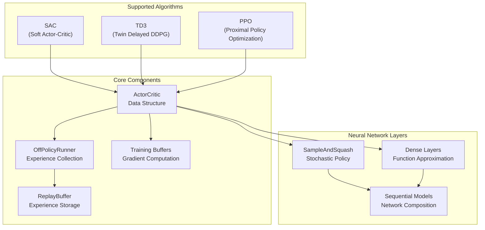
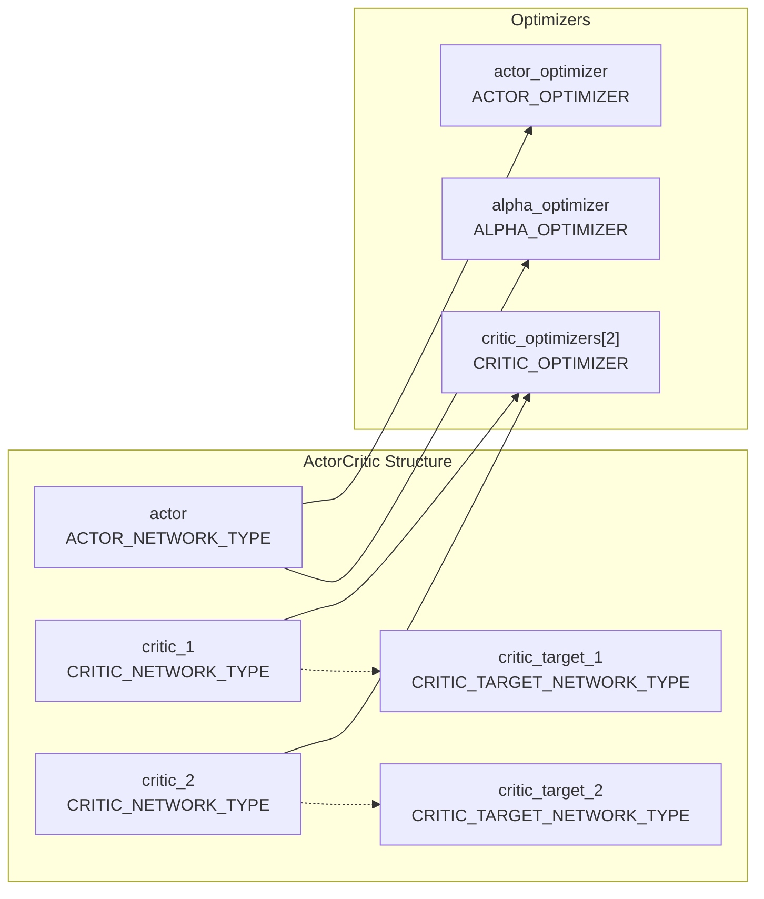
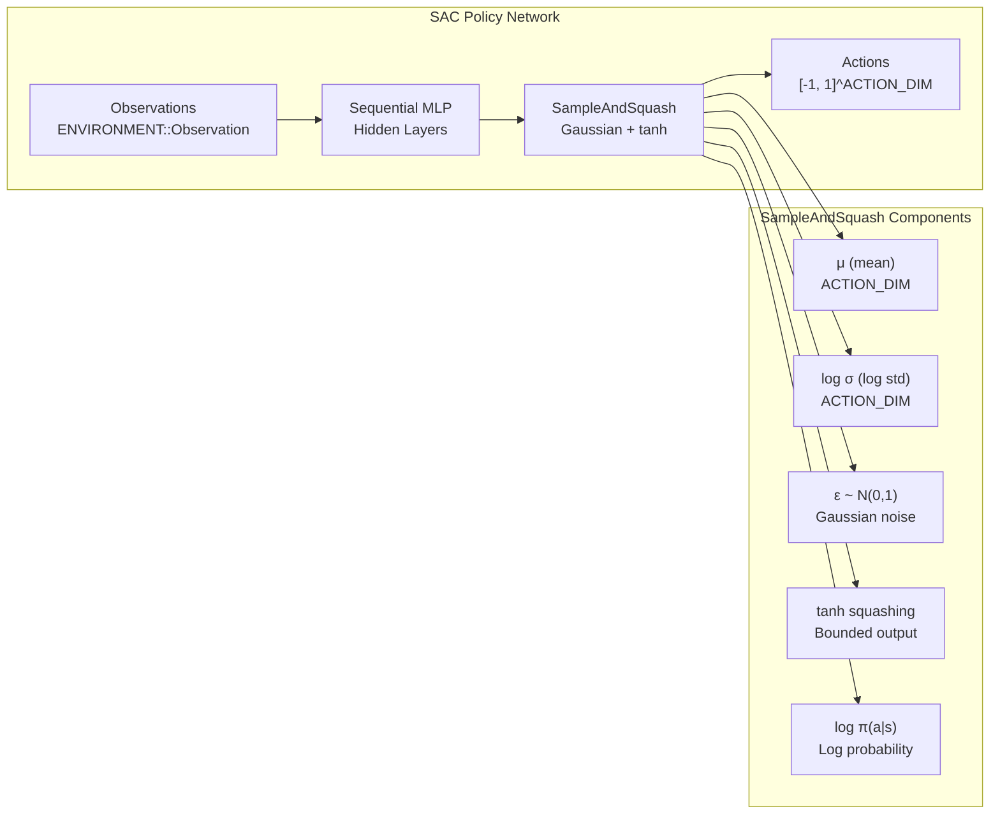
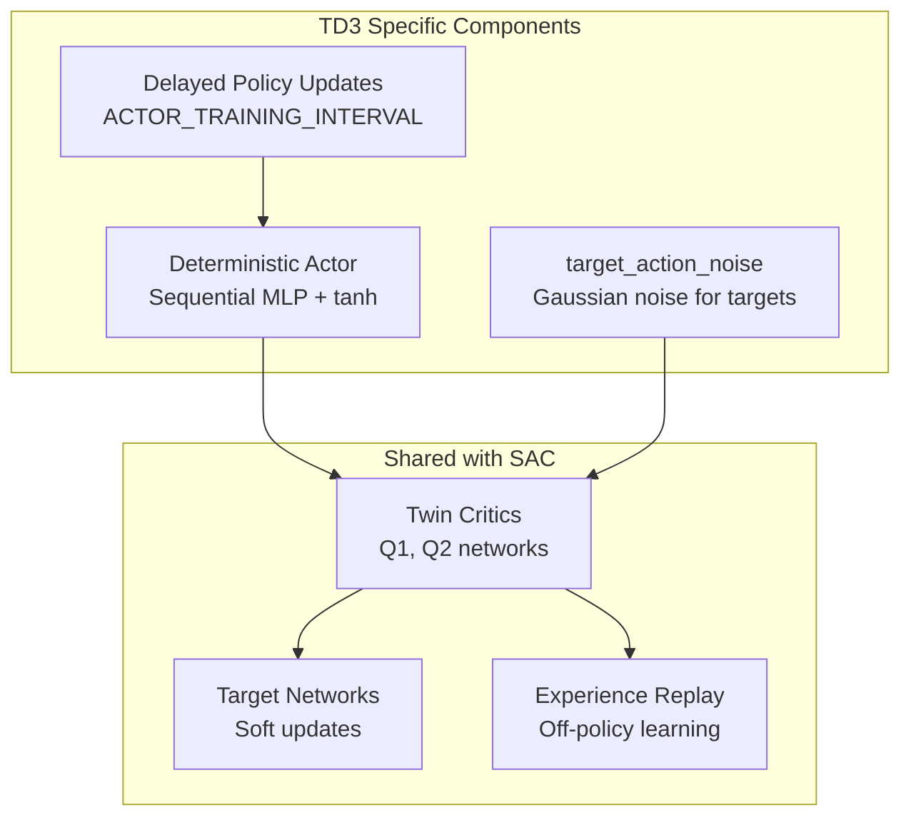
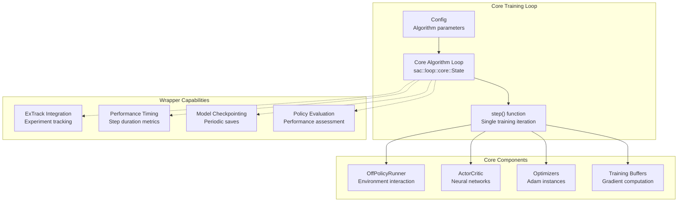
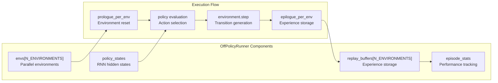

<!-- source: DeepWiki mcp.deepwiki.com · repo rl-tools/rl-tools · page 2 Reinforcement Learning Algorithms · fetched 2026-10-30 -->

# Reinforcement Learning Algorithms

<details>
<summary>Relevant source files</summary>

The following files were used as context for generating this wiki page:

- [include/rl_tools/nn/layers/sample_and_squash/layer.h](include/rl_tools/nn/layers/sample_and_squash/layer.h)
- [include/rl_tools/nn/layers/sample_and_squash/operations_generic.h](include/rl_tools/nn/layers/sample_and_squash/operations_generic.h)
- [include/rl_tools/rl/algorithms/ppo/loop/core/config.h](include/rl_tools/rl/algorithms/ppo/loop/core/config.h)
- [include/rl_tools/rl/algorithms/ppo/loop/core/operations_generic.h](include/rl_tools/rl/algorithms/ppo/loop/core/operations_generic.h)
- [include/rl_tools/rl/algorithms/ppo/loop/core/state.h](include/rl_tools/rl/algorithms/ppo/loop/core/state.h)
- [include/rl_tools/rl/algorithms/ppo/operations_generic.h](include/rl_tools/rl/algorithms/ppo/operations_generic.h)
- [include/rl_tools/rl/algorithms/ppo/ppo.h](include/rl_tools/rl/algorithms/ppo/ppo.h)
- [include/rl_tools/rl/algorithms/sac/loop/core/config.h](include/rl_tools/rl/algorithms/sac/loop/core/config.h)
- [include/rl_tools/rl/algorithms/sac/loop/core/operations_generic.h](include/rl_tools/rl/algorithms/sac/loop/core/operations_generic.h)
- [include/rl_tools/rl/algorithms/sac/loop/core/state.h](include/rl_tools/rl/algorithms/sac/loop/core/state.h)
- [include/rl_tools/rl/algorithms/sac/operations_generic.h](include/rl_tools/rl/algorithms/sac/operations_generic.h)
- [include/rl_tools/rl/algorithms/sac/sac.h](include/rl_tools/rl/algorithms/sac/sac.h)
- [include/rl_tools/rl/algorithms/td3/loop/core/config.h](include/rl_tools/rl/algorithms/td3/loop/core/config.h)
- [include/rl_tools/rl/algorithms/td3/loop/core/operations_generic.h](include/rl_tools/rl/algorithms/td3/loop/core/operations_generic.h)
- [include/rl_tools/rl/algorithms/td3/loop/core/state.h](include/rl_tools/rl/algorithms/td3/loop/core/state.h)
- [include/rl_tools/rl/algorithms/td3/operations_generic.h](include/rl_tools/rl/algorithms/td3/operations_generic.h)
- [include/rl_tools/rl/algorithms/td3/td3.h](include/rl_tools/rl/algorithms/td3/td3.h)
- [include/rl_tools/rl/components/off_policy_runner/off_policy_runner.h](include/rl_tools/rl/components/off_policy_runner/off_policy_runner.h)
- [include/rl_tools/rl/components/off_policy_runner/operations_generic.h](include/rl_tools/rl/components/off_policy_runner/operations_generic.h)
- [include/rl_tools/rl/components/off_policy_runner/operations_generic_per_env.h](include/rl_tools/rl/components/off_policy_runner/operations_generic_per_env.h)
- [include/rl_tools/rl/components/on_policy_runner/on_policy_runner.h](include/rl_tools/rl/components/on_policy_runner/on_policy_runner.h)
- [include/rl_tools/rl/components/on_policy_runner/operations_generic.h](include/rl_tools/rl/components/on_policy_runner/operations_generic.h)
- [include/rl_tools/rl/components/on_policy_runner/operations_generic_per_env.h](include/rl_tools/rl/components/on_policy_runner/operations_generic_per_env.h)
- [include/rl_tools/rl/components/running_normalizer/running_normalizer.h](include/rl_tools/rl/components/running_normalizer/running_normalizer.h)
- [src/rl/environments/pendulum/ppo/cpu/CMakeLists.txt](src/rl/environments/pendulum/ppo/cpu/CMakeLists.txt)
- [src/rl/environments/pendulum/ppo/cpu/config.h](src/rl/environments/pendulum/ppo/cpu/config.h)
- [src/rl/environments/pendulum/ppo/cpu/training.cpp](src/rl/environments/pendulum/ppo/cpu/training.cpp)
- [src/rl/environments/pendulum/ppo/cuda/CMakeLists.txt](src/rl/environments/pendulum/ppo/cuda/CMakeLists.txt)
- [src/rl/environments/pendulum/ppo/cuda/training.cu](src/rl/environments/pendulum/ppo/cuda/training.cu)

</details>


This document covers the reinforcement learning algorithms implemented in RLtools, including their core components, training procedures, and modular training loop architecture. For neural network implementation details, see [Neural Network Components](#3). For environment interfaces, see [Environments](#4).

## Algorithm Overview

RLtools implements several state-of-the-art deep reinforcement learning algorithms, with comprehensive support for off-policy actor-critic methods. The framework provides modular implementations that can be configured for different environments and computational backends.



**Sources:** [include/rl_tools/rl/algorithms/sac/sac.h:9-151](), [include/rl_tools/rl/algorithms/td3/loop/core/config.h:16-94](), [include/rl_tools/rl/components/off_policy_runner/off_policy_runner.h:18-226]()

## Actor-Critic Architecture

All implemented algorithms use actor-critic architectures with separate networks for policy (actor) and value function estimation (critic). The `ActorCritic` data structure serves as the central container for network components and optimizers.



The twin critic design (used in SAC and TD3) helps reduce overestimation bias by taking the minimum of two Q-value estimates. Target networks provide stable training targets through soft updates.

**Sources:** [include/rl_tools/rl/algorithms/sac/sac.h:127-149](), [include/rl_tools/rl/algorithms/sac/operations_generic.h:449-453]()

## SAC Implementation Details

Soft Actor-Critic implements maximum entropy reinforcement learning with automatic temperature adjustment. The algorithm optimizes a stochastic policy while maintaining exploration through entropy regularization.

### Policy Parameterization

SAC uses a `SampleAndSquash` layer to parameterize stochastic policies with bounded actions:



The `SampleAndSquash` layer implements the reparameterization trick for gradient computation through stochastic policies.

**Sources:** [include/rl_tools/nn/layers/sample_and_squash/operations_generic.h:115-173](), [include/rl_tools/rl/algorithms/sac/operations_generic.h:227-251]()

### Training Procedure

SAC training alternates between critic and actor updates with automatic entropy temperature adjustment:

```mermaid
sequenceDiagram
    participant Env as "Environment"
    participant Runner as "OffPolicyRunner"
    participant Buffer as "ReplayBuffer" 
    participant SAC as "SAC Algorithm"
    participant Critic as "train_critic"
    participant Actor as "train_actor"
    
    Env->>Runner: step environment
    Runner->>Buffer: store transition
    Buffer->>SAC: gather_batch
    
    Note over SAC: Every CRITIC_TRAINING_INTERVAL steps
    SAC->>Critic: train twin critics
    Critic->>Critic: MSE loss vs target Q-values
    
    Note over SAC: Every ACTOR_TRAINING_INTERVAL steps  
    SAC->>Actor: train actor + entropy
    Actor->>Actor: Policy gradient + entropy bonus
    
    Note over SAC: Every TARGET_UPDATE_INTERVAL steps
    SAC->>SAC: update_critic_targets (Polyak)
```

**Sources:** [include/rl_tools/rl/algorithms/sac/loop/core/operations_generic.h:112-140](), [include/rl_tools/rl/algorithms/sac/operations_generic.h:210-283]()

### Entropy Regularization

SAC automatically adjusts the entropy coefficient α through a separate optimization objective:

| Component | Purpose | Implementation |
|-----------|---------|----------------|
| `log_alpha` | Learnable temperature parameter | `LayerGradient.log_alpha` |
| `alpha_optimizer` | Updates entropy coefficient | `ActorCritic.alpha_optimizer` |
| Target entropy | Desired exploration level | `PARAMETERS::TARGET_ENTROPY = -ACTION_DIM` |

**Sources:** [include/rl_tools/rl/algorithms/sac/sac.h:26-32](), [include/rl_tools/nn/layers/sample_and_squash/operations_generic.h:316-338]()

## TD3 Implementation Details

Twin Delayed Deep Deterministic Policy Gradient adds several stabilization techniques to the DDPG algorithm, including delayed policy updates and target action noise.

### Key Differences from SAC

| Feature | SAC | TD3 |
|---------|-----|-----|
| Policy Type | Stochastic (Gaussian) | Deterministic |
| Action Space | Continuous | Continuous |
| Exploration | Entropy regularization | Target policy noise |
| Policy Updates | Every step | Delayed (every 2 steps) |
| Output Layer | `SampleAndSquash` | Standard `Dense` with tanh |



**Sources:** [include/rl_tools/rl/algorithms/td3/loop/core/config.h:20-88](), [include/rl_tools/rl/algorithms/td3/loop/core/operations_generic.h:85-115]()

## Training Loop Architecture

RLtools implements a modular training loop architecture where core algorithm loops are enhanced with additional capabilities through wrapper configurations.



### Training State Management

The `State` structure contains all components needed for algorithm execution:

| Component | Type | Purpose |
|-----------|------|---------|
| `actor_critic` | `ACTOR_CRITIC_TYPE` | Main algorithm networks |
| `off_policy_runner` | `OffPolicyRunner` | Environment interaction |
| `critic_batch` | `SequentialBatch` | Critic training data |
| `actor_training_buffers` | `ActorTrainingBuffers` | Gradient computation workspace |
| `rng` | Random number generator | Stochastic sampling |

**Sources:** [include/rl_tools/rl/algorithms/sac/loop/core/state.h:13-38](), [include/rl_tools/rl/algorithms/sac/loop/core/operations_generic.h:100-149]()

## Off-Policy Runner System

The `OffPolicyRunner` manages environment interaction, experience collection, and replay buffer management for off-policy algorithms.



### Batch Collection

The runner supports both standard and sequential batch collection for different algorithm requirements:

| Batch Type | Use Case | Key Features |
|------------|----------|--------------|
| `Batch` | Standard RL | Independent transitions |
| `SequentialBatch` | RNN policies | Temporal sequences with reset handling |

**Sources:** [include/rl_tools/rl/components/off_policy_runner/off_policy_runner.h:74-154](), [include/rl_tools/rl/components/off_policy_runner/operations_generic.h:232-257](), [include/rl_tools/rl/components/off_policy_runner/operations_generic_per_env.h:8-88]()

---

