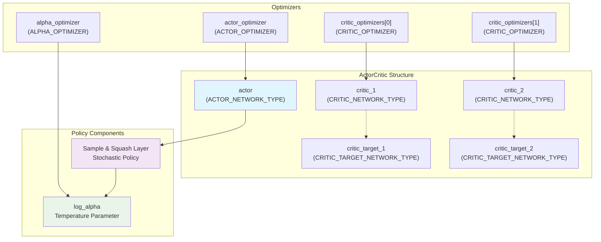
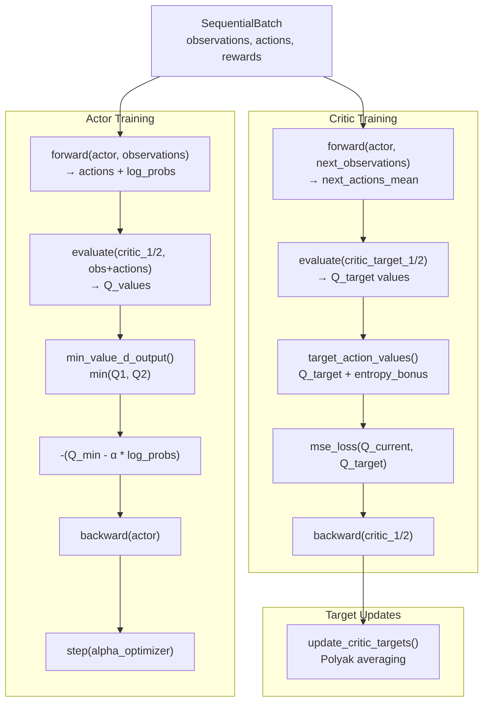
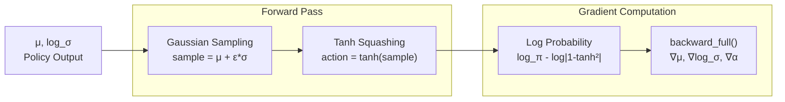

<!-- source: DeepWiki mcp.deepwiki.com · repo rl-tools/rl-tools · page 2.1 Soft Actor-Critic (SAC) · fetched 2026-10-30 -->

# Soft Actor-Critic (SAC)

Relevant source files

The following files were used as context for generating this wiki page:

- [include/rl_tools/nn/layers/sample_and_squash/layer.h](include/rl_tools/nn/layers/sample_and_squash/layer.h)
- [include/rl_tools/nn/layers/sample_and_squash/operations_generic.h](include/rl_tools/nn/layers/sample_and_squash/operations_generic.h)
- [include/rl_tools/rl/algorithms/sac/loop/core/config.h](include/rl_tools/rl/algorithms/sac/loop/core/config.h)
- [include/rl_tools/rl/algorithms/sac/loop/core/operations_generic.h](include/rl_tools/rl/algorithms/sac/loop/core/operations_generic.h)
- [include/rl_tools/rl/algorithms/sac/loop/core/state.h](include/rl_tools/rl/algorithms/sac/loop/core/state.h)
- [include/rl_tools/rl/algorithms/sac/operations_generic.h](include/rl_tools/rl/algorithms/sac/operations_generic.h)
- [include/rl_tools/rl/algorithms/sac/sac.h](include/rl_tools/rl/algorithms/sac/sac.h)
- [include/rl_tools/rl/algorithms/td3/loop/core/config.h](include/rl_tools/rl/algorithms/td3/loop/core/config.h)
- [include/rl_tools/rl/algorithms/td3/loop/core/operations_generic.h](include/rl_tools/rl/algorithms/td3/loop/core/operations_generic.h)
- [include/rl_tools/rl/algorithms/td3/loop/core/state.h](include/rl_tools/rl/algorithms/td3/loop/core/state.h)
- [include/rl_tools/rl/algorithms/td3/operations_generic.h](include/rl_tools/rl/algorithms/td3/operations_generic.h)
- [include/rl_tools/rl/algorithms/td3/td3.h](include/rl_tools/rl/algorithms/td3/td3.h)
- [include/rl_tools/rl/components/off_policy_runner/off_policy_runner.h](include/rl_tools/rl/components/off_policy_runner/off_policy_runner.h)
- [include/rl_tools/rl/components/off_policy_runner/operations_generic.h](include/rl_tools/rl/components/off_policy_runner/operations_generic.h)
- [include/rl_tools/rl/components/off_policy_runner/operations_generic_per_env.h](include/rl_tools/rl/components/off_policy_runner/operations_generic_per_env.h)
- [include/rl_tools/rl/loop/steps/extrack/operations_cpu.h](include/rl_tools/rl/loop/steps/extrack/operations_cpu.h)
- [include/rl_tools/rl/loop/steps/extrack/state.h](include/rl_tools/rl/loop/steps/extrack/state.h)
- [src/rl/environments/l2f/dr_sac/CMakeLists.txt](src/rl/environments/l2f/dr_sac/CMakeLists.txt)
- [src/rl/environments/l2f/dr_sac/l2f_dr_sac.cpp](src/rl/environments/l2f/dr_sac/l2f_dr_sac.cpp)
- [src/rl/zoo/CMakeLists.txt](src/rl/zoo/CMakeLists.txt)
- [src/rl/zoo/l2f/environment_tiny.h](src/rl/zoo/l2f/environment_tiny.h)
- [src/rl/zoo/l2f/plot_learning_curves.py](src/rl/zoo/l2f/plot_learning_curves.py)
- [src/rl/zoo/l2f/sac.h](src/rl/zoo/l2f/sac.h)
- [src/rl/zoo/l2f/sac_tiny.h](src/rl/zoo/l2f/sac_tiny.h)
- [src/rl/zoo/zoo.cpp](src/rl/zoo/zoo.cpp)
- [src/rl/zoo/zoo_cli.cpp](src/rl/zoo/zoo_cli.cpp)

This document covers the Soft Actor-Critic (SAC) algorithm implementation in RLtools, including the actor-critic architecture, training procedures, and entropy regularization mechanisms. For information about training loops and experiment management, see [Training Loops](#2.4). For neural network components used in SAC, see [Neural Network Components](#3).

## Overview

SAC is an off-policy actor-critic algorithm that maximizes both expected return and policy entropy. The RLtools implementation features twin critics for value estimation, a stochastic actor with entropy regularization, and automatic temperature (alpha) tuning for balancing exploration and exploitation.

The core SAC implementation consists of an actor-critic structure with dual Q-networks, target networks for stability, and specialized training buffers for efficient batch processing.

Sources: [include/rl_tools/rl/algorithms/sac/sac.h:9-150](), [include/rl_tools/rl/algorithms/sac/operations_generic.h:16-504]()

## Core Architecture

The `ActorCritic<SPEC>` structure encapsulates all neural networks and optimizers required for SAC training. The actor uses a sample-and-squash layer for stochastic policy implementation, while twin critics provide stable value estimation.

Sources: [include/rl_tools/rl/algorithms/sac/sac.h:127-149](), [include/rl_tools/nn/layers/sample_and_squash/operations_generic.h:14-43]()

## Training Process Flow

The training alternates between critic and actor updates. Critics are trained using temporal difference targets with entropy bonuses, while the actor maximizes expected Q-values minus entropy costs.

Sources: [include/rl_tools/rl/algorithms/sac/operations_generic.h:209-283](), [include/rl_tools/rl/algorithms/sac/operations_generic.h:339-399](), [include/rl_tools/rl/algorithms/sac/operations_generic.h:449-453]()

## Sample and Squash Layer

The actor network uses a specialized `sample_and_squash` layer to implement the stochastic policy:

The layer performs reparameterized sampling from a Gaussian distribution, applies tanh squashing for bounded actions, and computes log probabilities for entropy regularization. The `backward_full` function computes gradients for both policy parameters and the temperature parameter α.

Sources: [include/rl_tools/nn/layers/sample_and_squash/operations_generic.h:115-173](), [include/rl_tools/nn/layers/sample_and_squash/operations_generic.h:248-321](), [include/rl_tools/nn/layers/sample_and_squash/operations_generic.h:322-339]()

## Training Buffers

SAC uses specialized buffer structures for efficient batch processing:

| Buffer Type | Purpose | Key Tensors |
|-------------|---------|-------------|
| `ActorTrainingBuffers` | Actor gradient computation | `state_action_value_input`, `d_actor_output`, `action_sample` |
| `CriticTrainingBuffers` | Critic loss and targets | `target_action_value`, `next_state_action_value_input`, `next_action_log_probs` |

The buffers support both sequence-based training (for recurrent networks) and batch-based training with configurable dimensions:

- `SEQUENCE_LENGTH`: Temporal dimension for RNN processing
- `BATCH_SIZE`: Number of parallel training samples  
- `ACTION_DIM`: Dimensionality of action space
- `CRITIC_OBSERVATION_DIM`: State input dimension to critics

Sources: [include/rl_tools/rl/algorithms/sac/sac.h:68-93](), [include/rl_tools/rl/algorithms/sac/sac.h:99-125]()

## Key Operations

### Critic Training
The `train_critic` function implements the core critic update:
- Evaluates target critics on next states with sampled actions
- Computes temporal difference targets with entropy bonuses  
- Uses MSE loss with optional masking for sequence endpoints
- Updates critic parameters via gradient descent

### Actor Training  
The `train_actor` function optimizes the policy:
- Samples actions from current policy for given observations
- Evaluates critics on state-action pairs
- Minimizes negative expected returns plus entropy costs
- Updates both actor parameters and temperature α

### Target Updates
The `update_critic_targets` function applies Polyak averaging:
- Soft updates target networks: `θ_target ← τ*θ + (1-τ)*θ_target`
- Maintains training stability by slowly tracking main networks
- Applied after critic training steps

Sources: [include/rl_tools/rl/algorithms/sac/operations_generic.h:209-283](), [include/rl_tools/rl/algorithms/sac/operations_generic.h:339-399](), [include/rl_tools/rl/algorithms/sac/operations_generic.h:449-453]()

## Configuration Parameters

The `DefaultParameters` structure defines key hyperparameters:

| Parameter | Purpose | Default Value |
|-----------|---------|---------------|
| `GAMMA` | Discount factor | 0.99 |
| `CRITIC_POLYAK` | Target network update rate | 0.995 |
| `ENTROPY_BONUS` | Enable entropy regularization | true |
| `ADAPTIVE_ALPHA` | Automatic temperature tuning | true |
| `TARGET_ENTROPY` | Desired entropy level | -ACTION_DIM |

The implementation supports both fixed and adaptive temperature scheduling, sequence-based training for memory environments, and configurable network architectures through template specialization.

Sources: [include/rl_tools/rl/algorithms/sac/sac.h:10-33](), [src/rl/environments/memory/sac/parameters.h:22-36]()

---

