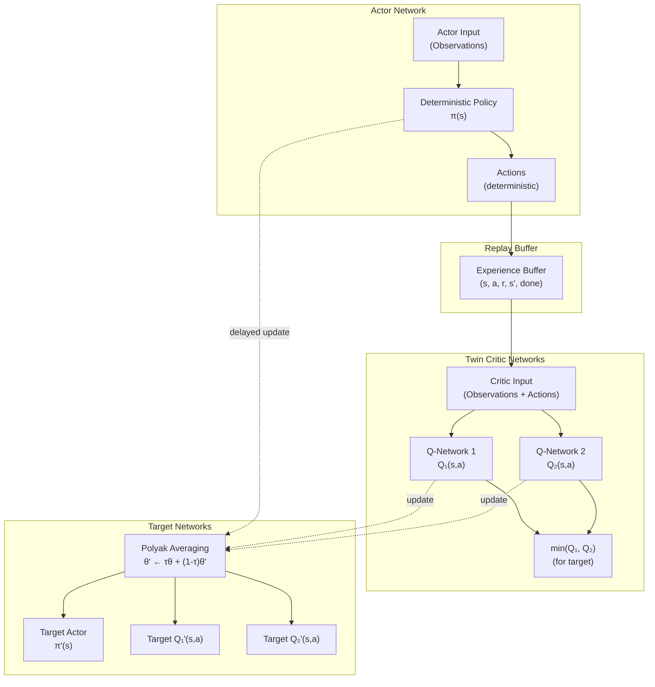
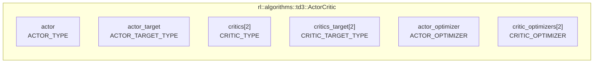
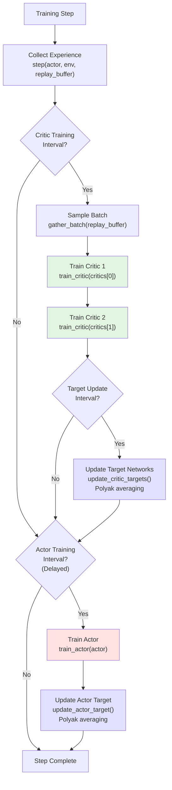
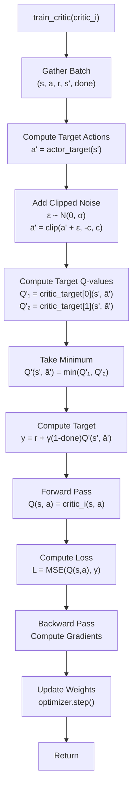
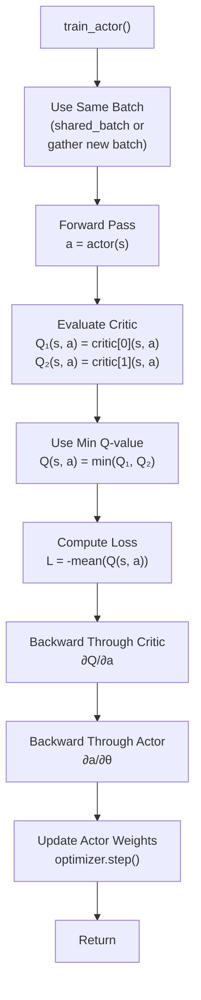
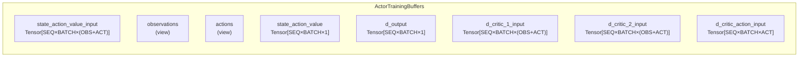
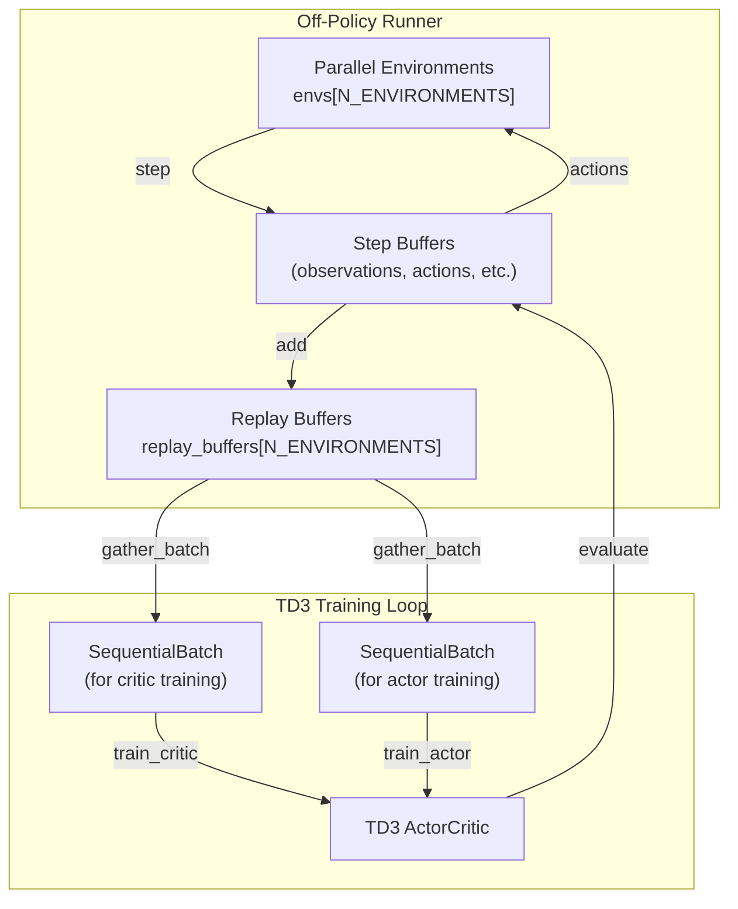
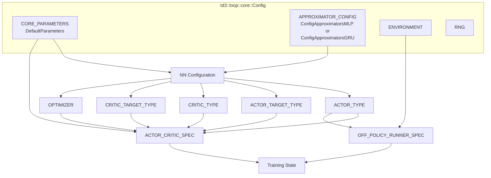

<!-- source: DeepWiki mcp.deepwiki.com · repo rl-tools/rl-tools · page 2.2 Twin Delayed DDPG (TD3) · fetched 2026-10-30 -->

# Twin Delayed DDPG (TD3)

<details>
<summary>Relevant source files</summary>

The following files were used as context for generating this wiki page:

- [include/rl_tools/nn/layers/sample_and_squash/layer.h](include/rl_tools/nn/layers/sample_and_squash/layer.h)
- [include/rl_tools/nn/layers/sample_and_squash/operations_generic.h](include/rl_tools/nn/layers/sample_and_squash/operations_generic.h)
- [include/rl_tools/rl/algorithms/sac/loop/core/config.h](include/rl_tools/rl/algorithms/sac/loop/core/config.h)
- [include/rl_tools/rl/algorithms/sac/loop/core/operations_generic.h](include/rl_tools/rl/algorithms/sac/loop/core/operations_generic.h)
- [include/rl_tools/rl/algorithms/sac/loop/core/state.h](include/rl_tools/rl/algorithms/sac/loop/core/state.h)
- [include/rl_tools/rl/algorithms/sac/operations_generic.h](include/rl_tools/rl/algorithms/sac/operations_generic.h)
- [include/rl_tools/rl/algorithms/sac/sac.h](include/rl_tools/rl/algorithms/sac/sac.h)
- [include/rl_tools/rl/algorithms/td3/loop/core/config.h](include/rl_tools/rl/algorithms/td3/loop/core/config.h)
- [include/rl_tools/rl/algorithms/td3/loop/core/operations_generic.h](include/rl_tools/rl/algorithms/td3/loop/core/operations_generic.h)
- [include/rl_tools/rl/algorithms/td3/loop/core/state.h](include/rl_tools/rl/algorithms/td3/loop/core/state.h)
- [include/rl_tools/rl/algorithms/td3/operations_generic.h](include/rl_tools/rl/algorithms/td3/operations_generic.h)
- [include/rl_tools/rl/algorithms/td3/td3.h](include/rl_tools/rl/algorithms/td3/td3.h)
- [include/rl_tools/rl/components/off_policy_runner/off_policy_runner.h](include/rl_tools/rl/components/off_policy_runner/off_policy_runner.h)
- [include/rl_tools/rl/components/off_policy_runner/operations_generic.h](include/rl_tools/rl/components/off_policy_runner/operations_generic.h)
- [include/rl_tools/rl/components/off_policy_runner/operations_generic_per_env.h](include/rl_tools/rl/components/off_policy_runner/operations_generic_per_env.h)
- [src/rl/environments/pendulum/sac/wasm/full_training.h](src/rl/environments/pendulum/sac/wasm/full_training.h)
- [src/rl/environments/pendulum/td3/arm/training.h](src/rl/environments/pendulum/td3/arm/training.h)
- [tests/src/nn/default_network_mlp.h](tests/src/nn/default_network_mlp.h)
- [tests/src/nn/full_training_mlp.cpp](tests/src/nn/full_training_mlp.cpp)
- [tests/src/nn/test_mlp.cpp](tests/src/nn/test_mlp.cpp)
- [tests/src/rl/algorithms/td3/first_stage_mlp.cpp](tests/src/rl/algorithms/td3/first_stage_mlp.cpp)
- [tests/src/rl/algorithms/td3/full_training_dummy_dep.cpp](tests/src/rl/algorithms/td3/full_training_dummy_dep.cpp)
- [tests/src/rl/algorithms/td3/second_stage_mlp.cpp](tests/src/rl/algorithms/td3/second_stage_mlp.cpp)
- [tests/src/rl/environments/pendulum/pendulum.cpp](tests/src/rl/environments/pendulum/pendulum.cpp)

</details>


## Purpose and Scope

This page documents the Twin Delayed Deep Deterministic Policy Gradient (TD3) implementation in rl_tools. TD3 is an off-policy reinforcement learning algorithm that addresses the overestimation bias in actor-critic methods through three key innovations: twin critics, delayed policy updates, and target action noise. This page covers the algorithm's architecture, training procedures, and implementation details.

For the stochastic policy variant (SAC), see [Soft Actor-Critic (SAC)](#2.1). For on-policy algorithms, see [Proximal Policy Optimization (PPO)](#2.3). For details on the training loop infrastructure shared across algorithms, see [Training Loop Architecture](#2.4) and [Off-Policy Runner](#2.5).

## Algorithm Overview

TD3 extends DDPG (Deep Deterministic Policy Gradient) with three critical modifications to improve training stability and reduce overestimation bias:

1. **Twin Critics**: Uses two Q-function networks and takes the minimum of their estimates for computing target values
2. **Delayed Policy Updates**: Updates the actor less frequently than the critics (typically every 2 critic updates)
3. **Target Policy Smoothing**: Adds clipped noise to target actions to smooth the value estimate

Unlike SAC, TD3 uses a deterministic policy and does not employ entropy regularization. The deterministic policy is represented as a neural network that directly outputs actions, typically with a `tanh` activation for bounded action spaces.

**TD3 Algorithm Architecture**



Sources: [include/rl_tools/rl/algorithms/td3/td3.h:1-100]()

## Core Data Structures

### ActorCritic Container

The `ActorCritic` structure is the central container for all TD3 components:



The structure contains:
- **actor**: The policy network that outputs deterministic actions
- **actor_target**: Target network for the actor, updated via Polyak averaging
- **critics[2]**: Two Q-function networks for estimating state-action values
- **critics_target[2]**: Target networks for the critics
- **optimizers**: Adam optimizers for actor and critics

Sources: [include/rl_tools/rl/algorithms/td3/td3.h:28-87]()

### DefaultParameters

TD3's hyperparameters are defined in the `DefaultParameters` struct:

| Parameter | Default Value | Description |
|-----------|--------------|-------------|
| `GAMMA` | 0.99 | Discount factor for future rewards |
| `ACTOR_BATCH_SIZE` | 100 | Batch size for actor training |
| `CRITIC_BATCH_SIZE` | 100 | Batch size for critic training |
| `CRITIC_TRAINING_INTERVAL` | 1 | Steps between critic updates |
| `ACTOR_TRAINING_INTERVAL` | 2 | Steps between actor updates (delayed) |
| `CRITIC_TARGET_UPDATE_INTERVAL` | 2 | Steps between critic target updates |
| `ACTOR_TARGET_UPDATE_INTERVAL` | 2 | Steps between actor target updates |
| `ACTOR_POLYAK` | 0.995 | Polyak averaging coefficient for actor |
| `CRITIC_POLYAK` | 0.995 | Polyak averaging coefficient for critics |
| `TARGET_NEXT_ACTION_NOISE_STD` | 0.2 | Standard deviation of target action noise |
| `TARGET_NEXT_ACTION_NOISE_CLIP` | 0.5 | Clipping range for target action noise |
| `IGNORE_TERMINATION` | false | Whether to ignore termination flag in Bellman update |
| `SEQUENCE_LENGTH` | 1 | Sequence length for recurrent policies (1 for MLP) |
| `MASK_NON_TERMINAL` | true | Whether to mask non-terminal steps in training |

Sources: [include/rl_tools/rl/algorithms/td3/td3.h:9-26]()

## Training Procedure

### Overall Training Flow

The TD3 training procedure follows this sequence within each training step:



The key insight is that actor updates occur less frequently (typically every 2 steps) compared to critic updates (every step), which is the "delayed" aspect of TD3.

Sources: [include/rl_tools/rl/algorithms/td3/loop/core/operations_generic.h:70-130]()

### Critic Training

The critic training procedure updates both Q-networks to minimize the temporal difference error:

**Critic Training Algorithm:**



The critic training implements the twin Q-learning update with target policy smoothing. The minimum of the two target Q-values is used to compute the TD target, reducing overestimation bias.

Sources: [include/rl_tools/rl/algorithms/td3/operations_generic.h:104-284]()

**Key Code Entities:**

- **Function**: `train_critic` at [include/rl_tools/rl/algorithms/td3/operations_generic.h:104-284]()
- **Target computation**: Uses `evaluate` on `actor_target` and `critics_target` 
- **Target smoothing**: Adds Gaussian noise clipped to `[-TARGET_NEXT_ACTION_NOISE_CLIP, TARGET_NEXT_ACTION_NOISE_CLIP]`
- **Minimum Q-value**: Computed element-wise between `Q'₁` and `Q'₂` at [include/rl_tools/rl/algorithms/td3/operations_generic.h:187-195]()
- **Loss function**: MSE between predicted Q-values and TD targets

### Actor Training

The actor training procedure updates the policy to maximize the Q-value:

**Actor Training Algorithm:**



The actor is trained to maximize the expected Q-value. The gradient flows backward through the critic to the actor, using only the minimum of the two Q-values.

Sources: [include/rl_tools/rl/algorithms/td3/operations_generic.h:286-379]()

**Key Code Entities:**

- **Function**: `train_actor` at [include/rl_tools/rl/algorithms/td3/operations_generic.h:286-379]()
- **Deterministic evaluation**: Actor forward pass produces deterministic actions
- **Critic evaluation**: Both critics evaluate the actions from the actor
- **Minimum selection**: Uses the minimum Q-value for gradient computation at [include/rl_tools/rl/algorithms/td3/operations_generic.h:334-343]()
- **Gradient computation**: Backpropagates through both critic and actor networks

### Target Network Updates

Target networks are updated using Polyak averaging (soft updates):

**Polyak Averaging:**

θ'ₜₐᵣ𝓰ₑₜ ← τ θcurrent + (1 - τ) θ'ₜₐᵣ𝓰ₑₜ

where τ is typically 0.005 (specified by `ACTOR_POLYAK` and `CRITIC_POLYAK` parameters).

**Target Update Functions:**

| Function | Purpose | Parameters Updated | Code Location |
|----------|---------|-------------------|---------------|
| `update_critic_targets` | Updates both critic target networks | `critics_target[0]`, `critics_target[1]` | [include/rl_tools/rl/algorithms/td3/operations_generic.h:381-389]() |
| `update_actor_target` | Updates actor target network | `actor_target` | [include/rl_tools/rl/algorithms/td3/operations_generic.h:391-395]() |

The `update_target_module` template function performs the actual Polyak averaging recursively for all layers in the network:

Sources: [include/rl_tools/rl/algorithms/sac/operations_generic.h:487-522]()

## Training Buffers and Batch Structures

TD3 uses specialized buffer structures for efficient training:

### CriticTrainingBuffers

```mermaid
graph LR
    subgraph CriticTrainingBuffers["CriticTrainingBuffers<SPEC>"]
        NextStateActionInput["next_state_action_value_input<br/>Tensor[SEQ×BATCH×(OBS+ACT)]"]
        NextObs["next_observations<br/>(view)"]
        NextAct["next_actions<br/>(view)"]
        ActionValue["action_value<br/>Tensor[SEQ×BATCH×1]"]
        TargetActionValue["target_action_value<br/>Tensor[SEQ×BATCH×1]"]
        NextQ1["next_state_action_value_critic_1<br/>Tensor[TARGET_SEQ×BATCH×1]"]
        NextQ2["next_state_action_value_critic_2<br/>Tensor[TARGET_SEQ×BATCH×1]"]
        TargetNoise["target_next_action_noise<br/>Matrix[TARGET_SEQ×BATCH, ACT]"]
        Gradients["d_output, d_input<br/>(gradient tensors)"]
    end
```



The `CriticTrainingBuffers` stores intermediate values during critic training:
- **next_state_action_value_input**: Combined tensor for next observations and actions
- **Views**: `next_observations` and `next_actions` are views into the combined tensor for memory efficiency
- **Q-value tensors**: Store current Q-values, target Q-values, and target Q-values from both critics
- **target_next_action_noise**: Pre-allocated noise for target policy smoothing

Sources: [include/rl_tools/rl/algorithms/td3/td3.h:89-132]()

### ActorTrainingBuffers



The `ActorTrainingBuffers` stores intermediate values during actor training, particularly the gradients flowing back from the critics to the actor.

Sources: [include/rl_tools/rl/algorithms/td3/td3.h:134-164]()

## Integration with Off-Policy Runner

TD3 integrates with the off-policy runner component for environment interaction and experience collection:



**Key Integration Points:**

1. **Experience Collection**: The runner's `step` function uses the actor to select actions
2. **Batch Sampling**: `gather_batch` samples from replay buffers into `SequentialBatch` structures
3. **Training**: Batches are passed to `train_critic` and `train_actor` functions
4. **Shared vs Separate Batches**: Can use same batch for critic and actor (`SHARED_BATCH=true`) or sample separately

Sources: [include/rl_tools/rl/algorithms/td3/loop/core/operations_generic.h:70-130](), [include/rl_tools/rl/components/off_policy_runner/operations_generic.h:214-237]()

## Configuration and Loop State

### Loop Configuration

The TD3 training loop uses a hierarchical configuration system:



**Configuration Hierarchy:**

1. **DefaultParameters**: Defines TD3 hyperparameters (learning rates, batch sizes, update intervals)
2. **ApproximatorConfig**: Specifies neural network architectures (MLP or GRU-based)
3. **ActorCriticSpec**: Combines networks and parameters into TD3 specification
4. **OffPolicyRunnerSpec**: Configures environment interaction and replay buffers

Sources: [include/rl_tools/rl/algorithms/td3/loop/core/config.h:1-107]()

### Training State

The `State` structure contains all mutable components needed during training:

**State Components:**

| Component | Type | Purpose |
|-----------|------|---------|
| `actor_critic` | `ActorCritic<SPEC>` | Main TD3 networks and optimizers |
| `off_policy_runner` | `OffPolicyRunner<SPEC>` | Environment interaction and replay buffers |
| `critic_batch` | `SequentialBatch<CRITIC_BATCH_SPEC>` | Batch for critic training |
| `actor_batch` | `SequentialBatch<ACTOR_BATCH_SPEC>` | Batch for actor training |
| `critic_training_buffers` | `CriticTrainingBuffers<SPEC>` | Intermediate tensors for critic training |
| `actor_training_buffers` | `ActorTrainingBuffers<SPEC>` | Intermediate tensors for actor training |
| `critic_buffers[2]` | `CRITIC_TYPE::Buffer<>` | Network buffers for critics |
| `actor_buffers[2]` | `ACTOR_TYPE::Buffer<>` | Network buffers for actor |
| `critic_target_buffers[2]` | Target critic buffers | Network buffers for target critics |
| `actor_target_buffers[2]` | Target actor buffers | Network buffers for target actor |
| `envs[]` | `ENVIRONMENT[]` | Environment instances |
| `rng` | `RNG` | Random number generator |
| `step` | `TI` | Current training step counter |

Sources: [include/rl_tools/rl/algorithms/td3/loop/core/state.h:1-45]()

## Key Operations and Functions

### Memory Management

**Allocation and Initialization:**

| Operation | Function | Description |
|-----------|----------|-------------|
| Allocation | `malloc(device, actor_critic)` | Allocates memory for all networks, optimizers, and buffers |
| Initialization | `init(device, actor_critic, rng)` | Initializes network weights, optimizer states, and copies to target networks |
| Deallocation | `free(device, actor_critic)` | Frees all allocated memory |

Sources: [include/rl_tools/rl/algorithms/td3/operations_generic.h:20-43]()

### Training Step Function

The core training step is implemented in the `step` function:

```cpp
template <typename DEVICE, typename T_CONFIG>
bool step(DEVICE& device, rl::algorithms::td3::loop::core::State<T_CONFIG>& ts)
```

**Step Execution Flow:**

1. **Check warmup**: Use exploration policy if `step < N_WARMUP_STEPS`, otherwise use trained actor
2. **Collect experience**: Call `step` on off-policy runner to interact with environment
3. **Critic training**: If at critic training interval, sample batch and call `train_critic` for both critics
4. **Target updates**: If at target update interval, update target networks via Polyak averaging
5. **Actor training** (delayed): If at actor training interval, sample batch and call `train_actor`
6. **Increment step counter**

Sources: [include/rl_tools/rl/algorithms/td3/loop/core/operations_generic.h:70-130]()

### Comparison: TD3 vs SAC

While both are off-policy actor-critic algorithms, they differ in key ways:

| Aspect | TD3 | SAC |
|--------|-----|-----|
| **Policy Type** | Deterministic | Stochastic (Gaussian) |
| **Policy Output** | Direct actions via tanh | Mean and log-std for Gaussian distribution |
| **Exploration** | Additive Gaussian noise (during rollout) | Inherent stochastic sampling |
| **Entropy** | No entropy term | Entropy regularization with adaptive temperature α |
| **Target Smoothing** | Noise added to target actions | No explicit target smoothing |
| **Update Frequency** | Delayed actor updates (every 2 steps) | Actor and critic updated every step |
| **Special Layers** | None (standard MLP/Sequential) | `sample_and_squash` layer for policy |

**Code Differences:**

- TD3 actor output layer typically uses `tanh` activation: [tests/src/rl/algorithms/td3/first_stage_mlp.cpp:118]()
- SAC actor requires `sample_and_squash` layer: [include/rl_tools/nn/layers/sample_and_squash/layer.h:1-100]()
- TD3 uses `TARGET_NEXT_ACTION_NOISE_STD` and `TARGET_NEXT_ACTION_NOISE_CLIP`: [include/rl_tools/rl/algorithms/td3/td3.h:21-22]()
- SAC uses `ALPHA`, `ADAPTIVE_ALPHA`, and `TARGET_ENTROPY`: [include/rl_tools/rl/algorithms/sac/sac.h:27-29]()

Sources: [include/rl_tools/rl/algorithms/td3/td3.h:9-26](), [include/rl_tools/rl/algorithms/sac/sac.h:10-33]()

## Usage Example

Here's a concrete example of setting up and training a TD3 agent:

**Network Configuration:**

```cpp
// Define network architectures
using ACTOR_NETWORK_SPEC = rlt::nn_models::mlp::Configuration<
    TYPE_POLICY, DEVICE::index_t, 
    ENVIRONMENT::ACTION_DIM,  // output dim
    3,                        // num layers
    64,                       // hidden dim
    rlt::nn::activation_functions::RELU,
    rlt::nn::activation_functions::TANH  // bounded actions
>;

using CRITIC_NETWORK_SPEC = rlt::nn_models::mlp::Configuration<
    TYPE_POLICY, DEVICE::index_t,
    1,                        // Q-value output
    3,                        // num layers  
    64,                       // hidden dim
    rlt::nn::activation_functions::RELU,
    rlt::nn::activation_functions::IDENTITY
>;
```

**TD3 Setup:**

```cpp
// Create TD3 specification
using TD3_SPEC = rlt::rl::algorithms::td3::Specification<
    TYPE_POLICY, TI, ENVIRONMENT,
    ACTOR_TYPE, ACTOR_TARGET_TYPE,
    CRITIC_TYPE, CRITIC_TARGET_TYPE,
    OPTIMIZER, TD3_PARAMETERS
>;

// Instantiate actor-critic
rlt::rl::algorithms::td3::ActorCritic<TD3_SPEC> actor_critic;

// Allocate and initialize
rlt::malloc(device, actor_critic);
rlt::init(device, actor_critic, rng);
```

**Training Loop:**

```cpp
// Setup off-policy runner
OffPolicyRunner<SPEC> runner;
rlt::malloc(device, runner);
rlt::init(device, runner);

// Training loop
for(int step = 0; step < NUM_STEPS; step++) {
    // Collect experience
    if(step < WARMUP_STEPS) {
        step<0>(device, runner, exploration_policy, buffers, rng);
    } else {
        step<1>(device, runner, actor_critic.actor, buffers, rng);
    }
    
    // Train critics
    if(step >= WARMUP_STEPS && step % CRITIC_INTERVAL == 0) {
        gather_batch(device, runner, critic_batch, rng);
        train_critic(device, actor_critic, actor_critic.critics[0], 
                    critic_batch, actor_critic.critic_optimizers[0], 
                    actor_buffers, critic_buffers, 
                    critic_training_buffers, rng);
        train_critic(device, actor_critic, actor_critic.critics[1], 
                    critic_batch, actor_critic.critic_optimizers[1],
                    actor_buffers, critic_buffers,
                    critic_training_buffers, rng);
    }
    
    // Update targets
    if(step % TARGET_UPDATE_INTERVAL == 0) {
        update_critic_targets(device, actor_critic);
    }
    
    // Train actor (delayed)
    if(step % ACTOR_INTERVAL == 0) {
        gather_batch(device, runner, actor_batch, rng);
        train_actor(device, actor_critic, actor_batch,
                   actor_critic.actor_optimizer, 
                   actor_buffers, critic_buffers,
                   actor_training_buffers, rng);
        update_actor_target(device, actor_critic);
    }
}
```

Sources: [tests/src/rl/algorithms/td3/full_training_dummy_dep.cpp:1-200](), [include/rl_tools/rl/algorithms/td3/loop/core/operations_generic.h:70-130]()

## Advanced Features

### Sequence Support for Recurrent Policies

TD3 supports recurrent policies (GRU-based) through the `SEQUENCE_LENGTH` parameter:

- When `SEQUENCE_LENGTH = 1`: Standard MLP policies (Markovian)
- When `SEQUENCE_LENGTH > 1`: Recurrent policies with GRU layers for partial observability

The `SequentialBatch` structure handles variable-length sequences with proper reset masking:

Sources: [include/rl_tools/rl/components/off_policy_runner/off_policy_runner.h:79-99](), [include/rl_tools/rl/algorithms/td3/td3.h:24]()

### Static Memory Allocation

TD3 can be configured for static memory allocation suitable for embedded systems:

- Set `T_DYNAMIC_ALLOCATION = false` in specifications
- All tensors and buffers are stack-allocated with compile-time sizes
- Enables deployment on resource-constrained platforms (ARM Cortex-M, ESP32)

Sources: [include/rl_tools/rl/algorithms/td3/loop/core/config.h:59](), [src/rl/environments/pendulum/td3/arm/training.h:1-200]()

### Non-Terminal Masking

The `MASK_NON_TERMINAL` parameter controls gradient masking for sequences:

- When enabled, gradients are only backpropagated through final steps in sequences
- Prevents undefined memory issues in sequences with variable lengths
- Essential when using sequence lengths > 1 with episode resets

Sources: [include/rl_tools/rl/algorithms/td3/td3.h:25]()

---

