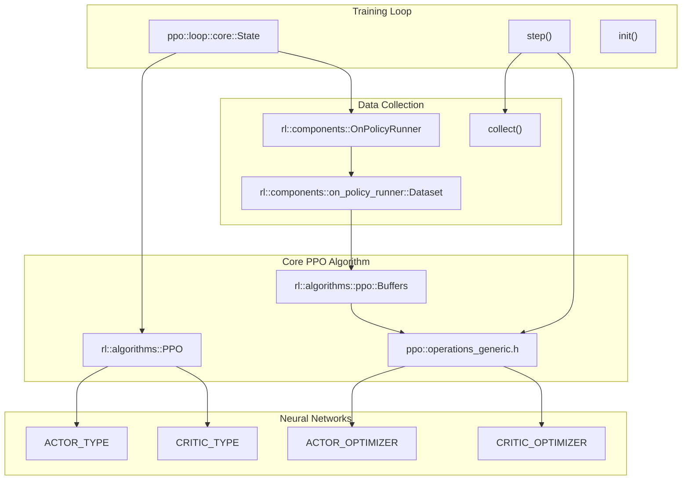
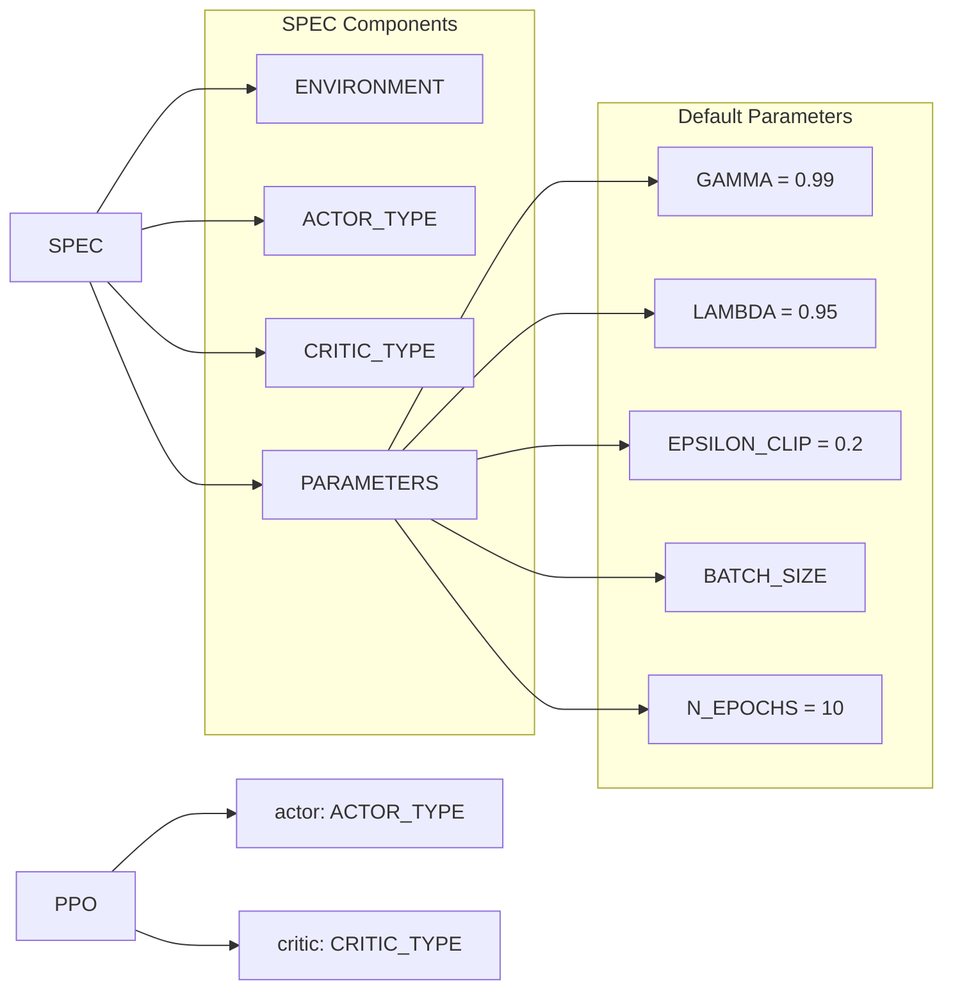
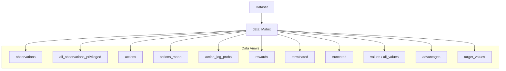
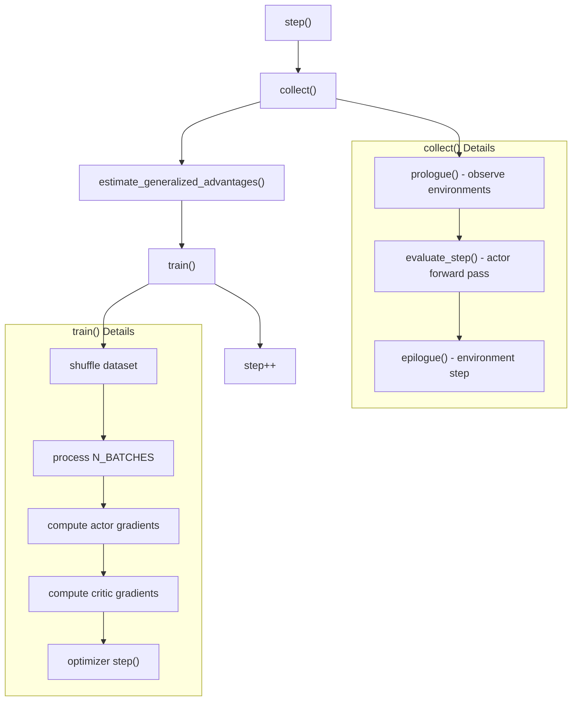
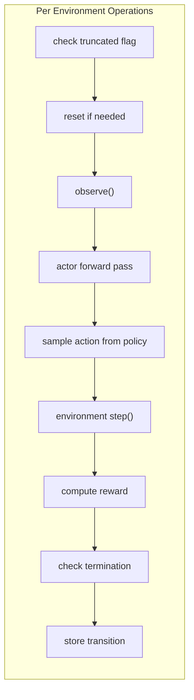
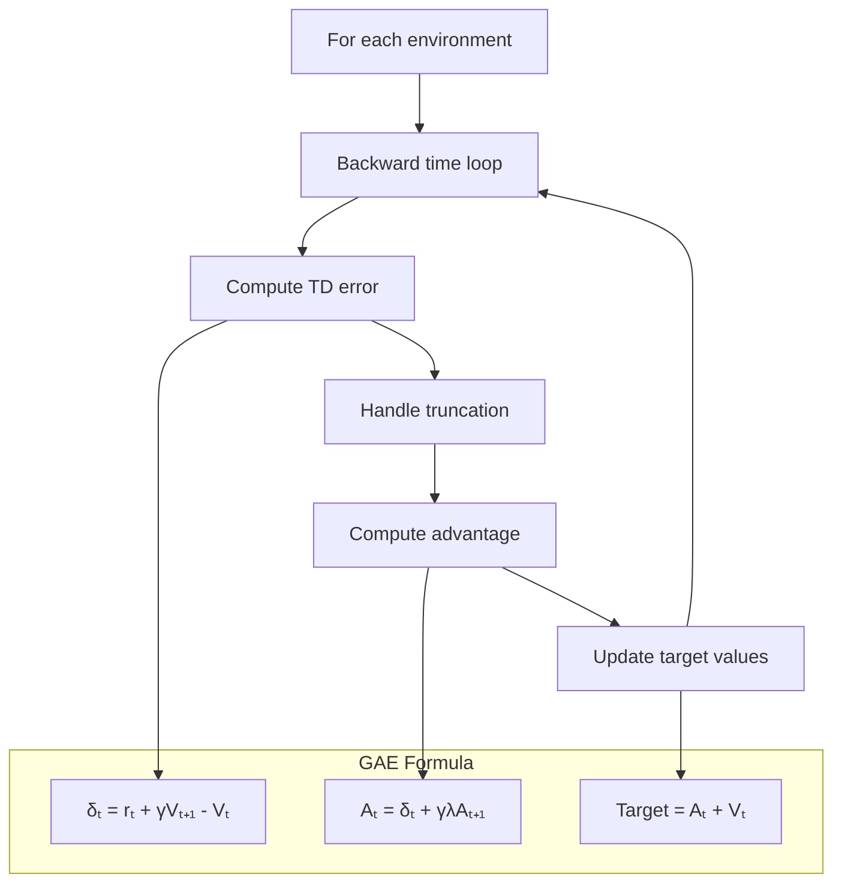
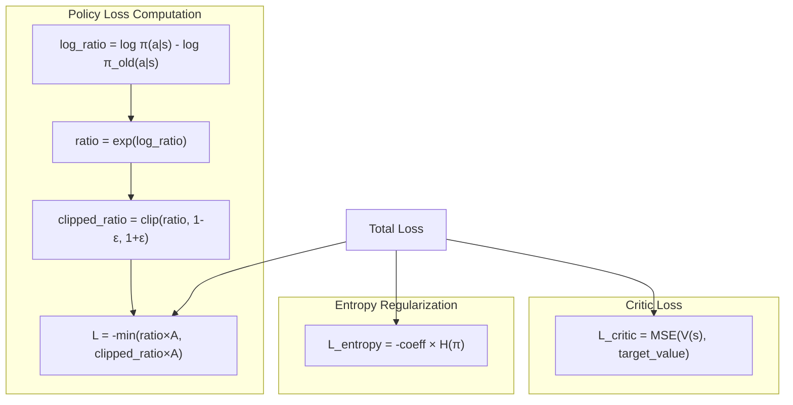
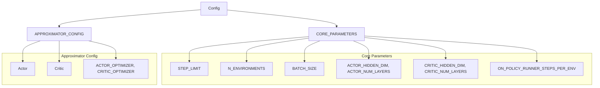
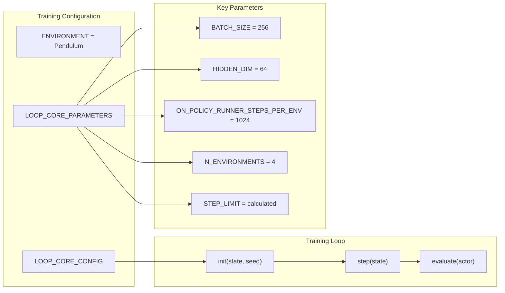

<!-- source: DeepWiki mcp.deepwiki.com · repo rl-tools/rl-tools · page 2.3 Proximal Policy Optimization (PPO) · fetched 2026-10-30 -->

# Proximal Policy Optimization (PPO)

Relevant source files

The following files were used as context for generating this wiki page:

- [include/rl_tools/rl/algorithms/ppo/loop/core/config.h](include/rl_tools/rl/algorithms/ppo/loop/core/config.h)
- [include/rl_tools/rl/algorithms/ppo/loop/core/operations_generic.h](include/rl_tools/rl/algorithms/ppo/loop/core/operations_generic.h)
- [include/rl_tools/rl/algorithms/ppo/loop/core/state.h](include/rl_tools/rl/algorithms/ppo/loop/core/state.h)
- [include/rl_tools/rl/algorithms/ppo/operations_generic.h](include/rl_tools/rl/algorithms/ppo/operations_generic.h)
- [include/rl_tools/rl/algorithms/ppo/ppo.h](include/rl_tools/rl/algorithms/ppo/ppo.h)
- [include/rl_tools/rl/components/on_policy_runner/on_policy_runner.h](include/rl_tools/rl/components/on_policy_runner/on_policy_runner.h)
- [include/rl_tools/rl/components/on_policy_runner/operations_generic.h](include/rl_tools/rl/components/on_policy_runner/operations_generic.h)
- [include/rl_tools/rl/components/on_policy_runner/operations_generic_per_env.h](include/rl_tools/rl/components/on_policy_runner/operations_generic_per_env.h)
- [include/rl_tools/rl/components/running_normalizer/running_normalizer.h](include/rl_tools/rl/components/running_normalizer/running_normalizer.h)
- [include/rl_tools/rl/environments/l2f/multirotor.h](include/rl_tools/rl/environments/l2f/multirotor.h)
- [include/rl_tools/rl/environments/l2f/operations_cpu.h](include/rl_tools/rl/environments/l2f/operations_cpu.h)
- [include/rl_tools/rl/environments/l2f/operations_generic.h](include/rl_tools/rl/environments/l2f/operations_generic.h)
- [include/rl_tools/rl/environments/l2f/operations_generic/10_sample_initial_parameters.h](include/rl_tools/rl/environments/l2f/operations_generic/10_sample_initial_parameters.h)
- [include/rl_tools/rl/environments/l2f/operations_generic/30_sample_initial_state.h](include/rl_tools/rl/environments/l2f/operations_generic/30_sample_initial_state.h)
- [include/rl_tools/rl/environments/l2f/operations_generic/70_post_integration.h](include/rl_tools/rl/environments/l2f/operations_generic/70_post_integration.h)
- [include/rl_tools/rl/environments/l2f/operations_multitask_generic.h](include/rl_tools/rl/environments/l2f/operations_multitask_generic.h)
- [include/rl_tools/rl/environments/l2f/operations_multitask_generic_forward.h](include/rl_tools/rl/environments/l2f/operations_multitask_generic_forward.h)
- [include/rl_tools/rl/environments/l2f/parameters/default.h](include/rl_tools/rl/environments/l2f/parameters/default.h)
- [include/rl_tools/rl/environments/l2f/parameters/trajectories/lissajous.h](include/rl_tools/rl/environments/l2f/parameters/trajectories/lissajous.h)
- [src/rl/environments/pendulum/ppo/cpu/CMakeLists.txt](src/rl/environments/pendulum/ppo/cpu/CMakeLists.txt)
- [src/rl/environments/pendulum/ppo/cpu/config.h](src/rl/environments/pendulum/ppo/cpu/config.h)
- [src/rl/environments/pendulum/ppo/cpu/training.cpp](src/rl/environments/pendulum/ppo/cpu/training.cpp)
- [src/rl/environments/pendulum/ppo/cuda/CMakeLists.txt](src/rl/environments/pendulum/ppo/cuda/CMakeLists.txt)
- [src/rl/environments/pendulum/ppo/cuda/training.cu](src/rl/environments/pendulum/ppo/cuda/training.cu)
- [src/rl/zoo/l2f/environment.h](src/rl/zoo/l2f/environment.h)
- [src/rl/zoo/l2f/environment_big.h](src/rl/zoo/l2f/environment_big.h)
- [src/rl/zoo/l2f/ppo.h](src/rl/zoo/l2f/ppo.h)
- [src/rl/zoo/l2f/sac_big.h](src/rl/zoo/l2f/sac_big.h)

This document covers the Proximal Policy Optimization (PPO) algorithm implementation in RLtools, including its core data structures, training loop architecture, and key algorithmic components. PPO is an on-policy reinforcement learning algorithm that uses a clipped surrogate objective and generalized advantage estimation.

For information about other RL algorithms, see [Soft Actor-Critic (SAC)](#2.1) and [Twin Delayed DDPG (TD3)](#2.2). For details about the modular training loop system, see [Training Loops](#2.4).

## Architecture Overview

The PPO implementation follows a modular design with separate components for policy networks, value networks, on-policy data collection, and training logic. The system supports both single-agent and multi-agent environments with observation normalization and adaptive learning rates.

### PPO System Components

Sources: [include/rl_tools/rl/algorithms/ppo/ppo.h:82-94](), [include/rl_tools/rl/algorithms/ppo/loop/core/state.h:14-41](), [include/rl_tools/rl/components/on_policy_runner/on_policy_runner.h:72-89]()

## Core Data Structures

### PPO Algorithm Structure

The main PPO algorithm is defined in `rl::algorithms::PPO<SPEC>` and contains actor and critic networks:

Sources: [include/rl_tools/rl/algorithms/ppo/ppo.h:82-94](), [include/rl_tools/rl/algorithms/ppo/ppo.h:13-34]()

### On-Policy Data Collection

The `OnPolicyRunner` manages multiple environment instances and collects trajectories:

| Component | Type | Purpose |
|-----------|------|---------|
| `environments` | `Matrix<ENVIRONMENT, 1, N_ENVIRONMENTS>` | Environment instances |
| `states` | `Matrix<ENVIRONMENT::State, 1, N_ENVIRONMENTS>` | Current environment states |
| `episode_step` | `Matrix<TI, 1, N_ENVIRONMENTS>` | Steps in current episodes |
| `episode_return` | `Matrix<T, 1, N_ENVIRONMENTS>` | Accumulated returns |
| `truncated` | `Matrix<bool, 1, N_ENVIRONMENTS>` | Episode termination flags |

The `Dataset` structure stores collected trajectories with all necessary information for PPO training:

Sources: [include/rl_tools/rl/components/on_policy_runner/on_policy_runner.h:34-65](), [include/rl_tools/rl/components/on_policy_runner/on_policy_runner.h:72-89]()

## Training Loop Architecture

The PPO training loop follows a structured approach with data collection, advantage estimation, and policy optimization:

### Core Training Step

Sources: [include/rl_tools/rl/algorithms/ppo/loop/core/operations_generic.h:77-138](), [include/rl_tools/rl/algorithms/ppo/operations_generic.h:90-302]()

### Data Collection Process

The on-policy data collection operates on multiple environments simultaneously:

Sources: [include/rl_tools/rl/components/on_policy_runner/operations_generic_per_env.h:8-32](), [include/rl_tools/rl/components/on_policy_runner/operations_generic_per_env.h:33-75]()

## Key Algorithms

### Generalized Advantage Estimation (GAE)

The `estimate_generalized_advantages` function computes advantages using the GAE algorithm:

Sources: [include/rl_tools/rl/algorithms/ppo/operations_generic.h:53-89]()

### Clipped Surrogate Objective

The PPO training implements the clipped surrogate objective with entropy regularization:

Sources: [include/rl_tools/rl/algorithms/ppo/operations_generic.h:234-244](), [include/rl_tools/rl/algorithms/ppo/operations_generic.h:210-217]()

## Configuration System

### Default Parameters

The PPO configuration system provides flexible parameter customization:

| Parameter | Default Value | Purpose |
|-----------|---------------|---------|
| `GAMMA` | 0.99 | Discount factor |
| `LAMBDA` | 0.95 | GAE lambda parameter |
| `EPSILON_CLIP` | 0.2 | Clipping parameter |
| `N_EPOCHS` | 10 | Training epochs per update |
| `BATCH_SIZE` | Configurable | Mini-batch size |
| `INITIAL_ACTION_STD` | 0.5 | Initial action standard deviation |
| `ACTION_ENTROPY_COEFFICIENT` | 0.01 | Entropy regularization coefficient |
| `NORMALIZE_ADVANTAGE` | true | Whether to normalize advantages |

Sources: [include/rl_tools/rl/algorithms/ppo/ppo.h:13-34]()

### Loop Configuration

The training loop configuration defines network architectures and training parameters:

Sources: [include/rl_tools/rl/algorithms/ppo/loop/core/config.h:21-46](), [include/rl_tools/rl/algorithms/ppo/loop/core/config.h:48-86]()

## Usage Example

The pendulum training example demonstrates a complete PPO setup:

Sources: [src/rl/environments/pendulum/ppo/cpu/training.cpp:41-58](), [src/rl/environments/pendulum/ppo/cpu/training.cpp:68-103]()

---

