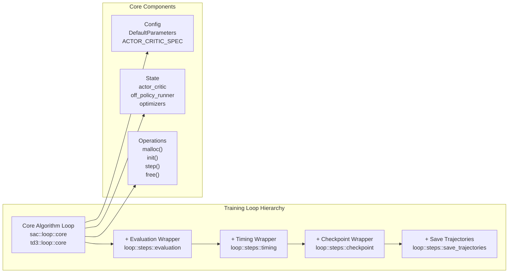
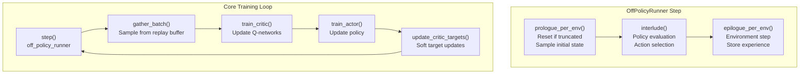
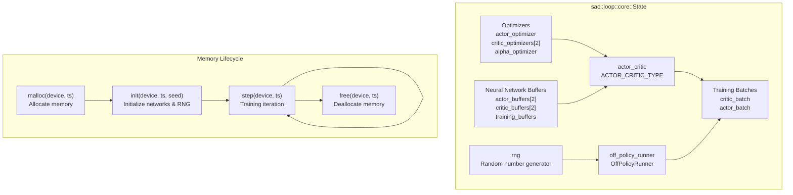
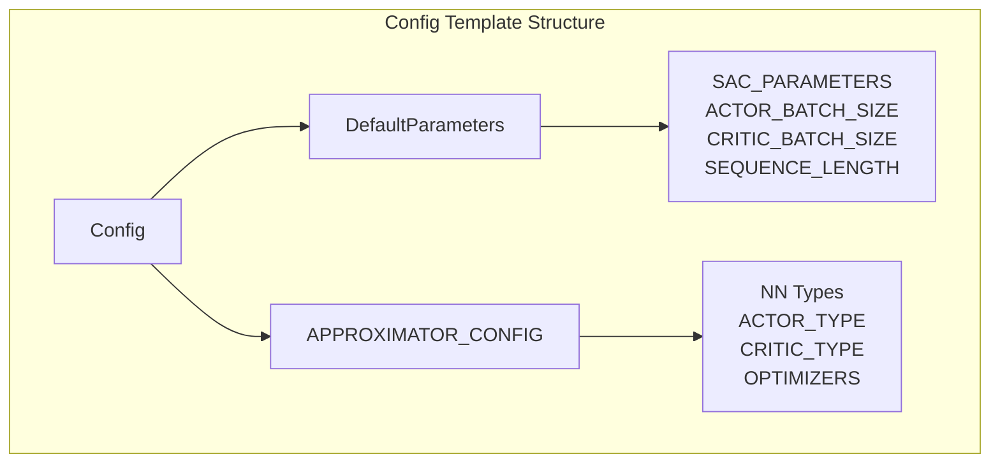
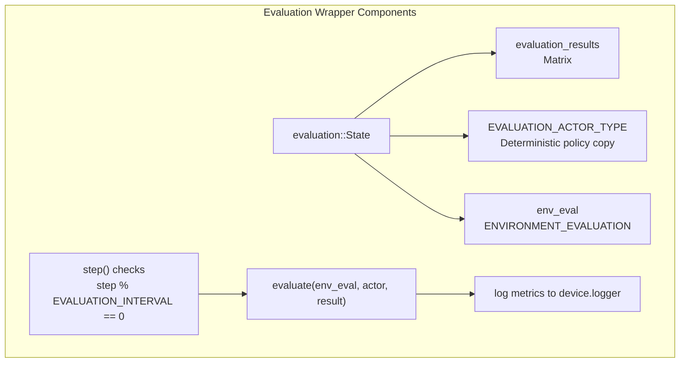
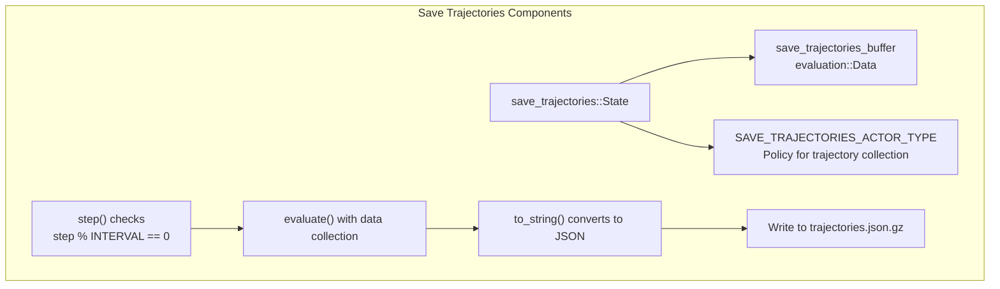
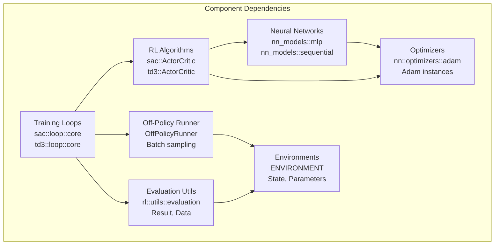

<!-- source: DeepWiki mcp.deepwiki.com · repo rl-tools/rl-tools · page 2.4 Training Loop Architecture · fetched 2026-10-30 -->

# Training Loops

<details>
<summary>Relevant source files</summary>

The following files were used as context for generating this wiki page:

- [include/rl_tools/nn/layers/sample_and_squash/layer.h](include/rl_tools/nn/layers/sample_and_squash/layer.h)
- [include/rl_tools/nn/layers/sample_and_squash/operations_generic.h](include/rl_tools/nn/layers/sample_and_squash/operations_generic.h)
- [include/rl_tools/rl/algorithms/ppo/loop/core/config.h](include/rl_tools/rl/algorithms/ppo/loop/core/config.h)
- [include/rl_tools/rl/algorithms/ppo/loop/core/operations_generic.h](include/rl_tools/rl/algorithms/ppo/loop/core/operations_generic.h)
- [include/rl_tools/rl/algorithms/ppo/loop/core/state.h](include/rl_tools/rl/algorithms/ppo/loop/core/state.h)
- [include/rl_tools/rl/algorithms/ppo/operations_generic.h](include/rl_tools/rl/algorithms/ppo/operations_generic.h)
- [include/rl_tools/rl/algorithms/ppo/ppo.h](include/rl_tools/rl/algorithms/ppo/ppo.h)
- [include/rl_tools/rl/algorithms/sac/loop/core/config.h](include/rl_tools/rl/algorithms/sac/loop/core/config.h)
- [include/rl_tools/rl/algorithms/sac/loop/core/operations_generic.h](include/rl_tools/rl/algorithms/sac/loop/core/operations_generic.h)
- [include/rl_tools/rl/algorithms/sac/loop/core/state.h](include/rl_tools/rl/algorithms/sac/loop/core/state.h)
- [include/rl_tools/rl/algorithms/sac/operations_generic.h](include/rl_tools/rl/algorithms/sac/operations_generic.h)
- [include/rl_tools/rl/algorithms/sac/sac.h](include/rl_tools/rl/algorithms/sac/sac.h)
- [include/rl_tools/rl/algorithms/td3/loop/core/config.h](include/rl_tools/rl/algorithms/td3/loop/core/config.h)
- [include/rl_tools/rl/algorithms/td3/loop/core/operations_generic.h](include/rl_tools/rl/algorithms/td3/loop/core/operations_generic.h)
- [include/rl_tools/rl/algorithms/td3/loop/core/state.h](include/rl_tools/rl/algorithms/td3/loop/core/state.h)
- [include/rl_tools/rl/algorithms/td3/operations_generic.h](include/rl_tools/rl/algorithms/td3/operations_generic.h)
- [include/rl_tools/rl/algorithms/td3/td3.h](include/rl_tools/rl/algorithms/td3/td3.h)
- [include/rl_tools/rl/components/off_policy_runner/off_policy_runner.h](include/rl_tools/rl/components/off_policy_runner/off_policy_runner.h)
- [include/rl_tools/rl/components/off_policy_runner/operations_generic.h](include/rl_tools/rl/components/off_policy_runner/operations_generic.h)
- [include/rl_tools/rl/components/off_policy_runner/operations_generic_per_env.h](include/rl_tools/rl/components/off_policy_runner/operations_generic_per_env.h)
- [include/rl_tools/rl/components/on_policy_runner/on_policy_runner.h](include/rl_tools/rl/components/on_policy_runner/on_policy_runner.h)
- [include/rl_tools/rl/components/on_policy_runner/operations_generic.h](include/rl_tools/rl/components/on_policy_runner/operations_generic.h)
- [include/rl_tools/rl/components/on_policy_runner/operations_generic_per_env.h](include/rl_tools/rl/components/on_policy_runner/operations_generic_per_env.h)
- [include/rl_tools/rl/components/running_normalizer/running_normalizer.h](include/rl_tools/rl/components/running_normalizer/running_normalizer.h)
- [src/rl/environments/pendulum/ppo/cpu/CMakeLists.txt](src/rl/environments/pendulum/ppo/cpu/CMakeLists.txt)
- [src/rl/environments/pendulum/ppo/cpu/config.h](src/rl/environments/pendulum/ppo/cpu/config.h)
- [src/rl/environments/pendulum/ppo/cpu/training.cpp](src/rl/environments/pendulum/ppo/cpu/training.cpp)
- [src/rl/environments/pendulum/ppo/cuda/CMakeLists.txt](src/rl/environments/pendulum/ppo/cuda/CMakeLists.txt)
- [src/rl/environments/pendulum/ppo/cuda/training.cu](src/rl/environments/pendulum/ppo/cuda/training.cu)

</details>


Training loops in RL-tools provide a modular framework for implementing and executing reinforcement learning algorithms. The architecture consists of core algorithm loops (SAC, TD3, PPO) that can be enhanced with additional capabilities through wrapper configurations such as evaluation, checkpointing, timing, and trajectory saving.

For information about specific algorithm implementations, see [Soft Actor-Critic (SAC)](#2.1), [Twin Delayed DDPG (TD3)](#2.2), and [Proximal Policy Optimization (PPO)](#2.3).

## Core Architecture

The training loop architecture in RL-tools follows a modular wrapper pattern where core algorithm loops are enhanced with additional capabilities through layered configurations.

### Modular Training Loop Architecture



Sources:
- [include/rl_tools/rl/algorithms/sac/loop/core/config.h:16-94]()
- [include/rl_tools/rl/algorithms/sac/loop/core/state.h:13-38]()
- [include/rl_tools/rl/algorithms/sac/loop/core/operations_generic.h:18-151]()
- [include/rl_tools/rl/loop/steps/evaluation/config.h:10-41]()
- [include/rl_tools/rl/loop/steps/save_trajectories/operations_cpu.h:22-143]()

### Core Components

Each training loop implementation consists of three main components:

1. **Config**: Defines `DefaultParameters`, network architectures, and algorithm-specific settings via templates like `Config<T_T, T_TI, T_RNG, T_ENVIRONMENT>`
2. **State**: Maintains runtime state including `actor_critic`, `off_policy_runner`, optimizers, and training buffers
3. **Operations**: Functions `malloc()`, `init()`, `step()`, and `free()` that manage the training lifecycle

## Off-Policy Training Architecture

RL-tools implements off-policy training loops for SAC and TD3 algorithms using the `OffPolicyRunner` component for environment interaction and experience collection.

### Off-Policy Runner Data Flow



Sources:
- [include/rl_tools/rl/components/off_policy_runner/operations_generic.h:199-231]()
- [include/rl_tools/rl/components/off_policy_runner/operations_generic_per_env.h:8-89]()
- [include/rl_tools/rl/algorithms/sac/loop/core/operations_generic.h:99-149]()

### Off-Policy Runner Components

The `OffPolicyRunner` manages:
- **Environment Interaction**: `prologue_per_env()`, `interlude()`, `epilogue_per_env()` functions handle the environment step cycle
- **Experience Storage**: `ReplayBuffer` stores transitions for batch sampling via `gather_batch()`
- **Policy Switching**: Template parameter `POLICY_INDEX` allows switching between exploration and learned policies
- **Episode Statistics**: Optional collection of episode returns and lengths when `COLLECT_EPISODE_STATS` is enabled

## State Management and Data Flow

The training loop state management follows a structured approach with explicit memory allocation and initialization phases.

### State Structure and Components



Sources:
- [include/rl_tools/rl/algorithms/sac/loop/core/state.h:13-38]()
- [include/rl_tools/rl/algorithms/sac/loop/core/operations_generic.h:19-97]()
- [include/rl_tools/rl/algorithms/td3/loop/core/state.h:13-34]()

## Configuration and Parameters

Each algorithm provides `DefaultParameters` structs that define training hyperparameters and network architectures. These can be customized through template specialization.

### Algorithm Configuration Comparison

| Parameter | SAC | TD3 | Description |
|-----------|-----|-----|-------------|
| `N_ENVIRONMENTS` | 1 | 1 | Number of parallel environments |
| `STEP_LIMIT` | 10000 | 10000 | Maximum training steps |
| `REPLAY_BUFFER_CAP` | STEP_LIMIT | STEP_LIMIT | Replay buffer capacity |
| `N_WARMUP_STEPS` | 100 | ACTOR_BATCH_SIZE | Steps before policy training |
| `N_WARMUP_STEPS_CRITIC` | 100 | N/A | Steps before critic training (SAC) |
| `N_WARMUP_STEPS_ACTOR` | 100 | N/A | Steps before actor training (SAC) |
| `ACTOR_HIDDEN_DIM` | 64 | 64 | Actor network hidden dimension |
| `CRITIC_HIDDEN_DIM` | 64 | 64 | Critic network hidden dimension |
| `EXPLORATION_NOISE` | N/A | 0.1 | Exploration noise std (TD3) |
| `SHARED_BATCH` | true | true | Share batches between actor/critic |

### Configuration Template Structure



Sources:
- [include/rl_tools/rl/algorithms/sac/loop/core/config.h:18-48]()
- [include/rl_tools/rl/algorithms/td3/loop/core/config.h:20-43]()
- [include/rl_tools/rl/algorithms/sac/loop/core/config.h:51-93]()
- [include/rl_tools/rl/algorithms/td3/loop/core/config.h:46-88]()

## Step Function Implementation

The `step` function encapsulates one complete training iteration. Each algorithm implements specific logic for environment interaction, experience collection, and network updates.

### SAC Step Function Logic

```mermaid
graph TD
    subgraph "SAC step() Function Flow"
        SetStep["set_step(device, device.logger, ts.step)"]
        CheckWarmup["ts.step >= N_WARMUP_STEPS?"]
        UseActor["step<1>(off_policy_runner, actor)"]
        UseExploration["step<0>(off_policy_runner, exploration_policy)"]
        
        CheckCriticTrain["ts.step >= N_WARMUP_STEPS_CRITIC<br/>AND step % CRITIC_TRAINING_INTERVAL == 0?"]
        GatherBatch["gather_batch() & randn(action_noise)"]
        TrainCritics["train_critic() for critic_1 and critic_2"]
        
        CheckTargetUpdate["step % CRITIC_TARGET_UPDATE_INTERVAL == 0?"]
        UpdateTargets["update_critic_targets()"]
        
        CheckActorTrain["ts.step >= N_WARMUP_STEPS_ACTOR<br/>AND step % ACTOR_TRAINING_INTERVAL == 0?"]
        TrainActor["train_actor()"]
        
        Increment["ts.step++"]
        CheckFinish["ts.step > STEP_LIMIT?"]
        
        SetStep --> CheckWarmup
        CheckWarmup -->|Yes| UseActor
        CheckWarmup -->|No| UseExploration
        UseActor --> CheckCriticTrain
        UseExploration --> CheckCriticTrain
        CheckCriticTrain -->|Yes| GatherBatch
        GatherBatch --> TrainCritics
        TrainCritics --> CheckTargetUpdate
        CheckCriticTrain -->|No| CheckTargetUpdate
        CheckTargetUpdate -->|Yes| UpdateTargets
        UpdateTargets --> CheckActorTrain
        CheckTargetUpdate -->|No| CheckActorTrain
        CheckActorTrain -->|Yes| TrainActor
        TrainActor --> Increment
        CheckActorTrain -->|No| Increment
        Increment --> CheckFinish
    end
```



### TD3 Step Function Logic

```mermaid
graph TD
    subgraph "TD3 step() Function Flow"
        SetStep["set_step(device, device.logger, ts.step)"]
        CheckWarmup["ts.step >= N_WARMUP_STEPS?"]
        UseActor["step<1>(off_policy_runner, actor)"]
        UseExploration["step<0>(off_policy_runner, exploration_policy)"]
        
        PrepBatch["gather_batch() & target_action_noise()"]
        
        CheckCriticTrain["step % CRITIC_TRAINING_INTERVAL == 0?"]
        TrainCritics["train_critic() for both critics"]
        
        CheckActorTrain["step % ACTOR_TRAINING_INTERVAL == 0?"]
        TrainActor["train_actor()"]
        
        CheckCriticUpdate["step % CRITIC_TARGET_UPDATE_INTERVAL == 0?"]
        UpdateCriticTargets["update_critic_targets()"]
        
        CheckActorUpdate["step % ACTOR_TARGET_UPDATE_INTERVAL == 0?"]
        UpdateActorTarget["update_actor_target()"]
        
        Increment["ts.step++"]
        CheckFinish["ts.step > STEP_LIMIT?"]
        
        SetStep --> CheckWarmup
        CheckWarmup -->|Yes| UseActor
        CheckWarmup -->|No| UseExploration
        UseActor --> PrepBatch
        UseExploration --> PrepBatch
        PrepBatch --> CheckCriticTrain
        CheckCriticTrain -->|Yes| TrainCritics
        TrainCritics --> CheckActorTrain
        CheckCriticTrain -->|No| CheckActorTrain
        CheckActorTrain -->|Yes| TrainActor
        TrainActor --> CheckCriticUpdate
        CheckActorTrain -->|No| CheckCriticUpdate
        CheckCriticUpdate -->|Yes| UpdateCriticTargets
        UpdateCriticTargets --> CheckActorUpdate
        CheckCriticUpdate -->|No| CheckActorUpdate
        CheckActorUpdate -->|Yes| UpdateActorTarget
        UpdateActorTarget --> Increment
        CheckActorUpdate -->|No| Increment
        Increment --> CheckFinish
    end
```



Sources:
- [include/rl_tools/rl/algorithms/sac/loop/core/operations_generic.h:99-149]()
- [include/rl_tools/rl/algorithms/td3/loop/core/operations_generic.h:72-125]()

## Evaluation and Trajectory Saving

The modular training loop architecture supports additional capabilities through wrapper layers for evaluation and trajectory saving.

### Evaluation Wrapper

The `loop::steps::evaluation` wrapper provides deterministic policy evaluation at specified intervals:



### Trajectory Saving Wrapper

The `loop::steps::save_trajectories` wrapper saves detailed trajectory data for analysis:



Sources:
- [include/rl_tools/rl/loop/steps/evaluation/state.h:10-26]()
- [include/rl_tools/rl/loop/steps/evaluation/operations_generic.h:47-72]()
- [include/rl_tools/rl/loop/steps/save_trajectories/state.h:11-27]()
- [include/rl_tools/rl/loop/steps/save_trajectories/operations_cpu.h:83-143]()
- [include/rl_tools/rl/utils/evaluation/operations_generic.h:60-201]()

## Example Usage

A typical training loop execution follows this pattern:

```cpp
// 1. Create state object
LOOP_STATE ts;

// 2. Allocate memory
malloc(device, ts);

// 3. Initialize state with seed
init(device, ts, seed);

// 4. Run training loop until complete
while(!step(device, ts)) {
    // Optional: custom processing between steps
}

// 5. Free memory when done
free(device, ts);
```

### Accessing Actor Networks

The training loop provides access to the trained actor network through the `get_actor()` function:

```cpp
auto actor = get_actor(ts);
// Use actor for evaluation or deployment
```

Sources:
- [include/rl_tools/rl/algorithms/sac/loop/core/state.h:40-43]()
- [include/rl_tools/rl/algorithms/td3/loop/core/state.h:36-39]()

## Performance Considerations

The training loop design in RL-tools prioritizes performance and flexibility:

1. **Memory efficiency**:
   - Explicit memory management through `malloc()`/`free()`
   - Buffer reuse where possible via `SHARED_BATCH` parameter
   - Compact state structures with minimal overhead

2. **Computational efficiency**:
   - Batched policy evaluation through `OffPolicyRunner`
   - Conditional updates based on training intervals
   - Template-based optimizations for compile-time specialization

3. **Flexibility**:
   - Configurable parameters through `DefaultParameters`
   - Support for multiple backends (CPU, CUDA) via device abstraction
   - Modular wrapper architecture for extensibility

Sources:
- [include/rl_tools/rl/algorithms/sac/loop/core/config.h:51-93]()
- [include/rl_tools/rl/algorithms/td3/loop/core/config.h:46-88]()
- [include/rl_tools/rl/components/off_policy_runner/operations_generic.h:232-257]()

## Integration with Other Components

Training loops integrate with other parts of the RL-tools library through well-defined interfaces:



Sources:
- [include/rl_tools/rl/algorithms/sac/loop/core/config.h:6-13]()
- [include/rl_tools/rl/algorithms/td3/loop/core/config.h:6-14]()
- [include/rl_tools/rl/components/off_policy_runner/off_policy_runner.h:179-223]()
- [include/rl_tools/rl/utils/evaluation/evaluation.h:11-58]()

## Conclusion

Training loops are a central component of RL-tools, providing a flexible and efficient framework for implementing reinforcement learning algorithms. The design allows for both algorithm-specific optimizations and a consistent interface across different methods. Users can customize parameters, extend functionality, and integrate with other components in the library to create tailored reinforcement learning solutions.

---

