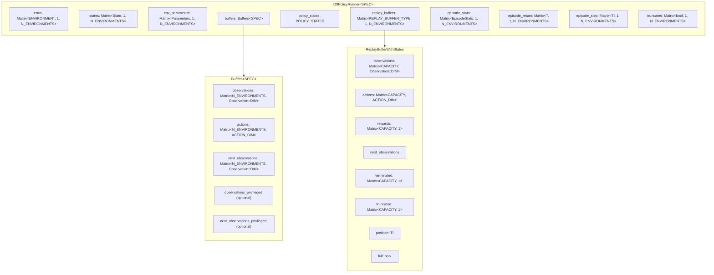
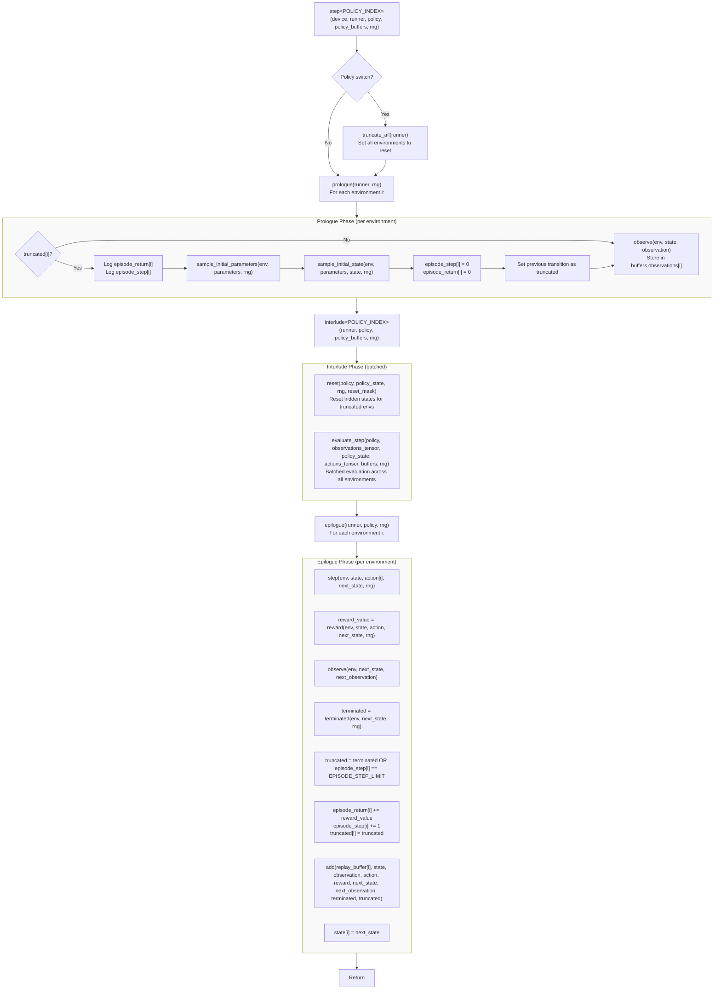
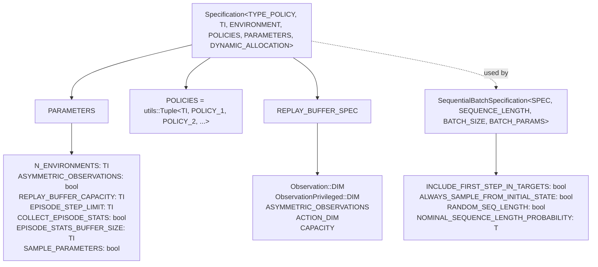
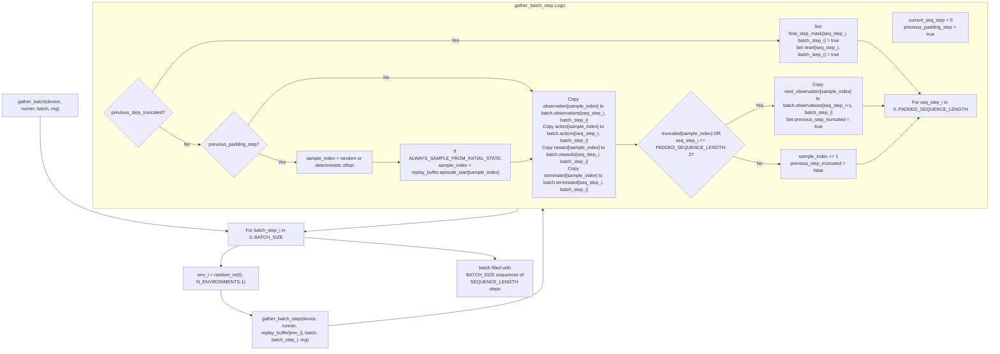
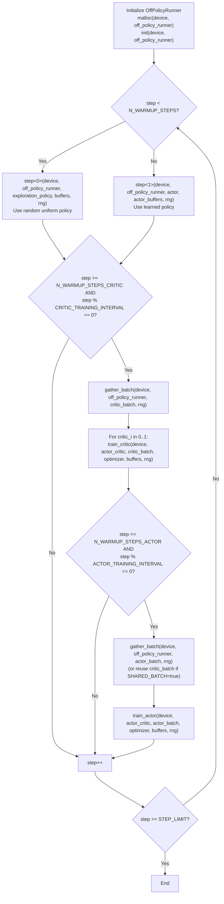

<!-- source: DeepWiki mcp.deepwiki.com · repo rl-tools/rl-tools · page 2.5 Off-Policy Runner · fetched 2026-10-30 -->

# Off-Policy Runner

<details>
<summary>Relevant source files</summary>

The following files were used as context for generating this wiki page:

- [include/rl_tools/nn/layers/sample_and_squash/layer.h](include/rl_tools/nn/layers/sample_and_squash/layer.h)
- [include/rl_tools/nn/layers/sample_and_squash/operations_generic.h](include/rl_tools/nn/layers/sample_and_squash/operations_generic.h)
- [include/rl_tools/rl/algorithms/sac/loop/core/config.h](include/rl_tools/rl/algorithms/sac/loop/core/config.h)
- [include/rl_tools/rl/algorithms/sac/loop/core/operations_generic.h](include/rl_tools/rl/algorithms/sac/loop/core/operations_generic.h)
- [include/rl_tools/rl/algorithms/sac/loop/core/state.h](include/rl_tools/rl/algorithms/sac/loop/core/state.h)
- [include/rl_tools/rl/algorithms/sac/operations_generic.h](include/rl_tools/rl/algorithms/sac/operations_generic.h)
- [include/rl_tools/rl/algorithms/sac/sac.h](include/rl_tools/rl/algorithms/sac/sac.h)
- [include/rl_tools/rl/algorithms/td3/loop/core/config.h](include/rl_tools/rl/algorithms/td3/loop/core/config.h)
- [include/rl_tools/rl/algorithms/td3/loop/core/operations_generic.h](include/rl_tools/rl/algorithms/td3/loop/core/operations_generic.h)
- [include/rl_tools/rl/algorithms/td3/loop/core/state.h](include/rl_tools/rl/algorithms/td3/loop/core/state.h)
- [include/rl_tools/rl/algorithms/td3/operations_generic.h](include/rl_tools/rl/algorithms/td3/operations_generic.h)
- [include/rl_tools/rl/algorithms/td3/td3.h](include/rl_tools/rl/algorithms/td3/td3.h)
- [include/rl_tools/rl/components/off_policy_runner/off_policy_runner.h](include/rl_tools/rl/components/off_policy_runner/off_policy_runner.h)
- [include/rl_tools/rl/components/off_policy_runner/operations_generic.h](include/rl_tools/rl/components/off_policy_runner/operations_generic.h)
- [include/rl_tools/rl/components/off_policy_runner/operations_generic_per_env.h](include/rl_tools/rl/components/off_policy_runner/operations_generic_per_env.h)
- [src/rl/environments/pendulum/sac/wasm/full_training.h](src/rl/environments/pendulum/sac/wasm/full_training.h)
- [src/rl/environments/pendulum/td3/arm/training.h](src/rl/environments/pendulum/td3/arm/training.h)
- [tests/src/nn/default_network_mlp.h](tests/src/nn/default_network_mlp.h)
- [tests/src/nn/full_training_mlp.cpp](tests/src/nn/full_training_mlp.cpp)
- [tests/src/nn/test_mlp.cpp](tests/src/nn/test_mlp.cpp)
- [tests/src/rl/algorithms/td3/first_stage_mlp.cpp](tests/src/rl/algorithms/td3/first_stage_mlp.cpp)
- [tests/src/rl/algorithms/td3/full_training_dummy_dep.cpp](tests/src/rl/algorithms/td3/full_training_dummy_dep.cpp)
- [tests/src/rl/algorithms/td3/second_stage_mlp.cpp](tests/src/rl/algorithms/td3/second_stage_mlp.cpp)
- [tests/src/rl/environments/pendulum/pendulum.cpp](tests/src/rl/environments/pendulum/pendulum.cpp)

</details>


The Off-Policy Runner is a component that manages parallel environment interaction and experience collection for off-policy reinforcement learning algorithms. It handles environment stepping, transition storage in replay buffers, and batch sampling for training. This component is used by SAC [2.1](#2.1) and TD3 [2.2](#2.2) algorithms. For on-policy data collection used with PPO, see On-Policy Runner [2.6](#2.6).

## Core Responsibilities

The Off-Policy Runner performs the following tasks:

| Responsibility | Description |
|---------------|-------------|
| **Environment Management** | Maintains N parallel environment instances with independent states |
| **Episode Lifecycle** | Handles automatic episode resets when terminal states or step limits are reached |
| **Transition Storage** | Stores (observation, action, reward, next_observation, terminated, truncated) tuples in per-environment replay buffers |
| **Batch Sampling** | Samples batches of experiences from replay buffers, supporting both single-step and sequential (recurrent) sampling |
| **Policy Evaluation** | Evaluates policies in batched mode across all environments |
| **Episode Statistics** | Optionally tracks episode returns and lengths for monitoring |

Sources: [include/rl_tools/rl/components/off_policy_runner/off_policy_runner.h:1-226]()

## Architecture Overview

The following diagram shows the main components and their relationships:



**Key Data Structures**

- **`OffPolicyRunner<SPEC>`**: Main container managing all parallel environments and replay buffers [include/rl_tools/rl/components/off_policy_runner/off_policy_runner.h:184-222]()
- **`Buffers<SPEC>`**: Temporary storage for current step's observations, actions, and next observations across all environments [include/rl_tools/rl/components/off_policy_runner/off_policy_runner.h:60-74]()
- **`ReplayBufferWithStates`**: Per-environment circular buffer storing transitions [include/rl_tools/rl/components/off_policy_runner/off_policy_runner.h:197-199]()
- **`SequentialBatch<SPEC>`**: Sampled batch with support for sequences (for recurrent policies) [include/rl_tools/rl/components/off_policy_runner/off_policy_runner.h:103-156]()

Sources: [include/rl_tools/rl/components/off_policy_runner/off_policy_runner.h:184-222](), [include/rl_tools/rl/components/off_policy_runner/off_policy_runner.h:60-74]()

## Step Execution Flow

Each call to `step()` executes a three-phase process:



**Phase Functions**

- **`prologue_per_env()`**: Resets environments when episodes end and observes initial states [include/rl_tools/rl/components/off_policy_runner/operations_generic_per_env.h:8-66]()
- **`interlude<POLICY_INDEX>()`**: Evaluates policy in batched mode, resetting hidden states for truncated environments [include/rl_tools/rl/components/off_policy_runner/operations_generic.h:189-204]()
- **`epilogue_per_env()`**: Steps environments, computes rewards, stores transitions in replay buffers [include/rl_tools/rl/components/off_policy_runner/operations_generic_per_env.h:68-109]()

Sources: [include/rl_tools/rl/components/off_policy_runner/operations_generic.h:214-237](), [include/rl_tools/rl/components/off_policy_runner/operations_generic_per_env.h:8-109]()

## Configuration and Specification

The Off-Policy Runner is configured through nested specification types:



**Key Configuration Parameters**

| Parameter | Type | Purpose |
|-----------|------|---------|
| `N_ENVIRONMENTS` | `TI` | Number of parallel environments |
| `ASYMMETRIC_OBSERVATIONS` | `bool` | If true, separate privileged observations for critic |
| `REPLAY_BUFFER_CAPACITY` | `TI` | Maximum transitions per replay buffer |
| `EPISODE_STEP_LIMIT` | `TI` | Maximum steps per episode before truncation |
| `COLLECT_EPISODE_STATS` | `bool` | Whether to track episode returns and lengths |
| `SAMPLE_PARAMETERS` | `bool` | Whether to randomize environment parameters on reset |

Sources: [include/rl_tools/rl/components/off_policy_runner/off_policy_runner.h:24-35](), [include/rl_tools/rl/components/off_policy_runner/off_policy_runner.h:36-58]()

## Sequential Batch Sampling

The Off-Policy Runner supports sampling sequences of transitions for recurrent policies (GRU-based actors/critics):



**Sequential Batch Structure**

The `SequentialBatch<SPEC>` contains:
- **`observations_base`**: Tensor of shape `(PADDED_SEQUENCE_LENGTH, BATCH_SIZE, OBSERVATION_DIM)` [include/rl_tools/rl/components/off_policy_runner/off_policy_runner.h:121]()
- **`actions_base`**: Tensor of shape `(PADDED_SEQUENCE_LENGTH, BATCH_SIZE, ACTION_DIM)` [include/rl_tools/rl/components/off_policy_runner/off_policy_runner.h:135]()
- **`observations_current`**: View into first `SEQUENCE_LENGTH` steps [include/rl_tools/rl/components/off_policy_runner/off_policy_runner.h:138]()
- **`observations_next`**: View for target network inputs (may include first step if `INCLUDE_FIRST_STEP_IN_TARGETS`) [include/rl_tools/rl/components/off_policy_runner/off_policy_runner.h:143]()
- **`reset`**: Boolean mask indicating which sequence steps require hidden state reset [include/rl_tools/rl/components/off_policy_runner/off_policy_runner.h:149]()
- **`final_step_mask`**: Boolean mask indicating final steps in sequences (for masking gradients) [include/rl_tools/rl/components/off_policy_runner/off_policy_runner.h:152]()

**Sampling Modes**

| Parameter | Effect |
|-----------|--------|
| `RANDOM_SEQ_LENGTH = true` | Each sequence randomly varies in length (1 to SEQUENCE_LENGTH) |
| `ALWAYS_SAMPLE_FROM_INITIAL_STATE = true` | All sequences start from episode beginnings |
| `INCLUDE_FIRST_STEP_IN_TARGETS = true` | Target networks see the initial observation (important for partially observable environments) |

Sources: [include/rl_tools/rl/components/off_policy_runner/operations_generic.h:238-429](), [include/rl_tools/rl/components/off_policy_runner/off_policy_runner.h:79-87]()

## Integration with Training Algorithms

The Off-Policy Runner integrates with SAC and TD3 through the training loop:



**Usage Example from SAC Loop**

The SAC training loop demonstrates typical usage:

```cpp
// Warmup phase with random exploration
if(ts.step < CONFIG::CORE_PARAMETERS::N_WARMUP_STEPS){
    typename CONFIG::EXPLORATION_POLICY exploration_policy;
    typename CONFIG::EXPLORATION_POLICY::template Buffer<> buffer;
    step<0>(device, ts.off_policy_runner, exploration_policy, buffer, ts.rng);
}
else{
    // Use learned actor policy
    step<1>(device, ts.off_policy_runner, get_actor(ts), ts.actor_buffers_eval, ts.rng);
}

// Sample batch for critic training
if(train_critic_flag){
    gather_batch(device, ts.off_policy_runner, ts.critic_batch, ts.rng);
    for(int critic_i = 0; critic_i < 2; critic_i++){
        train_critic(device, ts.actor_critic, ts.actor_critic.critics[critic_i], 
                     ts.critic_batch, ts.actor_critic.critic_optimizers[critic_i], 
                     buffers, ts.rng);
    }
}

// Sample batch for actor training
if(train_actor_flag){
    gather_batch(device, ts.off_policy_runner, ts.actor_batch, ts.rng);
    train_actor(device, ts.actor_critic, ts.actor_batch, 
                ts.actor_critic.actor_optimizer, buffers, ts.rng);
}
```

Sources: [include/rl_tools/rl/algorithms/sac/loop/core/operations_generic.h:110-156](), [include/rl_tools/rl/algorithms/td3/loop/core/operations_generic.h:63-119]()

## Policy Management with Multiple Policies

The Off-Policy Runner supports multiple policies through a tuple-based system, enabling policy switching and warm-start mechanisms:

**Policy Tuple Configuration**

```cpp
// Define multiple policies (e.g., exploration policy + learned actor)
using EXPLORATION_POLICY = nn_models::RandomUniform<EXPLORATION_POLICY_SPEC>;
using EVAL_ACTOR_TYPE = ACTOR_TYPE::template CHANGE_BATCH_SIZE<TI, N_ENVIRONMENTS>;
using POLICIES = utils::Tuple<TI, EXPLORATION_POLICY, EVAL_ACTOR_TYPE>;

// Instantiate runner with policy tuple
using OFF_POLICY_RUNNER_SPEC = rl::components::off_policy_runner::Specification<
    TYPE_POLICY, TI, ENVIRONMENT, POLICIES, OFF_POLICY_RUNNER_PARAMETERS>;
rl::components::OffPolicyRunner<OFF_POLICY_RUNNER_SPEC> runner;
```

**Policy Index Selection**

The `step<POLICY_INDEX>()` function uses compile-time policy selection:
- `step<0>(...)` executes policy at index 0 (typically exploration policy)
- `step<1>(...)` executes policy at index 1 (typically learned actor)

When switching policies, all environments are automatically truncated to ensure clean episode boundaries [include/rl_tools/rl/components/off_policy_runner/operations_generic.h:226-229]().

Sources: [include/rl_tools/rl/algorithms/sac/loop/core/config.h:67-89](), [include/rl_tools/rl/components/off_policy_runner/operations_generic.h:214-237]()

## Asymmetric Observations

For environments with privileged information available during training but not deployment, the Off-Policy Runner supports asymmetric observations:

| Observation Type | Usage | Stored In |
|-----------------|-------|-----------|
| `Observation` | Actor input (deployable) | `buffers.observations` |
| `ObservationPrivileged` | Critic input (training only) | `buffers.observations_privileged` |

Configuration requires:
1. `PARAMETERS::ASYMMETRIC_OBSERVATIONS = true`
2. Environment defining both `Observation` and `ObservationPrivileged` types
3. Critic networks with input dimension = `ObservationPrivileged::DIM + ACTION_DIM`

When enabled, the runner calls `observe()` twice per step:
```cpp
observe(device, env, parameters, state, typename ENVIRONMENT::Observation{}, observation, rng);
observe(device, env, parameters, state, typename ENVIRONMENT::ObservationPrivileged{}, 
        observation_privileged, rng);
```

Sources: [include/rl_tools/rl/components/off_policy_runner/off_policy_runner.h:55-57](), [include/rl_tools/rl/components/off_policy_runner/operations_generic_per_env.h:60-65]()

## Episode Statistics Collection

When `COLLECT_EPISODE_STATS = true`, the runner maintains a circular buffer of recent episode statistics:

**EpisodeStats Structure**

```cpp
template<typename T_SPEC>
struct EpisodeStats{
    Matrix<matrix::Specification<T, TI, BUFFER_SIZE, 2>> data;
    TI next_episode_i;
    
    // Views into data matrix
    VIEW<BUFFER_SIZE, 1> returns;  // Column 0: episode returns
    VIEW<BUFFER_SIZE, 1> steps;    // Column 1: episode lengths
};
```

Statistics are recorded at episode completion in `prologue_per_env()` [include/rl_tools/rl/components/off_policy_runner/operations_generic_per_env.h:28-42]() and can be analyzed for:
- Training progress monitoring
- Hyperparameter tuning
- Debugging convergence issues
- Population-based training

Sources: [include/rl_tools/rl/components/off_policy_runner/off_policy_runner.h:158-178](), [include/rl_tools/rl/components/off_policy_runner/operations_generic_per_env.h:28-42]()

---

