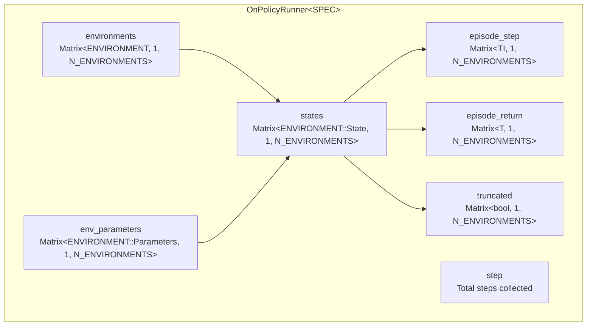
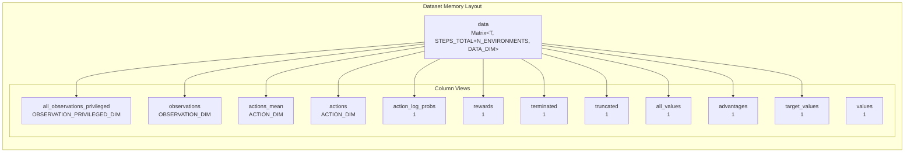
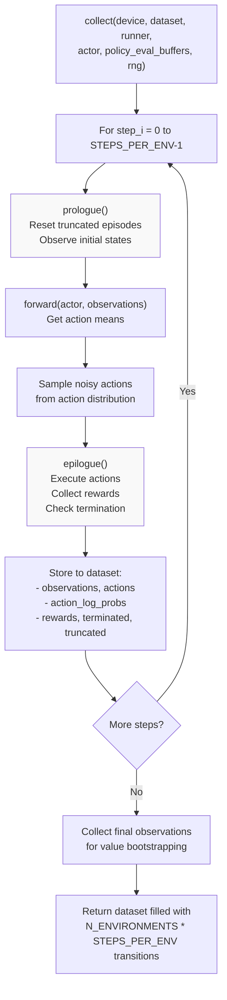
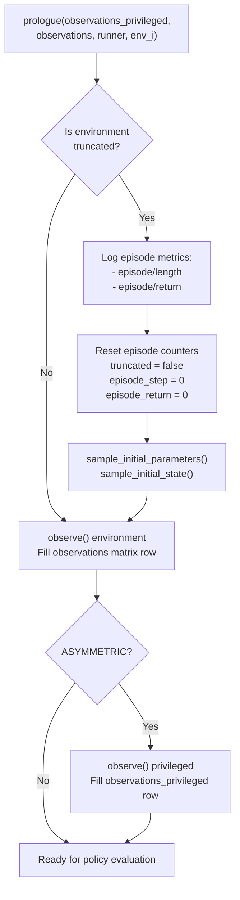
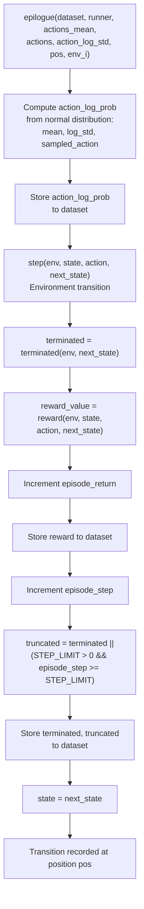
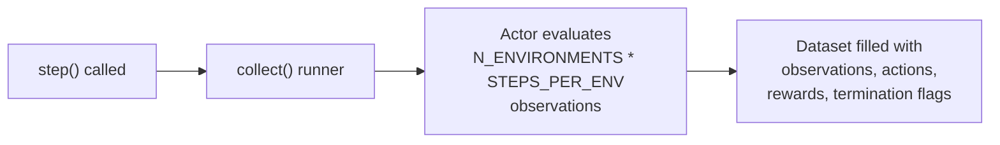
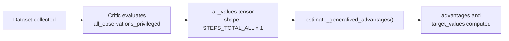
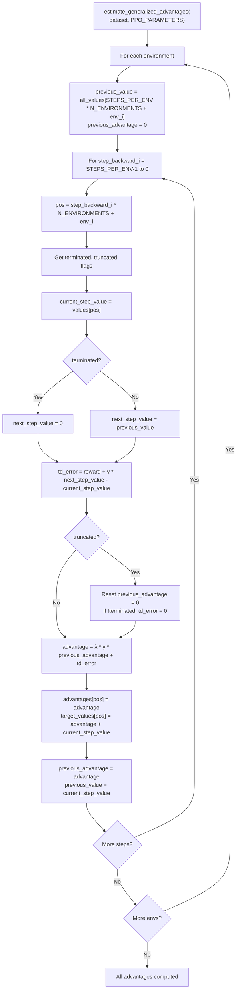
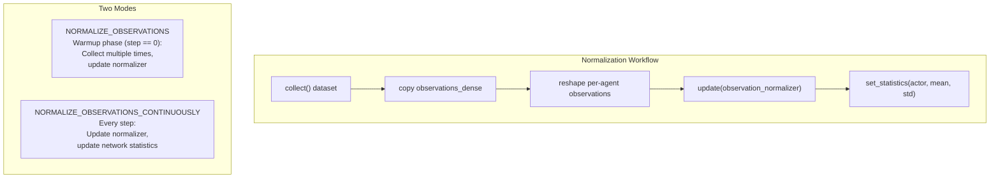
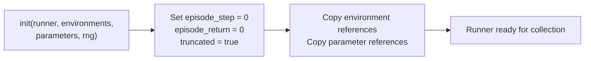

<!-- source: DeepWiki mcp.deepwiki.com · repo rl-tools/rl-tools · page 2.6 On-Policy Runner · fetched 2026-10-30 -->

# On-Policy Runner

<details>
<summary>Relevant source files</summary>

The following files were used as context for generating this wiki page:

- [include/rl_tools/rl/algorithms/ppo/loop/core/config.h](include/rl_tools/rl/algorithms/ppo/loop/core/config.h)
- [include/rl_tools/rl/algorithms/ppo/loop/core/operations_generic.h](include/rl_tools/rl/algorithms/ppo/loop/core/operations_generic.h)
- [include/rl_tools/rl/algorithms/ppo/loop/core/state.h](include/rl_tools/rl/algorithms/ppo/loop/core/state.h)
- [include/rl_tools/rl/algorithms/ppo/operations_generic.h](include/rl_tools/rl/algorithms/ppo/operations_generic.h)
- [include/rl_tools/rl/algorithms/ppo/ppo.h](include/rl_tools/rl/algorithms/ppo/ppo.h)
- [include/rl_tools/rl/components/on_policy_runner/on_policy_runner.h](include/rl_tools/rl/components/on_policy_runner/on_policy_runner.h)
- [include/rl_tools/rl/components/on_policy_runner/operations_generic.h](include/rl_tools/rl/components/on_policy_runner/operations_generic.h)
- [include/rl_tools/rl/components/on_policy_runner/operations_generic_per_env.h](include/rl_tools/rl/components/on_policy_runner/operations_generic_per_env.h)
- [include/rl_tools/rl/components/running_normalizer/running_normalizer.h](include/rl_tools/rl/components/running_normalizer/running_normalizer.h)
- [src/rl/environments/pendulum/ppo/cpu/CMakeLists.txt](src/rl/environments/pendulum/ppo/cpu/CMakeLists.txt)
- [src/rl/environments/pendulum/ppo/cpu/config.h](src/rl/environments/pendulum/ppo/cpu/config.h)
- [src/rl/environments/pendulum/ppo/cpu/training.cpp](src/rl/environments/pendulum/ppo/cpu/training.cpp)
- [src/rl/environments/pendulum/ppo/cuda/CMakeLists.txt](src/rl/environments/pendulum/ppo/cuda/CMakeLists.txt)
- [src/rl/environments/pendulum/ppo/cuda/training.cu](src/rl/environments/pendulum/ppo/cuda/training.cu)

</details>


## Purpose and Scope

The **On-Policy Runner** is a component that manages parallel environment execution and trajectory collection for on-policy reinforcement learning algorithms. It collects rollout data (observations, actions, rewards, values) from multiple environments running in parallel and organizes this data into a structured dataset for training. This component is primarily used by Proximal Policy Optimization (PPO), as described in [2.3](#2.3).

For off-policy data collection with replay buffers, see [Off-Policy Runner](#2.5).

**Sources:** [include/rl_tools/rl/components/on_policy_runner/on_policy_runner.h:1-94]()

## Core Data Structures

### OnPolicyRunner Specification and State

The `OnPolicyRunner<SPEC>` manages parallel environment instances and their execution state:



**Specification Parameters:**

| Parameter | Description |
|-----------|-------------|
| `TYPE_POLICY` | Numeric type policy for precision |
| `ENVIRONMENT` | Environment type to run |
| `N_ENVIRONMENTS` | Number of parallel environments |
| `STEP_LIMIT` | Episode step limit (0 = use environment default) |
| `N_AGENTS_PER_ENV` | Agents per environment (1 for single-agent) |
| `ASYMMETRIC_OBSERVATIONS` | Whether critic sees privileged observations |

**Sources:** [include/rl_tools/rl/components/on_policy_runner/on_policy_runner.h:11-21](), [include/rl_tools/rl/components/on_policy_runner/on_policy_runner.h:73-90]()

### Dataset Structure

The `Dataset<DATASET_SPEC>` stores collected trajectory data in a memory-efficient layout using matrix views:



**Dataset Dimensions:**
- `STEPS_TOTAL = STEPS_PER_ENV * N_ENVIRONMENTS`
- `STEPS_TOTAL_ALL = (STEPS_PER_ENV + 1) * N_ENVIRONMENTS` (extra row for final observations)
- `DATA_DIM` = sum of all view column dimensions

**Sources:** [include/rl_tools/rl/components/on_policy_runner/on_policy_runner.h:34-66](), [include/rl_tools/rl/components/on_policy_runner/operations_generic.h:12-29]()

## Data Collection Process

### Collection Function: `collect()`

The `collect()` function orchestrates data collection across all parallel environments for a fixed number of steps:



**Sources:** [include/rl_tools/rl/components/on_policy_runner/operations_generic.h:99-132]()

### Per-Environment Execution

#### Prologue: Episode Management

The `prologue()` function prepares environments before policy evaluation:



**Sources:** [include/rl_tools/rl/components/on_policy_runner/operations_generic_per_env.h:8-32]()

#### Epilogue: Environment Stepping

The `epilogue()` function executes actions and collects transition data:



**Sources:** [include/rl_tools/rl/components/on_policy_runner/operations_generic_per_env.h:34-76]()

## Integration with PPO Training Loop

### PPO Loop Step Function

The on-policy runner integrates into PPO's training step:

```mermaid
sequenceDiagram
    participant Loop as PPO Loop step()
    participant Runner as OnPolicyRunner
    participant Dataset as Dataset
    participant Actor as Actor Network
    participant Critic as Critic Network
    participant PPO as PPO train()
    
    Loop->>Runner: collect(dataset, runner, actor)
    Runner->>Actor: evaluate_step() for all environments
    Actor-->>Runner: action means
    Runner->>Dataset: Store observations, actions, rewards
    Runner-->>Loop: Dataset filled
    
    Loop->>Critic: evaluate(all_observations_privileged)
    Critic-->>Dataset: Fill all_values
    
    Loop->>Dataset: estimate_generalized_advantages()
    Dataset-->>Dataset: Compute advantages, target_values
    
    Loop->>PPO: train(ppo, dataset, optimizers)
    PPO-->>Loop: Networks updated
```

**Sources:** [include/rl_tools/rl/algorithms/ppo/loop/core/operations_generic.h:88-145]()

### Key Integration Points

**Collection Phase:**


**Value Estimation Phase:**


**Sources:** [include/rl_tools/rl/algorithms/ppo/loop/core/operations_generic.h:109-122]()

## Generalized Advantage Estimation (GAE)

The `estimate_generalized_advantages()` function computes advantages using the GAE algorithm:

### GAE Algorithm Implementation



**GAE Parameters:**
| Parameter | Typical Value | Description |
|-----------|--------------|-------------|
| `GAMMA` (γ) | 0.99 | Discount factor |
| `LAMBDA` (λ) | 0.95 | GAE lambda parameter |
| `IGNORE_TERMINATION` | false | Whether to ignore termination for advantage computation |

**Sources:** [include/rl_tools/rl/algorithms/ppo/operations_generic.h:59-95]()

## Observation Normalization

The runner supports optional observation normalization through the `RunningNormalizer` component:



**Normalization Configuration:**
```
NORMALIZE_OBSERVATIONS = true/false
NORMALIZE_OBSERVATIONS_CONTINUOUSLY = true/false
OBSERVATION_NORMALIZATION_WARMUP_STEPS (typically 1)
```

**Sources:** [include/rl_tools/rl/algorithms/ppo/loop/core/operations_generic.h:98-116]()

## Memory Management and Initialization

### Allocation Functions

**`malloc(device, runner)`** - Allocates runner state:
- environments matrix
- env_parameters matrix
- states matrix
- episode_step, episode_return, truncated matrices

**`malloc(device, dataset)`** - Allocates dataset memory:
- Single contiguous data matrix
- Creates views for all trajectory components

**Sources:** [include/rl_tools/rl/components/on_policy_runner/operations_generic.h:47-63](), [include/rl_tools/rl/components/on_policy_runner/operations_generic.h:12-29]()

### Initialization



All environments start with `truncated = true`, ensuring proper initialization on the first `prologue()` call.

**Sources:** [include/rl_tools/rl/components/on_policy_runner/operations_generic.h:64-77]()

## Complete PPO Training State

The `State<CONFIG>` in PPO's loop contains the on-policy runner and dataset:

| Component | Type | Purpose |
|-----------|------|---------|
| `on_policy_runner` | `ON_POLICY_RUNNER_TYPE` | Manages parallel environments |
| `on_policy_runner_dataset` | `ON_POLICY_RUNNER_DATASET_TYPE` | Stores collected trajectories |
| `ppo` | `PPO_TYPE` | Actor and critic networks |
| `ppo_buffers` | `PPO_BUFFERS_TYPE` | Training buffers |
| `actor_optimizer` | `ACTOR_OPTIMIZER` | Adam optimizer for actor |
| `critic_optimizer` | `CRITIC_OPTIMIZER` | Adam optimizer for critic |
| `observation_normalizer` | `RunningNormalizer` | Running mean/std for observations |
| `envs` | `Tensor<ENVIRONMENT>` | Environment instances |

**Sources:** [include/rl_tools/rl/algorithms/ppo/loop/core/state.h:14-42]()

## Configuration Example

From Pendulum PPO training configuration:

```
LOOP_CORE_PARAMETERS:
  - N_ENVIRONMENTS = 4
  - ON_POLICY_RUNNER_STEPS_PER_ENV = 1024
  - EPISODE_STEP_LIMIT = 200
  - BATCH_SIZE = 256
  
Dataset size: 4 * 1024 = 4096 transitions per collection
Number of batches: 4096 / 256 = 16 batches per epoch
```

**Sources:** [src/rl/environments/pendulum/ppo/cpu/config.h:11-28]()

## Static vs Dynamic Memory Allocation

The on-policy runner supports both allocation modes through template parameters:

**Dynamic Allocation** (`DYNAMIC_ALLOCATION = true`):
- Heap allocation via `malloc()`
- Suitable for training on desktop/server

**Static Allocation** (`DYNAMIC_ALLOCATION = false`):
- Stack or compile-time allocation
- Required for embedded deployment
- Enabled via `RL_TOOLS_STATIC_MEM` flag

**Sources:** [src/rl/environments/pendulum/ppo/cpu/training.cpp:43-47](), [include/rl_tools/rl/components/on_policy_runner/on_policy_runner.h:11-21]()

---

