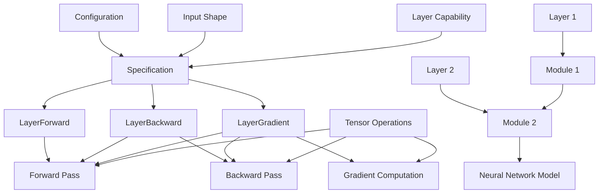
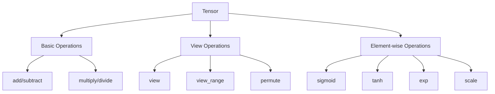
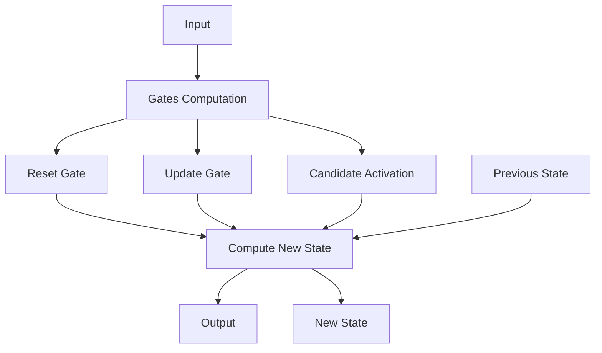
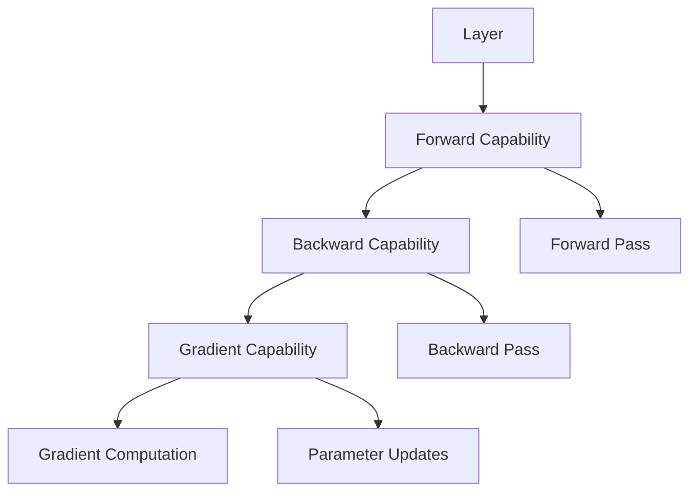
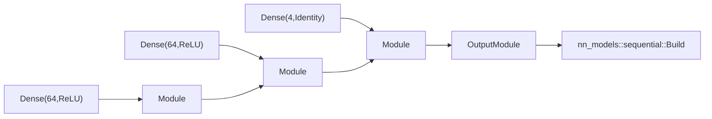
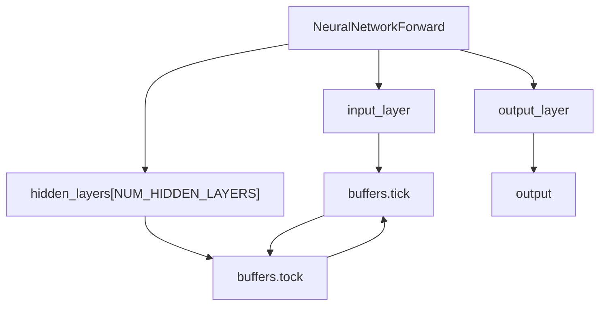

<!-- source: DeepWiki mcp.deepwiki.com · repo rl-tools/rl-tools · page 3 Neural Network Components · fetched 2026-10-30 -->

# Neural Network Components

<details>
<summary>Relevant source files</summary>

The following files were used as context for generating this wiki page:

- [include/rl_tools/containers/tensor/operations_generic.h](include/rl_tools/containers/tensor/operations_generic.h)
- [include/rl_tools/containers/tensor/tensor.h](include/rl_tools/containers/tensor/tensor.h)
- [include/rl_tools/nn/layers/embedding/layer.h](include/rl_tools/nn/layers/embedding/layer.h)
- [include/rl_tools/nn/layers/embedding/operations_generic.h](include/rl_tools/nn/layers/embedding/operations_generic.h)
- [include/rl_tools/nn/layers/gru/layer.h](include/rl_tools/nn/layers/gru/layer.h)
- [include/rl_tools/nn/layers/gru/operations_generic.h](include/rl_tools/nn/layers/gru/operations_generic.h)
- [src/rl/environments/pendulum/sac/wasm/full_training.h](src/rl/environments/pendulum/sac/wasm/full_training.h)
- [src/rl/environments/pendulum/td3/arm/training.h](src/rl/environments/pendulum/td3/arm/training.h)
- [tests/src/container/tensor.cpp](tests/src/container/tensor.cpp)
- [tests/src/nn/default_network_mlp.h](tests/src/nn/default_network_mlp.h)
- [tests/src/nn/full_training_mlp.cpp](tests/src/nn/full_training_mlp.cpp)
- [tests/src/nn/layers/gru/CMakeLists.txt](tests/src/nn/layers/gru/CMakeLists.txt)
- [tests/src/nn/layers/gru/gru.cpp](tests/src/nn/layers/gru/gru.cpp)
- [tests/src/nn/layers/gru/gru_model.h](tests/src/nn/layers/gru/gru_model.h)
- [tests/src/nn/layers/gru/gru_training.cpp](tests/src/nn/layers/gru/gru_training.cpp)
- [tests/src/nn/layers/gru/jax/jax_test.py](tests/src/nn/layers/gru/jax/jax_test.py)
- [tests/src/nn/test_mlp.cpp](tests/src/nn/test_mlp.cpp)
- [tests/src/rl/algorithms/td3/first_stage_mlp.cpp](tests/src/rl/algorithms/td3/first_stage_mlp.cpp)
- [tests/src/rl/algorithms/td3/full_training_dummy_dep.cpp](tests/src/rl/algorithms/td3/full_training_dummy_dep.cpp)
- [tests/src/rl/algorithms/td3/second_stage_mlp.cpp](tests/src/rl/algorithms/td3/second_stage_mlp.cpp)
- [tests/src/rl/environments/pendulum/pendulum.cpp](tests/src/rl/environments/pendulum/pendulum.cpp)

</details>


This document provides a comprehensive overview of the neural network components in the RL-tools library. It covers various layer types, operations, tensor handling, and model composition mechanisms that serve as building blocks for constructing neural networks used in reinforcement learning. For information about specific reinforcement learning algorithms that use these components, see [Reinforcement Learning Algorithms](#2).

## Architecture Overview

The neural network components in RL-tools follow a consistent architecture pattern designed for performance and flexibility:

**Neural Network Component Architecture**


Sources:
- [include/rl_tools/nn/layers/gru/layer.h:11-22]()
- [include/rl_tools/nn/layers/gru/layer.h:23-38]()
- [include/rl_tools/nn/layers/gru/layer.h:99-186]()
- [include/rl_tools/nn_models/sequential/operations_generic.h:10-25]()

This architecture consists of:

1. **Configuration**: Defines layer parameters (like dimensions, activation functions)
2. **Specification**: Combines Configuration with Input Shape and Capability
3. **Layer**: The implementation with Forward, Backward, or Gradient capabilities
4. **Module**: Wraps layers for sequential composition
5. **Model**: A complete neural network built from a module chain

## Tensor System

Neural network operations rely on an underlying tensor system that provides efficient multidimensional array manipulation:

**Tensor System Components**


Sources:
- [include/rl_tools/containers/tensor/tensor.h:28-62]()
- [include/rl_tools/containers/tensor/operations_generic.h:440-499]()
- [include/rl_tools/containers/tensor/operations_generic.h:67-126]()
- [include/rl_tools/containers/tensor/operations_generic.h:292-363]()

Key features of the tensor system include:

| Feature | Description | Key Functions |
|---------|-------------|---------------|
| Storage | Both static and dynamic tensor storage | `TensorStatic`, `TensorDynamic` |
| Basic Operations | Core arithmetic operations | `add`, `subtract`, `multiply`, `divide` |
| View Operations | Zero-copy access to tensor subsets | `view`, `view_range`, `permute` |
| Element-wise | Function application to each element | `sigmoid`, `tanh`, `exp`, `scale` |
| Reduction | Operations that reduce tensor dimensions | `sum`, `abs_diff`, `unary_reduce` |
| Memory | Explicit memory management | `malloc`, `free`, `copy` |

The tensor system serves as the foundation for all neural network operations, optimized for both CPU and GPU execution.

## Layer Types

RL-tools provides several specialized neural network layer types:

### GRU (Gated Recurrent Unit)

GRU is a recurrent layer for processing sequential data, featuring gates that control information flow.

**GRU Layer Structure**


Sources:
- [include/rl_tools/nn/layers/gru/layer.h:99-186]()
- [include/rl_tools/nn/layers/gru/operations_generic.h:102-114]()
- [include/rl_tools/nn/layers/gru/operations_generic.h:190-301]()
- [tests/src/nn/layers/gru/gru.cpp:74-328]()

The GRU implementation includes:
- Reset and update gates controlling information flow
- Candidate activation proposing new states
- Sequence handling with configurable memory
- Fast evaluation options (`FAST_TANH`)

### Dense (Fully Connected)

The standard neural network layer connecting all inputs to all outputs through weights and biases.

```cpp
template<typename T_T, typename T_TI, T_TI T_INPUT_DIM, T_TI T_OUTPUT_DIM, 
         typename T_ACTIVATION_FUNCTION, typename T_INITIALIZER, 
         typename T_PARAMETER_GROUP>
struct Configuration {
    using T = T_T;
    using TI = T_TI;
    static constexpr TI INPUT_DIM = T_INPUT_DIM;
    static constexpr TI OUTPUT_DIM = T_OUTPUT_DIM;
    using ACTIVATION_FUNCTION = T_ACTIVATION_FUNCTION;
    using INITIALIZER = T_INITIALIZER;
    using PARAMETER_GROUP = T_PARAMETER_GROUP;
};
```

Features:
- Configurable input/output dimensions
- Multiple activation function options (ReLU, Tanh, Identity, etc.)
- Weight matrices and bias vectors with gradient tracking
- Kaiming uniform initialization by default

Sources:
- [include/rl_tools/nn/layers/dense/operations_generic.h:16-45]()
- [include/rl_tools/nn/layers/dense/operations_generic.h:57-84]()

### Standardize

A normalization layer that transforms inputs to have zero mean and unit variance.

```cpp
template<typename DEVICE, typename LAYER_SPEC, typename MEAN_SPEC, typename STD_SPEC>
void set_statistics(DEVICE& device, nn::layers::standardize::LayerForward<LAYER_SPEC>& layer, 
                   const Matrix<MEAN_SPEC>& mean, const Matrix<STD_SPEC>& std) {
    // Sets normalization parameters: output = (input - mean) * precision
    copy(device, device, mean, layer.mean.parameters);
    for(TI i=0; i < LAYER_SPEC::INPUT_DIM; i++){
        T current_std = get(std, 0, i);
        T precision = current_std == 0 ? 0 : 1/current_std;
        set(layer.precision.parameters, 0, i, precision);
    }
}
```

Features:
- Configurable mean and standard deviation parameters
- Precision-based computation to avoid division during forward pass
- Zero-mean, unit-variance output transformation

Sources:
- [include/rl_tools/nn/layers/standardize/operations_generic.h:49-63]()
- [include/rl_tools/nn/layers/standardize/operations_generic.h:64-82]()

### Sample and Squash

A specialized layer for reinforcement learning that samples actions from a distribution and constrains them to a bounded range using tanh squashing.

```cpp
template <typename DEVICE, typename SPEC, typename INPUT_SPEC, typename OUTPUT_SPEC, 
          typename BUFFER_SPEC, typename RNG, typename MODE = mode::Default<>>
void evaluate_per_sample(DEVICE& device, const nn::layers::sample_and_squash::LayerForward<SPEC>& layer, 
                         const Matrix<INPUT_SPEC>& input, Matrix<OUTPUT_SPEC>& output, 
                         nn::layers::sample_and_squash::Buffer<BUFFER_SPEC>& buffer, RNG& rng, 
                         typename DEVICE::index_t row_i, const Mode<MODE>& mode) {
    // Extract mean and log_std from input
    T mean = get(input, row_i, col_i);
    T log_std = get(input, row_i, SPEC::DIM + col_i);
    T log_std_clipped = math::clamp(device.math, log_std, 
                                   (T)PARAMETERS::LOG_STD_LOWER_BOUND, 
                                   (T)PARAMETERS::LOG_STD_UPPER_BOUND);
    T std = math::exp(device.math, log_std_clipped);
    
    // Sample and squash
    T sample = mean + noise * std;
    T squashed = math::tanh(device.math, sample);
    set(output, row_i, col_i, squashed);
}
```

Features:
- Gaussian sampling with parameterized mean and log standard deviation
- Tanh squashing to bounded [-1, 1] range
- Log probability computation for policy gradient methods
- Support for external noise injection mode

Sources:
- [include/rl_tools/nn/layers/sample_and_squash/operations_generic.h:115-161]()
- [include/rl_tools/nn/layers/sample_and_squash/operations_generic.h:248-320]()

### Embedding

A layer that maps discrete tokens to dense vector representations.

```cpp
template<typename DEVICE, typename LAYER_SPEC, typename INPUT_SPEC, typename OUTPUT_SPEC, 
         typename RNG, typename MODE = mode::Default<>>
void evaluate(DEVICE& device, const nn::layers::embedding::LayerForward<LAYER_SPEC>& layer, 
              const Tensor<INPUT_SPEC>& input, Tensor<OUTPUT_SPEC>& output, 
              nn::layers::embedding::Buffer&, RNG& rng, const Mode<MODE>& mode) {
    // Map discrete indices to embeddings
    for(TI batch_i=0; batch_i < get<0>(typename decltype(input_view)::SPEC::SHAPE{}); batch_i++){
        auto index = get(device, input_view, batch_i);
        auto embedding = view(device, layer.weights.parameters, index, tensor::ViewSpec<0>{});
        auto output_row = view(device, output_view, batch_i, tensor::ViewSpec<0>{});
        copy(device, device, embedding, output_row);
    }
}
```

Features:
- Maps discrete class indices to dense embeddings
- Configurable number of classes and embedding dimensions
- Standard normal weight initialization
- Efficient lookup operation

Sources:
- [include/rl_tools/nn/layers/embedding/operations_generic.h:70-85]()
- [include/rl_tools/nn/layers/embedding/operations_generic.h:53-67]()

## Layer Capabilities

Layers in RL-tools implement different capabilities in a hierarchical structure:

**Layer Capabilities Hierarchy**


Sources:
- [include/rl_tools/nn/layers/gru/layer.h:164-186]()
- [include/rl_tools/nn/layers/gru/layer.h:201-206]()
- [include/rl_tools/nn/layers/dense/operations_generic.h:16-45]()

| Capability | Description | Class Suffix | Primary Functions |
|------------|-------------|--------------|-------------------|
| Forward | Basic forward evaluation | `LayerForward` | `evaluate` |
| Backward | Adds backward pass | `LayerBackward` | `backward` |
| Gradient | Adds gradient computation | `LayerGradient` | `zero_gradient`, `update` |

This hierarchical design ensures that layers only include the operations they need, optimizing memory usage and performance.

## Neural Network Operations

The neural network components support a common set of operations:

### Forward Pass

The forward pass computes the output of a layer or model given its input:

```cpp
// Forward pass evaluation for a GRU layer
template<typename DEVICE, typename LAYER_SPEC, typename INPUT_SPEC, typename OUTPUT_SPEC, 
         typename BUFFER_SPEC, typename RNG, typename MODE = mode::Default<>>
void evaluate(DEVICE& device, const nn::layers::gru::LayerForward<LAYER_SPEC>& layer, 
              const Tensor<INPUT_SPEC>& input, Tensor<OUTPUT_SPEC>& output, 
              nn::layers::gru::buffers::Evaluation<BUFFER_SPEC>& buffers, RNG& rng, 
              const Mode<MODE>& mode = Mode<mode::Default<>>{})

// Forward pass for backward-compatible layers (stores intermediate values)
template<typename DEVICE, typename LAYER_SPEC, typename INPUT_SPEC, typename BUFFER_SPEC, 
         typename RNG, typename MODE = mode::Default<>>
void forward(DEVICE& device, nn::layers::gru::LayerBackward<LAYER_SPEC>& layer, 
             const Tensor<INPUT_SPEC>& input, nn::layers::gru::buffers::Evaluation<BUFFER_SPEC>& buffers, 
             RNG& rng, const Mode<MODE>& mode = Mode<mode::Default<>>{})
```

### Backward Pass

The backward pass computes gradients through the network:

```cpp
// Backward pass for gradient computation (step-by-step for RNNs)
template<bool CALCULATE_D_INPUT, bool CALCULATE_D_PARAMETERS, typename DEVICE, 
         typename LAYER_SPEC, typename INPUT_SPEC, typename D_OUTPUT_SPEC, 
         typename D_INPUT_SPEC, typename BUFFER_SPEC, typename MODE = mode::Default<>>
void _backward(DEVICE& device, nn::layers::gru::LayerGradient<LAYER_SPEC>& layer, 
               const Tensor<INPUT_SPEC>& input, Tensor<D_OUTPUT_SPEC>& d_output, 
               Tensor<D_INPUT_SPEC>& d_input, nn::layers::gru::buffers::Backward<BUFFER_SPEC>& buffers, 
               typename DEVICE::index_t step_i, const Mode<MODE>& mode = Mode<mode::Default<>>{})

// Input gradient computation only
template<typename DEVICE, typename LAYER_SPEC, typename D_OUTPUT_SPEC, typename D_INPUT_SPEC, 
         typename BUFFER_SPEC, typename MODE = mode::Default<>>
void backward_input(DEVICE& device, const nn::layers::dense::LayerForward<LAYER_SPEC>& layer, 
                    const Matrix<D_OUTPUT_SPEC>& d_output, Matrix<D_INPUT_SPEC>& d_input, 
                    nn::layers::dense::Buffer&, const Mode<MODE>& mode = Mode<mode::Default<>>{})
```

### Weight Initialization

Different initialization strategies are implemented for each layer type:

```cpp
// GRU weight initialization - PyTorch compatible
template <typename DEVICE, typename SPEC, typename RNG>
void init_weights(DEVICE& device, nn::layers::gru::LayerForward<SPEC>& l, RNG& rng){
    using T = typename SPEC::T;
    using TI = typename DEVICE::index_t;
    T scale_input = 1 / math::sqrt(device.math, (T)SPEC::INPUT_DIM);
    T scale_hidden = 1 / math::sqrt(device.math, (T)SPEC::HIDDEN_DIM);
    rand(device, l.weights_hidden.parameters, rng, -scale_hidden, scale_hidden);
    rand(device, l.weights_input.parameters, rng, -scale_input, scale_input);
    rand(device, l.biases_hidden.parameters, rng, -scale_hidden, scale_hidden);
    rand(device, l.biases_input.parameters, rng, -scale_input, scale_input);
    set_all(device, l.initial_hidden_state.parameters, 0);
}

// Dense layer Kaiming uniform initialization
template<typename DEVICE, typename SPEC, typename INITIALIZER_SPEC, typename RNG>
void init_weights(DEVICE& device, nn::layers::dense::LayerForward<SPEC>& layer, 
                  const nn::layers::dense::KaimingUniform<INITIALIZER_SPEC>& initializer, RNG& rng) {
    T gain = math::sqrt(device.math, (T)2.0) * INITIALIZER_SPEC::SCALE;
    T fan = SPEC::INPUT_DIM;
    T std = gain / math::sqrt(device.math, fan);
    T weight_bound = math::sqrt(device.math, (T)3.0) * std;
    // Initialize weights and biases within calculated bounds
}
```

### Parameter Updates

Updates layer parameters using optimizers like Adam:

```cpp
template<typename DEVICE, typename SPEC, typename OPTIMIZER>
void update(DEVICE& device, nn::layers::gru::LayerGradient<SPEC>& layer, OPTIMIZER& optimizer){
    update(device, layer.weights_input, optimizer);
    update(device, layer.biases_input, optimizer);
    update(device, layer.weights_hidden, optimizer);
    update(device, layer.biases_hidden, optimizer);
    update(device, layer.initial_hidden_state, optimizer);
}
```

### Persistence

Saving and loading of layer and model parameters:

```cpp
// Save layer parameters to code
template<typename DEVICE, typename SPEC>
persist::Code save_code_split(DEVICE& device, nn::layers::gru::LayerForward<SPEC> &layer, std::string name, bool const_declaration=false, typename DEVICE::index_t indent=0, bool finish=true)
```

Sources:
- [include/rl_tools/nn/layers/gru/operations_generic.h:302-307]()
- [include/rl_tools/nn/layers/gru/operations_generic.h:379-382]()
- [include/rl_tools/nn/layers/gru/operations_generic.h:558-698]()
- [include/rl_tools/nn/layers/gru/operations_generic.h:102-114]()
- [include/rl_tools/nn/layers/dense/operations_generic.h:57-84]()

## Model Composition

RL-tools provides utilities for composing layers into complete neural network models:

**Sequential Model Composition**


**MLP Model Architecture**


Sources:
- [include/rl_tools/nn_models/sequential/operations_generic.h:10-25]()
- [include/rl_tools/nn_models/mlp/operations_generic.h:12-27]()
- [include/rl_tools/nn_models/mlp/operations_generic.h:75-99]()

### Sequential Composition

Layers are composed sequentially using the `ModuleForward` template with recursive module chains:

```cpp
template<typename DEVICE, typename MODULE_SPEC>
void malloc(DEVICE& device, nn_models::sequential::ModuleForward<MODULE_SPEC>& module){
    malloc(device, module.content);
    if constexpr(!utils::typing::is_same_v<typename MODULE_SPEC::NEXT_MODULE, OutputModule>){
        malloc(device, module.next_module);
    }
}

// Layer composition
template <typename T_CONTENT, typename T_NEXT_MODULE = rlt::nn_models::sequential::OutputModule>
using Module = typename rlt::nn_models::sequential::Module<T_CONTENT, T_NEXT_MODULE>;

using MODULE_CHAIN = Module<LAYER_1, Module<LAYER_2, Module<LAYER_3>>>;
using MODEL = typename rlt::nn_models::sequential::Build<CAPABILITY, MODULE_CHAIN, INPUT_SHAPE>;
```

Key operations that work recursively on the module chain:
- `malloc`/`free` for memory management
- `init_weights` for parameter initialization  
- `evaluate`/`forward` for computation
- `get_layer<N>` for accessing specific layers

### Model Types

Several pre-configured model types are available:

| Model Type | Description | Key Classes | Key Features |
|------------|-------------|-------------|--------------|
| MLP | Multi-Layer Perceptron | `NeuralNetworkForward`, `NeuralNetworkGradient` | Dense layers with tick/tock buffering |
| Sequential | Generic sequential model | `ModuleForward`, `Build` | Flexibly combines any layer types |
| GRU-based | Recurrent models | `LayerForward`, `LayerGradient` | Sequence processing with hidden state |
| RL Policy | Stochastic policies | Sample-and-squash output layers | Bounded action spaces with log probabilities |

## Usage Examples

### Constructing a Simple MLP

```cpp
// Configure layer types
using LAYER_1_CONFIG = rlt::nn::layers::dense::Configuration<T, TI, 64, rlt::nn::activation_functions::ActivationFunction::RELU>;
using LAYER_1 = rlt::nn::layers::dense::BindConfiguration<LAYER_1_CONFIG>;
using LAYER_2_CONFIG = rlt::nn::layers::dense::Configuration<T, TI, 64, rlt::nn::activation_functions::ActivationFunction::RELU>;
using LAYER_2 = rlt::nn::layers::dense::BindConfiguration<LAYER_2_CONFIG>;
using LAYER_3_CONFIG = rlt::nn::layers::dense::Configuration<T, TI, 4, rlt::nn::activation_functions::ActivationFunction::IDENTITY>;
using LAYER_3 = rlt::nn::layers::dense::BindConfiguration<LAYER_3_CONFIG>;

// Define module chain
template <typename T_CONTENT, typename T_NEXT_MODULE = rlt::nn_models::sequential::OutputModule>
using Module = typename rlt::nn_models::sequential::Module<T_CONTENT, T_NEXT_MODULE>;
using MODULE_CHAIN = Module<LAYER_1, Module<LAYER_2, Module<LAYER_3>>>;

// Build the model
using MODEL = typename rlt::nn_models::sequential::Build<rlt::nn::capability::Gradient<rlt::nn::parameters::Adam>, MODULE_CHAIN, INPUT_SHAPE>;
```

### Using a GRU Layer

```cpp
// Configure GRU layer
using GRU_CONFIG = rlt::nn::layers::gru::Configuration<T, TI, HIDDEN_DIM>;
using GRU = rlt::nn::layers::gru::BindConfiguration<GRU_CONFIG>;
using CAPABILITY = rlt::nn::capability::Gradient<rlt::nn::parameters::Adam>;

// Build model with GRU
using MODULE_CHAIN = Module<GRU>;
using GRU_MODEL = rlt::nn_models::sequential::Build<CAPABILITY, MODULE_CHAIN, INPUT_SHAPE>;

// Allocate memory and initialize weights
rlt::malloc(device, model);
rlt::malloc(device, buffer);
rlt::init_weights(device, model, rng);

// Evaluate the model
rlt::evaluate(device, model, input, output, buffer, rng);
```

Sources:
- [include/rl_tools/nn_models/sequential/operations_generic.h:10-25]()
- [include/rl_tools/nn/layers/gru/operations_generic.h:12-20]()
- [include/rl_tools/nn/layers/gru/operations_generic.h:102-114]()

## Performance Considerations

The neural network components in RL-tools are designed with performance in mind:

1. **View Operations**: Zero-copy tensor views minimize memory allocations and data transfers
2. **Fast Math Options**: Optional faster implementations (`FAST_TANH`, `FAST_SIGMOID`) for performance-critical applications
3. **Memory Management**: Explicit `malloc`/`free` operations allow fine-grained control over memory
4. **Backend Flexibility**: Components work with multiple backends (CPU, CUDA) for optimal performance

For embedded applications where performance is crucial, the library provides optimized implementations that balance accuracy and speed.

---

