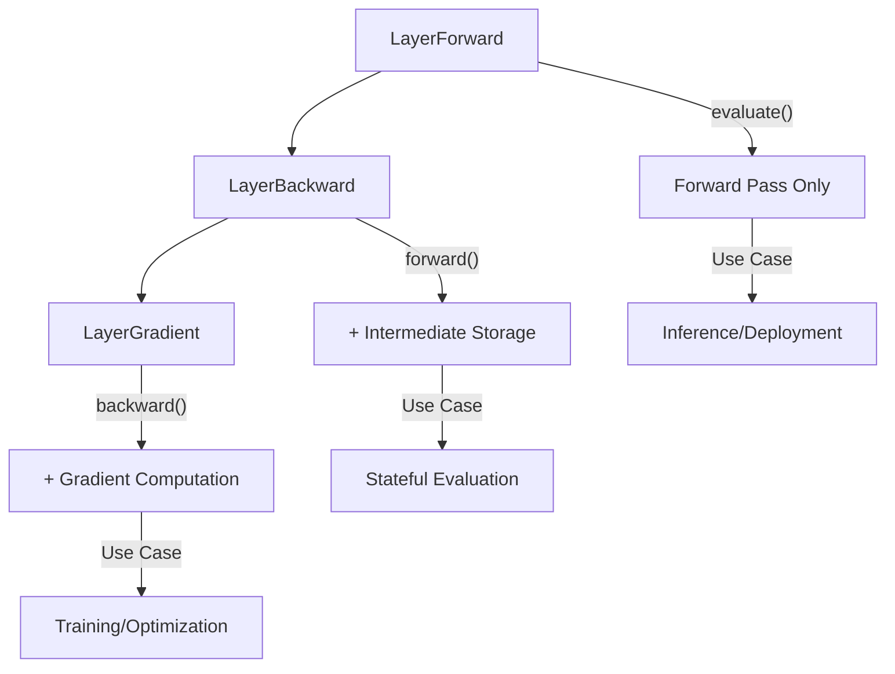
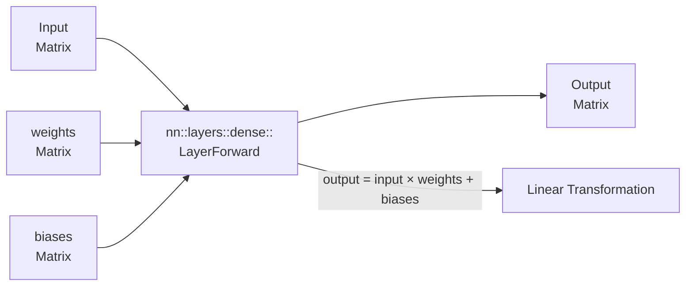
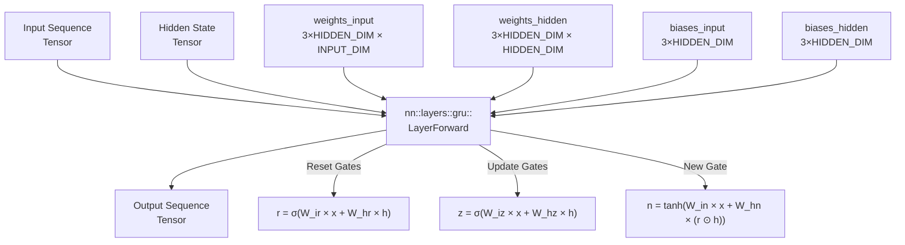
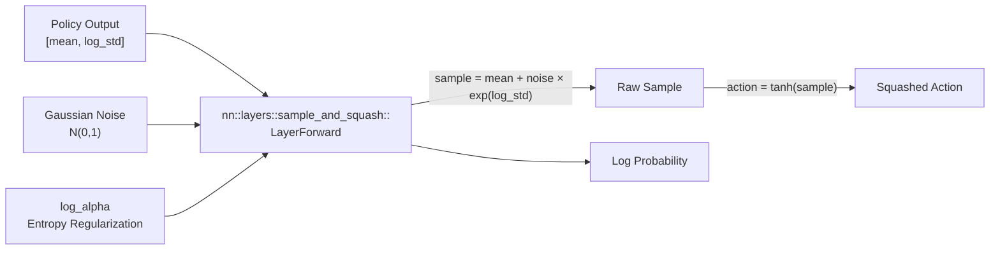
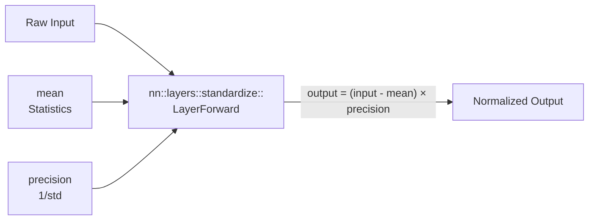
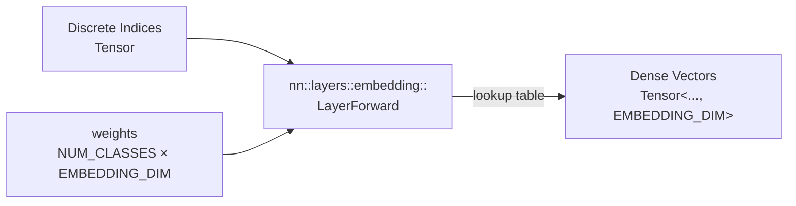
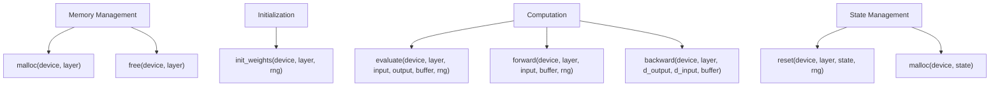
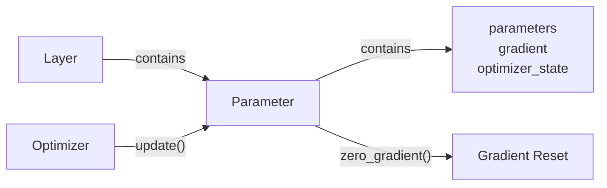
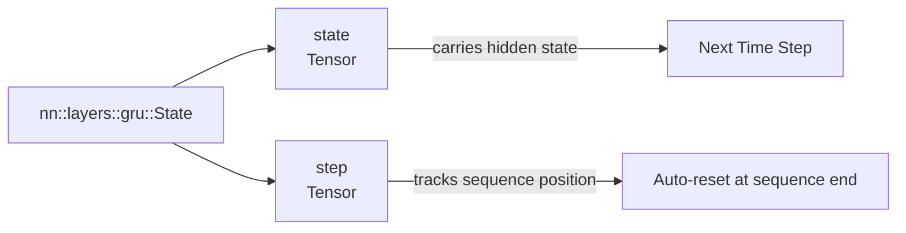
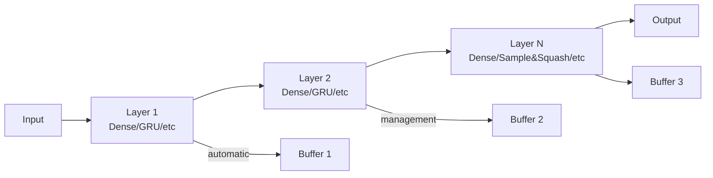

<!-- source: DeepWiki mcp.deepwiki.com · repo rl-tools/rl-tools · page 3.1 Layer Types · fetched 2026-10-30 -->

# Layer Types

Relevant source files

The following files were used as context for generating this wiki page:

- [include/rl_tools/containers/tensor/operations_generic.h](include/rl_tools/containers/tensor/operations_generic.h)
- [include/rl_tools/containers/tensor/tensor.h](include/rl_tools/containers/tensor/tensor.h)
- [include/rl_tools/nn/layers/embedding/layer.h](include/rl_tools/nn/layers/embedding/layer.h)
- [include/rl_tools/nn/layers/embedding/operations_generic.h](include/rl_tools/nn/layers/embedding/operations_generic.h)
- [include/rl_tools/nn/layers/gru/layer.h](include/rl_tools/nn/layers/gru/layer.h)
- [include/rl_tools/nn/layers/gru/operations_generic.h](include/rl_tools/nn/layers/gru/operations_generic.h)
- [include/rl_tools/nn/layers/sample_and_squash/layer.h](include/rl_tools/nn/layers/sample_and_squash/layer.h)
- [include/rl_tools/nn/layers/sample_and_squash/operations_generic.h](include/rl_tools/nn/layers/sample_and_squash/operations_generic.h)
- [include/rl_tools/rl/algorithms/sac/loop/core/config.h](include/rl_tools/rl/algorithms/sac/loop/core/config.h)
- [include/rl_tools/rl/algorithms/sac/loop/core/operations_generic.h](include/rl_tools/rl/algorithms/sac/loop/core/operations_generic.h)
- [include/rl_tools/rl/algorithms/sac/loop/core/state.h](include/rl_tools/rl/algorithms/sac/loop/core/state.h)
- [include/rl_tools/rl/algorithms/sac/operations_generic.h](include/rl_tools/rl/algorithms/sac/operations_generic.h)
- [include/rl_tools/rl/algorithms/sac/sac.h](include/rl_tools/rl/algorithms/sac/sac.h)
- [include/rl_tools/rl/algorithms/td3/loop/core/config.h](include/rl_tools/rl/algorithms/td3/loop/core/config.h)
- [include/rl_tools/rl/algorithms/td3/loop/core/operations_generic.h](include/rl_tools/rl/algorithms/td3/loop/core/operations_generic.h)
- [include/rl_tools/rl/algorithms/td3/loop/core/state.h](include/rl_tools/rl/algorithms/td3/loop/core/state.h)
- [include/rl_tools/rl/algorithms/td3/operations_generic.h](include/rl_tools/rl/algorithms/td3/operations_generic.h)
- [include/rl_tools/rl/algorithms/td3/td3.h](include/rl_tools/rl/algorithms/td3/td3.h)
- [include/rl_tools/rl/components/off_policy_runner/off_policy_runner.h](include/rl_tools/rl/components/off_policy_runner/off_policy_runner.h)
- [include/rl_tools/rl/components/off_policy_runner/operations_generic.h](include/rl_tools/rl/components/off_policy_runner/operations_generic.h)
- [include/rl_tools/rl/components/off_policy_runner/operations_generic_per_env.h](include/rl_tools/rl/components/off_policy_runner/operations_generic_per_env.h)
- [tests/src/container/tensor.cpp](tests/src/container/tensor.cpp)
- [tests/src/nn/layers/gru/CMakeLists.txt](tests/src/nn/layers/gru/CMakeLists.txt)
- [tests/src/nn/layers/gru/gru.cpp](tests/src/nn/layers/gru/gru.cpp)
- [tests/src/nn/layers/gru/gru_model.h](tests/src/nn/layers/gru/gru_model.h)
- [tests/src/nn/layers/gru/gru_training.cpp](tests/src/nn/layers/gru/gru_training.cpp)
- [tests/src/nn/layers/gru/jax/jax_test.py](tests/src/nn/layers/gru/jax/jax_test.py)

This document covers the neural network layer types available in RLtools, their capabilities, and common interfaces. Layer types form the building blocks for constructing neural networks used in reinforcement learning algorithms.

For information about how layers are composed into complete neural network models, see [Network Models](#3.2). For details on CUDA acceleration of layer operations, see [CUDA Acceleration](#3.3).

## Layer Capability Hierarchy

RLtools uses a capability-based design where each layer type supports different levels of functionality depending on the use case. This enables efficient inference-only deployments while maintaining full training capabilities when needed.

### Capability Levels

**Sources:** [include/rl_tools/nn/layers/dense/layer.h:97-140](), [include/rl_tools/nn/layers/gru/layer.h:99-186]()

## Available Layer Types

### Dense Layers

Dense (fully-connected) layers perform linear transformations with learnable weights and biases. They form the backbone of Multi-Layer Perceptrons (MLPs).

**Key Components:**
- `weights`: Parameter matrix of shape `[OUTPUT_DIM, INPUT_DIM]`
- `biases`: Parameter vector of shape `[OUTPUT_DIM]`
- Activation functions applied via separate layers

**Sources:** [include/rl_tools/nn/layers/dense/layer.h:44-97](), [include/rl_tools/nn/layers/dense/operations_generic.h:91-150]()

### GRU Layers

Gated Recurrent Unit (GRU) layers process sequential data with internal memory. They are essential for handling temporal dependencies in reinforcement learning environments.

**Key Features:**
- `SEQUENCE_LENGTH`: Fixed sequence length for processing
- `HIDDEN_DIM`: Size of internal hidden state
- Reset modes for handling episode boundaries in RL
- `State<SPEC>` for stateful evaluation across time steps

**Sources:** [include/rl_tools/nn/layers/gru/layer.h:99-146](), [include/rl_tools/nn/layers/gru/operations_generic.h:190-301]()

### Sample and Squash Layers

Sample and Squash layers implement stochastic policies for reinforcement learning by sampling actions from probability distributions and applying squashing functions.

**Key Parameters:**
- `DIM`: Action dimension
- `LOG_STD_LOWER_BOUND`: Minimum log standard deviation (-20)
- `LOG_STD_UPPER_BOUND`: Maximum log standard deviation (2)
- `LOG_PROBABILITY_EPSILON`: Numerical stability constant (1e-6)

**Sources:** [include/rl_tools/nn/layers/sample_and_squash/layer.h:11-89](), [include/rl_tools/nn/layers/sample_and_squash/operations_generic.h:115-173]()

### Standardize Layers

Standardize layers normalize inputs using stored statistics, essential for stable training with varying input ranges.

**Key Components:**
- `mean`: Parameter storing input means
- `precision`: Parameter storing 1/standard_deviation for numerical efficiency
- Zero precision handling for constant inputs

**Sources:** [include/rl_tools/nn/layers/standardize/layer.h:11-89](), [include/rl_tools/nn/layers/standardize/operations_generic.h:64-82]()

### Embedding Layers

Embedding layers convert discrete indices to dense vector representations, useful for discrete action spaces or categorical inputs.

**Key Parameters:**
- `NUM_CLASSES`: Number of discrete classes/indices
- `EMBEDDING_DIM`: Dimension of output vectors
- Weight matrix stores learnable embeddings

**Sources:** [include/rl_tools/nn/layers/embedding/layer.h:11-76](), [include/rl_tools/nn/layers/embedding/operations_generic.h:70-85]()

## Common Layer Interface

All layer types follow a consistent interface pattern that enables modular composition and uniform handling across the framework.

### Core Operations

### Parameter Integration

Layers integrate with the parameter system for automatic differentiation and optimization:

**Sources:** [include/rl_tools/nn/parameters/operations_generic.h:15-50](), [include/rl_tools/nn/layers/dense/operations_generic.h:16-44]()

## Buffer and State Management

### Buffer Types

Different layers require different buffer types for intermediate computations:

| Layer Type | Buffer Purpose | Key Components |
|------------|----------------|----------------|
| Dense | Minimal - computation is stateless | `nn::layers::dense::Buffer` (empty) |
| GRU | Sequence processing intermediates | `post_activation`, `n_pre_pre_activation` |
| Sample & Squash | Noise storage for external control | `noise` matrix |
| Standardize | No intermediate storage needed | `nn::layers::standardize::Buffer` (empty) |
| Embedding | No intermediate storage needed | `nn::layers::embedding::Buffer` (empty) |

### State for Recurrent Layers

GRU layers maintain internal state across time steps:

**Sources:** [include/rl_tools/nn/layers/gru/layer.h:83-97](), [include/rl_tools/nn/layers/gru/operations_generic.h:66-101]()

## Integration with Sequential Models

Layer types are composed into neural networks using the Sequential model architecture, which chains layers together while managing intermediate tensors and automatic differentiation.

**Sources:** [include/rl_tools/nn_models/sequential/operations_generic.h:144-243](), [include/rl_tools/nn_models/mlp/operations_generic.h:75-100]()

---

