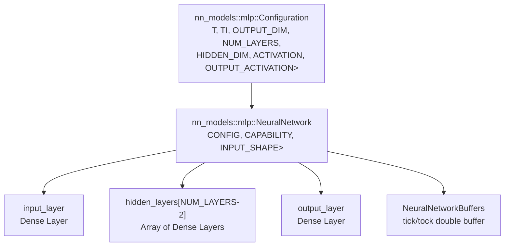
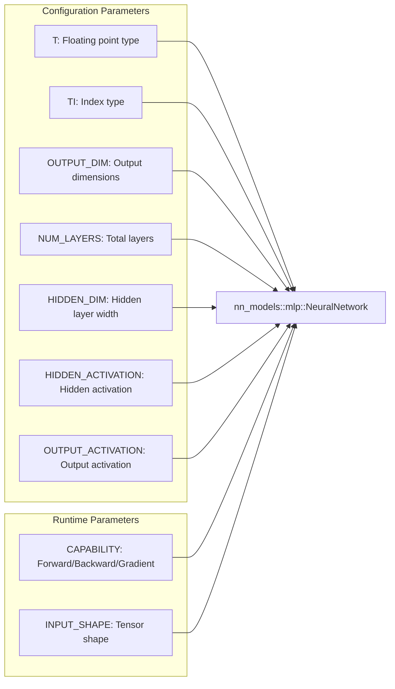
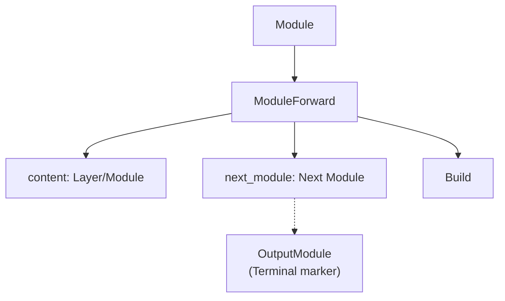
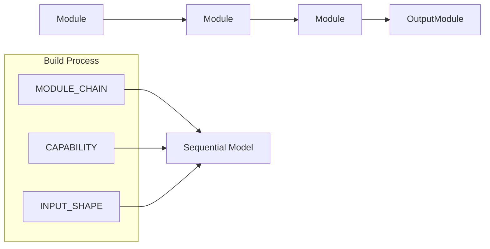
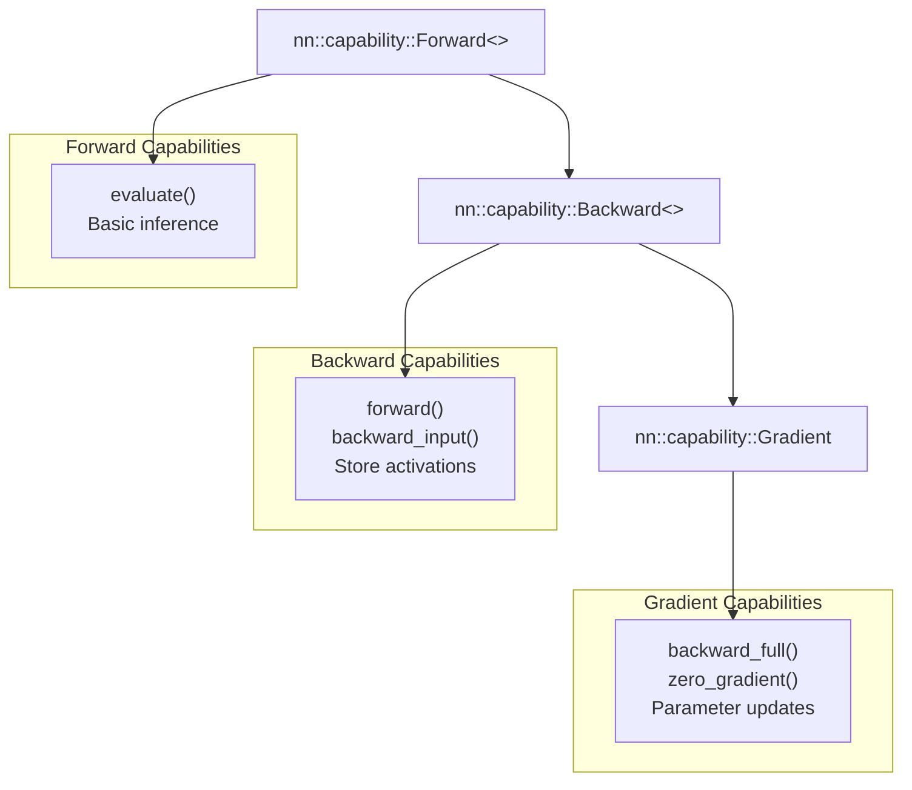
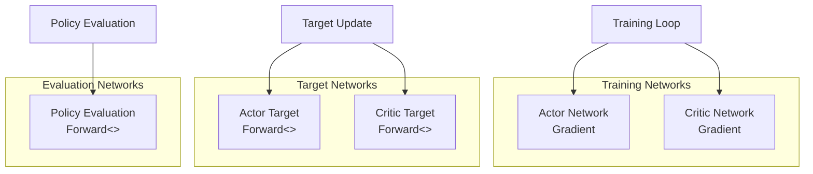
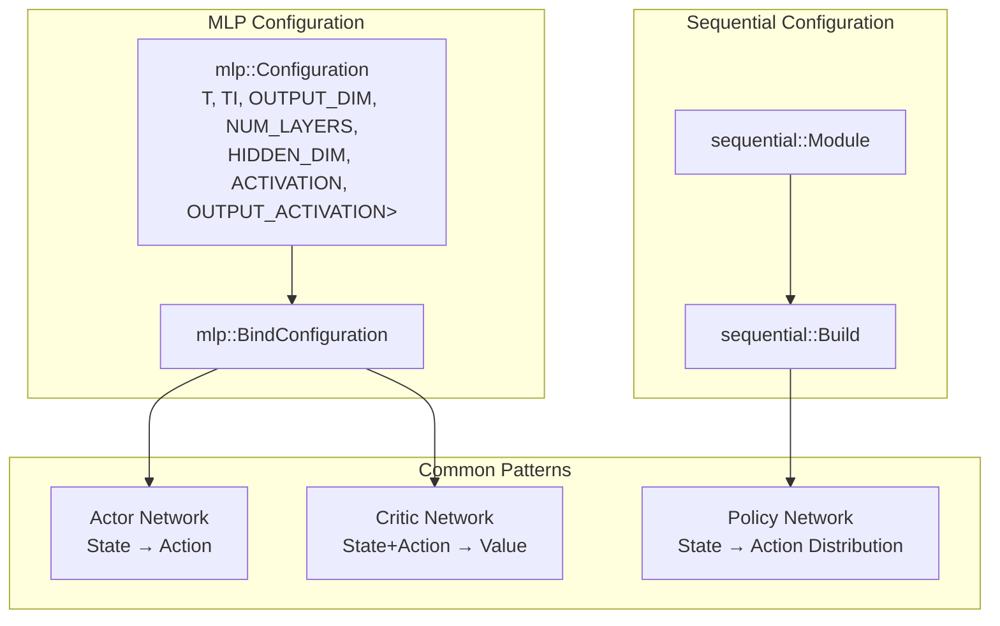
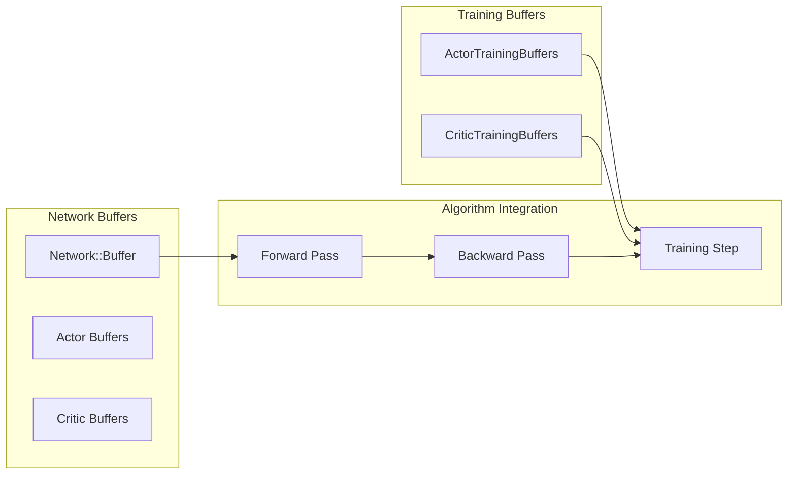

<!-- source: DeepWiki mcp.deepwiki.com · repo rl-tools/rl-tools · page 3.2 Network Models · fetched 2026-10-30 -->

# Network Models

Relevant source files

The following files were used as context for generating this wiki page:

- [include/rl_tools/containers/tensor/operations_generic.h](include/rl_tools/containers/tensor/operations_generic.h)
- [include/rl_tools/containers/tensor/tensor.h](include/rl_tools/containers/tensor/tensor.h)
- [include/rl_tools/nn/layers/embedding/layer.h](include/rl_tools/nn/layers/embedding/layer.h)
- [include/rl_tools/nn/layers/embedding/operations_generic.h](include/rl_tools/nn/layers/embedding/operations_generic.h)
- [include/rl_tools/nn/layers/gru/layer.h](include/rl_tools/nn/layers/gru/layer.h)
- [include/rl_tools/nn/layers/gru/operations_generic.h](include/rl_tools/nn/layers/gru/operations_generic.h)
- [src/rl/environments/pendulum/sac/wasm/full_training.h](src/rl/environments/pendulum/sac/wasm/full_training.h)
- [src/rl/environments/pendulum/td3/arm/training.h](src/rl/environments/pendulum/td3/arm/training.h)
- [tests/src/container/tensor.cpp](tests/src/container/tensor.cpp)
- [tests/src/nn/default_network_mlp.h](tests/src/nn/default_network_mlp.h)
- [tests/src/nn/full_training_mlp.cpp](tests/src/nn/full_training_mlp.cpp)
- [tests/src/nn/layers/gru/CMakeLists.txt](tests/src/nn/layers/gru/CMakeLists.txt)
- [tests/src/nn/layers/gru/gru.cpp](tests/src/nn/layers/gru/gru.cpp)
- [tests/src/nn/layers/gru/gru_model.h](tests/src/nn/layers/gru/gru_model.h)
- [tests/src/nn/layers/gru/gru_training.cpp](tests/src/nn/layers/gru/gru_training.cpp)
- [tests/src/nn/layers/gru/jax/jax_test.py](tests/src/nn/layers/gru/jax/jax_test.py)
- [tests/src/nn/test_mlp.cpp](tests/src/nn/test_mlp.cpp)
- [tests/src/rl/algorithms/td3/first_stage_mlp.cpp](tests/src/rl/algorithms/td3/first_stage_mlp.cpp)
- [tests/src/rl/algorithms/td3/full_training_dummy_dep.cpp](tests/src/rl/algorithms/td3/full_training_dummy_dep.cpp)
- [tests/src/rl/algorithms/td3/second_stage_mlp.cpp](tests/src/rl/algorithms/td3/second_stage_mlp.cpp)
- [tests/src/rl/environments/pendulum/pendulum.cpp](tests/src/rl/environments/pendulum/pendulum.cpp)

This page covers the neural network model architectures provided by RLtools, focusing on the high-level model abstractions that compose layers into complete networks. For information about individual layer types, see [Layer Types](#3.1). For GPU acceleration details, see [CUDA Acceleration](#3.3). For model saving and loading, see [Model Persistence](#3.4).

Network models in RLtools are the primary building blocks for constructing neural networks used in reinforcement learning algorithms. They provide structured ways to compose layers, manage memory, and handle forward/backward passes with different capability levels.

## MLP Models

Multi-Layer Perceptron (MLP) models represent traditional feedforward neural networks with configurable depth and width. The `nn_models::mlp` namespace provides the core MLP implementation.

### MLP Architecture

**MLP Configuration and Construction**

MLPs are configured through the `Configuration` template and instantiated as `NeuralNetwork` objects:

**MLP Operations**

The MLP implementation provides efficient forward and backward passes using double-buffering for intermediate activations:

- `evaluate()` - Forward pass without storing intermediate activations (inference only)
- `forward()` - Forward pass storing activations for backward pass  
- `backward_full()` - Full backward pass computing input gradients and parameter gradients
- `backward()` - Backward pass computing only parameter gradients

Sources: [include/rl_tools/nn_models/mlp/operations_generic.h:1-100](), [tests/src/nn/test_mlp.cpp:1-50]()

## Sequential Models

Sequential models provide a flexible composition system for building networks from arbitrary sequences of layers and modules. The `nn_models::sequential` namespace implements this through recursive template composition.

### Sequential Architecture

**Sequential Composition**

Sequential models use recursive template composition to chain modules together:

**Sequential Operations**

Sequential models support the same operation interface as MLPs but handle the recursive composition:

- `_evaluate()` - Recursive evaluation through module chain
- `get_layer<N>()` - Access specific layer by index  
- `get_first_layer()` / `get_last_layer()` - Access terminal layers
- `num_layers()` - Compile-time layer count

Sources: [include/rl_tools/nn_models/sequential/operations_generic.h:1-150](), [tests/src/rl/algorithms/td3/second_stage_mlp.cpp:56-88]()

## Capability System

The capability system determines what operations a network model supports through compile-time configuration. This enables memory and performance optimizations based on intended usage.

### Capability Hierarchy

**Capability Usage Patterns**

Different use cases require different capability levels:

Sources: [tests/src/rl/algorithms/td3/first_stage_mlp.cpp:121-131](), [tests/src/rl/algorithms/td3/second_stage_mlp.cpp:70-86]()

## Model Configuration and Construction

RLtools provides structured approaches for configuring and constructing network models suitable for reinforcement learning applications.

### Configuration Patterns

**Example Configurations**

Common RL network configurations demonstrate typical usage patterns:

- **Actor Networks**: Map states to actions, typically use `TANH` output activation
- **Critic Networks**: Map state-action pairs to values, use `IDENTITY` output activation  
- **Policy Networks**: Map states to action distributions, often end with `SampleAndSquash` layers

Sources: [tests/src/rl/algorithms/td3/full_training_dummy_dep.cpp:48-73](), [src/rl/environments/pendulum/td3/arm/training.h:48-68]()

## Integration with RL Algorithms

Network models integrate seamlessly with RLtools RL algorithms through standardized interfaces and buffer management.

### Algorithm Integration

```mermaid
graph TD
    subgraph "TD3 Actor-Critic"
        TD3Actor["ACTOR_NETWORK_TYPE"]
        TD3ActorTarget["ACTOR_TARGET_NETWORK_TYPE"] 
        TD3Critic1["CRITIC_NETWORK_TYPE"]
        TD3Critic2["CRITIC_NETWORK_TYPE"]
        TD3CriticTarget1["CRITIC_TARGET_NETWORK_TYPE"]
        TD3CriticTarget2["CRITIC_TARGET_NETWORK_TYPE"]
    end
    
    subgraph "SAC Actor-Critic"
        SACPolicy["ACTOR_NETWORK_TYPE<br/>(Policy with entropy)"]
        SACCritic1["CRITIC_NETWORK_TYPE"]
        SACCritic2["CRITIC_NETWORK_TYPE"]
        SACCriticTarget1["CRITIC_TARGET_NETWORK_TYPE"]
        SACCriticTarget2["CRITIC_TARGET_NETWORK_TYPE"]
    end
    
    subgraph "Training Operations"
        TrainActor["train_actor()"]
        TrainCritic["train_critic()"]
        UpdateTargets["update_targets()"]
    end
    
    TD3Actor --> TrainActor
    TD3Critic1 --> TrainCritic
    SACPolicy --> TrainActor
    SACCritic1 --> TrainCritic
    
    TD3ActorTarget --> UpdateTargets
    TD3CriticTarget1 --> UpdateTargets
```

**Buffer Management**

Network models work with algorithm-specific buffer management for efficient training:

The network models provide the computational backbone for RL algorithms while maintaining separation of concerns between network architecture, training procedures, and algorithm-specific logic.

Sources: [include/rl_tools/rl/algorithms/sac/operations_generic.h:18-33](), [include/rl_tools/rl/algorithms/sac/sac.h:35-60](), [tests/src/rl/algorithms/td3/second_stage_mlp.cpp:242-258]()

---

