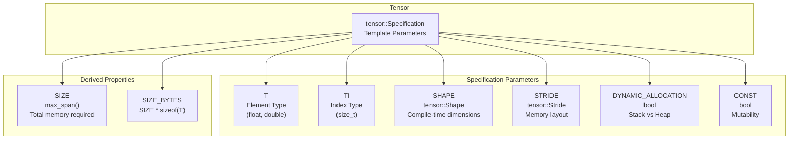
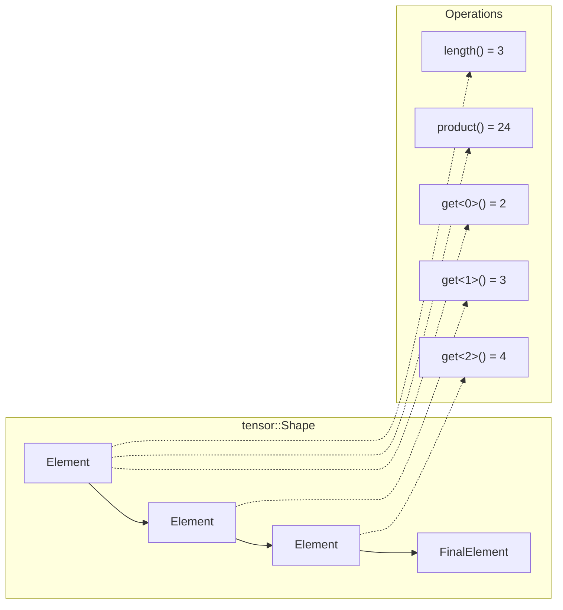
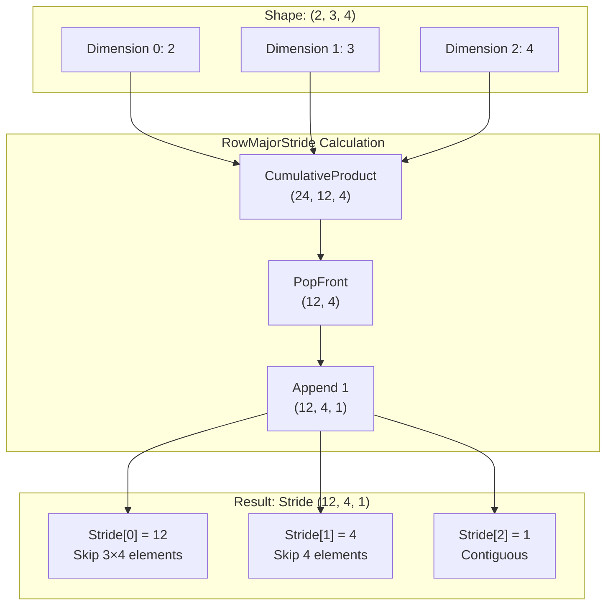
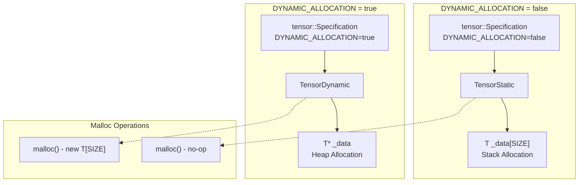
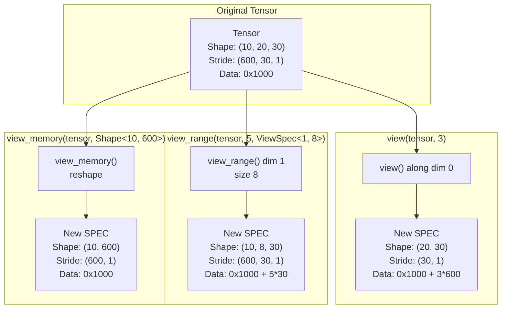
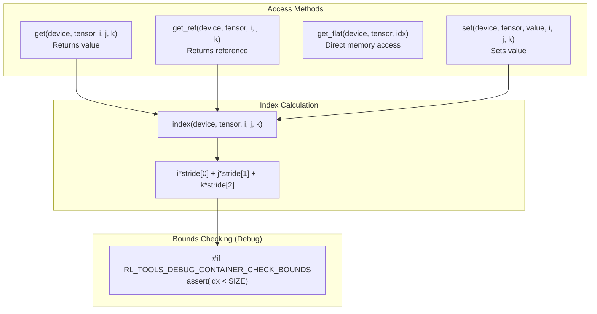
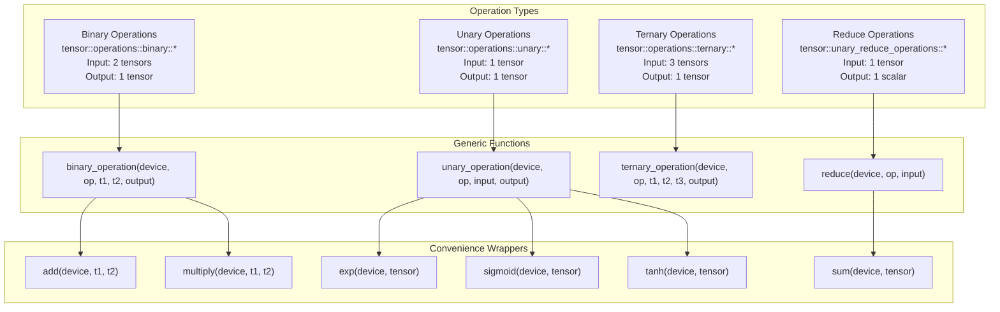
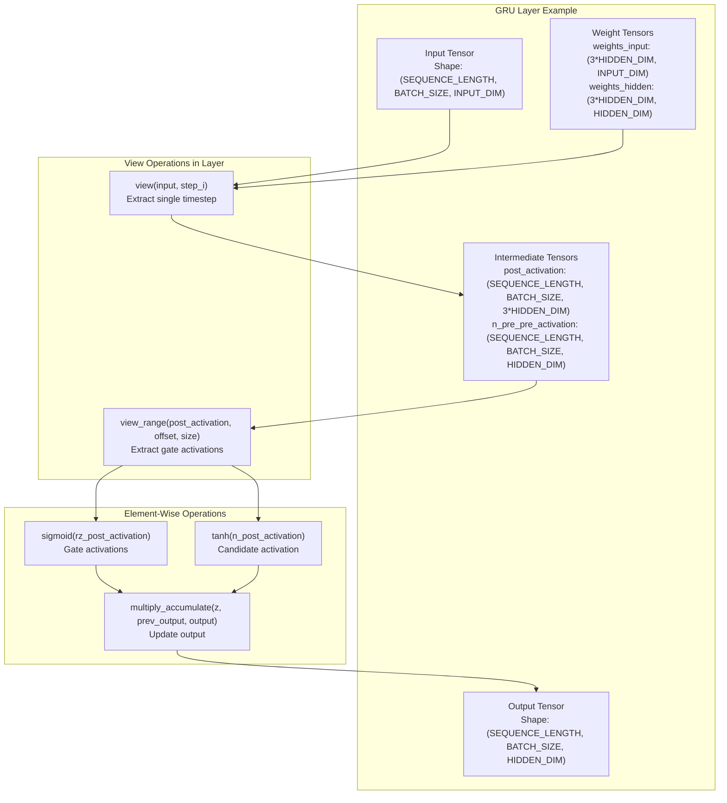
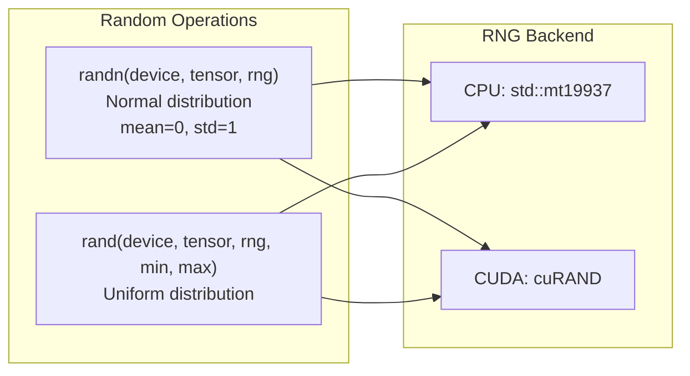

<!-- source: DeepWiki mcp.deepwiki.com · repo rl-tools/rl-tools · page 3.3 Tensor and Container Operations · fetched 2026-10-30 -->

# Tensor and Container Operations

<details>
<summary>Relevant source files</summary>

The following files were used as context for generating this wiki page:

- [include/rl_tools/containers/tensor/operations_generic.h](include/rl_tools/containers/tensor/operations_generic.h)
- [include/rl_tools/containers/tensor/tensor.h](include/rl_tools/containers/tensor/tensor.h)
- [include/rl_tools/devices/cpu.h](include/rl_tools/devices/cpu.h)
- [include/rl_tools/nn/layers/embedding/layer.h](include/rl_tools/nn/layers/embedding/layer.h)
- [include/rl_tools/nn/layers/embedding/operations_generic.h](include/rl_tools/nn/layers/embedding/operations_generic.h)
- [include/rl_tools/nn/layers/gru/layer.h](include/rl_tools/nn/layers/gru/layer.h)
- [include/rl_tools/nn/layers/gru/operations_generic.h](include/rl_tools/nn/layers/gru/operations_generic.h)
- [include/rl_tools/random/operations_cpu.h](include/rl_tools/random/operations_cpu.h)
- [include/rl_tools/rl/environments/pendulum/ui_xeus.h](include/rl_tools/rl/environments/pendulum/ui_xeus.h)
- [tests/src/container/tensor.cpp](tests/src/container/tensor.cpp)
- [tests/src/nn/layers/gru/CMakeLists.txt](tests/src/nn/layers/gru/CMakeLists.txt)
- [tests/src/nn/layers/gru/gru.cpp](tests/src/nn/layers/gru/gru.cpp)
- [tests/src/nn/layers/gru/gru_model.h](tests/src/nn/layers/gru/gru_model.h)
- [tests/src/nn/layers/gru/gru_training.cpp](tests/src/nn/layers/gru/gru_training.cpp)
- [tests/src/nn/layers/gru/jax/jax_test.py](tests/src/nn/layers/gru/jax/jax_test.py)

</details>


## Purpose and Scope

This page documents the tensor and container system in rl_tools, which provides the fundamental data structures and operations for neural network computations. The tensor system supports multi-dimensional arrays with compile-time shape information, flexible memory layouts, zero-cost view operations, and efficient element-wise operations across CPU and CUDA backends.

For information about how tensors are used in specific layer implementations, see [Layer Types](#3.1). For CUDA-specific tensor optimizations, see [CUDA Acceleration](#3.4).

**Sources:** [include/rl_tools/containers/tensor/tensor.h:1-380](), [include/rl_tools/containers/tensor/operations_generic.h:1-50]()

---

## Tensor Specification Pattern

The tensor system uses a **specification pattern** where tensor properties are encoded as compile-time template parameters through a `tensor::Specification` type. This allows the compiler to optimize memory layout and operations while providing type safety.

### Core Specification Components



**Diagram: Tensor Specification Structure**

The specification encodes all tensor properties at compile time:

| Property | Type | Purpose | Example |
|----------|------|---------|---------|
| `T` | Type | Element data type | `float`, `double` |
| `TI` | Type | Index type | `size_t` |
| `SHAPE` | `tensor::Shape<TI, ...>` | Dimensions | `Shape<TI, 2, 3, 4>` |
| `STRIDE` | `tensor::Stride<TI, ...>` | Memory layout | `Stride<TI, 12, 4, 1>` |
| `DYNAMIC_ALLOCATION` | `bool` | Memory model | `true` (heap), `false` (stack) |
| `CONST` | `bool` | Mutability | `true` (read-only), `false` (mutable) |

**Sources:** [include/rl_tools/containers/tensor/tensor.h:224-235]()

---

## Shape and Stride System

The shape and stride system uses **compile-time linked lists** represented as recursive template structures. This enables compile-time shape validation and stride calculations without runtime overhead.

### Shape Representation



**Diagram: Shape Linked List Structure**

### Shape Manipulation Operations

The system provides compile-time shape transformations:

| Operation | Input | Output | Description |
|-----------|-------|--------|-------------|
| `Append<SHAPE, N>` | `(2, 3)`, `4` | `(2, 3, 4)` | Add dimension at end |
| `Prepend<SHAPE, N>` | `(2, 3)`, `4` | `(4, 2, 3)` | Add dimension at start |
| `PopFront<SHAPE>` | `(2, 3, 4)` | `(3, 4)` | Remove first dimension |
| `PopBack<SHAPE>` | `(2, 3, 4)` | `(2, 3)` | Remove last dimension |
| `Remove<SHAPE, DIM>` | `(2, 3, 4)`, `1` | `(2, 4)` | Remove dimension at index |
| `Insert<SHAPE, N, DIM>` | `(2, 4)`, `3`, `1` | `(2, 3, 4)` | Insert dimension |
| `Replace<SHAPE, N, DIM>` | `(2, 3, 4)`, `5`, `1` | `(2, 5, 4)` | Replace dimension |

**Sources:** [include/rl_tools/containers/tensor/tensor.h:8-204](), [tests/src/container/tensor.cpp:15-104]()

### Row-Major Stride Calculation

Strides define memory layout. The default is **row-major** ordering:



**Diagram: Row-Major Stride Computation**

The formula: `Stride[i] = product(Shape[i+1:])` ensures contiguous row-major layout.

**Sources:** [include/rl_tools/containers/tensor/tensor.h:207](), [include/rl_tools/containers/tensor/tensor.h:241-298]()

---

## Memory Management: Static vs Dynamic Allocation

The tensor system supports two memory models controlled by the `DYNAMIC_ALLOCATION` flag:



**Diagram: Static vs Dynamic Memory Models**

### Static Allocation (Stack)

Used for embedded systems and when memory size is known at compile time:

```cpp
// Specification with static allocation
using SPEC = tensor::Specification<float, size_t, 
    tensor::Shape<size_t, 2, 3, 4>, 
    false>;  // DYNAMIC_ALLOCATION = false

// Tensor data stored in struct
struct TensorStatic {
    float _data[24];  // Inline array
};
```

**malloc/free are no-ops** for static tensors since memory is part of the struct.

**Sources:** [include/rl_tools/containers/tensor/tensor.h:320-325](), [include/rl_tools/containers/tensor/operations_generic.h:12-18]()

### Dynamic Allocation (Heap)

Used for variable-size tensors and GPU memory:

```cpp
// Specification with dynamic allocation  
using SPEC = tensor::Specification<float, size_t,
    tensor::Shape<size_t, 2, 3, 4>,
    true>;  // DYNAMIC_ALLOCATION = true

// Tensor holds pointer
struct TensorDynamic {
    float* _data;  // Heap pointer
};

// malloc allocates memory
template<typename DEVICE, typename SPEC>
void malloc(DEVICE& device, Tensor<SPEC>& tensor) {
    tensor._data = new T[SIZE];
}
```

**Sources:** [include/rl_tools/containers/tensor/tensor.h:331-340](), [include/rl_tools/containers/tensor/operations_generic.h:29-43]()

---

## View Operations: Zero-Cost Tensor Manipulation

Views provide **zero-cost** tensor slicing and reshaping by creating new specifications that reference the same underlying memory. No data is copied.



**Diagram: View Operations Create New Specifications**

### view: Slicing Along a Dimension

The `view` operation selects a single index along one dimension, reducing dimensionality by 1:

**Function Signature:**
```cpp
template <auto DIM=0>
auto view(DEVICE& device, Tensor<SPEC>& tensor, 
          typename DEVICE::index_t index, 
          const tensor::ViewSpec<DIM> = {})
```

**Behavior:**
- Removes dimension `DIM` from shape
- Removes dimension `DIM` from stride
- Offsets data pointer by `index * stride[DIM]`
- No memory allocation

**Sources:** [include/rl_tools/containers/tensor/operations_generic.h:106-133]()

### view_range: Selecting a Range

The `view_range` operation selects a contiguous range along one dimension:

**Function Signature:**
```cpp
template <auto DIM=0, auto SIZE=0>
auto view_range(DEVICE& device, Tensor<SPEC>& tensor,
                typename DEVICE::index_t index,
                const tensor::ViewSpec<DIM, SIZE>)
```

**Behavior:**
- Replaces `shape[DIM]` with `SIZE`
- Keeps stride unchanged
- Offsets data pointer by `index * stride[DIM]`

**Sources:** [include/rl_tools/containers/tensor/operations_generic.h:67-104]()

### view_memory: Zero-Cost Reshape

The `view_memory` operation reinterprets memory layout **without moving data**:

**Function Signature:**
```cpp
template <typename SHAPE>
auto view_memory(DEVICE& device, Tensor<SPEC>& tensor)
```

**Requirements:**
- `product(new_shape) <= SIZE`
- Tensor must have dense row-major layout

**Example:**
```cpp
// Original: Shape (2, 3, 4), size = 24
// Reshape to: Shape (6, 4), size = 24
auto reshaped = view_memory<tensor::Shape<TI, 6, 4>>(device, tensor);
```

**Sources:** [include/rl_tools/containers/tensor/operations_generic.h:45-65]()

### permute: Dimension Reordering

The `permute` operation swaps two dimensions by manipulating strides:

**Function Signature:**
```cpp
template <auto DIM_1=0, auto DIM_2=1>
auto permute(DEVICE& device, Tensor<SPEC>& tensor,
             const tensor::PermutationSpec<DIM_1, DIM_2> spec={})
```

**Behavior:**
- Swaps `shape[DIM_1]` with `shape[DIM_2]`
- Swaps `stride[DIM_1]` with `stride[DIM_2]`
- Data pointer unchanged

**Use Case:** Converting between batch-first and sequence-first formats.

**Sources:** [include/rl_tools/containers/tensor/operations_generic.h:143-175]()

---

## Element Access Operations

The tensor system provides several ways to access elements with varying performance characteristics:



**Diagram: Element Access Operations and Index Calculation**

### Multi-Dimensional Indexing

The `get` and `set` functions use **recursive** index calculation:

```cpp
// For tensor with shape (2, 3, 4) and row-major stride (12, 4, 1)
// get(device, tensor, 1, 2, 3) computes:
// offset = 1*12 + 2*4 + 3*1 = 23
```

**Implementation Pattern:**
1. Compute offset for first index: `index * stride[0]`
2. Take `view` to reduce dimension
3. Recurse on remaining indices
4. Base case: 1D tensor, direct indexing

**Sources:** [include/rl_tools/containers/tensor/operations_generic.h:177-257]()

### Flat Indexing

For **dense row-major** tensors, `get_flat` provides direct memory access:

```cpp
template<typename DEVICE, typename SPEC>
typename SPEC::T get_flat(DEVICE& device, 
                          const Tensor<SPEC>& tensor, 
                          typename DEVICE::index_t local_index) {
    static_assert(tensor::dense_row_major_layout<SPEC>());
    return *(data(tensor) + local_index);
}
```

This is the **fastest** access method when iterating sequentially.

**Sources:** [include/rl_tools/containers/tensor/operations_generic.h:259-266]()

### Reference Access

The `get_ref` variants return **references** for in-place modification:

```cpp
// Modify element in-place
get_ref(device, tensor, i, j) += delta;
```

This avoids copying large element types.

**Sources:** [include/rl_tools/containers/tensor/operations_generic.h:196-236]()

### Debug Bounds Checking

When compiled with `RL_TOOLS_DEBUG_CONTAINER_CHECK_BOUNDS`, all access operations validate indices:

```cpp
#if defined(RL_TOOLS_DEBUG_CONTAINER_CHECK_BOUNDS) && !defined(__CUDA_ARCH__)
    utils::assert_exit(device, idx < SPEC::SIZE, "Index out of bounds");
#endif
```

This adds runtime overhead but catches indexing errors during development.

**Sources:** [include/rl_tools/containers/tensor/operations_generic.h:72-75](), [include/rl_tools/containers/tensor/operations_generic.h:200-202]()

---

## Element-Wise Operations

The tensor system provides a **generic operation framework** that works across all backends (CPU, CUDA, MKL):



**Diagram: Element-Wise Operation Framework**

### Unary Operations

Unary operations transform each element independently:

| Operation | Struct | Mathematical Function |
|-----------|--------|-----------------------|
| Negate | `operations::unary::Negate` | `y = -x` |
| Abs | `operations::unary::Abs` | `y = abs(x)` |
| Exp | `operations::unary::Exp` | `y = exp(x)` |
| Sigmoid | `operations::unary::Sigmoid` | `y = 1/(1 + exp(-x))` |
| FastSigmoid | `operations::unary::FastSigmoid` | Fast approximation |
| Tanh | `operations::unary::Tanh` | `y = tanh(x)` |
| FastTanh | `operations::unary::FastTanh` | Fast approximation |
| Scale | `operations::unary::Scale<T>` | `y = x * scale` |

**Generic Implementation Pattern:**
```cpp
template<typename DEVICE, typename OPERATION, typename SPEC>
void unary_operation(DEVICE& device, const OPERATION& op,
                     Tensor<SPEC>& input, 
                     Tensor<SPEC>& output) {
    if constexpr(length(SHAPE{}) > 1) {
        // Recurse on first dimension
        for(TI i=0; i < get<0>(SHAPE{}); ++i) {
            auto next_input = view(device, input, i);
            auto next_output = view(device, output, i);
            unary_operation(device, op, next_input, next_output);
        }
    } else {
        // Base case: 1D tensor
        for(TI i=0; i < get<0>(SHAPE{}); i++) {
            T value = get(device, input, i);
            T result = OPERATION::operation(device, op, value);
            set(device, output, result, i);
        }
    }
}
```

This recursive pattern handles **arbitrary dimensions** automatically.

**Sources:** [include/rl_tools/containers/tensor/operations_generic.h:357-444](), [include/rl_tools/containers/tensor/operations_generic.h:612-689]()

### Binary Operations

Binary operations combine two tensors element-wise:

| Operation | Struct | Function |
|-----------|--------|----------|
| Add | `operations::binary::Add` | `z = x + y` |
| Subtract | `operations::binary::Subtract` | `z = x - y` |
| Multiply | `operations::binary::Multiply` | `z = x * y` |
| Divide | `operations::binary::Divide` | `z = x / y` |

**Convenience Functions:**
```cpp
// In-place addition: t2 += t1
add(device, t1, t2);

// Three-argument: result = t1 - t2
subtract(device, t1, t2, result);

// In-place multiplication: t2 *= t1
multiply(device, t1, t2);
```

**Sources:** [include/rl_tools/containers/tensor/operations_generic.h:445-610]()

### Ternary Operations

Ternary operations combine three tensors:

| Operation | Struct | Function |
|-----------|--------|----------|
| MultiplyAccumulate | `operations::ternary::MultiplyAccumulate<T>` | `acc = acc + a * b` |

**Use Case:** Fused multiply-add in neural network computations.

**Sources:** [include/rl_tools/containers/tensor/operations_generic.h:471-478]()

### Reduce Operations

Reduce operations collapse a tensor to a scalar:

| Operation | Struct | Result |
|-----------|--------|--------|
| Sum | `unary_reduce_operations::Sum<DEVICE, T>` | Sum of all elements |
| SquaredSum | `unary_reduce_operations::SquaredSum<DEVICE, T>` | Sum of squares |
| IsNan | `unary_reduce_operations::IsNan<DEVICE, T>` | Any element is NaN |
| IsFinite | `unary_reduce_operations::IsFinite<DEVICE, T>` | All elements finite |

**Implementation:**
```cpp
template<typename DEVICE, typename OPERATION, typename SPEC>
typename OPERATION::ACCUMULATOR_TYPE 
reduce(DEVICE& device, const OPERATION& operation, 
       const Tensor<SPEC>& tensor) {
    auto acc = operation.initial_value;
    if constexpr(length(SHAPE{}) > 1) {
        for(TI i=0; i < get<0>(SHAPE{}); ++i) {
            auto next = view(device, tensor, i);
            auto sub_acc = reduce(device, operation, next);
            acc = OPERATION::REDUCE_OPERATION(device, operation.parameter, acc, sub_acc);
        }
    } else {
        for(TI i=0; i < get<0>(SHAPE{}); i++) {
            T value = get(device, tensor, i);
            acc = OPERATION::UNARY_REDUCE_OPERATION(device, operation.parameter, acc, value);
        }
    }
    return acc;
}
```

**Sources:** [include/rl_tools/containers/tensor/operations_generic.h:480-549]()

---

## Integration with Neural Network Layers

Tensors are the fundamental data structure for neural network computations. Layers use tensors for inputs, outputs, weights, and intermediate activations.



**Diagram: Tensor Operations in GRU Layer**

### Sequential Data Processing

Recurrent layers like GRU process sequences using view operations:

```cpp
// Input shape: (SEQUENCE_LENGTH, BATCH_SIZE, INPUT_DIM)
for(TI step_i=0; step_i < SEQUENCE_LENGTH; step_i++) {
    // Extract single timestep (reduces dimension by 1)
    auto input_step = view(device, input, step_i);
    // input_step shape: (BATCH_SIZE, INPUT_DIM)
    
    // Process timestep
    auto output_step = view(device, output, step_i);
    // ... layer computation ...
}
```

**Sources:** [include/rl_tools/nn/layers/gru/operations_generic.h:224-333]()

### Gate Extraction with view_range

GRU layers use `view_range` to access specific gates in concatenated weight tensors:

```cpp
// post_activation shape: (BATCH_SIZE, 3*HIDDEN_DIM)
// Extract reset gate (dimension 0 to HIDDEN_DIM)
auto r_post_activation = view_range(device, post_activation, 
    0*HIDDEN_DIM, tensor::ViewSpec<1, HIDDEN_DIM>{});

// Extract update gate (dimension HIDDEN_DIM to 2*HIDDEN_DIM)  
auto z_post_activation = view_range(device, post_activation,
    1*HIDDEN_DIM, tensor::ViewSpec<1, HIDDEN_DIM>{});

// Extract candidate gate (dimension 2*HIDDEN_DIM to 3*HIDDEN_DIM)
auto n_post_activation = view_range(device, post_activation,
    2*HIDDEN_DIM, tensor::ViewSpec<1, HIDDEN_DIM>{});
```

This avoids allocating separate tensors for each gate.

**Sources:** [include/rl_tools/nn/layers/gru/operations_generic.h:257-260]()

### Batch Processing

Dense layers broadcast operations over leading batch dimensions:

```cpp
// Input shape: (SEQUENCE_LENGTH, BATCH_SIZE, INPUT_DIM)
// Layer interprets this as:
// INTERNAL_BATCH_SIZE = SEQUENCE_LENGTH * BATCH_SIZE
// Effectively: (INTERNAL_BATCH_SIZE, INPUT_DIM)

// Matrix multiplication broadcasts automatically
static constexpr TI INTERNAL_BATCH_SIZE = 
    get<1>(INPUT_SHAPE{});  // Batch dimension
```

The `INTERNAL_BATCH_SIZE` concept allows layers to handle multi-dimensional inputs efficiently.

**Sources:** [include/rl_tools/nn/layers/gru/layer.h:35-36](), [include/rl_tools/nn/layers/embedding/layer.h:67]()

### Embedding Layer: Integer Indexing

The embedding layer demonstrates **integer-to-tensor** mapping using get/set:

```cpp
// Input: integer class IDs
// Output: embedded vectors

for(TI batch_i=0; batch_i < BATCH_SIZE; batch_i++) {
    auto index = get(device, input_view, batch_i);  // Integer ID
    auto embedding = view(device, layer.weights.parameters, index);
    auto output_row = view(device, output_view, batch_i);
    copy(device, device, embedding, output_row);
}
```

**Sources:** [include/rl_tools/nn/layers/embedding/operations_generic.h:73-87]()

### Copy Operations Across Devices

The `copy` function handles **cross-device** transfers (e.g., CPU to CUDA):

```cpp
template<typename FROM_DEVICE, typename TO_DEVICE, 
         typename FROM_SPEC, typename TO_SPEC>
void copy(FROM_DEVICE& from_device, TO_DEVICE& to_device,
          const Tensor<FROM_SPEC>& from, 
          Tensor<TO_SPEC>& to) {
    static_assert(tensor::same_dimensions<FROM_SPEC, TO_SPEC>());
    
    if constexpr(length(SHAPE{}) > 1) {
        // Recurse
        for(TI i=0; i < get<0>(SHAPE{}); ++i) {
            auto next_from = view(from_device, from, i);
            auto next_to = view(to_device, to, i);
            copy(from_device, to_device, next_from, next_to);
        }
    } else {
        // Base case: element-by-element copy
        for(TI i=0; i < get<0>(SHAPE{}); i++) {
            set(to_device, to, get(from_device, from, i), i);
        }
    }
}
```

Device-specific implementations can override this for optimized bulk transfers (e.g., `cudaMemcpy`).

**Sources:** [include/rl_tools/containers/tensor/operations_generic.h:295-321]()

---

## Random Initialization

Tensors can be initialized with random values using the device's random number generator:



**Diagram: Random Tensor Initialization**

**Usage:**
```cpp
using RNG = typename DEVICE::SPEC::RANDOM::ENGINE<>;
RNG rng;
init(device, rng, seed);

Tensor<SPEC> tensor;
malloc(device, tensor);

// Fill with normal distribution N(0, 1)
randn(device, tensor, rng);

// Fill with uniform distribution U(min, max)
rand(device, tensor, rng, -1.0, 1.0);
```

**Sources:** [include/rl_tools/containers/tensor/operations_generic.h:322-355](), [include/rl_tools/random/operations_cpu.h:24-47]()

---

## Summary: Key Design Principles

The tensor system embodies several core design principles:

| Principle | Implementation | Benefit |
|-----------|----------------|---------|
| **Compile-Time Shape** | Template-based `tensor::Shape` | Type safety, zero overhead |
| **Specification Pattern** | All properties in `SPEC` | Consistent, composable design |
| **Zero-Cost Views** | Pointer arithmetic only | No memory allocation |
| **Backend Agnostic** | Generic operations + specialization | CPU/CUDA/MKL support |
| **Static vs Dynamic** | `DYNAMIC_ALLOCATION` flag | Embedded & desktop flexibility |
| **Recursive Algorithms** | Dimension-by-dimension processing | Handles arbitrary rank |
| **Dense Row-Major Default** | Standard memory layout | Cache efficiency |

**Sources:** [include/rl_tools/containers/tensor/tensor.h:1-380](), [include/rl_tools/containers/tensor/operations_generic.h:1-1500]()

---

