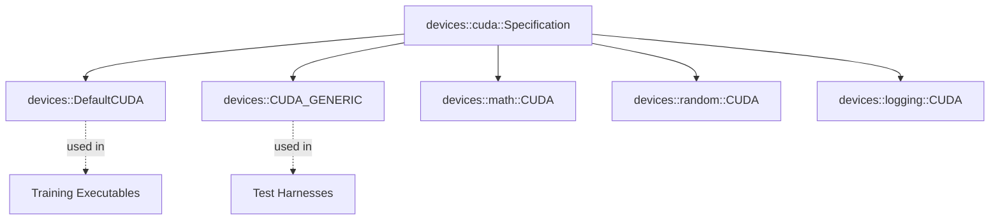
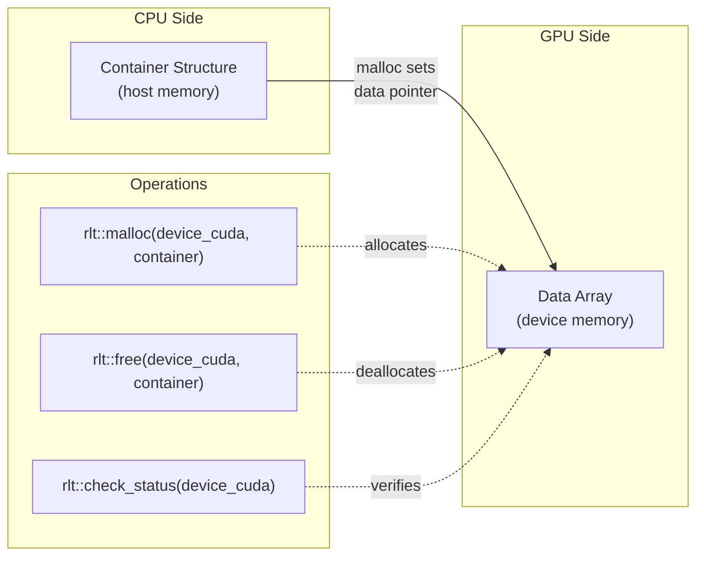
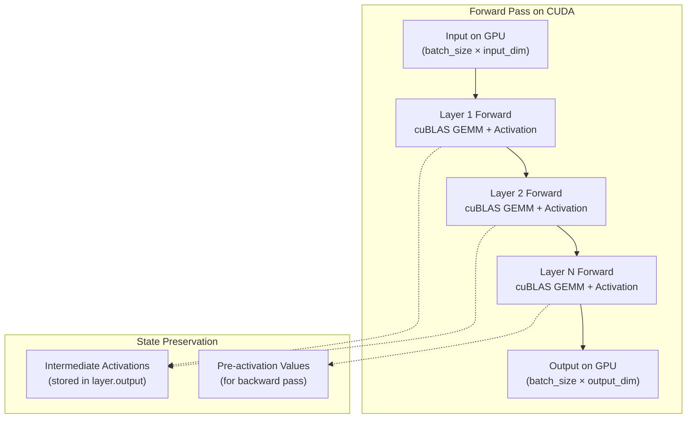
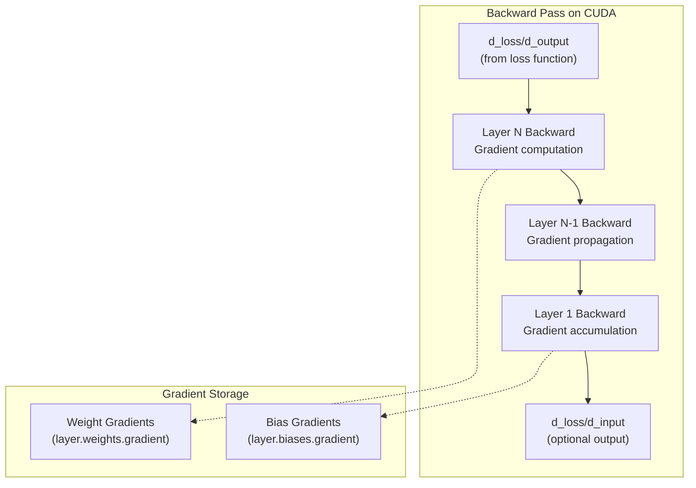
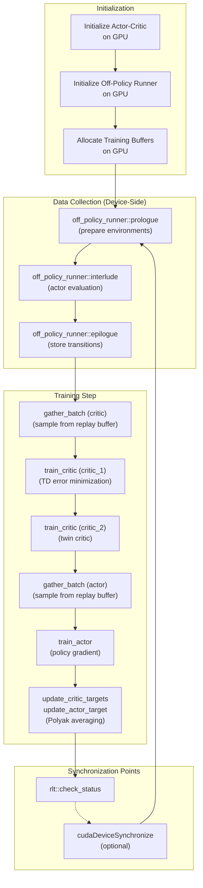
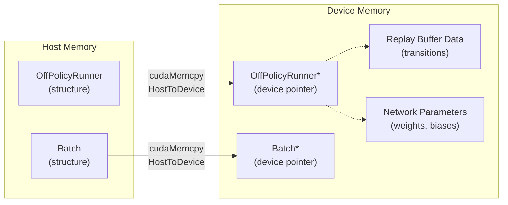

<!-- source: DeepWiki mcp.deepwiki.com · repo rl-tools/rl-tools · page 3.4 CUDA Acceleration · fetched 2026-10-30 -->

# CUDA Acceleration

<details>
<summary>Relevant source files</summary>

The following files were used as context for generating this wiki page:

- [include/rl_tools/containers/tensor/operations_generic.h](include/rl_tools/containers/tensor/operations_generic.h)
- [include/rl_tools/containers/tensor/tensor.h](include/rl_tools/containers/tensor/tensor.h)
- [include/rl_tools/nn/layers/embedding/layer.h](include/rl_tools/nn/layers/embedding/layer.h)
- [include/rl_tools/nn/layers/embedding/operations_generic.h](include/rl_tools/nn/layers/embedding/operations_generic.h)
- [include/rl_tools/nn/layers/gru/layer.h](include/rl_tools/nn/layers/gru/layer.h)
- [include/rl_tools/nn/layers/gru/operations_generic.h](include/rl_tools/nn/layers/gru/operations_generic.h)
- [src/rl/environments/mujoco/ant/td3/parameters.h](src/rl/environments/mujoco/ant/td3/parameters.h)
- [tests/src/container/tensor.cpp](tests/src/container/tensor.cpp)
- [tests/src/nn/benchmark.cpp](tests/src/nn/benchmark.cpp)
- [tests/src/nn/cuda/CMakeLists.txt](tests/src/nn/cuda/CMakeLists.txt)
- [tests/src/nn/cuda/cuda_basics.cu](tests/src/nn/cuda/cuda_basics.cu)
- [tests/src/nn/cuda/main.cu](tests/src/nn/cuda/main.cu)
- [tests/src/nn/layers/gru/CMakeLists.txt](tests/src/nn/layers/gru/CMakeLists.txt)
- [tests/src/nn/layers/gru/gru.cpp](tests/src/nn/layers/gru/gru.cpp)
- [tests/src/nn/layers/gru/gru_model.h](tests/src/nn/layers/gru/gru_model.h)
- [tests/src/nn/layers/gru/gru_training.cpp](tests/src/nn/layers/gru/gru_training.cpp)
- [tests/src/nn/layers/gru/jax/jax_test.py](tests/src/nn/layers/gru/jax/jax_test.py)
- [tests/src/rl/components/off_policy_runner.cpp](tests/src/rl/components/off_policy_runner.cpp)
- [tests/src/rl/cuda/CMakeLists.txt](tests/src/rl/cuda/CMakeLists.txt)
- [tests/src/rl/cuda/rl.cu](tests/src/rl/cuda/rl.cu)
- [tests/src/rl/cuda/td3_full_training.cu](tests/src/rl/cuda/td3_full_training.cu)
- [tests/src/rl/cuda/td3_full_training_parameters_pendulum.h](tests/src/rl/cuda/td3_full_training_parameters_pendulum.h)

</details>


## Purpose and Scope

This page documents the CUDA acceleration backend in rl_tools, explaining how neural network operations, RL algorithms, and tensor operations are accelerated using NVIDIA GPUs. The CUDA backend provides device memory management, optimized matrix operations via cuBLAS, and GPU-accelerated training pipelines.

For information about the overall device abstraction system that enables multi-backend support, see [Core Concepts](#1.3). For neural network layer implementations that work across all backends, see [Layer Types](#3.1). For tensor and container fundamentals, see [Tensor and Container Operations](#3.3).

---

## CUDA Device Types

The CUDA backend is implemented through the device abstraction layer, providing GPU-accelerated equivalents of CPU operations.

**Device Type Hierarchy**



The primary device types are:
- **`devices::DefaultCUDA`**: Standard CUDA device for production use
- **`devices::CUDA_GENERIC`**: Generic CUDA device for testing
- **`devices::cuda::Specification`**: Template specification for configuring CUDA devices

**Sources:** [tests/src/nn/cuda/cuda_basics.cu:27-29](), [tests/src/rl/cuda/td3_full_training.cu:22](), [tests/src/nn/cuda/main.cu:46-48]()

---

## Memory Management

CUDA memory management follows the same `malloc`/`free` interface as CPU devices but allocates memory on the GPU.

**Memory Allocation Pattern**



**Allocation Examples**

Matrices and tensors:
```cpp
// Allocate matrix on GPU
rlt::Matrix<rlt::matrix::Specification<T, TI, ROWS, COLS>> matrix_cuda;
rlt::malloc(device_cuda, matrix_cuda);

// Allocate neural network on GPU
NetworkType network_cuda;
rlt::malloc(device_cuda, network_cuda);
```

Buffers and working memory:
```cpp
// Allocate training buffers
CRITIC_TRAINING_BUFFERS_TYPE critic_training_buffers;
rlt::malloc(device_cuda, critic_training_buffers);

// Allocate layer buffers
ACTOR_NETWORK_TYPE::Buffer<BATCH_SIZE> actor_buffers;
rlt::malloc(device_cuda, actor_buffers);
```

Device memory requires explicit status checking after operations to catch CUDA errors:
```cpp
rlt::malloc(device_cuda, network_cuda);
rlt::check_status(device_cuda);  // Verify allocation succeeded
```

**Sources:** [tests/src/nn/cuda/cuda_basics.cu:36-50](), [tests/src/rl/cuda/td3_full_training.cu:86-106](), [tests/src/rl/cuda/rl.cu:122-140]()

---

## Data Transfer Between CPU and GPU

The `copy` operation handles data transfer between devices with automatic handling of memory layouts and alignments.

**Transfer Patterns**

```mermaid
graph TB
    subgraph "Host to Device"
        CPUH2D["CPU Container"] -->|"rlt::copy(cpu, cuda, src, dst)"| CUDAH2D["CUDA Container"]
    end
    
    subgraph "Device to Host"
        CUDAD2H["CUDA Container"] -->|"rlt::copy(cuda, cpu, src, dst)"| CPUD2H["CPU Container"]
    end
    
    subgraph "Device to Device"
        CUDA1["CUDA Container A"] -->|"rlt::copy(cuda, cuda, src, dst)"| CUDA2["CUDA Container B"]
    end
    
    subgraph "Round-Trip Verification"
        Original["Original CPU Data"]
        ToGPU["Transfer to GPU"]
        FromGPU["Transfer back to CPU"]
        Verify["Verify abs_diff == 0"]
        
        Original --> ToGPU
        ToGPU --> FromGPU
        FromGPU --> Verify
    end
```



**Copy Operations by Container Type**

| Operation | Source | Destination | Use Case |
|-----------|--------|-------------|----------|
| **Initial Upload** | `device_cpu` | `device_cuda` | Transfer initialized weights to GPU |
| **Download Results** | `device_cuda` | `device_cpu` | Retrieve trained model for evaluation |
| **Device-to-Device** | `device_cuda` | `device_cuda` | Copy between GPU buffers |
| **Round-trip Verification** | CPU → GPU → CPU | Same | Validate numerical precision |

**Copy with Views and Alignment**

The system handles complex memory layouts including views and aligned matrices:
```cpp
// Copy with aligned matrices
rlt::Matrix<rlt::matrix::Specification<T, TI, ROWS, COLS, true, 
    rlt::matrix::layouts::RowMajorAlignment<TI, ALIGNMENT>>> matrix_cuda;
rlt::copy(device_cpu, device_cuda, matrix_cpu, matrix_cuda);

// Copy views
auto matrix_view = rlt::view<DEVICE_CUDA, SPEC, VIEW_ROWS, VIEW_COLS>(
    device_cuda, matrix_data, offset_row, offset_col);
rlt::copy(device_cpu, device_cuda, matrix_cpu, matrix_view);
```

**Sources:** [tests/src/nn/cuda/cuda_basics.cu:42-68](), [tests/src/nn/cuda/cuda_basics.cu:194-270](), [tests/src/rl/cuda/td3_full_training.cu:109-121]()

---

## Matrix Operations and cuBLAS Integration

CUDA-accelerated matrix operations leverage cuBLAS for high-performance GEMM (General Matrix Multiply) operations.

**GEMM Operation Flow**

```mermaid
graph LR
    subgraph "Input Preparation"
        Input["Input Matrix<br/>(batch_size × input_dim)"]
        Weights["Weight Matrix<br/>(output_dim × input_dim)"]
        Bias["Bias Vector<br/>(output_dim)"]
    end
    
    subgraph "cuBLAS Execution"
        GEMM["cuBLAS GEMM<br/>C = α·A·B + β·C"]
        BiasAdd["Bias Addition<br/>(broadcast)"]
    end
    
    subgraph "Output"
        Output["Output Matrix<br/>(batch_size × output_dim)"]
    end
    
    Input --> GEMM
    Weights --> GEMM
    GEMM --> BiasAdd
    Bias --> BiasAdd
    BiasAdd --> Output
```

**Layer Evaluation Using cuBLAS**

```cpp
// Evaluate dense layer using GEMM
rlt::evaluate(device_cuda, network.input_layer, 
              input_cuda, output_cuda, buffer_cuda, rng_cuda);

// Behind the scenes: cuBLAS call
// cublasSgemm or cublasDgemm for float/double
```

**Performance Characteristics**

| Batch Size | Operation Type | Typical Speedup vs CPU |
|------------|----------------|------------------------|
| 1 | GEMM | 1-2× |
| 32 | GEMM | 5-10× |
| 256 | GEMM | 10-20× |
| 1024 | GEMM | 15-30× |

Performance scales with batch size as GPU parallelism is better utilized. Small batch sizes may not fully saturate the GPU.

**Alignment and Memory Layout**

CUDA operations benefit from properly aligned memory:
```cpp
// Aligned matrix specification
using ALIGNED_SPEC = rlt::matrix::Specification<T, TI, ROWS, COLS, true,
    rlt::matrix::layouts::RowMajorAlignment<TI, 64>>;  // 64-byte alignment

// Memory coalescing for efficient GPU access
```

**Sources:** [tests/src/nn/cuda/cuda_basics.cu:353-462](), [tests/src/nn/cuda/cuda_basics.cu:420-427](), [tests/src/nn/benchmark.cpp:115-122]()

---

## Neural Network Forward and Backward Passes

Forward and backward passes on CUDA follow the same API as CPU but execute on GPU with device-resident data.

**Forward Pass Pipeline**



**Forward Pass Example**

```cpp
// Network forward pass on CUDA
rlt::forward(device_cuda, network_cuda, input_cuda);

// Access output (still on GPU)
auto& output = network_cuda.output_layer.output;

// Or use evaluate for single layer
rlt::evaluate(device_cuda, layer, input_cuda, output_cuda, 
              buffer_cuda, rng_cuda);
```

**Backward Pass Pipeline**



**Backward Pass Example**

```cpp
// Compute loss gradient
rlt::nn::loss_functions::mse::gradient(device_cuda, 
    network_cuda.output_layer.output, target_cuda, d_output_cuda);

// Backward pass through network
rlt::backward_full(device_cuda, network_cuda, input_cuda, 
                   d_output_cuda, d_input_cuda, buffer_cuda);

// Gradients are now in layer.weights.gradient, layer.biases.gradient
```

**Buffer Requirements**

Each layer type requires specific buffers for CUDA execution:

| Layer Type | Buffer Contents |
|------------|-----------------|
| **Dense** | Intermediate values for backward pass |
| **GRU** | Hidden states, gate activations, pre-activations |
| **Embedding** | No buffer needed (stateless lookup) |

**Sources:** [tests/src/nn/cuda/cuda_basics.cu:464-545](), [tests/src/nn/cuda/cuda_basics.cu:547-621](), [tests/src/rl/cuda/td3_full_training.cu:140-166]()

---

## Training Loops on CUDA

Complete training loops coordinate data collection, batch sampling, network updates, and target updates on GPU.

**TD3 Training Loop Architecture**



**Device Memory Structures**



**Training Loop Implementation**

```cpp
// Allocate device-side structures
cudaMalloc(&off_policy_runner_pointer, sizeof(OffPolicyRunner));
cudaMalloc(&batch_pointer, sizeof(Batch));

// Copy structures to device
cudaMemcpy(off_policy_runner_pointer, &off_policy_runner, 
           sizeof(OffPolicyRunner), cudaMemcpyHostToDevice);

// Training loop
for(int step = 0; step < step_limit; step++) {
    // Collect data (on device)
    rlt::rl::components::off_policy_runner::prologue(
        device_cuda, off_policy_runner_pointer, rng);
    rlt::rl::components::off_policy_runner::interlude(
        device_cuda, off_policy_runner, actor, buffers, rng);
    rlt::rl::components::off_policy_runner::epilogue(
        device_cuda, off_policy_runner_pointer, actor, rng);
    
    // Train critics
    if(step % CRITIC_TRAINING_INTERVAL == 0) {
        rlt::gather_batch(device_cuda, off_policy_runner_pointer, 
                          critic_batch, rng);
        rlt::train_critic(device_cuda, actor_critic, critic_1, 
                          critic_batch, optimizer, buffers, ...);
        rlt::train_critic(device_cuda, actor_critic, critic_2, 
                          critic_batch, optimizer, buffers, ...);
    }
    
    // Train actor
    if(step % ACTOR_TRAINING_INTERVAL == 0) {
        rlt::gather_batch(device_cuda, off_policy_runner_pointer, 
                          actor_batch, rng);
        rlt::train_actor(device_cuda, actor_critic, actor_batch, 
                         optimizer, buffers, ...);
    }
    
    // Update target networks
    if(step % TARGET_UPDATE_INTERVAL == 0) {
        rlt::update_critic_targets(device_cuda, actor_critic);
        rlt::update_actor_target(device_cuda, actor_critic);
    }
}
```

**Warmup and Training Intervals**

| Phase | Condition | Operation |
|-------|-----------|-----------|
| **Warmup (Critic)** | `step > N_WARMUP_STEPS_CRITIC` | Begin critic training |
| **Warmup (Actor)** | `step > N_WARMUP_STEPS_ACTOR` | Begin actor training |
| **Critic Training** | `step % CRITIC_TRAINING_INTERVAL == 0` | Train both critics |
| **Actor Training** | `step % ACTOR_TRAINING_INTERVAL == 0` | Train actor |
| **Target Update** | `step % TARGET_UPDATE_INTERVAL == 0` | Polyak averaging |

**Sources:** [tests/src/rl/cuda/td3_full_training.cu:86-196](), [tests/src/rl/cuda/rl.cu:111-157]()

---

## Random Number Generation on CUDA

CUDA uses device-side random number generators compatible with the generic RNG interface.

**RNG Initialization and Usage**

```cpp
// Initialize CUDA RNG
DEVICE_CUDA::SPEC::RANDOM::ENGINE<> rng_cuda;
rlt::malloc(device_cuda, rng_cuda);
rlt::init(device_cuda, rng_cuda, seed);

// Use in operations
rlt::forward(device_cuda, network, input, buffer, rng_cuda);

// Advance RNG state between steps
rng = rlt::random::next(DEVICE_CUDA::SPEC::RANDOM(), rng);
```

The CUDA RNG maintains device-side state and is advanced between training steps to ensure different random samples. This is particularly important for exploration noise in RL algorithms and dropout in neural networks.

**Sources:** [tests/src/rl/cuda/td3_full_training.cu:74-76](), [tests/src/rl/cuda/td3_full_training.cu:127-161]()

---

## Performance Considerations

### Synchronization Points

CUDA operations are asynchronous by default. Explicit synchronization is required only when:
- Copying results back to CPU for evaluation
- Timing performance (to ensure kernels complete)
- Debugging (to catch errors immediately)

```cpp
// Optional synchronization for timing
cudaDeviceSynchronize();
auto start = std::chrono::high_resolution_clock::now();
// ... CUDA operations ...
cudaDeviceSynchronize();
auto end = std::chrono::high_resolution_clock::now();
```

Avoiding unnecessary synchronization improves performance by allowing GPU and CPU to overlap:
```cpp
// Good: No sync between CUDA operations
rlt::train_critic(device_cuda, ...);  // Queued to GPU
rlt::train_actor(device_cuda, ...);   // Queued to GPU
// GPU executes both while CPU continues

// Bad: Sync after every operation
rlt::train_critic(device_cuda, ...);
cudaDeviceSynchronize();  // CPU waits for GPU
rlt::train_actor(device_cuda, ...);
cudaDeviceSynchronize();  // CPU waits again
```

### Error Checking

Use `check_status` after memory operations and periodically during training:
```cpp
rlt::malloc(device_cuda, network);
rlt::check_status(device_cuda);  // Catch allocation errors

// During training
if(step % 1000 == 0) {
    rlt::check_status(device_cuda);  // Periodic error check
}
```

### Memory Layout Optimization

Aligned memory layouts improve performance:
- Use `RowMajorAlignment` with 64 or 128-byte alignment
- Contiguous memory access patterns enable coalescing
- Views maintain alignment when possible

### Batch Size Selection

Larger batch sizes better utilize GPU parallelism:
- **Batch size < 32**: Underutilized GPU, minimal speedup
- **Batch size 64-256**: Good utilization, 10-20× speedup typical
- **Batch size > 1024**: Maximum throughput, but higher memory usage

**Sources:** [tests/src/rl/cuda/td3_full_training.cu:134-177](), [tests/src/nn/cuda/cuda_basics.cu:90-130](), [tests/src/nn/benchmark.cpp:115-146]()

---

## Integration with Other Components

The CUDA backend integrates seamlessly with the broader rl_tools ecosystem:

| Component | Integration Point | Key Classes |
|-----------|-------------------|-------------|
| **Tensor Operations** | Generic operations dispatch to CUDA kernels | `Tensor<SPEC>`, view operations |
| **Neural Network Layers** | Forward/backward use cuBLAS | `LayerForward`, `LayerBackward` |
| **RL Algorithms** | Training operations on GPU | `ActorCritic`, `train_critic`, `train_actor` |
| **Off-Policy Runner** | Device-side replay buffer | `OffPolicyRunner`, `gather_batch` |
| **Optimizers** | Parameter updates on GPU | `Adam`, optimizer state on device |

For complete training examples combining all components, see the full training tests at [tests/src/rl/cuda/td3_full_training.cu]().

**Sources:** [tests/src/rl/cuda/td3_full_training.cu:1-214](), [tests/src/nn/cuda/cuda_basics.cu:1-462](), [tests/src/rl/cuda/rl.cu:1-159]()

---

