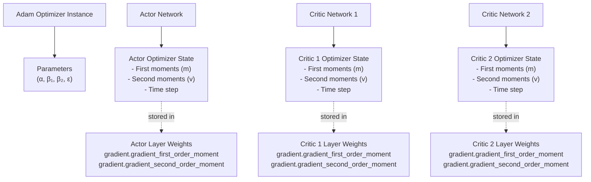
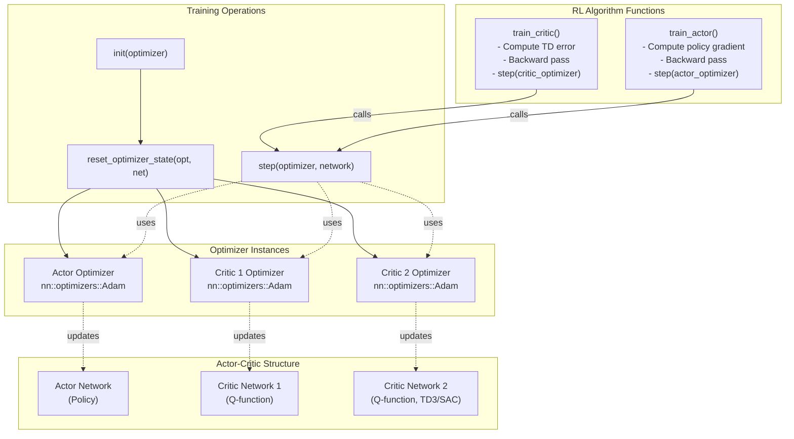

<!-- source: DeepWiki mcp.deepwiki.com · repo rl-tools/rl-tools · page 3.5 Optimizers · fetched 2026-10-30 -->

# Optimizers

<details>
<summary>Relevant source files</summary>

The following files were used as context for generating this wiki page:

- [include/rl_tools/rl/algorithms/ppo/loop/core/config.h](include/rl_tools/rl/algorithms/ppo/loop/core/config.h)
- [include/rl_tools/rl/algorithms/ppo/loop/core/operations_generic.h](include/rl_tools/rl/algorithms/ppo/loop/core/operations_generic.h)
- [include/rl_tools/rl/algorithms/ppo/loop/core/state.h](include/rl_tools/rl/algorithms/ppo/loop/core/state.h)
- [include/rl_tools/rl/algorithms/ppo/operations_generic.h](include/rl_tools/rl/algorithms/ppo/operations_generic.h)
- [include/rl_tools/rl/algorithms/ppo/ppo.h](include/rl_tools/rl/algorithms/ppo/ppo.h)
- [include/rl_tools/rl/components/on_policy_runner/on_policy_runner.h](include/rl_tools/rl/components/on_policy_runner/on_policy_runner.h)
- [include/rl_tools/rl/components/on_policy_runner/operations_generic.h](include/rl_tools/rl/components/on_policy_runner/operations_generic.h)
- [include/rl_tools/rl/components/on_policy_runner/operations_generic_per_env.h](include/rl_tools/rl/components/on_policy_runner/operations_generic_per_env.h)
- [include/rl_tools/rl/components/running_normalizer/running_normalizer.h](include/rl_tools/rl/components/running_normalizer/running_normalizer.h)
- [src/rl/environments/pendulum/ppo/cpu/CMakeLists.txt](src/rl/environments/pendulum/ppo/cpu/CMakeLists.txt)
- [src/rl/environments/pendulum/ppo/cpu/config.h](src/rl/environments/pendulum/ppo/cpu/config.h)
- [src/rl/environments/pendulum/ppo/cpu/training.cpp](src/rl/environments/pendulum/ppo/cpu/training.cpp)
- [src/rl/environments/pendulum/ppo/cuda/CMakeLists.txt](src/rl/environments/pendulum/ppo/cuda/CMakeLists.txt)
- [src/rl/environments/pendulum/ppo/cuda/training.cu](src/rl/environments/pendulum/ppo/cuda/training.cu)
- [src/rl/environments/pendulum/sac/wasm/full_training.h](src/rl/environments/pendulum/sac/wasm/full_training.h)
- [src/rl/environments/pendulum/td3/arm/training.h](src/rl/environments/pendulum/td3/arm/training.h)
- [tests/src/nn/default_network_mlp.h](tests/src/nn/default_network_mlp.h)
- [tests/src/nn/full_training_mlp.cpp](tests/src/nn/full_training_mlp.cpp)
- [tests/src/nn/test_mlp.cpp](tests/src/nn/test_mlp.cpp)
- [tests/src/rl/algorithms/td3/first_stage_mlp.cpp](tests/src/rl/algorithms/td3/first_stage_mlp.cpp)
- [tests/src/rl/algorithms/td3/full_training_dummy_dep.cpp](tests/src/rl/algorithms/td3/full_training_dummy_dep.cpp)
- [tests/src/rl/algorithms/td3/second_stage_mlp.cpp](tests/src/rl/algorithms/td3/second_stage_mlp.cpp)
- [tests/src/rl/environments/pendulum/pendulum.cpp](tests/src/rl/environments/pendulum/pendulum.cpp)

</details>


This page documents the optimizer implementations in RL-Tools, which are responsible for updating neural network parameters during training. Optimizers apply gradient-based update rules to minimize loss functions in both supervised learning and reinforcement learning contexts.

For information about neural network layers and models that optimizers update, see [Layer Types](#3.1) and [Network Models](#3.2). For details on how optimizers integrate into training workflows, see [Training Loop Architecture](#2.4).

---

## Overview

RL-Tools currently implements the **Adam optimizer** (Adaptive Moment Estimation), which is used across all RL algorithms (SAC, TD3, PPO) for training both actor and critic networks. The optimizer maintains per-parameter adaptive learning rates based on first and second moment estimates of gradients.

Key characteristics:
- **Template-based design**: Optimizer behavior is configured at compile-time using specification types
- **Per-network state**: Optimizer state (moments) is stored separately for each neural network
- **Device-agnostic**: Works across CPU, CUDA, and embedded backends
- **Memory flexibility**: Supports both static and dynamic memory allocation

Sources: [include/rl_tools/rl/algorithms/ppo/loop/core/config.h:45-84](), [tests/src/nn/test_mlp.cpp:17-19](), [tests/src/rl/algorithms/td3/second_stage_mlp.cpp:70-71]()

---

## Adam Optimizer Implementation

### Specification Structure

The Adam optimizer is defined through a specification type that encapsulates its configuration:

```cpp
// Type specification pattern
using OPTIMIZER_SPEC = nn::optimizers::adam::Specification<
    TYPE_POLICY,        // Numeric type policy
    TI,                 // Index type
    PARAMETERS,         // Parameter set (e.g., DEFAULT_PARAMETERS_PYTORCH)
    DYNAMIC_ALLOCATION  // Memory allocation strategy
>;

using OPTIMIZER = nn::optimizers::Adam<OPTIMIZER_SPEC>;
```

**Template Parameters**:
- `TYPE_POLICY`: Defines floating-point precision and accumulator types
- `TI`: Index type (typically `typename DEVICE::index_t`)
- `PARAMETERS`: Algorithm hyperparameters (learning rate, betas, epsilon)
- `DYNAMIC_ALLOCATION`: Boolean flag for static vs. dynamic memory

Sources: [include/rl_tools/rl/algorithms/ppo/loop/core/config.h:81-84](), [tests/src/nn/test_mlp.cpp:18](), [tests/src/rl/algorithms/td3/first_stage_mlp.cpp:125-126]()

### Default Parameter Sets

RL-Tools provides two predefined parameter configurations matching popular frameworks:

| Parameter Set | Learning Rate (α) | β₁ | β₂ | ε | Use Case |
|---------------|-------------------|----|----|---|----------|
| `DEFAULT_PARAMETERS_PYTORCH` | Framework default | 0.9 | 0.999 | 1e-8 | General RL training |
| `DEFAULT_PARAMETERS_TENSORFLOW` | Framework default | 0.9 | 0.999 | 1e-7 | Alternative configuration |

**Parameter Access and Modification**:
```cpp
// Accessing optimizer parameters
auto& params = get_ref(device, optimizer.parameters, 0);

// Example: Disable epsilon square root for numerical testing
params.epsilon_sqrt = 0;
```

The `epsilon_sqrt` parameter controls whether epsilon is applied before or after the square root in the denominator update, affecting numerical stability.

Sources: [include/rl_tools/rl/algorithms/ppo/loop/core/config.h:20](), [src/rl/environments/pendulum/ppo/cpu/config.h:20](), [tests/src/rl/algorithms/td3/second_stage_mlp.cpp:213-215]()

### State Management

The Adam optimizer maintains per-parameter state consisting of:
- **First moment (m)**: Exponentially decaying average of gradients
- **Second moment (v)**: Exponentially decaying average of squared gradients
- **Time step counter**: For bias correction

State is stored **per network** rather than globally, allowing different networks to have independent optimization histories. This is crucial in actor-critic architectures where actor and critic may require different optimization strategies.

**Mermaid Diagram: Optimizer State Structure**



Sources: [tests/src/rl/algorithms/td3/second_stage_mlp.cpp:230-241](), [tests/src/rl/algorithms/td3/first_stage_mlp.cpp:417-418](), [tests/src/nn/test_mlp.cpp:230]()

---

## Optimizer Operations

### Initialization and Setup

**Operation: `malloc` and `init`**

```cpp
// Allocate optimizer memory
malloc(device, optimizer);

// Initialize optimizer parameters to defaults
init(device, optimizer);
```

The `malloc` operation allocates memory for the optimizer structure, while `init` sets default parameter values. These are separate to allow parameter customization before initialization.

**Operation: `reset_optimizer_state`**

```cpp
// Reset optimizer state for a specific network
reset_optimizer_state(device, optimizer, network);
```

This operation:
1. Zeroes all first moment estimates (m)
2. Zeroes all second moment estimates (v)
3. Resets the time step counter to 0

This is called **per network** before training begins, ensuring each network starts with fresh optimizer state. It's also called when loading pre-trained weights to avoid using stale moment estimates.

Sources: [tests/src/nn/test_mlp.cpp:230](), [tests/src/rl/algorithms/td3/second_stage_mlp.cpp:239-241](), [tests/src/nn/full_training_mlp.cpp:93]()

### Update Step

**Operation: `step`**

```cpp
// Perform one optimization step
step(device, optimizer, network);
```

The `step` operation implements the Adam update rule for all parameters in the network:

**Adam Update Algorithm**:
1. Increment time step: `t ← t + 1`
2. For each parameter with gradient `g`:
   - Update biased first moment: `m ← β₁ · m + (1 - β₁) · g`
   - Update biased second moment: `v ← β₂ · v + (1 - β₂) · g²`
   - Compute bias-corrected moments: `m̂ ← m / (1 - β₁ᵗ)`, `v̂ ← v / (1 - β₂ᵗ)`
   - Update parameter: `θ ← θ - α · m̂ / (√v̂ + ε)`

The gradient must be computed before calling `step`, typically through:
```cpp
// Zero existing gradients
zero_gradient(device, network);

// Forward pass
forward(device, network, input, buffers, rng);

// Compute loss gradient
loss_functions::mse::gradient(device, output, target, d_output);

// Backward pass to compute parameter gradients
backward_full(device, network, input, d_output, d_input, buffers);

// Apply optimizer update
step(device, optimizer, network);
```

Sources: [tests/src/nn/test_mlp.cpp:231](), [tests/src/nn/full_training_mlp.cpp:132](), [tests/src/nn/test_mlp.cpp:329-334]()

**Mermaid Diagram: Training Step Workflow with Optimizer**

```mermaid
sequenceDiagram
    participant TL as Training Loop
    participant Net as Neural Network
    participant Opt as Adam Optimizer
    participant Buf as Buffers
    
    TL->>Net: zero_gradient(device, network)
    Note over Net: Clear gradient accumulators
    
    loop Batch Samples
        TL->>Net: forward(input, buffers)
        Net-->>Buf: Store activations
        TL->>TL: Compute loss
        TL->>Net: loss_gradient(output, target)
        TL->>Net: backward_full(input, d_output)
        Note over Net: Accumulate gradients
    end
    
    TL->>Opt: step(device, optimizer, network)
    Note over Opt: Update m, v moments
    Note over Opt: Compute bias correction
    Opt->>Net: Update parameters (θ ← θ - α·m̂/√v̂)
```

Sources: [tests/src/nn/test_mlp.cpp:298-334](), [tests/src/nn/full_training_mlp.cpp:107-132]()

---

## Integration with RL Algorithms

### TD3 and SAC Usage

In off-policy algorithms (TD3, SAC), separate optimizers are instantiated for the actor and each critic network:

**TD3 Example**:
```cpp
struct ActorCritic {
    ACTOR_TYPE actor;
    CRITIC_TYPE critics[2];  // Twin critics
    
    OPTIMIZER actor_optimizer;
    OPTIMIZER critic_optimizers[2];
};

// Initialization
init(device, actor_critic, rng);  // Initializes networks and optimizers

// Reset states before training
reset_optimizer_state(device, actor_critic.actor_optimizer, actor_critic.actor);
reset_optimizer_state(device, actor_critic.critic_optimizers[0], actor_critic.critics[0]);
reset_optimizer_state(device, actor_critic.critic_optimizers[1], actor_critic.critics[1]);

// Training updates
train_critic(device, actor_critic, critic_batch, ...);  // Calls step internally
train_actor(device, actor_critic, actor_batch, ...);     // Calls step internally
```

The optimizer `step` operations are called internally by `train_critic` and `train_actor` functions after gradient computation.

Sources: [tests/src/rl/algorithms/td3/second_stage_mlp.cpp:90-91](), [tests/src/rl/algorithms/td3/second_stage_mlp.cpp:239-241](), [tests/src/rl/algorithms/td3/first_stage_mlp.cpp:417-418]()

### PPO Usage

PPO also uses separate optimizers for actor and critic, configured through the loop configuration:

```cpp
// From PPO loop core configuration
struct ConfigApproximatorsSequential {
    using ACTOR_OPTIMIZER_SPEC = nn::optimizers::adam::Specification<
        TYPE_POLICY, TI, 
        typename PARAMETERS::OPTIMIZER_PARAMETERS, 
        DYNAMIC_ALLOCATION
    >;
    using CRITIC_OPTIMIZER_SPEC = nn::optimizers::adam::Specification<
        TYPE_POLICY, TI, 
        typename PARAMETERS::OPTIMIZER_PARAMETERS, 
        DYNAMIC_ALLOCATION
    >;
    using ACTOR_OPTIMIZER = nn::optimizers::Adam<ACTOR_OPTIMIZER_SPEC>;
    using CRITIC_OPTIMIZER = nn::optimizers::Adam<CRITIC_OPTIMIZER_SPEC>;
};

// Training state contains separate optimizer instances
struct State {
    ACTOR_OPTIMIZER actor_optimizer;
    CRITIC_OPTIMIZER critic_optimizer;
    PPO_TYPE ppo;  // Contains actor and critic networks
    // ...
};
```

Sources: [include/rl_tools/rl/algorithms/ppo/loop/core/config.h:81-84](), [include/rl_tools/rl/algorithms/ppo/loop/core/state.h:21-22]()

### Adaptive Learning Rates (PPO)

PPO supports adaptive learning rate adjustment based on policy KL divergence:

**Mechanism**:
1. Track KL divergence between old and new policies during training
2. If KL divergence exceeds threshold, reduce learning rate
3. Ensure learning rate stays within `[MIN, MAX]` bounds

**Configuration Parameters**:
```cpp
struct PPO_PARAMETERS {
    static constexpr bool ADAPTIVE_LEARNING_RATE = true;
    static constexpr T ADAPTIVE_LEARNING_RATE_POLICY_KL_THRESHOLD = 0.008;
    static constexpr T ADAPTIVE_LEARNING_RATE_DECAY = (T)1/(T)1.5;
    static constexpr T ADAPTIVE_LEARNING_RATE_MIN = 1e-6;
    static constexpr T ADAPTIVE_LEARNING_RATE_MAX = 1e-2;
};
```

The KL divergence is computed during the policy update and used to modulate the learning rate for subsequent epochs within the same training step.

Sources: [include/rl_tools/rl/algorithms/ppo/ppo.h:24-29](), [include/rl_tools/rl/algorithms/ppo/operations_generic.h:119-209]()

**Mermaid Diagram: Optimizer Integration in RL Training**



Sources: [include/rl_tools/rl/algorithms/ppo/loop/core/config.h:81-84](), [tests/src/rl/algorithms/td3/second_stage_mlp.cpp:90-91](), [include/rl_tools/rl/algorithms/ppo/operations_generic.h:38-57]()

---

## Memory Management

### Static vs. Dynamic Allocation

Optimizers support both allocation strategies through the `DYNAMIC_ALLOCATION` template parameter:

**Dynamic Allocation** (`DYNAMIC_ALLOCATION = true`):
- Optimizer state (moments) allocated on heap
- Used for desktop/server training where memory is not constrained
- Default for most training scenarios

**Static Allocation** (`DYNAMIC_ALLOCATION = false`):
- All optimizer state allocated at compile-time on stack
- Required for embedded deployment (PX4, Crazyflie, ESP32, iOS)
- Enables deployment without heap allocation

**Configuration Example**:
```cpp
// Dynamic allocation (training)
using OPTIMIZER_SPEC = nn::optimizers::adam::Specification<
    TYPE_POLICY, TI, PARAMETERS, 
    true  // DYNAMIC_ALLOCATION
>;

// Static allocation (embedded)
using OPTIMIZER_SPEC = nn::optimizers::adam::Specification<
    TYPE_POLICY, TI, PARAMETERS, 
    false  // DYNAMIC_ALLOCATION
>;
```

When using static allocation, the total memory footprint can be determined at compile-time:
```cpp
#ifdef RL_TOOLS_STATIC_MEM
    std::cout << "Training state size: " << sizeof(LOOP_STATE) << std::endl;
#endif
```

Sources: [include/rl_tools/rl/algorithms/ppo/loop/core/config.h:82](), [src/rl/environments/pendulum/ppo/cpu/training.cpp:88-90](), [src/rl/environments/pendulum/td3/arm/training.h:34]()

### Gradient Capability Requirement

Networks must be instantiated with the appropriate capability to work with the Adam optimizer:

```cpp
// Network must have Adam gradient capability
using CAPABILITY_ADAM = nn::capability::Gradient<nn::parameters::Adam, DYNAMIC_ALLOCATION>;
using ACTOR_TYPE = nn_models::mlp::NeuralNetwork<SPEC, CAPABILITY_ADAM, INPUT_SHAPE>;
```

This capability:
- Adds gradient storage to each parameter
- Adds first moment (m) and second moment (v) storage
- Provides the interface for optimizer state access

Networks with only `Forward` or `Backward` capability cannot be optimized with Adam, as they lack the necessary state storage.

Sources: [include/rl_tools/rl/algorithms/ppo/loop/core/config.h:85-87](), [tests/src/nn/test_mlp.cpp:21](), [tests/src/rl/algorithms/td3/second_stage_mlp.cpp:58-72]()

---

## Parameter Specification Summary

| Component | Type | Description |
|-----------|------|-------------|
| `TYPE_POLICY` | Template parameter | Defines floating-point precision (float/double) |
| `TI` | Template parameter | Index type (typically `DEVICE::index_t`) |
| `PARAMETERS` | Template parameter | Hyperparameter set (learning rate, betas, epsilon) |
| `DYNAMIC_ALLOCATION` | Template parameter | Boolean: true for heap allocation, false for stack |
| `alpha` (α) | Runtime parameter | Learning rate (step size) |
| `beta_1` (β₁) | Runtime parameter | First moment decay rate (default: 0.9) |
| `beta_2` (β₂) | Runtime parameter | Second moment decay rate (default: 0.999) |
| `epsilon` (ε) | Runtime parameter | Numerical stability term (default: 1e-8 or 1e-7) |
| `epsilon_sqrt` | Runtime parameter | Apply epsilon before/after sqrt (default: 0) |

Sources: [tests/src/rl/algorithms/td3/second_stage_mlp.cpp:213-215](), [include/rl_tools/rl/algorithms/ppo/loop/core/config.h:81-84]()

---

