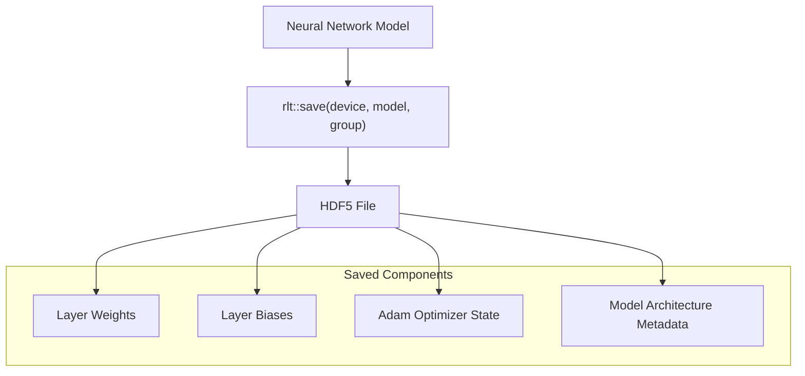
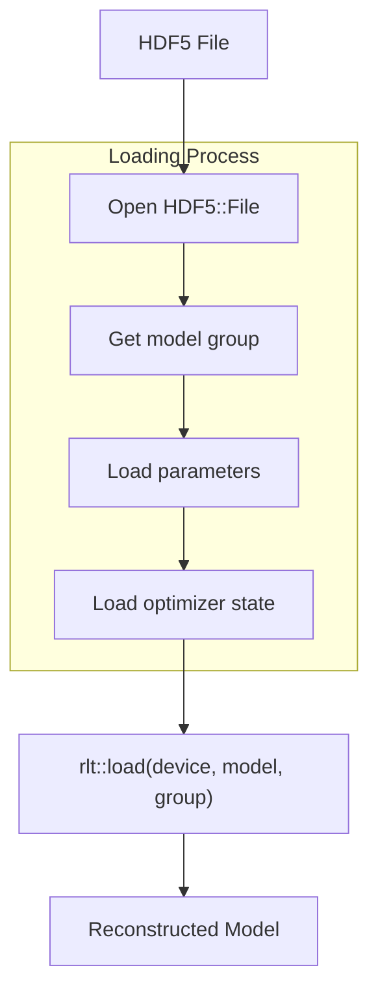
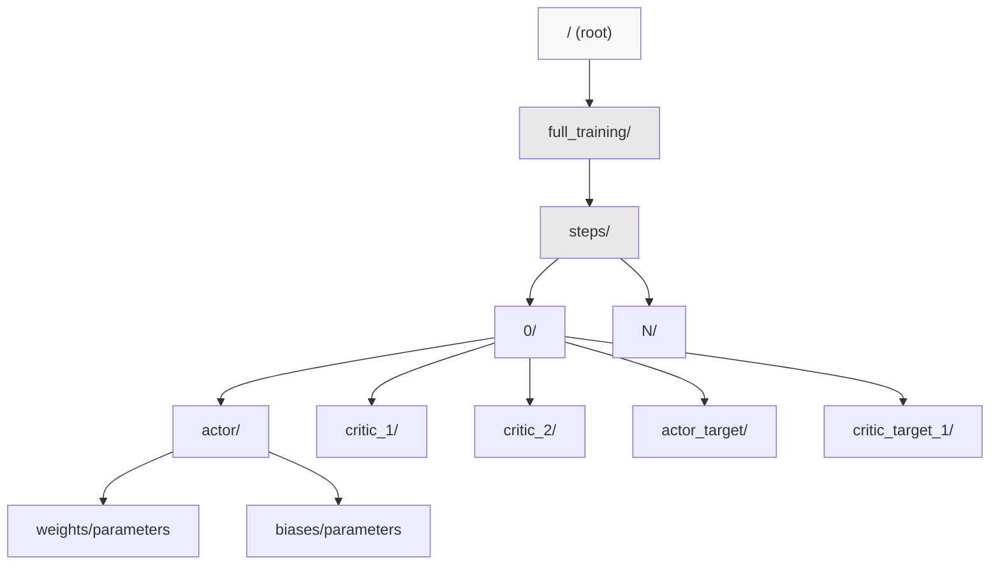
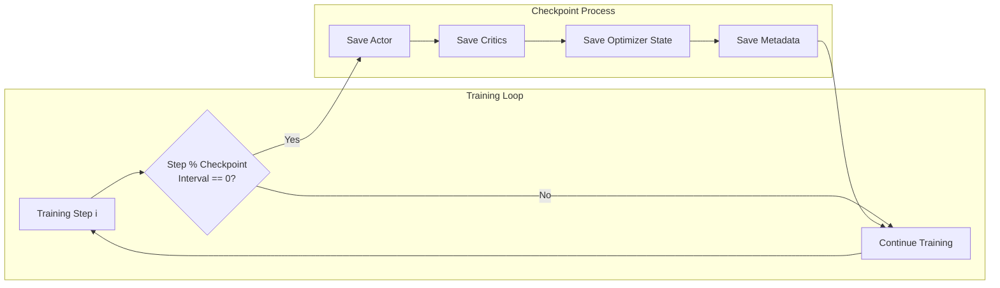
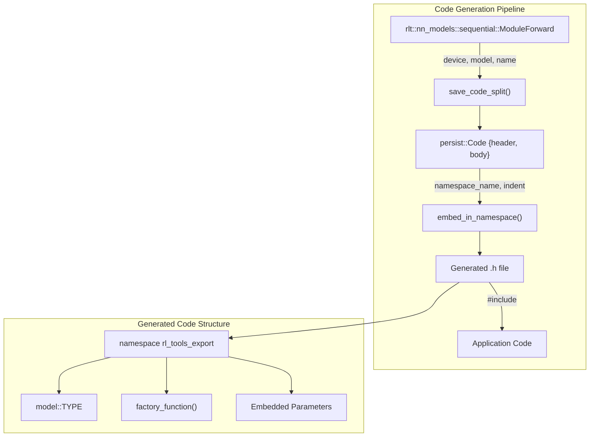
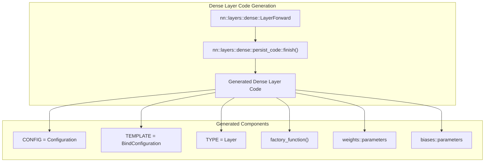
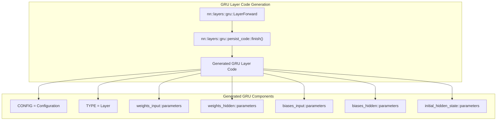
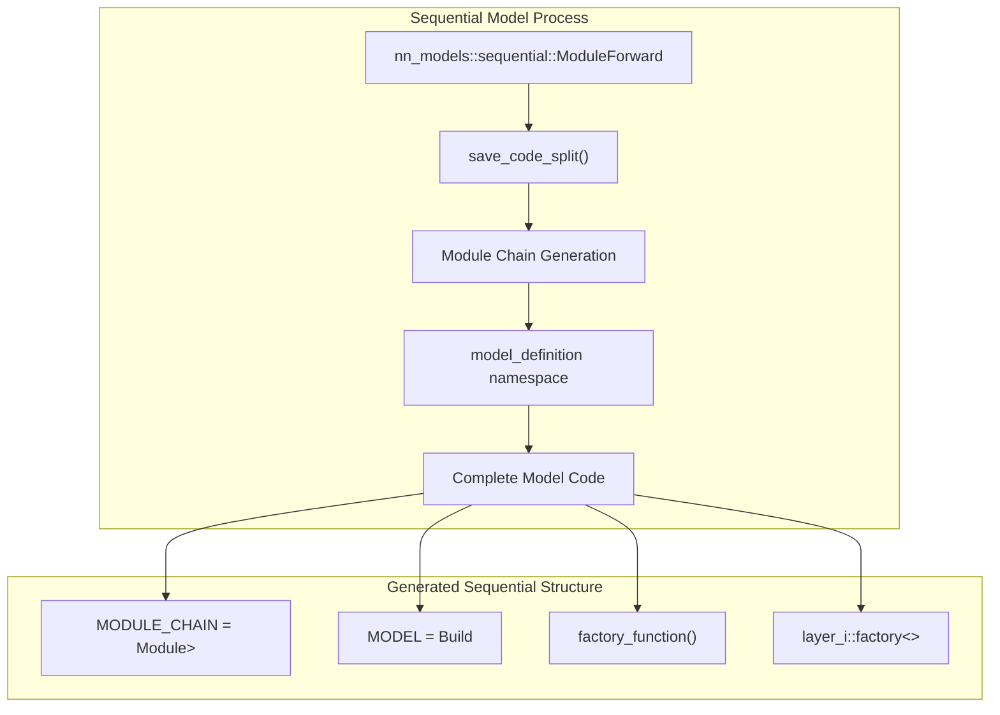
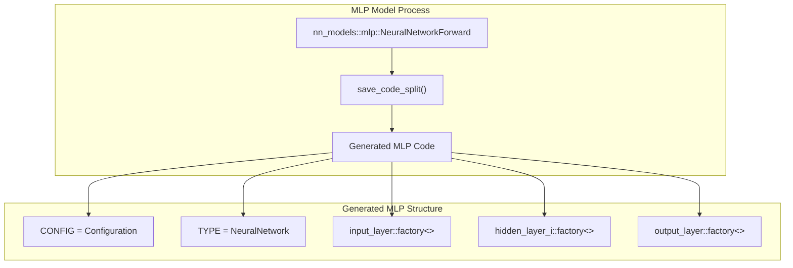
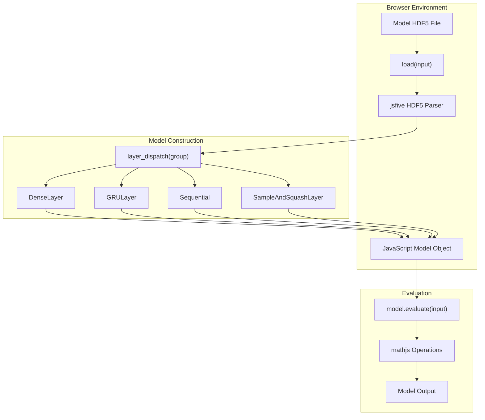

<!-- source: DeepWiki mcp.deepwiki.com · repo rl-tools/rl-tools · page 3.6 Model Persistence · fetched 2026-10-30 -->

# Model Persistence

<details>
<summary>Relevant source files</summary>

The following files were used as context for generating this wiki page:

- [src/rl/environments/pendulum/sac/wasm/full_training.h](src/rl/environments/pendulum/sac/wasm/full_training.h)
- [src/rl/environments/pendulum/td3/arm/training.h](src/rl/environments/pendulum/td3/arm/training.h)
- [static/rltools.js/.gitignore](static/rltools.js/.gitignore)
- [static/rltools.js/README.md](static/rltools.js/README.md)
- [static/rltools.js/main.js](static/rltools.js/main.js)
- [tests/src/nn/default_network_mlp.h](tests/src/nn/default_network_mlp.h)
- [tests/src/nn/full_training_mlp.cpp](tests/src/nn/full_training_mlp.cpp)
- [tests/src/nn/test_mlp.cpp](tests/src/nn/test_mlp.cpp)
- [tests/src/rl/algorithms/td3/first_stage_mlp.cpp](tests/src/rl/algorithms/td3/first_stage_mlp.cpp)
- [tests/src/rl/algorithms/td3/full_training_dummy_dep.cpp](tests/src/rl/algorithms/td3/full_training_dummy_dep.cpp)
- [tests/src/rl/algorithms/td3/second_stage_mlp.cpp](tests/src/rl/algorithms/td3/second_stage_mlp.cpp)
- [tests/src/rl/environments/pendulum/pendulum.cpp](tests/src/rl/environments/pendulum/pendulum.cpp)

</details>


RLtools provides multiple model persistence mechanisms for different deployment scenarios:

1. **HDF5 Format**: Standard serialization for saving/loading models during and after training
2. **Checkpointing**: Periodic model saving during training for reproducibility and debugging
3. **C++ Code Generation**: Zero-overhead export to standalone C++ headers for embedded deployment
4. **rltools.js Loading**: Browser-based model loading via WebAssembly

Each approach serves distinct use cases: HDF5 for development and experimentation, checkpointing for training workflows, code generation for production embedded systems, and rltools.js for web deployment.

## HDF5 Persistence

The HDF5 backend provides runtime model serialization using the HighFive C++ library. Models can be saved to and loaded from HDF5 files during training, testing, and deployment.

### Saving Models to HDF5



The `save` operation is implemented for all network components through template specialization:

| Component | Save Function | Location |
|-----------|--------------|----------|
| Dense Layer | `save(device, layer, group)` | [include/rl_tools/nn/layers/dense/persist.h]() |
| GRU Layer | `save(device, layer, group)` | [include/rl_tools/nn/layers/gru/persist.h]() |
| MLP Model | `save(device, model, group)` | [include/rl_tools/nn_models/mlp/persist.h]() |
| Sequential Model | `save(device, model, group)` | [include/rl_tools/nn_models/sequential/persist.h]() |

Sources: [include/rl_tools/persist/backends/hdf5/operations_cpu.h](), [tests/src/rl/algorithms/td3/second_stage_mlp.cpp:223-234]()

### Loading Models from HDF5



Example loading workflow from test code:

```cpp
// Open HDF5 file
auto data_file = HighFive::File(get_data_file_path(), HighFive::File::ReadOnly);

// Navigate to model group
auto step_group = data_file.getGroup("full_training").getGroup("steps").getGroup(std::to_string(step));

// Load actor network
rlt::persist::backends::hdf5::Group<> actor_group = {step_group.getGroup("actor")};
rlt::load(device, actor_critic.actor.content, actor_group);

// Load critic networks
rlt::persist::backends::hdf5::Group<> critic_1_group = {step_group.getGroup("critic_1")};
rlt::load(device, actor_critic.critics[0].content, critic_1_group);
```

Sources: [tests/src/rl/algorithms/td3/second_stage_mlp.cpp:113-118](), [tests/src/rl/algorithms/td3/first_stage_mlp.cpp:163-167]()

### HDF5 File Structure

Training checkpoints use hierarchical HDF5 groups to organize multiple training steps:



Sources: [tests/src/rl/algorithms/td3/second_stage_mlp.cpp:114-117](), [tests/src/nn/test_mlp.cpp:96-113]()

## Checkpointing During Training

Checkpointing saves model snapshots at regular intervals during training for reproducibility, debugging, and post-training analysis.

### Checkpoint Workflow



The TD3 tests demonstrate checkpoint-based training verification where each training step is saved and can be replayed:

```cpp
// Iterate through saved training steps
auto steps_group = full_training_group.getGroup("steps");
TI num_steps = std::min(steps_group.getNumberObjects(), (typename DEVICE::index_t)1000);

for(TI step_i = 0; step_i < num_steps; step_i++){
    auto _step_group = steps_group.getGroup(std::to_string(step_i));
    rlt::persist::backends::hdf5::Group<> step_group = {_step_group};
    
    // Load training batch
    if(_step_group.exist("critics_batch")){
        std::vector<std::vector<T>> batch;
        _step_group.getDataSet("critics_batch").read(batch);
        
        // Perform training step
        rlt::train_critic(device, actor_critic, actor_critic.critics[0], 
                         critic_batch, actor_critic.critic_optimizers[0], ...);
        
        // Verify against saved checkpoint
        rlt::utils::typing::remove_reference_t<decltype(actor_critic.critics[0])> post_critic_1;
        auto critic1_group = rlt::get_group(device, step_group, "critic1");
        rlt::load(device, post_critic_1.content, critic1_group);
        // Compare current state with checkpoint...
    }
}
```

Sources: [tests/src/rl/algorithms/td3/second_stage_mlp.cpp:249-318](), [tests/src/rl/algorithms/td3/first_stage_mlp.cpp:422-441]()

### Checkpoint Components

| Component | Purpose | Saved Data |
|-----------|---------|------------|
| Actor Network | Policy parameters | Weights, biases, layer states |
| Critic Networks | Value function parameters | Twin critic weights, biases |
| Target Networks | Polyak-averaged targets | Actor/critic target parameters |
| Optimizer State | Adam momentum | First/second moment estimates |
| Training Batch | Reproducibility | Sampled transitions |
| Random State | Deterministic replay | RNG seed/state |

Sources: [tests/src/rl/algorithms/td3/second_stage_mlp.cpp:223-234]()

## C++ Code Generation Architecture

The persistence system generates self-contained C++ code that recreates neural network models:



Sources: [tests/src/nn_models/sequential/persist_code.cpp:151-168](), [include/rl_tools/nn_models/sequential/persist_code.h:14-101]()

## Core Persistence Functions

The persistence system provides several key functions for generating C++ code from trained models:

| Function | Purpose | Returns |
|----------|---------|---------|
| `save_code_split(device, model, name, const_declaration, indent)` | Generates C++ code for a model with separate header and body | `persist::Code` |
| `save_code(device, model, name, const_declaration, indent)` | Convenience function combining header and body | `std::string` |
| `embed_in_namespace(device, code, namespace_name, indent)` | Wraps generated code in a namespace | `persist::Code` |

### persist::Code Structure

The `persist::Code` structure contains two components:

```cpp
struct Code {
    std::string header;  // Include statements and declarations
    std::string body;    // Implementation and data
};
```

Sources: [include/rl_tools/persist/code.h](), [tests/src/nn_models/sequential/persist_code.cpp:151-168]()

## Layer-Specific Code Generation

Different layer types implement specialized persistence logic through dedicated `persist_code.h` files:

### Dense Layer Persistence



### GRU Layer Persistence

The GRU layer generates more complex code due to its recurrent nature:



Sources: [include/rl_tools/nn/layers/dense/persist_code.h:44-125](), [include/rl_tools/nn/layers/gru/persist_code.h:14-116]()

## Model-Level Code Generation

Complete models use compositional code generation that combines multiple layers:

### Sequential Model Generation



### MLP Model Generation

MLP models generate structured code for feedforward networks:



Sources: [include/rl_tools/nn_models/sequential/persist_code.h:14-101](), [include/rl_tools/nn_models/mlp/persist_code.h:14-109]()

## Practical Example: Sequential Model Persistence

The test suite demonstrates complete model persistence workflow:

```cpp
// Create a sequential model with multiple layers
using LAYER_1_CONFIG = rlt::nn::layers::dense::Configuration<T, TI, 64, 
    rlt::nn::activation_functions::ActivationFunction::RELU>;
using LAYER_1 = rlt::nn::layers::dense::BindConfiguration<LAYER_1_CONFIG>;

template <typename T_CONTENT, typename T_NEXT_MODULE = rlt::nn_models::sequential::OutputModule>
using Module = typename rlt::nn_models::sequential::Module<T_CONTENT, T_NEXT_MODULE>;

using MODULE_CHAIN = Module<LAYER_1, Module<LAYER_2, Module<LAYER_3>>>;
using MODEL = typename rlt::nn_models::sequential::Build<CAPABILITY, MODULE_CHAIN, INPUT_SHAPE>;

// Generate code
auto model_code = rlt::save_code_split(device, model, "model", true, 1);
auto wrapped = rlt::embed_in_namespace(device, {model_code.header, model_code.body}, 
                                      "rl_tools_export", 0);

// Write to file
std::ofstream file("model_code.h");
file << wrapped.header << "\n" << wrapped.body;

// Usage in application
const rl_tools_export::model::TYPE module = rl_tools_export::model::factory_function();
rlt::evaluate(device, module, input, output, buffer, rng);
```

Sources: [tests/src/nn_models/sequential/persist_code.cpp:125-170](), [tests/src/nn_models/sequential/persist_code_compile.cpp:18-53]()

## Implementation Hierarchy

The persistence system follows a hierarchical template specialization pattern:

```mermaid
classDiagram
    class "persist::Code" {
        +string header
        +string body
    }
    
    class "save_code_split" {
        +template<typename DEVICE, typename SPEC>
        +persist::Code operator()
    }
    
    class "Layer persist_code" {
        +finish()
        +get_activation_function_string()
        +get_type_string()
    }
    
    class "Model persist_code" {
        +save_code_split()
        +factory generation
        +initializer_list construction
    }
    
    "save_code_split" --> "persist::Code" : returns
    "Layer persist_code" --> "save_code_split" : implements
    "Model persist_code" --> "Layer persist_code" : uses
    
    class "DenseLayer" {
        +LayerForward<SPEC>
        +LayerBackward<SPEC>
        +LayerGradient<SPEC>
    }
    
    class "GRULayer" {
        +LayerForward<SPEC>
        +LayerBackward<SPEC>
        +LayerGradient<SPEC>
    }
    
    class "SequentialModel" {
        +ModuleForward<SPEC>
        +num_layers()
        +MODULE_CHAIN
    }
    
    class "MLPModel" {
        +NeuralNetworkForward<SPEC>
        +input_layer
        +hidden_layers
        +output_layer
    }
    
    "DenseLayer" --> "Layer persist_code" : specialized for
    "GRULayer" --> "Layer persist_code" : specialized for
    "SequentialModel" --> "Model persist_code" : specialized for
    "MLPModel" --> "Model persist_code" : specialized for
```

## Capability-Based Code Generation

The persistence system generates different code structures based on neural network capabilities:

| Capability | Generated Structure | Use Case |
|------------|-------------------|----------|
| `nn::capability::Forward<>` | Parameters only | Inference-only deployment |
| `nn::capability::Backward<>` | Parameters + intermediate buffers | Training with backward pass |
| `nn::capability::Gradient<Parameters>` | Full training structure | Complete training capability |

### Capability-Specific Initializers

Different capabilities generate different initializer lists:

```cpp
// Forward capability
initializer_list = "{weights::parameters, biases::parameters}";

// Backward capability  
initializer_list = "{{weights::parameters, biases::parameters}, pre_activations::container}";

// Gradient capability
initializer_list = "{{{weights::parameters, biases::parameters}, pre_activations::container}, output::container}";
```

Sources: [include/rl_tools/nn/layers/dense/persist_code.h:74-94](), [include/rl_tools/nn/capability/persist_code.h]()

## Supported Layer Types

Each layer type implements specialized persistence functions:

| Layer Type | Key Parameters | Implementation |
|------------|---------------|----------------|
| Dense | `weights`, `biases` | [include/rl_tools/nn/layers/dense/persist_code.h]() |
| GRU | `weights_input`, `weights_hidden`, `biases_input`, `biases_hidden`, `initial_hidden_state` | [include/rl_tools/nn/layers/gru/persist_code.h]() |
| Standardize | `mean`, `precision` | [include/rl_tools/nn/layers/standardize/persist_code.h]() |
| Sample and Squash | `log_alpha`, `log_probabilities`, `pre_squashing`, `noise` | [include/rl_tools/nn/layers/sample_and_squash/persist_code.h]() |

## Model Architecture Support

Different model architectures have specialized persistence implementations:

| Model Type | Implementation File | Key Features |
|------------|-------------------|--------------|
| MLP | [include/rl_tools/nn_models/mlp/persist_code.h]() | Feedforward networks with configurable layers |
| MLP Unconditional StdDev | [include/rl_tools/nn_models/mlp_unconditional_stddev/persist_code.h]() | Policy networks with separate standard deviation |
| Sequential | [include/rl_tools/nn_models/sequential/persist_code.h]() | Flexible layer composition with MODULE_CHAIN |

Sources: [include/rl_tools/nn/layers/dense/persist_code.h](), [include/rl_tools/nn/layers/gru/persist_code.h](), [include/rl_tools/nn_models/sequential/persist_code.h]()

## Complete Example: GRU Model Persistence

### Sequential Model with GRU Layer

```cpp
// Define GRU configuration
static constexpr TI SEQUENCE_LENGTH = 2;
static constexpr TI BATCH_SIZE = 3;
static constexpr TI INPUT_DIM = 4;
static constexpr TI OUTPUT_DIM = 5;
using INPUT_SHAPE = rlt::tensor::Shape<TI, SEQUENCE_LENGTH, BATCH_SIZE, INPUT_DIM>;
using GRU_CONFIG = rlt::nn::layers::gru::Configuration<T, TI, OUTPUT_DIM, 
    rlt::nn::parameters::groups::Normal, true>;
using GRU = rlt::nn::layers::gru::BindConfiguration<GRU_CONFIG>;
using CAPABILITY = rlt::nn::capability::Gradient<rlt::nn::parameters::Adam>;

// Create sequential model with GRU
template <typename T_CONTENT, typename T_NEXT_MODULE = rlt::nn_models::sequential::OutputModule>
using Module = typename rlt::nn_models::sequential::Module<T_CONTENT, T_NEXT_MODULE>;
using MODULE_CHAIN = Module<GRU>;
using GRU_MODEL = rlt::nn_models::sequential::Build<CAPABILITY, MODULE_CHAIN, INPUT_SHAPE>;

// Initialize model
GRU_MODEL gru;
typename GRU_MODEL::Buffer<true> buffer;
rlt::malloc(device, gru);
rlt::init_weights(device, gru, rng);

// Generate code
std::string code_output;
code_output += rlt::save_code(device, gru, "gru", true);
code_output += rlt::save_code(device, input, "input", true);
auto output_tensor = rlt::output(device, gru);
code_output += rlt::save_code(device, output_tensor, "output", true);

// Write to file
std::ofstream file("gru_model.h");
file << code_output;
```

### Generated Code Structure

The persistence system generates code that recreates the exact model structure:

```cpp
namespace gru {
    using CONFIG = RL_TOOLS_NAMESPACE_WRAPPER::rl_tools::nn::layers::gru::Configuration<
        double, long, 5, 
        RL_TOOLS_NAMESPACE_WRAPPER::rl_tools::nn::parameters::groups::Normal, 
        true, false>;
    using TEMPLATE = RL_TOOLS_NAMESPACE_WRAPPER::rl_tools::nn::layers::gru::BindConfiguration<CONFIG>;
    using INPUT_SHAPE = RL_TOOLS_NAMESPACE_WRAPPER::rl_tools::tensor::Shape<long, 2, 3, 4>;
    using CAPABILITY = RL_TOOLS_NAMESPACE_WRAPPER::rl_tools::nn::capability::Gradient<
        RL_TOOLS_NAMESPACE_WRAPPER::rl_tools::nn::parameters::Adam>;
    using TYPE = RL_TOOLS_NAMESPACE_WRAPPER::rl_tools::nn::layers::gru::Layer<CONFIG, CAPABILITY, INPUT_SHAPE>;
    
    const TYPE module = {weights_input::parameters, biases_input::parameters, 
                         weights_hidden::parameters, biases_hidden::parameters, 
                         initial_hidden_state::parameters};
    
    template <typename T_TYPE = TYPE>
    const T_TYPE factory_function(){
        return {weights_input::parameters, biases_input::parameters, 
                weights_hidden::parameters, biases_hidden::parameters, 
                initial_hidden_state::parameters};
    }
}
```

Sources: [tests/src/nn/layers/gru/gru_persist_code.cpp:43-93](), [tests/src/nn/layers/gru/gru_persist_code_compile.cpp:35-66]()

## Loading Models in rltools.js

The rltools.js library enables browser-based model inference by loading HDF5 models via WebAssembly. The JavaScript implementation uses jsfive for HDF5 parsing and mathjs for linear algebra operations.

### Browser Loading Architecture



### Supported Layer Types in rltools.js

| Layer Type | Class | Key Features |
|------------|-------|--------------|
| Dense | `DenseLayer` | Matrix multiply, activation functions |
| GRU | `GRULayer` | Recurrent state, reset/update gates |
| Sequential | `Sequential` | Layer composition, state management |
| Sample and Squash | `SampleAndSquashLayer` | Stochastic policy sampling |
| Standardize | `StandardizeLayer` | Observation normalization |

Sources: [static/rltools.js/main.js:46-100](), [static/rltools.js/main.js:102-165]()

### Loading Process

```javascript
// Load from URL
load("model.hdf5")
    .then(function(model) {
        // Model ready for inference
        const output = model.evaluate(input);
    });

// Load from ArrayBuffer
const buffer = /* ... get ArrayBuffer ... */;
const model = load(buffer);
```

The `load_from_array_buffer` function orchestrates model construction:

```javascript
function load_from_array_buffer(buffer){
    var f = new hdf5.File(buffer, "");
    const model = layer_dispatch(f.get("actor"));
    const input = new Tensor(f.get("example").get("input"));
    const target_output = new Tensor(f.get("example").get("output"));

    // Verify model correctness
    const output = model.evaluate(input.data);
    const diff = math.subtract(output, target_output.data);
    const diff_reduce = math.flatten(diff).valueOf()
        .reduce((a, c) => a + Math.abs(c)) / diff.size().reduce((a, c) => a * c, 1);
    
    console.assert(diff_reduce < 1e-6, "Output is not close enough to target output");
    return model;
}
```

Sources: [static/rltools.js/main.js:312-325](), [static/rltools.js/main.js:275-310]()

### Layer Dispatch and Construction

The `layer_dispatch` function routes HDF5 groups to appropriate layer constructors:

```javascript
function layer_dispatch(group){
    let model = null;
    if(group.attrs.type === "dense") {
        model = new DenseLayer(group);
    }
    else if(group.attrs.type === "gru") {
        model = new GRULayer(group);
    }
    else if(group.attrs.type === "sequential") {
        model = new Sequential(group);
    }
    else if(group.attrs.type === "sample_and_squash") {
        model = new SampleAndSquashLayer(group);
    }
    else if(group.attrs.type === "standardize") {
        model = new StandardizeLayer(group);
    }
    // ... metadata handling
    return model;
}
```

Each layer class extracts parameters from HDF5 groups and implements `evaluate(input)` and `evaluate_step(input, state)` methods for forward pass computation using mathjs.

Sources: [static/rltools.js/main.js:275-310]()

## Persistence Approach Comparison

| Approach | Use Case | Advantages | Limitations |
|----------|----------|-----------|-------------|
| **HDF5 Runtime** | Training, testing, development | Flexible, standard format, tool support | Runtime dependency, parsing overhead |
| **Checkpointing** | Training workflows, debugging | Reproducibility, training history | Large disk usage, management overhead |
| **C++ Code Generation** | Embedded deployment, production | Zero runtime overhead, compile-time safety, no dependencies | Requires recompilation, larger binaries |
| **rltools.js** | Web applications, demos | Browser-native, no installation | JavaScript performance limitations |

Sources: [include/rl_tools/nn_models/sequential/persist_code.h](), [static/rltools.js/main.js:312-343]()

## Supported Types and Compatibility

The persistence system supports all major neural network components in RLtools:

- Tensors of various dimensions and types
- Neural network parameters with different optimization capabilities
- Layer types: Dense, GRU, Standardize, Sample and Squash, etc.
- Model architectures: MLP, Sequential, etc.

Each component type implements the appropriate persistence functions based on its structure and requirements.

Sources: [include/rl_tools/nn/layers/dense/persist_code.h](), [include/rl_tools/nn/layers/gru/persist_code.h](), [include/rl_tools/nn_models/sequential/persist_code.h]()

---

