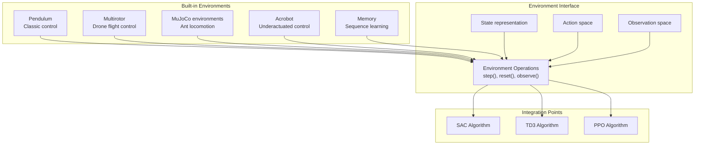
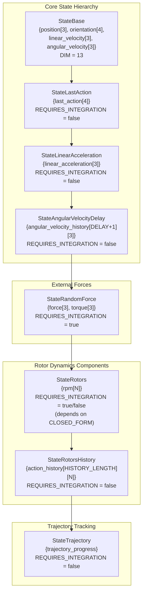
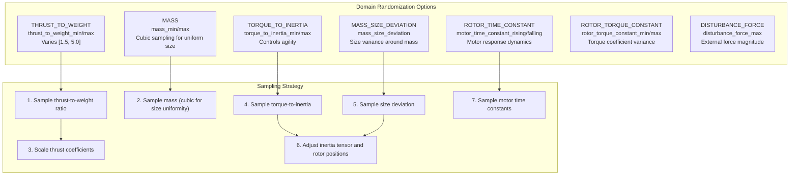
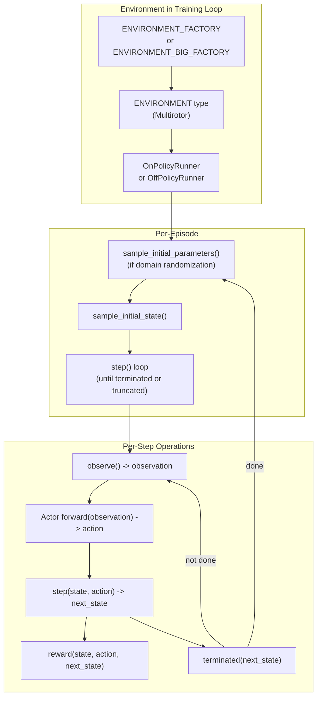
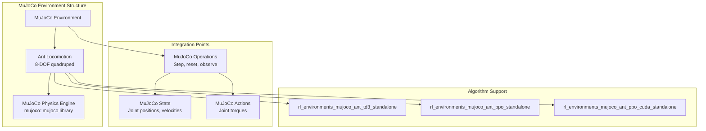
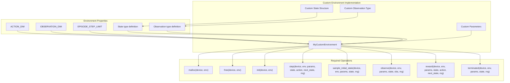

<!-- source: DeepWiki mcp.deepwiki.com · repo rl-tools/rl-tools · page 4 Environments · fetched 2026-10-30 -->

# Environments

<details>
<summary>Relevant source files</summary>

The following files were used as context for generating this wiki page:

- [include/rl_tools/rl/algorithms/ppo/loop/core/config.h](include/rl_tools/rl/algorithms/ppo/loop/core/config.h)
- [include/rl_tools/rl/algorithms/ppo/loop/core/operations_generic.h](include/rl_tools/rl/algorithms/ppo/loop/core/operations_generic.h)
- [include/rl_tools/rl/algorithms/ppo/loop/core/state.h](include/rl_tools/rl/algorithms/ppo/loop/core/state.h)
- [include/rl_tools/rl/algorithms/ppo/operations_generic.h](include/rl_tools/rl/algorithms/ppo/operations_generic.h)
- [include/rl_tools/rl/algorithms/ppo/ppo.h](include/rl_tools/rl/algorithms/ppo/ppo.h)
- [include/rl_tools/rl/components/on_policy_runner/on_policy_runner.h](include/rl_tools/rl/components/on_policy_runner/on_policy_runner.h)
- [include/rl_tools/rl/components/on_policy_runner/operations_generic.h](include/rl_tools/rl/components/on_policy_runner/operations_generic.h)
- [include/rl_tools/rl/components/on_policy_runner/operations_generic_per_env.h](include/rl_tools/rl/components/on_policy_runner/operations_generic_per_env.h)
- [include/rl_tools/rl/components/running_normalizer/running_normalizer.h](include/rl_tools/rl/components/running_normalizer/running_normalizer.h)
- [include/rl_tools/rl/environments/l2f/multirotor.h](include/rl_tools/rl/environments/l2f/multirotor.h)
- [include/rl_tools/rl/environments/l2f/operations_cpu.h](include/rl_tools/rl/environments/l2f/operations_cpu.h)
- [include/rl_tools/rl/environments/l2f/operations_generic.h](include/rl_tools/rl/environments/l2f/operations_generic.h)
- [include/rl_tools/rl/environments/l2f/operations_generic/10_sample_initial_parameters.h](include/rl_tools/rl/environments/l2f/operations_generic/10_sample_initial_parameters.h)
- [include/rl_tools/rl/environments/l2f/operations_generic/30_sample_initial_state.h](include/rl_tools/rl/environments/l2f/operations_generic/30_sample_initial_state.h)
- [include/rl_tools/rl/environments/l2f/operations_generic/70_post_integration.h](include/rl_tools/rl/environments/l2f/operations_generic/70_post_integration.h)
- [include/rl_tools/rl/environments/l2f/operations_multitask_generic.h](include/rl_tools/rl/environments/l2f/operations_multitask_generic.h)
- [include/rl_tools/rl/environments/l2f/operations_multitask_generic_forward.h](include/rl_tools/rl/environments/l2f/operations_multitask_generic_forward.h)
- [include/rl_tools/rl/environments/l2f/parameters/default.h](include/rl_tools/rl/environments/l2f/parameters/default.h)
- [include/rl_tools/rl/environments/l2f/parameters/trajectories/lissajous.h](include/rl_tools/rl/environments/l2f/parameters/trajectories/lissajous.h)
- [src/rl/environments/pendulum/ppo/cpu/CMakeLists.txt](src/rl/environments/pendulum/ppo/cpu/CMakeLists.txt)
- [src/rl/environments/pendulum/ppo/cpu/config.h](src/rl/environments/pendulum/ppo/cpu/config.h)
- [src/rl/environments/pendulum/ppo/cpu/training.cpp](src/rl/environments/pendulum/ppo/cpu/training.cpp)
- [src/rl/environments/pendulum/ppo/cuda/CMakeLists.txt](src/rl/environments/pendulum/ppo/cuda/CMakeLists.txt)
- [src/rl/environments/pendulum/ppo/cuda/training.cu](src/rl/environments/pendulum/ppo/cuda/training.cu)
- [src/rl/zoo/l2f/environment.h](src/rl/zoo/l2f/environment.h)
- [src/rl/zoo/l2f/environment_big.h](src/rl/zoo/l2f/environment_big.h)
- [src/rl/zoo/l2f/ppo.h](src/rl/zoo/l2f/ppo.h)
- [src/rl/zoo/l2f/sac_big.h](src/rl/zoo/l2f/sac_big.h)

</details>


This page documents the reinforcement learning environments available in RLtools, their interfaces, and how to create custom environments. Environments provide the simulated worlds where RL agents learn to perform tasks through interaction.

For information about RL algorithms that train on these environments, see [Reinforcement Learning Algorithms](#2). For neural network components used in environment observation processing, see [Neural Network Components](#3).

## Available Environments

RLtools provides several built-in environments for different types of learning tasks:



Sources: [CMakeLists.txt:37](), [include/rl_tools/rl/environments/l2f/multirotor.h:449-503](), [src/rl/environments/pendulum/td3/cpu/CMakeLists.txt:1-76](), [src/rl/environments/mujoco/ant/CMakeLists.txt:1-36]()

## Environment Interface

All RLtools environments implement a common interface through template specialization and operation overloading. Environments use a specification pattern where the `SPEC` template parameter defines types and constants.

### Core Operations

The environment interface consists of these fundamental operations defined in [include/rl_tools/rl/environments/l2f/operations_generic.h:38-169]():

| Operation | Signature | Description |
|-----------|-----------|-------------|
| `malloc` | `malloc(DEVICE&, Multirotor<SPEC>&)` | Allocates dynamic memory for environment |
| `free` | `free(DEVICE&, Multirotor<SPEC>&)` | Deallocates environment memory |
| `init` | `init(DEVICE&, Multirotor<SPEC>&)` | Initializes environment with default parameters |
| `sample_initial_parameters` | `sample_initial_parameters(DEVICE&, Multirotor<SPEC>&, PARAMETERS&, RNG&)` | Samples randomized dynamics parameters |
| `sample_initial_state` | `sample_initial_state(DEVICE&, Multirotor<SPEC>&, PARAMETERS&, STATE&, RNG&)` | Samples random initial state |
| `step` | `step(DEVICE&, Multirotor<SPEC>&, PARAMETERS&, STATE&, Matrix<ACTION_SPEC>&, STATE&, RNG&) -> T` | Advances simulation by one timestep using RK4 integration |
| `observe` | `observe(DEVICE&, Multirotor<SPEC>&, PARAMETERS&, STATE&, OBSERVATION&, Matrix<OBS_SPEC>&, RNG&)` | Generates observations from current state |
| `reward` | `reward(DEVICE&, Multirotor<SPEC>&, PARAMETERS&, STATE&, Matrix<ACTION_SPEC>&, STATE&, RNG&) -> T` | Computes reward signal |
| `terminated` | `terminated(DEVICE&, Multirotor<SPEC>&, PARAMETERS&, STATE&, RNG&) -> bool` | Checks if episode should terminate |

### Environment Specification Pattern

```mermaid
graph TB
    subgraph "Environment Type Structure"
        EnvSpec["Specification<T, TI, STATIC_PARAMETERS>"]
        StaticParams["STATIC_PARAMETERS"]
        RuntimeParams["Parameters (runtime)"]
    end
    
    subgraph "Static Parameters Define"
        StateType["STATE_TYPE"]
        ObsType["OBSERVATION_TYPE"]
        ObsPrivType["OBSERVATION_TYPE_PRIVILEGED"]
        ParamsType["PARAMETERS (type)"]
        NSubsteps["N_SUBSTEPS"]
        EpisodeLimit["EPISODE_STEP_LIMIT"]
        ActionHistLen["ACTION_HISTORY_LENGTH"]
    end
    
    subgraph "Runtime Parameters Include"
        Dynamics["dynamics (N rotors)"]
        Integration["integration (dt)"]
        MDP["mdp (init, reward, noise, termination)"]
        DomainRand["domain_randomization"]
        Trajectory["trajectory"]
    end
    
    EnvSpec --> StaticParams
    EnvSpec --> RuntimeParams
    
    StaticParams --> StateType
    StaticParams --> ObsType
    StaticParams --> ObsPrivType
    StaticParams --> ParamsType
    StaticParams --> NSubsteps
    StaticParams --> EpisodeLimit
    StaticParams --> ActionHistLen
    
    RuntimeParams --> Dynamics
    RuntimeParams --> Integration
    RuntimeParams --> MDP
    RuntimeParams --> DomainRand
    RuntimeParams --> Trajectory
```



The `step` function uses RK4 integration [include/rl_tools/rl/environments/l2f/operations_generic.h:95-130]() with support for multiple substeps. Actions are scaled from normalized range [-1, 1] to the dynamics-specific action limits [include/rl_tools/rl/environments/l2f/operations_generic.h:104-110]().

Sources: [include/rl_tools/rl/environments/l2f/operations_generic.h:38-169](), [include/rl_tools/rl/environments/l2f/multirotor.h:14-221]()
</old_str>

<new_str>
## L2F (Learn to Fly) Environment

The L2F environment (`rl::environments::Multirotor<SPEC>`) provides a sophisticated multirotor drone simulation with complex state representation, configurable dynamics, and advanced features like domain randomization and trajectory tracking. It is defined in [include/rl_tools/rl/environments/l2f/multirotor.h:1-850]().

### State Representation

The L2F environment uses a composable state system where components are chained using a linked-list pattern through the `NEXT_COMPONENT` template parameter.

#### Base State Components



Each state component implements:
- `initial_state()`: Sets default values [include/rl_tools/rl/environments/l2f/operations_generic/20_initial_state.h:1-200]()
- `_sample_initial_state()`: Randomizes initial values [include/rl_tools/rl/environments/l2f/operations_generic/30_sample_initial_state.h:1-250]()
- `post_integration()`: Updates non-integrated components after physics step [include/rl_tools/rl/environments/l2f/operations_generic/70_post_integration.h:1-200]()

The `StateBase` contains the 13-dimensional continuous state integrated via RK4, while other components like `StateLastAction` and `StateRotorsHistory` are updated discretely in `post_integration()`.

Sources: [include/rl_tools/rl/environments/l2f/multirotor.h:624-850](), [include/rl_tools/rl/environments/l2f/operations_generic/70_post_integration.h:20-149]()

### Observation Composition System

The observation system uses a linked-list pattern enabling flexible, composable observations. Each observation component defines its `CURRENT_DIM` and chains to a `NEXT_COMPONENT`.

#### Available Observation Components

| Component | Class | Dimensions | Description |
|-----------|-------|------------|-------------|
| Position | `observation::Position<SPEC>` | 3 | Drone position (x, y, z) |
| Orientation (Quaternion) | `observation::OrientationQuaternion<SPEC>` | 4 | Orientation as quaternion |
| Orientation (Rotation Matrix) | `observation::OrientationRotationMatrix<SPEC>` | 9 | Orientation as 3×3 rotation matrix |
| Linear Velocity | `observation::LinearVelocity<SPEC>` | 3 | Body-frame linear velocity |
| Angular Velocity | `observation::AngularVelocity<SPEC>` | 3 | Body-frame angular velocity |
| Angular Velocity (Delayed) | `observation::AngularVelocityDelayed<SPEC>` | 3 | Delayed angular velocity for sensor lag |
| IMU Accelerometer | `observation::IMUAccelerometer<SPEC>` | 3 | Simulated IMU acceleration |
| Action History | `observation::ActionHistory<SPEC>` | 4×HISTORY_LENGTH | Previous actions for Markovification |
| Rotor Speeds | `observation::RotorSpeeds<SPEC>` | 4 | Current RPM values (privileged) |
| Random Force | `observation::RandomForce<SPEC>` | 6 | Applied disturbance forces/torques (privileged) |
| Trajectory Tracking Position | `observation::TrajectoryTrackingPosition<SPEC>` | 3 | Position error from trajectory |
| Trajectory Tracking Velocity | `observation::TrajectoryTrackingLinearVelocity<SPEC>` | 3 | Velocity error from trajectory |



```mermaid
graph LR
    subgraph "Observation Composition Example"
        Pos["Position<br/>DIM=3"]
        Orient["OrientationRotationMatrix<br/>DIM=9"]
        LinVel["LinearVelocity<br/>DIM=3"]
        AngVel["AngularVelocity<br/>DIM=3"]
        ActHist["ActionHistory<br/>DIM=4*16=64"]
        Last["LastComponent<br/>DIM=0"]
    end
    
    subgraph "Total Observation"
        TotalObs["Total DIM = 3+9+3+3+64 = 82"]
    end
    
    Pos -->|"NEXT_COMPONENT"| Orient
    Orient -->|"NEXT_COMPONENT"| LinVel
    LinVel -->|"NEXT_COMPONENT"| AngVel
    AngVel -->|"NEXT_COMPONENT"| ActHist
    ActHist -->|"NEXT_COMPONENT"| Last
    
    Last --> TotalObs
```

The observation is computed recursively in [include/rl_tools/rl/environments/l2f/operations_generic/40_observe.h:1-500](). Each component calls `_observe()` on itself, then dispatches to the next component.

**Privileged observations** (for asymmetric actor-critic) include additional information like rotor speeds and disturbance forces that would not be available to a real robot.

Sources: [include/rl_tools/rl/environments/l2f/multirotor.h:236-615](), [include/rl_tools/rl/environments/l2f/operations_cpu.h:16-135](), [src/rl/zoo/l2f/environment.h:141-151]()

### Dynamics Models and Registry

The environment supports multiple quadrotor configurations through a dynamics registry in [include/rl_tools/rl/environments/l2f/parameters/dynamics/registry.h]().

#### Dynamics Parameters

The `parameters::Dynamics<T, TI, N>` structure defines [include/rl_tools/rl/environments/l2f/multirotor.h:25-44]():

```
struct Dynamics {
    T rotor_positions[N][3];              // Rotor positions in body frame
    T rotor_thrust_directions[N][3];      // Thrust direction unit vectors
    T rotor_torque_directions[N][3];      // Torque direction unit vectors  
    T rotor_thrust_coefficients[N][3];    // Quadratic thrust curve coefficients
    T rotor_torque_constants[N];          // Torque coefficient for each rotor
    T rotor_time_constants_rising[N];     // Motor spool-up time constant
    T rotor_time_constants_falling[N];    // Motor spool-down time constant
    T mass;                                // Total mass
    T gravity[3];                          // Gravity vector
    T J[3][3];                            // Inertia tensor
    T J_inv[3][3];                        // Inverse inertia tensor
    T hovering_throttle_relative;         // Hovering throttle [0,1]
    ActionLimit action_limit;             // Min/max action values
}
```

#### Pre-defined Models

The registry provides models accessed via `parameters::dynamics::registry<MODEL, SPEC>`:

| Model Enum | Description | Use Case |
|------------|-------------|----------|
| `REGISTRY::crazyflie` | Bitcraze Crazyflie 2.x | Micro quadrotor, research |
| `REGISTRY::x500_sim` | PX4 X500 (simulation) | Mid-size quadrotor simulation |
| `REGISTRY::x500_real` | PX4 X500 (real-world) | Real hardware deployment |
| `REGISTRY::arpl_vision` | ARPL vision-based model | Vision-based control |
| `REGISTRY::race` | Racing quadrotor | Aggressive flight |
| `REGISTRY::soft_rigid` | Soft/rigid mixed dynamics | Research configurations |

Models can be rotated/remapped using `permute_rotors()` [include/rl_tools/rl/environments/l2f/operations_generic.h:47-64]() for motor randomization.

Sources: [include/rl_tools/rl/environments/l2f/multirotor.h:25-44](), [src/rl/zoo/l2f/environment_big.h:23-24](), [include/rl_tools/rl/environments/l2f/operations_generic.h:47-64]()

### Domain Randomization

Domain randomization is controlled by `ParametersDomainRandomization<SPEC>` and sampled in `sample_initial_parameters()` [include/rl_tools/rl/environments/l2f/operations_generic/10_sample_initial_parameters.h:36-195]().

#### Randomization Parameters



The randomization process [include/rl_tools/rl/environments/l2f/operations_generic/10_sample_initial_parameters.h:54-195]():

1. **Thrust-to-Weight**: Directly scales thrust coefficients to achieve desired ratio
2. **Mass**: Sampled uniformly in size (∛mass) to avoid bias toward large quadrotors  
3. **Torque-to-Inertia**: Controls rotational agility by adjusting inertia tensor
4. **Size Deviation**: Scales rotor positions independently of mass for varied geometries
5. **Motor Dynamics**: Randomizes first-order motor response time constants

Each parameter can be independently enabled/disabled via `DOMAIN_RANDOMIZATION_OPTIONS` compile-time flags.

Sources: [include/rl_tools/rl/environments/l2f/operations_generic/10_sample_initial_parameters.h:36-195](), [include/rl_tools/rl/environments/l2f/multirotor.h:106-127]()

### Trajectory Tracking

The environment supports reference trajectory tracking through `StateTrajectory<SPEC>` and `ParametersTrajectory<SPEC>`.

#### Trajectory Definition

Trajectories are pre-computed arrays of `Step<T>` waypoints [include/rl_tools/rl/environments/l2f/parameters/trajectories/trajectory.h:9-27]():

```
struct Step {
    T position[3];           // Desired position
    T yaw;                   // Desired yaw angle
    T linear_velocity[3];    // Desired velocity
    T yaw_velocity;          // Desired yaw rate
}

struct Trajectory {
    Step steps[LENGTH];
}
```

Trajectories are evaluated at the current timestep to provide desired state in `get_desired_state()` [include/rl_tools/rl/environments/l2f/operations_generic/35_get_desired_state.h:1-100]().

#### Lissajous Curves

The primary trajectory type is Lissajous curves [include/rl_tools/rl/environments/l2f/parameters/trajectories/lissajous.h:12-60]():

```
struct Parameters {
    T A, B, C;           // Amplitudes in x, y, z
    T a, b, c;           // Frequency ratios
    T interval;          // Total period duration
    T ramp_duration;     // Initial ramp-up time
}
```

Position: `[A·sin(a·ω·t), B·sin(b·ω·t), C·sin(c·ω·t)]` where `ω = 2π/interval`

Default parameters generate a figure-8 pattern in the xy-plane:
- A=0.5, B=1.0, C=0.0 (no z motion)
- a=2.0, b=1.0 (2:1 frequency ratio)
- interval=6.5 seconds

The trajectory is pre-computed during initialization via `fill(device, params, trajectory, rng)` [include/rl_tools/rl/environments/l2f/parameters/trajectories/lissajous.h:62-68]().

**Observation Components for Tracking:**
- `observation::TrajectoryTrackingPosition`: Position error (current - desired)
- `observation::TrajectoryTrackingLinearVelocity`: Velocity error
- `observation::TrajectoryTrackingLookahead`: Future waypoints for prediction

Sources: [include/rl_tools/rl/environments/l2f/parameters/trajectories/lissajous.h:12-68](), [include/rl_tools/rl/environments/l2f/operations_generic/35_get_desired_state.h:1-100](), [include/rl_tools/rl/environments/l2f/multirotor.h:189-206]()

### Reward Functions

Reward functions are implemented as composable functors in [include/rl_tools/rl/environments/l2f/parameters/reward_functions/]().

#### Squared Reward Function

The primary reward function is `reward_functions::Squared<T>` [include/rl_tools/rl/environments/l2f/parameters/reward_functions/squared/operations_generic.h:1-150]():

```
struct Squared {
    bool non_negative;
    T scale;
    T constant;
    T termination_penalty;
    T position;                    // Weight for position error²
    T position_clip;               // Clipping threshold
    T orientation;                 // Weight for orientation error²
    T linear_velocity;             // Weight for velocity error²
    T angular_velocity;            // Weight for angular velocity²
    T linear_acceleration;         // Weight for acceleration²
    T angular_acceleration;        // Weight for angular acceleration²
    T action;                      // Weight for action magnitude²
    T d_action;                    // Weight for action change²
    T position_error_integral;     // Weight for integral error
}
```

The reward is computed as:
```
reward = scale * (constant 
    - position_weight * ||pos_error||²
    - orientation_weight * ||orient_error||²
    - linear_velocity_weight * ||vel_error||²
    - ...
    - d_action_weight * ||action_t - action_{t-1}||²
) + termination_penalty (if terminated)
```

The squared terms naturally provide stronger penalties for larger errors while keeping derivatives smooth for gradient-based learning.

Sources: [include/rl_tools/rl/environments/l2f/parameters/reward_functions/squared/operations_generic.h:1-150](), [src/rl/zoo/l2f/environment.h:26-41]()

### Integration with Training

The L2F environment integrates with training loops through the `OnPolicyRunner` (for PPO) or `OffPolicyRunner` (for SAC/TD3).



See [src/rl/zoo/l2f/environment.h:18-162]() for environment factory configuration and [src/rl/zoo/l2f/sac_big.h:1-81](), [src/rl/zoo/l2f/ppo.h:1-53]() for algorithm-specific configurations.

Sources: [src/rl/zoo/l2f/environment.h:18-162](), [src/rl/zoo/l2f/sac_big.h:18-78](), [src/rl/zoo/l2f/ppo.h:23-49](), [include/rl_tools/rl/components/on_policy_runner/operations_generic_per_env.h:8-76]()

## Pendulum Environment

The pendulum environment (`rl::environments::Pendulum<SPEC>`) implements the classic inverted pendulum control problem with continuous control. It serves as a simple testbed for RL algorithms.

### Environment Properties

| Property | Value | Description |
|----------|-------|-------------|
| State | `{angle, angular_velocity}` | 2D continuous state |
| Action | `{torque}` | 1D continuous control |
| Observation | `{cos(angle), sin(angle), angular_velocity}` | 3D observation vector |
| Episode Limit | 200 steps | Maximum episode length |

The environment is integrated with:
- **TD3**: [src/rl/environments/pendulum/td3/cpu/CMakeLists.txt:16-26]()
- **SAC**: [src/rl/environments/pendulum/sac/cpu/CMakeLists.txt:5-18]()  
- **PPO**: [src/rl/environments/pendulum/ppo/cpu/CMakeLists.txt:8-10]()

PPO configuration for Pendulum [src/rl/environments/pendulum/ppo/cpu/config.h:1-45]():
```
LOOP_CORE_PARAMETERS:
    BATCH_SIZE = 256
    ACTOR_HIDDEN_DIM = 64
    CRITIC_HIDDEN_DIM = 64
    ON_POLICY_RUNNER_STEPS_PER_ENV = 1024
    N_ENVIRONMENTS = 4
    EPISODE_STEP_LIMIT = 200
    
PPO_PARAMETERS:
    ACTION_ENTROPY_COEFFICIENT = 0.0
    N_EPOCHS = 2
    GAMMA = 0.9
    INITIAL_ACTION_STD = 2.0
```

The Pendulum environment also demonstrates:
- Observation scaling wrapper (`rl::environment_wrappers::ScaleObservations`) [src/rl/environments/pendulum/ppo/cpu/config.h:8-9]()
- Static memory allocation for embedded deployment [src/rl/environments/pendulum/ppo/cpu/CMakeLists.txt:2-6]()
- CUDA implementation [src/rl/environments/pendulum/ppo/cuda/training.cu:1-114]()

Sources: [src/rl/environments/pendulum/ppo/cpu/config.h:1-45](), [src/rl/environments/pendulum/ppo/cpu/CMakeLists.txt:1-17](), [src/rl/environments/pendulum/ppo/cuda/training.cu:32-42]()

## L2F (Learn to Fly) Environment

The L2F environment provides a sophisticated multirotor drone simulation with complex state representation and configurable dynamics:


## MuJoCo Integration

RLtools integrates with the MuJoCo physics engine for complex robotics simulations:



The MuJoCo integration requires the `RL_TOOLS_RL_ENVIRONMENTS_ENABLE_MUJOCO` CMake option and supports both CPU and CUDA implementations.

Sources: [CMakeLists.txt:186-223](), [src/rl/environments/mujoco/ant/ppo/cpu/CMakeLists.txt:1-54](), [src/rl/environments/mujoco/ant/ppo/cuda/CMakeLists.txt:1-103]()

## Creating Custom Environments

To create a custom environment, implement the required operations for your environment type:



The environment must define template specializations for all required operations and provide the necessary type definitions and constants.

Sources: [include/rl_tools/rl/environments/l2f/operations_generic.h:262-287](), [include/rl_tools/rl/environments/l2f/multirotor.h:449-503]()

---

