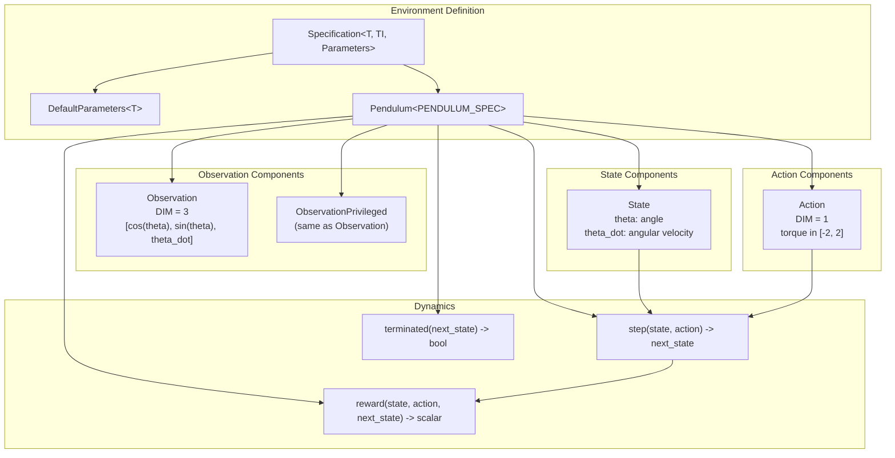
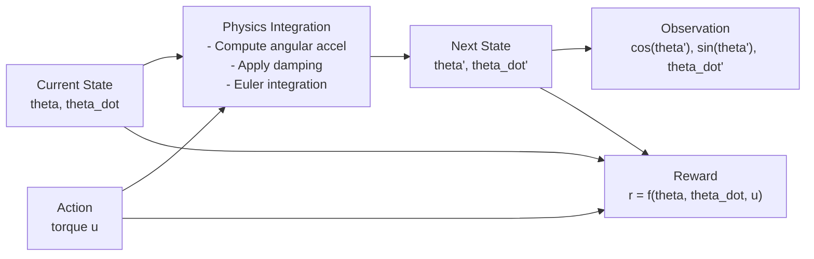
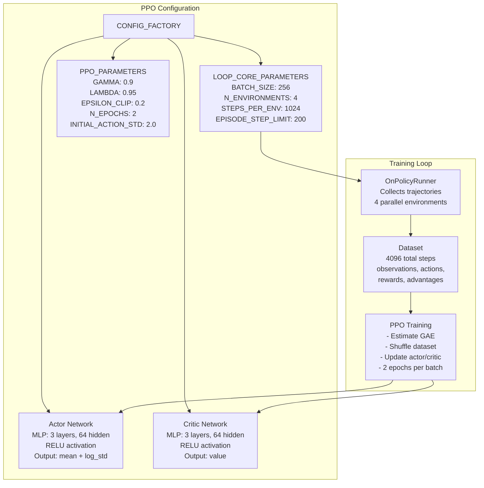
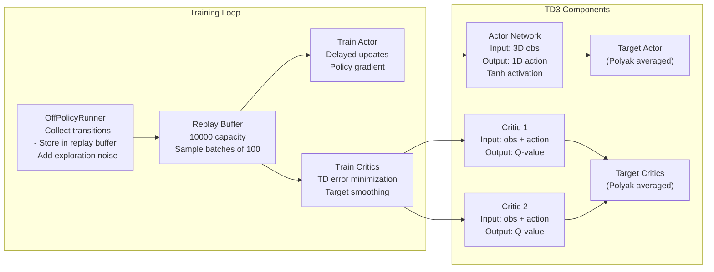
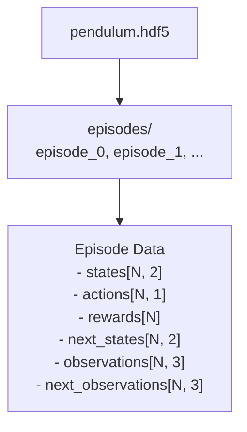

<!-- source: DeepWiki mcp.deepwiki.com · repo rl-tools/rl-tools · page 4.1 Pendulum · fetched 2026-10-30 -->

# Pendulum

<details>
<summary>Relevant source files</summary>

The following files were used as context for generating this wiki page:

- [include/rl_tools/rl/algorithms/ppo/loop/core/config.h](include/rl_tools/rl/algorithms/ppo/loop/core/config.h)
- [include/rl_tools/rl/algorithms/ppo/loop/core/operations_generic.h](include/rl_tools/rl/algorithms/ppo/loop/core/operations_generic.h)
- [include/rl_tools/rl/algorithms/ppo/loop/core/state.h](include/rl_tools/rl/algorithms/ppo/loop/core/state.h)
- [include/rl_tools/rl/algorithms/ppo/operations_generic.h](include/rl_tools/rl/algorithms/ppo/operations_generic.h)
- [include/rl_tools/rl/algorithms/ppo/ppo.h](include/rl_tools/rl/algorithms/ppo/ppo.h)
- [include/rl_tools/rl/components/on_policy_runner/on_policy_runner.h](include/rl_tools/rl/components/on_policy_runner/on_policy_runner.h)
- [include/rl_tools/rl/components/on_policy_runner/operations_generic.h](include/rl_tools/rl/components/on_policy_runner/operations_generic.h)
- [include/rl_tools/rl/components/on_policy_runner/operations_generic_per_env.h](include/rl_tools/rl/components/on_policy_runner/operations_generic_per_env.h)
- [include/rl_tools/rl/components/running_normalizer/running_normalizer.h](include/rl_tools/rl/components/running_normalizer/running_normalizer.h)
- [src/rl/environments/pendulum/ppo/cpu/CMakeLists.txt](src/rl/environments/pendulum/ppo/cpu/CMakeLists.txt)
- [src/rl/environments/pendulum/ppo/cpu/config.h](src/rl/environments/pendulum/ppo/cpu/config.h)
- [src/rl/environments/pendulum/ppo/cpu/training.cpp](src/rl/environments/pendulum/ppo/cpu/training.cpp)
- [src/rl/environments/pendulum/ppo/cuda/CMakeLists.txt](src/rl/environments/pendulum/ppo/cuda/CMakeLists.txt)
- [src/rl/environments/pendulum/ppo/cuda/training.cu](src/rl/environments/pendulum/ppo/cuda/training.cu)
- [src/rl/environments/pendulum/sac/wasm/full_training.h](src/rl/environments/pendulum/sac/wasm/full_training.h)
- [src/rl/environments/pendulum/td3/arm/training.h](src/rl/environments/pendulum/td3/arm/training.h)
- [tests/src/nn/default_network_mlp.h](tests/src/nn/default_network_mlp.h)
- [tests/src/nn/full_training_mlp.cpp](tests/src/nn/full_training_mlp.cpp)
- [tests/src/nn/test_mlp.cpp](tests/src/nn/test_mlp.cpp)
- [tests/src/rl/algorithms/td3/first_stage_mlp.cpp](tests/src/rl/algorithms/td3/first_stage_mlp.cpp)
- [tests/src/rl/algorithms/td3/full_training_dummy_dep.cpp](tests/src/rl/algorithms/td3/full_training_dummy_dep.cpp)
- [tests/src/rl/algorithms/td3/second_stage_mlp.cpp](tests/src/rl/algorithms/td3/second_stage_mlp.cpp)
- [tests/src/rl/environments/pendulum/pendulum.cpp](tests/src/rl/environments/pendulum/pendulum.cpp)

</details>


## Purpose and Scope

This page documents the **Pendulum-v1** environment, a classic inverted pendulum control problem used as a benchmark for reinforcement learning algorithms in RLtools. The Pendulum environment provides a simple continuous control task where an agent must swing up and balance an inverted pendulum by applying torque.

For information about other environments, see [Environments](#4). For training with specific algorithms on Pendulum, see [SAC](#2.1), [TD3](#2.2), or [PPO](#2.3).

---

## Environment Overview

The Pendulum environment simulates a single inverted pendulum that starts hanging downward. The goal is to swing it upward and keep it balanced in the inverted position by applying continuous torque actions.

**Key Characteristics:**
- **State Space**: 2D continuous (angle θ, angular velocity θ̇)
- **Action Space**: 1D continuous (torque in range [-2, 2])
- **Observation Space**: 3D continuous (cos(θ), sin(θ), θ̇)
- **Episode Length**: Typically 200 steps
- **Reward**: Dense reward based on angle and angular velocity

### Pendulum Environment Structure



**Sources:** [include/rl_tools/rl/environments/pendulum/operations_generic.h](), [tests/src/rl/environments/pendulum/pendulum.cpp:14-67]()

---

## Environment Specification

The Pendulum environment is defined through a specification pattern that allows compile-time configuration of precision and parameters.

### Type Definitions

| Component | Template Parameters | Description |
|-----------|-------------------|-------------|
| `Specification<T, TI, Parameters>` | `T`: floating point type<br/>`TI`: index type<br/>`Parameters`: physics parameters | Core environment specification |
| `DefaultParameters<T>` | `T`: floating point type | Default physics parameters (mass, length, damping, etc.) |
| `Pendulum<PENDULUM_SPEC>` | `PENDULUM_SPEC`: environment specification | Complete environment type |

### State Space

The internal state consists of:
- **`theta`**: Angle in radians (unbounded, wraps around 2π)
- **`theta_dot`**: Angular velocity in radians/second

```cpp
struct State {
    T theta;      // angle
    T theta_dot;  // angular velocity
};
```

### Observation Space

The observation is a 3-dimensional vector that avoids angle discontinuities:
- **`cos(theta)`**: Cosine of angle (range [-1, 1])
- **`sin(theta)`**: Sine of angle (range [-1, 1])  
- **`theta_dot`**: Angular velocity (typically bounded to [-8, 8])

This representation is continuous and avoids the 0/2π discontinuity that would occur with raw angle values.

### Action Space

The action is a 1-dimensional continuous value:
- **Torque**: Applied torque in range [-2.0, 2.0] Newton-meters

**Sources:** [tests/src/rl/environments/pendulum/pendulum.cpp:44-66](), [src/rl/environments/pendulum/ppo/cpu/training.cpp:6-9]()

---

## Physics and Dynamics

### Dynamics Model

The pendulum follows standard rotational dynamics with the equation:

**θ̈ = (3g / (2L)) × sin(θ) + (3 / (mL²)) × u - damping × θ̇**

Where:
- g: gravitational acceleration (9.81 m/s²)
- L: pendulum length
- m: pendulum mass
- u: applied torque (action)

The `step()` function integrates these dynamics using Euler integration with a fixed timestep (typically 0.05s).

### State Transition Flow



**Sources:** [tests/src/rl/environments/pendulum/pendulum.cpp:44-66]()

---

## Reward Function

The reward function encourages the pendulum to remain upright (θ ≈ 0) with minimal angular velocity and minimal control effort:

**r = -(θ² + 0.1 × θ̇² + 0.001 × u²)**

Components:
- **Angle penalty**: -θ² (minimized when pendulum is upright)
- **Velocity penalty**: -0.1 × θ̇² (encourages stability)
- **Action penalty**: -0.001 × u² (encourages minimal control effort)

The reward is always negative, with a maximum of 0 when the pendulum is perfectly balanced with no velocity and no applied torque. Episodes typically achieve returns in the range [-2000, 0] for untrained policies and [-200, 0] for well-trained policies.

**Sources:** [tests/src/rl/environments/pendulum/pendulum.cpp:57-60]()

---

## Usage Examples

### Basic Environment Instantiation

```cpp
// Define specification
using PENDULUM_SPEC = rlt::rl::environments::pendulum::Specification<
    float,                                              // T (data type)
    DEVICE::index_t,                                   // TI (index type)
    rlt::rl::environments::pendulum::DefaultParameters<float>
>;

// Create environment instance
using ENVIRONMENT = rlt::rl::environments::Pendulum<PENDULUM_SPEC>;
ENVIRONMENT env;
ENVIRONMENT::Parameters parameters;
ENVIRONMENT::State state;

// Initialize
rlt::initial_parameters(device, env, parameters);
rlt::sample_initial_state(device, env, parameters, state, rng);

// Take a step
rlt::Matrix<...> action; // 1D action
ENVIRONMENT::State next_state;
rlt::step(device, env, parameters, state, action, next_state, rng);

// Compute reward
T reward_value = rlt::reward(device, env, parameters, state, action, next_state, rng);

// Get observation
rlt::Matrix<...> observation; // 3D observation
rlt::observe(device, env, parameters, state, 
             typename ENVIRONMENT::Observation{}, observation, rng);
```

### With Observation Scaling Wrapper

The `ScaleObservations` wrapper normalizes observations to a standard range:

```cpp
using PRE_ENVIRONMENT = rlt::rl::environments::Pendulum<PENDULUM_SPEC>;
using SCALE_OBSERVATIONS_WRAPPER_SPEC = 
    rlt::rl::environment_wrappers::scale_observations::Specification<...>;
using ENVIRONMENT = 
    rlt::rl::environment_wrappers::ScaleObservations<
        SCALE_OBSERVATIONS_WRAPPER_SPEC, 
        PRE_ENVIRONMENT
    >;
```

**Sources:** [src/rl/environments/pendulum/ppo/cpu/config.h:1-10](), [tests/src/rl/environments/pendulum/pendulum.cpp:44-66]()

---

## Training Integration

The Pendulum environment integrates with all major RL algorithms in RLtools through a consistent interface.

### Algorithm Compatibility Matrix

| Algorithm | Off-Policy | On-Policy | Stochastic | Deterministic | Example Path |
|-----------|-----------|-----------|------------|---------------|--------------|
| **TD3** | ✓ | | | ✓ | `src/rl/environments/pendulum/td3/` |
| **SAC** | ✓ | | ✓ | | `src/rl/environments/pendulum/sac/` |
| **PPO** | | ✓ | ✓ | | `src/rl/environments/pendulum/ppo/` |

### PPO Training Configuration



**Sources:** [src/rl/environments/pendulum/ppo/cpu/config.h:1-45](), [src/rl/environments/pendulum/ppo/cpu/training.cpp:1-126]()

### TD3 Training Configuration

For TD3, the environment is used with:
- **Off-Policy Runner**: Manages replay buffer and parallel environments
- **Replay Buffer**: Capacity of 10,000 transitions
- **Network Architecture**: Actor and twin critics with 3 layers, 64 hidden units each
- **Exploration Noise**: Gaussian noise with σ = 0.1



**Sources:** [src/rl/environments/pendulum/td3/arm/training.h:1-221](), [tests/src/rl/algorithms/td3/full_training_dummy_dep.cpp:36-165]()

---

## Platform Support

The Pendulum environment supports training and deployment across multiple platforms:

### Training Platforms

| Platform | Device Type | Memory Allocation | Example |
|----------|-------------|-------------------|---------|
| **CPU** | Generic CPU | Dynamic or Static | `src/rl/environments/pendulum/ppo/cpu/training.cpp` |
| **CUDA** | NVIDIA GPU | Static (device memory) | `src/rl/environments/pendulum/ppo/cuda/training.cu` |
| **ARM** | ARM processors | Static | `src/rl/environments/pendulum/td3/arm/training.h` |
| **WebAssembly** | Browser | Dynamic | `src/rl/environments/pendulum/sac/wasm/full_training.h` |

### Static vs Dynamic Memory Allocation

The environment supports both allocation modes:

```cpp
// Dynamic allocation (heap)
constexpr bool DYNAMIC_ALLOCATION = true;
using CONFIG = CONFIG_FACTORY<DEVICE, TYPE_POLICY, DYNAMIC_ALLOCATION>;

// Static allocation (stack/compile-time)
constexpr bool DYNAMIC_ALLOCATION = false;
using CONFIG = CONFIG_FACTORY<DEVICE, TYPE_POLICY, DYNAMIC_ALLOCATION>;
```

Static allocation is useful for embedded systems and GPU kernels where dynamic allocation is expensive or unavailable.

**Sources:** [src/rl/environments/pendulum/ppo/cpu/CMakeLists.txt:1-17](), [src/rl/environments/pendulum/ppo/cuda/CMakeLists.txt:1-7](), [src/rl/environments/pendulum/td3/arm/training.h:34]()

---

## Testing and Validation

### Regression Testing

The Pendulum environment includes regression tests that verify correctness against reference implementations:

```cpp
// Test structure from tests/src/rl/environments/pendulum/pendulum.cpp
TEST(RL_TOOLS_RL_ENVIRONMENTS_PENDULUM_TEST, COMPARISON) {
    // 1. Load reference trajectories from HDF5
    // 2. Initialize environment with same initial state
    // 3. Replay actions step-by-step
    // 4. Compare states, rewards, and next states
    // 5. Assert differences < STATE_TOLERANCE (0.00001)
}
```

The test loads pre-computed episodes from `pendulum.hdf5` and verifies:
- State transitions match reference
- Reward computations match reference  
- Observations match reference

### Test Data Structure



**Sources:** [tests/src/rl/environments/pendulum/pendulum.cpp:13-67]()

---

## Performance Benchmarks

### Typical Training Results

| Algorithm | Episodes to Solve | Average Return | Training Time (CPU) |
|-----------|------------------|----------------|---------------------|
| **PPO** | ~300k steps | -150 to -200 | ~30s (M3 Pro) |
| **TD3** | ~15k steps | -150 to -200 | ~10s |
| **SAC** | ~20k steps | -150 to -200 | ~15s |

"Solved" is defined as achieving an average return > -200 over 100 evaluation episodes.

### Memory Footprint

For PPO with static allocation (`RL_TOOLS_STATIC_MEM`):
- **Total Training State**: Printed at compile time in `training.cpp:89`
- Components:
  - Actor network
  - Critic network
  - OnPolicyRunner (4 environments)
  - Dataset (4096 steps)
  - Optimizers (Adam)
  - Buffers

**Sources:** [src/rl/environments/pendulum/ppo/cpu/training.cpp:88-90](), [src/rl/environments/pendulum/ppo/cpu/config.h:17]()

---

## Related Components

### Environment Interface

The Pendulum environment implements the standard environment interface required by RLtools:
- `step()`: State transition
- `reward()`: Reward computation
- `terminated()`: Episode termination check
- `observe()`: State to observation mapping
- `sample_initial_state()`: Random initialization
- `sample_initial_parameters()`: Parameter sampling (for domain randomization)

### Environment Wrappers

The Pendulum is commonly used with:
- **ScaleObservations**: Normalizes observations to [-1, 1] or similar range
- Used in PPO training to improve learning stability

**Sources:** [src/rl/environments/pendulum/ppo/cpu/config.h:8-9](), [tests/src/rl/environments/pendulum/pendulum.cpp:44-66]()

---

## Code Organization

```
rl_tools/
├── include/rl_tools/rl/environments/
│   └── pendulum/
│       ├── operations_generic.h    # Core dynamics and interface
│       └── ui.h                     # Visualization (optional)
├── src/rl/environments/pendulum/
│   ├── ppo/
│   │   ├── cpu/
│   │   │   ├── training.cpp        # CPU PPO training
│   │   │   ├── config.h            # PPO hyperparameters
│   │   │   └── CMakeLists.txt
│   │   └── cuda/
│   │       ├── training.cu         # CUDA PPO training
│   │       └── CMakeLists.txt
│   ├── td3/
│   │   └── arm/
│   │       └── training.h          # ARM TD3 training
│   └── sac/
│       └── wasm/
│           └── full_training.h     # WASM SAC training
└── tests/src/rl/environments/pendulum/
    └── pendulum.cpp                # Regression tests
```

**Sources:** [src/rl/environments/pendulum/ppo/cpu/training.cpp](), [src/rl/environments/pendulum/ppo/cuda/training.cu](), [tests/src/rl/environments/pendulum/pendulum.cpp]()

---

