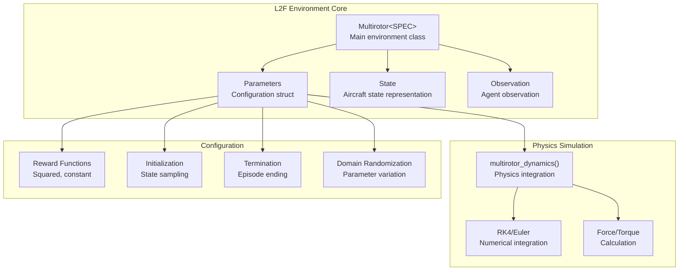
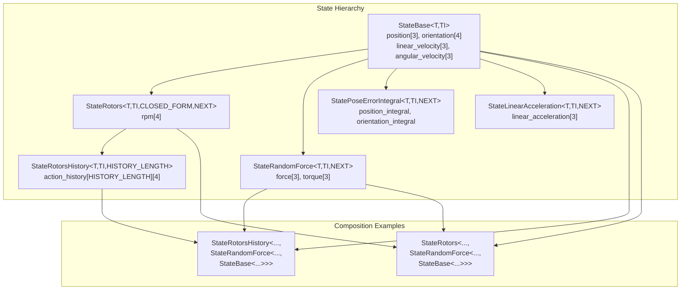
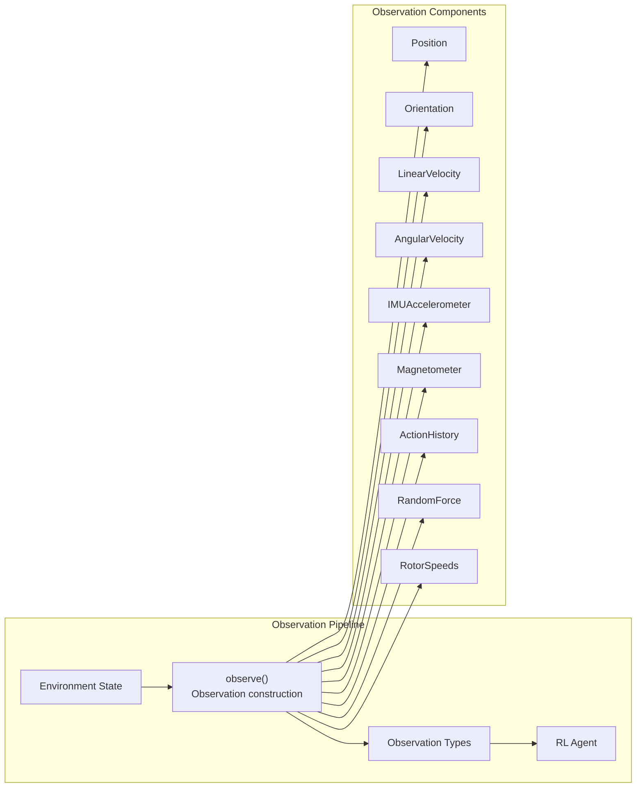
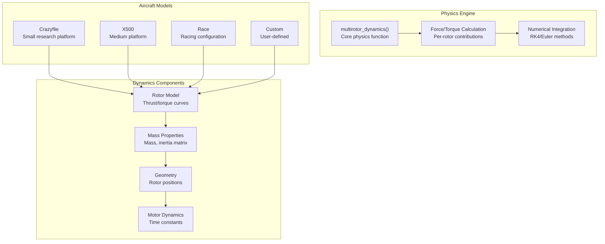
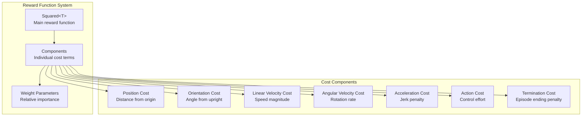
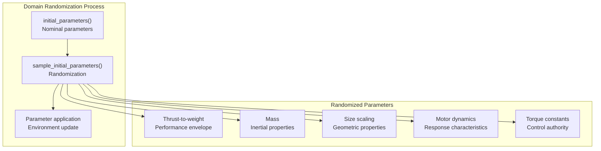
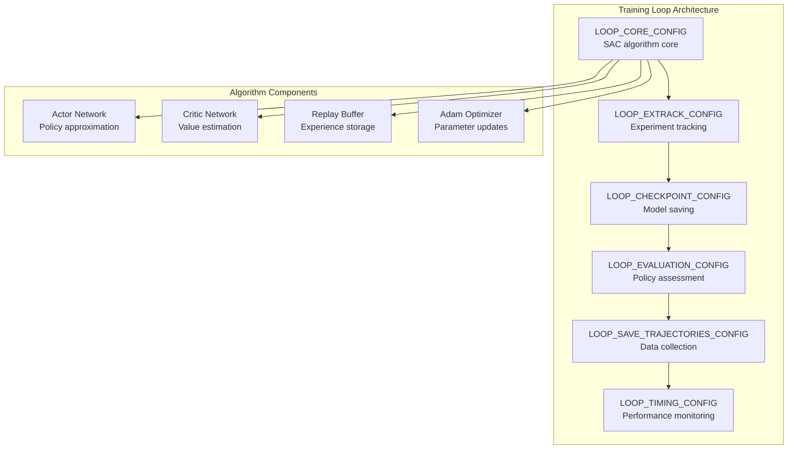

<!-- source: DeepWiki mcp.deepwiki.com · repo rl-tools/rl-tools · page 4.2 Learn to Fly (L2F) · fetched 2026-10-30 -->

# Learn to Fly (L2F)

<details>
<summary>Relevant source files</summary>

The following files were used as context for generating this wiki page:

- [include/rl_tools/rl/environments/l2f/multirotor.h](include/rl_tools/rl/environments/l2f/multirotor.h)
- [include/rl_tools/rl/environments/l2f/operations_cpu.h](include/rl_tools/rl/environments/l2f/operations_cpu.h)
- [include/rl_tools/rl/environments/l2f/operations_generic.h](include/rl_tools/rl/environments/l2f/operations_generic.h)
- [include/rl_tools/rl/environments/l2f/operations_generic/10_sample_initial_parameters.h](include/rl_tools/rl/environments/l2f/operations_generic/10_sample_initial_parameters.h)
- [include/rl_tools/rl/environments/l2f/operations_generic/30_sample_initial_state.h](include/rl_tools/rl/environments/l2f/operations_generic/30_sample_initial_state.h)
- [include/rl_tools/rl/environments/l2f/operations_generic/70_post_integration.h](include/rl_tools/rl/environments/l2f/operations_generic/70_post_integration.h)
- [include/rl_tools/rl/environments/l2f/operations_multitask_generic.h](include/rl_tools/rl/environments/l2f/operations_multitask_generic.h)
- [include/rl_tools/rl/environments/l2f/operations_multitask_generic_forward.h](include/rl_tools/rl/environments/l2f/operations_multitask_generic_forward.h)
- [include/rl_tools/rl/environments/l2f/parameters/default.h](include/rl_tools/rl/environments/l2f/parameters/default.h)
- [include/rl_tools/rl/environments/l2f/parameters/dynamics/arpl.h](include/rl_tools/rl/environments/l2f/parameters/dynamics/arpl.h)
- [include/rl_tools/rl/environments/l2f/parameters/dynamics/soft.h](include/rl_tools/rl/environments/l2f/parameters/dynamics/soft.h)
- [include/rl_tools/rl/environments/l2f/parameters/dynamics/soft_rigid.h](include/rl_tools/rl/environments/l2f/parameters/dynamics/soft_rigid.h)
- [include/rl_tools/rl/environments/l2f/parameters/registry.h](include/rl_tools/rl/environments/l2f/parameters/registry.h)
- [include/rl_tools/rl/environments/l2f/parameters/trajectories/lissajous.h](include/rl_tools/rl/environments/l2f/parameters/trajectories/lissajous.h)
- [src/rl/zoo/l2f/environment.h](src/rl/zoo/l2f/environment.h)
- [src/rl/zoo/l2f/environment_big.h](src/rl/zoo/l2f/environment_big.h)
- [src/rl/zoo/l2f/ppo.h](src/rl/zoo/l2f/ppo.h)
- [src/rl/zoo/l2f/sac_big.h](src/rl/zoo/l2f/sac_big.h)

</details>


This document covers the Learn to Fly (L2F) multirotor control environment within RLtools. L2F provides a physics-based simulation environment for training reinforcement learning agents to control quadrotor aircraft, with support for domain randomization, multiple observation modalities, and various reward functions.

For information about other environments, see [Environments](#4). For SAC algorithm implementation details, see [Soft Actor-Critic (SAC)](#2.1).

## Environment Overview

L2F is a multirotor control environment that simulates quadrotor aircraft dynamics with configurable parameters, observation types, and reward functions. The environment supports both standard reinforcement learning training and domain randomization for robust policy learning.



Sources: [include/rl_tools/rl/environments/l2f/multirotor.h:449-504](), [include/rl_tools/rl/environments/l2f/operations_generic.h:158-256]()

## State Representation

L2F uses a hierarchical state representation system that allows for flexible composition of state components based on the specific requirements of the training scenario.



Sources: [include/rl_tools/rl/environments/l2f/multirotor.h:354-414](), [include/rl_tools/rl/environments/l2f/parameters/default.h:86-111]()

## Observation Types

The environment supports multiple observation modalities through a composable observation system, allowing agents to receive different types of sensory information.

| Observation Component | Dimensions | Description |
|----------------------|------------|-------------|
| `Position` | 3 | Global position (x, y, z) |
| `OrientationRotationMatrix` | 9 | 3x3 rotation matrix |
| `OrientationQuaternion` | 4 | Quaternion representation |
| `LinearVelocity` | 3 | Linear velocity in global frame |
| `AngularVelocity` | 3 | Angular velocity in body frame |
| `IMUAccelerometer` | 3 | Simulated IMU acceleration |
| `Magnetometer` | 2 | Magnetic field measurements |
| `ActionHistory` | 4 × HISTORY_LENGTH | Previous actions |
| `RandomForce` | 6 | Applied disturbance forces/torques |
| `RotorSpeeds` | 4 | Individual rotor RPM values |



Sources: [include/rl_tools/rl/environments/l2f/multirotor.h:138-351](), [src/rl/environments/l2f/sac/parameters.h:24-54]()

## Physics Simulation

L2F implements detailed quadrotor physics with configurable aircraft models and numerical integration schemes.



Sources: [include/rl_tools/rl/environments/l2f/operations_generic.h:158-256](), [include/rl_tools/rl/environments/l2f/parameters/dynamics/crazyflie.h:46-75]()

## Reward Functions

L2F provides configurable reward functions for different training objectives, with the primary implementation being the squared reward function.



The reward calculation follows the formula:
```
reward = -scale * (w_pos * pos_cost + w_ori * ori_cost + w_vel * vel_cost + w_action * action_cost) + constant
```

Sources: [include/rl_tools/rl/environments/l2f/parameters/reward_functions/squared.h:38-114](), [include/rl_tools/rl/environments/l2f/parameters/reward_functions/default.h:24-37]()

## Domain Randomization

L2F supports comprehensive domain randomization to improve policy robustness by varying physical parameters during training.

| Parameter | Description | Effect |
|-----------|-------------|--------|
| `thrust_to_weight_min/max` | Thrust-to-weight ratio range | Overall aircraft performance |
| `mass_min/max` | Mass variation range | Inertial properties |
| `mass_size_deviation` | Size scaling factor | Geometric properties |
| `motor_time_constant` | Motor response time | Control authority |
| `rotor_torque_constant` | Torque generation | Rotational control |



Sources: [include/rl_tools/rl/environments/l2f/operations_generic.h:288-368](), [src/rl/environments/l2f/dr_sac/l2f_dr_sac.cpp:114-137]()

## Training Configuration

L2F can be used with various RL algorithms, with SAC being the primary supported algorithm. The training configuration includes environment parameters, algorithm settings, and training loop components.



Sources: [src/rl/environments/l2f/dr_sac/l2f_dr_sac.cpp:172-247](), [src/rl/environments/l2f/sac/parameters.h:75-148]()

## Usage Examples

### Basic Environment Setup

```cpp
using ENVIRONMENT_SPEC = rl_tools::rl::environments::l2f::Specification<T, TI, ENVIRONMENT_STATIC_PARAMETERS>;
using ENVIRONMENT = rl_tools::rl::environments::Multirotor<ENVIRONMENT_SPEC>;

ENVIRONMENT env;
ENVIRONMENT::Parameters parameters;
ENVIRONMENT::State state, next_state;

rlt::malloc(device, env);
rlt::init(device, env);
rlt::sample_initial_parameters(device, env, parameters, rng);
rlt::sample_initial_state(device, env, parameters, state, rng);
```

### Domain Randomization Setup

```cpp
// Enable domain randomization in parameters
static constexpr typename PARAMETERS_TYPE::DomainRandomization domain_randomization = {
    2.0,  // thrust_to_weight_min
    5.0,  // thrust_to_weight_max
    0.02, // mass_min
    0.05, // mass_max
    0.1,  // mass_size_deviation
    0.1,  // motor_time_constant
    0.1   // rotor_torque_constant
};
```

### Training with SAC

```cpp
using LOOP_CORE_CONFIG = rlt::rl::algorithms::sac::loop::core::Config<T, TI, RNG, ENVIRONMENT, LOOP_CORE_PARAMETERS>;
using LOOP_STATE = typename LOOP_CONFIG::State<LOOP_CONFIG>;

LOOP_STATE ts;
rlt::malloc(device, ts);
rlt::init(device, ts, seed);

while(!rlt::step(device, ts)){
    // Training loop automatically handles environment interaction
}
```

Sources: [src/rl/environments/l2f/dr_sac/l2f_dr_sac.cpp:252-333](), [src/rl/environments/l2f/sac/l2f_sac.cpp:76-99]()

---

