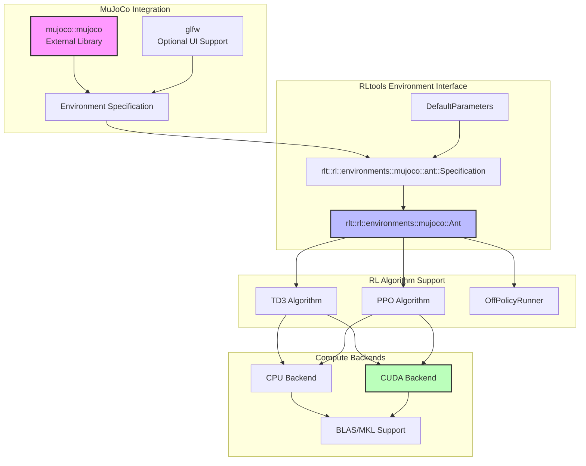
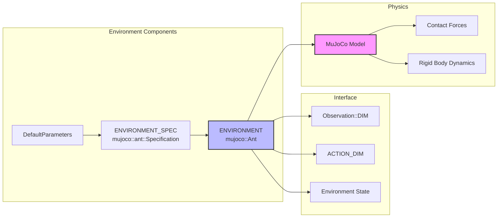
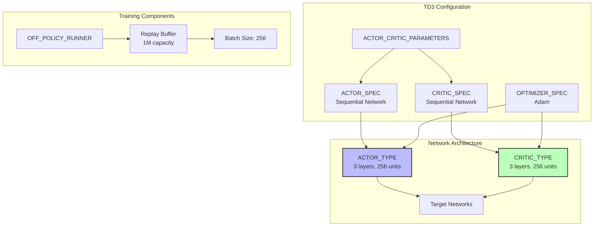
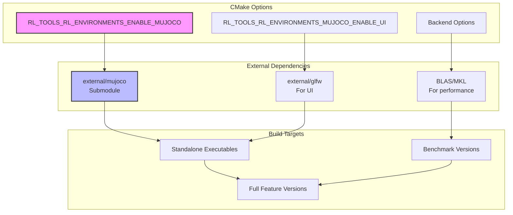
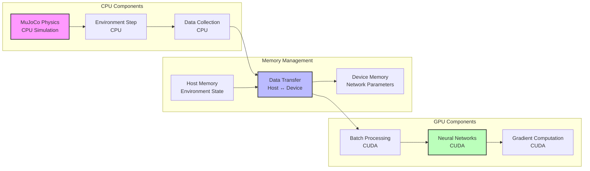
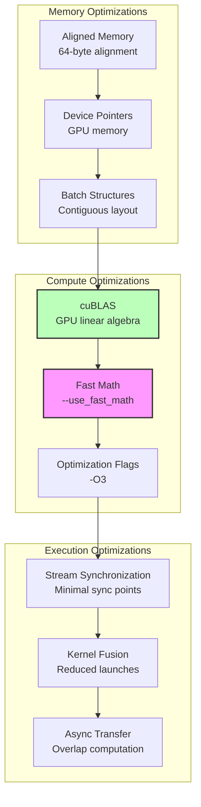

<!-- source: DeepWiki mcp.deepwiki.com · repo rl-tools/rl-tools · page 4.3 MuJoCo Environments · fetched 2026-10-30 -->

# MuJoCo Environments

<details>
<summary>Relevant source files</summary>

The following files were used as context for generating this wiki page:

- [.gitignore](.gitignore)
- [CMakeLists.txt](CMakeLists.txt)
- [include/rl_tools/rl/loop/steps/extrack/operations_cpu.h](include/rl_tools/rl/loop/steps/extrack/operations_cpu.h)
- [include/rl_tools/rl/loop/steps/extrack/state.h](include/rl_tools/rl/loop/steps/extrack/state.h)
- [src/rl/environments/l2f/dr_sac/CMakeLists.txt](src/rl/environments/l2f/dr_sac/CMakeLists.txt)
- [src/rl/environments/l2f/dr_sac/l2f_dr_sac.cpp](src/rl/environments/l2f/dr_sac/l2f_dr_sac.cpp)
- [src/rl/environments/mujoco/ant/CMakeLists.txt](src/rl/environments/mujoco/ant/CMakeLists.txt)
- [src/rl/environments/mujoco/ant/evaluate_actor.cpp](src/rl/environments/mujoco/ant/evaluate_actor.cpp)
- [src/rl/environments/mujoco/ant/ppo/cpu/CMakeLists.txt](src/rl/environments/mujoco/ant/ppo/cpu/CMakeLists.txt)
- [src/rl/environments/mujoco/ant/ppo/cpu/training.h](src/rl/environments/mujoco/ant/ppo/cpu/training.h)
- [src/rl/environments/mujoco/ant/ppo/cuda/CMakeLists.txt](src/rl/environments/mujoco/ant/ppo/cuda/CMakeLists.txt)
- [src/rl/environments/mujoco/ant/ppo/cuda/training_ppo.cu](src/rl/environments/mujoco/ant/ppo/cuda/training_ppo.cu)
- [src/rl/environments/mujoco/ant/ppo/parameters.h](src/rl/environments/mujoco/ant/ppo/parameters.h)
- [src/rl/environments/mujoco/ant/td3/CMakeLists.txt](src/rl/environments/mujoco/ant/td3/CMakeLists.txt)
- [src/rl/environments/mujoco/ant/td3/training.h](src/rl/environments/mujoco/ant/td3/training.h)
- [src/rl/environments/pendulum/sac/cuda/cuda_graph_export.h](src/rl/environments/pendulum/sac/cuda/cuda_graph_export.h)
- [src/rl/environments/pendulum/td3/cpu/CMakeLists.txt](src/rl/environments/pendulum/td3/cpu/CMakeLists.txt)
- [src/rl/zoo/CMakeLists.txt](src/rl/zoo/CMakeLists.txt)
- [src/rl/zoo/l2f/environment_tiny.h](src/rl/zoo/l2f/environment_tiny.h)
- [src/rl/zoo/l2f/plot_learning_curves.py](src/rl/zoo/l2f/plot_learning_curves.py)
- [src/rl/zoo/l2f/sac.h](src/rl/zoo/l2f/sac.h)
- [src/rl/zoo/l2f/sac_tiny.h](src/rl/zoo/l2f/sac_tiny.h)
- [src/rl/zoo/zoo.cpp](src/rl/zoo/zoo.cpp)
- [src/rl/zoo/zoo_cli.cpp](src/rl/zoo/zoo_cli.cpp)
- [tests/src/rl/algorithms/ppo/parameters_rl.h](tests/src/rl/algorithms/ppo/parameters_rl.h)

</details>


This document covers the integration of MuJoCo physics simulation environments within RLtools. MuJoCo environments provide high-fidelity physics simulation for robotics and continuous control tasks, offering more complex dynamics than simple environments like Pendulum.

For information about creating custom environments, see [Creating Custom Environments](#4.4). For the simpler Pendulum environment, see [Pendulum](#4.1).

## Overview

MuJoCo environments in RLtools provide physics-based simulations for reinforcement learning research. The integration enables training of RL algorithms on complex robotic tasks with realistic physics, collision detection, and contact modeling.

The MuJoCo integration is optional and controlled by the `RL_TOOLS_RL_ENVIRONMENTS_ENABLE_MUJOCO` CMake option. When enabled, it builds the MuJoCo library from source and provides C++ bindings for RL training.

Sources: [CMakeLists.txt:37](), [CMakeLists.txt:186-223]()

## Architecture



The MuJoCo integration follows RLtools' standard environment interface while providing access to MuJoCo's physics simulation capabilities. The environment specifications define the observation and action spaces, while the MuJoCo library handles the underlying physics simulation.

Sources: [src/rl/environments/mujoco/ant/td3/parameters.h:13-14](), [CMakeLists.txt:186-223]()

## Available Environments

### Ant Environment

The Ant environment is the primary MuJoCo environment implemented in RLtools. It simulates a quadrupedal robot (ant) learning to locomote in a 3D physics environment.



**Key Components:**
- **Environment Specification**: Defines the template parameters and configuration
- **Observation Space**: High-dimensional state including joint angles, velocities, and contact information
- **Action Space**: Continuous control of joint torques
- **Physics Model**: MuJoCo handles collision detection, contact forces, and rigid body dynamics

Sources: [src/rl/environments/mujoco/ant/td3/parameters.h:12-15]()

## Algorithm Integration

### TD3 Implementation

The Ant environment integrates with the TD3 (Twin Delayed DDPG) algorithm for continuous control learning.



**Configuration Details:**
- **Actor Network**: 3-layer MLP with 256 units, ReLU activation, Tanh output
- **Critic Network**: 3-layer MLP with 256 units, ReLU activation, Identity output
- **Training Parameters**: 256 batch size, 1M replay buffer capacity
- **Update Intervals**: Critic trained every step, Actor every 2 steps

Sources: [src/rl/environments/mujoco/ant/td3/parameters.h:19-29](), [src/rl/environments/mujoco/ant/td3/parameters.h:34-49]()

### PPO Implementation

The Ant environment also supports PPO (Proximal Policy Optimization) for on-policy learning.

Sources: [src/rl/environments/mujoco/ant/ppo/cpu/CMakeLists.txt:1-54](), [src/rl/environments/mujoco/ant/ppo/cuda/CMakeLists.txt:1-103]()

## Build System Integration

### CMake Configuration

The MuJoCo integration is configured through CMake options and requires external dependencies:



**Key Configuration Options:**
- `RL_TOOLS_RL_ENVIRONMENTS_ENABLE_MUJOCO`: Enables MuJoCo support
- `RL_TOOLS_RL_ENVIRONMENTS_MUJOCO_ENABLE_UI`: Enables visualization with GLFW
- Backend options control CUDA and BLAS integration

Sources: [CMakeLists.txt:37](), [CMakeLists.txt:186-223]()

### Build Targets

The build system provides multiple target configurations for different use cases:

| Target Type | Description | Dependencies |
|-------------|-------------|--------------|
| `standalone` | Minimal dependencies, no BLAS | `RLtools::Core`, `mujoco::mujoco` |
| `blas` | BLAS acceleration enabled | `RLtools::RLtools`, `mujoco::mujoco` |
| `benchmark` | Performance testing, no evaluation | BLAS + performance optimizations |
| `full` | All features enabled | BLAS + HDF5 + TensorBoard |

Sources: [src/rl/environments/mujoco/ant/td3/CMakeLists.txt:1-31](), [src/rl/environments/mujoco/ant/ppo/cpu/CMakeLists.txt:1-54]()

## CUDA Support

### GPU Acceleration

MuJoCo environments support CUDA acceleration for neural network training while using CPU for physics simulation:



**CUDA Integration Features:**
- Neural network training on GPU while physics runs on CPU
- Efficient memory transfer between host and device
- Batch processing of experiences on GPU
- CUDA-optimized linear algebra operations

Sources: [src/rl/environments/mujoco/ant/ppo/cuda/CMakeLists.txt:1-103](), [tests/src/rl/cuda/td3_full_training.cu:1-210]()

### Performance Optimizations

The CUDA implementation includes several performance optimizations:



Sources: [tests/src/rl/cuda/td3_full_training.cu:119-203](), [CMakeLists.txt:274-302]()

## Usage Examples

### Basic Training Setup

To use MuJoCo environments for training, configure the environment specification and integrate with RL algorithms:

```cpp
// Environment specification
using ENVIRONMENT_SPEC = rlt::rl::environments::mujoco::ant::Specification<T, TI, 
    rlt::rl::environments::mujoco::ant::DefaultParameters<T, TI>>;
using ENVIRONMENT = rlt::rl::environments::mujoco::Ant<ENVIRONMENT_SPEC>;

// Algorithm configuration
using ACTOR_CRITIC_SPEC = rlt::rl::algorithms::td3::Specification<T, TI, ENVIRONMENT, 
    ACTOR_TYPE, ACTOR_TARGET_TYPE, CRITIC_TYPE, CRITIC_TARGET_TYPE, OPTIMIZER, PARAMETERS>;
using ACTOR_CRITIC_TYPE = rlt::rl::algorithms::td3::ActorCritic<ACTOR_CRITIC_SPEC>;
```

### Off-Policy Training

Configure the off-policy runner for experience collection:

```cpp
struct OFF_POLICY_RUNNER_PARAMETERS: rlt::rl::components::off_policy_runner::ParametersDefault<T, TI> {
    static constexpr TI N_ENVIRONMENTS = 1;
    static constexpr TI REPLAY_BUFFER_CAPACITY = 1000000;
    static constexpr TI EPISODE_STEP_LIMIT = 1000;
    static constexpr T EXPLORATION_NOISE = 0.1;
};
```

Sources: [src/rl/environments/mujoco/ant/td3/parameters.h:57-64](), [tests/src/rl/cuda/td3_full_training.cu:76-193]()

---

