<!-- source: DeepWiki mcp.deepwiki.com · repo rl-tools/rl-tools · page 4.4 Creating Custom Environments · fetched 2026-10-30 -->

# Creating Custom Environments

Relevant source files

The following files were used as context for generating this wiki page:

- [include/rl_tools/rl/algorithms/ppo/loop/core/config.h](include/rl_tools/rl/algorithms/ppo/loop/core/config.h)
- [include/rl_tools/rl/algorithms/ppo/loop/core/operations_generic.h](include/rl_tools/rl/algorithms/ppo/loop/core/operations_generic.h)
- [include/rl_tools/rl/algorithms/ppo/loop/core/state.h](include/rl_tools/rl/algorithms/ppo/loop/core/state.h)
- [include/rl_tools/rl/algorithms/ppo/operations_generic.h](include/rl_tools/rl/algorithms/ppo/operations_generic.h)
- [include/rl_tools/rl/algorithms/ppo/ppo.h](include/rl_tools/rl/algorithms/ppo/ppo.h)
- [include/rl_tools/rl/components/on_policy_runner/on_policy_runner.h](include/rl_tools/rl/components/on_policy_runner/on_policy_runner.h)
- [include/rl_tools/rl/components/on_policy_runner/operations_generic.h](include/rl_tools/rl/components/on_policy_runner/operations_generic.h)
- [include/rl_tools/rl/components/on_policy_runner/operations_generic_per_env.h](include/rl_tools/rl/components/on_policy_runner/operations_generic_per_env.h)
- [include/rl_tools/rl/components/running_normalizer/running_normalizer.h](include/rl_tools/rl/components/running_normalizer/running_normalizer.h)
- [include/rl_tools/rl/environments/l2f/multirotor.h](include/rl_tools/rl/environments/l2f/multirotor.h)
- [include/rl_tools/rl/environments/l2f/operations_cpu.h](include/rl_tools/rl/environments/l2f/operations_cpu.h)
- [include/rl_tools/rl/environments/l2f/operations_generic.h](include/rl_tools/rl/environments/l2f/operations_generic.h)
- [include/rl_tools/rl/environments/l2f/operations_generic/10_sample_initial_parameters.h](include/rl_tools/rl/environments/l2f/operations_generic/10_sample_initial_parameters.h)
- [include/rl_tools/rl/environments/l2f/operations_generic/30_sample_initial_state.h](include/rl_tools/rl/environments/l2f/operations_generic/30_sample_initial_state.h)
- [include/rl_tools/rl/environments/l2f/operations_generic/70_post_integration.h](include/rl_tools/rl/environments/l2f/operations_generic/70_post_integration.h)
- [include/rl_tools/rl/environments/l2f/operations_multitask_generic.h](include/rl_tools/rl/environments/l2f/operations_multitask_generic.h)
- [include/rl_tools/rl/environments/l2f/operations_multitask_generic_forward.h](include/rl_tools/rl/environments/l2f/operations_multitask_generic_forward.h)
- [include/rl_tools/rl/environments/l2f/parameters/default.h](include/rl_tools/rl/environments/l2f/parameters/default.h)
- [include/rl_tools/rl/environments/l2f/parameters/trajectories/lissajous.h](include/rl_tools/rl/environments/l2f/parameters/trajectories/lissajous.h)
- [src/rl/environments/pendulum/ppo/cpu/CMakeLists.txt](src/rl/environments/pendulum/ppo/cpu/CMakeLists.txt)
- [src/rl/environments/pendulum/ppo/cpu/config.h](src/rl/environments/pendulum/ppo/cpu/config.h)
- [src/rl/environments/pendulum/ppo/cpu/training.cpp](src/rl/environments/pendulum/ppo/cpu/training.cpp)
- [src/rl/environments/pendulum/ppo/cuda/CMakeLists.txt](src/rl/environments/pendulum/ppo/cuda/CMakeLists.txt)
- [src/rl/environments/pendulum/ppo/cuda/training.cu](src/rl/environments/pendulum/ppo/cuda/training.cu)
- [src/rl/zoo/l2f/environment.h](src/rl/zoo/l2f/environment.h)
- [src/rl/zoo/l2f/environment_big.h](src/rl/zoo/l2f/environment_big.h)
- [src/rl/zoo/l2f/ppo.h](src/rl/zoo/l2f/ppo.h)
- [src/rl/zoo/l2f/sac_big.h](src/rl/zoo/l2f/sac_big.h)

This document provides a comprehensive guide for creating custom environments in RLtools. Custom environments allow you to model specific systems or problems for reinforcement learning that aren't covered by the built-in environments. For information about using existing environments like Pendulum or L2F, see the respective documentation pages ([Pendulum](#4.1), [Learn to Fly](#4.2), and [MuJoCo Environments](#4.3)).

## Environment Architecture Overview

RLtools environments follow a consistent interface pattern based on generic functions operating on environment types. The environment itself is typically a struct containing parameters and potentially state, while operations are implemented as free functions.

### Core Components of an Environment

Title: Environment Structure and Operations in RLtools

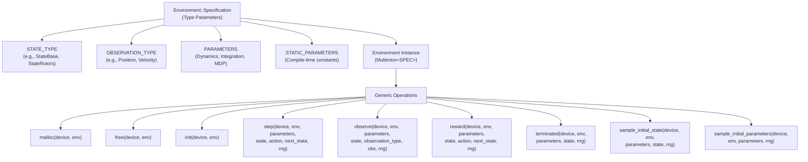

Sources: [include/rl_tools/rl/environments/l2f/multirotor.h:449-463](), [include/rl_tools/rl/environments/l2f/operations_generic.h:39-168]()

## Creating a Custom Environment

Building a custom environment in RLtools involves several key steps, from designing the state representation to implementing the dynamics and reward functions.

### 1. Define State Representation

The state represents the complete internal information of your environment. States use a linked-list pattern through inheritance, where each component extends `NEXT_COMPONENT` to build composite states. Each state component must define a `DIM` constant and may specify `REQUIRES_INTEGRATION` to indicate if it evolves through dynamics integration.

Title: State Component Hierarchy in L2F Environment

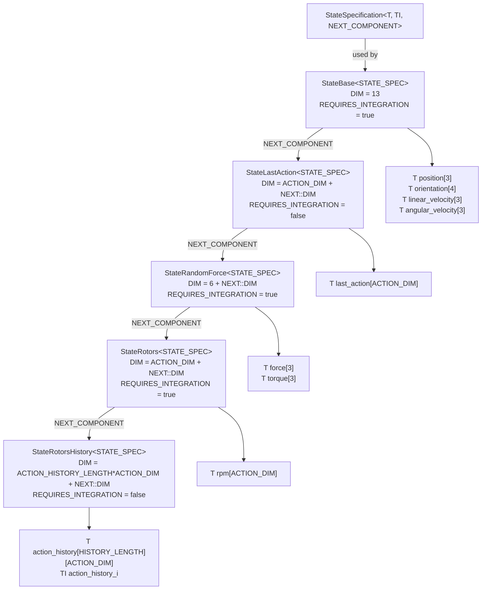

Sources: [include/rl_tools/rl/environments/l2f/multirotor.h:617-772]()

### 2. Design Observation Types

Observations use the same linked-list pattern as states. Each observation component defines `CURRENT_DIM` (its contribution) and `DIM` (total including `NEXT_COMPONENT`). Observations can be marked `PRIVILEGED` to indicate asymmetric information only available to critics. The observation types themselves serve as type tags passed to the `observe` function.

Title: Observation Component Chain in L2F Environment

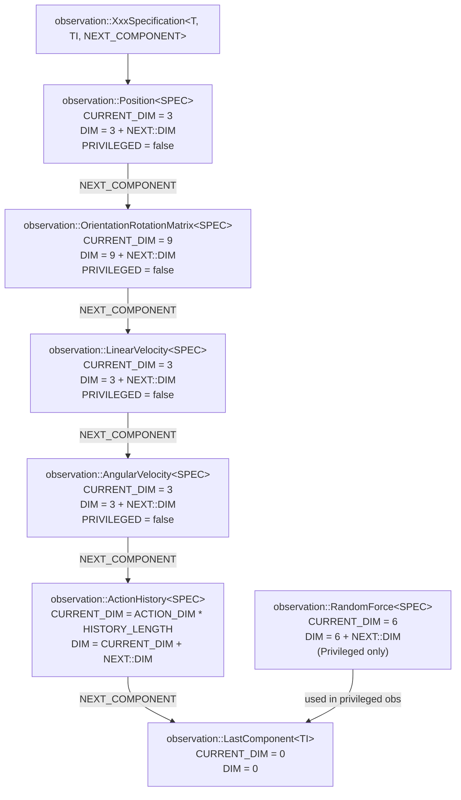

Sources: [include/rl_tools/rl/environments/l2f/multirotor.h:236-614]()

### 3. Create Environment Specification and Factory

Define a specification struct and typically an environment factory. The factory pattern allows configuring environments with different options while maintaining type safety. The specification contains all type definitions and compile-time parameters.

Title: Environment Specification Structure

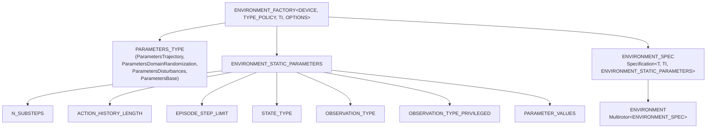

Sources: [src/rl/zoo/l2f/environment.h:18-162](), [include/rl_tools/rl/environments/l2f/multirotor.h:449-463]()

### 4. Implement Dynamics

Dynamics are implemented through two mechanisms: a dynamics function that computes state derivatives for components with `REQUIRES_INTEGRATION = true`, and a `post_integration` function for discrete updates. The `step` function uses an integrator (RK4 or Euler) to propagate the continuous state components.

Title: Step Function Flow with Integration

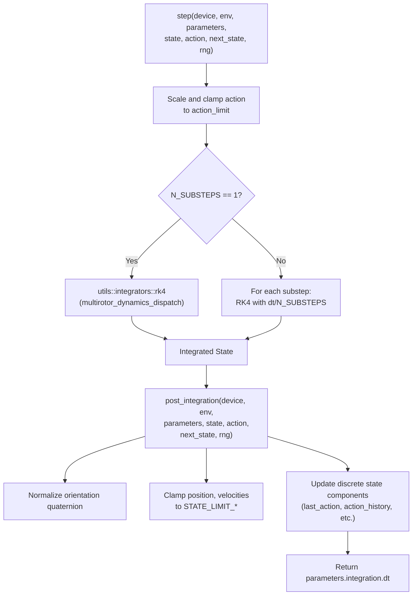

Sources: [include/rl_tools/rl/environments/l2f/operations_generic.h:94-130](), [include/rl_tools/rl/environments/l2f/operations_generic/70_post_integration.h:19-256]()

### 5. Define Parameter Structures

Environment parameters configure behavior and must be structured hierarchically.

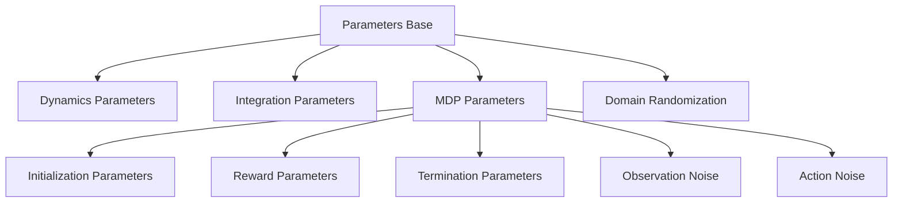

Sources: [include/rl_tools/rl/environments/l2f/multirotor.h:18-137](), [include/rl_tools/rl/environments/l2f/parameters/default.h:15-115]()

### 6. Implement Reward and Termination Functions

Define reward functions that evaluate states, actions, and transitions, as well as termination conditions.

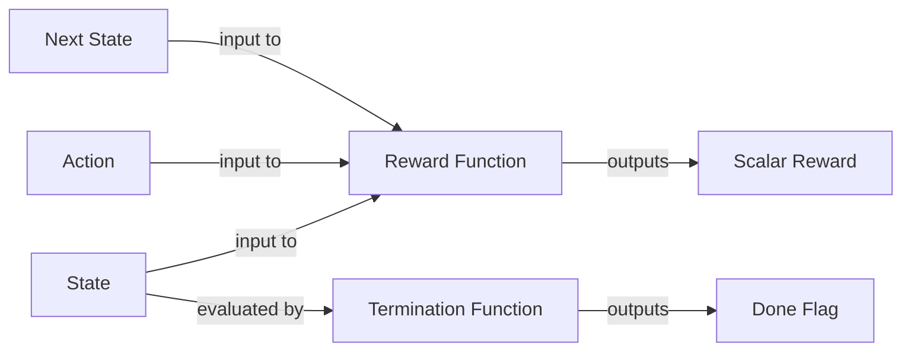

Sources: [include/rl_tools/rl/environments/l2f/parameters/reward_functions/squared.h:38-114](), [include/rl_tools/rl/environments/l2f/parameters/termination/default.h:10-29]()

### 7. Implement Core Operations

Each operation is a generic function taking a `DEVICE` as the first parameter. The operations use dispatch patterns to handle different state and observation component types.

Title: Core Environment Operations API

| Operation | Signature | Description |
|-----------|-----------|-------------|
| `malloc` | `malloc(DEVICE& device, ENV& env)` | Allocate memory for environment (often empty for stateless envs) |
| `free` | `free(DEVICE& device, ENV& env)` | Free allocated memory |
| `init` | `init(DEVICE& device, ENV& env)` | Initialize environment with `SPEC::STATIC_PARAMETERS::PARAMETER_VALUES` |
| `initial_parameters` | `initial_parameters(DEVICE& device, ENV& env, PARAMETERS& parameters)` | Copy `env.parameters` to `parameters` |
| `sample_initial_parameters` | `sample_initial_parameters(DEVICE& device, ENV& env, PARAMETERS& parameters, RNG& rng)` | Generate randomized parameters (domain randomization) |
| `initial_state` | `initial_state(DEVICE& device, ENV& env, PARAMETERS& parameters, STATE& state)` | Set default initial state (typically zeros) |
| `sample_initial_state` | `sample_initial_state(DEVICE& device, ENV& env, PARAMETERS& parameters, STATE& state, RNG& rng)` | Generate randomized initial state from ranges in `parameters.mdp.init` |
| `step` | `step(DEVICE& device, ENV& env, PARAMETERS& parameters, const STATE& state, const Matrix<ACTION_SPEC>& action, STATE& next_state, RNG& rng)` | Integrate dynamics and update discrete components, returns `dt` |
| `observe` | `observe(DEVICE& device, ENV& env, PARAMETERS& parameters, const STATE& state, const OBSERVATION& obs_type, Matrix<OBS_SPEC>& observation, RNG& rng)` | Extract observation from state using dispatch on `obs_type` |
| `reward` | `reward(DEVICE& device, ENV& env, PARAMETERS& parameters, const STATE& state, const Matrix<ACTION_SPEC>& action, const STATE& next_state, RNG& rng)` | Calculate scalar reward |
| `terminated` | `terminated(DEVICE& device, ENV& env, PARAMETERS& parameters, const STATE& state, RNG& rng)` | Check if episode should terminate |

Sources: [include/rl_tools/rl/environments/l2f/operations_generic.h:39-184]()

## Environment Parameters and Domain Randomization

Parameters allow configuring your environment and implementing domain randomization for robust learning.

### Basic Parameter Structure

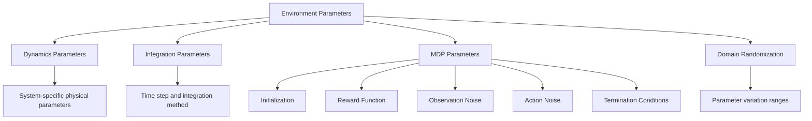

Sources: [include/rl_tools/rl/environments/l2f/multirotor.h:18-137](), [include/rl_tools/rl/environments/l2f/parameters/default.h:15-115]()

### Domain Randomization

Domain randomization varies physical parameters during training for robustness. RLtools provides mechanisms to sample randomized parameters:

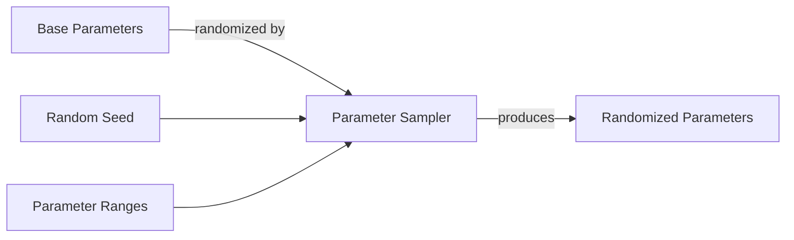

Sources: [include/rl_tools/rl/environments/l2f/operations_generic.h:288-367]()

## Integrating with Training Algorithms

Environments integrate with training through runners (`OnPolicyRunner` for PPO, `OffPolicyRunner` for SAC/TD3). The runner manages multiple environment instances in parallel, handles episode resets with parameter sampling, and collects experience.

Title: Environment Integration with Training Loop

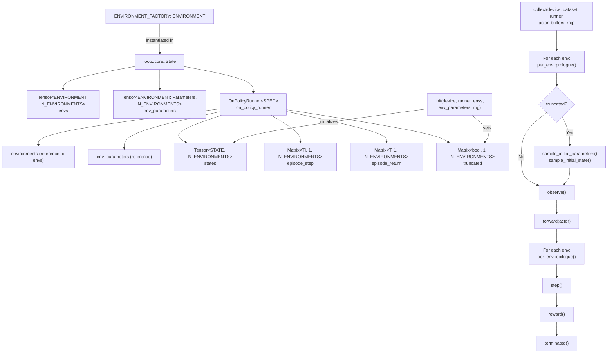

Sources: [include/rl_tools/rl/algorithms/ppo/loop/core/state.h:14-42](), [include/rl_tools/rl/components/on_policy_runner/operations_generic.h:64-122](), [include/rl_tools/rl/components/on_policy_runner/operations_generic_per_env.h:8-76]()

## Example: Pendulum Environment

The Pendulum environment provides a simpler example to understand the basic structure. It uses the environment wrapper pattern for observation scaling.

Title: Pendulum Environment Structure

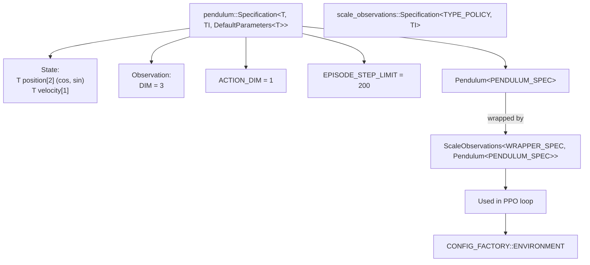

Sources: [src/rl/environments/pendulum/ppo/cpu/config.h:1-44](), [src/rl/environments/pendulum/ppo/cpu/training.cpp:36-58]()

## Example: L2F Multirotor Environment with Domain Randomization

The L2F environment demonstrates advanced features including domain randomization and trajectory tracking.

Title: L2F Environment Configuration Example

```mermaid
graph TD
    Factory["ENVIRONMENT_BIG_FACTORY&lt;DEVICE, TYPE_POLICY, TI, OPTIONS&gt;"]
    
    Factory --> Model["MODEL = dynamics::REGISTRY::soft_rigid"]
    Factory --> RewardFn["REWARD_FUNCTION = Squared&lt;T&gt;"]
    Factory --> DROptions["DOMAIN_RANDOMIZATION_OPTIONS"]
    
    DROptions --> DR_ENABLED["ENABLED = false"]
    DROptions --> DR_T2W["THRUST_TO_WEIGHT = false"]
    DROptions --> DR_MASS["MASS = false"]
    DROptions --> DR_INERTIA["TORQUE_TO_INERTIA = false"]
    
    Factory --> ParamType["PARAMETERS_TYPE<br/>ParametersTrajectory&lt;...&gt;"]
    
    ParamType --> Trajectory["trajectory: Trajectory&lt;SPEC&gt;<br/>LENGTH = 500, DT = 10000us"]
    ParamType --> TrajParams["trajectory_parameters<br/>Type::LISSAJOUS"]
    ParamType --> DRParams["domain_randomization<br/>thrust_to_weight_min/max<br/>mass_min/max<br/>torque_to_inertia_min/max"]
    
    Factory --> StaticParams["ENVIRONMENT_STATIC_PARAMETERS"]
    
    StaticParams --> StateType["STATE_TYPE = StateTrajectory&lt;<br/>StateRotorsHistory&lt;<br/>StateRandomForce&lt;<br/>StateLastAction&lt;<br/>StateAngularVelocityDelay&lt;<br/>StateBase&gt;&gt;&gt;&gt;&gt;"]
    
    StaticParams --> ObsType["OBSERVATION_TYPE =<br/>TrajectoryTrackingPosition +<br/>OrientationRotationMatrix +<br/>TrajectoryTrackingLinearVelocity +<br/>AngularVelocityDelayed +<br/>ActionHistory"]
    
    StaticParams --> DynamicsVals["N_DYNAMICS_VALUES = 1<br/>DYNAMICS_VALUES[0] = crazyflie"]
    
    Factory --> EnvSpec["ENVIRONMENT_SPEC"]
    EnvSpec --> Env["ENVIRONMENT = Multirotor&lt;ENVIRONMENT_SPEC&gt;"]
```

Sources: [src/rl/zoo/l2f/environment_big.h:18-149]()

## Best Practices

When creating custom environments, consider these best practices:

1. **Modularity**: Use inheritance for state and observation components to enable reuse
2. **Numerical Stability**: Ensure dynamics functions are numerically stable
3. **Domain Randomization**: Implement parameter randomization for robustness
4. **Performance**: Optimize compute-intensive operations like dynamics calculations
5. **Testing**: Validate environment behavior before training agents

## Conclusion

Creating custom environments in RLtools requires understanding the core components and patterns used throughout the framework. By following this guide, you can develop environments that integrate seamlessly with the training algorithms and evaluation tools in RLtools.

For additional help, refer to the existing environment implementations like Pendulum ([Pendulum](#4.1)) and Learn to Fly ([Learn to Fly](#4.2)), which provide concrete examples of the patterns described in this document.

---

