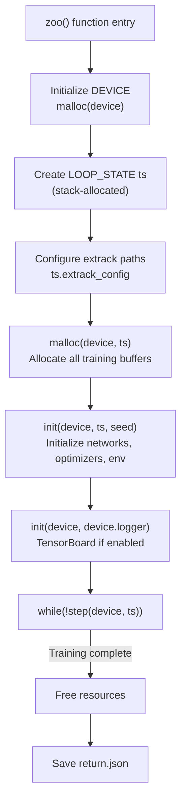
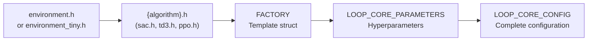

<!-- source: DeepWiki mcp.deepwiki.com · repo rl-tools/rl-tools · page 5.1 Running Experiments · fetched 2026-10-30 -->

# Running Experiments

<details>
<summary>Relevant source files</summary>

The following files were used as context for generating this wiki page:

- [.gitignore](.gitignore)
- [CMakeLists.txt](CMakeLists.txt)
- [include/rl_tools/rl/loop/steps/extrack/operations_cpu.h](include/rl_tools/rl/loop/steps/extrack/operations_cpu.h)
- [include/rl_tools/rl/loop/steps/extrack/state.h](include/rl_tools/rl/loop/steps/extrack/state.h)
- [src/rl/environments/l2f/dr_sac/CMakeLists.txt](src/rl/environments/l2f/dr_sac/CMakeLists.txt)
- [src/rl/environments/l2f/dr_sac/l2f_dr_sac.cpp](src/rl/environments/l2f/dr_sac/l2f_dr_sac.cpp)
- [src/rl/environments/mujoco/ant/CMakeLists.txt](src/rl/environments/mujoco/ant/CMakeLists.txt)
- [src/rl/environments/mujoco/ant/evaluate_actor.cpp](src/rl/environments/mujoco/ant/evaluate_actor.cpp)
- [src/rl/environments/mujoco/ant/ppo/cpu/CMakeLists.txt](src/rl/environments/mujoco/ant/ppo/cpu/CMakeLists.txt)
- [src/rl/environments/mujoco/ant/ppo/cpu/training.h](src/rl/environments/mujoco/ant/ppo/cpu/training.h)
- [src/rl/environments/mujoco/ant/ppo/cuda/CMakeLists.txt](src/rl/environments/mujoco/ant/ppo/cuda/CMakeLists.txt)
- [src/rl/environments/mujoco/ant/ppo/cuda/training_ppo.cu](src/rl/environments/mujoco/ant/ppo/cuda/training_ppo.cu)
- [src/rl/environments/mujoco/ant/ppo/parameters.h](src/rl/environments/mujoco/ant/ppo/parameters.h)
- [src/rl/environments/mujoco/ant/td3/CMakeLists.txt](src/rl/environments/mujoco/ant/td3/CMakeLists.txt)
- [src/rl/environments/mujoco/ant/td3/training.h](src/rl/environments/mujoco/ant/td3/training.h)
- [src/rl/environments/pendulum/sac/cuda/cuda_graph_export.h](src/rl/environments/pendulum/sac/cuda/cuda_graph_export.h)
- [src/rl/environments/pendulum/td3/cpu/CMakeLists.txt](src/rl/environments/pendulum/td3/cpu/CMakeLists.txt)
- [src/rl/zoo/CMakeLists.txt](src/rl/zoo/CMakeLists.txt)
- [src/rl/zoo/l2f/environment_tiny.h](src/rl/zoo/l2f/environment_tiny.h)
- [src/rl/zoo/l2f/plot_learning_curves.py](src/rl/zoo/l2f/plot_learning_curves.py)
- [src/rl/zoo/l2f/sac.h](src/rl/zoo/l2f/sac.h)
- [src/rl/zoo/l2f/sac_tiny.h](src/rl/zoo/l2f/sac_tiny.h)
- [src/rl/zoo/zoo.cpp](src/rl/zoo/zoo.cpp)
- [src/rl/zoo/zoo_cli.cpp](src/rl/zoo/zoo_cli.cpp)
- [tests/src/rl/algorithms/ppo/parameters_rl.h](tests/src/rl/algorithms/ppo/parameters_rl.h)

</details>


This page explains how to execute training experiments using the Zoo system's command-line interface. The Zoo provides pre-configured executables for various algorithm-environment combinations with integrated experiment tracking, checkpointing, and evaluation.

For information about the experiment tracking system used by the Zoo, see [Experiment Tracking (Extrack)](#5.2). For details on post-training evaluation workflows, see [Evaluation and Trajectory Saving](#5.3).

---

## Zoo Executable Targets

The Zoo system compiles separate executables for each algorithm-environment combination. Each executable is statically configured at compile-time through preprocessor definitions.

### Executable Naming Convention

All Zoo executables follow the naming pattern: `rl_zoo_{environment}_{algorithm}`

```
rl_zoo_pendulum_v1_sac
rl_zoo_pendulum_v1_td3
rl_zoo_pendulum_v1_ppo
rl_zoo_l2f_sac
rl_zoo_l2f_td3
rl_zoo_l2f_ppo
rl_zoo_ant_v4_ppo
rl_zoo_ant_v4_td3
```

**Available Algorithm-Environment Combinations:**

| Environment | SAC | TD3 | PPO |
|-------------|-----|-----|-----|
| `pendulum-v1` | ✓ | ✓ | ✓ |
| `pendulum-velocity-v1` | ✓ | ✓ | - |
| `pendulum-multitask-v1` | ✓ | ✓ | ✓ |
| `flag` | ✓ | ✓ | ✓ |
| `acrobot-swingup-v0` | ✓ | - | - |
| `bottleneck-v0` | - | - | ✓ |
| `l2f` | ✓ | ✓ | ✓ |
| `ant-v4` | - | ✓ | ✓ |

**Sources:** [src/rl/zoo/CMakeLists.txt:8-154]()

---

## Building Zoo Executables

The Zoo executables are built as part of the main CMake build when `RL_TOOLS_ENABLE_TARGETS` is enabled.

```bash
# Standard build
mkdir build && cd build
cmake .. -DRL_TOOLS_ENABLE_TARGETS=ON
cmake --build . --target rl_zoo_pendulum_v1_sac

# For MuJoCo environments, enable MuJoCo support
cmake .. -DRL_TOOLS_RL_ENVIRONMENTS_ENABLE_MUJOCO=ON
cmake --build . --target rl_zoo_ant_v4_ppo
```

Each executable is compiled with specific preprocessor definitions:

```cmake
target_compile_definitions(rl_zoo_pendulum_v1_sac PRIVATE 
    RL_TOOLS_RL_ZOO_ALGORITHM_SAC
    RL_TOOLS_RL_ZOO_ENVIRONMENT_PENDULUM_V1)
```

**Benchmark Variants:**

Some executables have benchmark variants that disable logging and evaluation for maximum performance:

```bash
cmake --build . --target rl_zoo_l2f_sac_benchmark
```

**Sources:** [src/rl/zoo/CMakeLists.txt:1-157](), [CMakeLists.txt:87-89]()

---

## Command Line Interface

### Basic Usage

```bash
# Run a single training run with default seed (0)
./rl_zoo_pendulum_v1_sac

# Run with specific seed
./rl_zoo_pendulum_v1_sac --seed 42

# Run multiple seeds sequentially
./rl_zoo_pendulum_v1_sac --seed 0 --n_seeds 10
```

### Command Line Arguments

When compiled with CLI11 support, the Zoo executables accept the following arguments:

| Argument | Short | Type | Description |
|----------|-------|------|-------------|
| `--seed` | `-s` | `int` | Initial random seed (default: 0) |
| `--n_seeds` | `-n` | `int` | Number of sequential seeds to run (default: 1) |
| `--extrack` | `-e` | `string` | Base directory for experiment tracking |
| `--extrack-experiment` | `--ee` | `string` | Experiment name (default: timestamp) |
| `--extrack-experiment-path` | `--eep` | `string` | Full experiment path override |
| `--config` | `-c` | `string` | Configuration file path (reserved for future use) |

**Example with experiment tracking:**

```bash
./rl_zoo_l2f_sac \
    --seed 0 \
    --n_seeds 5 \
    --extrack experiments \
    --extrack-experiment my_l2f_run
```

This will create output in `experiments/{timestamp}_{commit_hash}_zoo_environment_algorithm/l2f_sac/{seed}/`

**Sources:** [src/rl/zoo/zoo_cli.cpp:1-34]()

---

## Training Loop Architecture

The Zoo implements a layered training loop architecture where each layer adds functionality through the decorator pattern.

### Loop Configuration Hierarchy

```mermaid
graph TD
    LOOP_CORE["LOOP_CORE_CONFIG<br/>Algorithm-specific training logic"]
    TIMING["LOOP_TIMING_CONFIG<br/>Performance timing"]
    EXTRACK["LOOP_EXTRACK_CONFIG<br/>Experiment tracking setup"]
    EVAL["LOOP_EVALUATION_CONFIG<br/>Periodic policy evaluation"]
    CHECKPOINT["LOOP_CHECKPOINT_CONFIG<br/>Model checkpointing"]
    TRAJ["LOOP_SAVE_TRAJECTORIES_CONFIG<br/>Trajectory recording"]
    ANALYTICS["LOOP_NN_ANALYTICS_CONFIG<br/>Neural network analytics"]
    
    LOOP_CORE --> TIMING
    TIMING --> EXTRACK
    EXTRACK --> EVAL
    EVAL --> CHECKPOINT
    CHECKPOINT --> TRAJ
    TRAJ --> ANALYTICS
    
    ANALYTICS -.->|"Final CONFIG"| LOOP_CONFIG["LOOP_CONFIG<br/>(used in training)"]
```



**Sources:** [src/rl/zoo/zoo.cpp:219-261]()

### Loop Step Intervals

The Zoo configures periodic operations based on the total training step limit:

```cpp
constexpr TI NUM_CHECKPOINTS = 10;
constexpr TI NUM_EVALUATIONS = 100;
constexpr TI NUM_SAVE_TRAJECTORIES = 10;
constexpr TI TIMING_INTERVAL = 10000;  // or 10 for PPO

// Intervals are calculated as:
CHECKPOINT_INTERVAL = STEP_LIMIT / NUM_CHECKPOINTS
EVALUATION_INTERVAL = STEP_LIMIT / NUM_EVALUATIONS
```

**Default Intervals Example** (for L2F SAC with 200,000 steps):
- Checkpoints: every 20,000 steps
- Evaluations: every 2,000 steps
- Trajectory saves: every 20,000 steps
- Timing logs: every 10,000 steps

**Sources:** [src/rl/zoo/zoo.cpp:219-261]()

---

## Main Training Loop

### Loop State Initialization



**Sources:** [src/rl/zoo/zoo.cpp:310-401]()

### Step Function Execution

Each call to `step(device, ts)` executes one training iteration:

**For Off-Policy Algorithms (SAC/TD3):**
1. Collect experience: environment interaction, replay buffer storage
2. Sample batches from replay buffer
3. Train critic networks (TD error minimization)
4. Train actor network (policy gradient)
5. Update target networks (polyak averaging)
6. Periodic evaluation and checkpointing

**For On-Policy Algorithms (PPO):**
1. Collect full dataset of experience
2. Estimate generalized advantages (GAE)
3. Multiple training epochs over collected data
4. Update observation normalization statistics
5. Periodic evaluation and checkpointing

**Sources:** [src/rl/zoo/zoo.cpp:362-400]()

---

## Algorithm-Specific Configuration

Each algorithm-environment combination is defined in a separate header file that provides a `FACTORY` template struct.

### Configuration File Structure



**Example: L2F SAC Configuration**

The configuration is defined in [src/rl/zoo/l2f/sac.h:1-59]():

```cpp
struct LOOP_CORE_PARAMETERS: rlt::rl::algorithms::sac::loop::core::DefaultParameters<...>{
    struct SAC_PARAMETERS: rlt::rl::algorithms::sac::DefaultParameters<...>{
        static constexpr TI ACTOR_BATCH_SIZE = 64;
        static constexpr TI CRITIC_BATCH_SIZE = 64;
        static constexpr TI TRAINING_INTERVAL = 5;
        static constexpr T GAMMA = 0.99;
        static constexpr T TARGET_ENTROPY = -4.0;
    };
    static constexpr TI STEP_LIMIT = 200000;
    static constexpr TI REPLAY_BUFFER_CAP = 200000;
    static constexpr TI ACTOR_NUM_LAYERS = 3;
    static constexpr TI ACTOR_HIDDEN_DIM = 32;
    static constexpr bool SAMPLE_ENVIRONMENT_PARAMETERS = true;
};
```

**Sources:** [src/rl/zoo/l2f/sac.h:1-59](), [src/rl/zoo/l2f/sac_tiny.h:13-71]()

### Configuration Locations

| Environment | SAC | TD3 | PPO |
|-------------|-----|-----|-----|
| Pendulum-v1 | `src/rl/zoo/pendulum-v1/sac.h` | `src/rl/zoo/pendulum-v1/td3.h` | `src/rl/zoo/pendulum-v1/ppo.h` |
| L2F | `src/rl/zoo/l2f/sac.h` | `src/rl/zoo/l2f/td3.h` | `src/rl/zoo/l2f/ppo.h` |
| Ant-v4 | - | `src/rl/zoo/ant-v4/td3.h` | `src/rl/zoo/ant-v4/ppo.h` |

**Sources:** [src/rl/zoo/zoo.cpp:52-77]()

---

## Compile-Time Algorithm Selection

The Zoo uses preprocessor definitions to select the algorithm and environment at compile-time. The main `zoo.cpp` file contains conditional compilation blocks:

```cpp
#if defined(RL_TOOLS_RL_ZOO_ALGORITHM_SAC)
    #if defined(RL_TOOLS_RL_ZOO_ENVIRONMENT_PENDULUM_V1)
        using LOOP_CORE_CONFIG = rlt::rl::zoo::pendulum_v1::sac::FACTORY<...>::LOOP_CORE_CONFIG;
    #elif defined(RL_TOOLS_RL_ZOO_ENVIRONMENT_L2F)
        using LOOP_CORE_CONFIG = rlt::rl::zoo::l2f::sac::FACTORY<...>::LOOP_CORE_CONFIG;
    // ... more environments
    #endif
#elif defined(RL_TOOLS_RL_ZOO_ALGORITHM_TD3)
    // ... TD3 configurations
#elif defined(RL_TOOLS_RL_ZOO_ALGORITHM_PPO)
    // ... PPO configurations
#endif
```

This produces a single specialized executable for each combination, eliminating runtime overhead and enabling aggressive compiler optimizations.

**Sources:** [src/rl/zoo/zoo.cpp:131-217]()

---

## Output and Results

### Directory Structure

Each training run creates a structured output directory:

```
{extrack_base_path}/
└── {timestamp}_{commit_hash}_zoo_environment_algorithm/
    └── {environment}_{algorithm}/
        └── {seed}/
            ├── return.json            # Evaluation results
            ├── return.json.set        # Completion marker
            ├── checkpoints/           # Saved models
            │   ├── checkpoint_0000000000000020000.h5
            │   ├── checkpoint_0000000000000040000.h5
            │   └── ...
            ├── trajectories/          # Saved trajectory data
            │   ├── trajectories_0000000000000020000.json
            │   └── ...
            └── steps/                 # Exported C++ code (benchmark mode)
                └── 000000000200000/
```

**Sources:** [src/rl/zoo/zoo.cpp:402-414]()

### return.json Format

The primary output file contains evaluation results at periodic intervals:

```json
[
  {
    "step": 2000,
    "returns": [156.3, 142.8, ...],  // 100 evaluation episodes
    "returns_mean": 149.5,
    "returns_std": 12.3,
    "episode_lengths": [500, 498, ...],
    "episode_lengths_mean": 499.2,
    "share_terminated": 0.05
  },
  {
    "step": 4000,
    ...
  }
]
```

This file is created only after training completes. The `return.json.set` marker file indicates successful completion.

**Sources:** [src/rl/zoo/zoo.cpp:402-414]()

---

## Signal Handling (Unix/macOS)

On Unix-like systems, the Zoo supports on-demand operations via `SIGUSR1`:

```bash
# Get the PID from the console output
# The Zoo prints: "PID: 12345 (use kill -SIGUSR1 12345 to create evaluate, create a checkpoint and save trajectories on demand)"

# Trigger evaluation, checkpointing, and trajectory saving
kill -SIGUSR1 12345
```

This sets flags in the loop state:
```cpp
ts.evaluate_this_step = true;
ts.checkpoint_this_step = true;
ts.save_trajectories_this_step = true;
```

**Sources:** [src/rl/zoo/zoo.cpp:293-309](), [src/rl/zoo/zoo.cpp:381-388]()

---

## Performance Considerations

### Benchmark Mode

Benchmark builds disable all logging and evaluation for maximum throughput:

```bash
cmake --build . --target rl_zoo_l2f_sac_benchmark
```

Benchmark mode:
- Disables TensorBoard logging (`RL_TOOLS_RL_ZOO_BENCHMARK`)
- Disables evaluation (`LOOP_CONFIG = LOOP_EXTRACK_CONFIG` instead of full chain)
- Saves only final checkpoint and code export
- Typical speedup: 2-5x

**Sources:** [src/rl/zoo/zoo.cpp:8-10](), [src/rl/zoo/zoo.cpp:257-261]()

### Static Memory Configuration

The Zoo can operate with static memory allocation by defining `RL_TOOLS_DISABLE_DYNAMIC_MEMORY_ALLOCATIONS`. The loop state is stack-allocated:

```cpp
static_assert(sizeof(LOOP_STATE) < 100000000);  // ~100MB max
```

This enables deployment on embedded systems without heap allocation.

**Sources:** [src/rl/zoo/zoo.cpp:127-129](), [src/rl/zoo/zoo.cpp:312]()

---

## Example: Running an L2F SAC Experiment

### Complete Workflow

```bash
# 1. Build the target
cd build
cmake .. -DRL_TOOLS_ENABLE_TARGETS=ON
cmake --build . --target rl_zoo_l2f_sac

# 2. Run training with custom experiment path
./rl_zoo_l2f_sac \
    --seed 0 \
    --n_seeds 5 \
    --extrack ../experiments \
    --extrack-experiment l2f_baseline

# 3. Monitor progress (in another terminal)
tail -f experiments/*/zoo_environment_algorithm/l2f_sac/0000/return.json

# 4. Trigger on-demand checkpoint (if supported)
kill -SIGUSR1 $(pgrep rl_zoo_l2f_sac)

# 5. Analyze results after completion
python src/rl/zoo/l2f/plot_learning_curves.py
```

### Expected Console Output

```
PID: 12345 (use kill -SIGUSR1 12345 to create evaluate, create a checkpoint and save trajectories on demand)
Evaluation Interval: 2000
Checkpoint Interval: 20000
Save Trajectories Interval: 20000
```

The training loop will output periodic timing information and evaluation results as configured.

**Sources:** [src/rl/zoo/zoo.cpp:302-340](), [src/rl/zoo/l2f/plot_learning_curves.py:1-151]()

---

