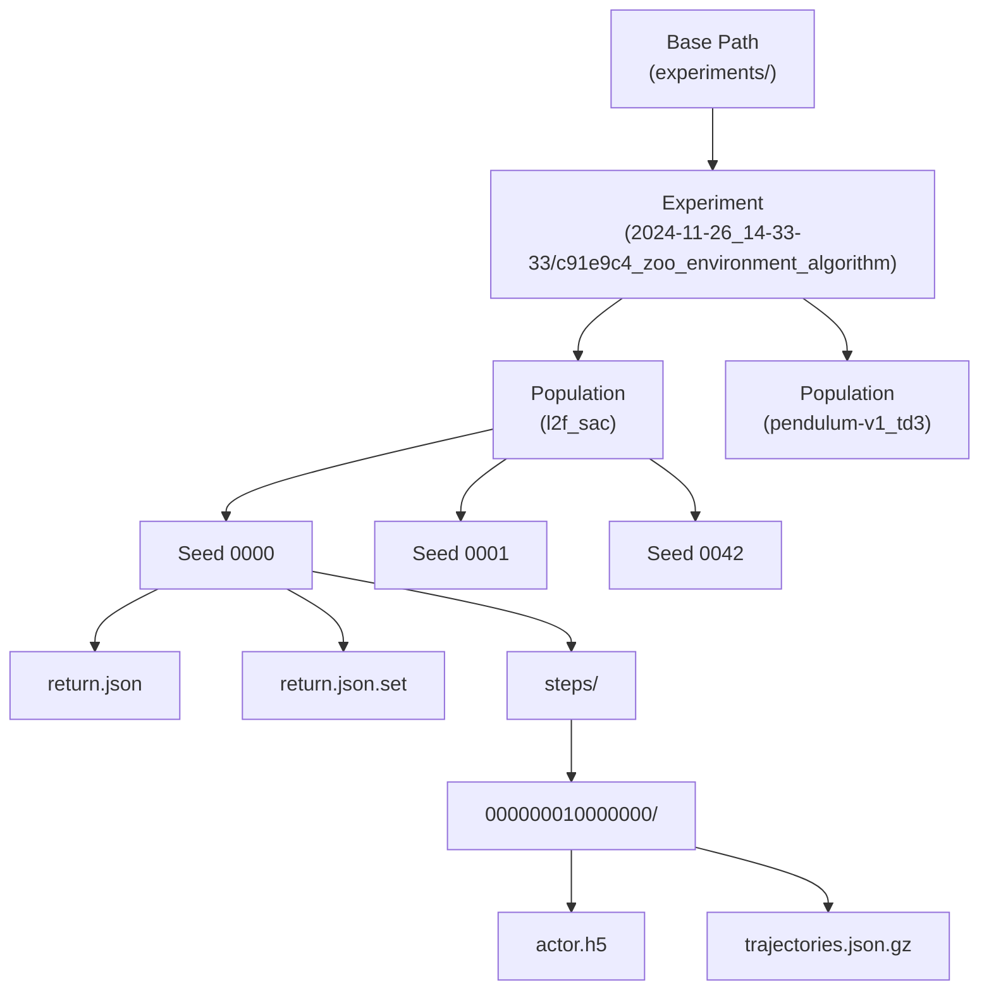
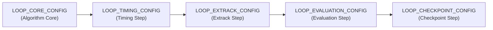
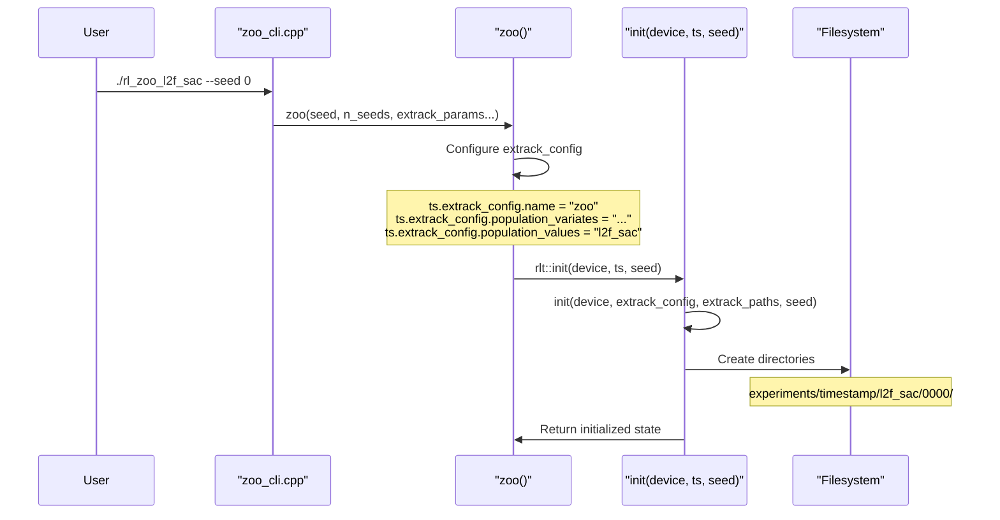
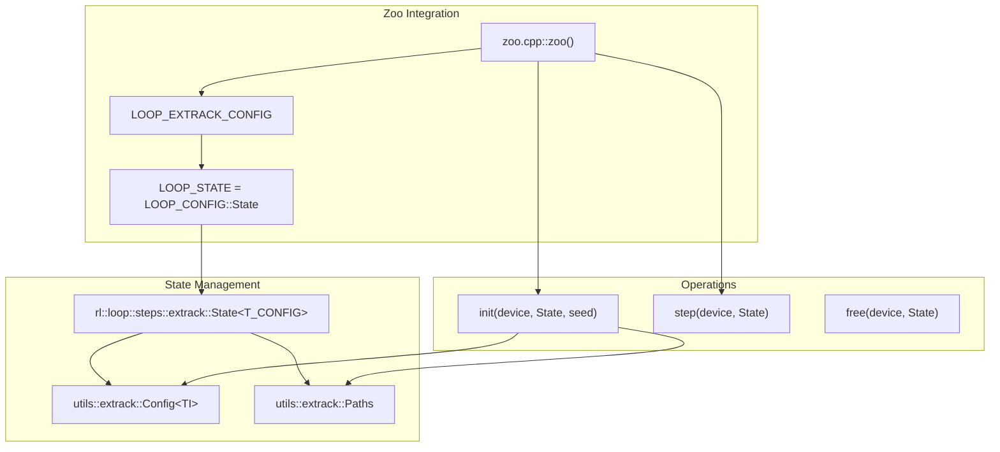
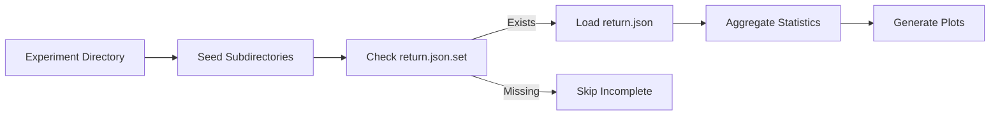

<!-- source: DeepWiki mcp.deepwiki.com · repo rl-tools/rl-tools · page 5.2 Experiment Tracking (Extrack) · fetched 2026-10-30 -->

# Experiment Tracking (Extrack)

<details>
<summary>Relevant source files</summary>

The following files were used as context for generating this wiki page:

- [include/rl_tools/rl/loop/steps/evaluation/config.h](include/rl_tools/rl/loop/steps/evaluation/config.h)
- [include/rl_tools/rl/loop/steps/evaluation/operations_generic.h](include/rl_tools/rl/loop/steps/evaluation/operations_generic.h)
- [include/rl_tools/rl/loop/steps/evaluation/state.h](include/rl_tools/rl/loop/steps/evaluation/state.h)
- [include/rl_tools/rl/loop/steps/extrack/operations_cpu.h](include/rl_tools/rl/loop/steps/extrack/operations_cpu.h)
- [include/rl_tools/rl/loop/steps/extrack/state.h](include/rl_tools/rl/loop/steps/extrack/state.h)
- [include/rl_tools/rl/loop/steps/save_trajectories/config.h](include/rl_tools/rl/loop/steps/save_trajectories/config.h)
- [include/rl_tools/rl/loop/steps/save_trajectories/operations_cpu.h](include/rl_tools/rl/loop/steps/save_trajectories/operations_cpu.h)
- [include/rl_tools/rl/loop/steps/save_trajectories/state.h](include/rl_tools/rl/loop/steps/save_trajectories/state.h)
- [include/rl_tools/rl/utils/evaluation/evaluation.h](include/rl_tools/rl/utils/evaluation/evaluation.h)
- [include/rl_tools/rl/utils/evaluation/operations_generic.h](include/rl_tools/rl/utils/evaluation/operations_generic.h)
- [src/rl/environments/l2f/dr_sac/CMakeLists.txt](src/rl/environments/l2f/dr_sac/CMakeLists.txt)
- [src/rl/environments/l2f/dr_sac/l2f_dr_sac.cpp](src/rl/environments/l2f/dr_sac/l2f_dr_sac.cpp)
- [src/rl/zoo/CMakeLists.txt](src/rl/zoo/CMakeLists.txt)
- [src/rl/zoo/l2f/environment_tiny.h](src/rl/zoo/l2f/environment_tiny.h)
- [src/rl/zoo/l2f/plot_learning_curves.py](src/rl/zoo/l2f/plot_learning_curves.py)
- [src/rl/zoo/l2f/sac.h](src/rl/zoo/l2f/sac.h)
- [src/rl/zoo/l2f/sac_tiny.h](src/rl/zoo/l2f/sac_tiny.h)
- [src/rl/zoo/zoo.cpp](src/rl/zoo/zoo.cpp)
- [src/rl/zoo/zoo_cli.cpp](src/rl/zoo/zoo_cli.cpp)

</details>


## Purpose and Scope

The Experiment Tracking (Extrack) system provides a standardized approach to organizing, storing, and managing reinforcement learning experiment results. It creates a hierarchical directory structure for experiments, manages metadata, and persists evaluation metrics in a machine-readable format for downstream analysis. 

For information about running experiments through the Zoo system, see [Running Experiments](#5.1). For details on evaluation utilities and trajectory collection, see [Evaluation and Trajectory Saving](#5.3).

---

## Overview

Extrack is a lightweight experiment management system integrated into the training loop via the decorator pattern. It automatically:

- Creates timestamped experiment directories with Git commit hash tracking
- Organizes runs by population variates (algorithm-environment combinations)
- Assigns unique seed-based subdirectories for parallel experiments
- Persists evaluation results to JSON format
- Provides a confirmation mechanism (`return.json.set`) for atomicity

The system is designed for reproducibility and ease of post-processing, enabling batch analysis of hyperparameter sweeps and algorithm comparisons.

**Sources:** [src/rl/zoo/zoo.cpp:95](), [include/rl_tools/rl/loop/steps/extrack/operations_cpu.h:1-44](), [include/rl_tools/rl/loop/steps/extrack/state.h:1-28]()

---

## Core Concepts

### Experiment Hierarchy

Extrack organizes experiments using a three-level hierarchy:

| Level | Purpose | Example |
|-------|---------|---------|
| **Experiment** | Top-level timestamped folder with Git commit hash | `2024-11-26_14-33-33/c91e9c4_zoo_environment_algorithm` |
| **Population** | Groups runs by variates (algorithm-environment pairs) | `l2f_sac`, `pendulum-v1_td3` |
| **Seed** | Individual run with specific random seed | `0000`, `0001`, `0042` |

The full path structure is: `base_path/experiment/population_values/seed/`

### Population Variates

**Population variates** define the dimensions along which experiments vary. In the Zoo system, the standard variate is `environment_algorithm`, which groups runs by their environment-algorithm combination.

```cpp
ts.extrack_config.population_variates = "environment_algorithm";
ts.extrack_config.population_values = environment + "_" + algorithm;
```

This allows comparing different algorithms on the same environment or the same algorithm across different environments by analyzing runs within and across population directories.

**Sources:** [src/rl/zoo/zoo.cpp:324-325](), [src/rl/environments/l2f/dr_sac/l2f_dr_sac.cpp:290-292]()

---

## Directory Structure and Paths



**Directory Structure Diagram**

### Path Components

| Component | Type | Description |
|-----------|------|-------------|
| `base_path` | Config | Root directory for all experiments (default: `./experiments`) |
| `experiment` | Timestamp + Git hash | `YYYY-MM-DD_HH-MM-SS/COMMIT_zoo_variates` |
| `population_values` | String | Concatenation of variate values (e.g., `l2f_sac`) |
| `seed` | Zero-padded int | Four-digit seed identifier (e.g., `0042`) |

The `extrack_paths` structure contains the fully resolved paths after initialization.

**Sources:** [include/rl_tools/rl/loop/steps/extrack/state.h:17-18](), [src/rl/zoo/zoo.cpp:318-327]()

---

## Configuration

### Extrack Config Structure

The `extrack_config` is initialized in the training loop state before `init()` is called:

```cpp
ts.extrack_config.name = "zoo";
ts.extrack_config.base_path = extrack_base_path;  // CLI override or default
ts.extrack_config.experiment = extrack_experiment;  // Timestamp or CLI override
ts.extrack_config.population_variates = "environment_algorithm";
ts.extrack_config.population_values = environment + "_" + algorithm;
```

### CLI Parameters

The Zoo CLI exposes Extrack configuration via command-line arguments:

| Argument | Short | Purpose |
|----------|-------|---------|
| `--extrack` | `-e` | Override base path |
| `--extrack-experiment` | `--ee` | Override experiment name (default: timestamp) |
| `--extrack-experiment-path` | `--eep` | Full experiment path override |

Example usage:
```bash
./rl_zoo_l2f_sac --seed 0 --n_seeds 10 --extrack experiments/ --ee my_sweep
```

**Sources:** [src/rl/zoo/zoo_cli.cpp:11-20](), [src/rl/zoo/zoo.cpp:318-328]()

---

## Output Files

### return.json Format

The `return.json` file contains an array of evaluation results, one entry per evaluation checkpoint:

```json
[
  {
    "step": 10000,
    "returns": [8.2, 7.9, 8.5, ...],
    "returns_mean": 8.2,
    "returns_std": 0.3,
    "episode_length": [500, 498, 500, ...],
    "episode_length_mean": 499.3,
    "episode_length_std": 1.2,
    "share_terminated": 0.05
  },
  {
    "step": 20000,
    ...
  }
]
```

### File Schema

| Field | Type | Description |
|-------|------|-------------|
| `step` | int | Training step at evaluation time |
| `returns` | float[] | Episode returns for all evaluation episodes |
| `returns_mean` | float | Mean return across episodes |
| `returns_std` | float | Standard deviation of returns |
| `episode_length` | int[] | Episode lengths for all evaluation episodes |
| `episode_length_mean` | float | Mean episode length |
| `episode_length_std` | float | Standard deviation of episode length |
| `share_terminated` | float | Fraction of episodes that terminated (vs truncated) |

### return.json.set

The presence of `return.json.set` (an empty file) signals that the `return.json` file has been written completely. Post-processing scripts check for this file before loading data to avoid reading incomplete results from currently-running experiments.

```cpp
std::ofstream return_file_confirmation(ts.extrack_paths.seed / "return.json.set");
return_file_confirmation.close();
```

**Sources:** [src/rl/zoo/zoo.cpp:402-414](), [src/rl/environments/l2f/dr_sac/l2f_dr_sac.cpp:341-359](), [include/rl_tools/rl/utils/evaluation/operations_generic.h:1-274]()

---

## Integration with Training Loop

### Loop Decorator Pattern

Extrack is integrated as a decorator step in the training loop configuration hierarchy:



**Training Loop Configuration Chain**

Each step inherits from the previous via the `NEXT` pattern:

```cpp
using LOOP_TIMING_CONFIG = rlt::rl::loop::steps::timing::Config<LOOP_CORE_CONFIG, ...>;
using LOOP_EXTRACK_CONFIG = rlt::rl::loop::steps::extrack::Config<LOOP_TIMING_CONFIG>;
using LOOP_EVALUATION_CONFIG = rlt::rl::loop::steps::evaluation::Config<LOOP_EXTRACK_CONFIG, ...>;
```

The state structure similarly inherits:

```cpp
template<typename T_CONFIG, typename T_NEXT = typename T_CONFIG::NEXT::template State<...>>
struct State: T_NEXT {
    rl_tools::utils::extrack::Config<typename T_CONFIG::TI> extrack_config;
    rl_tools::utils::extrack::Paths extrack_paths;
};
```

### Initialization Sequence



**Extrack Initialization Sequence**

The `init()` function in Extrack creates the directory structure and resolves paths before the training loop begins.

**Sources:** [src/rl/zoo/zoo.cpp:228-240](), [include/rl_tools/rl/loop/steps/extrack/operations_cpu.h:19-24](), [src/rl/zoo/zoo.cpp:302-335]()

---

## Code Entity Mapping

### Key Classes and Functions



**Extrack Code Entity Relationships**

| Entity | File | Description |
|--------|------|-------------|
| `extrack::State<T_CONFIG>` | [include/rl_tools/rl/loop/steps/extrack/state.h:13-19]() | Loop state containing config and paths |
| `extrack::Config<T_NEXT>` | Referenced via utils | Config template (not in provided files) |
| `utils::extrack::Config<TI>` | Referenced | Runtime configuration struct |
| `utils::extrack::Paths` | Referenced | Resolved filesystem paths |
| `init(device, State, seed)` | [include/rl_tools/rl/loop/steps/extrack/operations_cpu.h:19-24]() | Initializes paths and creates directories |
| `step(device, State)` | [include/rl_tools/rl/loop/steps/extrack/operations_cpu.h:33-39]() | No-op, delegates to next step |

**Sources:** [include/rl_tools/rl/loop/steps/extrack/state.h:1-28](), [include/rl_tools/rl/loop/steps/extrack/operations_cpu.h:1-44]()

---

## Usage Examples

### Basic Usage in Zoo

```cpp
// From zoo.cpp lines 317-328
ts.extrack_config.name = "zoo";
if(extrack_base_path != ""){
    ts.extrack_config.base_path = extrack_base_path;
}
if(extrack_experiment != ""){
    ts.extrack_config.experiment = extrack_experiment;
}
ts.extrack_config.population_variates = "environment_algorithm";
ts.extrack_config.population_values = environment + "_" + algorithm;
if(extrack_experiment_path != ""){
    ts.extrack_config.experiment = extrack_experiment_path;
}
```

### Custom Population Variates

```cpp
// From l2f_dr_sac.cpp lines 290-292
ts.extrack_config.name = "dr-sac";
ts.extrack_config.population_variates = "algorithm_environment_zero-init";
ts.extrack_config.population_values = "sac_l2f_" + std::string((ZERO_ANGLE_INIT ? "true" : "false"));
```

This creates separate populations for different initialization strategies.

### Writing Results

```cpp
// From zoo.cpp lines 402-414
std::filesystem::create_directories(ts.extrack_paths.seed);
std::ofstream return_file(ts.extrack_paths.seed / "return.json");
return_file << "[";
for(TI evaluation_i = 0; evaluation_i < LOOP_CONFIG::EVALUATION_PARAMETERS::N_EVALUATIONS; evaluation_i++){
    auto& result = rlt::get(ts.evaluation_results, 0, evaluation_i);
    return_file << rlt::json(device, result, step);
    if(evaluation_i < LOOP_CONFIG::EVALUATION_PARAMETERS::N_EVALUATIONS - 1){
        return_file << ", ";
    }
}
return_file << "]";
std::ofstream return_file_confirmation(ts.extrack_paths.seed / "return.json.set");
```

**Sources:** [src/rl/zoo/zoo.cpp:317-328](), [src/rl/environments/l2f/dr_sac/l2f_dr_sac.cpp:290-292](), [src/rl/zoo/zoo.cpp:402-414]()

---

## Post-Processing and Analysis

### Loading Experiment Data

Python scripts can aggregate results across seeds by checking for `return.json.set` and parsing `return.json`:

```python
# From plot_learning_curves.py lines 6-36
def load_experiment(experiment, time, lower_percentile=0, upper_percentile=100):
    steps = []
    returns = []
    
    for run_path in map(lambda x: os.path.join(experiment, x), os.listdir(experiment)):
        if os.path.exists(os.path.join(run_path, "return.json.set")):
            with open(os.path.join(run_path, "return.json")) as f:
                results = json.load(f)
                for i, evaluation_step in enumerate(results):
                    if not steps_set:
                        steps.append(evaluation_step["step"])
                        returns.append([])
                    returns[i].append(np.mean(evaluation_step["returns"]))
    
    returns = np.array(returns)
    # Compute IQM statistics...
    return steps, wall_time, iqm_mean_returns, iqm_std_returns, returns
```

### Typical Analysis Workflow



**Post-Processing Data Flow**

### Comparison Across Populations

Multiple experiments can be loaded by specifying different population paths:

```python
experiments = {
    "SAC": ("experiments/2024-11-26_14-33-33/c91e9c4_zoo_environment_algorithm/l2f_sac", 20*60),
    "TD3": ("experiments/2024-11-26_14-33-33/c91e9c4_zoo_environment_algorithm/l2f_td3", 20*60),
}

for experiment_name, (path, time) in experiments.items():
    steps, wall_time, mean_returns, std_returns, returns = load_experiment(path, time)
    plt.plot(wall_time, mean_returns, label=experiment_name)
```

The directory structure enables easy comparison of algorithm performance on the same environment.

**Sources:** [src/rl/zoo/l2f/plot_learning_curves.py:1-151]()

---

## Relationship to Other Systems

### Evaluation Step Integration

The Extrack paths are used by the evaluation step to save checkpoints and trajectories:

```cpp
// Evaluation results are written using extrack paths
std::ofstream return_file(ts.extrack_paths.seed / "return.json");

// Checkpoints use step subdirectories under extrack seed path
std::filesystem::path step_folder = ts.extrack_paths.seed / "steps" / step_ss.str();
```

### Checkpoint System

The checkpoint saving mechanism (see [Checkpoint System](#5.1)) uses Extrack's directory structure:

```
experiments/
  └── 2024-11-26_14-33-33/c91e9c4_zoo_environment_algorithm/
      └── l2f_sac/
          └── 0000/
              ├── return.json
              ├── return.json.set
              └── steps/
                  ├── 000000010000000/
                  │   ├── actor.h5
                  │   └── trajectories.json.gz
                  └── 000000020000000/
                      ├── actor.h5
                      └── trajectories.json.gz
```

This unified structure simplifies experiment management and post-training evaluation.

**Sources:** [include/rl_tools/rl/loop/steps/save_trajectories/operations_cpu.h:141-168](), [src/rl/zoo/zoo.cpp:402-414]()

---

