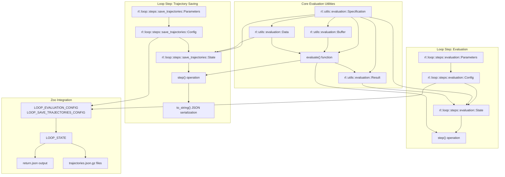
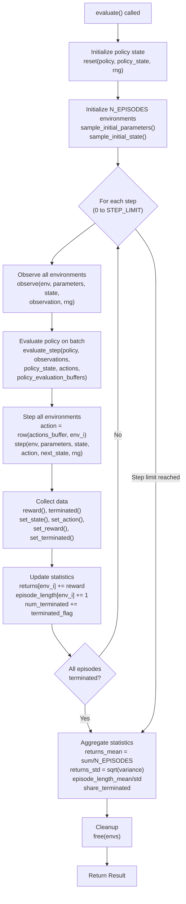
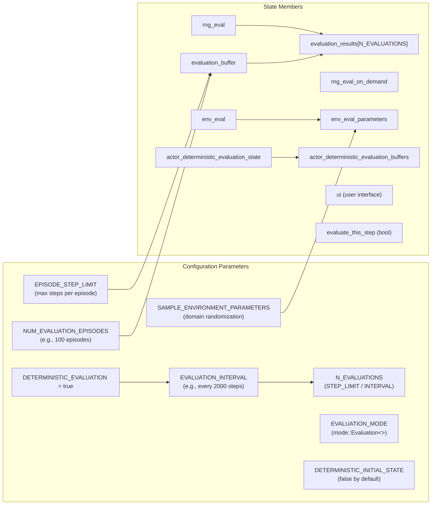
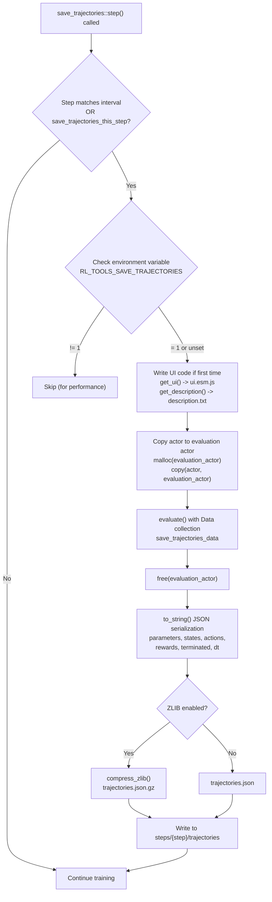
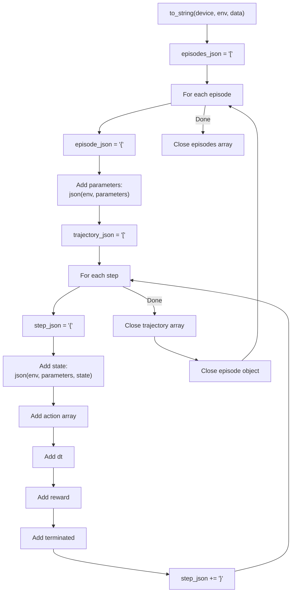
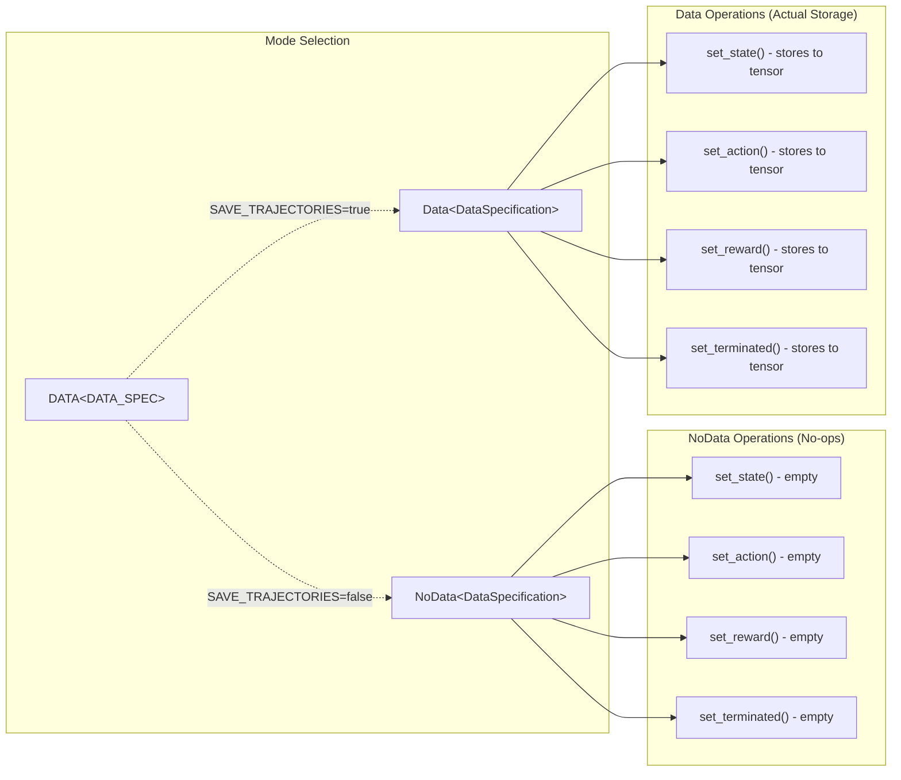
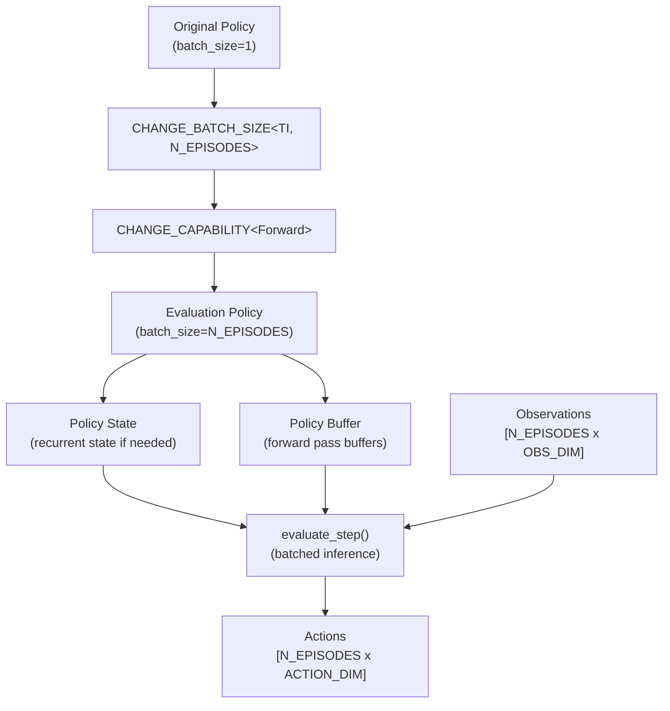
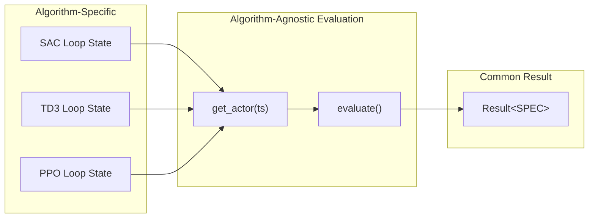

<!-- source: DeepWiki mcp.deepwiki.com · repo rl-tools/rl-tools · page 5.3 Evaluation and Trajectory Saving · fetched 2026-10-30 -->

# Evaluation and Trajectory Saving

<details>
<summary>Relevant source files</summary>

The following files were used as context for generating this wiki page:

- [include/rl_tools/rl/loop/steps/evaluation/config.h](include/rl_tools/rl/loop/steps/evaluation/config.h)
- [include/rl_tools/rl/loop/steps/evaluation/operations_generic.h](include/rl_tools/rl/loop/steps/evaluation/operations_generic.h)
- [include/rl_tools/rl/loop/steps/evaluation/state.h](include/rl_tools/rl/loop/steps/evaluation/state.h)
- [include/rl_tools/rl/loop/steps/extrack/operations_cpu.h](include/rl_tools/rl/loop/steps/extrack/operations_cpu.h)
- [include/rl_tools/rl/loop/steps/extrack/state.h](include/rl_tools/rl/loop/steps/extrack/state.h)
- [include/rl_tools/rl/loop/steps/save_trajectories/config.h](include/rl_tools/rl/loop/steps/save_trajectories/config.h)
- [include/rl_tools/rl/loop/steps/save_trajectories/operations_cpu.h](include/rl_tools/rl/loop/steps/save_trajectories/operations_cpu.h)
- [include/rl_tools/rl/loop/steps/save_trajectories/state.h](include/rl_tools/rl/loop/steps/save_trajectories/state.h)
- [include/rl_tools/rl/utils/evaluation/evaluation.h](include/rl_tools/rl/utils/evaluation/evaluation.h)
- [include/rl_tools/rl/utils/evaluation/operations_generic.h](include/rl_tools/rl/utils/evaluation/operations_generic.h)
- [src/rl/environments/l2f/dr_sac/CMakeLists.txt](src/rl/environments/l2f/dr_sac/CMakeLists.txt)
- [src/rl/environments/l2f/dr_sac/l2f_dr_sac.cpp](src/rl/environments/l2f/dr_sac/l2f_dr_sac.cpp)
- [src/rl/zoo/CMakeLists.txt](src/rl/zoo/CMakeLists.txt)
- [src/rl/zoo/l2f/environment_tiny.h](src/rl/zoo/l2f/environment_tiny.h)
- [src/rl/zoo/l2f/plot_learning_curves.py](src/rl/zoo/l2f/plot_learning_curves.py)
- [src/rl/zoo/l2f/sac.h](src/rl/zoo/l2f/sac.h)
- [src/rl/zoo/l2f/sac_tiny.h](src/rl/zoo/l2f/sac_tiny.h)
- [src/rl/zoo/zoo.cpp](src/rl/zoo/zoo.cpp)
- [src/rl/zoo/zoo_cli.cpp](src/rl/zoo/zoo_cli.cpp)

</details>


## Purpose and Scope

This document describes the evaluation and trajectory saving systems in rl_tools, which provide periodic policy assessment during training and detailed trajectory data collection for analysis and visualization. Evaluation measures policy performance at regular intervals, while trajectory saving captures complete episode data including states, actions, rewards, and termination flags. These systems are implemented as composable loop steps that can be added to any training configuration.

For information about the overall training loop architecture and the decorator pattern for loop steps, see [Training Loop Architecture](#2.4). For experiment tracking and result organization, see [Experiment Tracking (Extrack)](#5.2).

## System Components

The evaluation and trajectory saving functionality is organized into several interconnected components:



**Sources:** [include/rl_tools/rl/utils/evaluation/evaluation.h](), [include/rl_tools/rl/loop/steps/evaluation/config.h](), [include/rl_tools/rl/loop/steps/save_trajectories/config.h](), [src/rl/zoo/zoo.cpp:219-261]()

## Evaluation Specification and Result Types

The evaluation system uses a template-based specification pattern to define evaluation parameters and result types:

| Type | Purpose | Key Members |
|------|---------|-------------|
| `rl::utils::evaluation::Specification<...>` | Defines evaluation parameters | `N_EPISODES`, `STEP_LIMIT`, `DETERMINISTIC_INITIAL_STATE` |
| `rl::utils::evaluation::Result<SPEC>` | Stores aggregated metrics | `returns_mean`, `returns_std`, `episode_length_mean`, `share_terminated` |
| `rl::utils::evaluation::Buffer<SPEC>` | Holds temporary evaluation data | `actions`, `observations`, `envs`, `states`, `parameters` |
| `rl::utils::evaluation::Data<SPEC>` | Stores complete trajectory data | `states`, `actions`, `rewards`, `terminated`, `dt` |
| `rl::utils::evaluation::NoData<SPEC>` | Empty placeholder when data not needed | (no members) |

The `Specification` template parameters:
- `TYPE_POLICY`: Numeric type policy (e.g., `float`, `double`)
- `TI`: Index type (typically `int` or `long`)
- `T_ENVIRONMENT`: Environment type
- `T_N_EPISODES`: Number of parallel evaluation episodes
- `T_STEP_LIMIT`: Maximum steps per episode
- `T_DETERMINISTIC_INITIAL_STATE`: Whether to use deterministic initialization

**Sources:** [include/rl_tools/rl/utils/evaluation/evaluation.h:19-66]()

## Evaluation Process Flow

The evaluation process runs multiple episodes in parallel and aggregates results:



**Sources:** [include/rl_tools/rl/utils/evaluation/operations_generic.h:114-234]()

## Evaluation Loop Step Configuration

The evaluation loop step adds periodic policy evaluation to the training loop:



The evaluation step (`rl::loop::steps::evaluation::step()`) checks if evaluation is scheduled and executes the evaluation:

1. **Schedule Check**: `ts.step % EVALUATION_INTERVAL == 0`
2. **Copy Actor**: Extract actor from training state (or copy if needed)
3. **Run Evaluation**: Call `evaluate()` with deterministic mode
4. **Store Results**: Save to pre-allocated `evaluation_results[evaluation_index]`
5. **Log Metrics**: Write to logger/TensorBoard

**Sources:** [include/rl_tools/rl/loop/steps/evaluation/config.h](), [include/rl_tools/rl/loop/steps/evaluation/state.h](), [include/rl_tools/rl/loop/steps/evaluation/operations_generic.h:55-95]()

## Trajectory Saving Loop Step

The trajectory saving step captures complete episode data for visualization and analysis:



The trajectory data format includes:
- **Episode Parameters**: Environment-specific parameters (dynamics, initial conditions)
- **Trajectory**: Array of steps, each containing:
  - `state`: Full environment state
  - `action`: Action taken
  - `dt`: Time step duration
  - `reward`: Reward received
  - `terminated`: Termination flag

**Sources:** [include/rl_tools/rl/loop/steps/save_trajectories/operations_cpu.h:123-174](), [include/rl_tools/rl/loop/steps/save_trajectories/operations_cpu.h:52-92]()

## JSON Serialization Format

The trajectory data is serialized to JSON with the following structure:

```json
[
  {
    "parameters": { /* Environment parameters */ },
    "trajectory": [
      {
        "state": { /* Environment-specific state */ },
        "action": [0.1, -0.2, 0.3, 0.4],
        "dt": 0.02,
        "reward": -0.05,
        "terminated": false
      },
      /* ... more steps ... */
    ]
  },
  /* ... more episodes ... */
]
```

The `to_string()` function iterates through the collected data and constructs the JSON string:



**Sources:** [include/rl_tools/rl/loop/steps/save_trajectories/operations_cpu.h:53-92]()

## Configuration in Zoo System

The zoo system (`src/rl/zoo/zoo.cpp`) configures evaluation and trajectory saving intervals:

| Configuration | Purpose | Typical Value |
|---------------|---------|---------------|
| `NUM_EVALUATIONS` | Number of evaluation points during training | 100 |
| `NUM_SAVE_TRAJECTORIES` | Number of trajectory save points | 10 |
| `LOOP_EVALUATION_PARAMETERS::EVALUATION_INTERVAL` | Steps between evaluations | `STEP_LIMIT / NUM_EVALUATIONS` |
| `LOOP_SAVE_TRAJECTORIES_PARAMETERS::INTERVAL` | Steps between trajectory saves | `STEP_LIMIT / NUM_SAVE_TRAJECTORIES` |
| `LOOP_EVALUATION_PARAMETERS::NUM_EVALUATION_EPISODES` | Episodes per evaluation | 100 |
| `LOOP_SAVE_TRAJECTORIES_PARAMETERS::NUM_EPISODES` | Episodes per trajectory save | 100 |

The loop configuration is built by composing multiple loop step configs:

```
LOOP_CORE_CONFIG
  -> LOOP_TIMING_CONFIG
    -> LOOP_EXTRACK_CONFIG
      -> LOOP_EVALUATION_CONFIG
        -> LOOP_CHECKPOINT_CONFIG
          -> LOOP_SAVE_TRAJECTORIES_CONFIG
            -> LOOP_NN_ANALYTICS_CONFIG (optional)
```

Each step adds its state and operations to the training loop using the decorator pattern.

**Sources:** [src/rl/zoo/zoo.cpp:219-261]()

## Evaluation Results Output

At the end of training, evaluation results are written to `return.json`:

```json
[
  {
    "step": 0,
    "returns": [1.2, 1.5, ...],
    "returns_mean": 1.35,
    "returns_std": 0.15,
    "episode_length": [200, 210, ...],
    "episode_length_mean": 205.0,
    "episode_length_std": 5.0,
    "share_terminated": 0.95
  },
  /* ... more evaluation points ... */
]
```

The zoo main loop writes this file after training completes:

```cpp
std::ofstream return_file(ts.extrack_paths.seed / "return.json");
return_file << "[";
for(TI evaluation_i = 0; evaluation_i < N_EVALUATIONS; evaluation_i++){
    auto& result = get(ts.evaluation_results, 0, evaluation_i);
    return_file << json(device, result, step);
    if(evaluation_i < N_EVALUATIONS - 1){
        return_file << ", ";
    }
}
return_file << "]";
```

A companion `return.json.set` file is created to signal completion, which the extrack system uses to identify completed runs.

**Sources:** [src/rl/zoo/zoo.cpp:402-414](), [src/rl/environments/l2f/dr_sac/l2f_dr_sac.cpp:340-360]()

## Data Collection Modes

The evaluation system supports two data collection modes through template specialization:



This design allows the evaluation loop step to run without trajectory data collection overhead, while the trajectory saving step uses the same `evaluate()` function with full data collection enabled.

**Sources:** [include/rl_tools/rl/utils/evaluation/operations_generic.h:70-111](), [include/rl_tools/rl/loop/steps/save_trajectories/state.h:20]()

## Policy Buffer and Batching

For efficient evaluation, policies are adjusted to process multiple episodes in parallel:



The capability change removes backward pass functionality since evaluation only requires forward passes, reducing memory usage.

**Sources:** [include/rl_tools/rl/loop/steps/evaluation/state.h:21-24](), [include/rl_tools/rl/utils/evaluation/evaluation.h:86-102]()

## Signal-Based On-Demand Evaluation

The zoo system supports on-demand evaluation and trajectory saving via Unix signals:

```cpp
#if defined(__unix__) || defined(__APPLE__)
    if (signal(SIGUSR1, signal_handler) == SIG_ERR){ ... }
#endif

// In training loop:
if(signal_flag){
    ts.evaluate_this_step = true;
    ts.checkpoint_this_step = true;
    ts.save_trajectories_this_step = true;
}
signal_flag = false;
```

Sending `SIGUSR1` to the process triggers evaluation, checkpointing, and trajectory saving at the next training step, useful for debugging or monitoring long-running experiments.

**Sources:** [src/rl/zoo/zoo.cpp:293-309](), [src/rl/zoo/zoo.cpp:382-387]()

## File Organization

Evaluation and trajectory files are organized within the extrack directory structure:

```
experiments/{timestamp}_{commit_hash}_{experiment_name}/{population_variates}/{population_values}/{seed}/
├── return.json              # Evaluation results (all checkpoints)
├── return.json.set          # Completion marker
├── ui.esm.js               # Environment-specific UI code (if available)
├── description.txt         # Environment description
└── steps/
    ├── 000000000020000/
    │   ├── actor.h         # Policy checkpoint
    │   ├── trajectories.json.gz  # Trajectory data
    │   └── ...
    ├── 000000000040000/
    │   └── ...
    └── ...
```

The zero-padded step numbers (15 digits) ensure correct lexicographic sorting when listing directories.

**Sources:** [include/rl_tools/rl/loop/steps/save_trajectories/operations_cpu.h:164-168](), [src/rl/zoo/zoo.cpp:402-414]()

## Visualization and Analysis

The saved trajectory data can be used for:

1. **Browser-based Visualization**: The `ui.esm.js` file provides environment-specific visualization code that can render trajectories in a web browser using the rltools.js library (see [WebAssembly and rltools.js](#8.2))

2. **Post-Training Analysis**: The JSON format enables easy loading in Python for analysis:
   ```python
   import json
   import gzip
   
   with gzip.open('trajectories.json.gz', 'rt') as f:
       episodes = json.load(f)
   
   for episode in episodes:
       params = episode['parameters']
       trajectory = episode['trajectory']
       # Analyze trajectory...
   ```

3. **Learning Curve Plotting**: The `return.json` file structure enables plotting learning curves, as demonstrated in `src/rl/zoo/l2f/plot_learning_curves.py`

**Sources:** [src/rl/zoo/l2f/plot_learning_curves.py:1-151](), [include/rl_tools/rl/loop/steps/save_trajectories/operations_cpu.h:136-153]()

## Performance Considerations

| Aspect | Impact | Mitigation |
|--------|--------|------------|
| Evaluation overhead | Pauses training for evaluation episodes | Configurable `EVALUATION_INTERVAL` |
| Trajectory data size | Large tensors for state/action/reward storage | Use `NoData<>` mode when not needed; gzip compression |
| JSON serialization | String construction can be slow | Only serialize at save points, not every evaluation |
| Memory usage | Batched evaluation with `N_EPISODES` environments | Adjust `NUM_EVALUATION_EPISODES` based on available memory |
| I/O blocking | Writing large compressed files | Use higher `INTERVAL` values for trajectory saving |

The environment variable `RL_TOOLS_SAVE_TRAJECTORIES` can disable trajectory saving entirely for production runs where only evaluation metrics are needed.

**Sources:** [include/rl_tools/rl/loop/steps/save_trajectories/operations_cpu.h:132-136]()

## Integration with Training Algorithms

The evaluation system works identically across all training algorithms (SAC, TD3, PPO):



Each algorithm implements `get_actor()` to extract the policy from its state structure, allowing the evaluation system to remain algorithm-agnostic.

**Sources:** [include/rl_tools/rl/loop/steps/evaluation/operations_generic.h:70-72](), [include/rl_tools/rl/loop/steps/save_trajectories/operations_cpu.h:156-158]()

---

