<!-- source: DeepWiki mcp.deepwiki.com · repo rl-tools/rl-tools · page 6 Build System and Configuration · fetched 2026-10-30 -->

# Build System and Configuration

<details>
<summary>Relevant source files</summary>

The following files were used as context for generating this wiki page:

- [.gitignore](.gitignore)
- [CMakeLists.txt](CMakeLists.txt)
- [src/rl/environments/mujoco/ant/CMakeLists.txt](src/rl/environments/mujoco/ant/CMakeLists.txt)
- [src/rl/environments/mujoco/ant/evaluate_actor.cpp](src/rl/environments/mujoco/ant/evaluate_actor.cpp)
- [src/rl/environments/mujoco/ant/ppo/cpu/CMakeLists.txt](src/rl/environments/mujoco/ant/ppo/cpu/CMakeLists.txt)
- [src/rl/environments/mujoco/ant/ppo/cpu/training.h](src/rl/environments/mujoco/ant/ppo/cpu/training.h)
- [src/rl/environments/mujoco/ant/ppo/cuda/CMakeLists.txt](src/rl/environments/mujoco/ant/ppo/cuda/CMakeLists.txt)
- [src/rl/environments/mujoco/ant/ppo/cuda/training_ppo.cu](src/rl/environments/mujoco/ant/ppo/cuda/training_ppo.cu)
- [src/rl/environments/mujoco/ant/ppo/parameters.h](src/rl/environments/mujoco/ant/ppo/parameters.h)
- [src/rl/environments/mujoco/ant/td3/CMakeLists.txt](src/rl/environments/mujoco/ant/td3/CMakeLists.txt)
- [src/rl/environments/mujoco/ant/td3/training.h](src/rl/environments/mujoco/ant/td3/training.h)
- [src/rl/environments/pendulum/sac/cuda/cuda_graph_export.h](src/rl/environments/pendulum/sac/cuda/cuda_graph_export.h)
- [src/rl/environments/pendulum/td3/cpu/CMakeLists.txt](src/rl/environments/pendulum/td3/cpu/CMakeLists.txt)
- [tests/CMakeLists.txt](tests/CMakeLists.txt)
- [tests/src/rl/algorithms/ppo/parameters_rl.h](tests/src/rl/algorithms/ppo/parameters_rl.h)

</details>


This page documents the CMake-based build system used in RLtools and the various configuration options available. The build system is designed to be flexible, allowing users to enable or disable specific features, choose appropriate backends (CPU, CUDA, etc.), and control optimization settings for different deployment scenarios.

For information about running tests, see [Testing and Benchmarking](#7).

## Build System Overview

The RLtools build system is built on CMake (minimum version 3.19 required for HDF5::HDF5 target support) and provides a header-only library interface through the `rl_tools_core` INTERFACE target. The library can be integrated either as a full-featured build or as a minimal header-only dependency.

Sources: [CMakeLists.txt:3]()

### Core CMake Targets

**CMake Target Structure Diagram**

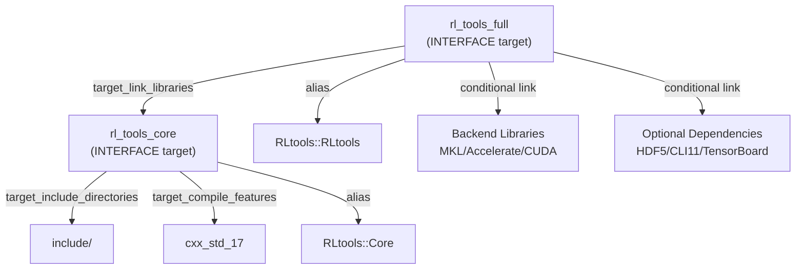

Sources: [CMakeLists.txt:21-28]()

The two primary targets are:

| Target | Alias | Type | Description |
|--------|-------|------|-------------|
| `rl_tools_core` | `RLtools::Core` | INTERFACE | Header-only base library, requires C++17, includes `include/` directory |
| `rl_tools_full` | `RLtools::RLtools` | INTERFACE | Full library linking core + backends + optional features |

The `rl_tools_core` target is defined at [CMakeLists.txt:21-24]() and provides just the header includes and C++17 requirement. The `rl_tools_full` target is defined at [CMakeLists.txt:26-28]() and adds backends and dependencies based on enabled options.

Sources: [CMakeLists.txt:21-28]()

## CMake Options

RLtools offers many configuration options to customize the build according to your needs. These options can be set when invoking CMake using the `-D` flag.

**CMake Options and Compile Definitions Diagram**

```mermaid
graph TD
    A["CMake Options"] --> B["Core Build Control"]
    A --> C["Backend Selection"]
    A --> D["Optional Features"]
    A --> E["Optimization Flags"]
    
    B --> B1["RL_TOOLS_ENABLE_TARGETS<br/>Default: ON<br/>Controls: src/ subdirectory"]
    B --> B2["RL_TOOLS_ENABLE_TESTS<br/>Default: OFF<br/>Controls: tests/ subdirectory"]
    B --> B3["RL_TOOLS_OFFLINE_BUILD<br/>Default: OFF<br/>Sets: FETCHCONTENT_FULLY_DISCONNECTED"]
    B --> B4["RL_TOOLS_WARNINGS_AS_ERRORS<br/>Default: ON<br/>Adds: -Werror/-Wall/-Wextra"]
    
    C --> C1["RL_TOOLS_BACKEND_ENABLE_MKL<br/>Links: BLAS::BLAS<br/>Define: RL_TOOLS_BACKEND_ENABLE_MKL"]
    C --> C2["RL_TOOLS_BACKEND_ENABLE_ACCELERATE<br/>Links: BLAS::BLAS<br/>Define: RL_TOOLS_BACKEND_ENABLE_ACCELERATE"]
    C --> C3["RL_TOOLS_BACKEND_ENABLE_CUDA<br/>Links: CUDA::cublas<br/>Define: RL_TOOLS_BACKEND_ENABLE_CUDA"]
    
    D --> D1["RL_TOOLS_ENABLE_HDF5<br/>Links: HighFive<br/>Define: RL_TOOLS_ENABLE_HDF5"]
    D --> D2["RL_TOOLS_ENABLE_TENSORBOARD<br/>Links: tensorboard_logger<br/>Define: RL_TOOLS_ENABLE_TENSORBOARD"]
    D --> D3["RL_TOOLS_ENABLE_CLI11<br/>Links: CLI11::CLI11<br/>Define: RL_TOOLS_ENABLE_CLI11"]
    D --> D4["RL_TOOLS_RL_ENVIRONMENTS_ENABLE_MUJOCO<br/>Links: mujoco::mujoco<br/>Includes: cmake/optional/mujoco.cmake"]
    
    E --> E1["RL_TOOLS_DISABLE_FAST_MATH<br/>Controls: -ffast-math flag"]
    E --> E2["RL_TOOLS_DISABLE_CPU_SPECIFIC_OPTIMIZATIONS<br/>Controls: -march=native flag"]
    E --> E3["CMAKE_BUILD_TYPE=Debug<br/>Defines: RL_TOOLS_DEBUG"]
    E --> E4["CMAKE_BUILD_TYPE=Release<br/>Adds: -O3 -ffast-math -march=native"]
```

Sources: [CMakeLists.txt:10-16](), [CMakeLists.txt:31-38](), [CMakeLists.txt:83-85](), [CMakeLists.txt:91-101]()

Below is a reference table of important CMake options with their default values and effects:

| CMake Option | Default | Compile Definition | Linked Libraries | Description |
|--------------|---------|-------------------|------------------|-------------|
| `RL_TOOLS_ENABLE_TARGETS` | ON | - | - | Enables `add_subdirectory(src)` to build executables |
| `RL_TOOLS_ENABLE_TESTS` | OFF | - | GTest::gtest_main | Enables `add_subdirectory(tests)` |
| `RL_TOOLS_OFFLINE_BUILD` | OFF | - | - | Sets `FETCHCONTENT_FULLY_DISCONNECTED` for offline builds |
| `RL_TOOLS_WARNINGS_AS_ERRORS` | ON | - | - | Adds `-Werror -Wall -Wextra` compiler flags |
| `RL_TOOLS_RL_ENVIRONMENTS_ENABLE_MUJOCO` | OFF | - | mujoco::mujoco | Includes `cmake/optional/mujoco.cmake` |

Sources: [CMakeLists.txt:10-16](), [CMakeLists.txt:35-52](), [CMakeLists.txt:87-89](), [CMakeLists.txt:91-101]()

### Backend Configuration

Backend options are autodetected by `cmake/autodetect/all.cmake` and control which computational libraries are used for matrix operations:

**Backend Selection and Preprocessor Defines**

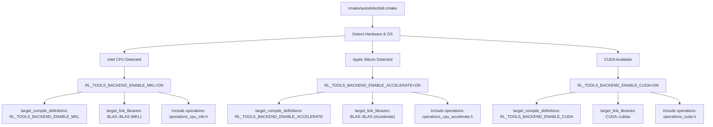

Sources: [CMakeLists.txt:81](), [src/rl/environments/mujoco/ant/ppo/cpu/training.h:16-23]()

| Backend Option | Preprocessor Define | Linked Library | Operations Header |
|----------------|--------------------|-----------------|--------------------|
| `RL_TOOLS_BACKEND_ENABLE_MKL` | `RL_TOOLS_BACKEND_ENABLE_MKL` | BLAS::BLAS (MKL) | `operations_cpu_mkl.h` |
| `RL_TOOLS_BACKEND_ENABLE_ACCELERATE` | `RL_TOOLS_BACKEND_ENABLE_ACCELERATE` | BLAS::BLAS (Accelerate) | `operations_cpu_accelerate.h` |
| `RL_TOOLS_BACKEND_ENABLE_CUDA` | `RL_TOOLS_BACKEND_ENABLE_CUDA` | CUDA::cublas | `operations_cuda.h` |

The backend selection affects which operations implementation is included via preprocessor conditionals, as seen in training code:

```cpp
#if defined(RL_TOOLS_BACKEND_ENABLE_MKL) && !defined(RL_TOOLS_BACKEND_DISABLE_BLAS)
#include <rl_tools/rl/components/on_policy_runner/operations_cpu_mkl.h>
#else
#if defined(RL_TOOLS_BACKEND_ENABLE_ACCELERATE) && !defined(RL_TOOLS_BACKEND_DISABLE_BLAS)
#include <rl_tools/rl/components/on_policy_runner/operations_cpu_accelerate.h>
#else
#include <rl_tools/rl/components/on_policy_runner/operations_cpu.h>
#endif
#endif
```

Sources: [src/rl/environments/mujoco/ant/ppo/cpu/training.h:16-24]()

### Compiler Optimization Flags

The build system applies different compiler flags based on build type and configuration options:

**Compiler Flag Selection Logic**

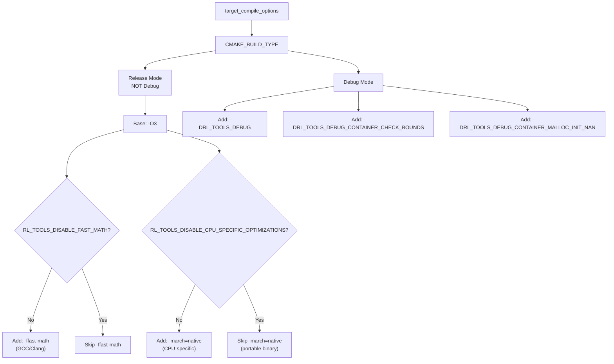

Sources: [CMakeLists.txt:31-52]()

| Configuration Option | Compiler Flags (GCC/Clang) | Compiler Flags (MSVC) | Effect |
|----------------------|----------------------------|----------------------|---------|
| Release + defaults | `-O3 -ffast-math -march=native` | `/fp:fast` | Maximum performance |
| `RL_TOOLS_DISABLE_FAST_MATH` | `-O3 -march=native` (no `-ffast-math`) | (no `/fp:fast`) | IEEE 754 compliance |
| `RL_TOOLS_DISABLE_CPU_SPECIFIC_OPTIMIZATIONS` | `-O3 -ffast-math` (no `-march=native`) | `/fp:fast` | Portable binary |
| `RL_TOOLS_WARNINGS_AS_ERRORS=ON` | `-Werror -Wall -Wextra` | `/W4 /WX` | Strict compilation |
| Debug | `-DRL_TOOLS_DEBUG` + debug flags | `/D RL_TOOLS_DEBUG` | Runtime checks enabled |

Sources: [CMakeLists.txt:31-52]()

### Debug Build Configuration

When `CMAKE_BUILD_TYPE=Debug`, several preprocessor defines are automatically added to enable runtime checks:

**Debug Mode Preprocessor Defines**

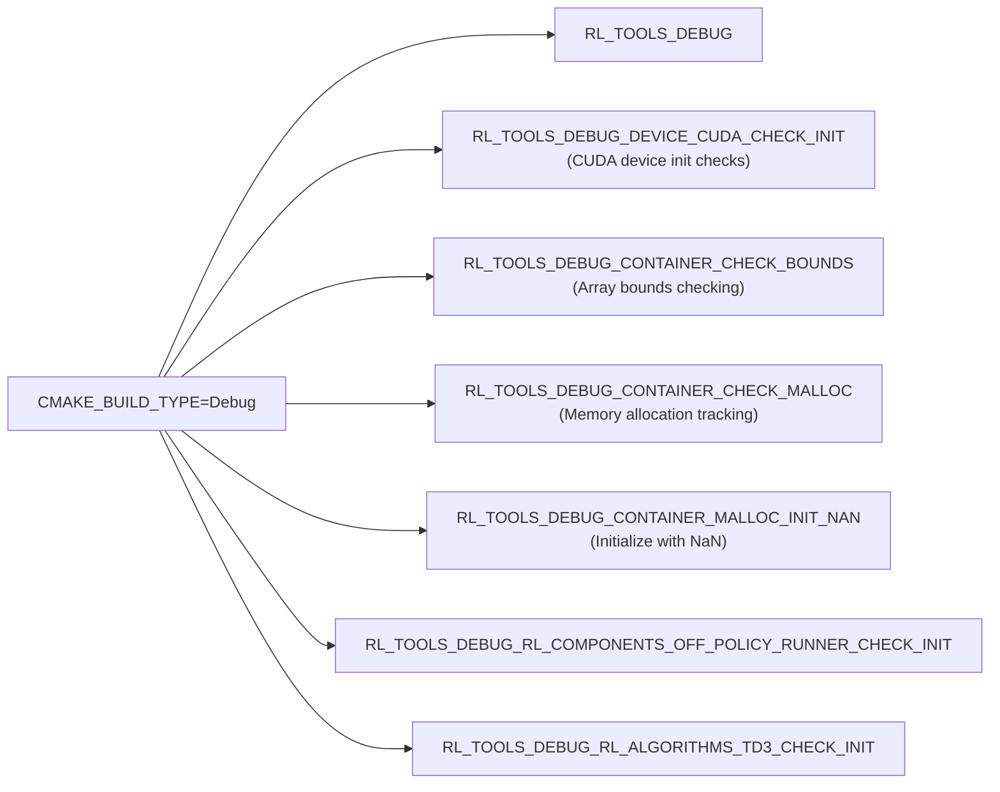

These defines enable runtime checks throughout the codebase. For example, `RL_TOOLS_DEBUG_CONTAINER_CHECK_BOUNDS` enables array bounds checking in container operations, while `RL_TOOLS_DEBUG_CONTAINER_MALLOC_INIT_NAN` initializes all allocated memory with NaN values to help detect uninitialized data usage.

Additionally, the option `RL_TOOLS_TESTS_CODE_COVERAGE` enables code coverage instrumentation:

```cmake
if(RL_TOOLS_TESTS_CODE_COVERAGE)
    add_compile_options(--coverage -g -O0)
    add_link_options(--coverage)
endif()
```

Sources: [tests/CMakeLists.txt:19-25]()

## FetchContent Dependency Management

RLtools uses CMake's FetchContent to manage external dependencies. The base directory for downloaded dependencies is configurable:

**FetchContent Base Directory Configuration**

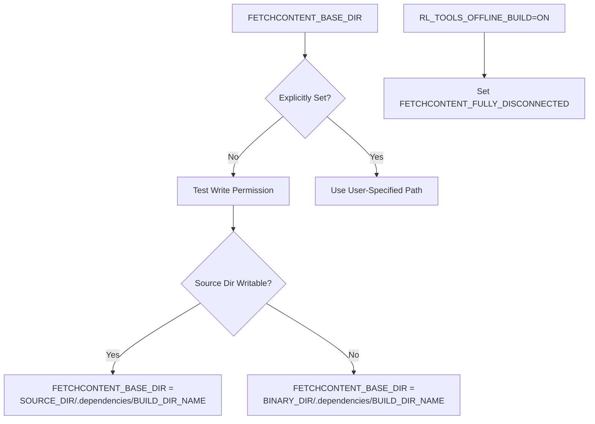

Sources: [CMakeLists.txt:55-78]()

The FetchContent base directory logic:
1. If not explicitly set, RLtools tests if the source directory is writable
2. If writable, dependencies are cached in `.dependencies/` within the source tree (shared across build directories)
3. If not writable, dependencies are stored in the build directory
4. Setting `RL_TOOLS_OFFLINE_BUILD=ON` prevents FetchContent from updating dependencies

This design allows multiple build configurations to share downloaded dependencies while supporting read-only source directories.

Sources: [CMakeLists.txt:55-78]()

## Building RLtools

### Build Process Diagram

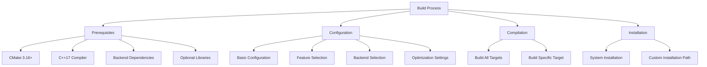

### Prerequisites

Before building RLtools, ensure you have:

1. CMake (version 3.16 or higher)
2. A C++17 compliant compiler
3. Dependencies for the backends you want to use:
   - Intel MKL for `RL_TOOLS_BACKEND_ENABLE_MKL`
   - CUDA toolkit for `RL_TOOLS_BACKEND_ENABLE_CUDA`
   - Apple Accelerate framework for `RL_TOOLS_BACKEND_ENABLE_ACCELERATE`
   - OpenBLAS for `RL_TOOLS_BACKEND_ENABLE_OPENBLAS`
4. Optional dependencies based on enabled features:
   - HDF5 for model persistence
   - TensorBoard for logging
   - MuJoCo for physics simulation
   - JSON libraries for data serialization

Sources: [CMakeLists.txt:226-272](), [CMakeLists.txt:168-342]()

### Basic Build

To build RLtools with default settings:

```bash
mkdir build
cd build
cmake ..
cmake --build .
```

### Configuring with Specific Features

To configure RLtools with specific features, use the `-D` option to set CMake variables:

```bash
cmake .. -DCMAKE_BUILD_TYPE=Release \
   -DRL_TOOLS_ENABLE_TARGETS=ON \
   -DRL_TOOLS_ENABLE_TENSORBOARD=ON \
   -DRL_TOOLS_ENABLE_HDF5=ON \
   -DRL_TOOLS_BACKEND_ENABLE_MKL=ON
```

Sources: [CMakeLists.txt:25-53]()

## Cross-Platform Support

### Platform Support Diagram

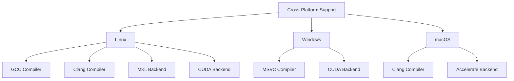

RLtools supports multiple platforms with specific configurations:

- **Linux**: Tested with GCC and Clang, supports MKL and CUDA backends
- **Windows**: Tested with MSVC, supports CUDA backend
- **macOS**: Tested with Apple Clang, supports Accelerate backend

The build system automatically adapts compilation flags and optimization settings based on the platform and compiler being used. Platform-specific optimizations are controlled through CMake options like `RL_TOOLS_DISABLE_CPU_SPECIFIC_OPTIMIZATIONS`.

Sources: [CMakeLists.txt:467-489](), [CMakeLists.txt:459-465]()

## Executable Targets

When `RL_TOOLS_ENABLE_TARGETS=ON`, the `src/` directory is included and builds environment-algorithm combinations as executables.

**Executable Target Naming Convention**

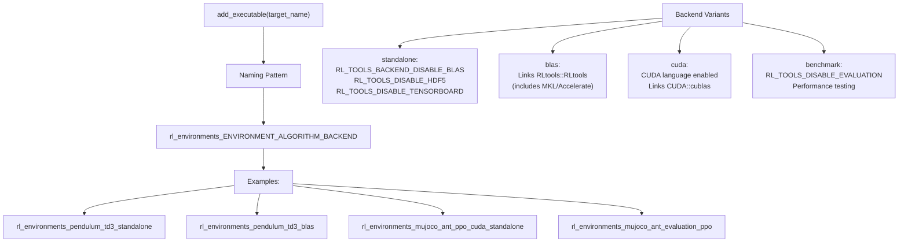

Sources: [src/rl/environments/pendulum/td3/cpu/CMakeLists.txt:16-71](), [src/rl/environments/mujoco/ant/ppo/cpu/CMakeLists.txt:3-23](), [src/rl/environments/mujoco/ant/ppo/cuda/CMakeLists.txt:23-78]()

### Pendulum Targets (TD3)

Defined in [src/rl/environments/pendulum/td3/cpu/CMakeLists.txt]():

| Target Name | Backend | Compile Definitions | Link Libraries |
|-------------|---------|---------------------|----------------|
| `rl_environments_pendulum_td3_bare` | None | `-nostdlib` flag | RLtools::Core |
| `rl_environments_pendulum_td3_standalone` | Generic CPU | - | RLtools::Core |
| `rl_environments_pendulum_td3_blas` | MKL/Accelerate | `RL_TOOLS_DISABLE_HDF5`<br/>`RL_TOOLS_DISABLE_TENSORBOARD` | RLtools::RLtools |
| `rl_environments_pendulum_td3_blas_benchmark` | MKL/Accelerate | `RL_TOOLS_DISABLE_HDF5`<br/>`RL_TOOLS_DISABLE_TENSORBOARD`<br/>`RL_TOOLS_RL_ENVIRONMENTS_PENDULUM_DISABLE_EVALUATION`<br/>`RL_TOOLS_NN_DISABLE_GENERIC_FORWARD_BACKWARD` | RLtools::RLtools |
| `rl_environments_pendulum_td3_blas_tensorboard` | MKL/Accelerate | - | RLtools::RLtools |

Sources: [src/rl/environments/pendulum/td3/cpu/CMakeLists.txt:2-71]()

### MuJoCo Ant Targets (PPO)

Defined in [src/rl/environments/mujoco/ant/ppo/cpu/CMakeLists.txt]() and [src/rl/environments/mujoco/ant/ppo/cuda/CMakeLists.txt]():

**CPU Targets:**

| Target Name | Backend | Compile Definitions | Link Libraries |
|-------------|---------|---------------------|----------------|
| `rl_environments_mujoco_ant_ppo_standalone` | Generic CPU | `RL_TOOLS_BACKEND_DISABLE_BLAS`<br/>`RL_TOOLS_DISABLE_HDF5`<br/>`RL_TOOLS_DISABLE_TENSORBOARD` | RLtools::RLtools, Threads::Threads |
| `rl_environments_mujoco_ant_ppo_blas_benchmark` | MKL/Accelerate | `RL_TOOLS_DISABLE_HDF5`<br/>`RL_TOOLS_DISABLE_TENSORBOARD` | RLtools::RLtools, Threads::Threads |
| `rl_environments_mujoco_ant_ppo_blas` | MKL/Accelerate | - | RLtools::RLtools, mujoco::mujoco, Threads::Threads |

Sources: [src/rl/environments/mujoco/ant/ppo/cpu/CMakeLists.txt:3-23]()

**CUDA Targets:**

| Target Name | Language | Compile Definitions | Link Libraries |
|-------------|----------|---------------------|----------------|
| `rl_environments_mujoco_ant_ppo_cuda_standalone` | CUDA | `RL_TOOLS_BACKEND_DISABLE_BLAS`<br/>`RL_TOOLS_DISABLE_HDF5`<br/>`RL_TOOLS_DISABLE_CLI11`<br/>`RL_TOOLS_DISABLE_TENSORBOARD` | RLtools::RLtools, mujoco::mujoco, CLI11::CLI11 |
| `rl_environments_mujoco_ant_ppo_cuda_benchmark` | CUDA | `RL_TOOLS_DISABLE_HDF5`<br/>`RL_TOOLS_DISABLE_TENSORBOARD`<br/>`RL_TOOLS_RL_ENVIRONMENTS_MUJOCO_ANT_DISABLE_EVALUATION` | RLtools::RLtools, mujoco::mujoco, CLI11::CLI11 |
| `rl_environments_mujoco_ant_ppo_cuda_full` | CUDA | - | RLtools::RLtools, mujoco::mujoco, CLI11::CLI11 |

Sources: [src/rl/environments/mujoco/ant/ppo/cuda/CMakeLists.txt:24-78]()

### Evaluation Targets

Defined in [src/rl/environments/mujoco/ant/CMakeLists.txt:4-14]():

| Target Name | Algorithm | Compile Definitions | Requirements |
|-------------|-----------|---------------------|--------------|
| `rl_environments_mujoco_ant_evaluation_td3` | TD3 | - | `RL_TOOLS_ENABLE_HDF5`<br/>`RL_TOOLS_RL_ENVIRONMENTS_MUJOCO_ENABLE_UI`<br/>`RL_TOOLS_ENABLE_CLI11` |
| `rl_environments_mujoco_ant_evaluation_ppo` | PPO | `RL_TOOLS_TEST_RL_ENVIRONMENTS_MUJOCO_ANT_EVALUATE_ACTOR_PPO` | `RL_TOOLS_ENABLE_HDF5`<br/>`RL_TOOLS_RL_ENVIRONMENTS_MUJOCO_ENABLE_UI`<br/>`RL_TOOLS_ENABLE_CLI11` |

These executables load trained actors from HDF5 checkpoints and visualize them in the MuJoCo UI.

Sources: [src/rl/environments/mujoco/ant/CMakeLists.txt:4-14](), [src/rl/environments/mujoco/ant/evaluate_actor.cpp:54-175]()

## Using RLtools as a Dependency

RLtools can be consumed as a CMake dependency in three ways:

**Integration Methods Diagram**

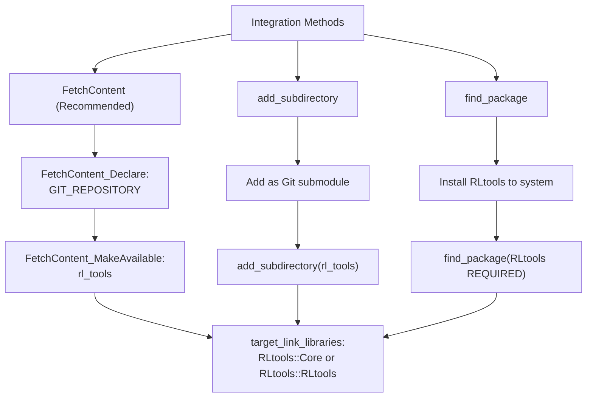

Sources: [CMakeLists.txt:21-28]()

### Method 1: FetchContent (Recommended)

```cmake
include(FetchContent)
FetchContent_Declare(
    rl_tools
    GIT_REPOSITORY https://github.com/rl-tools/rl-tools
    GIT_TAG main
)
FetchContent_MakeAvailable(rl_tools)

add_executable(my_app main.cpp)
target_link_libraries(my_app PRIVATE RLtools::Core)
```

### Method 2: add_subdirectory

```cmake
# Add as git submodule or copy to external/rl_tools
add_subdirectory(external/rl_tools)

add_executable(my_app main.cpp)
target_link_libraries(my_app PRIVATE RLtools::Core)
```

### Method 3: Installed Package

After installing RLtools with `cmake --install`:

```cmake
find_package(RLtools REQUIRED)

add_executable(my_app main.cpp)
target_link_libraries(my_app PRIVATE RLtools::Core)
```

### Choosing Between RLtools::Core and RLtools::RLtools

- **RLtools::Core**: Header-only, no dependencies, minimal features
- **RLtools::RLtools**: Full library with backends (MKL/CUDA), HDF5, TensorBoard, etc.

Sources: [CMakeLists.txt:21-28]()

## Test Configuration

The test framework is enabled with `RL_TOOLS_ENABLE_TESTS=ON` and configured in [tests/CMakeLists.txt]().

**Test Build Configuration**

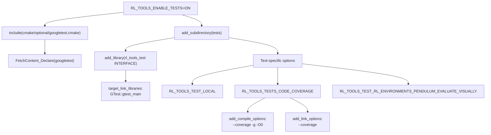

Sources: [CMakeLists.txt:91-101](), [tests/CMakeLists.txt:1-48]()

The `rl_tools_test` interface target provides common test infrastructure:

```cmake
add_library(rl_tools_test INTERFACE)
target_link_libraries(rl_tools_test INTERFACE GTest::gtest_main)
if(RL_TOOLS_TEST_DATA_PATH)
    target_compile_definitions(rl_tools_test INTERFACE RL_TOOLS_TEST_DATA_PATH=${RL_TOOLS_TEST_DATA_PATH})
endif()
add_library(RLtools::Test ALIAS rl_tools_test)
```

Test executables link against `RLtools::Test` to get GoogleTest and common test utilities.

Sources: [tests/CMakeLists.txt:29-35]()

### Test-Specific CMake Options

| Option | Default | Effect |
|--------|---------|--------|
| `RL_TOOLS_TEST_LOCAL` | OFF | Enable local development mode |
| `RL_TOOLS_TESTS_CODE_COVERAGE` | OFF | Add `--coverage -g -O0` flags for gcov |
| `RL_TOOLS_TEST_RL_ENVIRONMENTS_PENDULUM_EVALUATE_VISUALLY` | OFF | Enable visual evaluation of pendulum |
| `RL_TOOLS_TEST_RL_ALGORITHMS_TD3_SECOND_STAGE_EVALUATE_VISUALLY` | OFF | Enable TD3 visual evaluation |

Sources: [tests/CMakeLists.txt:3-19]()

## Troubleshooting

Common build issues and solutions:

1. **Missing Dependencies**: RLtools will emit clear error messages if required dependencies are missing. Install the necessary packages or disable the corresponding feature.

2. **Platform-Specific Issues**: For platform-specific issues, check the appropriate GitHub workflow files for examples of correct configuration.

3. **Debugging Compilation**: Use `CMAKE_VERBOSE_MAKEFILE=ON` to see the exact compilation commands:
   ```bash
   cmake .. -DCMAKE_VERBOSE_MAKEFILE=ON
   ```

4. **Compilation Errors**: For complex template errors, enable `RL_TOOLS_DEBUG_COMPILER_OPTIONS` to get more detailed error messages:
   ```bash
   cmake .. -DRL_TOOLS_DEBUG_COMPILER_OPTIONS=ON
   ```

For Docker-based builds, see the provided Dockerfile for a minimal setup:

Sources: [tests/Dockerfile:1-12](), [tests/README.MD:1-19]()

---

