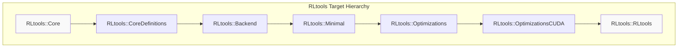
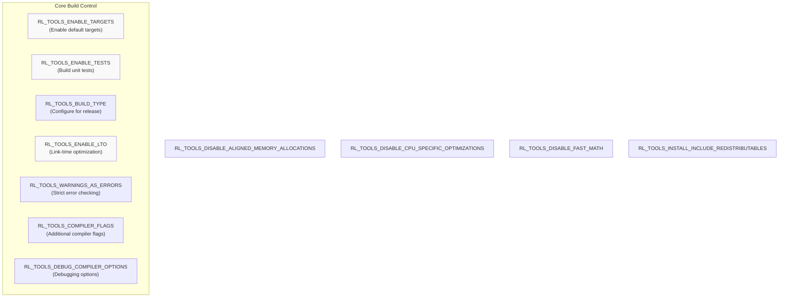
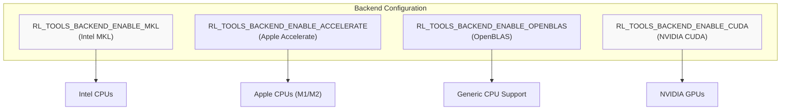
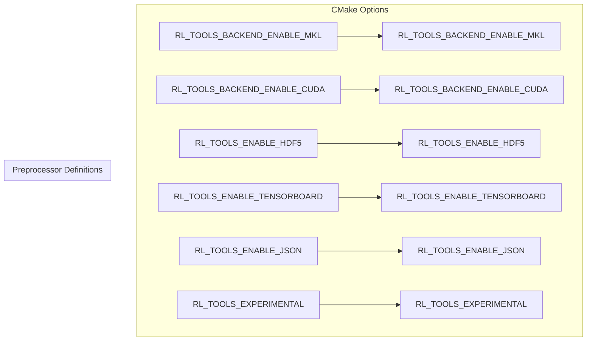
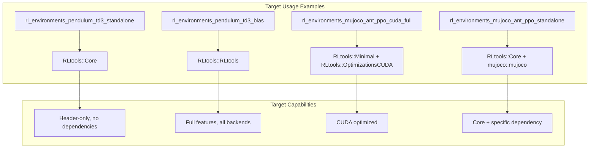

<!-- source: DeepWiki mcp.deepwiki.com · repo rl-tools/rl-tools · page 6.1 CMake Options · fetched 2026-10-30 -->

# CMake Options

<details>
<summary>Relevant source files</summary>

The following files were used as context for generating this wiki page:

- [.gitignore](.gitignore)
- [CMakeLists.txt](CMakeLists.txt)
- [src/rl/environments/mujoco/ant/CMakeLists.txt](src/rl/environments/mujoco/ant/CMakeLists.txt)
- [src/rl/environments/mujoco/ant/evaluate_actor.cpp](src/rl/environments/mujoco/ant/evaluate_actor.cpp)
- [src/rl/environments/mujoco/ant/ppo/cpu/CMakeLists.txt](src/rl/environments/mujoco/ant/ppo/cpu/CMakeLists.txt)
- [src/rl/environments/mujoco/ant/ppo/cpu/training.h](src/rl/environments/mujoco/ant/ppo/cpu/training.h)
- [src/rl/environments/mujoco/ant/ppo/cuda/CMakeLists.txt](src/rl/environments/mujoco/ant/ppo/cuda/CMakeLists.txt)
- [src/rl/environments/mujoco/ant/ppo/cuda/training_ppo.cu](src/rl/environments/mujoco/ant/ppo/cuda/training_ppo.cu)
- [src/rl/environments/mujoco/ant/ppo/parameters.h](src/rl/environments/mujoco/ant/ppo/parameters.h)
- [src/rl/environments/mujoco/ant/td3/CMakeLists.txt](src/rl/environments/mujoco/ant/td3/CMakeLists.txt)
- [src/rl/environments/mujoco/ant/td3/training.h](src/rl/environments/mujoco/ant/td3/training.h)
- [src/rl/environments/pendulum/sac/cuda/cuda_graph_export.h](src/rl/environments/pendulum/sac/cuda/cuda_graph_export.h)
- [src/rl/environments/pendulum/td3/cpu/CMakeLists.txt](src/rl/environments/pendulum/td3/cpu/CMakeLists.txt)
- [tests/CMakeLists.txt](tests/CMakeLists.txt)
- [tests/src/rl/algorithms/ppo/parameters_rl.h](tests/src/rl/algorithms/ppo/parameters_rl.h)

</details>


This page documents the CMake configuration options available in RLtools. These options allow you to customize how the library is built, which features are enabled, and which backends are used. The build system leverages CMake's flexibility to provide a modular approach to library configuration, optimized for both development and deployment.

For information about configuring specific backends like MKL, CUDA, or Accelerate, see [Backend Configuration](#6.2).

## Overview of CMake Target Structure

The RLtools build system creates multiple CMake targets with increasing levels of functionality and dependencies:



Each target in the hierarchy provides different levels of functionality:

| Target | Description |
|--------|-------------|
| `RLtools::Core` | Basic header-only library with minimal dependencies |
| `RLtools::CoreDefinitions` | Core + compile definitions |
| `RLtools::Backend` | CoreDefinitions + mathematical backends (MKL, Accelerate, etc.) |
| `RLtools::Minimal` | Backend + minimal dependencies for functional library |
| `RLtools::Optimizations` | Minimal + CPU optimization flags |
| `RLtools::OptimizationsCUDA` | Optimizations + CUDA optimization flags |
| `RLtools::RLtools` | Full library with all enabled features |

Sources: [CMakeLists.txt:70-144]()

## Core Build Options

These options control fundamental aspects of the build process:



| Option | Default | Description |
|--------|---------|-------------|
| `RL_TOOLS_ENABLE_TARGETS` | OFF | Enable building of default application targets |
| `RL_TOOLS_ENABLE_TESTS` | OFF | Build the unit test suite |
| `RL_TOOLS_BUILD_TYPE` | OFF | Configure for release builds (e.g., build CUDA code for all architectures) |
| `RL_TOOLS_ENABLE_LTO` | OFF | Enable link-time optimization for release builds |
| `RL_TOOLS_WARNINGS_AS_ERRORS` | OFF | Treat compiler warnings as errors |
| `RL_TOOLS_COMPILER_FLAGS` | OFF | Specify additional compiler flags |
| `RL_TOOLS_DEBUG_COMPILER_OPTIONS` | OFF | Enable compiler options for better debugging (e.g., `-ftemplate-backtrace-limit=0`) |
| `RL_TOOLS_DISABLE_ALIGNED_MEMORY_ALLOCATIONS` | OFF | Disable 64-byte/512-bit aligned memory allocations |
| `RL_TOOLS_DISABLE_CPU_SPECIFIC_OPTIMIZATIONS` | OFF | Disable CPU-specific optimizations like `-march=native` (useful for portable builds) |
| `RL_TOOLS_DISABLE_FAST_MATH` | OFF | Disable potentially unsafe floating-point optimizations |
| `RL_TOOLS_INSTALL_INCLUDE_REDISTRIBUTABLES` | OFF | Include redistributable libraries in installation |

Sources: [CMakeLists.txt:25-53](), [CMakeLists.txt:96-131](), [CMakeLists.txt:467-489](), [CMakeLists.txt:534-539]()

## Backend Options

These options control which computational backends are enabled:



| Option | Default | Description |
|--------|---------|-------------|
| `RL_TOOLS_BACKEND_ENABLE_MKL` | OFF | Enable Intel MKL backend (Intel CPUs only) |
| `RL_TOOLS_BACKEND_ENABLE_ACCELERATE` | OFF | Enable Apple Accelerate framework (Apple CPUs only) |
| `RL_TOOLS_BACKEND_ENABLE_OPENBLAS` | OFF | Enable OpenBLAS backend |
| `RL_TOOLS_BACKEND_ENABLE_CUDA` | OFF | Enable NVIDIA CUDA support |

**Backend Target Mapping:**
- MKL: Links `rl_tools_backend` to `MKL::MKL` target
- Accelerate: Links `rl_tools_backend` to `BLAS` target  
- CUDA: Links `rl_tools_backend` to `CUDA::cublas` target

These options are mutually compatible - you can enable multiple backends simultaneously, though typically only one CPU-based backend (MKL, Accelerate, or OpenBLAS) would be used at a time.

Sources: [CMakeLists.txt:34-36](), [CMakeLists.txt:226-272](), [CMakeLists.txt:274-302]()

## Feature Options

These options control which additional features and dependencies are enabled:

```mermaid
graph TB
    subgraph "Feature Options"
        IO["Data I/O"]
        UI["User Interfaces"]
        Env["Environments"]
        Tools["Development Tools"]
    end
    
    IO --> ZLIB["RL_TOOLS_ENABLE_ZLIB"]
    IO --> HDF5["RL_TOOLS_ENABLE_HDF5"]
    IO --> JSON["RL_TOOLS_ENABLE_JSON"]
    IO --> CJSON["RL_TOOLS_ENABLE_CJSON"]
    
    UI --> TB["RL_TOOLS_ENABLE_TENSORBOARD"]
    UI --> PNG["RL_TOOLS_ENABLE_LIBATTOPNG"]
    UI --> GTK["RL_TOOLS_ENABLE_GTK"]
    UI --> BB["RL_TOOLS_ENABLE_BOOST_BEAST"]
    UI --> WS["RL_TOOLS_ENABLE_LIBWEBSOCKETS"]
    UI --> CLI["RL_TOOLS_ENABLE_CLI11"]
    
    Env --> MUJOCO["RL_TOOLS_RL_ENVIRONMENTS_ENABLE_MUJOCO"]
    
    Tools --> TRACY["RL_TOOLS_ENABLE_TRACY"]
    
    style IO fill:#f9f9f9
    style UI fill:#f9f9f9
    style Env fill:#f9f9f9
    style Tools fill:#f9f9f9
```



| Option | Default | Description |
|--------|---------|-------------|
| `RL_TOOLS_ENABLE_ZLIB` | OFF | Enable zlib compression library |
| `RL_TOOLS_ENABLE_HDF5` | OFF | Enable HDF5 for persisting data to disk |
| `RL_TOOLS_ENABLE_TENSORBOARD` | OFF | Enable TensorBoard logging interface |
| `RL_TOOLS_ENABLE_LIBATTOPNG` | OFF | Enable libattopng for logging images to TensorBoard |
| `RL_TOOLS_ENABLE_JSON` | OFF | Enable JSON support using nlohmann/json |
| `RL_TOOLS_ENABLE_CJSON` | OFF | Enable cJSON support (lightweight C JSON parser) |
| `RL_TOOLS_ENABLE_GTK` | OFF | Enable GTK UI library (Linux only) |
| `RL_TOOLS_ENABLE_BOOST_BEAST` | OFF | Enable Boost Beast (used for multirotor UI) |
| `RL_TOOLS_ENABLE_LIBWEBSOCKETS` | OFF | Enable libwebsockets (used for UI server connections) |
| `RL_TOOLS_ENABLE_CLI11` | OFF | Enable CLI11 command-line parser |
| `RL_TOOLS_ENABLE_TRACY` | OFF | Enable Tracy profiler |
| `RL_TOOLS_RL_ENVIRONMENTS_ENABLE_MUJOCO` | OFF | Enable MuJoCo physics simulator |

**Feature-to-Target Mapping:**
- Most features link to the `rl_tools_minimal` target
- UI features (GTK, Boost Beast, libwebsockets) link to the full `rl_tools` target
- MuJoCo links to the `rl_tools` target and requires `mujoco::mujoco`

Sources: [CMakeLists.txt:29-42](), [CMakeLists.txt:168-403]()

## HDF5-Specific Options

When `RL_TOOLS_ENABLE_HDF5` is enabled, additional options become available:

| Option | Default | Description |
|--------|---------|-------------|
| `RL_TOOLS_HDF5_HIGHFIVE_FROM_CONAN` | OFF | Use HighFive from conan instead of the submodule |

Sources: [CMakeLists.txt:43](), [CMakeLists.txt:311-325]()

## Debug Options

These options are primarily used for debugging and development:

| Option | Default | Description |
|--------|---------|-------------|
| `RL_TOOLS_CONTAINER_INIT_NAN` | OFF | Initialize memory allocations with NaN values to catch uninitialized data usage |
| `RL_TOOLS_EXPERIMENTAL` | OFF | Enable experimental features |

Sources: [CMakeLists.txt:53](), [CMakeLists.txt:417-432](), [CMakeLists.txt:541-543]()

## Environment-Specific Options

These options are defined in the test configurations but can be useful for specific environments:

| Option | Default | Description |
|--------|---------|-------------|
| `RL_TOOLS_RL_ENVIRONMENTS_MUJOCO_ENABLE_UI` | OFF | Enable MuJoCo UI support |
| `RL_TOOLS_TESTS_RL_ENVIRONMENTS_MULTIROTOR_UI_ENABLE` | OFF | Enable Multirotor UI |

Sources: [tests/CMakeLists.txt:17](), [CMakeLists.txt:186-194]()

## Using CMake Options

You can specify these options when running CMake in several ways:

1. Command line:
   ```
   cmake -DRL_TOOLS_BACKEND_ENABLE_CUDA=ON -DRL_TOOLS_ENABLE_HDF5=ON ..
   ```

2. Using CMake's interactive interface:
   ```
   ccmake ..
   ```

3. Using CMake GUI

## Option to Preprocessor Mapping

CMake Options to Preprocessor Definitions:



These preprocessor definitions control conditional compilation in the source code.

## Common Build Configurations

Here are some common build configurations for different use cases:

### Minimal CPU-Only Build

```
cmake -DRL_TOOLS_ENABLE_TARGETS=ON ..
```

### Development Build with Tests

```
cmake -DRL_TOOLS_ENABLE_TARGETS=ON -DRL_TOOLS_ENABLE_TESTS=ON ..
```

### High-Performance CPU Build with MKL

```
cmake -DRL_TOOLS_ENABLE_TARGETS=ON -DRL_TOOLS_BACKEND_ENABLE_MKL=ON -DRL_TOOLS_ENABLE_LTO=ON ..
```

### CUDA-Enabled Build with TensorBoard

```
cmake -DRL_TOOLS_ENABLE_TARGETS=ON -DRL_TOOLS_BACKEND_ENABLE_CUDA=ON -DRL_TOOLS_ENABLE_TENSORBOARD=ON -DRL_TOOLS_ENABLE_HDF5=ON ..
```

### Complete Research Environment

```
cmake -DRL_TOOLS_ENABLE_TARGETS=ON -DRL_TOOLS_BACKEND_ENABLE_CUDA=ON -DRL_TOOLS_BACKEND_ENABLE_MKL=ON -DRL_TOOLS_ENABLE_TENSORBOARD=ON -DRL_TOOLS_ENABLE_HDF5=ON -DRL_TOOLS_ENABLE_JSON=ON -DRL_TOOLS_ENABLE_CLI11=ON -DRL_TOOLS_RL_ENVIRONMENTS_ENABLE_MUJOCO=ON ..
```

### Portable Build (for Docker containers)

```
cmake -DRL_TOOLS_ENABLE_TARGETS=ON -DRL_TOOLS_DISABLE_CPU_SPECIFIC_OPTIMIZATIONS=ON ..
```

## How Options Affect Compilation

Many options modify the compilation process by defining specific preprocessor macros. For example:

- When `RL_TOOLS_BACKEND_ENABLE_MKL` is enabled, the macro `RL_TOOLS_BACKEND_ENABLE_MKL` is defined during compilation
- When `RL_TOOLS_ENABLE_HDF5` is enabled, the macro `RL_TOOLS_ENABLE_HDF5` is defined during compilation

This allows conditional compilation of code that depends on these features.

## Target Usage in Real Projects

Common target usage patterns found in the codebase:



Sources: [CMakeLists.txt:228](), [CMakeLists.txt:322](), [src/rl/environments/pendulum/td3/cpu/CMakeLists.txt:18-26](), [src/rl/environments/mujoco/ant/ppo/cuda/CMakeLists.txt:72-87]()

## Optimization Options

In Release mode, the build system automatically enables several optimizations:

- When `RL_TOOLS_ENABLE_LTO` is ON, CMake's interprocedural optimization is enabled
- Unless `RL_TOOLS_DISABLE_CPU_SPECIFIC_OPTIMIZATIONS` is ON, `-march=native` is added to compiler flags
- Unless `RL_TOOLS_DISABLE_FAST_MATH` is ON:
  - On Linux: `-Ofast` is used for CPU code and `--use_fast_math --optimize 3` for CUDA
  - On macOS: `-Ofast` is used
  - On Windows with GCC/MinGW: `-Ofast` is used
  - On Windows with MSVC: `/fp:fast` is used

Sources: [CMakeLists.txt:55-57](), [CMakeLists.txt:467-489]()

## Debug Mode Definitions

When built in Debug mode, several additional preprocessor macros are defined to enable various checks and debugging features:

- `RL_TOOLS_DEBUG`
- `RL_TOOLS_DEBUG_DEVICE_CUDA_CHECK_INIT`
- `RL_TOOLS_DEBUG_CONTAINER_CHECK_BOUNDS`
- `RL_TOOLS_DEBUG_CONTAINER_CHECK_MALLOC`
- `RL_TOOLS_DEBUG_CONTAINER_MALLOC_INIT_NAN`
- Various algorithm-specific debug checks

Sources: [CMakeLists.txt:421-432]()

## Building with Different Backends

When using specific backends, certain target configurations are required:

### CUDA

When `RL_TOOLS_BACKEND_ENABLE_CUDA` is enabled, CUDA architectures are configured based on build type:
- For Release builds (`RL_TOOLS_BUILD_TYPE=Release`): `CMAKE_CUDA_ARCHITECTURES="all"`
- Otherwise: `CMAKE_CUDA_ARCHITECTURES="native"`

Sources: [CMakeLists.txt:274-302]()

### MKL and Accelerate

These options enable platform-specific BLAS implementations:
- `RL_TOOLS_BACKEND_ENABLE_MKL` is for Intel CPUs
- `RL_TOOLS_BACKEND_ENABLE_ACCELERATE` is for Apple CPUs

Sources: [CMakeLists.txt:226-252]()

---

