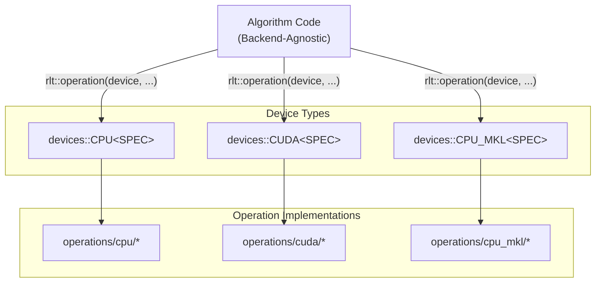
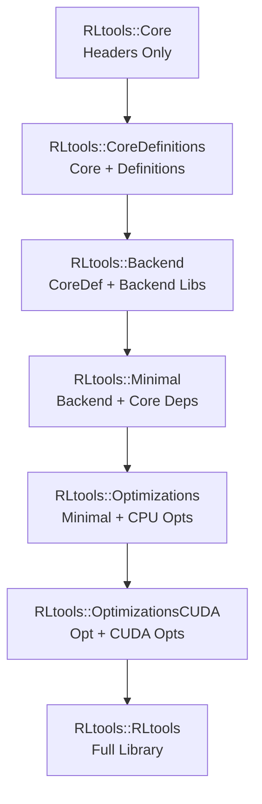
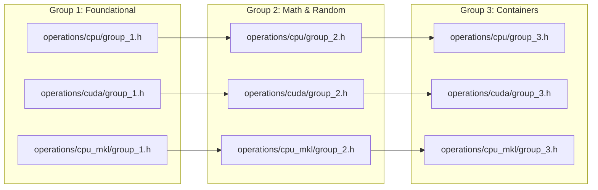
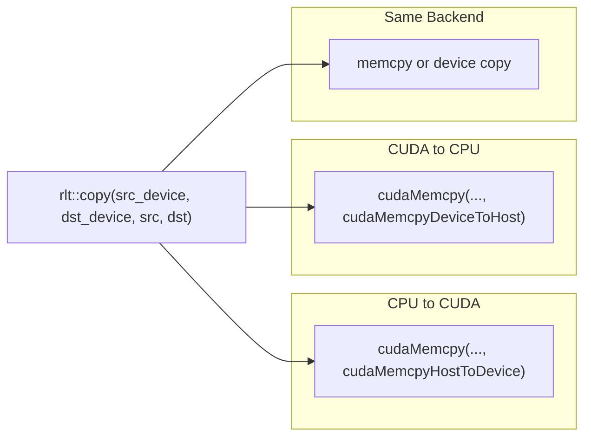
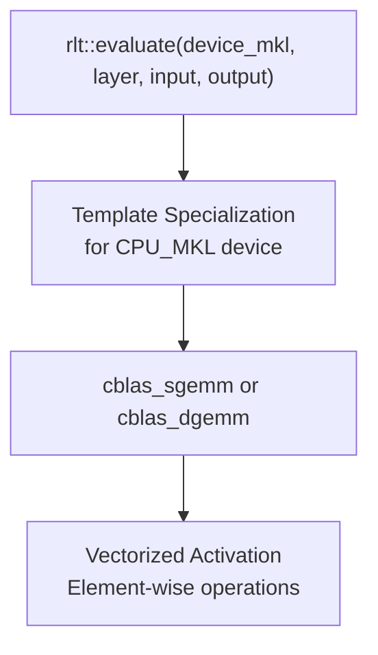
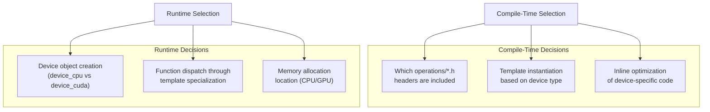
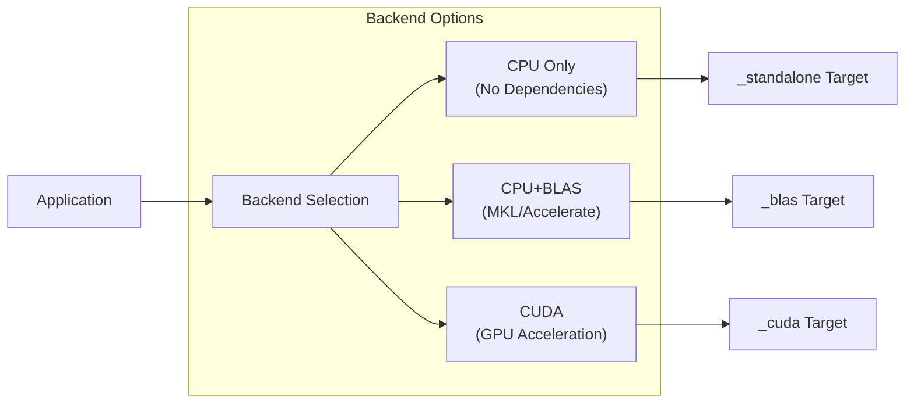

<!-- source: DeepWiki mcp.deepwiki.com · repo rl-tools/rl-tools · page 6.2 Backend Configuration · fetched 2026-10-30 -->

# Backend Configuration

<details>
<summary>Relevant source files</summary>

The following files were used as context for generating this wiki page:

- [include/rl_tools/devices/cpu.h](include/rl_tools/devices/cpu.h)
- [include/rl_tools/random/operations_cpu.h](include/rl_tools/random/operations_cpu.h)
- [include/rl_tools/rl/environments/pendulum/ui_xeus.h](include/rl_tools/rl/environments/pendulum/ui_xeus.h)
- [src/rl/environments/mujoco/ant/td3/parameters.h](src/rl/environments/mujoco/ant/td3/parameters.h)
- [tests/src/nn/benchmark.cpp](tests/src/nn/benchmark.cpp)
- [tests/src/nn/cuda/CMakeLists.txt](tests/src/nn/cuda/CMakeLists.txt)
- [tests/src/nn/cuda/cuda_basics.cu](tests/src/nn/cuda/cuda_basics.cu)
- [tests/src/nn/cuda/main.cu](tests/src/nn/cuda/main.cu)
- [tests/src/rl/components/off_policy_runner.cpp](tests/src/rl/components/off_policy_runner.cpp)
- [tests/src/rl/cuda/CMakeLists.txt](tests/src/rl/cuda/CMakeLists.txt)
- [tests/src/rl/cuda/rl.cu](tests/src/rl/cuda/rl.cu)
- [tests/src/rl/cuda/td3_full_training.cu](tests/src/rl/cuda/td3_full_training.cu)
- [tests/src/rl/cuda/td3_full_training_parameters_pendulum.h](tests/src/rl/cuda/td3_full_training_parameters_pendulum.h)

</details>


This document explains how to configure and use different computational backends in RLtools. The library supports multiple backends to optimize performance across various hardware platforms. For general build system configuration, see [CMake Options](#6.1).

## Device Abstraction System

RLtools uses a device abstraction layer that separates algorithms from hardware-specific implementations. All operations are dispatched through device objects, enabling compile-time backend selection.

**Device Abstraction Pattern**


Sources: [include/rl_tools/devices/cpu.h:54-63](), [tests/src/nn/cuda/cuda_basics.cu:27-31]()

## Available Backends

| Backend | Device Type | Use Case | Hardware Requirements |
|---------|-------------|----------|----------------------|
| Generic CPU | `devices::DefaultCPU` | Baseline, portable | Any CPU |
| MKL | `devices::DefaultCPU_MKL` or `devices::CPU_MKL<SPEC>` | Optimized for Intel CPUs | Intel CPU + MKL library |
| Accelerate | `devices::CPU<Specification<...>>` with Accelerate | Apple hardware | macOS + Accelerate framework |
| CUDA | `devices::DefaultCUDA` | GPU acceleration | NVIDIA GPU + CUDA Toolkit |

Sources: [tests/src/nn/cuda/cuda_basics.cu:27-28](), [tests/src/rl/cuda/rl.cu:42-44](), [tests/src/nn/benchmark.cpp:179-179](), [include/rl_tools/devices/cpu.h:65-66]()

## Target Structure

RLtools uses a hierarchical target structure that builds up functionality layer by layer:



Sources: [CMakeLists.txt:63-69](), [CMakeLists.txt:545-556]()

## Configuring Backends with CMake

Backend configuration is done during the CMake build process:

| CMake Option | Description | Default |
|--------------|-------------|---------|
| `RL_TOOLS_BACKEND_ENABLE_MKL` | Enable Intel MKL backend | OFF |
| `RL_TOOLS_BACKEND_ENABLE_ACCELERATE` | Enable Apple Accelerate framework | OFF |
| `RL_TOOLS_BACKEND_ENABLE_CUDA` | Enable NVIDIA CUDA backend | OFF |
| `RL_TOOLS_BACKEND_ENABLE_OPENBLAS` | Enable OpenBLAS backend | OFF |

To enable a backend, pass the option to CMake:

```
cmake -DRL_TOOLS_BACKEND_ENABLE_CUDA=ON ..
```

Sources: [CMakeLists.txt:33-36]()

### MKL Backend Configuration

The MKL backend provides optimized BLAS operations for Intel CPUs:


Installation:
```
sudo apt install intel-oneapi-mkl-devel  # On Ubuntu
```

Sources: [CMakeLists.txt:226-244]()

### CUDA Backend Configuration

The CUDA backend enables GPU acceleration for NVIDIA graphics cards:


CUDA architecture selection:
- `RL_TOOLS_BUILD_TYPE=Release`: Build for all architectures (portable)
- Default: Build for native architecture only (faster build)

Sources: [CMakeLists.txt:274-302]()

### Accelerate Backend Configuration

For Apple systems, the Accelerate framework provides optimized BLAS operations:

```
cmake -DRL_TOOLS_BACKEND_ENABLE_ACCELERATE=ON ..
```

Sources: [CMakeLists.txt:247-252]()

### OpenBLAS Backend Configuration

OpenBLAS provides an alternative to MKL for non-Intel hardware:

```
cmake -DRL_TOOLS_BACKEND_ENABLE_OPENBLAS=ON ..
```

Sources: [CMakeLists.txt:254-272]()

## Backend Optimization Options

RLtools provides options to control optimization levels:

| CMake Option | Description | Default |
|--------------|-------------|---------|
| `RL_TOOLS_DISABLE_FAST_MATH` | Disable fast math operations | OFF |
| `RL_TOOLS_DISABLE_CPU_SPECIFIC_OPTIMIZATIONS` | Disable CPU-specific optimizations | OFF |
| `RL_TOOLS_ENABLE_LTO` | Enable link-time optimization | OFF |

Sources: [CMakeLists.txt:46-50](), [CMakeLists.txt:468-489]()

### CPU Optimizations

In Release mode, RLtools enables:
- Native CPU optimizations (`-march=native`)
- Fast math operations (`-Ofast` on GNU/Clang, `/fp:fast` on MSVC)

To disable for more portable builds:
```
cmake -DRL_TOOLS_DISABLE_CPU_SPECIFIC_OPTIMIZATIONS=ON ..
```

Sources: [CMakeLists.txt:468-472]()

### CUDA Optimizations

For CUDA, the following optimizations are applied:
- Fast math operations (`--use_fast_math`)
- Optimization level 3 (`--optimize 3`)

Sources: [CMakeLists.txt:476-477]()

## Compile-Time Backend Selection

Backend selection in RLtools is primarily compile-time, determined by:
1. Which operation headers are included
2. The device type passed to operations

### Include-Based Backend Selection

Operations are organized into groups that must be included in order:

**Group Structure for Multi-Backend Code**


Example for CUDA + CPU + MKL support:
```cpp
// Group 1
#include <rl_tools/operations/cpu/group_1.h>
#include <rl_tools/operations/cuda/group_1.h>
#include <rl_tools/operations/cpu_mkl/group_1.h>

// Group 2
#include <rl_tools/operations/cpu/group_2.h>
#include <rl_tools/operations/cuda/group_2.h>
#include <rl_tools/operations/cpu_mkl/group_2.h>

// Group 3
#include <rl_tools/operations/cpu/group_3.h>
#include <rl_tools/operations/cuda/group_3.h>
#include <rl_tools/operations/cpu_mkl/group_3.h>
```

Sources: [tests/src/nn/cuda/cuda_basics.cu:1-11](), [tests/src/rl/cuda/rl.cu:1-14](), [tests/src/nn/benchmark.cpp:1-26]()

### Device Type Selection

Once headers are included, select backend at runtime through device type:

```cpp
// Generic CPU backend
using DEVICE_CPU = rlt::devices::DefaultCPU;
DEVICE_CPU device_cpu;

// CUDA backend (requires init)
using DEVICE_CUDA = rlt::devices::DefaultCUDA;
DEVICE_CUDA device_cuda;
rlt::init(device_cuda);

// MKL backend
using DEVICE_MKL = rlt::devices::DefaultCPU_MKL;
DEVICE_MKL device_mkl;
```

The same algorithm code works with any device:
```cpp
rlt::malloc(device_cpu, network);   // Allocates on CPU
rlt::malloc(device_cuda, network);  // Allocates on GPU
```

Sources: [tests/src/nn/cuda/cuda_basics.cu:27-31](), [tests/src/rl/cuda/rl.cu:42-45](), [tests/src/nn/benchmark.cpp:237-240]()

## Cross-Backend Data Transfer

The `rlt::copy` function handles data transfer between different backends:

**Copy Operation Dispatch**


Example usage:
```cpp
using DEVICE_CPU = rlt::devices::DefaultCPU;
using DEVICE_CUDA = rlt::devices::DefaultCUDA;

DEVICE_CPU device_cpu;
DEVICE_CUDA device_cuda;
rlt::init(device_cuda);

// Allocate on both backends
rlt::Matrix<...> matrix_cpu;
rlt::Matrix<...> matrix_cuda;
rlt::malloc(device_cpu, matrix_cpu);
rlt::malloc(device_cuda, matrix_cuda);

// CPU to CUDA
rlt::copy(device_cpu, device_cuda, matrix_cpu, matrix_cuda);

// CUDA to CPU
rlt::copy(device_cuda, device_cpu, matrix_cuda, matrix_cpu);
```

The copy operation automatically handles:
- Memory layout conversions
- Alignment differences
- View/submatrix copies

Sources: [tests/src/nn/cuda/cuda_basics.cu:42-50](), [tests/src/nn/cuda/cuda_basics.cu:117-121](), [tests/src/rl/cuda/rl.cu:155-155]()

## Backend-Specific Requirements

### CUDA Backend

**CUDA Device Lifecycle**


Key requirements:
1. **Initialize device**: `rlt::init(device_cuda);` must be called before any operations
2. **Explicit synchronization**: CUDA operations are asynchronous; use `cudaDeviceSynchronize()` for timing or before CPU access
3. **Memory management**: Use `rlt::malloc()` and `rlt::free()` for device memory
4. **Status checking**: Call `rlt::check_status(device_cuda)` to detect CUDA errors

Sources: [tests/src/nn/cuda/cuda_basics.cu:32-32](), [tests/src/rl/cuda/td3_full_training.cu:71-71](), [tests/src/rl/cuda/rl.cu:112-112]()

### MKL Backend

The MKL backend provides optimized BLAS operations through Intel's Math Kernel Library.

**MKL Operation Dispatch**


Requirements:
1. **Hardware**: Works on any CPU, optimized for Intel processors
2. **Installation**: Requires Intel MKL library (`intel-oneapi-mkl-devel`)
3. **Include order**: MKL headers must be included alongside CPU headers
4. **Device type**: Use `devices::CPU_MKL<SPEC>` or `devices::DefaultCPU_MKL`

Example:
```cpp
// Include MKL backend
#include <rl_tools/operations/cpu_mkl/group_1.h>
#include <rl_tools/operations/cpu_mkl/group_2.h>
#include <rl_tools/operations/cpu_mkl/group_3.h>
#include <rl_tools/nn/operations_cpu_mkl.h>

// Use MKL device
using DEVICE_MKL = rlt::devices::CPU_MKL<rlt::devices::DefaultCPUSpecification>;
DEVICE_MKL device_mkl;
```

Sources: [tests/src/nn/benchmark.cpp:6-26](), [tests/src/nn/benchmark.cpp:179-179](), [tests/src/nn/benchmark.cpp:237-240]()

### Generic CPU Backend

The generic CPU backend requires no external dependencies and works on any architecture:

```cpp
#include <rl_tools/operations/cpu/group_1.h>
#include <rl_tools/operations/cpu/group_2.h>
#include <rl_tools/operations/cpu/group_3.h>

using DEVICE = rlt::devices::DefaultCPU;
DEVICE device;
// No initialization needed for CPU
```

Device specification structure:
```cpp
namespace rlt::devices::cpu {
    template <typename T_MATH, typename T_RANDOM, typename T_LOGGING>
    struct Specification {
        using MATH = T_MATH;
        using RANDOM = T_RANDOM;
        using LOGGING = T_LOGGING;
        using index_t = size_t;
    };
}
```

Sources: [include/rl_tools/devices/cpu.h:19-27](), [include/rl_tools/devices/cpu.h:54-63]()

## Runtime vs Compile-Time Selection

RLtools uses a **hybrid approach**:

**Selection Strategy**


### Why Compile-Time Selection?

1. **Zero overhead**: Backend dispatch resolved at compile-time through templates
2. **Type safety**: Invalid backend combinations caught at compile-time
3. **Optimization**: Compiler can inline and optimize for specific backends
4. **Code size control**: Only included backends are compiled into binary

### Multi-Backend Support in Single Binary

You can support multiple backends in one executable:

```cpp
// Include all backends at compile-time
#include <rl_tools/operations/cpu/group_1.h>
#include <rl_tools/operations/cuda/group_1.h>
#include <rl_tools/operations/cpu_mkl/group_1.h>
// ... (groups 2 and 3)

// Switch backends at runtime
void train_on_cpu() {
    rlt::devices::DefaultCPU device;
    NetworkType network;
    rlt::malloc(device, network);
    // Training code...
}

void train_on_gpu() {
    rlt::devices::DefaultCUDA device;
    rlt::init(device);
    NetworkType network;
    rlt::malloc(device, network);
    // Same training code...
}
```

The device type determines which implementation is called, but both are compiled in.

Sources: [tests/src/nn/cuda/cuda_basics.cu:1-11](), [tests/src/rl/cuda/rl.cu:1-14]()

## Performance Characteristics

Backend performance varies by operation type and problem size:

**Operation Performance by Backend**

| Operation Type | Generic CPU | MKL | CUDA | Notes |
|----------------|-------------|-----|------|-------|
| Matrix multiply (small) | Baseline | 2-3x faster | Slower | GPU overhead dominates for small matrices |
| Matrix multiply (large) | Baseline | 3-5x faster | 10-50x faster | CUDA excels at large batches |
| Element-wise ops | Baseline | Similar | 5-10x faster | Memory bandwidth limited |
| Network forward pass | Baseline | 2-4x faster | 5-20x faster | Depends on network size and batch |

Example benchmark data from GEMM operations:
- Batch size 256, hidden dim 256: MKL ~3x faster than generic CPU
- Same configuration: CUDA ~15x faster than generic CPU (after warmup)

Sources: [tests/src/nn/benchmark.cpp:157-173](), [tests/src/nn/benchmark.cpp:207-230]()

### Optimization Guidelines

1. **Generic CPU**: Use for prototyping, small models, or when other backends unavailable
2. **MKL**: Use for CPU-only inference on Intel hardware, good balance of speed and compatibility
3. **CUDA**: Use for training large models, batch inference, or when maximum throughput needed
4. **Batch size matters**: Larger batches (>128) benefit more from GPU acceleration

The codebase includes benchmark targets for performance testing:
- `*_benchmark` targets disable evaluation and enable optimizations  
- CUDA targets include GPU-specific optimizations (`--use_fast_math`)
- Release builds enable fast math and architecture-specific optimizations

Sources: [src/rl/environments/pendulum/td3/cpu/CMakeLists.txt:44-61](), [src/rl/environments/mujoco/ant/ppo/cuda/CMakeLists.txt:44-69](), [CMakeLists.txt:467-489]()

## Building Applications with Different Backends

The CMake files in the repository provide examples of building applications with different backends:



Examples of build targets with different backends:

| Target Pattern | Backend | Example |
|----------------|---------|---------|
| `*_standalone` | CPU only | `rl_environments_pendulum_td3_standalone` |
| `*_blas` | CPU with BLAS | `rl_environments_pendulum_td3_blas` |
| `*_cuda_*` | CUDA | `rl_environments_mujoco_ant_ppo_cuda_standalone` |

Sources: [src/rl/environments/pendulum/td3/cpu/CMakeLists.txt:16-26](), [src/rl/environments/pendulum/td3/cpu/CMakeLists.txt:28-42](), [src/rl/environments/mujoco/ant/ppo/cuda/CMakeLists.txt:23-42]()

## Common Issues and Solutions

### Missing Backend Libraries

If you see undefined reference errors related to BLAS functions, ensure you've installed the required backend libraries:
- MKL: Install Intel MKL development package
- CUDA: Install NVIDIA CUDA Toolkit

### CUDA Compatibility

CUDA requires compatible drivers and hardware. Verify compatibility with:
```bash
nvidia-smi
```

### Build Error: CUDA Compiler Not Found

Make sure to install CUDA Toolkit and set the `CUDA_HOME` environment variable.

### Build Warning: CPU-specific Optimizations

If building a binary for distribution, disable CPU-specific optimizations:
```
cmake -DRL_TOOLS_DISABLE_CPU_SPECIFIC_OPTIMIZATIONS=ON ..
```

Sources: [CMakeLists.txt:50-50]()

---

