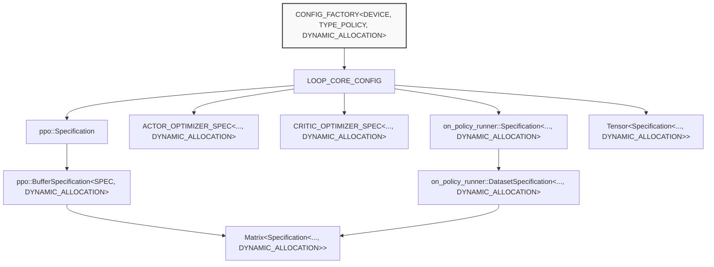
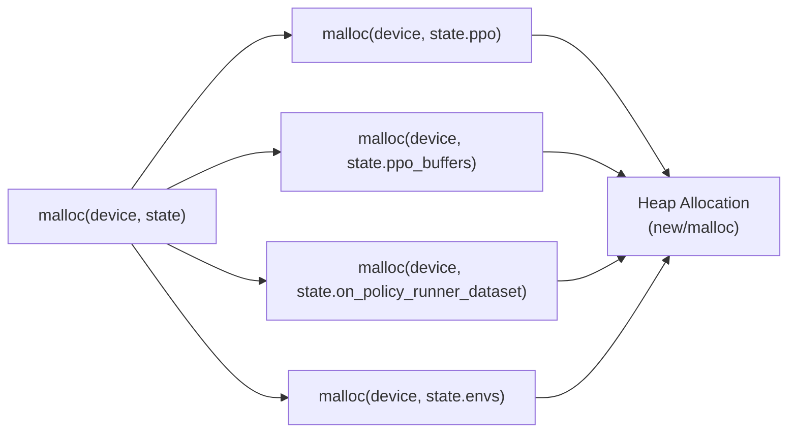
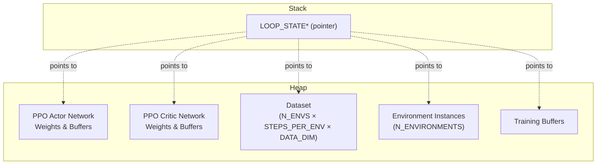
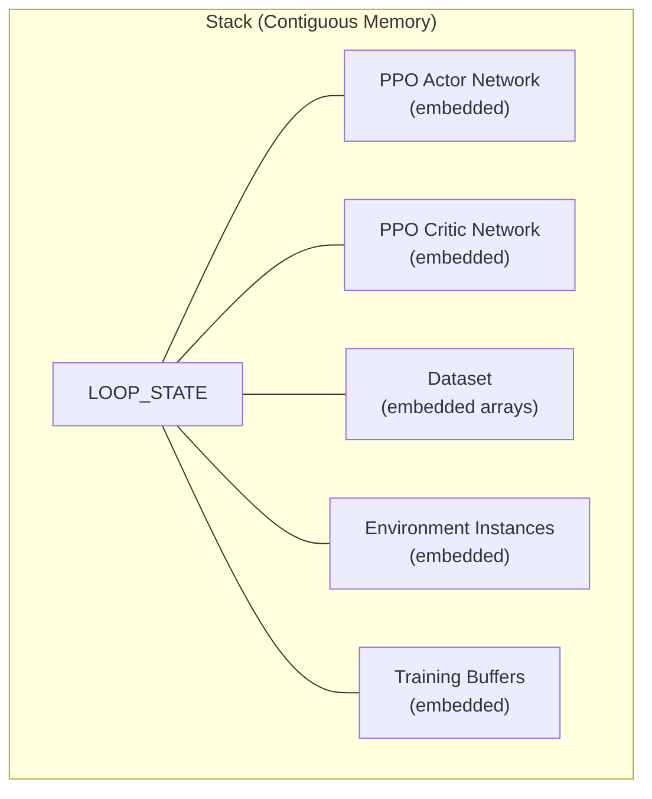
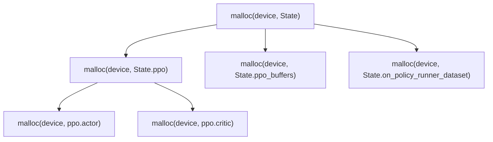

<!-- source: DeepWiki mcp.deepwiki.com · repo rl-tools/rl-tools · page 6.3 Static vs Dynamic Memory Allocation · fetched 2026-10-30 -->

# Static vs Dynamic Memory Allocation

<details>
<summary>Relevant source files</summary>

The following files were used as context for generating this wiki page:

- [include/rl_tools/devices/cpu.h](include/rl_tools/devices/cpu.h)
- [include/rl_tools/random/operations_cpu.h](include/rl_tools/random/operations_cpu.h)
- [include/rl_tools/rl/algorithms/ppo/loop/core/config.h](include/rl_tools/rl/algorithms/ppo/loop/core/config.h)
- [include/rl_tools/rl/algorithms/ppo/loop/core/operations_generic.h](include/rl_tools/rl/algorithms/ppo/loop/core/operations_generic.h)
- [include/rl_tools/rl/algorithms/ppo/loop/core/state.h](include/rl_tools/rl/algorithms/ppo/loop/core/state.h)
- [include/rl_tools/rl/algorithms/ppo/operations_generic.h](include/rl_tools/rl/algorithms/ppo/operations_generic.h)
- [include/rl_tools/rl/algorithms/ppo/ppo.h](include/rl_tools/rl/algorithms/ppo/ppo.h)
- [include/rl_tools/rl/components/on_policy_runner/on_policy_runner.h](include/rl_tools/rl/components/on_policy_runner/on_policy_runner.h)
- [include/rl_tools/rl/components/on_policy_runner/operations_generic.h](include/rl_tools/rl/components/on_policy_runner/operations_generic.h)
- [include/rl_tools/rl/components/on_policy_runner/operations_generic_per_env.h](include/rl_tools/rl/components/on_policy_runner/operations_generic_per_env.h)
- [include/rl_tools/rl/components/running_normalizer/running_normalizer.h](include/rl_tools/rl/components/running_normalizer/running_normalizer.h)
- [include/rl_tools/rl/environments/pendulum/ui_xeus.h](include/rl_tools/rl/environments/pendulum/ui_xeus.h)
- [src/rl/environments/pendulum/ppo/cpu/CMakeLists.txt](src/rl/environments/pendulum/ppo/cpu/CMakeLists.txt)
- [src/rl/environments/pendulum/ppo/cpu/config.h](src/rl/environments/pendulum/ppo/cpu/config.h)
- [src/rl/environments/pendulum/ppo/cpu/training.cpp](src/rl/environments/pendulum/ppo/cpu/training.cpp)
- [src/rl/environments/pendulum/ppo/cuda/CMakeLists.txt](src/rl/environments/pendulum/ppo/cuda/CMakeLists.txt)
- [src/rl/environments/pendulum/ppo/cuda/training.cu](src/rl/environments/pendulum/ppo/cuda/training.cu)

</details>


## Purpose and Scope

This page explains how RL Tools supports both **static** (stack-based) and **dynamic** (heap-based) memory allocation modes, controlled at compile time. This capability is essential for deploying trained policies on embedded systems with limited or no heap allocation support. For information about backend-specific device configuration, see [Backend Configuration](#6.2). For deployment to specific embedded platforms, see [Embedded Platforms](#8.1).

---

## Allocation Modes Overview

RL Tools provides two memory allocation strategies that can be selected at compile time:

| Mode | Memory Location | Controlled By | Primary Use Case |
|------|----------------|---------------|------------------|
| **Dynamic Allocation** | Heap (via `malloc`/`new`) | Default behavior | General training on CPU/CUDA with ample memory |
| **Static Allocation** | Stack (compile-time sized arrays) | `RL_TOOLS_STATIC_MEM` flag | Embedded deployment (PX4, Crazyflie, ESP32, iOS) |

When **static allocation** is enabled, all containers (matrices, tensors, buffers) are allocated on the stack with sizes determined at compile time. This eliminates runtime heap allocations entirely, making the code suitable for resource-constrained embedded systems.

**Sources:** [src/rl/environments/pendulum/ppo/cpu/training.cpp:2-4](), [src/rl/environments/pendulum/ppo/cpu/training.cpp:43-47]()

---

## Build Configuration

### CMake Configuration

Static memory allocation is enabled by defining the `RL_TOOLS_STATIC_MEM` preprocessor macro. This is typically done through CMake compile definitions:

```cmake
target_compile_definitions(target_name PRIVATE RL_TOOLS_STATIC_MEM)
```

When this flag is set, the code automatically defines `RL_TOOLS_DISABLE_DYNAMIC_MEMORY_ALLOCATIONS` to enforce the constraint:

```cpp
#ifdef RL_TOOLS_STATIC_MEM
#define RL_TOOLS_DISABLE_DYNAMIC_MEMORY_ALLOCATIONS
#endif
```

**Example CMake Target:**

The Pendulum PPO training example demonstrates both configurations:

- **Dynamic allocation (default):** `rl_environments_pendulum_ppo_training`
- **Static allocation:** `rl_environments_pendulum_ppo_training_static_mem` (with `RL_TOOLS_STATIC_MEM` defined)

**Sources:** [src/rl/environments/pendulum/ppo/cpu/CMakeLists.txt:1-6](), [src/rl/environments/pendulum/ppo/cpu/training.cpp:2-4]()

### Compile-Time Detection

The training code detects the allocation mode and configures the type system accordingly:

```cpp
#ifdef RL_TOOLS_STATIC_MEM
static constexpr bool DYNAMIC_ALLOCATION = false;
#else
static constexpr bool DYNAMIC_ALLOCATION = true;
#endif

using CONFIG = CONFIG_FACTORY<DEVICE, TYPE_POLICY, DYNAMIC_ALLOCATION>;
```

**Sources:** [src/rl/environments/pendulum/ppo/cpu/training.cpp:43-49]()

---

## Type System Propagation

The `DYNAMIC_ALLOCATION` boolean template parameter propagates through the entire type hierarchy, affecting every container and buffer allocation:



**Sources:** [include/rl_tools/rl/algorithms/ppo/loop/core/config.h:50-52](), [include/rl_tools/rl/algorithms/ppo/loop/core/config.h:81-88](), [include/rl_tools/rl/algorithms/ppo/ppo.h:60-64]()

### Key Type Specifications

#### PPO Configuration

The PPO loop configuration accepts `DYNAMIC_ALLOCATION` as a template parameter:

```cpp
template<typename T_TYPE_POLICY, typename T_TI, typename T_RNG, 
         typename T_ENVIRONMENT, typename T_PARAMETERS, 
         template<typename, typename, typename, typename, bool> class APPROXIMATOR_CONFIG,
         bool T_DYNAMIC_ALLOCATION=true>
struct Config {
    static constexpr bool DYNAMIC_ALLOCATION = T_DYNAMIC_ALLOCATION;
    // ...
};
```

**Sources:** [include/rl_tools/rl/algorithms/ppo/loop/core/config.h:143-152]()

#### Buffer Specifications

PPO buffers carry the allocation flag:

```cpp
template <typename T_SPEC, bool T_DYNAMIC_ALLOCATION=true>
struct BufferSpecification {
    using SPEC = T_SPEC;
    static constexpr bool DYNAMIC_ALLOCATION = T_DYNAMIC_ALLOCATION;
};

template <typename T_BUFFER_SPEC>
struct Buffers {
    // All matrix members use BUFFER_SPEC::DYNAMIC_ALLOCATION
    Matrix<matrix::Specification<T, TI, BATCH_SIZE, ACTION_DIM, BUFFER_SPEC::DYNAMIC_ALLOCATION>> current_batch_actions;
    // ...
};
```

**Sources:** [include/rl_tools/rl/algorithms/ppo/ppo.h:60-79]()

#### On-Policy Runner

Dataset and runner specifications propagate the allocation mode:

```cpp
template <typename T_SPEC, typename T_SPEC::TI T_STEPS_PER_ENV, bool T_DYNAMIC_ALLOCATION = true>
struct DatasetSpecification {
    static constexpr bool DYNAMIC_ALLOCATION = T_DYNAMIC_ALLOCATION;
};

template <typename T_DATASET_SPEC>
struct Dataset {
    // Large data matrix with compile-time or runtime allocation
    Matrix<matrix::Specification<T, TI, STEPS_TOTAL + SPEC::N_ENVIRONMENTS, DATA_DIM, 
                                 DATASET_SPEC::DYNAMIC_ALLOCATION>> data;
};
```

**Sources:** [include/rl_tools/rl/components/on_policy_runner/on_policy_runner.h:23-31](), [include/rl_tools/rl/components/on_policy_runner/on_policy_runner.h:48]()

---

## Memory Allocation Operations

### Dynamic Allocation Mode

When `DYNAMIC_ALLOCATION = true`, the `malloc` and `free` operations perform heap allocations:



The `malloc` function recursively allocates all nested components:

```cpp
template <typename DEVICE, typename T_CONFIG>
void malloc(DEVICE& device, rl::algorithms::ppo::loop::core::State<T_CONFIG>& ts) {
    malloc(device, ts.ppo);
    malloc(device, ts.ppo_buffers);
    malloc(device, ts.on_policy_runner_dataset);
    malloc(device, ts.on_policy_runner);
    malloc(device, ts.actor_eval_buffers);
    // ... more components
}
```

**Sources:** [include/rl_tools/rl/algorithms/ppo/loop/core/operations_generic.h:20-42]()

### Static Allocation Mode

When `DYNAMIC_ALLOCATION = false`, the `malloc` and `free` operations become **no-ops**. All memory is allocated on the stack when the state object is declared:

```cpp
LOOP_STATE ts;  // All memory allocated on stack at compile time
rlt::malloc(device, ts);  // Does nothing in static mode
rlt::init(device, ts, seed);
// ... use ts
rlt::free(device, ts);  // Does nothing in static mode
```

The entire training state size is determined at compile time and can be inspected:

```cpp
#ifdef RL_TOOLS_STATIC_MEM
    std::cout << "Training state size: " << sizeof(LOOP_STATE) << std::endl;
#endif
```

**Sources:** [src/rl/environments/pendulum/ppo/cpu/training.cpp:88-90]()

---

## Memory Layout Comparison

### Dynamic Allocation



### Static Allocation



**Sources:** [include/rl_tools/rl/algorithms/ppo/loop/core/state.h:14-42]()

---

## State Structure Example

The PPO loop state demonstrates how allocation mode affects container declarations:

```cpp
template<typename T_CONFIG>
struct State {
    using CONFIG = T_CONFIG;
    static constexpr bool DYNAMIC_ALLOCATION = CONFIG::DYNAMIC_ALLOCATION;
    
    // All members use DYNAMIC_ALLOCATION in their specifications
    typename CONFIG::PPO_TYPE ppo;
    typename CONFIG::PPO_BUFFERS_TYPE ppo_buffers;
    typename CONFIG::ON_POLICY_RUNNER_DATASET_TYPE on_policy_runner_dataset;
    
    // Matrix with allocation mode
    Matrix<matrix::Specification<T, TI, 
                                 CONFIG::ON_POLICY_RUNNER_DATASET_TYPE::STEPS_TOTAL, 
                                 CONFIG::ENVIRONMENT::Observation::DIM, 
                                 DYNAMIC_ALLOCATION>> observations_dense;
    
    // Tensor with allocation mode
    Tensor<tensor::Specification<typename CONFIG::ENVIRONMENT, TI, 
                                tensor::Shape<TI, CONFIG::CORE_PARAMETERS::N_ENVIRONMENTS>, 
                                DYNAMIC_ALLOCATION>> envs;
};
```

**Sources:** [include/rl_tools/rl/algorithms/ppo/loop/core/state.h:14-42]()

---

## Trade-offs

| Aspect | Dynamic Allocation | Static Allocation |
|--------|-------------------|-------------------|
| **Memory Location** | Heap | Stack |
| **Allocation Time** | Runtime | Compile time |
| **Size Flexibility** | Can vary at runtime | Fixed at compile time |
| **Memory Fragmentation** | Possible | None |
| **Allocation Overhead** | `malloc`/`free` calls | Zero runtime overhead |
| **Maximum Size** | Limited by heap size | Limited by stack size |
| **Embedded Compatibility** | Requires heap support | Works on bare metal |
| **Determinism** | Potential allocation failures | Fully deterministic |
| **Binary Size** | Smaller | Larger (includes all data) |

**Sources:** [src/rl/environments/pendulum/ppo/cpu/training.cpp:43-47](), [src/rl/environments/pendulum/ppo/cpu/CMakeLists.txt:1-6]()

---

## Use Cases

### Dynamic Allocation (Default)

**Recommended for:**
- Training on desktop/server hardware (CPU/CUDA)
- Development and experimentation
- Scenarios requiring flexible batch sizes or network architectures
- Multi-agent systems with variable agent counts

**Example:**
```cpp
using DEVICE = rlt::devices::DefaultCPU;
static constexpr bool DYNAMIC_ALLOCATION = true;
using CONFIG = CONFIG_FACTORY<DEVICE, TYPE_POLICY, DYNAMIC_ALLOCATION>;

int main() {
    DEVICE device;
    typename CONFIG::LOOP_STATE ts;
    rlt::malloc(device, ts);  // Allocates from heap
    rlt::init(device, ts, seed);
    // Training loop...
    rlt::free(device, ts);  // Frees heap memory
}
```

**Sources:** [src/rl/environments/pendulum/ppo/cpu/training.cpp:62-84]()

### Static Allocation

**Recommended for:**
- Embedded platforms (PX4, Crazyflie, ESP32)
- Real-time systems requiring deterministic behavior
- Platforms without heap support
- Scenarios where maximum memory usage must be known at compile time

**Example:**
```cpp
#define RL_TOOLS_STATIC_MEM
#define RL_TOOLS_DISABLE_DYNAMIC_MEMORY_ALLOCATIONS

using DEVICE = rlt::devices::DefaultCPU;
static constexpr bool DYNAMIC_ALLOCATION = false;
using CONFIG = CONFIG_FACTORY<DEVICE, TYPE_POLICY, DYNAMIC_ALLOCATION>;

int main() {
    std::cout << "State size: " << sizeof(typename CONFIG::LOOP_STATE) << std::endl;
    DEVICE device;
    typename CONFIG::LOOP_STATE ts;  // All memory on stack
    rlt::malloc(device, ts);  // No-op in static mode
    rlt::init(device, ts, seed);
    // Training loop...
    rlt::free(device, ts);  // No-op in static mode
}
```

**Sources:** [src/rl/environments/pendulum/ppo/cpu/training.cpp:2-4](), [src/rl/environments/pendulum/ppo/cpu/training.cpp:88-90]()

---

## CUDA Static Allocation Example

Static allocation also works with CUDA, where the training state is allocated in device memory:

```cpp
#define RL_TOOLS_DISABLE_DYNAMIC_MEMORY_ALLOCATIONS

using KERNEL_DEVICE = rlt::devices::cuda::CUDA_KERNEL<...>;
static constexpr bool DYNAMIC_ALLOCATION = false;
using CONFIG = CONFIG_FACTORY<KERNEL_DEVICE, TYPE_POLICY, DYNAMIC_ALLOCATION>;
using LOOP_STATE = typename CONFIG::LOOP_STATE;

LOOP_STATE* ts = nullptr;
cudaMalloc(&ts, sizeof(LOOP_STATE));  // Allocate device memory
init<<<1, 1>>>(device, ts);           // Initialize on device
// Training...
cudaFree(ts);
```

The kernel uses static allocation internally, but the state struct itself is allocated in CUDA device memory via `cudaMalloc`.

**Sources:** [src/rl/environments/pendulum/ppo/cuda/training.cu:1](), [src/rl/environments/pendulum/ppo/cuda/training.cu:37](), [src/rl/environments/pendulum/ppo/cuda/training.cu:63-88]()

---

## Implementation Details

### No-Op Operations

For CPU devices, the `malloc` and `free` operations for containers become no-ops when static allocation is used. The operations exist but perform no runtime work:

```cpp
template <typename DEV_SPEC, typename SPEC>
void malloc(devices::CPU<DEV_SPEC>& device, devices::random::CPU::ENGINE<SPEC>& rng) {}

template <typename DEV_SPEC, typename SPEC>
void free(devices::CPU<DEV_SPEC>& device, devices::random::CPU::ENGINE<SPEC>& rng) {}
```

This pattern applies to all RL Tools containers and allows the same code to work in both allocation modes.

**Sources:** [include/rl_tools/random/operations_cpu.h:16-18]()

### Recursive Allocation

The `malloc` and `free` operations recursively traverse the component hierarchy:



Each level allocates its own members and recursively calls `malloc` on nested components. In static mode, all these calls are no-ops.

**Sources:** [include/rl_tools/rl/algorithms/ppo/loop/core/operations_generic.h:20-42](), [include/rl_tools/rl/algorithms/ppo/operations_generic.h:29-37]()

---

## Related Pages

- For CMake build options controlling allocation mode: [CMake Options](#6.1)
- For backend-specific configurations: [Backend Configuration](#6.2)
- For embedded platform deployment: [Embedded Platforms](#8.1)
- For model export without runtime allocation: [Model Export and Code Generation](#8.4)

---

