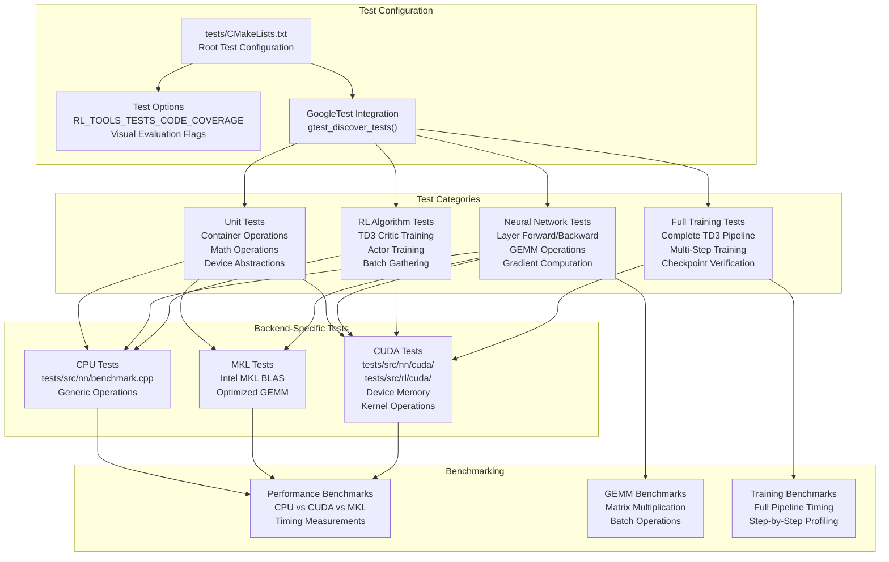
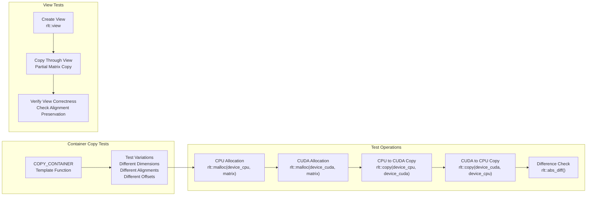
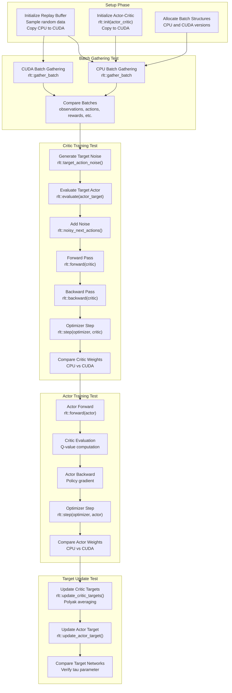
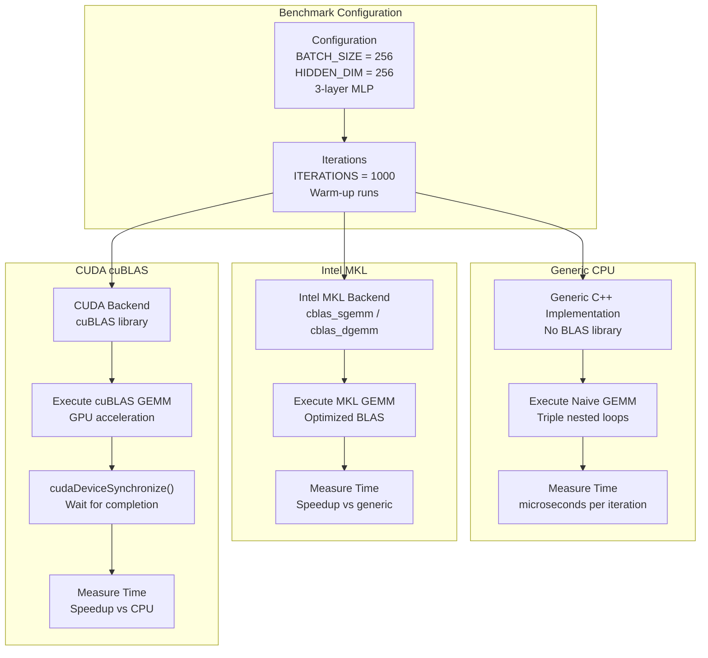
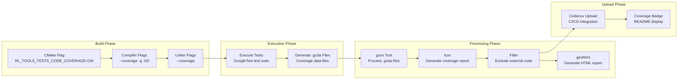

<!-- source: DeepWiki mcp.deepwiki.com · repo rl-tools/rl-tools · page 7 Testing and Benchmarking · fetched 2026-10-30 -->

# Testing and Benchmarking

<details>
<summary>Relevant source files</summary>

The following files were used as context for generating this wiki page:

- [src/rl/environments/mujoco/ant/td3/parameters.h](src/rl/environments/mujoco/ant/td3/parameters.h)
- [tests/CMakeLists.txt](tests/CMakeLists.txt)
- [tests/src/nn/benchmark.cpp](tests/src/nn/benchmark.cpp)
- [tests/src/nn/cuda/CMakeLists.txt](tests/src/nn/cuda/CMakeLists.txt)
- [tests/src/nn/cuda/cuda_basics.cu](tests/src/nn/cuda/cuda_basics.cu)
- [tests/src/nn/cuda/main.cu](tests/src/nn/cuda/main.cu)
- [tests/src/rl/components/off_policy_runner.cpp](tests/src/rl/components/off_policy_runner.cpp)
- [tests/src/rl/cuda/CMakeLists.txt](tests/src/rl/cuda/CMakeLists.txt)
- [tests/src/rl/cuda/rl.cu](tests/src/rl/cuda/rl.cu)
- [tests/src/rl/cuda/td3_full_training.cu](tests/src/rl/cuda/td3_full_training.cu)
- [tests/src/rl/cuda/td3_full_training_parameters_pendulum.h](tests/src/rl/cuda/td3_full_training_parameters_pendulum.h)

</details>


This page documents the testing infrastructure and performance benchmarking systems in rl_tools. It covers the GoogleTest-based test suite, backend-specific tests (CPU/CUDA/MKL), performance benchmarking utilities, and code coverage reporting. For information about the CI/CD pipeline that executes these tests, see [CI/CD Pipeline](#7.3). For details on build configuration options that affect testing, see [CMake Options](#6.1).

---

## Test Infrastructure Overview

The rl_tools test suite is built on GoogleTest and organized hierarchically by component and backend. Tests verify correctness across device abstractions (CPU, CUDA, MKL), neural network operations, RL algorithms, and full training pipelines.



**Test Infrastructure Architecture**: The test system integrates GoogleTest with CMake, organizing tests by component (unit/NN/RL/full) and backend (CPU/MKL/CUDA), with dedicated benchmarking for performance measurement.

Sources: [tests/CMakeLists.txt:1-48](), [tests/src/nn/cuda/CMakeLists.txt:1-36](), [tests/src/rl/cuda/CMakeLists.txt:1-49]()

---

## CMake Test Configuration

The root test configuration defines options and integrates GoogleTest. Test targets are discovered automatically using `gtest_discover_tests()`.

### Configuration Options

| Option | Default | Purpose |
|--------|---------|---------|
| `RL_TOOLS_DOWNLOAD_GTEST` | OFF | Download GoogleTest automatically |
| `RL_TOOLS_TEST_LOCAL` | OFF | Enable local development features |
| `RL_TOOLS_TEST_RL_ENVIRONMENTS_PENDULUM_EVALUATE_VISUALLY` | OFF | Visual evaluation of Pendulum environment |
| `RL_TOOLS_TEST_RL_ALGORITHMS_TD3_SECOND_STAGE_OUTPUT_PLOTS` | OFF | Generate plots for TD3 second stage |
| `RL_TOOLS_TEST_RL_ALGORITHMS_TD3_FULL_TRAINING_OUTPUT_PLOTS` | OFF | Generate plots for full TD3 training |
| `RL_TOOLS_TESTS_RL_ENVIRONMENTS_MULTIROTOR_UI_ENABLE` | OFF | Enable multirotor UI for testing |
| `RL_TOOLS_TESTS_CODE_COVERAGE` | OFF | Enable code coverage instrumentation |

### Code Coverage Instrumentation

When `RL_TOOLS_TESTS_CODE_COVERAGE` is enabled, tests are compiled with coverage flags:

```cpp
// Defined in tests/CMakeLists.txt:21-25
if(RL_TOOLS_TESTS_CODE_COVERAGE)
    add_compile_options(--coverage -g -O0)
    add_link_options(--coverage)
    add_compile_definitions(-DRL_TOOLS_TESTS_CODE_COVERAGE)
endif()
```

The `--coverage` flag enables gcov instrumentation, `-g` adds debug symbols, and `-O0` disables optimizations to ensure accurate line coverage. Coverage data is collected as `.gcda` files during test execution and processed by Codecov in CI.

Sources: [tests/CMakeLists.txt:19-25](), [tests/CMakeLists.txt:31-34]()

---

## Test Organization by Component

### Unit Tests: Container and Device Operations

Unit tests verify basic operations on containers (Matrix, Tensor) and device abstractions. These tests ensure that data can be correctly copied between CPU and CUDA, views work properly, and memory alignment is handled correctly.



**Container Copy Test Pattern**: Tests verify round-trip copying between devices with various matrix dimensions, alignments, and offsets to ensure data integrity across all configurations.

The `COPY_CONTAINER` template function tests copying matrices between CPU and CUDA with different specifications. It uses fuzz testing with randomized parameters generated via Julia code (see comments in [tests/src/nn/cuda/cuda_basics.cu:134-140]()):

```cpp
// From tests/src/nn/cuda/cuda_basics.cu:25-131
template <typename T, typename TI, TI DIM_1, TI DIM_2, TI OFFSET_1, TI OFFSET_2, 
          TI ALIGNMENT_1, TI ALIGNMENT_2, TI DIM_3, TI DIM_4, TI OFFSET_3, 
          TI OFFSET_4, TI ALIGNMENT_3, TI ALIGNMENT_4>
void COPY_CONTAINER() {
    // Allocate on CPU and CUDA
    rlt::Matrix<rlt::matrix::Specification<T, DEVICE_CPU::index_t, DIM_1, DIM_2>> matrix_cpu;
    rlt::Matrix<rlt::matrix::Specification<T, DEVICE_CUDA::index_t, DIM_1, DIM_2>> matrix_cuda;
    
    // Round-trip copy and verify
    rlt::copy(device_cpu, device_cuda, matrix_cpu, matrix_cuda);
    rlt::copy(device_cuda, device_cpu, matrix_cuda, matrix_cpu2);
    auto diff = rlt::abs_diff(device_cpu, matrix_cpu, matrix_cpu2);
    ASSERT_FLOAT_EQ(diff, 0.0f);
}
```

Sources: [tests/src/nn/cuda/cuda_basics.cu:25-191]()

### Neural Network Tests: Forward and Backward Passes

Neural network tests verify the correctness of forward passes, backward passes (gradient computation), and weight updates across different backends. Tests compare CPU and CUDA implementations to ensure numerical equivalence.

```mermaid
graph TB
    subgraph "GEMM Tests"
        GEMMSetup["Setup<br/>BATCH_SIZE x HIDDEN_DIM<br/>3-layer MLP"]
        GEMMCPUExec["CPU GEMM<br/>evaluate(device_cpu, layer, input, output)"]
        GEMMCUDAExec["CUDA GEMM<br/>evaluate(device_cuda, layer, input, output)<br/>cuBLAS Integration"]
        GEMMCompare["Compare Results<br/>abs_diff < threshold"]
    end
    
    subgraph "Forward Tests"
        FwdSetup["Network Setup<br/>Copy CPU weights to CUDA"]
        FwdCPU["CPU Forward<br/>rlt::forward(device_cpu, network, input)"]
        FwdCUDA["CUDA Forward<br/>rlt::forward(device_cuda, network, input)"]
        FwdCompare["Compare Outputs<br/>Verify Layer-by-Layer"]
    end
    
    subgraph "Backward Tests"
        BwdZeroGrad["Zero Gradients<br/>rlt::zero_gradient()"]
        BwdCPU["CPU Backward<br/>forward + backward_full"]
        BwdCUDA["CUDA Backward<br/>forward + backward_full"]
        BwdCompare["Compare Gradients<br/>All Layers and Parameters"]
    end
    
    subgraph "Update Tests"
        UpdateInit["Initialize Optimizer<br/>Adam with age=100000"]
        UpdateCPU["CPU Update<br/>rlt::step(optimizer, network)"]
        UpdateCUDA["CUDA Update<br/>rlt::step(optimizer, network)"]
        UpdateCompare["Compare Weights<br/>After Multiple Steps"]
    end
    
    GEMMSetup --> GEMMCPUExec
    GEMMSetup --> GEMMCUDAExec
    GEMMCPUExec --> GEMMCompare
    GEMMCUDAExec --> GEMMCompare
    
    FwdSetup --> FwdCPU
    FwdSetup --> FwdCUDA
    FwdCPU --> FwdCompare
    FwdCUDA --> FwdCompare
    
    BwdZeroGrad --> BwdCPU
    BwdZeroGrad --> BwdCUDA
    BwdCPU --> BwdCompare
    BwdCUDA --> BwdCompare
    
    UpdateInit --> UpdateCPU
    UpdateInit --> UpdateCUDA
    UpdateCPU --> UpdateCompare
    UpdateCUDA --> UpdateCompare
```



**Neural Network Test Hierarchy**: Tests progressively verify GEMM operations, forward passes, backward passes, and optimizer updates, ensuring correctness at each level before proceeding to the next.

The `FORWARD` test template verifies that neural network forward passes produce identical results on CPU and CUDA:

```cpp
// From tests/src/nn/cuda/cuda_basics.cu:465-612
template <typename TYPE_POLICY, typename TI, TI BATCH_SIZE, TI ITERATIONS>
void FORWARD() {
    // Initialize networks on both devices
    rlt::init_weights(device_cpu, network_cpu, rng);
    rlt::copy(device_cpu, device_cuda, network_cpu, network_cuda);
    
    // Execute forward pass on both
    rlt::forward(device_cpu, network_cpu, input_cpu, network_cpu_buffers, rng);
    rlt::forward(device_cuda, network_cuda, input_cuda, network_cuda_buffers, rng_cuda);
    
    // Compare outputs
    auto evaluation_diff = rlt::abs_diff(device_cpu, output_cuda_cpu, 
                                         network_cpu.output_layer.output);
    ASSERT_LT(evaluation_diff, threshold);
}
```

Sources: [tests/src/nn/cuda/cuda_basics.cu:353-462](), [tests/src/nn/cuda/cuda_basics.cu:465-627](), [tests/src/nn/cuda/cuda_basics.cu:629-815]()

### RL Algorithm Tests: Step-by-Step Verification

RL algorithm tests verify each step of the training process individually, ensuring that critic training, actor training, target updates, and batch gathering work correctly on CUDA.



**RL Algorithm Step-by-Step Testing**: Each component of TD3 training is tested individually to isolate issues, starting from batch gathering through critic training, actor training, and target network updates.

The `TRAIN_CRITIC_STEP_BY_STEP` test verifies each operation in the critic training loop:

```cpp
// From tests/src/rl/cuda/rl.cu:230-376
TEST_F(RL_TOOLS_RL_CUDA, TRAIN_CRITIC_STEP_BY_STEP) {
    // Sample batch deterministically for both devices
    rlt::gather_batch<DEVICE_CPU, ...>(device_cpu, off_policy_runner_cpu, batch_cpu, rng_cpu);
    rlt::gather_batch<DEVICE_GPU::SPEC, ...>(device_gpu, off_policy_runner_gpu_struct, 
                                              batch_gpu, rng_gpu);
    
    // Verify batch consistency
    auto abs_diff_batch = rlt::abs_diff(device_cpu, batch_cpu.observations, 
                                        batch_cpu_2.observations);
    ASSERT_FLOAT_EQ(abs_diff_batch, 0);
    
    // Train critic on both devices
    rlt::zero_gradient(device_cpu, critic_cpu);
    rlt::zero_gradient(device_gpu, critic_gpu);
    rlt::forward(device_cpu, critic_cpu, batch_cpu.observations_and_actions, ...);
    rlt::forward(device_gpu, critic_gpu, batch_gpu.observations_and_actions, ...);
    
    // Compare gradients after backward pass
    auto abs_diff_critic = rlt::abs_diff(device_cpu, critic_cpu, critic_cpu_2);
    ASSERT_LT(abs_diff_critic, EPSILON);
}
```

Sources: [tests/src/rl/cuda/rl.cu:230-376](), [tests/src/rl/cuda/rl.cu:378-443]()

### Full Training Tests

Full training tests execute complete training loops to verify the end-to-end pipeline, including environment interaction, experience collection, and multiple training steps.

```mermaid
graph LR
    subgraph "Training Loop"
        Prologue["Prologue<br/>Reset environments<br/>Sample exploration noise"]
        Interlude["Interlude<br/>Actor inference<br/>Environment step"]
        Epilogue["Epilogue<br/>Store transition<br/>Update episode stats"]
    end
    
    subgraph "Training Steps"
        CriticTrain["Critic Training<br/>Every CRITIC_TRAINING_INTERVAL<br/>Train both critics"]
        ActorTrain["Actor Training<br/>Every ACTOR_TRAINING_INTERVAL<br/>Policy gradient update"]
        TargetUpdate["Target Update<br/>Polyak averaging<br/>tau = 0.005"]
    end
    
    subgraph "Evaluation"
        EvalInterval["Every 1000 steps"]
        CopyToCPU["Copy to CPU<br/>For evaluation"]
        RunEval["Run Evaluation<br/>Deterministic policy"]
        LogMetrics["Log Metrics<br/>Mean return"]
    end
    
    Prologue --> Interlude
    Interlude --> Epilogue
    Epilogue --> CriticTrain
    CriticTrain --> ActorTrain
    ActorTrain --> TargetUpdate
    TargetUpdate --> EvalInterval
    EvalInterval --> CopyToCPU
    CopyToCPU --> RunEval
    RunEval --> LogMetrics
    LogMetrics --> Prologue
```



**Full Training Loop Structure**: The complete training pipeline includes environment interaction (prologue/interlude/epilogue), training steps with appropriate intervals, and periodic evaluation.

The full training test runs 20,000 steps of TD3 training on CUDA:

```cpp
// From tests/src/rl/cuda/td3_full_training.cu:48-213
TEST(RL_TOOLS_RL_CUDA_TD3, TEST_FULL_TRAINING) {
    constexpr DEVICE::index_t step_limit = 20000;
    for(int step_i = 0; step_i < step_limit; step_i += 1) {
        // Environment interaction
        rlt::rl::components::off_policy_runner::prologue(device, off_policy_runner_pointer, rng);
        rlt::rl::components::off_policy_runner::interlude(device, off_policy_runner, 
                                                           actor_critic.actor, actor_buffers_eval, rng);
        rlt::rl::components::off_policy_runner::epilogue(device, off_policy_runner_pointer, 
                                                          actor_critic.actor, rng);
        
        // Critic training
        if(step_i > N_WARMUP_STEPS_CRITIC && step_i % CRITIC_TRAINING_INTERVAL == 0) {
            for (int critic_i = 0; critic_i < 2; critic_i++) {
                rlt::target_action_noise(device, actor_critic, 
                                         critic_training_buffers.target_next_action_noise, rng);
                rlt::gather_batch(device, off_policy_runner_pointer, critic_batch, rng);
                rlt::train_critic(device, actor_critic, critic, critic_batch, optimizer, ...);
            }
        }
        
        // Actor training
        if(step_i > N_WARMUP_STEPS_ACTOR && step_i % ACTOR_TRAINING_INTERVAL == 0) {
            rlt::gather_batch(device, off_policy_runner_pointer, actor_batch, rng);
            rlt::train_actor(device, actor_critic, actor_batch, optimizer, ...);
        }
        
        // Target updates
        if(step_i % CRITIC_TARGET_UPDATE_INTERVAL == 0) {
            rlt::update_critic_targets(device, actor_critic);
        }
        if(step_i % ACTOR_TARGET_UPDATE_INTERVAL == 0) {
            rlt::update_actor_target(device, actor_critic);
        }
        
        // Evaluation
        if(step_i % 1000 == 0) {
            rlt::copy(device, device_init, actor_critic, actor_critic_init);
            rlt::evaluate(device_init, envs[0], ui, actor_critic_init.actor, 
                          results, actor_buffers_eval_init, rng_init, false);
            std::cout << "Mean return: " << results.returns_mean << std::endl;
        }
    }
}
```

Sources: [tests/src/rl/cuda/td3_full_training.cu:48-213](), [tests/src/rl/cuda/td3_full_training_parameters_pendulum.h:1-57]()

---

## Performance Benchmarking

Performance benchmarks measure execution time for critical operations across different backends. Benchmarks use `std::chrono::high_resolution_clock` to measure timing with microsecond precision.

### GEMM Benchmarks

GEMM (General Matrix Multiply) benchmarks compare matrix multiplication performance across CPU (generic), Intel MKL, and CUDA cuBLAS implementations.



**GEMM Benchmark Flow**: Benchmarks compare generic CPU, Intel MKL, and CUDA cuBLAS implementations, measuring time per iteration after synchronization to ensure accurate GPU timing.

The MKL benchmark directly calls `cblas_sgemm`/`cblas_dgemm`:

```cpp
// From tests/src/nn/benchmark.cpp:181-231
TEST_F(RL_TOOLS_NN_DENSE_BENCHMARK, MKL) {
    // Setup matrix multiplication: A (BATCH_SIZE x INPUT_DIM) * B (INPUT_DIM x HIDDEN_DIM)
    int m = BATCH_SIZE, k = INPUT_DIM, n = HIDDEN_DIM;
    T alpha = 1.0, beta = 0.0;
    
    auto start = std::chrono::high_resolution_clock::now();
    for(INDEX_TYPE iteration_i = 0; iteration_i < ITERATIONS; iteration_i++) {
        if constexpr(rlt::utils::typing::is_same_v<T, float>){
            cblas_sgemm(CblasRowMajor, CblasNoTrans, CblasTrans, 
                        m, n, k, alpha, 
                        (float*)input_mkl_matrix._data, rlt::row_pitch(input_mkl_matrix), 
                        (float*)network_mkl.input_layer.weights.parameters._data, 
                        rlt::row_pitch(network_mkl.input_layer.weights.parameters), 
                        beta, (float*)output_mkl_matrix._data, 
                        rlt::row_pitch(output_mkl_matrix));
        }
    }
    auto end = std::chrono::high_resolution_clock::now();
    std::cout << "MKL: " << std::chrono::duration_cast<std::chrono::microseconds>(end - start)
                              .count() / ((T)ITERATIONS) << "us" << std::endl;
}
```

Sources: [tests/src/nn/benchmark.cpp:181-231]()

### Layer and Network Benchmarks

Benchmarks measure complete layer evaluations and full network forward/backward passes:

| Benchmark | Description | Code Location |
|-----------|-------------|---------------|
| `MKL_LAYER` | Layer evaluation with MKL backend | [tests/src/nn/benchmark.cpp:237-263]() |
| `MKL_LAYER_FORWARD` | Layer forward pass with state | [tests/src/nn/benchmark.cpp:265-292]() |
| `MKL_MODEL_FORWARD` | Full model forward pass | [tests/src/nn/benchmark.cpp:294-317]() |
| `MKL_MODEL_BACKWARD` | Full model forward + backward | [tests/src/nn/benchmark.cpp:319-360]() |

The backward pass benchmark measures gradient computation time:

```cpp
// From tests/src/nn/benchmark.cpp:319-360
TEST_F(RL_TOOLS_NN_DENSE_BENCHMARK, MKL_MODEL_BACKWARD) {
    auto start = std::chrono::high_resolution_clock::now();
    for(INDEX_TYPE iteration_i = 0; iteration_i < ITERATIONS; iteration_i++) {
        rlt::forward(device_mkl, network_mkl, input);
        rlt::nn::loss_functions::mse::gradient(device_mkl, network.output_layer.output, 
                                                output_target, d_output);
        rlt::backward_full(device_mkl, network_mkl, input, d_output, d_input, 
                           network_mkl_buffers);
    }
    auto end = std::chrono::high_resolution_clock::now();
    std::cout << "MKL LIC forward backward mse: " 
              << std::chrono::duration_cast<std::chrono::microseconds>(end - start)
                     .count() / ((DTYPE)ITERATIONS) << "us" << std::endl;
}
```

Sources: [tests/src/nn/benchmark.cpp:237-360]()

### CUDA Benchmarks

CUDA benchmarks measure GPU kernel execution time with proper synchronization:

```cpp
// From tests/src/nn/cuda/cuda_basics.cu:437-446
{
    cudaDeviceSynchronize();
    auto start = std::chrono::high_resolution_clock::now();
    for(int i = 0; i < ITERATIONS; ++i) {
        rlt::evaluate(device_cuda, network_cuda.input_layer, input_cuda, 
                      output_first_layer_cuda, buffer_cuda, rng_cuda);
        cudaDeviceSynchronize();  // Wait for GPU to finish
    }
    auto end = std::chrono::high_resolution_clock::now();
    std::cout << "CUDA evaluation time: " 
              << std::chrono::duration_cast<std::chrono::microseconds>(end - start)
                     .count() / ((T)ITERATIONS) << "us" << std::endl;
}
```

The `cudaDeviceSynchronize()` call is critical for accurate timing, as CUDA operations are asynchronous by default. Without synchronization, timing would only measure kernel launch overhead, not actual execution time.

Sources: [tests/src/nn/cuda/cuda_basics.cu:437-446](), [tests/src/nn/cuda/cuda_basics.cu:602-611]()

---

## Code Coverage

Code coverage is enabled via the `RL_TOOLS_TESTS_CODE_COVERAGE` CMake option, which adds instrumentation to measure which lines of code are executed during testing.

### Coverage Workflow



**Coverage Collection and Reporting**: Tests compile with instrumentation, generate `.gcda` files during execution, and are processed by lcov/gcov for upload to Codecov.

The coverage instrumentation is configured in CMake:

```cmake
# From tests/CMakeLists.txt:19-25
option(RL_TOOLS_TESTS_CODE_COVERAGE "Enable coverage reporting" OFF)

if(RL_TOOLS_TESTS_CODE_COVERAGE)
    add_compile_options(--coverage -g -O0)
    add_link_options(--coverage)
    add_compile_definitions(-DRL_TOOLS_TESTS_CODE_COVERAGE)
endif()
```

The `-g` flag adds debug symbols for line number mapping, `-O0` disables optimizations to prevent line merging, and `--coverage` enables gcov instrumentation. During test execution, each executed line increments a counter in `.gcda` files. These files are processed by gcov and lcov to generate line coverage percentages, which are uploaded to Codecov for visualization.

Sources: [tests/CMakeLists.txt:19-25]()

---

## Debug Definitions

Test executables can be compiled with debug definitions to enable additional runtime checks. These are typically enabled in Debug build configurations.

```mermaid
graph TB
    subgraph "Container Debug Checks"
        CheckBounds["RL_TOOLS_DEBUG_CONTAINER_CHECK_BOUNDS<br/>Array bounds checking"]
        CheckMalloc["RL_TOOLS_DEBUG_CONTAINER_CHECK_MALLOC<br/>Allocation tracking"]
        InitNaN["RL_TOOLS_DEBUG_CONTAINER_MALLOC_INIT_NAN<br/>Initialize with NaN"]
    end
    
    subgraph "Component Debug Checks"
        RunnerInit["RL_TOOLS_DEBUG_RL_COMPONENTS_OFF_POLICY_RUNNER_CHECK_INIT<br/>Off-policy runner initialization"]
    end
    
    subgraph "Device Debug Checks"
        CUDAInit["RL_TOOLS_DEBUG_DEVICE_CUDA_CHECK_INIT<br/>CUDA device initialization"]
        CUDASync["RL_TOOLS_DEBUG_DEVICE_CUDA_SYNCHRONIZE_STATUS_CHECK<br/>Check errors after sync"]
        CUDABounds["RL_TOOLS_DEBUG_DEVICE_CUDA_CHECK_BOUNDS<br/>GPU memory bounds"]
    end
    
    CheckBounds --> RuntimeAssert["Runtime Assertion<br/>Abort on violation"]
    CheckMalloc --> RuntimeAssert
    InitNaN --> DetectUninitialized["Detect Uninitialized Memory<br/>NaN propagation"]
    
    RunnerInit --> RuntimeAssert
    
    CUDAInit --> RuntimeAssert
    CUDASync --> RuntimeAssert
    CUDABounds --> RuntimeAssert
```



**Debug Definition Categories**: Debug flags enable bounds checking, initialization tracking, and device-specific checks to catch errors early during development.

Debug definitions are conditionally added in CMake:

```cmake
# From tests/src/rl/cuda/CMakeLists.txt:8-19
function(RL_TOOLS_TESTS_RL_CUDA_ADD_DEBUG_DEFINITIONS TARGET)
    if(CMAKE_BUILD_TYPE STREQUAL "Debug")
        target_compile_definitions(${TARGET} PRIVATE -DRL_TOOLS_DEBUG_CONTAINER_MALLOC_INIT_NAN)
        target_compile_definitions(${TARGET} PRIVATE -DRL_TOOLS_DEBUG_RL_COMPONENTS_OFF_POLICY_RUNNER_CHECK_INIT)
        target_compile_definitions(${TARGET} PRIVATE -DRL_TOOLS_DEBUG_DEVICE_CUDA_CHECK_INIT)
        target_compile_definitions(${TARGET} PRIVATE -DRL_TOOLS_DEBUG_DEVICE_CUDA_SYNCHRONIZE_STATUS_CHECK)
    endif()
endfunction()
```

These definitions enable runtime assertions that check for:
- **Bounds checking**: Verify array indices are within valid ranges
- **Initialization checking**: Ensure data structures are properly initialized before use
- **Memory initialization**: Fill allocations with NaN to detect use of uninitialized values
- **CUDA error checking**: Check for CUDA errors after synchronization operations

Sources: [tests/src/nn/cuda/CMakeLists.txt:8-16](), [tests/src/rl/cuda/CMakeLists.txt:8-19]()

---

## Running Tests

### Building Tests

Tests are built when the `RL_TOOLS_ENABLE_TESTS` option is enabled:

```bash
cmake -DRL_TOOLS_ENABLE_TESTS=ON ..
cmake --build . --target all
```

Individual test targets can be built:

```bash
cmake --build . --target test_nn_cuda_basics
cmake --build . --target test_rl_cuda
cmake --build . --target test_rl_cuda_td3_full_training
```

### Executing Tests

Tests can be run using CTest or directly:

```bash
# Run all tests
ctest

# Run specific test
ctest -R test_nn_cuda_basics

# Run with verbose output
ctest -V

# Run directly
./test_nn_cuda_basics
./test_nn_cuda_basics --gtest_filter=RL_TOOLS_NN_CUDA.GEMM
```

### Test Filtering

GoogleTest provides filtering capabilities:

```bash
# Run only GEMM tests
./test_nn_cuda_basics --gtest_filter=*GEMM*

# Run all except COPY tests
./test_nn_cuda_basics --gtest_filter=-*COPY*

# List available tests
./test_nn_cuda_basics --gtest_list_tests
```

Sources: [tests/src/nn/cuda/CMakeLists.txt:18-36](), [tests/src/rl/cuda/CMakeLists.txt:21-49]()

---

## Test Naming Conventions

Test executables and test cases follow consistent naming conventions:

| Pattern | Example | Purpose |
|---------|---------|---------|
| `test_<component>_<backend>` | `test_nn_cuda_basics` | Backend-specific component tests |
| `test_<algorithm>_<component>` | `test_rl_cuda_td3_full_training` | Algorithm-specific tests |
| `<COMPONENT>_<OPERATION>` | `RL_TOOLS_NN_CUDA.FORWARD` | Test case naming |
| `<ALGORITHM>_<PHASE>` | `TRAIN_CRITIC_STEP_BY_STEP` | RL algorithm phase tests |

### Test Fixture Classes

Test fixtures provide reusable setup and teardown logic:

```cpp
// From tests/src/rl/cuda/rl.cu:41-183
class RL_TOOLS_RL_CUDA : public ::testing::Test {
protected:
    DEVICE_CPU device_cpu;
    DEVICE_GPU device_gpu;
    OFF_POLICY_RUNNER_TYPE off_policy_runner_cpu;
    OFF_POLICY_RUNNER_TYPE off_policy_runner_gpu_cpu;
    BATCH_TYPE batch_cpu, batch_gpu;
    ACTOR_CRITIC_TYPE actor_critic_cpu, actor_critic_gpu;
    
    void SetUp() override {
        // Allocate and initialize resources
        rlt::malloc(device_cpu, off_policy_runner_cpu);
        rlt::malloc(device_gpu, batch_gpu);
        rlt::init(device_cpu, actor_critic_cpu, rng_cpu);
        rlt::copy(device_cpu, device_gpu, actor_critic_cpu, actor_critic_gpu);
    }
    
    void TearDown() override {
        // Free resources
        rlt::free(device_cpu, off_policy_runner_cpu);
        rlt::free(device_gpu, batch_gpu);
    }
};
```

Test fixtures reduce code duplication and ensure proper resource cleanup after test failure.

Sources: [tests/src/rl/cuda/rl.cu:41-183]()

---

## Integration with CI/CD

The testing infrastructure integrates with GitHub Actions CI/CD. For details on the CI workflows, test matrices, and automated test execution, see [CI/CD Pipeline](#7.3). The coverage data generated by tests with `RL_TOOLS_TESTS_CODE_COVERAGE` enabled is automatically uploaded to Codecov for tracking coverage trends over time.

Sources: [tests/CMakeLists.txt:19-25]()

---

