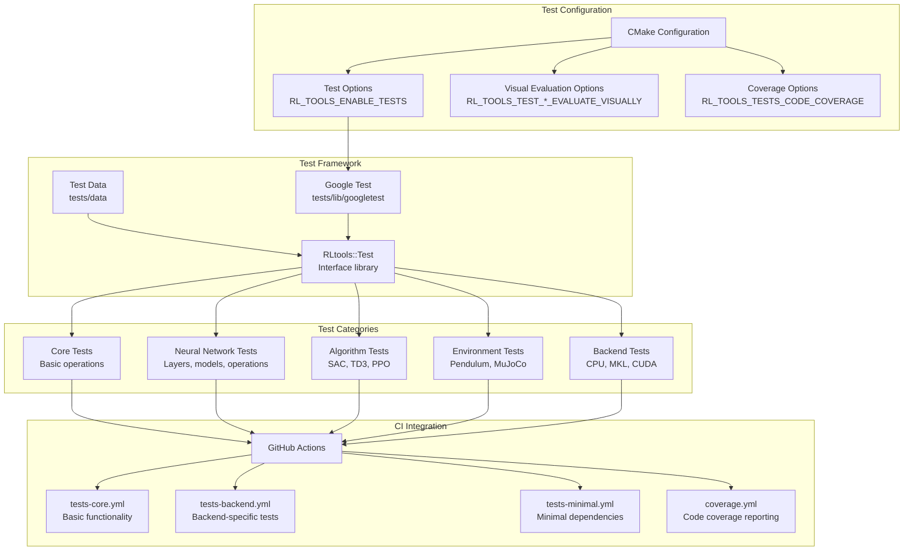
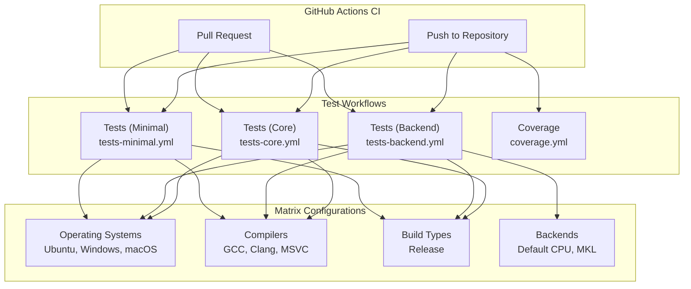

<!-- source: DeepWiki mcp.deepwiki.com · repo rl-tools/rl-tools · page 7.1 Running Tests · fetched 2026-10-30 -->

# Running Tests

<details>
<summary>Relevant source files</summary>

The following files were used as context for generating this wiki page:

- [.github/workflows/coverage.yml](.github/workflows/coverage.yml)
- [.github/workflows/tests-tier0.yml](.github/workflows/tests-tier0.yml)
- [.github/workflows/tests-tier3.yml](.github/workflows/tests-tier3.yml)
- [tests/CMakeLists.txt](tests/CMakeLists.txt)
- [tests/README.MD](tests/README.MD)

</details>


This document explains how to build and run the comprehensive test suite for RLtools. The test system is designed to validate the correctness of the library across different platforms, compilers, and computational backends.

For information about performance benchmarking, see [Performance Benchmarks](#7.2).

## Overview of the Testing System

RLtools uses Google Test as its testing framework and CMake to configure and build the tests. The test suite covers various components of the library, including neural network operations, reinforcement learning algorithms, and environment interactions.



Sources: [tests/CMakeLists.txt:1-49](), [.github/workflows/tests-core.yml:1-94](), [.github/workflows/tests-backend.yml:1-126](), [.github/workflows/tests-minimal.yml:1-143](), [.github/workflows/coverage.yml:1-125]()

## Building the Tests

### Prerequisites

Before building the tests, ensure you have the following dependencies installed:

- CMake (3.14 or higher)
- A C++ compiler with C++17 support (GCC, Clang, or MSVC)
- HDF5 library (for model persistence tests)
- Boost libraries (for certain environment tests)
- Protobuf (for TensorBoard integration tests)

For backend-specific tests, you may also need:
- Intel MKL (for CPU_MKL backend tests)
- CUDA toolkit (for CUDA backend tests)

### CMake Configuration

To enable and build the tests, use the following CMake options:

```bash
cmake -B build \
      -DCMAKE_BUILD_TYPE=Release \
      -DRL_TOOLS_ENABLE_TESTS=ON \
      -DRL_TOOLS_CONTAINER_INIT_NAN=ON
```

The `RL_TOOLS_CONTAINER_INIT_NAN` option initializes memory with NaN values, which helps detect uninitialized memory usage.

Additional useful options include:

| Option | Description |
|--------|-------------|
| `RL_TOOLS_ENABLE_TENSORBOARD` | Enable TensorBoard integration tests |
| `RL_TOOLS_ENABLE_HDF5` | Enable HDF5 model persistence tests |
| `RL_TOOLS_ENABLE_CLI11` | Enable command-line interface tests |
| `RL_TOOLS_TESTS_CODE_COVERAGE` | Enable code coverage reporting |
| `RL_TOOLS_BACKEND_ENABLE_MKL` | Enable Intel MKL backend tests |
| `RL_TOOLS_ENVIRONMENTS_ENABLE_MUJOCO` | Enable MuJoCo environment tests |

Sources: [tests/CMakeLists.txt:1-49](), [.github/workflows/tests.yml:1-42]()

### Building with Docker

For a consistent test environment, you can use Docker:

```bash
# Build the Docker image
docker build -t rl_tools:tests tests/

# Run the container with the repository mounted
docker run --rm -it --mount type=bind,source=$(pwd),target=/rl_tools rl_tools:tests

# Inside the container
mkdir -p build && cd build
cmake .. -DCMAKE_BUILD_TYPE=Release -DRL_TOOLS_ENABLE_TESTS=ON
cmake --build . -j $(nproc)
```

Sources: [tests/README.MD:1-19](), [tests/Dockerfile:1-13]()

## Running Tests

After building the tests, you can run them using CTest:

```bash
cd build
ctest --output-on-failure
```

To run specific tests, you can use the `--tests-regex` option:

```bash
ctest --output-on-failure --tests-regex "NN_DENSE"
```

### Test Categories

The RLtools test suite is organized into several categories:

```mermaid
graph TD
    subgraph "RLtools Test Suite"
        CoreTests["Core Tests"]
        NNTests["Neural Network Tests"]
        AlgorithmTests["Algorithm Tests"]
        EnvTests["Environment Tests"]
        BackendTests["Backend Tests"]
    end
    
    subgraph "Core Tests"
        ContainerTests["Container Tests<br/>Matrix, Tensor operations"]
        MathTests["Math Tests<br/>Basic math functions"]
        UtilTests["Utility Tests<br/>Random, Timing, etc."]
    end
    
    subgraph "Neural Network Tests"
        LayerTests["Layer Tests<br/>Dense, GRU, etc."]
        ModelTests["Model Tests<br/>MLP, Sequential"]
        OptimizerTests["Optimizer Tests<br/>Adam, SGD"]
        BackpropTests["Backpropagation Tests"]
    end
    
    subgraph "Algorithm Tests"
        SACTests["SAC Tests"]
        TD3Tests["TD3 Tests"]
        PPOTests["PPO Tests"]
    end
    
    subgraph "Environment Tests"
        PendulumTests["Pendulum Tests"]
        MuJoCoTests["MuJoCo Tests"]
        L2FTests["Learn to Fly Tests"]
    end
    
    subgraph "Backend Tests"
        CPUTests["CPU Backend Tests"]
        MKLTests["MKL Backend Tests"]
        CUDATests["CUDA Backend Tests"]
    end
    
    CoreTests --> ContainerTests
    CoreTests --> MathTests
    CoreTests --> UtilTests
    
    NNTests --> LayerTests
    NNTests --> ModelTests
    NNTests --> OptimizerTests
    NNTests --> BackpropTests
    
    AlgorithmTests --> SACTests
    AlgorithmTests --> TD3Tests
    AlgorithmTests --> PPOTests
    
    EnvTests --> PendulumTests
    EnvTests --> MuJoCoTests
    EnvTests --> L2FTests
    
    BackendTests --> CPUTests
    BackendTests --> MKLTests
    BackendTests --> CUDATests
```



Sources: [tests/src/nn/benchmark.cpp:1-431]()

## Backend-Specific Tests

RLtools supports multiple computational backends, and the test suite includes specific tests for each backend to ensure consistent behavior.

### CPU Backend Tests

The default CPU backend tests validate the core functionality of the library without any specialized acceleration.

### MKL Backend Tests

When configured with `-DRL_TOOLS_BACKEND_ENABLE_MKL=ON`, the test suite includes tests for the Intel MKL backend, which provides optimized linear algebra operations.

Example of an MKL backend test:

```cpp
TEST_F(RL_TOOLS_NN_DENSE_BENCHMARK, MKL_LAYER) {
    using DEVICE_MKL = rlt::devices::CPU_MKL<DEVICE::SPEC>;
    DEVICE_MKL device_mkl;
    device_mkl.logger = &logger;

    // Test MKL-accelerated layer operations
    rlt::evaluate(device_mkl, network_mkl.input_layer, input, output_matrix);
    
    // Verify results match the reference implementation
    DTYPE abs_diff = rlt::abs_diff(device_mkl, output_matrix, expected_output_input_layer);
    EXPECT_LT(abs_diff, 1e-6);
}
```

Sources: [tests/src/nn/benchmark.cpp:174-259]()

## Continuous Integration

RLtools uses GitHub Actions for continuous integration testing across multiple platforms, compilers, and configurations.

### CI Workflows

The repository includes several CI workflows for testing:

1. **Tests (Core)**: Basic functionality tests on multiple platforms
2. **Tests (Backend)**: Backend-specific tests (CPU, MKL)
3. **Tests (Minimal)**: Tests with minimal dependencies
4. **Coverage**: Code coverage reporting



Sources: [.github/workflows/tests-core.yml:1-94](), [.github/workflows/tests-backend.yml:1-126](), [.github/workflows/tests-minimal.yml:1-143](), [.github/workflows/coverage.yml:1-125]()

### CI Configuration

Each CI workflow is configured to test different aspects of the library:

| Workflow | Purpose | Platforms | Compilers |
|----------|---------|-----------|-----------|
| Tests (Core) | Basic functionality | Ubuntu, Windows, macOS | GCC, Clang, MSVC |
| Tests (Backend) | Backend-specific tests | Ubuntu | GCC, Clang |
| Tests (Minimal) | Minimal dependencies | Ubuntu, Windows | GCC, Clang, MSVC |
| Coverage | Code coverage reporting | Ubuntu | GCC |

Sources: [.github/workflows/tests-core.yml:26-53](), [.github/workflows/tests-backend.yml:28-50](), [.github/workflows/tests-minimal.yml:26-57](), [.github/workflows/coverage.yml:26-34]()

## Code Coverage

RLtools includes support for code coverage reporting using gcov/lcov. To enable code coverage:

```bash
cmake -B build \
      -DCMAKE_BUILD_TYPE=Release \
      -DRL_TOOLS_ENABLE_TESTS=ON \
      -DRL_TOOLS_TESTS_CODE_COVERAGE=ON
```

This adds the necessary compiler flags (`--coverage -g -O0`) to generate coverage information.

After running the tests, coverage reports can be generated and uploaded to services like Codecov.

Sources: [tests/CMakeLists.txt:19-25](), [.github/workflows/coverage.yml:78-114]()

## Visual Evaluation Tests

Some tests include visual evaluation options for environments like Pendulum and algorithms like TD3. These are disabled by default but can be enabled for local development:

```bash
cmake -B build \
      -DCMAKE_BUILD_TYPE=Release \
      -DRL_TOOLS_ENABLE_TESTS=ON \
      -DRL_TOOLS_TEST_RL_ENVIRONMENTS_PENDULUM_EVALUATE_VISUALLY=ON
```

Sources: [tests/CMakeLists.txt:5-17]()

## Troubleshooting

### Common Issues

1. **Missing Dependencies**: Ensure all required dependencies are installed. For minimal tests, you need HDF5, Boost, and Protobuf.

2. **Backend Configuration**: When testing specific backends (MKL, CUDA), make sure the corresponding libraries are properly installed and configured.

3. **Test Failures**: If tests fail, check the output with `--output-on-failure` to see detailed error messages.

### Getting Help

If you encounter issues with the test suite, check the GitHub repository issues or create a new issue with detailed information about the problem, including:

- Your operating system and compiler
- CMake configuration options
- Test output with `--output-on-failure`
- Any relevant error messages

---

