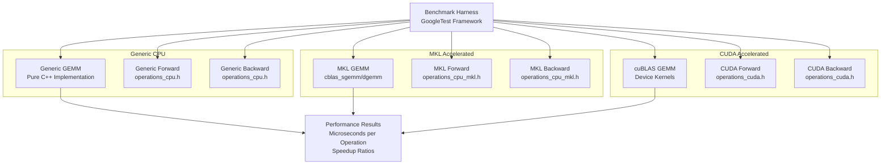
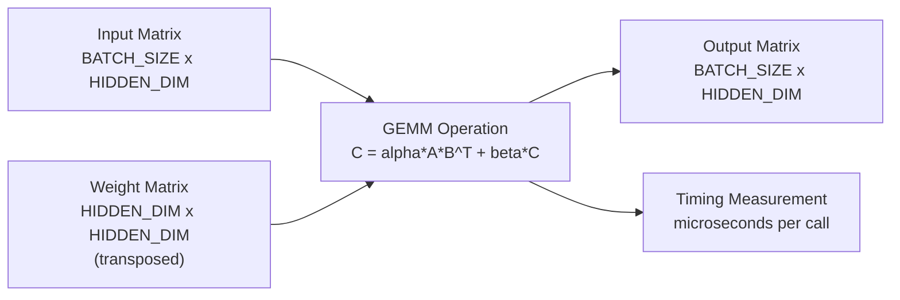
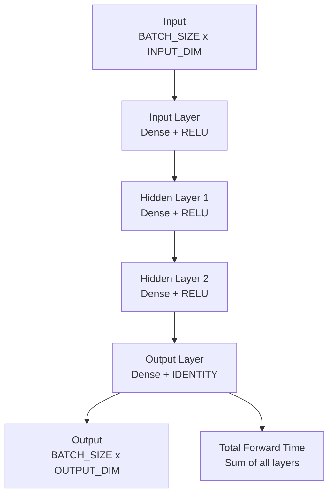
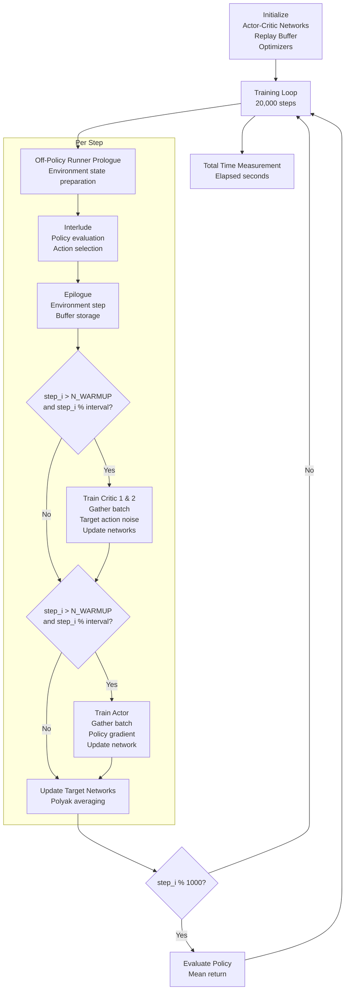
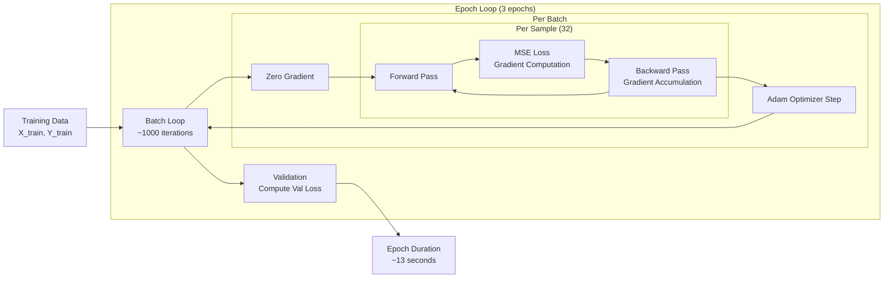
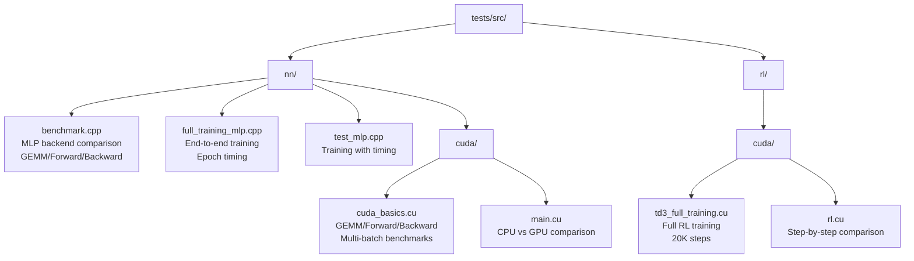
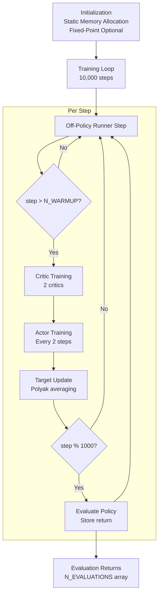

<!-- source: DeepWiki mcp.deepwiki.com · repo rl-tools/rl-tools · page 7.2 Performance Benchmarks · fetched 2026-10-30 -->

# Performance Benchmarks

<details>
<summary>Relevant source files</summary>

The following files were used as context for generating this wiki page:

- [src/rl/environments/mujoco/ant/td3/parameters.h](src/rl/environments/mujoco/ant/td3/parameters.h)
- [src/rl/environments/pendulum/sac/wasm/full_training.h](src/rl/environments/pendulum/sac/wasm/full_training.h)
- [src/rl/environments/pendulum/td3/arm/training.h](src/rl/environments/pendulum/td3/arm/training.h)
- [tests/src/nn/benchmark.cpp](tests/src/nn/benchmark.cpp)
- [tests/src/nn/cuda/CMakeLists.txt](tests/src/nn/cuda/CMakeLists.txt)
- [tests/src/nn/cuda/cuda_basics.cu](tests/src/nn/cuda/cuda_basics.cu)
- [tests/src/nn/cuda/main.cu](tests/src/nn/cuda/main.cu)
- [tests/src/nn/default_network_mlp.h](tests/src/nn/default_network_mlp.h)
- [tests/src/nn/full_training_mlp.cpp](tests/src/nn/full_training_mlp.cpp)
- [tests/src/nn/test_mlp.cpp](tests/src/nn/test_mlp.cpp)
- [tests/src/rl/algorithms/td3/first_stage_mlp.cpp](tests/src/rl/algorithms/td3/first_stage_mlp.cpp)
- [tests/src/rl/algorithms/td3/full_training_dummy_dep.cpp](tests/src/rl/algorithms/td3/full_training_dummy_dep.cpp)
- [tests/src/rl/algorithms/td3/second_stage_mlp.cpp](tests/src/rl/algorithms/td3/second_stage_mlp.cpp)
- [tests/src/rl/components/off_policy_runner.cpp](tests/src/rl/components/off_policy_runner.cpp)
- [tests/src/rl/cuda/CMakeLists.txt](tests/src/rl/cuda/CMakeLists.txt)
- [tests/src/rl/cuda/rl.cu](tests/src/rl/cuda/rl.cu)
- [tests/src/rl/cuda/td3_full_training.cu](tests/src/rl/cuda/td3_full_training.cu)
- [tests/src/rl/cuda/td3_full_training_parameters_pendulum.h](tests/src/rl/cuda/td3_full_training_parameters_pendulum.h)
- [tests/src/rl/environments/pendulum/pendulum.cpp](tests/src/rl/environments/pendulum/pendulum.cpp)

</details>


## Purpose and Scope

This page documents the performance benchmarking infrastructure in rl_tools and presents benchmark results for various computational backends. Benchmarks measure execution time for critical operations including matrix multiplication (GEMM), neural network forward/backward passes, and complete reinforcement learning training loops.

For information about running tests and the test infrastructure, see [Running Tests](#7.1). For backend configuration details, see [Backend Configuration](#6.2).

---

## Benchmark Categories

The codebase includes three primary categories of performance benchmarks:

### Matrix Operations (GEMM)
Low-level matrix multiplication operations that form the computational foundation of neural networks. Benchmarked across batch sizes from 1 to 1024 with various dimensions.

### Neural Network Operations
Forward and backward propagation through multi-layer perceptron (MLP) networks, including layer evaluations and gradient computations.

### Full Training Loops
End-to-end reinforcement learning training including environment interaction, policy evaluation, critic/actor training, and target network updates.

---

## Benchmark Infrastructure

### Timing Methodology

Benchmarks use `std::chrono::high_resolution_clock` for microsecond-precision timing measurements:

```
Benchmark Structure (template)
┌─────────────────────────────────────────┐
│  auto start = chrono::now()             │
│  for(i in ITERATIONS) {                 │
│      operation()                        │
│      cudaDeviceSynchronize() // CUDA    │
│  }                                      │
│  auto end = chrono::now()               │
│  duration = (end - start) / ITERATIONS  │
└─────────────────────────────────────────┘
```

**Sources:** [tests/src/nn/cuda/cuda_basics.cu:438-445](), [tests/src/nn/benchmark.cpp:115-121]()

---

## Backend Comparison Architecture



**Diagram: Backend Performance Testing Infrastructure**

The benchmark suite instantiates identical network structures across different device backends and measures execution time for equivalent operations. This enables direct performance comparisons.

**Sources:** [tests/src/nn/benchmark.cpp:60-83](), [tests/src/nn/cuda/cuda_basics.cu:353-447]()

---

## GEMM Benchmark Details

### Test Structure

The GEMM benchmarks evaluate matrix multiplication performance using the template:

```
GEMM<TYPE_POLICY, TI, BATCH_SIZE, ITERATIONS>
```

Testing configurations include batch sizes: 1, 2, 9, 10, 32, 64, 200, 256, 1024 with both `float` and `double` precision.



**Diagram: GEMM Benchmark Operation Flow**

**Sources:** [tests/src/nn/cuda/cuda_basics.cu:448-462](), [tests/src/nn/benchmark.cpp:181-231]()

### MKL GEMM Implementation

The MKL backend uses optimized BLAS routines:

- **Single precision**: `cblas_sgemm(CblasRowMajor, CblasNoTrans, CblasTrans, ...)`
- **Double precision**: `cblas_dgemm(CblasRowMajor, CblasNoTrans, CblasTrans, ...)`

Matrix operation: `C[m×n] = α·A[m×k]·B^T[k×n] + β·C[m×n]` where:
- `m = BATCH_SIZE`
- `k = INPUT_DIM`  
- `n = HIDDEN_DIM`
- `α = 1.0, β = 0.0`

**Sources:** [tests/src/nn/benchmark.cpp:209-214]()

### CUDA GEMM Implementation

CUDA backend utilizes cuBLAS with device memory management. The benchmark measures pure computation time by synchronizing before and after operations:

```
cudaDeviceSynchronize()
evaluate(device_cuda, layer, input_cuda, output_cuda)
cudaDeviceSynchronize()
```

**Sources:** [tests/src/nn/cuda/cuda_basics.cu:437-445]()

---

## Neural Network Operation Benchmarks

### Forward Pass Benchmarks

Forward pass benchmarks measure complete network evaluation including:
1. Input layer forward propagation
2. Hidden layer forward propagation (3 layers)
3. Output layer forward propagation
4. Activation function application



**Diagram: Forward Pass Benchmark Network Structure**

Test configurations from `FORWARD<TYPE_POLICY, TI, BATCH_SIZE, ITERATIONS>`:
- Batch sizes: 1, 2, 9, 10, 32, 64, 200, 256
- Network: `HIDDEN_DIM=BATCH_SIZE, 3 layers, RELU activation`
- Iteration counts: 1 for correctness, 100-1000 for timing

**Sources:** [tests/src/nn/cuda/cuda_basics.cu:465-627]()

### Backward Pass Benchmarks

Backward pass benchmarks measure gradient computation including:
1. Loss gradient computation
2. Output layer backward propagation
3. Hidden layer backward propagation
4. Input layer backward propagation
5. Gradient accumulation

The benchmark template:
```
BACKWARD<TYPE_POLICY, TI, BATCH_SIZE, INPUT_DIM, HIDDEN_DIM, OUTPUT_DIM, ITERATIONS>
```

**Sources:** [tests/src/nn/cuda/cuda_basics.cu:629-895]()

---

## Full Training Benchmarks

### TD3 Full Training on CUDA

The most comprehensive benchmark measures complete TD3 training on Pendulum environment:



**Diagram: Full TD3 Training Benchmark Flow**

### Performance Characteristics

The benchmark reports total elapsed time and includes comments on observed performance:

```
Results on Pendulum TD3 (20,000 steps):
- 90s baseline (with device synchronization)
- 24s with on-device rollout (6x speedup)
- 14s without device sync (2.5x vs baseline)
```

**Sources:** [tests/src/rl/cuda/td3_full_training.cu:123-205]()

### Network Specifications

| Component | Configuration |
|-----------|--------------|
| Actor | 3 layers, 64 hidden dim, RELU → TANH |
| Critic | 3 layers, 64 hidden dim, RELU → IDENTITY |
| Batch Size | 100 (both actor and critic) |
| Replay Buffer | 500,000 capacity |
| Episode Limit | 200 steps |
| Optimizer | Adam (ε_sqrt=0) |

**Sources:** [tests/src/rl/cuda/td3_full_training_parameters_pendulum.h:19-36]()

---

## MLP Full Training Benchmark

### CPU Full Training Performance

The MLP benchmark trains a neural network on a regression task:

| Parameter | Value |
|-----------|-------|
| Input Dimension | 17 |
| Output Dimension | 13 |
| Hidden Layers | 3 |
| Hidden Dimension | 50 |
| Activation | GELU (hidden), IDENTITY (output) |
| Batch Size | 32 |
| Training Samples | ~32,000 |
| Validation Samples | ~8,000 |



**Diagram: MLP Full Training Benchmark Structure**

Expected performance on Intel Core i9-10885H @ 2.40GHz with `-O3` optimization:
- Epoch duration: ~13 seconds
- Final training loss: < 0.002
- Final validation loss: < 0.001

**Sources:** [tests/src/nn/full_training_mlp.cpp:61-205]()

---

## Benchmark Test Organization

### File Structure



**Diagram: Benchmark Test File Organization**

**Sources:** [tests/src/nn/benchmark.cpp:1](), [tests/src/nn/cuda/cuda_basics.cu:1](), [tests/src/rl/cuda/td3_full_training.cu:1]()

---

## Running Benchmarks

### Build Configuration

Benchmarks are compiled as part of the test suite. To enable specific backends:

```cmake
# Enable MKL backend
-DRL_TOOLS_BACKEND_ENABLE_MKL=ON

# Enable CUDA backend (requires CUDA toolkit)
-DCMAKE_CUDA_COMPILER=/path/to/nvcc
```

**Sources:** [tests/src/nn/benchmark.cpp:6-26](), [tests/src/nn/cuda/CMakeLists.txt:1-36](), [tests/src/rl/cuda/CMakeLists.txt:1-49]()

### Execution

Individual benchmark tests can be run using GoogleTest filters:

```bash
# Run all GEMM benchmarks
./test_nn_benchmark --gtest_filter="*GEMM*"

# Run CUDA forward pass benchmarks  
./test_nn_cuda_basics --gtest_filter="*FORWARD*"

# Run full TD3 training benchmark
./test_rl_cuda_td3_full_training
```

### Output Format

Benchmark results are printed to stdout in microseconds:

```
LIC: 245us                          # Generic CPU layer evaluation
MKL: 12us                           # MKL-accelerated evaluation
CUDA evaluation time: 8us           # CUDA evaluation
```

**Sources:** [tests/src/nn/benchmark.cpp:121](), [tests/src/nn/cuda/cuda_basics.cu:445]()

---

## Benchmark Variations by Batch Size

The CUDA benchmark suite systematically tests across batch sizes:

| Test | Batch Sizes | Precision | Iterations |
|------|-------------|-----------|------------|
| `GEMM` | 1, 2, 9, 10, 32, 64, 200, 256, 1024 | float, double | 1-1000 |
| `FORWARD` | 1, 2, 9, 10, 32, 64, 200, 256 | float, double | 1-1000 |
| `BACKWARD` | 1, 2, 9, 10, 32, 64, 100, 128, 200 | float, double | 1-10 |

Smaller batch sizes use more iterations for stable timing measurements. Larger batch sizes (>256) are tested in non-debug builds only.

**Sources:** [tests/src/nn/cuda/cuda_basics.cu:448-462](), [tests/src/nn/cuda/cuda_basics.cu:614-627](), [tests/src/nn/cuda/cuda_basics.cu:897-920]()

---

## Embedded Platform Benchmarks

### ARM Platform Training

The ARM training benchmark measures performance on embedded ARM Cortex processors:



**Diagram: ARM Embedded Training Benchmark**

ARM-specific optimizations include:
- `operations_arm/opt.h` - Optimized dense layer operations
- `operations_arm/dsp.h` - DSP instruction utilization
- Static memory allocation (when `RL_TOOLS_DISABLE_DYNAMIC_MEMORY_ALLOCATIONS` defined)
- Malloc counting for memory profiling

**Sources:** [src/rl/environments/pendulum/td3/arm/training.h:1-235]()

### WASM Benchmark Considerations

WebAssembly deployments measure different performance characteristics:
- JavaScript interop overhead
- Browser-based execution constraints
- Memory allocation patterns in WASM linear memory
- Model loading time from HDF5 format using `jsfive`

**Sources:** [src/rl/environments/pendulum/sac/wasm/full_training.h:1]()

---

## Performance Analysis Tools

### Timing Utilities

The benchmark infrastructure provides several timing patterns:

1. **High-resolution timing**: `std::chrono::high_resolution_clock` for microsecond precision
2. **Device synchronization**: CUDA benchmarks use `cudaDeviceSynchronize()` to ensure accurate timing
3. **Iteration averaging**: Results divided by iteration count for per-operation timing
4. **Epoch timing**: Full training measures wall-clock time for complete epochs

**Sources:** [tests/src/nn/full_training_mlp.cpp:104-145]()

### Memory Profiling

Static memory configurations enable malloc counting:

```cpp
#define RL_TOOLS_DEBUG_CONTAINER_COUNT_MALLOC
```

This tracks allocation patterns for embedded deployment analysis.

**Sources:** [src/rl/environments/pendulum/td3/arm/training.h:2]()

---

## Comparison Methodology

### Correctness Validation

All benchmarks include correctness checks before performance measurement:

1. **Absolute difference**: `rlt::abs_diff(device, output_cpu, output_gpu)`
2. **Per-weight tolerance**: Division by total parameter count
3. **Precision-dependent thresholds**: `1e-6` for `float`, `1e-15` for `double`

**Sources:** [tests/src/nn/cuda/cuda_basics.cu:427-433]()

### Speedup Calculation

Speedup ratios compare execution time across backends:

```
Speedup = Time_CPU / Time_Accelerated
```

Reported in comments within benchmark code as observed performance improvements.

**Sources:** [tests/src/rl/cuda/td3_full_training.cu:202-204]()

---

