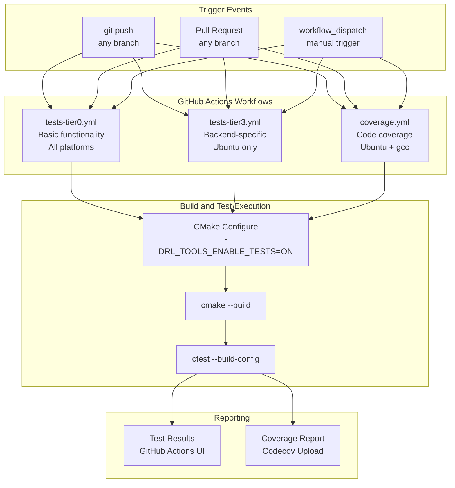
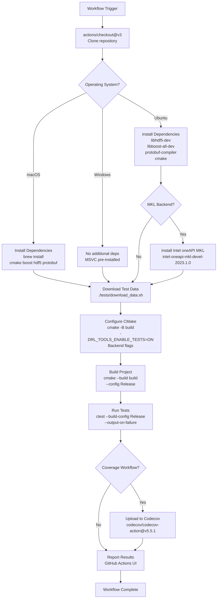
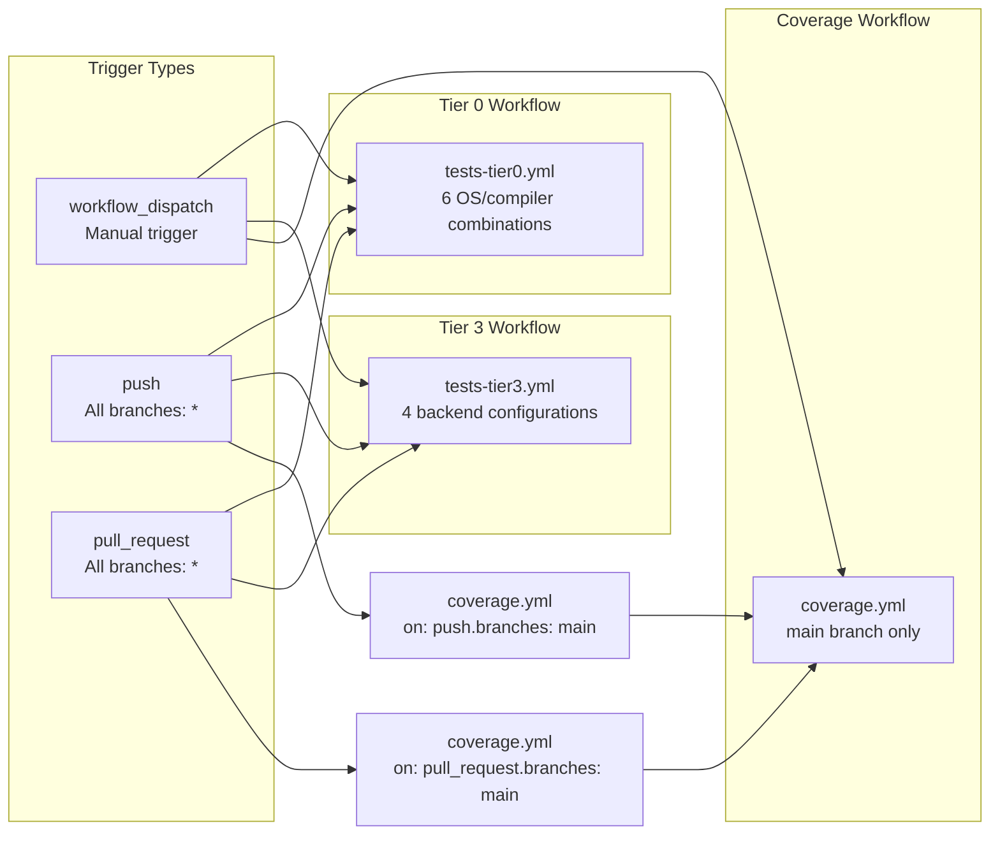

<!-- source: DeepWiki mcp.deepwiki.com · repo rl-tools/rl-tools · page 7.3 CI/CD Pipeline · fetched 2026-10-30 -->

# CI/CD Pipeline

<details>
<summary>Relevant source files</summary>

The following files were used as context for generating this wiki page:

- [.github/workflows/coverage.yml](.github/workflows/coverage.yml)
- [.github/workflows/tests-tier0.yml](.github/workflows/tests-tier0.yml)
- [.github/workflows/tests-tier3.yml](.github/workflows/tests-tier3.yml)
- [tests/CMakeLists.txt](tests/CMakeLists.txt)
- [tests/README.MD](tests/README.MD)

</details>


## Purpose and Scope

This document describes the Continuous Integration and Continuous Deployment (CI/CD) infrastructure for rl_tools, implemented using GitHub Actions workflows. The CI/CD system ensures code quality through automated testing across multiple platforms, compilers, and backend configurations. This page covers workflow structure, test tier organization, platform matrices, and coverage reporting.

For information about running tests locally, see [Running Tests](#7.1). For details on test implementation and GoogleTest integration, see [Testing and Benchmarking](#7).

## Overview

The CI/CD pipeline uses three primary GitHub Actions workflows that execute on push and pull request events. These workflows build the project, run tests using CTest, and report results. The pipeline is designed to validate functionality across diverse hardware configurations (CPU/CUDA/MKL) and operating systems (Ubuntu/Windows/macOS).



**Sources:** [.github/workflows/tests-tier0.yml:1-96](), [.github/workflows/tests-tier3.yml:1-114](), [.github/workflows/coverage.yml:1-103]()

## Workflow Tiers

The CI/CD system implements a tiered testing strategy to balance coverage with execution time. Each tier serves a specific purpose in validating different aspects of the codebase.

### Tier 0: Cross-Platform Basic Tests

**Workflow:** `tests-tier0.yml`

Tier 0 provides baseline functionality verification across all supported platforms and compilers. This tier runs the most fundamental tests without optional dependencies like MKL or CUDA.

**Platform Matrix:**

| Operating System | Compiler | Purpose |
|-----------------|----------|---------|
| ubuntu-24.04 | gcc | Verify Linux compatibility with GNU toolchain |
| ubuntu-24.04 | clang | Verify Linux compatibility with LLVM toolchain |
| ubuntu-22.04 | gcc | Verify older Ubuntu LTS compatibility |
| ubuntu-22.04 | clang | Verify older Ubuntu LTS with LLVM |
| windows-latest | cl (MSVC) | Verify Windows compatibility |
| macos-14 | clang | Verify macOS ARM64 compatibility |

**Configuration:**

[.github/workflows/tests-tier0.yml:76-85]()

```
cmake -B build
  -DCMAKE_CXX_COMPILER=${{ matrix.cpp_compiler }}
  -DCMAKE_C_COMPILER=${{ matrix.c_compiler }}
  -DCMAKE_BUILD_TYPE=Release
  -DRL_TOOLS_ENABLE_TESTS=ON
```

The workflow includes test data download via `./tests/download_data.sh` before configuration.

**Sources:** [.github/workflows/tests-tier0.yml:1-96]()

### Tier 3: Backend-Specific Tests

**Workflow:** `tests-tier3.yml`

Tier 3 validates backend-specific implementations, particularly the Intel MKL backend which requires additional dependencies and configuration. This tier only runs on Ubuntu platforms where MKL can be easily installed.

**Backend Configuration:**

[.github/workflows/tests-tier3.yml:37-46]()

The matrix includes the flag `-DRL_TOOLS_BACKEND_ENABLE_MKL=ON` for clang builds on both Ubuntu 24.04 and 22.04.

**MKL Installation:**

[.github/workflows/tests-tier3.yml:69-75]()

```bash
sudo wget -O- https://apt.repos.intel.com/intel-gpg-keys/GPG-PUB-KEY-INTEL-SW-PRODUCTS.PUB | \
  sudo gpg --dearmor | sudo tee /usr/share/keyrings/oneapi-archive-keyring.gpg > /dev/null
sudo echo "deb [signed-by=/usr/share/keyrings/oneapi-archive-keyring.gpg] \
  https://apt.repos.intel.com/oneapi all main" | sudo tee /etc/apt/sources.list.d/oneAPI.list
sudo apt-get update && sudo apt-get install -y intel-oneapi-mkl-devel-2023.1.0
```

**Environment Variables:**

[.github/workflows/tests-tier3.yml:15-16]()

The workflow sets `MKL_NUM_THREADS: 1` to prevent MKL from using excessive parallelism in the CI environment.

**Sources:** [.github/workflows/tests-tier3.yml:1-114]()

### Coverage Workflow

**Workflow:** `coverage.yml`

The coverage workflow instruments the build with gcov to measure code coverage and uploads results to Codecov.

**Coverage Configuration:**

[tests/CMakeLists.txt:19-25]()

```cmake
option(RL_TOOLS_TESTS_CODE_COVERAGE "Enable coverage reporting" OFF)

if(RL_TOOLS_TESTS_CODE_COVERAGE)
    add_compile_options(--coverage -g -O0)
    add_link_options(--coverage)
    add_compile_definitions(-DRL_TOOLS_TESTS_CODE_COVERAGE)
endif()
```

The workflow builds with `-DRL_TOOLS_TESTS_CODE_COVERAGE=ON` to enable coverage instrumentation.

**Codecov Upload:**

[.github/workflows/coverage.yml:88-92]()

```yaml
- name: Upload coverage reports to Codecov
  uses: codecov/codecov-action@v5.5.1
  with:
    token: ${{ secrets.CODECOV_TOKEN }}
    slug: rl-tools/rl-tools
```

**Sources:** [.github/workflows/coverage.yml:1-103](), [tests/CMakeLists.txt:19-25]()

## Workflow Execution Flow

Each workflow follows a standard execution pattern that configures, builds, and tests the project.



**Sources:** [.github/workflows/tests-tier0.yml:63-95](), [.github/workflows/tests-tier3.yml:61-112](), [.github/workflows/coverage.yml:35-92]()

## Dependency Installation

The workflows install platform-specific dependencies before building and testing.

### Ubuntu Dependencies

**Base Dependencies:**

[.github/workflows/tests-tier0.yml:64-68]() (similar in tier3 and coverage)

```bash
sudo apt-get update
sudo apt-get install -y libhdf5-dev libboost-all-dev protobuf-compiler libprotobuf-dev cmake
```

These dependencies support:
- `libhdf5-dev` - HDF5 file format for checkpoint saving/loading
- `libboost-all-dev` - Boost libraries (used in some environments)
- `protobuf-compiler`, `libprotobuf-dev` - Protocol buffers (used in MuJoCo integration)
- `cmake` - Build system

### macOS Dependencies

[.github/workflows/tests-tier0.yml:76-79]() (from tier3 workflow, not in tier0)

```bash
brew install cmake boost hdf5 protobuf
```

macOS uses Homebrew for package management and installs the same core dependencies.

### Test Data Download

[.github/workflows/tests-tier0.yml:73-75]()

```bash
./tests/download_data.sh
```

The `download_data.sh` script fetches reference data used by tests, including pre-trained model checkpoints and expected output values.

**Sources:** [.github/workflows/tests-tier0.yml:64-79](), [.github/workflows/tests-tier3.yml:64-79]()

## Build Configuration Matrix

The following table summarizes the complete build matrix across all workflows:

| Workflow | OS | Compiler | Backend Flags | Coverage | Purpose |
|----------|----|---------|--------------|---------:|---------|
| tier0 | ubuntu-24.04 | gcc | None | No | Basic Linux/GNU test |
| tier0 | ubuntu-24.04 | clang | None | No | Basic Linux/LLVM test |
| tier0 | ubuntu-22.04 | gcc | None | No | LTS compatibility |
| tier0 | ubuntu-22.04 | clang | None | No | LTS LLVM compatibility |
| tier0 | windows-latest | cl | None | No | Windows/MSVC test |
| tier0 | macos-14 | clang | None | No | macOS ARM64 test |
| tier3 | ubuntu-24.04 | gcc | None | No | Ubuntu 24 baseline |
| tier3 | ubuntu-24.04 | clang | MKL | No | MKL backend test |
| tier3 | ubuntu-22.04 | gcc | None | No | Ubuntu 22 baseline |
| tier3 | ubuntu-22.04 | clang | MKL | No | MKL backend LTS test |
| coverage | ubuntu-latest | gcc | None | Yes | Coverage measurement |

**Sources:** [.github/workflows/tests-tier0.yml:26-61](), [.github/workflows/tests-tier3.yml:28-60](), [.github/workflows/coverage.yml:26-33]()

## CMake Test Integration

The workflows integrate with the CMake-based test system defined in `tests/CMakeLists.txt`.

### Test Configuration Options

[tests/CMakeLists.txt:1-25]()

Key options available to the test system:

| Option | Default | Purpose |
|--------|---------|---------|
| `RL_TOOLS_DOWNLOAD_GTEST` | OFF | Download GoogleTest automatically |
| `RL_TOOLS_TEST_LOCAL` | OFF | Enable local development features |
| `RL_TOOLS_TEST_RL_ENVIRONMENTS_PENDULUM_EVALUATE_VISUALLY` | OFF | Visual evaluation for Pendulum |
| `RL_TOOLS_TEST_RL_ALGORITHMS_TD3_SECOND_STAGE_OUTPUT_PLOTS` | OFF | Generate plots in TD3 tests |
| `RL_TOOLS_TESTS_RL_ENVIRONMENTS_MULTIROTOR_UI_ENABLE` | OFF | Enable multirotor UI |
| `RL_TOOLS_TESTS_CODE_COVERAGE` | OFF | Enable gcov instrumentation |

The CI workflows typically set only `RL_TOOLS_ENABLE_TESTS=ON` and optionally `RL_TOOLS_TESTS_CODE_COVERAGE=ON`, leaving visual and plotting options disabled.

### Test Library Setup

[tests/CMakeLists.txt:27-34]()

```cmake
include(GoogleTest)

add_library(rl_tools_test INTERFACE)
target_link_libraries(rl_tools_test INTERFACE GTest::gtest_main)
if(RL_TOOLS_TEST_DATA_PATH)
    target_compile_definitions(rl_tools_test INTERFACE RL_TOOLS_TEST_DATA_PATH=${RL_TOOLS_TEST_DATA_PATH})
endif()
add_library(RLtools::Test ALIAS rl_tools_test)
```

This creates an interface library that test executables link against, providing access to GoogleTest and test data paths.

**Sources:** [tests/CMakeLists.txt:1-48]()

## Test Execution with CTest

After building, workflows execute tests using CTest, the CMake test driver.

**Test Command:**

[.github/workflows/tests-tier0.yml:91-95]()

```bash
ctest --build-config Release --output-on-failure
```

**Flags:**
- `--build-config Release` - Specifies the build configuration (required for multi-config generators like Visual Studio)
- `--output-on-failure` - Prints test output only when tests fail, reducing log verbosity

CTest discovers and runs all test executables registered via `gtest_discover_tests()` in the CMake configuration. The tier 0 and tier 3 workflows use identical test execution commands.

**Sources:** [.github/workflows/tests-tier0.yml:91-95](), [.github/workflows/tests-tier3.yml:108-112]()

## Failure Handling and Reporting

The workflow strategy includes `fail-fast: false` to ensure all matrix combinations complete even if some fail.

[.github/workflows/tests-tier0.yml:17-18]()

```yaml
strategy:
  fail-fast: false
```

This configuration ensures:
1. All platform/compiler combinations are tested
2. Failures in one configuration don't prevent others from running
3. Complete feedback on which specific combinations fail

Test results appear in the GitHub Actions UI, with failed tests showing their output due to the `--output-on-failure` flag. The coverage workflow additionally uploads results to Codecov for visualization.

**Sources:** [.github/workflows/tests-tier0.yml:16-18](), [.github/workflows/tests-tier3.yml:18-20]()

## Workflow Trigger Configuration

All three workflows respond to the same set of triggers:



**Tier 0 and Tier 3 Triggers:**

[.github/workflows/tests-tier0.yml:5-10]()

```yaml
on:
  workflow_dispatch:
  push:
    branches: [ "*" ]
  pull_request:
    branches: [ "*" ]
```

These workflows run on all branches for both push and pull request events.

**Coverage Workflow Triggers:**

[.github/workflows/coverage.yml:5-10]()

```yaml
on:
  workflow_dispatch:
  push:
    branches: [ "main" ]
  pull_request:
    branches: [ "main" ]
```

Coverage only runs for the main branch to reduce CI load, as detailed coverage metrics are primarily needed for the primary development branch.

**Sources:** [.github/workflows/tests-tier0.yml:5-10](), [.github/workflows/tests-tier3.yml:5-10](), [.github/workflows/coverage.yml:5-10]()

## Docker-Based Testing

While not used in the GitHub Actions workflows, the repository provides Docker support for local testing that matches CI conditions.

[tests/README.MD:1-19]()

**Docker Build:**

```bash
docker build -t rl_tools:tests .
```

**Docker Run:**

```bash
docker run --rm -it --mount type=bind,source=$(cd ..; pwd),target=/rl_tools,readonly rl_tools:tests
```

This approach allows developers to reproduce CI environment conditions locally, particularly useful for debugging platform-specific issues before pushing to GitHub.

**Sources:** [tests/README.MD:1-19]()

## Coverage Reporting Details

The coverage workflow produces instrumented builds and uploads results to the Codecov service for visualization and tracking over time.

### Compilation with Coverage

[tests/CMakeLists.txt:21-24]()

```cmake
if(RL_TOOLS_TESTS_CODE_COVERAGE)
    add_compile_options(--coverage -g -O0)
    add_link_options(--coverage)
    add_compile_definitions(-DRL_TOOLS_TESTS_CODE_COVERAGE)
endif()
```

The `--coverage` flag enables gcov instrumentation:
- `-g` - Include debug symbols
- `-O0` - Disable optimizations for accurate line coverage
- `--coverage` - Link with gcov libraries

### Codecov Integration

[.github/workflows/coverage.yml:88-92]()

The workflow uses the official Codecov action with repository credentials stored in GitHub Secrets. The `slug: rl-tools/rl-tools` parameter ensures correct project identification.

After test execution, gcov generates `.gcda` coverage data files in the build directory. The Codecov action automatically discovers these files and uploads them for processing.

**Sources:** [.github/workflows/coverage.yml:64-92](), [tests/CMakeLists.txt:19-25]()

## CI/CD Workflow Summary

The CI/CD pipeline provides comprehensive validation through:

1. **Multi-tier testing strategy** separating basic functionality (tier 0) from backend-specific tests (tier 3)
2. **Broad platform coverage** including Ubuntu, Windows, and macOS with multiple compiler versions
3. **Backend validation** ensuring MKL and other accelerated backends function correctly
4. **Automated coverage reporting** tracking code coverage over time via Codecov
5. **Fail-safe execution** with `fail-fast: false` ensuring complete test feedback
6. **Comprehensive dependency management** installing platform-specific prerequisites automatically

The workflows execute on every push and pull request to any branch (coverage limited to main), providing rapid feedback on code quality and compatibility across the supported deployment targets.

**Sources:** [.github/workflows/tests-tier0.yml:1-96](), [.github/workflows/tests-tier3.yml:1-114](), [.github/workflows/coverage.yml:1-103](), [tests/CMakeLists.txt:1-48]()

---

