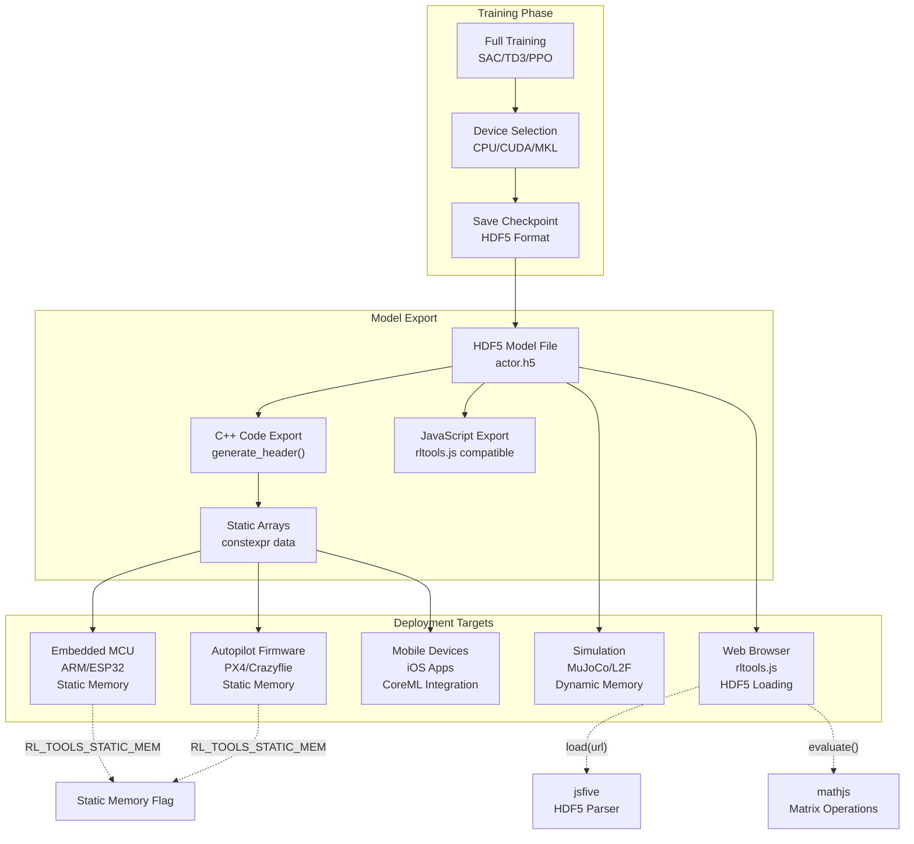
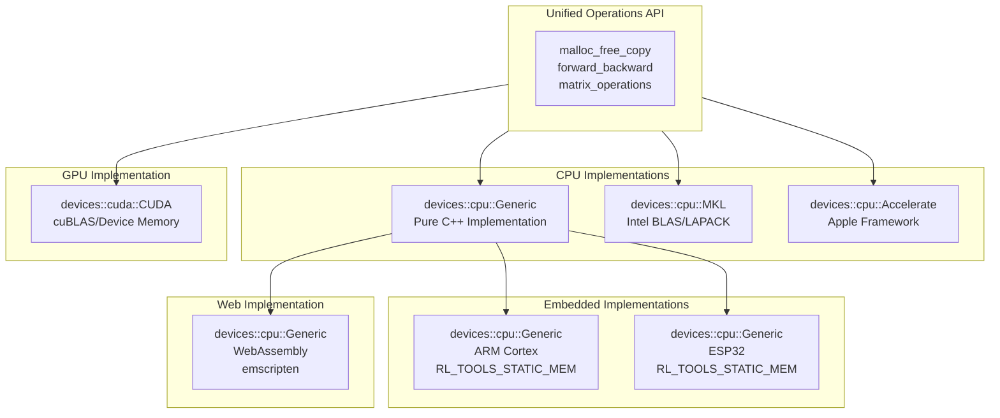
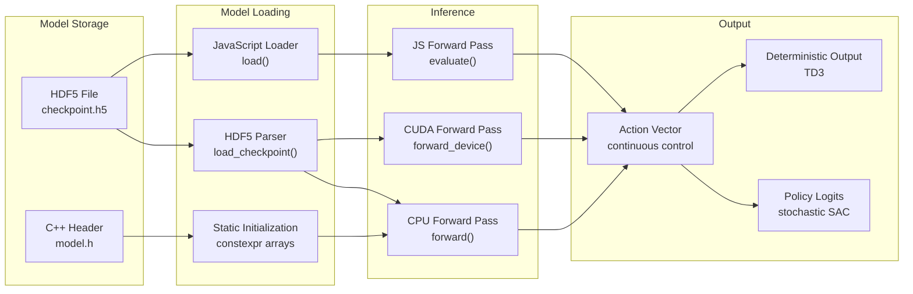

<!-- source: DeepWiki mcp.deepwiki.com · repo rl-tools/rl-tools · page 8 Deployment and Platforms · fetched 2026-10-30 -->

# Deployment and Platforms

<details>
<summary>Relevant source files</summary>

The following files were used as context for generating this wiki page:

- [include/rl_tools/rl/environments/l2f/parameters/dynamics/arpl.h](include/rl_tools/rl/environments/l2f/parameters/dynamics/arpl.h)
- [include/rl_tools/rl/environments/l2f/parameters/dynamics/soft.h](include/rl_tools/rl/environments/l2f/parameters/dynamics/soft.h)
- [include/rl_tools/rl/environments/l2f/parameters/dynamics/soft_rigid.h](include/rl_tools/rl/environments/l2f/parameters/dynamics/soft_rigid.h)
- [include/rl_tools/rl/environments/l2f/parameters/registry.h](include/rl_tools/rl/environments/l2f/parameters/registry.h)
- [static/rltools.js/.gitignore](static/rltools.js/.gitignore)
- [static/rltools.js/README.md](static/rltools.js/README.md)
- [static/rltools.js/main.js](static/rltools.js/main.js)

</details>


## Purpose and Scope

This document provides an overview of the deployment targets and platforms supported by rl_tools, covering the multi-backend architecture that enables the same trained models to run on CPUs, GPUs, embedded systems, and web browsers. The focus is on the high-level deployment workflow and platform-specific considerations.

For detailed information about specific deployment targets, see:
- **Embedded Platforms**: [8.1](#8.1) for PX4, Crazyflie, iOS, ESP32, and ARM Cortex systems
- **WebAssembly**: [8.2](#8.2) for browser-based deployment using rltools.js
- **Post-Training Evaluation**: [8.3](#8.3) for checkpoint testing and performance analysis
- **Model Export**: [8.4](#8.4) for code generation and model serialization formats

For information about the underlying device abstraction system, see [Core Concepts](#1.3). For model persistence formats, see [Model Persistence](#3.6).

---

## Deployment Architecture

rl_tools supports a diverse range of deployment targets through a unified device abstraction layer and flexible memory management system. The same neural network model trained on a CUDA GPU can be deployed to an embedded microcontroller, loaded in a web browser, or run on a CPU backend without modification to the model parameters.

### Multi-Platform Support Matrix

The following table summarizes the supported platforms and their key characteristics:

| Platform Category | Targets | Memory Model | Primary Use Case |
|------------------|---------|--------------|------------------|
| **CPU Backends** | Generic, MKL, Accelerate | Dynamic | Training and evaluation on workstations |
| **GPU Backends** | CUDA (cuBLAS) | Dynamic | Accelerated training on NVIDIA GPUs |
| **Embedded Systems** | ARM Cortex, ESP32 | Static | Real-time control on microcontrollers |
| **Autopilot Firmware** | PX4 (NuttX), Crazyflie (FreeRTOS) | Static | UAV flight control integration |
| **Mobile Devices** | iOS | Static/Dynamic | On-device inference |
| **Web Browsers** | WebAssembly | Dynamic | Interactive demonstrations and visualization |

Sources: [Diagram 4 - Multi-Backend Hardware Support]

### Deployment Pipeline Overview



**Diagram: Deployment Pipeline from Training to Target Platforms**

The deployment pipeline begins with training on a backend-optimized platform (typically CPU or CUDA), checkpointing the model in HDF5 format, and then exporting to target-specific representations. Dynamic memory targets (simulation, web browsers) can load HDF5 files directly, while static memory targets (embedded systems, autopilots) require compilation with statically-allocated model parameters.

Sources: [Diagram 6 - Post-Training and Deployment Workflow]

---

## Device Abstraction Layer

The device abstraction layer provides a uniform interface for operations across all platforms, enabling the same high-level algorithm code to run on different backends. This abstraction is implemented through template-based compile-time polymorphism rather than runtime virtual dispatch, avoiding performance overhead.

### Backend Selection and Compilation



**Diagram: Device Abstraction Layer Architecture**

All backends implement the same operations interface, allowing algorithm code to remain platform-agnostic. The `devices::cpu::Generic` backend provides a portable C++ implementation that serves as the foundation for embedded and WebAssembly targets.

Sources: [Diagram 4 - Multi-Backend Hardware Support]

---

## Memory Management Strategies

rl_tools supports two memory management strategies to accommodate different deployment constraints:

### Dynamic Memory Allocation

Used for training, evaluation, and platforms with sufficient memory resources (desktop CPUs, GPUs, mobile devices with large RAM). Memory is allocated at runtime using standard allocators.

**Characteristics:**
- Flexible buffer sizes
- Runtime memory allocation via `malloc()`
- Used during training and post-training evaluation
- Supports variable batch sizes

### Static Memory Allocation

Used for embedded systems and real-time control where heap allocation is prohibited or undesirable. All memory is allocated on the stack or as compile-time constants.

**Characteristics:**
- Compile-time memory allocation
- Enabled with `RL_TOOLS_STATIC_MEM` flag
- All buffer sizes specified as template parameters
- No heap allocation or dynamic memory
- Deterministic memory footprint

**Configuration:**

```
# CMake configuration for static memory
cmake -DRL_TOOLS_STATIC_MEM=ON ..
```

For detailed information about static memory configuration, see [Static vs Dynamic Memory Allocation](#6.3).

Sources: [Diagram 4 - Multi-Backend Hardware Support]

---

## Model Formats and Export

### HDF5 Checkpoint Format

The primary model serialization format is HDF5, which stores:
- Neural network layer parameters (weights, biases)
- Layer metadata (activation functions, dimensions)
- Observation normalization statistics (mean, precision)
- Example inputs and outputs for validation
- Training metadata (algorithm, environment, seed)

**HDF5 Structure:**
```
checkpoint.h5
├── actor/
│   ├── @type: "sequential"
│   ├── layers/
│   │   ├── 0/  (Standardize layer)
│   │   ├── 1/  (MLP)
│   │   └── 2/  (Sample & Squash)
│   └── ...
├── critic_1/
├── critic_2/
└── example/
    ├── input
    └── output
```

### JavaScript Model Format

For browser deployment, models are loaded from HDF5 files using the jsfive library, which parses HDF5 in JavaScript. The rltools.js library implements forward passes for all layer types in pure JavaScript.

**Loading Example:**
```javascript
import { load } from 'rltools.js';

// Load model from URL or ArrayBuffer
const model = await load('actor.h5');

// Evaluate on input
const output = model.evaluate(input);
```

Sources: [static/rltools.js/main.js:1-344]()

### C++ Static Array Export

For embedded deployment, models can be exported as C++ header files containing static `constexpr` arrays. This eliminates runtime file loading and enables compile-time optimization.

**Exported Structure:**
```cpp
namespace model_parameters {
    constexpr float layer_0_weights[INPUT_DIM][OUTPUT_DIM] = { /* ... */ };
    constexpr float layer_0_biases[OUTPUT_DIM] = { /* ... */ };
    // ...
}
```

For detailed export procedures, see [Model Export and Code Generation](#8.4).

Sources: [Diagram 6 - Post-Training and Deployment Workflow]

---

## Platform-Specific Considerations

### Embedded Systems

Embedded deployments typically require:
- **Static memory allocation**: All buffers pre-allocated at compile time
- **Fixed-point arithmetic**: Optional for platforms without FPU
- **Reduced precision**: Float16 or fixed-point for memory efficiency
- **RTOS integration**: Thread-safe operations for real-time systems

**Key Configuration:**
```cpp
// Static memory specification
template<typename T, typename TI, TI BATCH_SIZE>
struct StaticBufferSpec{
    using TYPE = T;
    using TI = TI;
    static constexpr TI BATCH_SIZE = BATCH_SIZE;
};
```

See [Embedded Platforms](#8.1) for platform-specific integration examples.

### WebAssembly

Browser deployment uses Emscripten to compile C++ to WebAssembly, but the rltools.js library provides a pure JavaScript implementation for broader compatibility:

**Implementation:**
- Layer types: `DenseLayer`, `GRULayer`, `StandardizeLayer`, `SampleAndSquashLayer`, `MLP`, `Sequential`
- Matrix operations via mathjs
- HDF5 parsing via jsfive
- Activation functions: IDENTITY, RELU, SIGMOID, TANH, FAST_TANH

See [WebAssembly and rltools.js](#8.2) for browser integration details.

Sources: [static/rltools.js/main.js:46-223]()

### Autopilot Firmware

Integration with autopilot systems (PX4, Crazyflie) requires:
- **RTOS compatibility**: FreeRTOS or NuttX integration
- **Low latency**: Sub-millisecond inference for control loops
- **Small footprint**: Limited flash and RAM
- **Hardware abstraction**: Standard sensor/actuator interfaces

Example drone models in the registry:
- `crazyflie`: Bitcraze Crazyflie 2.x parameters
- `arpl`: ARPL drone platform
- `x500_real`: PX4 X500 real hardware
- `x500_sim`: PX4 X500 simulation
- `soft`: Soft quadrotor
- `soft_rigid`: Soft-rigid hybrid
- `mrs`: MRS platform
- `fs_base`: FS base platform
- `flightmare`: Flightmare simulator

Sources: [include/rl_tools/rl/environments/l2f/parameters/registry.h:1-84]()

---

## Model Loading and Inference Pipeline

### Runtime Loading Pipeline



**Diagram: Model Loading and Inference Pipeline**

Different platforms use different loading mechanisms, but all converge to the same forward pass interface. Desktop and GPU platforms load HDF5 files at runtime, embedded systems use compile-time static initialization, and browsers parse HDF5 in JavaScript.

Sources: [static/rltools.js/main.js:312-342]()

---

## Integration with Training Systems

The deployment system integrates with the training pipeline through standardized checkpointing:

1. **Training Phase**: Algorithm (SAC/TD3/PPO) trains policy and critics on selected backend
2. **Checkpointing**: Periodic saves to HDF5 via `save_checkpoint()`
3. **Post-Training Evaluation**: Load checkpoints and test across multiple dynamics/seeds
4. **Export**: Convert to target-specific format (C++ headers, JavaScript)
5. **Deployment**: Integrate with target platform (embedded firmware, web app, simulation)

For algorithm-specific training procedures, see:
- [Soft Actor-Critic (SAC)](#2.1)
- [Twin Delayed DDPG (TD3)](#2.2)
- [Proximal Policy Optimization (PPO)](#2.3)

For training loop architecture, see [Training Loop Architecture](#2.4).

---

## Performance Considerations

### Backend Performance Characteristics

| Backend | Training Speed | Inference Latency | Memory Usage | Best For |
|---------|---------------|-------------------|--------------|----------|
| Generic CPU | Baseline (1x) | ~1-5ms | Moderate | Development, debugging |
| Intel MKL | 3-5x faster | ~0.5-2ms | Moderate | Production CPU training |
| CUDA | 10-50x faster | ~0.1-1ms | High | Large-scale training |
| ARM Cortex | N/A | ~5-20ms | Low | Real-time embedded control |
| WebAssembly | N/A | ~2-10ms | Moderate | Browser demos |

**Note**: Performance varies significantly based on network size, batch size, and hardware specifications.

For detailed benchmarks, see [Performance Benchmarks](#7.2).

---

## Summary

The rl_tools deployment architecture provides:

1. **Multi-Backend Support**: Unified API for CPU, CUDA, embedded, and web platforms
2. **Flexible Memory Management**: Dynamic allocation for training, static allocation for embedded
3. **Multiple Export Formats**: HDF5 for dynamic loading, C++ headers for static compilation, JavaScript for browsers
4. **Platform-Specific Optimizations**: Backend-specific implementations (MKL, cuBLAS) for performance
5. **Real-Time Capable**: Static memory and deterministic inference for embedded control
6. **Browser Compatible**: Pure JavaScript implementation for web deployment

The following child pages provide detailed information about specific deployment targets:
- [Embedded Platforms](#8.1): PX4, Crazyflie, iOS, ESP32 integration
- [WebAssembly and rltools.js](#8.2): Browser deployment implementation
- [Post-Training Evaluation](#8.3): Checkpoint testing and metrics
- [Model Export and Code Generation](#8.4): Export procedures and formats

Sources: [Diagram 1 - Overall System Architecture], [Diagram 4 - Multi-Backend Hardware Support], [Diagram 6 - Post-Training and Deployment Workflow], [include/rl_tools/rl/environments/l2f/parameters/dynamics/soft.h:1-117](), [include/rl_tools/rl/environments/l2f/parameters/dynamics/arpl.h:1-112](), [include/rl_tools/rl/environments/l2f/parameters/dynamics/soft_rigid.h:1-118]()

---

