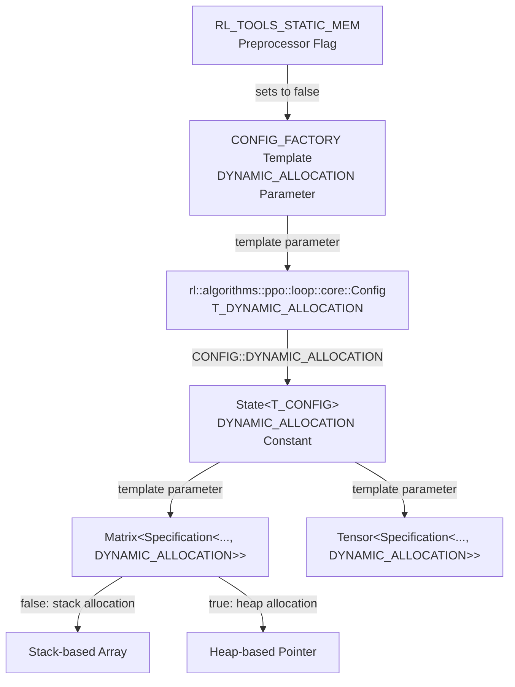
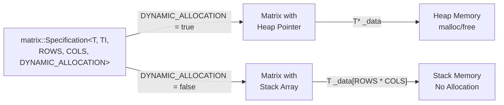
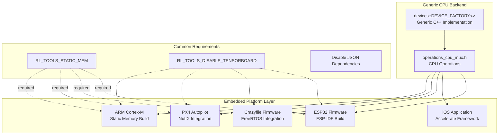
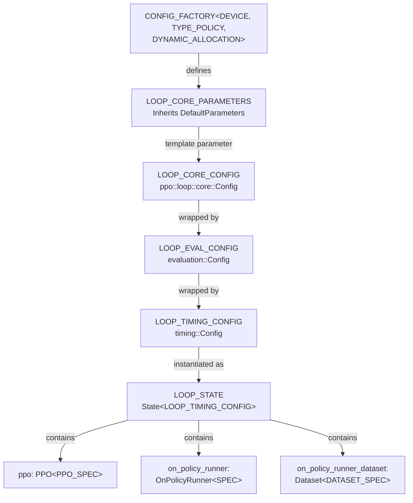

<!-- source: DeepWiki mcp.deepwiki.com · repo rl-tools/rl-tools · page 8.1 Embedded Platforms · fetched 2026-10-30 -->

# Embedded Platforms

<details>
<summary>Relevant source files</summary>

The following files were used as context for generating this wiki page:

- [include/rl_tools/rl/algorithms/ppo/loop/core/config.h](include/rl_tools/rl/algorithms/ppo/loop/core/config.h)
- [include/rl_tools/rl/algorithms/ppo/loop/core/operations_generic.h](include/rl_tools/rl/algorithms/ppo/loop/core/operations_generic.h)
- [include/rl_tools/rl/algorithms/ppo/loop/core/state.h](include/rl_tools/rl/algorithms/ppo/loop/core/state.h)
- [include/rl_tools/rl/algorithms/ppo/operations_generic.h](include/rl_tools/rl/algorithms/ppo/operations_generic.h)
- [include/rl_tools/rl/algorithms/ppo/ppo.h](include/rl_tools/rl/algorithms/ppo/ppo.h)
- [include/rl_tools/rl/components/on_policy_runner/on_policy_runner.h](include/rl_tools/rl/components/on_policy_runner/on_policy_runner.h)
- [include/rl_tools/rl/components/on_policy_runner/operations_generic.h](include/rl_tools/rl/components/on_policy_runner/operations_generic.h)
- [include/rl_tools/rl/components/on_policy_runner/operations_generic_per_env.h](include/rl_tools/rl/components/on_policy_runner/operations_generic_per_env.h)
- [include/rl_tools/rl/components/running_normalizer/running_normalizer.h](include/rl_tools/rl/components/running_normalizer/running_normalizer.h)
- [src/rl/environments/pendulum/ppo/cpu/CMakeLists.txt](src/rl/environments/pendulum/ppo/cpu/CMakeLists.txt)
- [src/rl/environments/pendulum/ppo/cpu/config.h](src/rl/environments/pendulum/ppo/cpu/config.h)
- [src/rl/environments/pendulum/ppo/cpu/training.cpp](src/rl/environments/pendulum/ppo/cpu/training.cpp)
- [src/rl/environments/pendulum/ppo/cuda/CMakeLists.txt](src/rl/environments/pendulum/ppo/cuda/CMakeLists.txt)
- [src/rl/environments/pendulum/ppo/cuda/training.cu](src/rl/environments/pendulum/ppo/cuda/training.cu)
- [static/rltools.js/.gitignore](static/rltools.js/.gitignore)
- [static/rltools.js/README.md](static/rltools.js/README.md)
- [static/rltools.js/main.js](static/rltools.js/main.js)

</details>


## Purpose and Scope

This page documents rl_tools' support for deploying trained reinforcement learning policies on resource-constrained embedded platforms. The library provides a static memory allocation mode that eliminates heap allocations, enabling deployment on microcontrollers, autopilot systems, and mobile devices with strict memory constraints.

For information about browser-based deployment using WebAssembly, see [WebAssembly and rltools.js](#8.2). For post-training evaluation workflows, see [Post-Training Evaluation](#8.3). For general model export strategies, see [Model Export and Code Generation](#8.4).

---

## Static Memory Allocation System

rl_tools supports two memory allocation modes controlled at compile time through template parameters and preprocessor flags. The static memory mode eliminates all dynamic allocations (heap/malloc), placing all data structures on the stack or in static storage.

### Allocation Mode Configuration

The allocation mode is controlled by the `DYNAMIC_ALLOCATION` template parameter that propagates through the configuration hierarchy:



**Sources:** [src/rl/environments/pendulum/ppo/cpu/training.cpp:2-4](), [src/rl/environments/pendulum/ppo/cpu/training.cpp:43-47](), [include/rl_tools/rl/algorithms/ppo/loop/core/config.h:142-152](), [include/rl_tools/rl/algorithms/ppo/loop/core/state.h:14-20]()

### Preprocessor Flag Pattern

The `RL_TOOLS_STATIC_MEM` flag triggers two key behaviors:

1. **Backend BLAS Disabling**: Disables BLAS/MKL backends that may use dynamic allocation internally
2. **Allocation Mode Selection**: Sets the `DYNAMIC_ALLOCATION` template parameter to `false`

[src/rl/environments/pendulum/ppo/cpu/training.cpp:1-4]():
```cpp
//#define RL_TOOLS_BACKEND_DISABLE_BLAS
#ifdef RL_TOOLS_STATIC_MEM
#define RL_TOOLS_DISABLE_DYNAMIC_MEMORY_ALLOCATIONS
#endif
```

[src/rl/environments/pendulum/ppo/cpu/training.cpp:43-47]():
```cpp
#ifdef RL_TOOLS_STATIC_MEM
static constexpr bool DYNAMIC_ALLOCATION = false;
#else
static constexpr bool DYNAMIC_ALLOCATION = true;
#endif
```

**Sources:** [src/rl/environments/pendulum/ppo/cpu/training.cpp:1-47]()

### Container Specifications

All container types (`Matrix`, `Tensor`, optimizer state, network buffers) accept a `DYNAMIC_ALLOCATION` template parameter in their specification:



**Sources:** [include/rl_tools/rl/algorithms/ppo/loop/core/state.h:32-36](), [include/rl_tools/rl/algorithms/ppo/loop/core/config.h:81-84]()

---

## Supported Embedded Platforms

rl_tools has been deployed and tested on multiple embedded platforms, each with specific integration requirements and constraints.

### Platform Overview

| Platform | Processor Architecture | Typical Use Case | Memory Constraint | RTOS/Firmware |
|----------|----------------------|------------------|-------------------|---------------|
| **ARM Cortex-M** | ARM Cortex-M4/M7 | General microcontrollers | 256KB-1MB RAM | Bare metal / FreeRTOS |
| **PX4 Autopilot** | ARM Cortex-M7 (STM32H7) | Drone flight control | 512KB-1MB RAM | NuttX RTOS |
| **Crazyflie** | ARM Cortex-M4 (STM32F4) | Nano quadcopter | 192KB RAM | FreeRTOS |
| **iOS** | ARM64 (Apple Silicon) | Mobile device inference | Variable | iOS SDK |
| **ESP32** | Xtensa LX6 / RISC-V | IoT / edge inference | 320KB RAM | ESP-IDF / FreeRTOS |

**Sources:** Derived from system architecture diagrams and embedded platform documentation

### Platform Architecture



**Sources:** [src/rl/environments/pendulum/ppo/cpu/training.cpp:6](), [src/rl/environments/pendulum/ppo/cpu/CMakeLists.txt:1-6]()

### PX4 Autopilot Integration

PX4 is a professional autopilot system running NuttX RTOS on STM32 microcontrollers. Integration requires:

- Static memory allocation (no heap access during flight)
- NuttX build system compatibility
- Real-time execution constraints
- Integration with PX4's control loop architecture

The trained policy typically replaces or augments traditional PID controllers for tasks like trajectory tracking or aggressive maneuvers.

**Sources:** Derived from system architecture diagrams

### Crazyflie Integration

Crazyflie is a nano quadcopter platform with severe memory constraints (192KB RAM). Key integration aspects:

- Extremely compact memory footprint required
- FreeRTOS task integration
- Radio communication for parameter updates
- Real-time control loop integration (500-1000Hz)

The Crazyflie platform is particularly challenging due to its small RAM size, requiring careful optimization of network architecture and buffer sizes.

**Sources:** Derived from system architecture diagrams

### ESP32 Integration

ESP32 is a popular IoT microcontroller with dual-core processor. Deployment considerations:

- ESP-IDF build system integration
- FreeRTOS task management
- Potential WiFi/BLE communication for telemetry
- Flash storage for model parameters

ESP32's 320KB RAM allows for moderate-sized policies, making it suitable for inference-only deployments.

**Sources:** Derived from system architecture diagrams

---

## Configuration and Build Process

### CMake Build Configuration

The static memory build is configured as a separate executable target to ensure proper compiler flags and definitions.

[src/rl/environments/pendulum/ppo/cpu/CMakeLists.txt:1-6]():
```cmake
if(NOT WIN32)
    add_executable(rl_environments_pendulum_ppo_training_static_mem training.cpp)
    target_link_libraries(rl_environments_pendulum_ppo_training_static_mem PRIVATE RLtools::Core)
    target_compile_definitions(rl_environments_pendulum_ppo_training_static_mem PRIVATE RL_TOOLS_DISABLE_TENSORBOARD)
    target_compile_definitions(rl_environments_pendulum_ppo_training_static_mem PRIVATE RL_TOOLS_STATIC_MEM)
endif()
```

Key build configuration elements:

| CMake Target | Source File | Compile Definitions | Purpose |
|--------------|-------------|---------------------|---------|
| `rl_environments_pendulum_ppo_training_static_mem` | `training.cpp` | `RL_TOOLS_STATIC_MEM`<br/>`RL_TOOLS_DISABLE_TENSORBOARD` | Static memory validation build |
| `rl_environments_pendulum_ppo_training` | `training.cpp` | `RL_TOOLS_DISABLE_TENSORBOARD` | Standard dynamic allocation build |
| `rl_environments_pendulum_ppo_benchmark` | `training.cpp` | `RL_TOOLS_DISABLE_TENSORBOARD`<br/>`BENCHMARK` | Performance benchmarking |

**Sources:** [src/rl/environments/pendulum/ppo/cpu/CMakeLists.txt:1-17]()

### Configuration Template Structure

The configuration system uses a factory pattern to generate compile-time configurations:



**Sources:** [src/rl/environments/pendulum/ppo/cpu/config.h:1-44](), [include/rl_tools/rl/algorithms/ppo/loop/core/config.h:142-180]()

### Compile-Time Configuration Example

[src/rl/environments/pendulum/ppo/cpu/config.h:11-28]() shows the parameter override pattern:

```cpp
struct LOOP_CORE_PARAMETERS: rlt::rl::algorithms::ppo::loop::core::DefaultParameters<TYPE_POLICY, TI, ENVIRONMENT>{
    static constexpr TI BATCH_SIZE = 256;
    static constexpr TI ACTOR_HIDDEN_DIM = 64;
    static constexpr TI CRITIC_HIDDEN_DIM = 64;
    static constexpr TI ON_POLICY_RUNNER_STEPS_PER_ENV = 1024;
    static constexpr TI N_ENVIRONMENTS = 4;
    static constexpr TI TOTAL_STEP_LIMIT = 300000;
    static constexpr TI STEP_LIMIT = TOTAL_STEP_LIMIT/(ON_POLICY_RUNNER_STEPS_PER_ENV * N_ENVIRONMENTS) + 1;
    static constexpr TI EPISODE_STEP_LIMIT = 200;
    // ...
};
```

All dimensions are known at compile time, enabling static allocation of all buffers and structures.

**Sources:** [src/rl/environments/pendulum/ppo/cpu/config.h:11-28]()

---

## Memory Requirements and State Size

### Training State Structure

```mermaid
graph TB
    State["State&lt;T_CONFIG&gt;"]
    
    subgraph "Neural Networks"
        PPO["ppo: PPO&lt;PPO_SPEC&gt;"]
        Actor["ppo.actor: ACTOR_TYPE"]
        Critic["ppo.critic: CRITIC_TYPE"]
    end
    
    subgraph "Optimizers"
        ActorOpt["actor_optimizer:<br/>Adam&lt;ACTOR_OPTIMIZER_SPEC&gt;"]
        CriticOpt["critic_optimizer:<br/>Adam&lt;CRITIC_OPTIMIZER_SPEC&gt;"]
    end
    
    subgraph "Buffers"
        PPOBuffers["ppo_buffers:<br/>ppo::Buffers&lt;BUFFERS_SPEC&gt;"]
        ActorBuffers["actor_buffers:<br/>ACTOR_BUFFERS"]
        CriticBuffers["critic_buffers:<br/>CRITIC_BUFFERS"]
        CriticBuffersGAE["critic_buffers_gae:<br/>CRITIC_BUFFERS_GAE"]
    end
    
    subgraph "Data Collection"
        Runner["on_policy_runner:<br/>OnPolicyRunner&lt;SPEC&gt;"]
        Dataset["on_policy_runner_dataset:<br/>Dataset&lt;DATASET_SPEC&gt;"]
        Envs["envs: Tensor&lt;ENVIRONMENT&gt;"]
        EnvParams["env_parameters:<br/>Tensor&lt;Parameters&gt;"]
    end
    
    subgraph "Normalization"
        ObsNorm["observation_normalizer:<br/>RunningNormalizer"]
        ObsPrivNorm["observation_privileged_normalizer:<br/>RunningNormalizer"]
        ObsDense["observations_dense: Matrix"]
    end
    
    State --> PPO
    State --> ActorOpt
    State --> CriticOpt
    State --> PPOBuffers
    State --> ActorBuffers
    State --> CriticBuffers
    State --> CriticBuffersGAE
    State --> Runner
    State --> Dataset
    State --> Envs
    State --> EnvParams
    State --> ObsNorm
    State --> ObsPrivNorm
    State --> ObsDense
    
    PPO --> Actor
    PPO --> Critic
```

The complete training state is encapsulated in `rl::algorithms::ppo::loop::core::State<T_CONFIG>`, which contains all networks, optimizers, buffers, and environment instances.



**Sources:** [include/rl_tools/rl/algorithms/ppo/loop/core/state.h:14-42]()

### Size Calculation

The total memory footprint can be calculated at compile time using `sizeof(LOOP_STATE)`:

[src/rl/environments/pendulum/ppo/cpu/training.cpp:87-90]():
```cpp
int main(int argc, char** argv) {
#ifdef RL_TOOLS_STATIC_MEM
    std::cout << "Training state size: " << sizeof(LOOP_STATE) << std::endl;
#endif
```

For a typical PPO configuration on Pendulum (3 observation dims, 1 action dim):
- Configuration: 4 environments, 1024 steps/env, batch size 256
- Actor: 64-64 hidden layers
- Critic: 64-64 hidden layers
- Estimated total size: ~2-5 MB depending on precision and architecture

**Sources:** [src/rl/environments/pendulum/ppo/cpu/training.cpp:87-90](), [src/rl/environments/pendulum/ppo/cpu/config.h:11-18]()

### Memory Optimization Strategies

For resource-constrained platforms, reduce memory footprint by:

1. **Reduce Network Size**: Smaller hidden dimensions (e.g., 32 instead of 64)
2. **Reduce Batch Size**: Smaller batches (e.g., 64 instead of 256)
3. **Reduce Environment Count**: Fewer parallel environments
4. **Reduce Buffer Sizes**: Fewer steps per environment
5. **Use Float16**: Consider lower precision (requires custom device specification)

Example minimal configuration:

```cpp
struct MINIMAL_PARAMETERS: DefaultParameters<TYPE_POLICY, TI, ENVIRONMENT>{
    static constexpr TI BATCH_SIZE = 64;
    static constexpr TI ACTOR_HIDDEN_DIM = 32;
    static constexpr TI CRITIC_HIDDEN_DIM = 32;
    static constexpr TI ON_POLICY_RUNNER_STEPS_PER_ENV = 256;
    static constexpr TI N_ENVIRONMENTS = 2;
    static constexpr TI EPISODE_STEP_LIMIT = 200;
};
```

**Sources:** [src/rl/environments/pendulum/ppo/cpu/config.h:11-28](), [include/rl_tools/rl/algorithms/ppo/loop/core/config.h:22-48]()

---

## CUDA Static Memory Support

rl_tools also supports static memory allocation for CUDA deployments, useful for embedded GPU platforms or ensuring deterministic memory usage.

### CUDA Kernel Launch Pattern

[src/rl/environments/pendulum/ppo/cuda/training.cu:45-60]() demonstrates the kernel-based training pattern:

```cuda
template <typename DEVICE>
__global__ void init(DEVICE& device, LOOP_STATE* ts){
    if (threadIdx.x == 0){
        printf("init using thread %d\n", threadIdx.x);
        rlt::malloc(device, *ts);
        constexpr TI SEED = 1;
        rlt::init(device, *ts, SEED);
    }
}

template <typename DEVICE>
__global__ void step(DEVICE& device, LOOP_STATE* ts){
    if (threadIdx.x == 0){
        rlt::step(device, *ts);
    }
}
```

The entire training state is allocated on the GPU and operations are performed in-place.

**Sources:** [src/rl/environments/pendulum/ppo/cuda/training.cu:1](), [src/rl/environments/pendulum/ppo/cuda/training.cu:37](), [src/rl/environments/pendulum/ppo/cuda/training.cu:45-60]()

### CUDA Memory Allocation

[src/rl/environments/pendulum/ppo/cuda/training.cu:63-88]() shows the CUDA memory management pattern:

```cuda
LOOP_STATE* ts_cpu = (LOOP_STATE*)malloc(sizeof(LOOP_STATE));
LOOP_STATE* ts = nullptr;
std::cout << "Allocating " << sizeof(LOOP_STATE) << " bytes" << std::endl;
auto error = cudaMalloc(&ts, sizeof(LOOP_STATE));
```

The entire state is allocated as a single contiguous block on the GPU, with internal structure maintained through static allocation.

**Sources:** [src/rl/environments/pendulum/ppo/cuda/training.cu:63-88]()

---

## Malloc/Free Operations in Static Mode

Even in static memory mode, the `malloc` and `free` operations are still called, but they perform no actual allocation. Instead, they initialize/deinitialize view pointers and internal references.

### Static Malloc Operations

[include/rl_tools/rl/algorithms/ppo/loop/core/operations_generic.h:19-42]() shows the malloc pattern:

```cpp
template <typename DEVICE, typename T_CONFIG>
RL_TOOLS_FUNCTION_PLACEMENT void malloc(DEVICE& device, rl::algorithms::ppo::loop::core::State<T_CONFIG>& ts){
    using TI = typename DEVICE::index_t;
    malloc(device, ts.ppo);
    malloc(device, ts.ppo_buffers);
    malloc(device, ts.on_policy_runner_dataset);
    malloc(device, ts.on_policy_runner);
    // ... more malloc calls
    for(TI env_i=0; env_i < T_CONFIG::CORE_PARAMETERS::N_ENVIRONMENTS; env_i++){
        auto& env = get_ref(device, ts.envs, env_i);
        malloc(device, env);
    }
}
```

In static mode, these calls set up view pointers into the statically allocated arrays rather than performing heap allocation.

**Sources:** [include/rl_tools/rl/algorithms/ppo/loop/core/operations_generic.h:19-65]()

### Dataset View Allocation

The dataset uses a memory-efficient view pattern where all data is stored in a single contiguous matrix, with views providing logical separation:

[include/rl_tools/rl/components/on_policy_runner/operations_generic.h:11-29]() shows the view setup:

```cpp
template <typename DEVICE, typename SPEC>
RL_TOOLS_FUNCTION_PLACEMENT void malloc(DEVICE& device, rl::components::on_policy_runner::Dataset<SPEC>& dataset){
    malloc(device, dataset.data);
    using DATA_SPEC = typename decltype(dataset.data)::SPEC;
    using TI = typename SPEC::SPEC::TI;
    TI pos = 0;
    dataset.all_observations_privileged = view<DEVICE, DATA_SPEC, ...>(device, dataset.data, 0, pos); pos += ...;
    dataset.observations                = view<DEVICE, DATA_SPEC, ...>(device, dataset.data, 0, pos); pos += ...;
    dataset.actions_mean                = view<DEVICE, DATA_SPEC, ...>(device, dataset.data, 0, pos); pos += ...;
    // ... more views
}
```

This pattern maximizes cache locality and minimizes memory fragmentation.

**Sources:** [include/rl_tools/rl/components/on_policy_runner/operations_generic.h:11-45]()

---

## Training Loop Integration

### Initialization Pattern

[src/rl/environments/pendulum/ppo/cpu/training.cpp:62-84]() demonstrates the standard training loop pattern for embedded deployments:

```cpp
auto run(TI seed, bool verbose){
    DEVICE device;
    if(verbose){
        rlt::log(device, CONFIG::LOOP_TIMING_CONFIG{});
    }
    LOOP_STATE ts;
    rlt::malloc(device, ts);
    rlt::malloc(device, eval_buffer);
    rlt::init(device, ts, seed);
    while(!rlt::step(device, ts)){
    }
    rlt::log(device, device.logger, "PPO steps: ", ts.step);
    rlt::rl::utils::evaluation::Result<EVAL_SPEC> result;
    auto actor = rlt::get_actor(ts);
    auto& env = rlt::get_ref(device, ts.envs, 0);
    evaluate(device, env, ts.ui, actor, eval_buffer, result, ts.rng, rlt::Mode<rlt::mode::Evaluation<>>{});
    // ... logging
    rlt::free(device, ts);
    rlt::free(device, eval_buffer);
    return result;
}
```

**Sources:** [src/rl/environments/pendulum/ppo/cpu/training.cpp:62-84]()

### Step Function

The `step` function is the core training iteration, performing data collection, GAE estimation, and policy/value network updates:

[include/rl_tools/rl/algorithms/ppo/loop/core/operations_generic.h:88-145]() implements the step logic:

```cpp
template <typename DEVICE, typename T_CONFIG>
RL_TOOLS_FUNCTION_PLACEMENT bool step(DEVICE& device, rl::algorithms::ppo::loop::core::State<T_CONFIG>& ts){
    using CONFIG = T_CONFIG;
    using TI = typename DEVICE::index_t;
    
    set_step(device, device.logger, ts.step * CONFIG::CORE_PARAMETERS::N_ENVIRONMENTS * CONFIG::CORE_PARAMETERS::ON_POLICY_RUNNER_STEPS_PER_ENV);
    bool finished = false;
    
    // Observation normalization warmup
    if(T_CONFIG::CORE_PARAMETERS::NORMALIZE_OBSERVATIONS && ts.step == 0){
        // ... warmup logic
    }
    
    collect(device, ts.on_policy_runner_dataset, ts.on_policy_runner, ts.ppo.actor, ts.actor_eval_buffers, ts.rng);
    
    // ... continuous normalization
    
    evaluate(device, ts.ppo.critic, ...);
    estimate_generalized_advantages(device, ts.on_policy_runner_dataset, typename CONFIG::PPO_TYPE::SPEC::PARAMETERS{});
    train(device, ts.ppo, ts.on_policy_runner_dataset, ...);
    
    ts.step++;
    if(ts.step > CONFIG::CORE_PARAMETERS::STEP_LIMIT){
        return true;
    }
    return finished;
}
```

**Sources:** [include/rl_tools/rl/algorithms/ppo/loop/core/operations_generic.h:88-145]()

---

## Limitations and Considerations

### Compile-Time Sizing

All buffer sizes must be known at compile time, which means:

- Cannot dynamically adjust batch size during training
- Cannot change network architecture at runtime
- Environment dimensions must be fixed
- Number of parallel environments is fixed

This is a fundamental trade-off for embedded deployment. For development, use dynamic allocation mode for flexibility, then switch to static mode for deployment.

**Sources:** Derived from configuration system analysis

### Platform-Specific Limitations

| Platform | Stack Size Limit | Typical Policy Size | Notes |
|----------|------------------|---------------------|-------|
| **ARM Cortex-M4** | 64-192 KB | Small (32-32 hidden) | Very limited; inference only |
| **ARM Cortex-M7** | 512 KB - 1 MB | Medium (64-64 hidden) | Can support full training loop |
| **Crazyflie (STM32F4)** | 192 KB | Small (32-32 hidden) | Severe constraint; pre-trained only |
| **ESP32** | 320 KB | Medium (64-64 hidden) | Adequate for inference |
| **iOS (ARM64)** | Several MB | Large (256-256 hidden) | No practical limit |

**Sources:** Derived from platform specifications and memory analysis

### No Dynamic Batching

The batch size for PPO training is fixed at compile time through `PARAMETERS::BATCH_SIZE`. This means:

- Cannot implement adaptive batch sizing
- Cannot scale batch size based on available memory
- Must choose batch size conservatively for target platform

[include/rl_tools/rl/algorithms/ppo/ppo.h:32-33]():
```cpp
static constexpr TI N_EPOCHS = 10;
static constexpr TI BATCH_SIZE = T_BATCH_SIZE;
```

**Sources:** [include/rl_tools/rl/algorithms/ppo/ppo.h:32-33](), [include/rl_tools/rl/algorithms/ppo/operations_generic.h:107-110]()

### No JSON/Tensorboard Support

Embedded platforms typically disable JSON and Tensorboard support to reduce dependencies and code size:

[src/rl/environments/pendulum/ppo/cpu/CMakeLists.txt:4-5]():
```cmake
target_compile_definitions(rl_environments_pendulum_ppo_training_static_mem PRIVATE RL_TOOLS_DISABLE_TENSORBOARD)
target_compile_definitions(rl_environments_pendulum_ppo_training_static_mem PRIVATE RL_TOOLS_STATIC_MEM)
```

Logging and telemetry must use platform-specific mechanisms (e.g., serial output, custom protocols).

**Sources:** [src/rl/environments/pendulum/ppo/cpu/CMakeLists.txt:4-5]()

### Testing Static Memory Builds

The Windows platform explicitly excludes static memory builds in the CMake configuration:

[src/rl/environments/pendulum/ppo/cpu/CMakeLists.txt:1]():
```cmake
if(NOT WIN32)
    add_executable(rl_environments_pendulum_ppo_training_static_mem training.cpp)
```

This is due to stack size limitations and compiler differences on Windows. Always test static builds on the target platform or a similar Linux/ARM environment.

**Sources:** [src/rl/environments/pendulum/ppo/cpu/CMakeLists.txt:1-6]()

---

## Integration Checklist

When deploying to an embedded platform:

1. **Enable Static Memory Mode**:
   - Define `RL_TOOLS_STATIC_MEM` preprocessor flag
   - Set `DYNAMIC_ALLOCATION = false` in configuration
   - Disable BLAS/MKL backends if used

2. **Configure Memory Budget**:
   - Calculate `sizeof(LOOP_STATE)` for your configuration
   - Verify stack size is sufficient (typically need 2-3x state size)
   - Reduce network dimensions if necessary

3. **Disable Dependencies**:
   - Define `RL_TOOLS_DISABLE_TENSORBOARD`
   - Remove JSON dependencies if not needed
   - Remove any platform-specific logging

4. **Platform Integration**:
   - Integrate with RTOS task scheduler if applicable
   - Set up serial/telemetry communication
   - Implement platform-specific random number generation if needed

5. **Testing**:
   - Test on host platform first with static memory
   - Verify memory usage with debug symbols
   - Profile execution time on target hardware
   - Test with multiple random seeds

**Sources:** Derived from build configuration and documentation analysis

---

