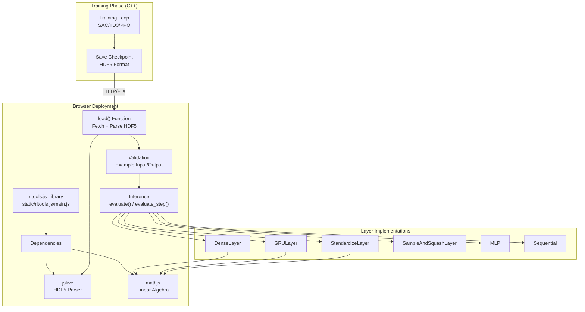
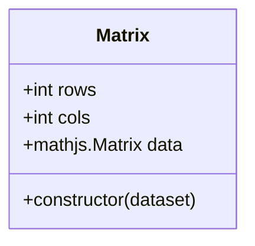
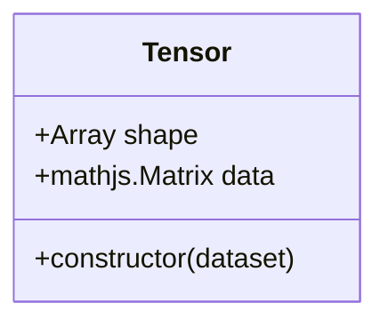
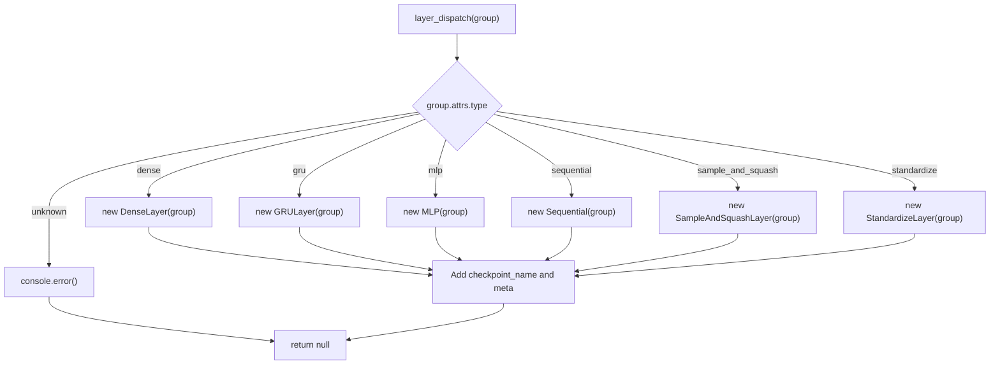
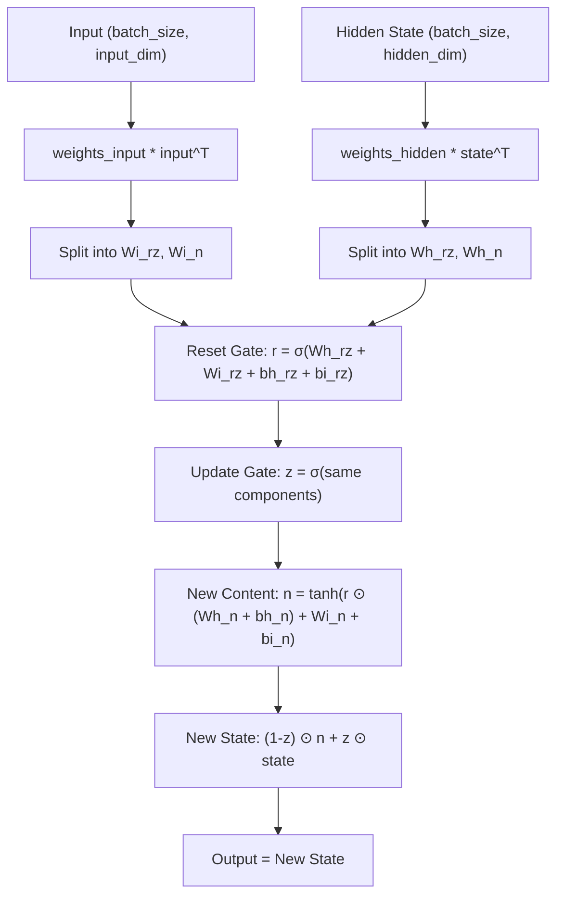
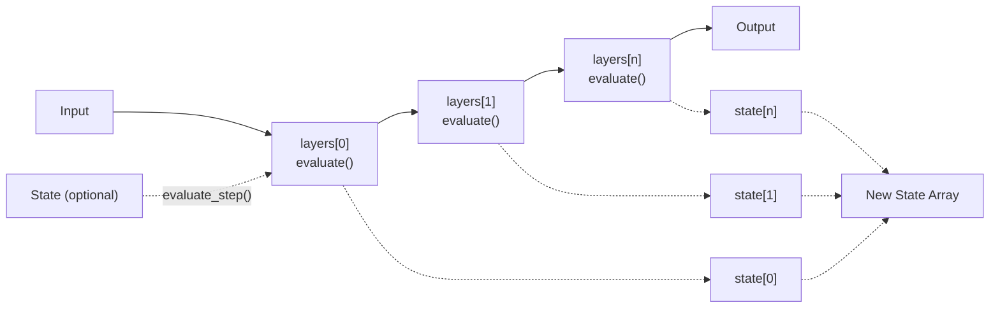
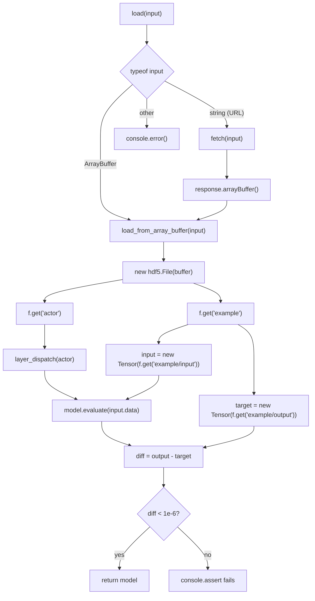
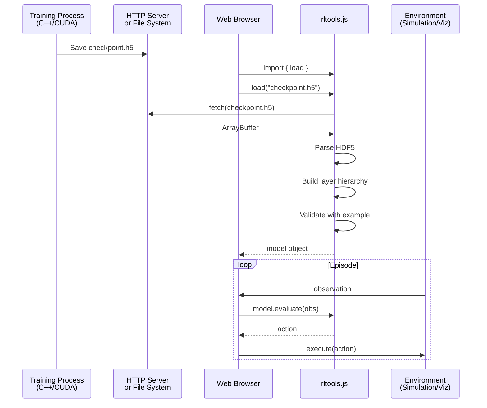

<!-- source: DeepWiki mcp.deepwiki.com · repo rl-tools/rl-tools · page 8.2 WebAssembly and rltools.js · fetched 2026-10-30 -->

# WebAssembly and rltools.js

<details>
<summary>Relevant source files</summary>

The following files were used as context for generating this wiki page:

- [static/rltools.js/.gitignore](static/rltools.js/.gitignore)
- [static/rltools.js/README.md](static/rltools.js/README.md)
- [static/rltools.js/main.js](static/rltools.js/main.js)

</details>


## Purpose and Scope

This document explains the **rltools.js** library, which enables browser-based deployment of trained reinforcement learning policies. The library provides a pure JavaScript implementation of neural network inference that can load models from HDF5 checkpoints and execute them in web browsers without requiring WebAssembly compilation of C++ code.

For information about model persistence and HDF5 checkpoint formats, see [Model Persistence](#3.6). For details on post-training evaluation workflows, see [Post-Training Evaluation](#8.3). For other deployment strategies including embedded platforms, see [Embedded Platforms](#8.1).

**Sources:** [static/rltools.js/main.js:1-344](), [Diagram 4: Multi-Backend Hardware Support](), [Diagram 6: Post-Training and Deployment Workflow]()

## Architecture Overview

The rltools.js library implements a JavaScript-based neural network inference engine that mirrors the layer structure of the main rl_tools C++ library. Rather than compiling C++ to WebAssembly, it provides native JavaScript implementations of all required neural network operations.



**rltools.js System Architecture**

The library consists of:
- **Data containers:** `Matrix` and `Tensor` classes wrapping mathjs arrays
- **Layer implementations:** JavaScript equivalents of C++ layer types
- **Model loaders:** HDF5 parsing and model construction
- **Inference engine:** Forward evaluation with optional state management

**Sources:** [static/rltools.js/main.js:1-11](), [static/rltools.js/main.js:312-342]()

## Dependencies and Core Data Structures

### External Dependencies

The library relies on two npm packages:

| Package | Purpose | Usage |
|---------|---------|-------|
| `jsfive` | HDF5 file parsing | Reads model checkpoints saved during training |
| `mathjs` | Linear algebra operations | Matrix multiplication, element-wise operations, reshaping |

**Sources:** [static/rltools.js/main.js:1-2]()

### Core Data Structures

#### Matrix Class

Wraps 2D arrays from HDF5 datasets:



The `Matrix` constructor extracts shape and data from HDF5 datasets, reshaping flat arrays into 2D matrices using mathjs.

**Sources:** [static/rltools.js/main.js:4-11]()

#### Tensor Class

Wraps multi-dimensional arrays from HDF5 datasets:



The `Tensor` class handles arbitrary-dimensional arrays, commonly used for GRU weights and observation standardization parameters.

**Sources:** [static/rltools.js/main.js:13-19]()

## Layer Implementations

### Layer Type Dispatch

The `layer_dispatch()` function maps HDF5 group types to JavaScript layer classes:



**Layer Dispatch Logic**

**Sources:** [static/rltools.js/main.js:275-310]()

### DenseLayer

Implements fully-connected layers with configurable activation functions:

| Property | Type | Description |
|----------|------|-------------|
| `weights` | `Matrix/Tensor` | Weight matrix (output_dim × input_dim) |
| `biases` | `Matrix/Tensor` | Bias vector (output_dim) |
| `activation_function_name` | `string` | "IDENTITY", "RELU", "SIGMOID", "TANH", "FAST_TANH" |
| `input_shape` | `Array` | [null, null, input_dim] |
| `output_shape` | `Array` | [null, null, output_dim] |

**Activation Functions:**
- **IDENTITY:** Pass-through [static/rltools.js/main.js:59-60]()
- **RELU:** `max(0, x)` [static/rltools.js/main.js:62-63]()
- **SIGMOID:** `1 / (1 + exp(-x))` [static/rltools.js/main.js:65-66]()
- **TANH:** Standard hyperbolic tangent [static/rltools.js/main.js:68-69]()
- **FAST_TANH:** Rational approximation `x * (27 + x²) / (27 + 9x²)` clamped to [-3, 3] [static/rltools.js/main.js:71-80]()

**Forward Pass Logic:**
1. Reshape input to 2D if needed [static/rltools.js/main.js:86-88]()
2. Compute `output = weights * input^T` [static/rltools.js/main.js:95]()
3. Add biases: `output = output^T + biases` [static/rltools.js/main.js:96]()
4. Apply activation function [static/rltools.js/main.js:97]()
5. Reshape to original batch dimensions [static/rltools.js/main.js:90-92]()

**Sources:** [static/rltools.js/main.js:46-100]()

### GRULayer

Implements Gated Recurrent Unit layers with hidden state management:



**GRU Forward Pass**

**Key Properties:**
- `weights_hidden`: (3 × hidden_dim) × hidden_dim tensor for reset, update, and new gates
- `weights_input`: (3 × hidden_dim) × input_dim tensor
- `initial_hidden_state`: Default hidden state for batch initialization
- Supports both single-step (`evaluate_step`) and sequential (`evaluate`) evaluation

**Sources:** [static/rltools.js/main.js:102-165]()

### StandardizeLayer

Normalizes observations using pre-computed mean and precision (inverse standard deviation):

**Operation:** `output = (input - mean) ⊙ precision`

This layer is commonly used at the beginning of actor networks to normalize environment observations based on statistics collected during training.

**Sources:** [static/rltools.js/main.js:21-44]()

### SampleAndSquashLayer

Extracts mean from stochastic policy distributions and applies tanh squashing:

**Operation:**
1. Extract first half of input dimensions (mean of Gaussian distribution)
2. Apply `tanh()` to squash to [-1, 1] range

This layer is used in SAC policies to convert from unbounded Gaussian samples to bounded action spaces. In deterministic inference mode, only the mean is used (no sampling).

**Sources:** [static/rltools.js/main.js:166-190]()

### MLP (Multi-Layer Perceptron)

Combines multiple dense layers into a feedforward network:

| Component | Type | Description |
|-----------|------|-------------|
| `input_layer` | `DenseLayer` | First layer |
| `hidden_layers` | `Array<DenseLayer>` | Middle layers (may be empty) |
| `output_layer` | `DenseLayer` | Final layer |

The MLP class handles loading of layers from different HDF5 naming conventions (legacy `hidden_layer_0` vs. grouped `hidden_layers/0`).

**Sources:** [static/rltools.js/main.js:191-223]()

### Sequential

Chains multiple layers (including MLPs and stateful layers like GRU) into a composite model:



**Sequential Layer Composition**

**Key Methods:**
- `reset()`: Initializes state for all layers [static/rltools.js/main.js:237-241]()
- `evaluate(input)`: Stateless forward pass [static/rltools.js/main.js:242-251]()
- `evaluate_step(input, state)`: Stateful forward pass for recurrent models [static/rltools.js/main.js:252-271]()

**Sources:** [static/rltools.js/main.js:225-272]()

## Model Loading Process

### Load Function

The primary API is the `load()` function, which accepts either a URL string or `ArrayBuffer`:



**Model Loading and Validation Workflow**

**Sources:** [static/rltools.js/main.js:312-342]()

### Validation Mechanism

Every saved HDF5 checkpoint includes an `example` group containing:
- `example/input`: Sample input tensor
- `example/output`: Expected output from C++ implementation

The loader validates that the JavaScript implementation produces outputs within 1e-6 tolerance of the C++ version. This ensures numerical consistency across implementations.

**Sources:** [static/rltools.js/main.js:315-324]()

## Inference Execution

### Stateless Inference

For feedforward networks (MLP, Dense layers only):

```javascript
// Load model
const model = await load("model_checkpoint.h5");

// Prepare input (mathjs matrix)
const observation = math.matrix([[1.2, -0.5, 0.3]]);

// Execute forward pass
const action = model.evaluate(observation);
```

The `evaluate()` method handles automatic reshaping for batch dimensions and returns actions in the same format as the C++ implementation.

**Sources:** [static/rltools.js/main.js:242-251]()

### Stateful Inference

For recurrent networks (containing GRU layers):

```javascript
// Load model and reset state
const model = await load("recurrent_model.h5");
let state = model.reset();

// Sequential processing
for (let step = 0; step < episode_length; step++) {
    const observation = get_observation(step);
    const [action, new_state] = model.evaluate_step(observation, state);
    state = new_state;
    execute_action(action);
}
```

The `evaluate_step()` method propagates hidden states through recurrent layers while treating feedforward layers as stateless.

**Sources:** [static/rltools.js/main.js:252-271]()

## Integration with Training Pipeline

### Checkpoint Creation

During training in C++, checkpoints are saved in HDF5 format with the following structure:

```
checkpoint.h5
├── actor/                  # Actor network structure
│   ├── @type              # "sequential", "mlp", etc.
│   ├── layers/            # For Sequential models
│   │   ├── 0/            # First layer
│   │   │   ├── @type     # "standardize", "dense", etc.
│   │   │   └── parameters/
│   │   └── 1/            # Second layer
│   └── ...
├── example/               # Validation data
│   ├── input/            # Sample input tensor
│   └── output/           # Expected output tensor
└── ...
```

For details on HDF5 structure and saving, see [Model Persistence](#3.6).

**Sources:** [static/rltools.js/main.js:313-316]()

### Layer Type Mapping

| C++ Type | JavaScript Class | Notes |
|----------|-----------------|-------|
| `nn::layers::dense::Layer` | `DenseLayer` | Direct mapping |
| `nn::layers::gru::Layer` | `GRULayer` | Supports stateful evaluation |
| `nn::layers::standardize::Layer` | `StandardizeLayer` | Uses mean/precision from training |
| `nn::layers::sample_and_squash::Layer` | `SampleAndSquashLayer` | Deterministic mode (mean only) |
| `nn_models::mlp::NeuralNetwork` | `MLP` | Composite of dense layers |
| `nn_models::sequential::Model` | `Sequential` | Arbitrary layer composition |

**Sources:** [static/rltools.js/main.js:275-298]()

## Usage Workflow

### Typical Deployment Scenario



**Browser Deployment Workflow**

**Sources:** [static/rltools.js/main.js:327-342](), [Diagram 6: Post-Training and Deployment Workflow]()

### Example: Pendulum Policy Visualization

A typical browser-based visualization application:

1. **Load trained policy:**
   - Fetch HDF5 checkpoint from server
   - Construct actor network using `load()`
   
2. **Initialize environment:**
   - Set up HTML5 Canvas or WebGL renderer
   - Initialize pendulum state (angle, angular velocity)

3. **Run control loop:**
   - Compute observation vector from state
   - Call `model.evaluate(observation)` to get action
   - Integrate dynamics to update state
   - Render current state
   - Repeat at ~60 FPS

4. **Interactive features:**
   - Allow user to perturb pendulum
   - Visualize policy behavior in real-time
   - No server-side computation required

**Sources:** [static/rltools.js/main.js:242-251]()

## Performance Considerations

### Computational Characteristics

| Operation | Implementation | Performance Notes |
|-----------|---------------|-------------------|
| Matrix multiplication | `mathjs.multiply()` | Uses JavaScript, not WebAssembly; suitable for small networks |
| Element-wise ops | `mathjs.map()`, `mathjs.dotMultiply()` | Efficient for moderate dimensions |
| Reshaping | `mathjs.reshape()` | Minimal overhead, view-based |
| Activation functions | Native JavaScript Math | Fast for standard functions (tanh, sigmoid) |

### Scaling Limitations

The pure JavaScript implementation is suitable for:
- **Network sizes:** Up to ~1000 parameters typical for L2F/Pendulum policies
- **Inference frequency:** Real-time control at 60+ Hz for small networks
- **Batch sizes:** Single observations or small batches (<10)

For larger networks or higher throughput, consider:
- Compiling C++ rl_tools to WebAssembly (future work)
- Server-side inference with WebSocket communication
- GPU acceleration via WebGL/WebGPU (not currently implemented)

**Sources:** [static/rltools.js/main.js:1-344]()

## Library Distribution

The rltools.js library is distributed as an npm package:

```json
{
  "name": "rltools.js",
  "dependencies": {
    "jsfive": "^version",
    "mathjs": "^version"
  }
}
```

**Installation:**
```bash
npm install rltools.js
```

**Sources:** [static/rltools.js/README.md:1-3](), [static/rltools.js/.gitignore:1-2]()

## Future Extensions

Potential enhancements to the browser deployment system:

1. **WebAssembly backend:** Compile C++ rl_tools device implementations to WASM for performance
2. **WebGPU integration:** GPU acceleration for larger networks
3. **Model quantization:** Int8/Int16 inference for reduced bandwidth
4. **Streaming inference:** Progressive loading for large models
5. **Service Worker caching:** Offline-capable policy deployment

For alternative deployment strategies, see [Embedded Platforms](#8.1) and [Model Export and Code Generation](#8.4).

**Sources:** [Diagram 4: Multi-Backend Hardware Support](), [Diagram 6: Post-Training and Deployment Workflow]()

---

