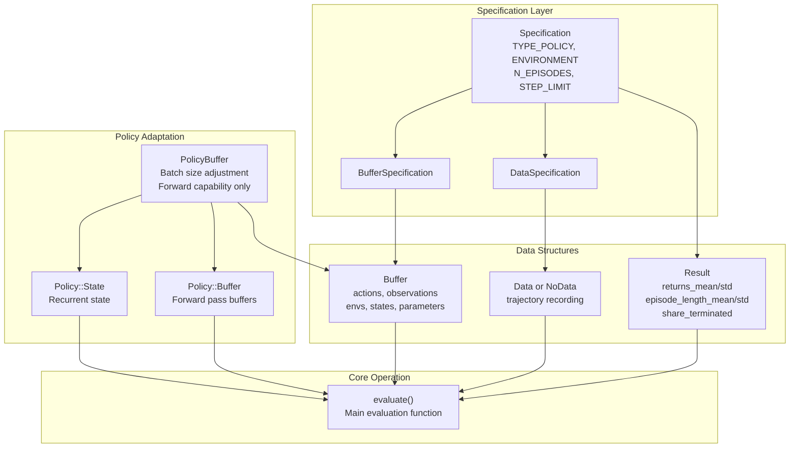
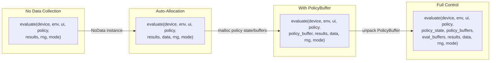
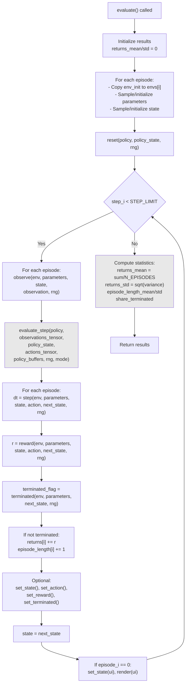
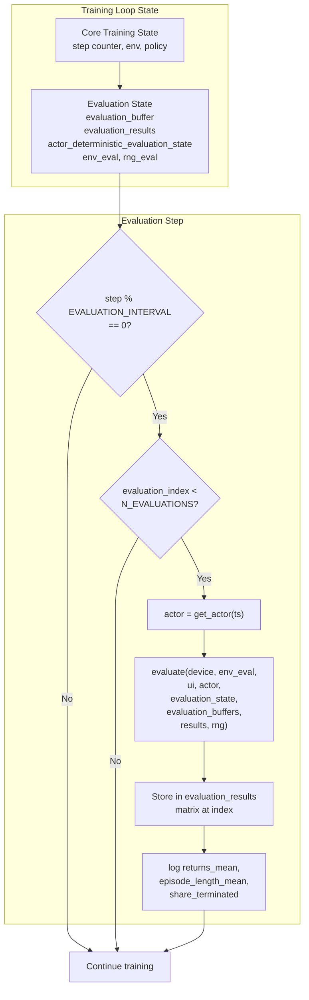
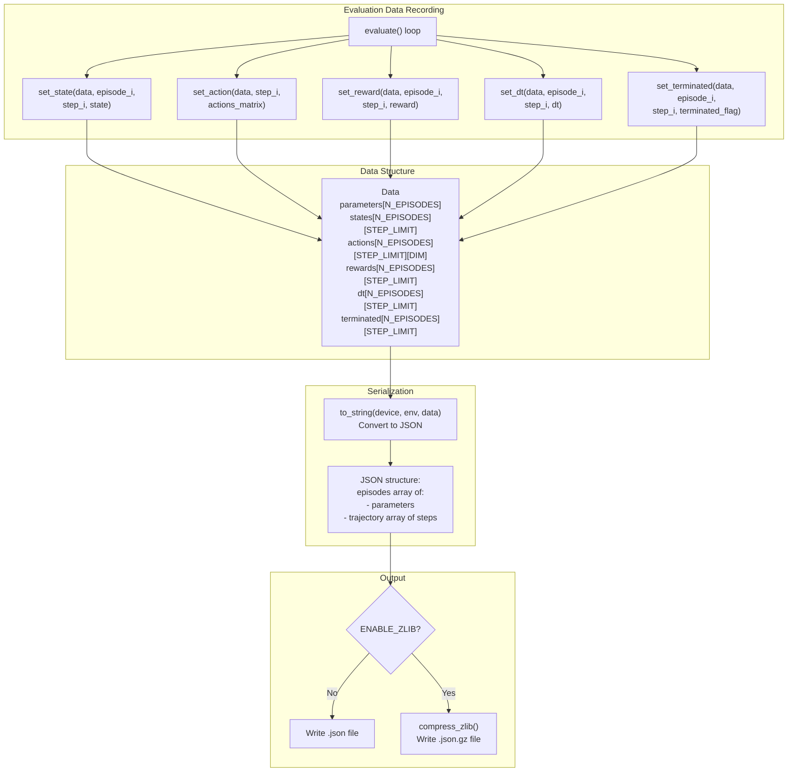

<!-- source: DeepWiki mcp.deepwiki.com · repo rl-tools/rl-tools · page 8.3 Post-Training Evaluation · fetched 2026-10-30 -->

# Post-Training Evaluation

<details>
<summary>Relevant source files</summary>

The following files were used as context for generating this wiki page:

- [include/rl_tools/rl/environments/l2f/parameters/dynamics/arpl.h](include/rl_tools/rl/environments/l2f/parameters/dynamics/arpl.h)
- [include/rl_tools/rl/environments/l2f/parameters/dynamics/soft.h](include/rl_tools/rl/environments/l2f/parameters/dynamics/soft.h)
- [include/rl_tools/rl/environments/l2f/parameters/dynamics/soft_rigid.h](include/rl_tools/rl/environments/l2f/parameters/dynamics/soft_rigid.h)
- [include/rl_tools/rl/environments/l2f/parameters/registry.h](include/rl_tools/rl/environments/l2f/parameters/registry.h)
- [include/rl_tools/rl/loop/steps/evaluation/config.h](include/rl_tools/rl/loop/steps/evaluation/config.h)
- [include/rl_tools/rl/loop/steps/evaluation/operations_generic.h](include/rl_tools/rl/loop/steps/evaluation/operations_generic.h)
- [include/rl_tools/rl/loop/steps/evaluation/state.h](include/rl_tools/rl/loop/steps/evaluation/state.h)
- [include/rl_tools/rl/loop/steps/save_trajectories/config.h](include/rl_tools/rl/loop/steps/save_trajectories/config.h)
- [include/rl_tools/rl/loop/steps/save_trajectories/operations_cpu.h](include/rl_tools/rl/loop/steps/save_trajectories/operations_cpu.h)
- [include/rl_tools/rl/loop/steps/save_trajectories/state.h](include/rl_tools/rl/loop/steps/save_trajectories/state.h)
- [include/rl_tools/rl/utils/evaluation/evaluation.h](include/rl_tools/rl/utils/evaluation/evaluation.h)
- [include/rl_tools/rl/utils/evaluation/operations_generic.h](include/rl_tools/rl/utils/evaluation/operations_generic.h)

</details>


## Purpose and Scope

This document describes the post-training evaluation system in RL Tools, which provides utilities for testing trained policies across multiple episodes, collecting detailed performance metrics, and optionally saving complete trajectory data. Post-training evaluation is used both during training (for periodic checkpointing and monitoring) and after training (for final performance assessment and deployment validation).

For information about model persistence and checkpoint formats, see [Model Persistence](#3.6). For details on training loop integration, see [Training Loop Architecture](#2.4). For deployment-specific evaluation on embedded platforms, see [Embedded Platforms](#8.1).

## Overview

The evaluation system is built around a generic `evaluate()` function that executes a policy on an environment across multiple episodes, collecting statistics on returns, episode lengths, and termination rates. The system supports both deterministic and stochastic evaluation modes, can collect detailed trajectory data for visualization, and integrates seamlessly with the training loop for periodic assessment.

**Key Features:**
- Multi-episode evaluation with configurable episode counts and step limits
- Statistical metrics: mean/std of returns and episode lengths, termination rates
- Optional trajectory data collection (states, actions, rewards, timesteps)
- Support for domain randomization via environment parameter sampling
- Deterministic or stochastic policy evaluation modes
- Integration with training loop for periodic checkpointing

**Sources:** [include/rl_tools/rl/utils/evaluation/operations_generic.h:1-275](), [Diagram 6: Post-Training and Deployment Workflow]()

## Core Data Structures

### Evaluation Specification

The evaluation system uses a specification pattern to configure evaluation runs:

```cpp
template <typename TYPE_POLICY, typename TI, typename ENVIRONMENT, 
          TI N_EPISODES, TI STEP_LIMIT, bool DETERMINISTIC_INITIAL_STATE>
struct Specification
```

**Key Parameters:**
| Parameter | Description |
|-----------|-------------|
| `TYPE_POLICY` | Policy type to evaluate (scalar type specification) |
| `ENVIRONMENT` | Environment type with state/action/observation definitions |
| `N_EPISODES` | Number of parallel episodes to run |
| `STEP_LIMIT` | Maximum steps per episode |
| `DETERMINISTIC_INITIAL_STATE` | Whether to use fixed initial states |

**Sources:** [include/rl_tools/rl/utils/evaluation/evaluation.h:19-28]()

### Result Structure

The `Result` structure accumulates statistics across all evaluation episodes:

| Field | Type | Description |
|-------|------|-------------|
| `returns[N_EPISODES]` | `T[]` | Individual episode returns |
| `returns_mean` | `T` | Mean return across episodes |
| `returns_std` | `T` | Standard deviation of returns |
| `episode_length[N_EPISODES]` | `TI[]` | Steps taken per episode |
| `episode_length_mean` | `T` | Mean episode length |
| `episode_length_std` | `T` | Standard deviation of episode length |
| `num_terminated` | `TI` | Count of episodes that terminated |
| `share_terminated` | `T` | Fraction of episodes terminated (0-1) |

**Sources:** [include/rl_tools/rl/utils/evaluation/evaluation.h:51-66]()

### Buffer and Data Structures

The evaluation system uses two main buffer types:

**Buffer** - Temporary storage for policy evaluation:
- `actions`: Matrix storing policy outputs for all episodes
- `observations`: Matrix storing environment observations
- `envs`: Tensor of environment instances (one per episode)
- `states`: Tensor of environment states
- `parameters`: Tensor of environment parameters (for domain randomization)

**Data** - Optional trajectory recording:
- `parameters`: Environment parameters per episode
- `terminated`: Termination flags per step and episode
- `rewards`: Rewards received per step
- `states`: Full state history
- `actions`: Action history
- `dt`: Timesteps per step (for variable-timestep environments)

The `Data` structure can be replaced with `NoData` to disable trajectory recording for memory efficiency.

**Sources:** [include/rl_tools/rl/utils/evaluation/evaluation.h:68-84](), [include/rl_tools/rl/utils/evaluation/evaluation.h:34-47]()

## Evaluation Architecture

### Component Hierarchy



**Sources:** [include/rl_tools/rl/utils/evaluation/evaluation.h:1-106](), [include/rl_tools/rl/utils/evaluation/operations_generic.h:16-67]()

### Evaluation Function Signatures

The evaluation system provides multiple overloads for different use cases:



**Sources:** [include/rl_tools/rl/utils/evaluation/operations_generic.h:113-270]()

## Evaluation Process Workflow

### Main Evaluation Loop



**Sources:** [include/rl_tools/rl/utils/evaluation/operations_generic.h:113-234]()

### Key Implementation Details

**Parallel Episode Execution:**
The evaluation runs `N_EPISODES` episodes in parallel within a single loop. Each episode maintains its own environment instance, state, and parameters. This enables efficient batch policy evaluation where the policy processes all observations simultaneously.

**Termination Handling:**
Once an episode terminates, it stops accumulating rewards and episode length, but the loop continues until all episodes complete or reach `STEP_LIMIT`. The `terminated` array tracks which episodes have finished.

**Statistics Computation:**
After all episodes complete, the function computes:
- Mean: `sum(returns) / N_EPISODES`
- Variance: `sum(returns^2) / N_EPISODES - mean^2`
- Standard deviation: `sqrt(max(0, variance))` (clamped to prevent numerical issues)

**Sources:** [include/rl_tools/rl/utils/evaluation/operations_generic.h:139-234]()

## Integration with Training Loop

### Periodic Evaluation Step

The evaluation system integrates with the training loop through the `rl::loop::steps::evaluation` module:



**Configuration Parameters:**

| Parameter | Description | Default |
|-----------|-------------|---------|
| `EVALUATION_INTERVAL` | Steps between evaluations | 1000 |
| `NUM_EVALUATION_EPISODES` | Episodes per evaluation | 10 |
| `N_EVALUATIONS` | Pre-allocated result slots | `STEP_LIMIT / INTERVAL + 1` |
| `EVALUATION_MODE` | Policy mode (deterministic) | `mode::Evaluation<>` |

**Sources:** [include/rl_tools/rl/loop/steps/evaluation/operations_generic.h:56-95](), [include/rl_tools/rl/loop/steps/evaluation/config.h:13-24]()

### On-Demand Evaluation

The training loop also supports on-demand evaluation via the `evaluate_this_step` flag:

```cpp
// In training state
ts.evaluate_this_step = true;  // Trigger evaluation on next step
```

When this flag is set, evaluation runs using a separate RNG (`rng_eval_on_demand`) and doesn't store results in the pre-allocated matrix. This is useful for checkpoint saving or user-initiated evaluation requests.

**Sources:** [include/rl_tools/rl/loop/steps/evaluation/operations_generic.h:64-90](), [include/rl_tools/rl/loop/steps/evaluation/state.h:28]()

## Trajectory Saving

### Data Collection System

The trajectory saving system captures complete episode data for offline analysis and visualization:



**Sources:** [include/rl_tools/rl/loop/steps/save_trajectories/operations_cpu.h:53-119](), [include/rl_tools/rl/utils/evaluation/operations_generic.h:69-111]()

### JSON Trajectory Format

The trajectory JSON has the following structure:

```
[
  {
    "parameters": <environment-specific JSON>,
    "trajectory": [
      {
        "state": <environment-specific JSON>,
        "action": [action_0, action_1, ..., action_n],
        "dt": timestep_value,
        "reward": reward_value,
        "terminated": true/false
      },
      ...
    ]
  },
  ...
]
```

Environment-specific serialization is handled by `json(device, env, parameters)` and `json(device, env, parameters, state)` functions that each environment must implement.

**Sources:** [include/rl_tools/rl/loop/steps/save_trajectories/operations_cpu.h:54-92]()

### Trajectory Saving Step

The training loop integrates trajectory saving through the `rl::loop::steps::save_trajectories` module:

| Configuration | Description | Default |
|---------------|-------------|---------|
| `INTERVAL` | Steps between trajectory saves | 1000 |
| `NUM_EPISODES` | Episodes to save | 10 |
| `SAVE_TRAJECTORIES` | Enable/disable feature | true |
| `DETERMINISTIC_INITIAL_STATE` | Fixed initial states | false |

Trajectories are saved to: `{seed}/steps/{step:015d}/trajectories.json[.gz]`

Additionally, the first time trajectories are saved, the system exports:
- `ui.esm.js`: Environment visualization code (if available)
- `description.txt`: Environment description

These files enable browser-based replay using the rltools.js library.

**Sources:** [include/rl_tools/rl/loop/steps/save_trajectories/operations_cpu.h:124-174](), [include/rl_tools/rl/loop/steps/save_trajectories/config.h:14-23]()

## Configuration and Modes

### Evaluation Modes

The evaluation system supports different policy evaluation modes through the `Mode` parameter:

**mode::Evaluation<>:**
- Deterministic action selection for most policies
- No exploration noise
- Suitable for performance assessment

**mode::Rollout<>:**
- Stochastic action selection (samples from policy distribution)
- With exploration noise
- Used during training data collection

**Sources:** [include/rl_tools/rl/loop/steps/evaluation/config.h:21]()

### Initial State Configuration

The `DETERMINISTIC_INITIAL_STATE` flag controls episode initialization:

**Deterministic (true):**
```cpp
initial_parameters(device, env, parameters);
initial_state(device, env, parameters, state);
```

**Stochastic (false):**
```cpp
sample_initial_parameters(device, env, parameters, rng);
sample_initial_state(device, env, parameters, state, rng);
```

For environments with domain randomization (like L2F), stochastic initialization samples different environment dynamics (mass, inertia, thrust coefficients) across episodes to assess policy robustness.

**Sources:** [include/rl_tools/rl/utils/evaluation/operations_generic.h:148-156](), [include/rl_tools/rl/loop/steps/evaluation/config.h:22-23]()

### Static vs Dynamic Allocation

The evaluation system supports both allocation modes:

**Dynamic Allocation (`DYNAMIC_ALLOCATION = true`):**
- Buffers allocated with `malloc(device, buffer)`
- Suitable for training and post-training analysis
- Used in most scenarios

**Static Allocation (`DYNAMIC_ALLOCATION = false`):**
- All buffers declared on stack
- Required for embedded deployment
- Must specify all sizes at compile time

**Sources:** [include/rl_tools/rl/utils/evaluation/evaluation.h:29-33](), [include/rl_tools/rl/utils/evaluation/evaluation.h:67-71]()

## Usage Patterns

### Simple Post-Training Evaluation

```cpp
// Load policy from checkpoint (see Model Persistence #3.6)
// Setup environment and evaluation parameters

using EVAL_SPEC = rl::utils::evaluation::Specification<
    TYPE_POLICY, TI, ENVIRONMENT, 
    10,    // N_EPISODES
    1000,  // STEP_LIMIT
    false  // DETERMINISTIC_INITIAL_STATE
>;

rl::utils::evaluation::Result<EVAL_SPEC> results;
evaluate(device, env, ui, policy, results, rng, mode::Evaluation<>{});

std::cout << "Mean return: " << results.returns_mean << std::endl;
std::cout << "Std return: " << results.returns_std << std::endl;
```

### Evaluation with Trajectory Recording

```cpp
using EVAL_SPEC = rl::utils::evaluation::Specification<...>;
using DATA_SPEC = rl::utils::evaluation::DataSpecification<EVAL_SPEC>;

rl::utils::evaluation::Data<DATA_SPEC> data;
rl::utils::evaluation::Result<EVAL_SPEC> results;

malloc(device, data);
evaluate(device, env, ui, policy, results, data, rng, mode::Evaluation<>{});

// Serialize and save
std::string json = rl::loop::steps::save_trajectories::to_string(device, env, data);
rl::loop::steps::save_trajectories::write_to_file(device, json, output_dir, "trajectories");

free(device, data);
```

### Multi-Dynamics Evaluation (L2F)

For environments with domain randomization, evaluate across multiple dynamics models:

```cpp
// Test across 9 different multirotor dynamics
for (auto dynamics_model : {
    REGISTRY::crazyflie,
    REGISTRY::mrs,
    REGISTRY::x500_real,
    REGISTRY::x500_sim,
    REGISTRY::arpl,
    // ... etc
}) {
    auto dynamics = dynamics::registry<dynamics_model, SPEC>;
    environment.parameters.dynamics = dynamics;
    
    evaluate(device, environment, ui, policy, results, rng, mode::Evaluation<>{});
    
    std::cout << dynamics::registry_name<dynamics_model> 
              << " mean return: " << results.returns_mean << std::endl;
}
```

**Sources:** [include/rl_tools/rl/environments/l2f/parameters/registry.h:20-54]()

## Performance Considerations

**Batch Size Optimization:**
The evaluation system adjusts policy batch size to match `N_EPISODES` for efficient parallel execution:
```cpp
using ADJUSTED_POLICY = typename POLICY::template CHANGE_BATCH_SIZE<TI, N_EPISODES>;
```
This enables single forward pass for all episodes simultaneously.

**Memory vs Performance Trade-offs:**
- Higher `N_EPISODES`: Better statistical estimates, more memory, slower evaluation
- Higher `STEP_LIMIT`: Captures longer episodes, more memory
- Trajectory recording (`Data` vs `NoData`): Full replay capability vs memory efficiency

**UI Rendering:**
Only the first episode (`env_i == 0`) triggers UI rendering to avoid performance overhead:
```cpp
if(env_i == 0 && !terminated[env_i]){
    set_state(device, env, env_parameters, ui, state, action);
    render(device, env, env_parameters, ui);
}
```

**Sources:** [include/rl_tools/rl/utils/evaluation/operations_generic.h:132](), [include/rl_tools/rl/utils/evaluation/operations_generic.h:186-189]()

---

