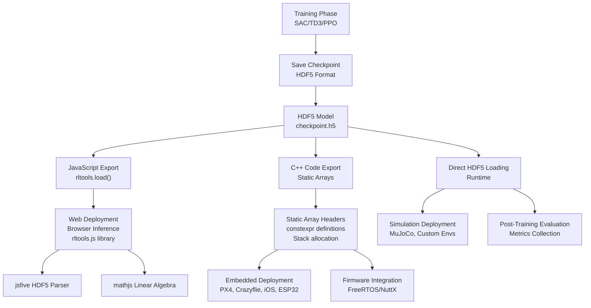
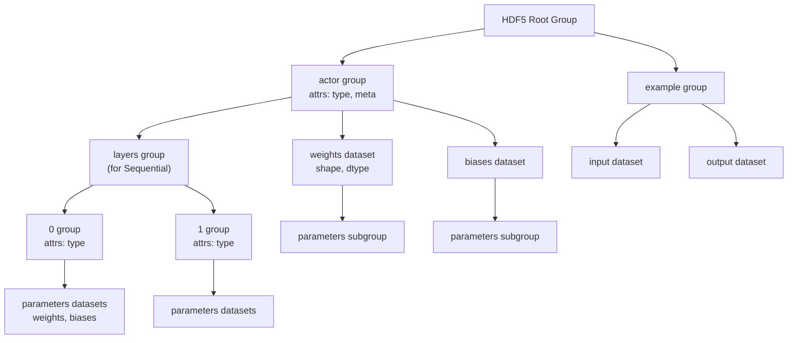
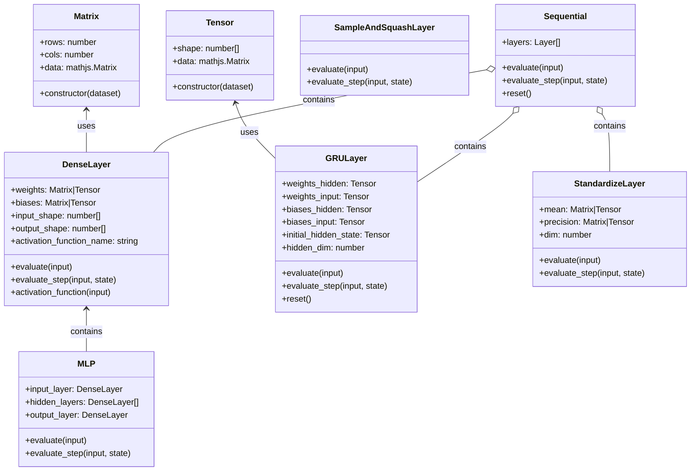
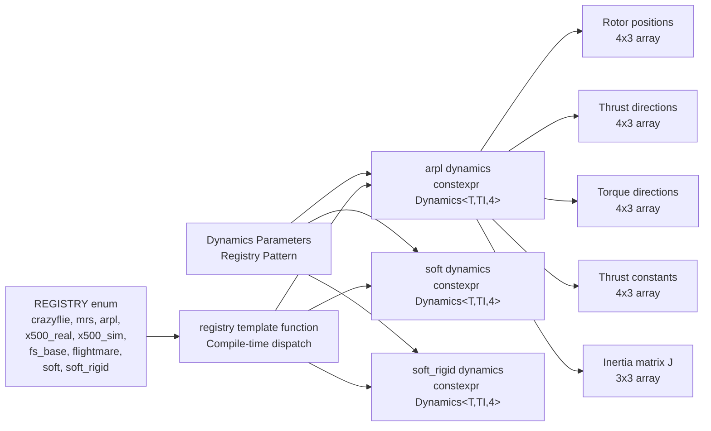
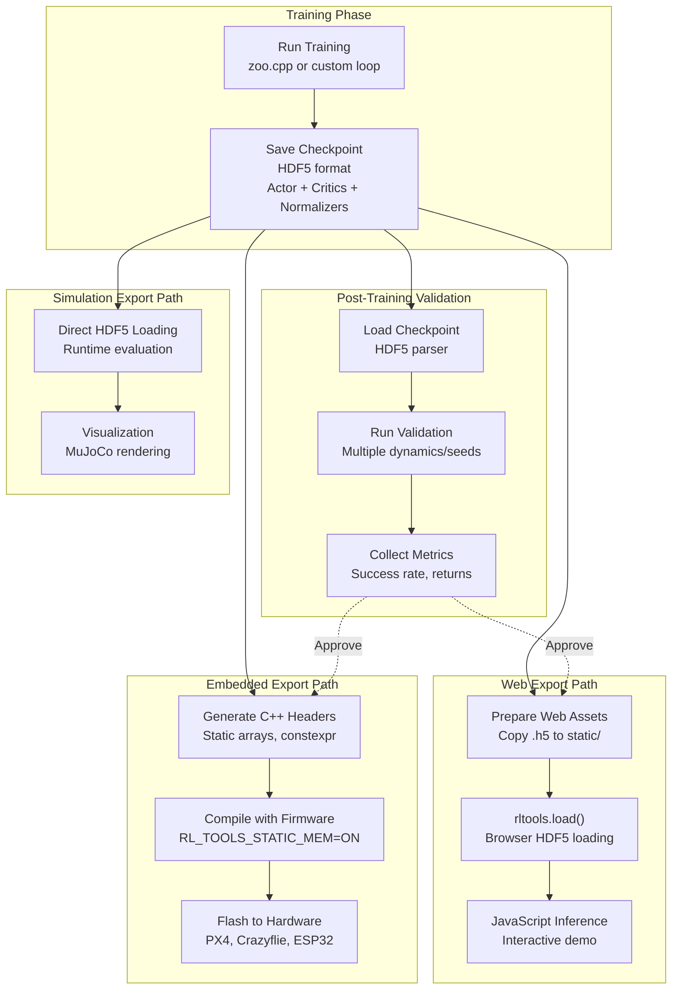

<!-- source: DeepWiki mcp.deepwiki.com · repo rl-tools/rl-tools · page 8.4 Model Export and Code Generation · fetched 2026-10-30 -->

# Model Export and Code Generation

<details>
<summary>Relevant source files</summary>

The following files were used as context for generating this wiki page:

- [include/rl_tools/rl/environments/l2f/parameters/dynamics/arpl.h](include/rl_tools/rl/environments/l2f/parameters/dynamics/arpl.h)
- [include/rl_tools/rl/environments/l2f/parameters/dynamics/soft.h](include/rl_tools/rl/environments/l2f/parameters/dynamics/soft.h)
- [include/rl_tools/rl/environments/l2f/parameters/dynamics/soft_rigid.h](include/rl_tools/rl/environments/l2f/parameters/dynamics/soft_rigid.h)
- [include/rl_tools/rl/environments/l2f/parameters/registry.h](include/rl_tools/rl/environments/l2f/parameters/registry.h)
- [static/rltools.js/.gitignore](static/rltools.js/.gitignore)
- [static/rltools.js/README.md](static/rltools.js/README.md)
- [static/rltools.js/main.js](static/rltools.js/main.js)

</details>


## Purpose and Scope

This page explains the model export and code generation capabilities in RL Tools, which enable trained models to be deployed across diverse target platforms. After training completes (see [Training Loop Architecture](#2.4)) and post-training evaluation is performed (see [Post-Training Evaluation](#8.3)), models must be converted into formats suitable for different deployment targets: web browsers via WebAssembly (see [WebAssembly and rltools.js](#8.2)), embedded platforms with limited resources (see [Embedded Platforms](#8.1)), and simulation environments. This page covers the HDF5 checkpoint format, JavaScript export for browser-based inference, C++ static array generation for embedded systems, and integration patterns for each target platform.

## Export Formats Overview

RL Tools supports multiple export formats optimized for different deployment scenarios:

| Export Format | Target Platform | Key Features | Use Case |
|--------------|-----------------|--------------|----------|
| **HDF5** | All platforms | Hierarchical structure, preserves metadata | Canonical checkpoint format, development/testing |
| **JavaScript (rltools.js)** | Web browsers | Dynamic loading, jsfive parser, mathjs operations | Interactive demos, web-based inference |
| **C++ Static Arrays** | Embedded systems | Compile-time constants, zero heap allocation | Resource-constrained hardware (PX4, Crazyflie, ESP32) |
| **C++ Dynamic Loading** | Desktop/Server | Runtime HDF5 loading | Simulation, evaluation, research |



**Sources:** [static/rltools.js/main.js:1-344](), Diagram 6 from high-level architecture

## HDF5 Model Format

HDF5 serves as the canonical checkpoint format in RL Tools. Models are saved with a hierarchical structure that preserves network architecture, parameters, and metadata. The HDF5 format stores:

**Model Structure:**
- **Network hierarchy**: Organized as HDF5 groups representing layers and modules
- **Parameter arrays**: Weight matrices, biases, and layer-specific parameters stored as datasets
- **Metadata attributes**: Layer types, activation functions, dimensions, checkpoint names
- **Example inputs/outputs**: For validation during loading

**Hierarchical Organization:**


**Key Attributes:**
- `type`: Identifies layer class (`"dense"`, `"gru"`, `"mlp"`, `"sequential"`, `"sample_and_squash"`, `"standardize"`)
- `activation_function`: Specifies activation (`"RELU"`, `"TANH"`, `"FAST_TANH"`, `"SIGMOID"`, `"IDENTITY"`)
- `checkpoint_name`: Optional identifier for the checkpoint
- `meta`: JSON-encoded metadata string

**Sources:** [static/rltools.js/main.js:275-310](), [include/rl_tools/nn/persist.h]() (implied from rltools.js structure)

## JavaScript Export and rltools.js

The rltools.js library enables browser-based model inference by loading HDF5 checkpoints directly in JavaScript. The library implements a complete neural network inference engine that mirrors the C++ implementation.

### Loading Models

The `load()` function provides the primary API for loading models:

```javascript
// Load from URL
rltools.load("path/to/model.h5").then(model => {
    // Use model
});

// Load from ArrayBuffer
const arrayBuffer = // ... obtained from file upload or fetch
const model = rltools.load(arrayBuffer);
```

**Sources:** [static/rltools.js/main.js:327-342]()

### Layer Implementations

rltools.js implements all standard layer types with `evaluate()` and `evaluate_step()` methods:



**Layer Dispatch Pattern:**

The `layer_dispatch()` function instantiates the appropriate layer class based on the HDF5 group's `type` attribute:

| Type Attribute | JavaScript Class | Description |
|----------------|------------------|-------------|
| `"dense"` | `DenseLayer` | Fully connected layer with activation |
| `"gru"` | `GRULayer` | Gated Recurrent Unit recurrent layer |
| `"mlp"` | `MLP` | Multi-layer perceptron (input, hidden, output layers) |
| `"sequential"` | `Sequential` | Container for sequential layer composition |
| `"sample_and_squash"` | `SampleAndSquashLayer` | SAC policy output layer |
| `"standardize"` | `StandardizeLayer` | Observation normalization layer |

**Sources:** [static/rltools.js/main.js:275-310]()

### Activation Functions

DenseLayer supports multiple activation functions matching the C++ implementation:

**Implemented Activations:**
- **IDENTITY**: Pass-through, no transformation
- **RELU**: `max(0, x)`
- **SIGMOID**: `1 / (1 + exp(-x))`
- **TANH**: Standard hyperbolic tangent
- **FAST_TANH**: Polynomial approximation for performance: `x * (27 + x²) / (27 + 9x²)` with clamping to `[-3, 3]`

**Sources:** [static/rltools.js/main.js:58-85]()

### Validation and Error Checking

The `load_from_array_buffer()` function validates loaded models by:
1. Loading example input/output datasets from the HDF5 file
2. Running forward pass with the example input
3. Computing element-wise absolute difference
4. Asserting that average difference is below `1e-6`

**Sources:** [static/rltools.js/main.js:312-325]()

### Dependencies

rltools.js relies on two external libraries:
- **jsfive**: HDF5 parser for JavaScript, enables reading `.h5` files in the browser
- **mathjs**: Linear algebra operations (matrix multiplication, transpose, element-wise operations)

**Sources:** [static/rltools.js/main.js:1-2]()

## C++ Code Generation for Embedded Deployment

For embedded platforms with constrained resources, RL Tools can export models as C++ header files containing static arrays. This approach enables:
- **Zero runtime allocation**: All data stored in read-only memory (ROM) or stack
- **Compile-time constants**: Enables aggressive compiler optimizations
- **Minimal binary size**: No HDF5 library dependency required
- **Fast startup**: No file I/O or parsing overhead

### Static Array Export Format

Dynamics parameters in the L2F environment demonstrate the static constant pattern used for exported models:



**Parameter Structure Example:**

The ARPL dynamics model shows the pattern for static constant definitions:

| Parameter | Type | Example Values | Purpose |
|-----------|------|----------------|---------|
| Rotor positions | `T[4][3]` | `{0.0775, -0.0981, 0}` | Spatial configuration of rotors |
| Thrust directions | `T[4][3]` | `{0, 0, 1}` | Thrust vector directions |
| Torque directions | `T[4][3]` | `{0, 0, -1}` | Torque vector directions |
| Thrust constants | `T[4][3]` | Polynomial coefficients | Thrust curve parameterization |
| Torque constants | `T[4]` | `0.005964552` | Torque generation coefficients |
| Mass | `T` | `0.782` | Vehicle mass in kg |
| Inertia matrix J | `T[3][3]` | Diagonal matrix | Moment of inertia tensor |
| J_inv | `T[3][3]` | Inverse of J | Pre-computed for efficiency |

**Sources:** [include/rl_tools/rl/environments/l2f/parameters/dynamics/arpl.h:1-112]()

### Registry Pattern for Model Selection

The dynamics registry demonstrates compile-time model selection, a pattern applicable to neural network export:

**Enum Registry:**
```cpp
enum class REGISTRY{
    crazyflie,
    mrs,
    x500_real,
    x500_sim,
    arpl,
    fs_base,
    flightmare,
    soft,
    soft_rigid,
};
```

**Template Dispatch Function:**
The `registry<MODEL, SPEC>` template uses `if constexpr` for compile-time selection, enabling the compiler to eliminate unused models from the binary.

**Sources:** [include/rl_tools/rl/environments/l2f/parameters/registry.h:20-54]()

### Benefits for Embedded Deployment

**Memory Efficiency:**
- Static arrays stored in ROM/flash, not RAM
- No heap fragmentation from dynamic allocation
- Predictable memory footprint for real-time systems

**Performance:**
- No runtime parsing overhead
- Compiler can optimize access patterns
- Cache-friendly contiguous memory layout

**Integration:**
- Header-only, no external dependencies
- Compatible with FreeRTOS, NuttX, bare-metal
- Works with `RL_TOOLS_STATIC_MEM` flag (see [Static vs Dynamic Memory Allocation](#6.3))

**Sources:** [include/rl_tools/rl/environments/l2f/parameters/dynamics/soft.h:1-117](), [include/rl_tools/rl/environments/l2f/parameters/dynamics/soft_rigid.h:1-118]()

## Export Workflow and Integration

### Complete Export Pipeline



### Platform-Specific Integration

**Web Platform (rltools.js):**
1. Host HDF5 file on web server or include in bundle
2. Load model asynchronously using `rltools.load(url)`
3. Call `model.evaluate(input)` for forward pass
4. Use mathjs for preprocessing/postprocessing

**Embedded Platform (Static Arrays):**
1. Export model to C++ header using code generation tool
2. Include header in firmware project
3. Configure build with `RL_TOOLS_STATIC_MEM=ON`
4. Instantiate model from constexpr definitions
5. Call forward pass using stack-allocated buffers

**Simulation Platform (Direct Loading):**
1. Load checkpoint using HDF5 C++ library
2. Instantiate network architecture
3. Copy parameters from checkpoint to network
4. Run inference with environment observations

**Sources:** [static/rltools.js/main.js:327-342](), [include/rl_tools/rl/environments/l2f/parameters/registry.h:1-84]()

## Model Metadata and Versioning

### Checkpoint Metadata

Models can store additional metadata in HDF5 attributes:
- **checkpoint_name**: Human-readable identifier
- **meta**: JSON-encoded metadata string with arbitrary fields
- **type**: Layer/model type identifier
- **activation_function**: Activation function name

The JavaScript loader preserves this metadata:

**Metadata Access Pattern:**
```javascript
// Loaded model preserves metadata
model.checkpoint_name  // e.g., "episode_1000"
model.meta            // Parsed JSON object
```

**Sources:** [static/rltools.js/main.js:299-309]()

### Version Compatibility

Both JavaScript and C++ implementations must maintain:
- **Layer type compatibility**: Matching type strings between exporter and loader
- **Parameter layout compatibility**: Consistent weight/bias ordering
- **Activation function compatibility**: Same activation implementations
- **Dimension compatibility**: Matching input/output shapes

The example validation in `load_from_array_buffer()` ensures compatibility by checking that the loaded model produces outputs matching the saved example to within `1e-6` tolerance.

**Sources:** [static/rltools.js/main.js:312-325]()