# Page: Overview

# Overview

<details>
<summary>Relevant source files</summary>

The following files were used as context for generating this wiki page:

- [include/rl_tools/devices/cpu.h](include/rl_tools/devices/cpu.h)
- [include/rl_tools/random/operations_cpu.h](include/rl_tools/random/operations_cpu.h)
- [include/rl_tools/rl/environments/pendulum/ui_xeus.h](include/rl_tools/rl/environments/pendulum/ui_xeus.h)
- [include/rl_tools/rl/loop/steps/extrack/operations_cpu.h](include/rl_tools/rl/loop/steps/extrack/operations_cpu.h)
- [include/rl_tools/rl/loop/steps/extrack/state.h](include/rl_tools/rl/loop/steps/extrack/state.h)
- [src/rl/environments/l2f/dr_sac/CMakeLists.txt](src/rl/environments/l2f/dr_sac/CMakeLists.txt)
- [src/rl/environments/l2f/dr_sac/l2f_dr_sac.cpp](src/rl/environments/l2f/dr_sac/l2f_dr_sac.cpp)
- [src/rl/zoo/CMakeLists.txt](src/rl/zoo/CMakeLists.txt)
- [src/rl/zoo/l2f/environment_tiny.h](src/rl/zoo/l2f/environment_tiny.h)
- [src/rl/zoo/l2f/plot_learning_curves.py](src/rl/zoo/l2f/plot_learning_curves.py)
- [src/rl/zoo/l2f/sac.h](src/rl/zoo/l2f/sac.h)
- [src/rl/zoo/l2f/sac_tiny.h](src/rl/zoo/l2f/sac_tiny.h)
- [src/rl/zoo/zoo.cpp](src/rl/zoo/zoo.cpp)
- [src/rl/zoo/zoo_cli.cpp](src/rl/zoo/zoo_cli.cpp)

</details>


## Purpose and Scope

This document provides a high-level introduction to **RLtools** (rl_tools), a header-only C++ reinforcement learning library designed for cross-platform deployment from high-performance servers to resource-constrained embedded systems. It explains the library's architecture, supported algorithms and environments, and deployment targets.

For step-by-step instructions on building and running experiments, see [Getting Started](#1.1). For detailed architectural concepts such as the device abstraction layer and template-based design patterns, see [Architecture Overview](#1.2) and [Core Concepts](#1.3).

---

## What is RLtools?

RLtools is a header-only C++ library that implements modern reinforcement learning algorithms with a focus on:

- **Multi-backend execution**: Seamless switching between CPU (generic/MKL/Accelerate), CUDA GPU, and embedded platforms
- **Zero-dependency core**: The library core requires only C++17, with optional dependencies for specific backends
- **Static memory allocation**: Support for stack-only allocation enabling deployment to microcontrollers (ARM Cortex, ESP32, etc.)
- **Cross-platform training and deployment**: Train on GPU/CPU, deploy to browsers (WebAssembly), autopilots (PX4), or drones (Crazyflie)

The library implements three production-ready RL algorithms—**SAC** (Soft Actor-Critic), **TD3** (Twin Delayed DDPG), and **PPO** (Proximal Policy Optimization)—and includes several environments such as the classic Pendulum-v1, a comprehensive multirotor simulation (L2F), and MuJoCo-based locomotion tasks.

**Sources:** [src/rl/zoo/zoo.cpp:1-475](), [include/rl_tools/devices/cpu.h:1-206]()

---

## High-Level System Architecture

The following diagram shows how the major components of RLtools interact:

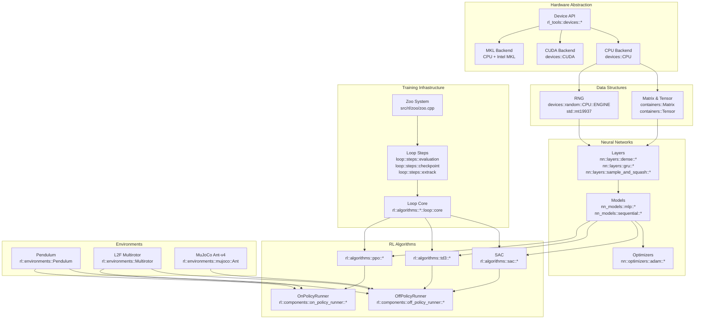

**Sources:** [src/rl/zoo/zoo.cpp:12-92](), [include/rl_tools/devices/cpu.h:18-67]()

---

## Core Code Organization

The repository follows a clear structure mapping system components to file locations:

| Component | Location | Description |
|-----------|----------|-------------|
| Device abstraction | `include/rl_tools/devices/` | Hardware backends (CPU, CUDA) |
| Containers | `include/rl_tools/containers/` | Matrix and Tensor data structures |
| Neural network layers | `include/rl_tools/nn/layers/` | Dense, GRU, Sample&Squash, etc. |
| Neural network models | `include/rl_tools/nn_models/` | MLP, Sequential composition |
| RL algorithms | `include/rl_tools/rl/algorithms/` | SAC, TD3, PPO implementations |
| Environments | `include/rl_tools/rl/environments/` | Pendulum, L2F, MuJoCo |
| Training loops | `include/rl_tools/rl/loop/` | Core loop and decorator steps |
| Zoo entry points | `src/rl/zoo/` | Executable training scripts |
| Persistence | `include/rl_tools/persist/` | HDF5 save/load, code generation |

**Sources:** [src/rl/zoo/zoo.cpp:1-100]()

---

## Supported Algorithms and Environments

### Algorithm-Environment Compatibility Matrix

The following table shows which algorithms work with which environments:

| Environment | SAC | TD3 | PPO | Key Features |
|-------------|-----|-----|-----|--------------|
| **Pendulum-v1** | ✓ | ✓ | ✓ | Classic control, simple dynamics |
| **L2F Multirotor** | ✓ | ✓ | ✓ | Domain randomization, trajectory tracking, multi-task |
| **Ant-v4 (MuJoCo)** | - | ✓ | ✓ | Complex locomotion, 8-DOF morphology |
| **Flag** | ✓ | ✓ | ✓ | Custom environment |
| **Acrobot Swingup** | ✓ | - | - | Underactuated system |
| **Bottleneck-v0** | - | - | ✓ | Custom environment |

Each algorithm-environment pair has a dedicated configuration file:

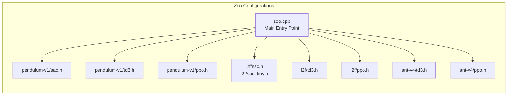

**Sources:** [src/rl/zoo/zoo.cpp:52-77](), [src/rl/zoo/zoo.cpp:131-217]()

---

## Training Loop Architecture

RLtools uses a **decorator pattern** for composing training loops. The core algorithm loop is wrapped with additional functionality:

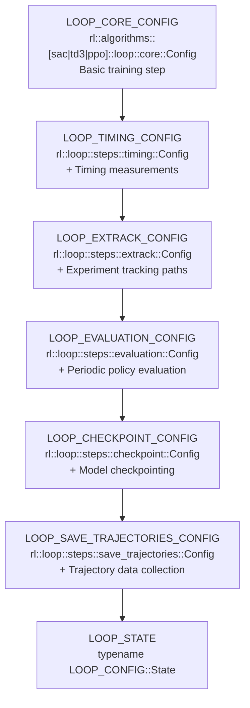

Each decorator adds functionality without modifying the core loop. The `step()` function cascades through the decorators:

**Sources:** [src/rl/zoo/zoo.cpp:227-261](), [include/rl_tools/rl/loop/steps/extrack/operations_cpu.h:1-44]()

---

## Zoo System: Central Training Entry Point

The **Zoo** system ([src/rl/zoo/zoo.cpp]()) is the main executable for running experiments. It:

1. Selects algorithm and environment via compile-time definitions
2. Initializes the training loop state
3. Configures experiment tracking (extrack)
4. Executes the training loop
5. Saves evaluation results and checkpoints

Key compile definitions control configuration:

| Definition | Purpose | Example |
|------------|---------|---------|
| `RL_TOOLS_RL_ZOO_ALGORITHM_*` | Select algorithm | `RL_TOOLS_RL_ZOO_ALGORITHM_SAC` |
| `RL_TOOLS_RL_ZOO_ENVIRONMENT_*` | Select environment | `RL_TOOLS_RL_ZOO_ENVIRONMENT_L2F` |
| `RL_TOOLS_RL_ZOO_BENCHMARK` | Disable logging for benchmarking | - |

**Example compilation targets:**

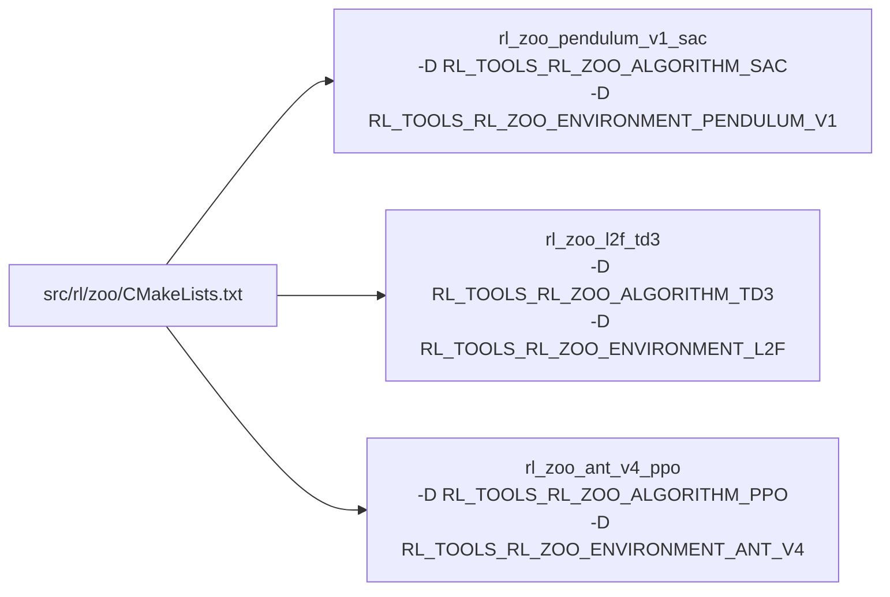

**Sources:** [src/rl/zoo/CMakeLists.txt:1-157](), [src/rl/zoo/zoo.cpp:131-217](), [src/rl/zoo/zoo.cpp:263-291]()

---

## Device Abstraction and Backend Selection

The library uses a device abstraction layer to support multiple backends without code duplication:

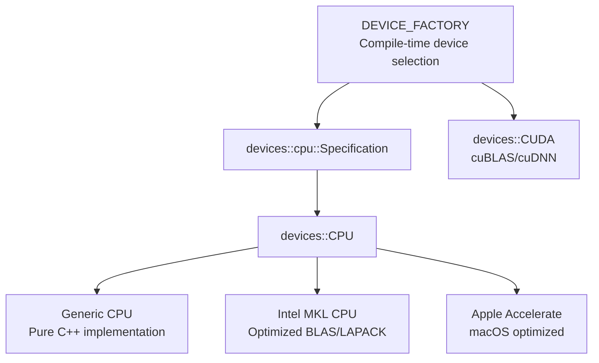

**Key classes:**

- `devices::DEVICE_FACTORY<>`: Template factory for device instantiation
- `devices::CPU<SPEC>`: CPU device with math, random, and logging components
- `devices::random::CPU::ENGINE<>`: Wraps `std::mt19937` for CPU RNG

**Sources:** [src/rl/zoo/zoo.cpp:110-121](), [include/rl_tools/devices/cpu.h:18-67](), [include/rl_tools/random/operations_cpu.h:1-55]()

---

## Deployment Targets

RLtools supports diverse deployment scenarios:

### Training Platforms

- **CPU (Generic)**: Pure C++17, no dependencies
- **CPU (MKL)**: Intel Math Kernel Library acceleration
- **CPU (Accelerate)**: Apple Accelerate framework (macOS)
- **CUDA**: NVIDIA GPU with cuBLAS

### Deployment Platforms

- **Desktop/Server**: Direct model execution
- **Embedded Autopilots**: PX4 (NuttX RTOS), Crazyflie (FreeRTOS)
- **Mobile**: iOS with CoreML integration
- **Microcontrollers**: ESP32, ARM Cortex-M
- **Web Browsers**: WebAssembly with rltools.js

**Static memory allocation** enables embedded deployment. When `RL_TOOLS_STATIC_MEM` is defined, all allocations use compile-time sizing and stack allocation, eliminating heap usage.

**Sources:** [src/rl/zoo/zoo.cpp:127-129](), [include/rl_tools/devices/cpu.h:1-206]()

---

## Main Training Function Flow

The primary training entry point is the `zoo()` function:

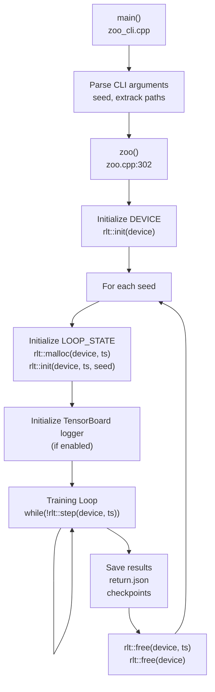

**Key steps:**

1. **Device initialization** [src/rl/zoo/zoo.cpp:329-330]()
2. **Loop state allocation** [src/rl/zoo/zoo.cpp:331-332]()
3. **Extrack configuration** [src/rl/zoo/zoo.cpp:317-328]()
4. **Training loop execution** [src/rl/zoo/zoo.cpp:362-400]()
5. **Result persistence** [src/rl/zoo/zoo.cpp:402-414]()

**Sources:** [src/rl/zoo/zoo.cpp:302-474](), [src/rl/zoo/zoo_cli.cpp:1-34]()

---

## Experiment Tracking (Extrack)

The **extrack** system provides structured experiment organization:

```mermaid
graph LR
    ExtrackConfig["extrack_config<br/>utils::extrack::Config"]
    
    ExtrackPaths["extrack_paths<br/>utils::extrack::Paths"]
    
    BasePath["base_path/<br/>Default: 'experiments'"]
    
    ExperimentPath["experiment/<br/>Timestamp + git hash"]
    
    PopulationPath["population_variates/<br/>e.g., 'environment_algorithm'"]
    
    PopulationValues["population_values/<br/>e.g., 'l2f_sac'"]
    
    SeedPath["seed/<br/>YYYY (4-digit seed)"]
    
    ExtrackConfig --> ExtrackPaths
    ExtrackPaths --> BasePath
    BasePath --> ExperimentPath
    ExperimentPath --> PopulationPath
    PopulationPath --> PopulationValues
    PopulationValues --> SeedPath
```

**Resulting directory structure:**

```
experiments/
└── 2024-12-09_13-30-20/
    └── d9384be_zoo_environment_algorithm/
        └── l2f_sac/
            ├── 0000/
            │   ├── return.json
            │   ├── checkpoints/
            │   └── trajectories/
            ├── 0001/
            └── ...
```

**Sources:** [include/rl_tools/rl/loop/steps/extrack/state.h:1-27](), [src/rl/zoo/zoo.cpp:317-328]()

---

## Key Takeaways

1. **Header-only design**: No separate compilation required for core functionality
2. **Template-based**: Compile-time device and algorithm selection
3. **Modular loop system**: Decorator pattern for composable training pipelines
4. **Multi-backend**: Single codebase runs on CPU, GPU, embedded, and browsers
5. **Zoo as central hub**: `src/rl/zoo/zoo.cpp` orchestrates all training experiments
6. **Static memory support**: Enables deployment to resource-constrained microcontrollers

For hands-on instructions, proceed to [Getting Started](#1.1). For deeper architectural details, see [Architecture Overview](#1.2) and [Core Concepts](#1.3).

**Sources:** [src/rl/zoo/zoo.cpp:1-475](), [src/rl/zoo/CMakeLists.txt:1-157](), [include/rl_tools/devices/cpu.h:1-206]()

---

# Page: Getting Started

# Getting Started

<details>
<summary>Relevant source files</summary>

The following files were used as context for generating this wiki page:

- [.gitignore](.gitignore)
- [CMakeLists.txt](CMakeLists.txt)
- [include/rl_tools/rl/loop/steps/extrack/operations_cpu.h](include/rl_tools/rl/loop/steps/extrack/operations_cpu.h)
- [include/rl_tools/rl/loop/steps/extrack/state.h](include/rl_tools/rl/loop/steps/extrack/state.h)
- [src/rl/environments/l2f/dr_sac/CMakeLists.txt](src/rl/environments/l2f/dr_sac/CMakeLists.txt)
- [src/rl/environments/l2f/dr_sac/l2f_dr_sac.cpp](src/rl/environments/l2f/dr_sac/l2f_dr_sac.cpp)
- [src/rl/environments/mujoco/ant/CMakeLists.txt](src/rl/environments/mujoco/ant/CMakeLists.txt)
- [src/rl/environments/mujoco/ant/evaluate_actor.cpp](src/rl/environments/mujoco/ant/evaluate_actor.cpp)
- [src/rl/environments/mujoco/ant/ppo/cpu/CMakeLists.txt](src/rl/environments/mujoco/ant/ppo/cpu/CMakeLists.txt)
- [src/rl/environments/mujoco/ant/ppo/cpu/training.h](src/rl/environments/mujoco/ant/ppo/cpu/training.h)
- [src/rl/environments/mujoco/ant/ppo/cuda/CMakeLists.txt](src/rl/environments/mujoco/ant/ppo/cuda/CMakeLists.txt)
- [src/rl/environments/mujoco/ant/ppo/cuda/training_ppo.cu](src/rl/environments/mujoco/ant/ppo/cuda/training_ppo.cu)
- [src/rl/environments/mujoco/ant/ppo/parameters.h](src/rl/environments/mujoco/ant/ppo/parameters.h)
- [src/rl/environments/mujoco/ant/td3/CMakeLists.txt](src/rl/environments/mujoco/ant/td3/CMakeLists.txt)
- [src/rl/environments/mujoco/ant/td3/training.h](src/rl/environments/mujoco/ant/td3/training.h)
- [src/rl/environments/pendulum/sac/cuda/cuda_graph_export.h](src/rl/environments/pendulum/sac/cuda/cuda_graph_export.h)
- [src/rl/environments/pendulum/td3/cpu/CMakeLists.txt](src/rl/environments/pendulum/td3/cpu/CMakeLists.txt)
- [src/rl/zoo/CMakeLists.txt](src/rl/zoo/CMakeLists.txt)
- [src/rl/zoo/l2f/environment_tiny.h](src/rl/zoo/l2f/environment_tiny.h)
- [src/rl/zoo/l2f/plot_learning_curves.py](src/rl/zoo/l2f/plot_learning_curves.py)
- [src/rl/zoo/l2f/sac.h](src/rl/zoo/l2f/sac.h)
- [src/rl/zoo/l2f/sac_tiny.h](src/rl/zoo/l2f/sac_tiny.h)
- [src/rl/zoo/zoo.cpp](src/rl/zoo/zoo.cpp)
- [src/rl/zoo/zoo_cli.cpp](src/rl/zoo/zoo_cli.cpp)
- [tests/src/rl/algorithms/ppo/parameters_rl.h](tests/src/rl/algorithms/ppo/parameters_rl.h)

</details>


This document provides a quick introduction to getting started with RLtools, covering installation, basic compilation, and running your first examples. It focuses on the essential steps to get RLtools working on your system and demonstrates the core compilation patterns.

For detailed information about specific algorithms, see [Reinforcement Learning Algorithms](#2). For comprehensive build system configuration, see [Build System and Configuration](#6).

## Quick Start

RLtools is a header-only C++ library with a modular build system. The fastest way to get started is using CMake to build one of the Zoo examples, which provide pre-configured algorithm-environment combinations.

### Using CMake (Recommended)

Clone the repository and build the Pendulum-v1 SAC example:

```bash
git clone https://github.com/rl-tools/rl-tools.git
cd rl-tools
mkdir build && cd build
cmake .. -DCMAKE_BUILD_TYPE=Release
cmake --build . --target rl_zoo_pendulum_v1_sac
./src/rl/zoo/rl_zoo_pendulum_v1_sac 0
```

This builds and runs the Pendulum-v1 environment with the SAC algorithm using seed 0. The program will train a policy to swing up and balance the pendulum.

### Direct Compilation (Alternative)

For minimal setup without CMake, compile directly:

```bash
git clone https://github.com/rl-tools/rl-tools.git
cd rl-tools
g++ -std=c++17 -O3 -ffast-math -march=native -I include \
    src/rl/zoo/zoo_cli.cpp src/rl/zoo/zoo.cpp \
    -DRL_TOOLS_RL_ZOO_ALGORITHM_SAC \
    -DRL_TOOLS_RL_ZOO_ENVIRONMENT_PENDULUM_V1
./a.out 0
```

### Platform-Specific Optimizations

**macOS with Accelerate Framework:**
```bash
cmake .. -DCMAKE_BUILD_TYPE=Release \
         -DRL_TOOLS_BACKEND_ENABLE_ACCELERATE=ON
```

**Ubuntu with MKL:**
```bash
cmake .. -DCMAKE_BUILD_TYPE=Release \
         -DRL_TOOLS_BACKEND_ENABLE_MKL=ON
```

Sources: [CMakeLists.txt:1-24](), [src/rl/zoo/CMakeLists.txt:10-20](), [src/rl/zoo/zoo.cpp:302-474](), [src/rl/zoo/zoo_cli.cpp:8-34]()

## Build System Architecture

RLtools uses CMake with a layered target system. The core library is header-only, with optional dependencies for acceleration and features.

**CMake Target Hierarchy:**

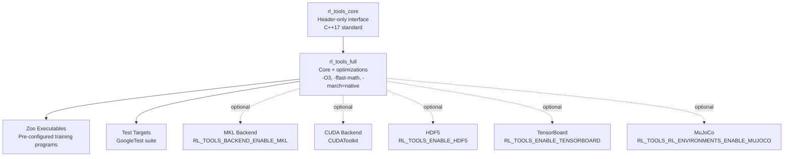

### Zoo Executable Naming

Zoo executables follow the pattern `rl_zoo_<environment>_<algorithm>`:

| Executable | Environment | Algorithm | Source |
|------------|-------------|-----------|--------|
| `rl_zoo_pendulum_v1_sac` | Pendulum-v1 | SAC | [src/rl/zoo/CMakeLists.txt:16-20]() |
| `rl_zoo_pendulum_v1_td3` | Pendulum-v1 | TD3 | [src/rl/zoo/CMakeLists.txt:29-33]() |
| `rl_zoo_pendulum_v1_ppo` | Pendulum-v1 | PPO | [src/rl/zoo/CMakeLists.txt:10-14]() |
| `rl_zoo_l2f_sac` | L2F Multirotor | SAC | [src/rl/zoo/CMakeLists.txt:104-108]() |
| `rl_zoo_ant_v4_ppo` | Ant-v4 (MuJoCo) | PPO | [src/rl/zoo/CMakeLists.txt:143-147]() |

Sources: [CMakeLists.txt:6-24](), [src/rl/zoo/CMakeLists.txt:1-157]()

## CMake Configuration

### Basic Configuration

```bash
mkdir build && cd build
cmake .. -DCMAKE_BUILD_TYPE=Release
cmake --build . --target rl_zoo_pendulum_v1_sac
```

### Key Configuration Options

| Option | Purpose | Default |
|--------|---------|---------|
| `RL_TOOLS_ENABLE_TARGETS` | Build main executables | ON |
| `RL_TOOLS_ENABLE_TESTS` | Build test suite | OFF |
| `RL_TOOLS_BACKEND_ENABLE_MKL` | Intel MKL BLAS acceleration | OFF |
| `RL_TOOLS_BACKEND_ENABLE_ACCELERATE` | Apple Accelerate framework | OFF |
| `RL_TOOLS_ENABLE_HDF5` | Model checkpointing | OFF |
| `RL_TOOLS_ENABLE_TENSORBOARD` | Training visualization | OFF |
| `RL_TOOLS_RL_ENVIRONMENTS_ENABLE_MUJOCO` | MuJoCo environments | OFF |
| `RL_TOOLS_WARNINGS_AS_ERRORS` | Treat warnings as errors | ON |
| `RL_TOOLS_OFFLINE_BUILD` | Use cached dependencies | OFF |

### Backend Configuration Examples

**CPU with MKL (Linux):**
```bash
cmake .. -DCMAKE_BUILD_TYPE=Release \
         -DRL_TOOLS_BACKEND_ENABLE_MKL=ON \
         -DRL_TOOLS_ENABLE_HDF5=ON \
         -DRL_TOOLS_ENABLE_TENSORBOARD=ON
```

**CPU with Accelerate (macOS):**
```bash
cmake .. -DCMAKE_BUILD_TYPE=Release \
         -DRL_TOOLS_BACKEND_ENABLE_ACCELERATE=ON
```

**GPU with CUDA:**
```bash
cmake .. -DCMAKE_BUILD_TYPE=Release \
         -DRL_TOOLS_BACKEND_ENABLE_CUDA=ON
```

**MuJoCo Environments:**
```bash
cmake .. -DCMAKE_BUILD_TYPE=Release \
         -DRL_TOOLS_RL_ENVIRONMENTS_ENABLE_MUJOCO=ON
```

Sources: [CMakeLists.txt:10-19](), [cmake/autodetect/all.cmake:1-20]()

## Zoo System: Running Experiments

The Zoo system provides a unified interface for training different algorithm-environment combinations. Each Zoo executable is pre-configured for a specific pairing.

**Zoo Execution Flow:**

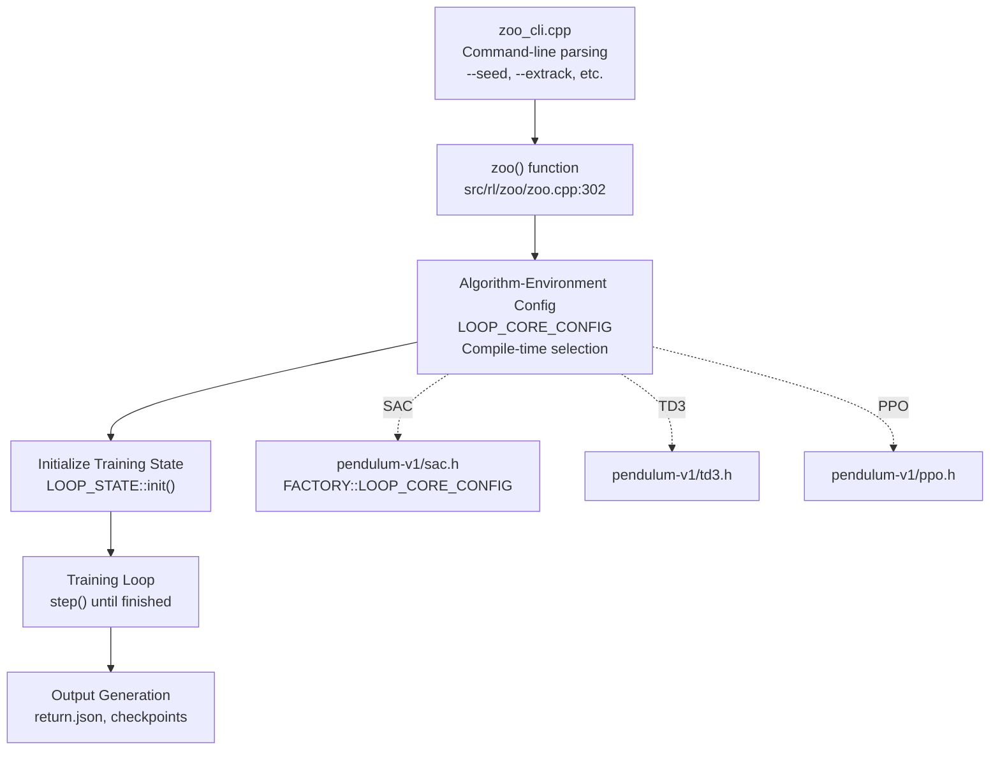

### Command-Line Interface

Zoo executables accept these arguments:

```bash
./rl_zoo_pendulum_v1_sac [options]
```

**Options** (when CLI11 enabled):

| Option | Description | Default |
|--------|-------------|---------|
| `-s, --seed` | Random seed for training | 0 |
| `-n, --n_seeds` | Number of seeds to run sequentially | 1 |
| `--e, --extrack` | Base path for experiment tracking | "" |
| `--ee, --extrack-experiment` | Experiment name | timestamp |
| `--eep, --extrack-experiment-path` | Full experiment path | "" |
| `-c, --config` | Config file path | "" |

### Running Multiple Seeds

Run multiple training runs with different seeds:

```bash
# Single seed
./rl_zoo_pendulum_v1_sac --seed 0

# Multiple seeds (0-9)
./rl_zoo_pendulum_v1_sac --seed 0 --n_seeds 10
```

### Output Structure

The Zoo system generates structured output using the ExTrack system:

```
experiments/
└── <timestamp>_<commit>_zoo_environment_algorithm/
    └── <environment>_<algorithm>/
        ├── 0000/  # seed 0
        │   ├── return.json
        │   ├── return.json.set
        │   └── steps/
        │       └── <step>/
        │           └── actor.h  # Exported C++ code
        ├── 0001/  # seed 1
        └── ...
```

Sources: [src/rl/zoo/zoo_cli.cpp:1-34](), [src/rl/zoo/zoo.cpp:302-474](), [include/rl_tools/rl/loop/steps/extrack/operations_cpu.h:1-44]()

## Running Your First Pendulum Experiment

### Step 1: Build the Target

```bash
cd build
cmake --build . --target rl_zoo_pendulum_v1_sac
```

### Step 2: Run Training

```bash
./src/rl/zoo/rl_zoo_pendulum_v1_sac --seed 0
```

**Expected Output:**
```
PID: <process_id> (use kill -SIGUSR1 <pid> to evaluate on demand)
Evaluation Interval: 2000
Checkpoint Interval: 20000
Save Trajectories Interval: 20000
...
Step: 0/200000
Step: 2000/200000 (evaluation...)
...
```

### Step 3: Monitor Progress

The training process logs key metrics:

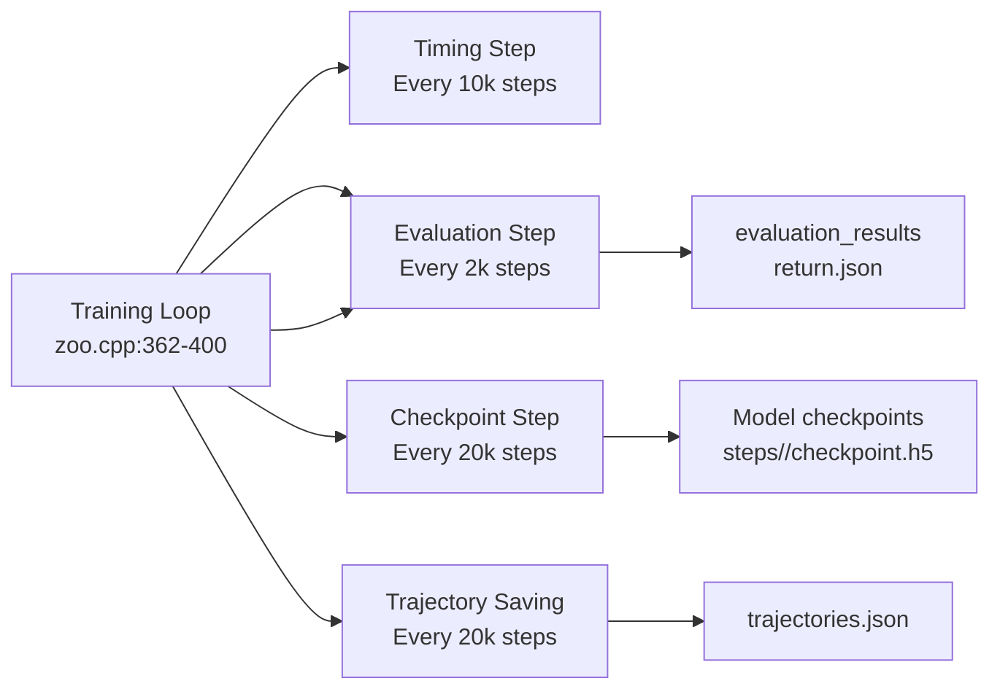

### Step 4: Analyze Results

After training completes, examine the output:

```bash
cd experiments/<timestamp>_zoo_environment_algorithm/pendulum-v1_sac/0000/
cat return.json  # View training metrics
```

**return.json Structure:**
```json
[
  {
    "step": 0,
    "returns": [<100 episode returns>],
    "returns_mean": -1234.5,
    "returns_std": 123.4,
    "episode_length_mean": 200.0,
    ...
  },
  ...
]
```

### Visualization

Use the provided Python script to plot learning curves:

```bash
cd src/rl/zoo/l2f/
python plot_learning_curves.py
```

Sources: [src/rl/zoo/zoo.cpp:362-474](), [src/rl/zoo/l2f/plot_learning_curves.py:1-151]()

## Available Zoo Targets

### Pendulum Environment

| Target | Algorithm | Features |
|--------|-----------|----------|
| `rl_zoo_pendulum_v1_sac` | SAC | Stochastic policy, entropy regularization |
| `rl_zoo_pendulum_v1_td3` | TD3 | Deterministic policy, target smoothing |
| `rl_zoo_pendulum_v1_ppo` | PPO | On-policy, clipped objective |
| `rl_zoo_pendulum_v1_sac_benchmark` | SAC | Minimal logging for benchmarking |

### Learn to Fly (L2F) Multirotor

| Target | Algorithm | Features |
|--------|-----------|----------|
| `rl_zoo_l2f_sac` | SAC | Domain randomization, trajectory tracking |
| `rl_zoo_l2f_td3` | TD3 | Trajectory tracking control |
| `rl_zoo_l2f_ppo` | PPO | On-policy multirotor control |
| `rl_zoo_l2f_sac_benchmark` | SAC | Performance benchmarking |

### MuJoCo Environments (requires `RL_TOOLS_RL_ENVIRONMENTS_ENABLE_MUJOCO=ON`)

| Target | Algorithm | Environment |
|--------|-----------|-------------|
| `rl_zoo_ant_v4_ppo` | PPO | Ant-v4 locomotion |
| `rl_zoo_ant_v4_td3` | TD3 | Ant-v4 locomotion |

### Other Environments

| Target | Algorithm | Environment |
|--------|-----------|-------------|
| `rl_zoo_flag_sac` | SAC | Flag environment |
| `rl_zoo_flag_td3` | TD3 | Flag environment |
| `rl_zoo_flag_ppo` | PPO | Flag environment |
| `rl_zoo_acrobot_swingup_v0_sac` | SAC | Acrobot swing-up |

Sources: [src/rl/zoo/CMakeLists.txt:8-154]()

## Dependencies and Setup

### Required Dependencies

- **C++17 compiler** (GCC 9+, Clang 10+, MSVC 2019+)
- **CMake 3.19+** (for HDF5 support)

### Optional Dependencies

RLtools uses FetchContent to automatically download optional dependencies:

| Dependency | Purpose | Auto-fetched | CMake Option |
|------------|---------|--------------|--------------|
| CLI11 | Command-line parsing | Yes | `RL_TOOLS_ENABLE_CLI11` |
| HDF5 | Model persistence | No | `RL_TOOLS_ENABLE_HDF5` |
| GoogleTest | Testing framework | Yes | `RL_TOOLS_ENABLE_GTEST` |
| TensorBoard Logger | Training visualization | Yes | `RL_TOOLS_ENABLE_TENSORBOARD` |
| MuJoCo | Physics simulation | No | `RL_TOOLS_RL_ENVIRONMENTS_ENABLE_MUJOCO` |

### FetchContent Configuration

Dependencies are cached in `.dependencies/<build_dir>` for offline builds:

```bash
# Normal build (downloads dependencies)
cmake .. -DCMAKE_BUILD_TYPE=Release

# Offline build (uses cached dependencies)
cmake .. -DCMAKE_BUILD_TYPE=Release \
         -DRL_TOOLS_OFFLINE_BUILD=ON
```

The base directory for FetchContent can be customized:

```cmake
set(FETCHCONTENT_BASE_DIR "/path/to/cache" CACHE PATH "Base dir")
```

### Installing System Dependencies

**Ubuntu/Debian:**
```bash
# For MKL backend
sudo apt install intel-mkl

# For HDF5 support
sudo apt install libhdf5-dev
```

**macOS:**
```bash
# Accelerate framework is built-in
# For HDF5 support
brew install hdf5
```

Sources: [CMakeLists.txt:55-78](), [cmake/autodetect/all.cmake:1-20](), [cmake/optional/googletest.cmake:1-20]()

## Next Steps

After successfully compiling and running your first examples:

1. **Explore Algorithms**: Try different RL algorithms - see [Reinforcement Learning Algorithms](#2)
2. **Custom Environments**: Create your own environments - see [Creating Custom Environments](#4.4)
3. **Advanced Configuration**: Configure backends and optimizations - see [Backend Configuration](#6.2)
4. **Performance Testing**: Run benchmarks and tests - see [Testing and Benchmarking](#7)

The header-only design makes RLtools easy to integrate into existing projects, while the layered CMake system allows you to include only the features you need.

---

# Page: Architecture Overview

# Architecture Overview

<details>
<summary>Relevant source files</summary>

The following files were used as context for generating this wiki page:

- [include/rl_tools/devices/cpu.h](include/rl_tools/devices/cpu.h)
- [include/rl_tools/random/operations_cpu.h](include/rl_tools/random/operations_cpu.h)
- [include/rl_tools/rl/environments/l2f/multirotor.h](include/rl_tools/rl/environments/l2f/multirotor.h)
- [include/rl_tools/rl/environments/l2f/operations_cpu.h](include/rl_tools/rl/environments/l2f/operations_cpu.h)
- [include/rl_tools/rl/environments/l2f/operations_generic.h](include/rl_tools/rl/environments/l2f/operations_generic.h)
- [include/rl_tools/rl/environments/l2f/operations_generic/10_sample_initial_parameters.h](include/rl_tools/rl/environments/l2f/operations_generic/10_sample_initial_parameters.h)
- [include/rl_tools/rl/environments/l2f/operations_generic/30_sample_initial_state.h](include/rl_tools/rl/environments/l2f/operations_generic/30_sample_initial_state.h)
- [include/rl_tools/rl/environments/l2f/operations_generic/70_post_integration.h](include/rl_tools/rl/environments/l2f/operations_generic/70_post_integration.h)
- [include/rl_tools/rl/environments/l2f/operations_multitask_generic.h](include/rl_tools/rl/environments/l2f/operations_multitask_generic.h)
- [include/rl_tools/rl/environments/l2f/operations_multitask_generic_forward.h](include/rl_tools/rl/environments/l2f/operations_multitask_generic_forward.h)
- [include/rl_tools/rl/environments/l2f/parameters/default.h](include/rl_tools/rl/environments/l2f/parameters/default.h)
- [include/rl_tools/rl/environments/l2f/parameters/trajectories/lissajous.h](include/rl_tools/rl/environments/l2f/parameters/trajectories/lissajous.h)
- [include/rl_tools/rl/environments/pendulum/ui_xeus.h](include/rl_tools/rl/environments/pendulum/ui_xeus.h)
- [src/rl/zoo/l2f/environment.h](src/rl/zoo/l2f/environment.h)
- [src/rl/zoo/l2f/environment_big.h](src/rl/zoo/l2f/environment_big.h)
- [src/rl/zoo/l2f/ppo.h](src/rl/zoo/l2f/ppo.h)
- [src/rl/zoo/l2f/sac_big.h](src/rl/zoo/l2f/sac_big.h)

</details>


## Purpose and Scope

This document explains the high-level architecture of RLtools: how major system components are organized, how they interact through well-defined interfaces, and the key design patterns that enable multi-platform deployment. The focus is on structural organization and composition mechanisms rather than individual algorithm or environment details.

For specific information about RL algorithms, see [Reinforcement Learning Algorithms](#2). For environment implementations, see [Environments](#4). For build system details, see [Build System and Configuration](#6).

---

## Design Philosophy

RLtools is architected as a **header-only C++ library** using template metaprogramming to achieve three primary goals:

1. **Zero-cost abstraction**: All polymorphism resolved at compile-time through templates
2. **Multi-backend portability**: Same high-level code runs on CPU, CUDA, embedded systems, and WebAssembly
3. **Static memory support**: Optional stack-only allocation for resource-constrained embedded platforms

The architecture employs a **functional programming style** where operations are stateless free functions rather than class methods, enabling easy backend dispatch and minimal binary size.

Sources: [include/rl_tools/devices/cpu.h:1-70](), [include/rl_tools/version.h]()

---

## Core Architectural Patterns

### Device Abstraction Layer

The device abstraction is the foundational pattern enabling multi-backend support. All compute operations are parameterized by a `DEVICE` type that provides math, random, and logging capabilities.

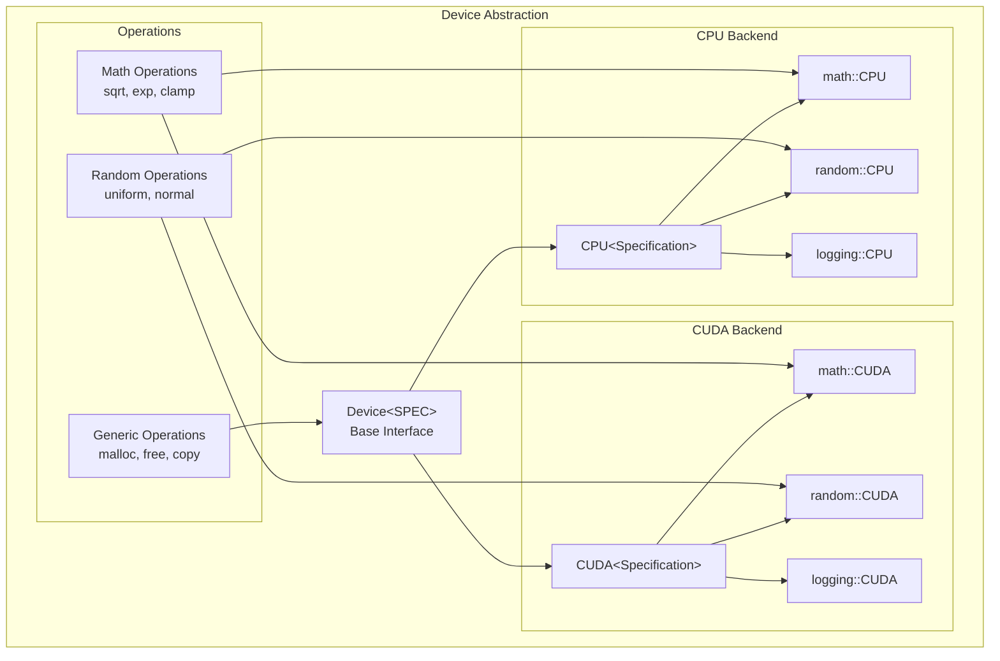

**Device Structure**:
- `devices::CPU<SPEC>`: Generic CPU backend with `math`, `random`, `logger` members
- `devices::CUDA<SPEC>`: GPU backend with cuBLAS/cuDNN integration
- `devices::DefaultCPU`: Convenience typedef using default specification

Operations are dispatched through the device parameter:
```cpp
template<typename DEVICE, typename T, typename RNG>
T sample(DEVICE& device, T mean, T std, RNG& rng);
```

Sources: [include/rl_tools/devices/cpu.h:17-67](), [include/rl_tools/random/operations_cpu.h:14-52]()

### Template-Based Design and Specification Pattern

Every major component is defined by a **Specification struct** containing compile-time configuration. This enables:
- Type parameterization (float vs double)
- Dimension configuration (layer sizes, buffer capacities)
- Behavioral flags (static allocation, domain randomization)

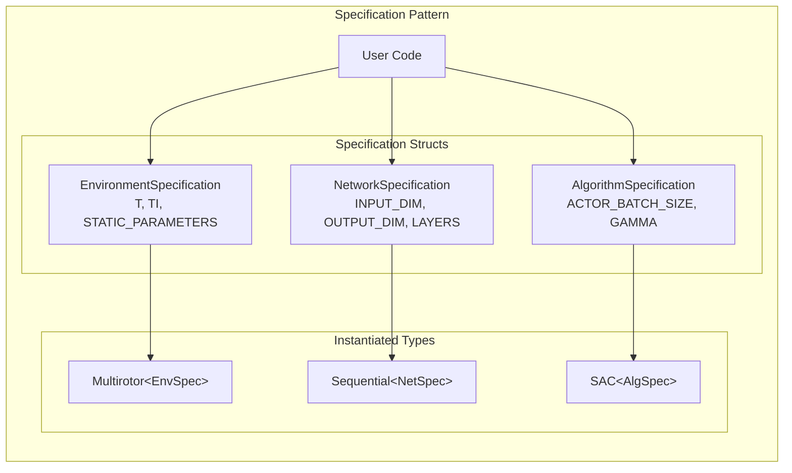

**Example**: L2F Environment Configuration
```cpp
struct ENVIRONMENT_STATIC_PARAMETERS {
    static constexpr TI N_SUBSTEPS = 1;
    static constexpr TI ACTION_HISTORY_LENGTH = 16;
    static constexpr TI EPISODE_STEP_LIMIT = 500;
    using STATE_TYPE = StateTrajectory<...>;
    using OBSERVATION_TYPE = DefaultActionHistoryObservation<...>;
    using PARAMETERS = PARAMETERS_TYPE;
};
```

Sources: [include/rl_tools/rl/environments/l2f/multirotor.h:14-243](), [src/rl/zoo/l2f/environment.h:134-158]()

### Operations Pattern

Operations are **free functions** templated on device and type specifications, not class methods. This pattern:
- Enables backend specialization through template specialization
- Keeps types lightweight (data only, no vtables)
- Allows operations to be added in separate headers

**Dispatch Mechanism**:
```cpp
// Generic declaration
template<typename DEVICE, typename SPEC, typename RNG>
void sample_initial_state(DEVICE&, Multirotor<SPEC>&, STATE&, RNG&);

// Backend-specific implementations
namespace cpu { /* CPU implementation */ }
namespace cuda { /* CUDA implementation */ }
```

**Composition Dispatch**: L2F uses a dispatch pattern for composed state/observation types:

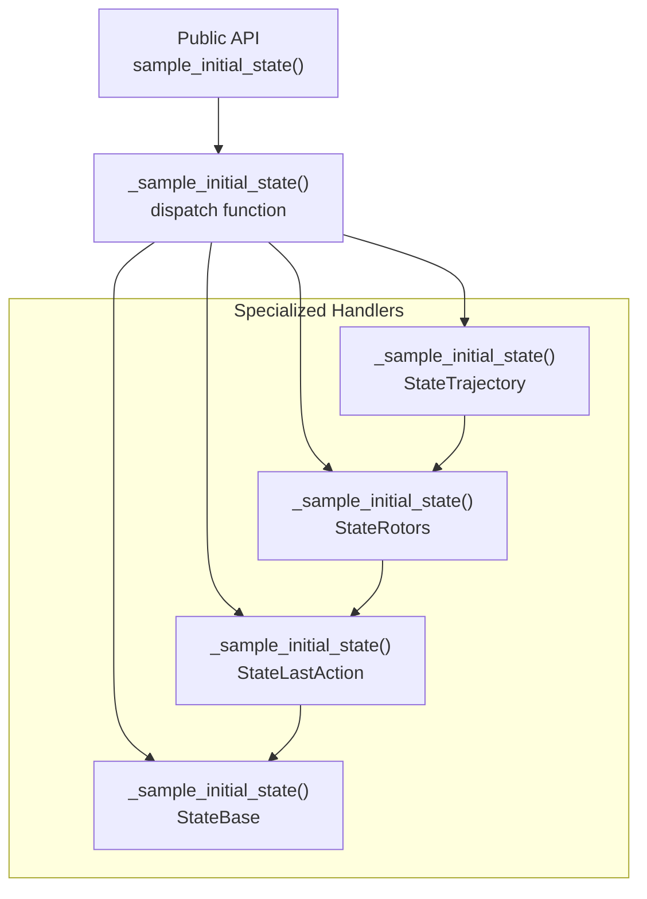

Sources: [include/rl_tools/rl/environments/l2f/operations_generic.h:22-92](), [include/rl_tools/rl/environments/l2f/operations_generic/30_sample_initial_state.h:16-217]()

---

## Component Hierarchy

### Devices and Compute Backends

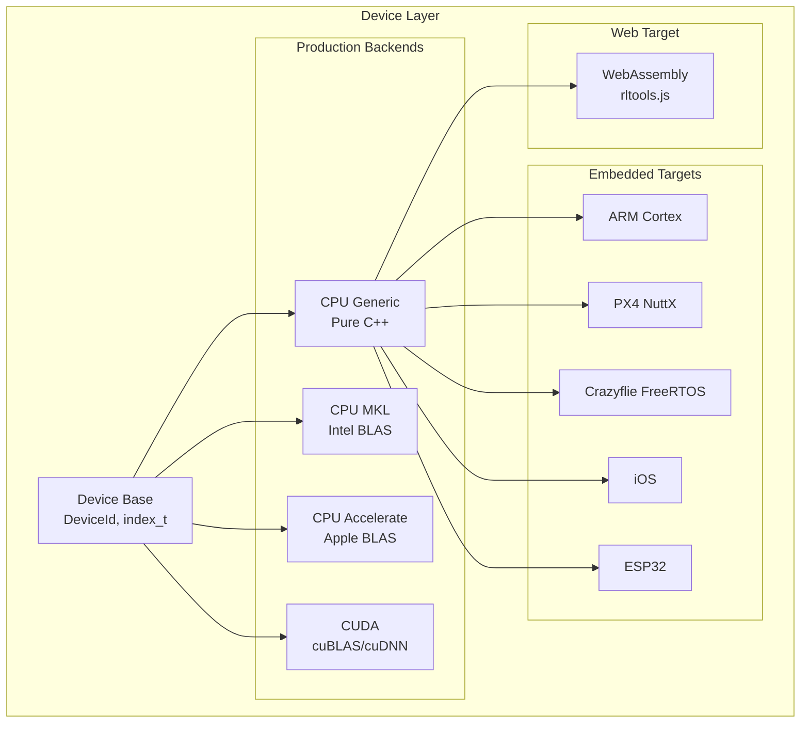

**Backend Selection**:
- Compile-time through template instantiation
- Runtime configuration minimal (device initialization, RNG seeding)
- Static memory mode: `RL_TOOLS_STATIC_MEM` flag eliminates heap allocation

Sources: [include/rl_tools/devices/cpu.h:18-67]()

### Container System

The container system provides a unified interface for tensors and matrices with compile-time or runtime sizing.

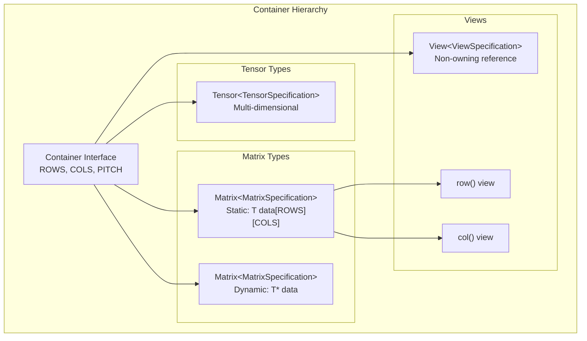

**Key Design Points**:
- **Specification-based**: `MatrixSpecification<T, TI, ROWS, COLS, PITCH>` defines layout
- **Allocation mode**: Controlled by `RL_TOOLS_STATIC_MEM` and specification
- **Operations**: `malloc()`, `free()`, `copy()`, `set()`, `get()` parameterized by device

Sources: [src/rl/zoo/l2f/environment.h:1-165]()

### Neural Network Architecture

Neural networks are built by composing layer modules into sequential or custom architectures.

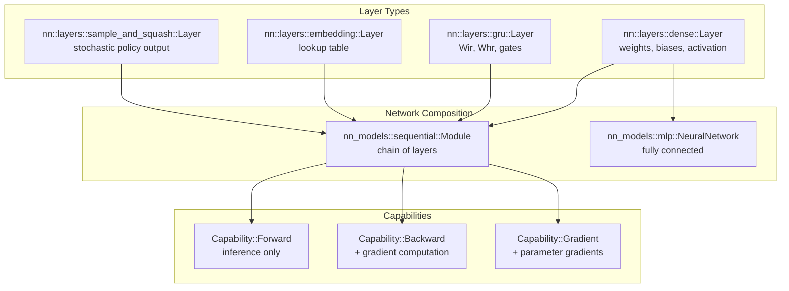

**Capability System**: Operations are enabled based on capability:
- `forward()`: Available for `Capability::Forward`
- `backward()`: Available for `Capability::Backward`
- `reset_optimizer_state()`: Available for `Capability::Gradient`

Sources: [src/rl/zoo/l2f/sac_big.h:1-81]()

### RL Algorithm Configuration

Algorithms are configured through nested specification structs defining hyperparameters and network architectures.

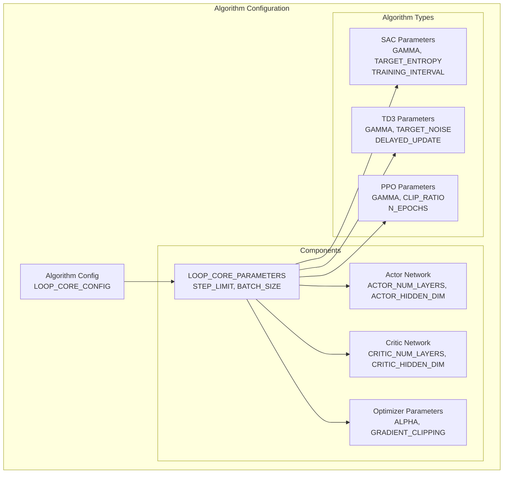

**Example**: SAC Configuration
```cpp
struct LOOP_CORE_PARAMETERS {
    struct SAC_PARAMETERS {
        static constexpr TI ACTOR_BATCH_SIZE = 512;
        static constexpr TI CRITIC_BATCH_SIZE = 512;
        static constexpr T GAMMA = 0.99;
        static constexpr T TARGET_ENTROPY = -2.0;
    };
    static constexpr TI ACTOR_NUM_LAYERS = 3;
    static constexpr TI ACTOR_HIDDEN_DIM = 32;
    static constexpr TI CRITIC_NUM_LAYERS = 3;
    static constexpr TI CRITIC_HIDDEN_DIM = 256;
};
```

Sources: [src/rl/zoo/l2f/sac_big.h:20-78](), [src/rl/zoo/l2f/ppo.h:25-49]()

---

## Composition Mechanisms

### State Composition via Linked-List Pattern

States, observations, and parameters use a **linked-list composition pattern** where each component references a `NEXT_COMPONENT` type, enabling arbitrary feature combinations.

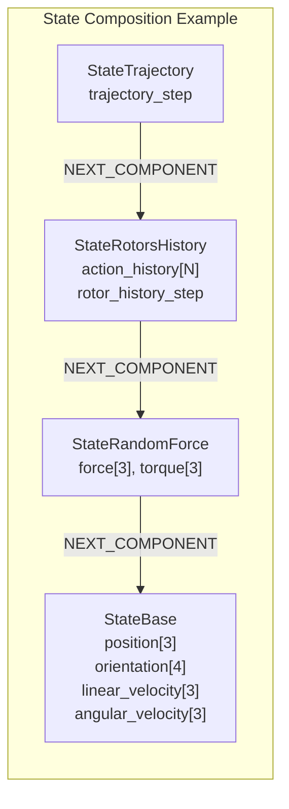

**Specification Structure**:
```cpp
template <typename T_SPEC>
struct StateBase {
    using SPEC = T_SPEC;
    using T = typename SPEC::T;
    static constexpr TI DIM = 13;
    T position[3];
    T orientation[4];
    T linear_velocity[3];
    T angular_velocity[3];
};

template <typename T_SPEC>
struct StateLastAction: T_SPEC::NEXT_COMPONENT {
    using SPEC = T_SPEC;
    using NEXT_COMPONENT = typename SPEC::NEXT_COMPONENT;
    static constexpr TI DIM = 4 + NEXT_COMPONENT::DIM;
    T last_action[4];
};
```

This pattern enables:
- **Modular features**: Each state component adds specific functionality
- **Automatic dimension calculation**: `DIM = CURRENT_DIM + NEXT_COMPONENT::DIM`
- **Composition dispatch**: Operations recursively call next component's handler

Sources: [include/rl_tools/rl/environments/l2f/multirotor.h:624-718]()

### Observation Composition

Observations follow the same linked-list pattern with additional support for privileged observations (critic-only).

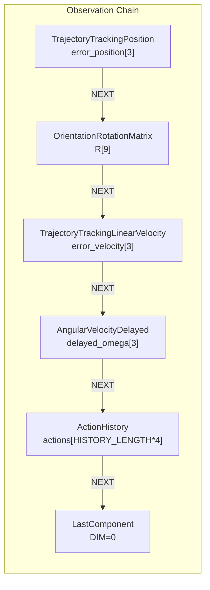

**Privileged Observations**: Marked with `PRIVILEGED = true` flag, accessible only to critic network for asymmetric actor-critic.

Sources: [include/rl_tools/rl/environments/l2f/multirotor.h:236-614](), [src/rl/zoo/l2f/environment_big.h:125-132]()

### Parameter Composition

Environment parameters compose domain randomization, disturbances, trajectories, and base dynamics using the same pattern.

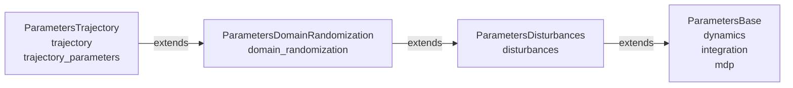

This enables sampling different parameter configurations at episode initialization through recursive dispatch:
- `sample_initial_parameters()` traverses the composition chain
- Each level samples its specific parameters
- Domain randomization adjusts base parameters (mass, inertia, thrust curves)

Sources: [include/rl_tools/rl/environments/l2f/multirotor.h:136-220](), [include/rl_tools/rl/environments/l2f/operations_generic/10_sample_initial_parameters.h:16-207]()

---

## Configuration System

### Factory Pattern for Type Construction

The codebase uses factory structs to construct fully-configured types from high-level parameters.

```mermaid
graph TB
    subgraph "Factory Pattern"
        Factory["ENVIRONMENT_FACTORY<br/>DEVICE, T, TI, OPTIONS"]
        
        subgraph "Configuration"
            Model["MODEL = crazyflie"]
            Params["PARAMETERS_TYPE<br/>nested specifications"]
            Static["ENVIRONMENT_STATIC_PARAMETERS<br/>N_SUBSTEPS, ACTION_HISTORY_LENGTH<br/>STATE_TYPE, OBSERVATION_TYPE"]
        end
        
        subgraph "Output"
            EnvSpec["ENVIRONMENT_SPEC<br/>combines all configuration"]
            Env["ENVIRONMENT<br/>Multirotor&lt;ENVIRONMENT_SPEC&gt;"]
        end
    end
    
    Factory --> Model
    Factory --> Params
    Factory --> Static
    
    Model --> EnvSpec
    Params --> EnvSpec
    Static --> EnvSpec
    EnvSpec --> Env
```

**Example**: Environment Factory
```cpp
template <typename DEVICE, typename TYPE_POLICY, typename TI, typename OPTIONS>
struct ENVIRONMENT_BIG_FACTORY {
    using T = typename TYPE_POLICY::DEFAULT;
    static constexpr auto MODEL = parameters::dynamics::REGISTRY::soft_rigid;
    
    struct ENVIRONMENT_STATIC_PARAMETERS {
        static constexpr TI N_SUBSTEPS = 1;
        static constexpr TI ACTION_HISTORY_LENGTH = 8;
        using STATE_TYPE = StateTrajectory<...>;
        using OBSERVATION_TYPE = observation::TrajectoryTrackingPosition<...>;
    };
    
    using ENVIRONMENT_SPEC = Specification<T, TI, ENVIRONMENT_STATIC_PARAMETERS>;
    using ENVIRONMENT = Multirotor<ENVIRONMENT_SPEC>;
};
```

Sources: [src/rl/zoo/l2f/environment_big.h:18-149](), [src/rl/zoo/l2f/environment.h:18-162]()

### Static vs Dynamic Allocation

Allocation strategy is controlled by `RL_TOOLS_STATIC_MEM` flag and specification:

**Static Mode** (embedded):
- All memory on stack
- Array sizes compile-time constants
- No `malloc()` calls
- Enabled by `RL_TOOLS_STATIC_MEM` macro

**Dynamic Mode** (desktop/server):
- Heap allocation for large buffers
- Runtime-sized structures
- Smaller binary size
- Default mode

The same code works in both modes through template specialization of `malloc()` and `free()`.

Sources: [include/rl_tools/rl/environments/l2f/operations_generic.h:38-46]()

### Configuration Flow

```mermaid
graph TB
    subgraph "Configuration Pipeline"
        User["User Specifies:<br/>DEVICE, T, TI, OPTIONS"]
        Factory["Factory Struct<br/>computes derived types"]
        
        subgraph "Compile-Time Resolution"
            Types["Type Resolution<br/>STATE_TYPE, OBSERVATION_TYPE"]
            Consts["Constant Propagation<br/>EPISODE_STEP_LIMIT, BATCH_SIZE"]
            Dispatch["Function Dispatch<br/>backend-specific operations"]
        end
        
        Runtime["Runtime Initialization<br/>init(), malloc()"]
        Execution["Training Loop Execution"]
    end
    
    User --> Factory
    Factory --> Types
    Factory --> Consts
    Types --> Dispatch
    Consts --> Dispatch
    Dispatch --> Runtime
    Runtime --> Execution
```

All configuration is compile-time except:
- RNG seed
- Device initialization
- Buffer allocation (if dynamic mode)

This enables aggressive compiler optimization and small binary sizes.

Sources: [src/rl/zoo/l2f/sac_big.h:8-80](), [src/rl/zoo/l2f/ppo.h:14-51]()

---

## Integration Points

### Zoo System as Central Orchestrator

The `zoo.cpp` system serves as the main entry point, composing algorithm, environment, and training loop configurations.

```mermaid
graph TB
    subgraph "Zoo Integration"
        ZooEntry["zoo.cpp<br/>main entry point"]
        
        subgraph "Component Selection"
            EnvFactory["ENVIRONMENT_FACTORY<br/>l2f, pendulum, ant"]
            AlgFactory["ALGORITHM_FACTORY<br/>SAC, TD3, PPO"]
            LoopConfig["LOOP_CONFIG<br/>training parameters"]
        end
        
        subgraph "Instantiation"
            LoopState["LoopState<br/>actor, critic, buffers"]
            Training["Training Loop<br/>step(), evaluate()"]
        end
        
        subgraph "Outputs"
            Checkpoints["Checkpoints<br/>HDF5 files"]
            Metrics["Metrics<br/>extrack JSON"]
            Trajectories["Trajectories<br/>evaluation data"]
        end
    end
    
    ZooEntry --> EnvFactory
    ZooEntry --> AlgFactory
    ZooEntry --> LoopConfig
    
    EnvFactory --> LoopState
    AlgFactory --> LoopState
    LoopConfig --> LoopState
    
    LoopState --> Training
    
    Training --> Checkpoints
    Training --> Metrics
    Training --> Trajectories
```

The zoo pattern enables:
- Compile-time selection of algorithm-environment pairs
- Shared training infrastructure across combinations
- Reproducible experiments with fixed configurations

Sources: [src/rl/zoo/l2f/sac_big.h:7-81](), [src/rl/zoo/l2f/ppo.h:12-52]()

### Multi-Platform Build Pipeline

```mermaid
graph LR
    subgraph "Source Code"
        Headers["include/<br/>header-only library"]
        Src["src/<br/>training executables"]
        Tests["tests/<br/>unit tests"]
    end
    
    subgraph "Build Configuration"
        CMake["CMakeLists.txt<br/>RL_TOOLS_ENABLE_*<br/>RL_TOOLS_STATIC_MEM"]
    end
    
    subgraph "Platform Outputs"
        Desktop["Desktop Executables<br/>CPU/CUDA/MKL"]
        Embedded["Embedded Binaries<br/>ARM/PX4/Crazyflie"]
        Web["WebAssembly<br/>rltools.js"]
        Tests2["Test Executables<br/>GoogleTest suite"]
    end
    
    Headers --> CMake
    Src --> CMake
    Tests --> CMake
    
    CMake --> Desktop
    CMake --> Embedded
    CMake --> Web
    CMake --> Tests2
```

**Key Build Features**:
- Header-only core: No compilation required for basic usage
- Platform-specific compilation units in `src/`
- CMake options control backend and features
- Static memory mode for embedded targets

Sources: [src/rl/zoo/l2f/environment.h:1-165]()

---

## Summary

The RLtools architecture achieves portability and performance through:

1. **Device abstraction**: Unified interface across CPU, GPU, embedded, and web backends
2. **Template metaprogramming**: Zero-cost abstractions with compile-time polymorphism
3. **Specification pattern**: All configuration as compile-time constants
4. **Operations pattern**: Free functions enable backend specialization
5. **Composition mechanisms**: Linked-list pattern for modular features
6. **Factory pattern**: High-level construction of complex types

This architecture enables the same algorithm code to run efficiently on a desktop GPU, a Crazyflie drone, and in a web browser, with minimal code duplication and no runtime polymorphism overhead.

Sources: [include/rl_tools/devices/cpu.h:1-70](), [include/rl_tools/rl/environments/l2f/multirotor.h:1-718](), [include/rl_tools/rl/environments/l2f/operations_generic.h:1-189](), [src/rl/zoo/l2f/environment_big.h:1-151]()

---

# Page: Core Concepts

# Core Concepts

<details>
<summary>Relevant source files</summary>

The following files were used as context for generating this wiki page:

- [include/rl_tools/containers/tensor/operations_generic.h](include/rl_tools/containers/tensor/operations_generic.h)
- [include/rl_tools/containers/tensor/tensor.h](include/rl_tools/containers/tensor/tensor.h)
- [include/rl_tools/devices/cpu.h](include/rl_tools/devices/cpu.h)
- [include/rl_tools/nn/layers/embedding/layer.h](include/rl_tools/nn/layers/embedding/layer.h)
- [include/rl_tools/nn/layers/embedding/operations_generic.h](include/rl_tools/nn/layers/embedding/operations_generic.h)
- [include/rl_tools/nn/layers/gru/layer.h](include/rl_tools/nn/layers/gru/layer.h)
- [include/rl_tools/nn/layers/gru/operations_generic.h](include/rl_tools/nn/layers/gru/operations_generic.h)
- [include/rl_tools/random/operations_cpu.h](include/rl_tools/random/operations_cpu.h)
- [include/rl_tools/rl/environments/pendulum/ui_xeus.h](include/rl_tools/rl/environments/pendulum/ui_xeus.h)
- [tests/src/container/tensor.cpp](tests/src/container/tensor.cpp)
- [tests/src/nn/layers/gru/CMakeLists.txt](tests/src/nn/layers/gru/CMakeLists.txt)
- [tests/src/nn/layers/gru/gru.cpp](tests/src/nn/layers/gru/gru.cpp)
- [tests/src/nn/layers/gru/gru_model.h](tests/src/nn/layers/gru/gru_model.h)
- [tests/src/nn/layers/gru/gru_training.cpp](tests/src/nn/layers/gru/gru_training.cpp)
- [tests/src/nn/layers/gru/jax/jax_test.py](tests/src/nn/layers/gru/jax/jax_test.py)

</details>


## Purpose and Scope

This page explains the fundamental design patterns and abstractions that form the foundation of RL Tools. These concepts appear throughout the codebase and understanding them is essential for using or extending the library.

**Topics covered:**
- Device abstraction for multi-backend support
- The specification pattern for compile-time configuration
- Tensor and container system with shapes and strides
- Static vs dynamic memory allocation strategies
- Type policies for numeric precision control

**Related pages:**
- For neural network components built on these concepts, see [Neural Network Components](#3)
- For RL algorithm implementations, see [Reinforcement Learning Algorithms](#2)
- For build configuration and backend selection, see [Build System and Configuration](#6)

---

## Device Abstraction

The device abstraction layer provides a unified interface across different hardware backends (CPU, CUDA, embedded platforms) while maintaining zero-cost abstractions. A device is composed of three orthogonal components: math operations, random number generation, and logging.

### Device Structure

```mermaid
graph TB
    subgraph "Device Composition"
        Device["devices::CPU&lt;SPEC&gt;<br/>Unified Device Interface"]
        Math["SPEC::MATH<br/>math::CPU"]
        Random["SPEC::RANDOM<br/>random::CPU"]
        Logging["SPEC::LOGGING<br/>logging::CPU"]
        
        Device --> Math
        Device --> Random
        Device --> Logging
    end
    
    subgraph "Backend Implementations"
        MathCPU["devices::math::CPU"]
        MathMKL["devices::math::MKL"]
        MathCUDA["devices::math::CUDA"]
        
        RandomCPU["devices::random::CPU<br/>std::mt19937"]
        RandomCUDA["devices::random::CUDA<br/>cuRAND"]
    end
    
    Math -.-> MathCPU
    Math -.-> MathMKL
    Math -.-> MathCUDA
    
    Random -.-> RandomCPU
    Random -.-> RandomCUDA
    
    style Device fill:#f9f9f9
```

**Device Composition Pattern**

Sources: [include/rl_tools/devices/cpu.h:18-67]()

The device is assembled via template specialization at compile time:

```cpp
namespace rl_tools::devices::cpu {
    template <typename T_MATH, typename T_RANDOM, typename T_LOGGING>
    struct Specification{
        using MATH = T_MATH;
        using RANDOM = T_RANDOM;
        using LOGGING = T_LOGGING;
        using index_t = size_t;
    };
}

template <typename T_SPEC>
struct CPU: Device<T_SPEC> {
    typename SPEC::MATH math;
    typename SPEC::RANDOM random;
    typename SPEC::LOGGING logger;
};
```

Each component (`MATH`, `RANDOM`, `LOGGING`) is an independent policy that can be swapped. For example, `devices::math::CPU` provides generic implementations, while `devices::math::MKL` uses Intel MKL for optimized BLAS operations.

**Device-Specific Operations**

Operations are dispatched based on the device type passed as the first parameter. This enables the same high-level code to run on different backends:

```cpp
// Generic signature for device-dispatched operations
template<typename DEVICE, typename SPEC>
void malloc(DEVICE& device, Tensor<SPEC>& tensor);

template<typename DEVICE, typename SPEC>
void randn(DEVICE& device, Tensor<SPEC>& tensor, RNG& rng);
```

Sources: [include/rl_tools/devices/cpu.h:18-67](), [include/rl_tools/random/operations_cpu.h:15-51]()

---

## The Specification Pattern

RL Tools uses a pervasive **specification pattern** where types are configured entirely at compile-time through template parameters. Specifications are distinct from instances: a specification defines *what* something is, while an instance is the actual object.

### Specification Flow

```mermaid
graph LR
    Config["Configuration<br/>TYPE_POLICY<br/>TI = size_t<br/>HIDDEN_DIM = 64"]
    
    Capability["Capability<br/>Forward/Backward/Gradient<br/>PARAMETER_TYPE<br/>DYNAMIC_ALLOCATION"]
    
    InputShape["INPUT_SHAPE<br/>tensor::Shape&lt;TI, SEQ, BATCH, IN_DIM&gt;"]
    
    Spec["Specification<br/>Combines CONFIG + CAPABILITY + INPUT_SHAPE<br/>Computes OUTPUT_SHAPE"]
    
    Layer["Layer Instance<br/>LayerForward&lt;SPEC&gt;<br/>Contains actual parameters"]
    
    Config --> Spec
    Capability --> Spec
    InputShape --> Spec
    Spec --> Layer
    
    style Spec fill:#f9f9f9
```

**Specification Components**

Every major component follows this pattern. For example, GRU layers:

| Component | Purpose | Example |
|-----------|---------|---------|
| **Configuration** | Problem-specific parameters | `gru::Configuration<TYPE_POLICY, TI, HIDDEN_DIM>` |
| **Capability** | Required operations (Forward/Backward/Gradient) | `capability::Gradient<parameters::Adam>` |
| **Input Shape** | Tensor dimensions | `tensor::Shape<TI, SEQUENCE_LENGTH, BATCH_SIZE, INPUT_DIM>` |
| **Specification** | Combines above + derives output shape | `gru::Specification<CONFIG, CAPABILITY, INPUT_SHAPE>` |
| **Layer Type** | Actual instance type | `gru::LayerGradient<SPEC>` or `gru::LayerForward<SPEC>` |

Sources: [include/rl_tools/nn/layers/gru/layer.h:10-21](), [include/rl_tools/nn/layers/gru/layer.h:22-37]()

**Why Specifications?**

1. **Compile-time optimization**: All dimensions, strides, and type information known at compile time enables aggressive inlining and optimization
2. **Static dispatch**: No virtual function overhead
3. **Type safety**: Mismatched dimensions caught at compile time
4. **Generic programming**: Same code works for different configurations via template instantiation
5. **Zero-cost abstractions**: No runtime penalty for the abstraction

---

## Tensor and Container System

Tensors are the primary data structure, generalizing matrices to arbitrary dimensions. The tensor system uses compile-time shape and stride information for zero-overhead abstractions.

### Tensor Specification Anatomy

```mermaid
graph TB
    subgraph "Tensor Specification"
        TensorSpec["tensor::Specification&lt;T, TI, SHAPE, DYNAMIC, STRIDE, CONST&gt;"]
        
        T["T: Element Type<br/>float/double/int"]
        TI["TI: Index Type<br/>size_t/uint32_t"]
        Shape["SHAPE: Compile-time Dimensions<br/>tensor::Shape&lt;TI, 2, 3, 4&gt;"]
        Dynamic["DYNAMIC_ALLOCATION: bool<br/>true=heap, false=stack"]
        Stride["STRIDE: Memory Layout<br/>tensor::RowMajorStride&lt;SHAPE&gt;"]
        Const["CONST: bool<br/>const qualifier"]
        
        TensorSpec --> T
        TensorSpec --> TI
        TensorSpec --> Shape
        TensorSpec --> Dynamic
        TensorSpec --> Stride
        TensorSpec --> Const
    end
    
    subgraph "Shape Type System"
        ShapeDef["tensor::Shape&lt;TI, 2, 3, 4&gt;"]
        Element["tensor::Element&lt;TI, VALUE, NEXT&gt;<br/>Recursive linked list"]
        Final["tensor::FinalElement<br/>Terminator"]
        
        ShapeDef --> Element
        Element --> Element
        Element --> Final
    end
    
    style TensorSpec fill:#f9f9f9
    style ShapeDef fill:#f9f9f9
```

Sources: [include/rl_tools/containers/tensor/tensor.h:224-235](), [include/rl_tools/containers/tensor/tensor.h:38-62]()

### Shape and Stride Types

Shapes and strides are represented as recursive compile-time types, not runtime arrays:

```cpp
// Shape is a recursive type, not a runtime array
template <typename TI, TI... T_DIMS>
struct Shape: Tuple<TI, T_DIMS...> {};

// Shape<size_t, 2, 3, 4> represents a 3D tensor
// Recursively: Element<2, Element<3, Element<4, FinalElement>>>
```

This enables compile-time operations:

```cpp
constexpr auto LENGTH = length(Shape<TI, 2, 3, 4>{}); // 3
constexpr auto DIM0 = get<0>(Shape<TI, 2, 3, 4>{}); // 2
constexpr auto DIM2 = get<2>(Shape<TI, 2, 3, 4>{}); // 4
constexpr auto PRODUCT = product(Shape<TI, 2, 3, 4>{}); // 24
```

**Row-Major Stride Calculation**

Strides are computed from shapes to support different memory layouts:

```cpp
// For shape (2, 3, 4), row-major stride is (12, 4, 1)
using SHAPE = tensor::Shape<TI, 2, 3, 4>;
using STRIDE = tensor::RowMajorStride<SHAPE>;
// Expands to: Stride<TI, 12, 4, 1>
```

The stride indicates the memory offset between consecutive elements along each dimension.

Sources: [include/rl_tools/containers/tensor/tensor.h:75-82](), [include/rl_tools/containers/tensor/tensor.h:206-207]()

### Tensor Views

Views provide zero-cost access to tensor slices without copying data:

```mermaid
graph LR
    subgraph "Original Tensor"
        Tensor["Tensor&lt;SPEC&gt;<br/>Shape: (10, 20, 30)<br/>Data: T* _data"]
    end
    
    subgraph "View Operations"
        ViewPoint["view(device, tensor, idx)<br/>Reduces rank by 1<br/>New Shape: (20, 30)"]
        
        ViewRange["view_range(device, tensor, start, ViewSpec&lt;DIM, SIZE&gt;)<br/>Restricts one dimension<br/>New Shape: (10, SIZE, 30)"]
    end
    
    subgraph "View Tensor"
        ViewTensor["View Tensor<br/>Same _data pointer<br/>Different SPEC<br/>No memory allocation"]
    end
    
    Tensor --> ViewPoint
    Tensor --> ViewRange
    ViewPoint --> ViewTensor
    ViewRange --> ViewTensor
    
    style Tensor fill:#f9f9f9
    style ViewTensor fill:#f9f9f9
```

**View Implementation**

```cpp
// Point view: select a single index along a dimension (reduces rank)
template <auto DIM=0, typename DEVICE, typename SPEC>
auto view(DEVICE& device, Tensor<SPEC>& tensor, typename DEVICE::index_t index) {
    auto offset = index * get<DIM>(typename SPEC::STRIDE{});
    using NEW_SHAPE = tensor::Remove<typename SPEC::SHAPE, DIM>;
    using NEW_STRIDE = tensor::Remove<typename SPEC::STRIDE, DIM>;
    using NEW_SPEC = tensor::Specification<...NEW_SHAPE, ...NEW_STRIDE...>;
    Tensor<NEW_SPEC> view{{data(tensor) + offset}};
    return view;
}
```

Views are returned by value but only contain a pointer, so there's no copying overhead. The view's `SPEC` encodes the modified shape and stride at compile time.

Sources: [include/rl_tools/containers/tensor/operations_generic.h:106-133](), [include/rl_tools/containers/tensor/operations_generic.h:67-95]()

### Common Tensor Operations

| Operation | Purpose | Signature |
|-----------|---------|-----------|
| `malloc/free` | Allocate/deallocate memory | `malloc(device, tensor)` |
| `set/get` | Element access with multi-index | `set(device, tensor, value, i, j, k)` |
| `copy` | Copy between tensors | `copy(from_device, to_device, from_tensor, to_tensor)` |
| `view` | Create slice (reduces rank) | `view(device, tensor, index, ViewSpec<DIM>{})` |
| `view_range` | Create sub-range view | `view_range(device, tensor, start, ViewSpec<DIM, SIZE>{})` |
| `permute` | Transpose dimensions | `permute(device, tensor, PermutationSpec<DIM1, DIM2>{})` |
| `randn/rand` | Fill with random values | `randn(device, tensor, rng)` |

Sources: [include/rl_tools/containers/tensor/operations_generic.h:11-355]()

---

## Static vs Dynamic Memory Allocation

RL Tools supports both heap-based dynamic allocation and stack-based static allocation. Static allocation is critical for embedded platforms with no heap or limited memory.

### Allocation Strategy Comparison

```mermaid
graph TB
    subgraph "Dynamic Allocation"
        DynSpec["SPEC::DYNAMIC_ALLOCATION = true"]
        DynContainer["tensor::TensorDynamic&lt;T, TI, SIZE&gt;<br/>T* _data = nullptr"]
        DynMalloc["malloc: _data = new T[SIZE]"]
        DynFree["free: delete[] _data"]
        
        DynSpec --> DynContainer
        DynContainer --> DynMalloc
        DynMalloc --> DynFree
    end
    
    subgraph "Static Allocation"
        StaticSpec["SPEC::DYNAMIC_ALLOCATION = false"]
        StaticContainer["tensor::TensorStatic&lt;T, TI, SIZE&gt;<br/>T _data[SIZE]"]
        StaticMalloc["malloc: no-op"]
        StaticFree["free: no-op"]
        
        StaticSpec --> StaticContainer
        StaticContainer --> StaticMalloc
        StaticMalloc --> StaticFree
    end
    
    style DynContainer fill:#f9f9f9
    style StaticContainer fill:#f9f9f9
```

**Implementation**

The same `Tensor<SPEC>` type conditionally inherits from either `TensorDynamic` or `TensorStatic`:

```cpp
template <typename T_SPEC>
struct Tensor: utils::typing::conditional_t<
    T_SPEC::DYNAMIC_ALLOCATION, 
    tensor::TensorDynamic<T, TI, SIZE>,  // Heap: T* _data
    tensor::TensorStatic<T, TI, SIZE>     // Stack: T _data[SIZE]
> {
    using SPEC = T_SPEC;
};

// Dynamic variant
template <typename T, typename TI, TI SIZE>
struct TensorDynamic {
    T* _data = nullptr;
};

// Static variant
template <typename T, typename TI, TI SIZE>
struct TensorStatic {
    T _data[SIZE];
};
```

Operations like `malloc` and `free` are specialized for each variant. For static tensors, they become no-ops.

Sources: [include/rl_tools/containers/tensor/tensor.h:320-354](), [include/rl_tools/containers/tensor/operations_generic.h:11-26]()

### Enabling Static Memory

Static memory is enabled globally via the `RL_TOOLS_STATIC_MEM` compilation flag. This affects all containers throughout the system:

```bash
# CMake flag
cmake -DRL_TOOLS_STATIC_MEM=ON ..

# Direct compilation
g++ -DRL_TOOLS_STATIC_MEM=1 ...
```

When enabled, all `DYNAMIC_ALLOCATION` template parameters default to `false`, causing all tensors, matrices, and buffers to use stack allocation.

**Trade-offs**

| Aspect | Dynamic Allocation | Static Allocation |
|--------|-------------------|-------------------|
| **Memory Location** | Heap | Stack |
| **Malloc/Free** | Runtime overhead | Compile-time (zero cost) |
| **Memory Size** | Flexible at runtime | Fixed at compile time |
| **Embedded Support** | Requires heap | Works without heap |
| **Stack Usage** | Minimal | Can overflow with large sizes |
| **Use Case** | General-purpose training | Embedded inference |

Sources: [include/rl_tools/containers/tensor/tensor.h:320-341](), [CMakeLists.txt context from diagrams]()

---

## Type Policies

Type policies control numeric types used throughout the system. They enable using different precisions for different operations (e.g., `float` for most computations, `double` for accumulators).

### Type Policy Structure

```mermaid
graph TB
    TypePolicy["numeric_types::Policy&lt;DEFAULT_T&gt;"]
    
    Default["DEFAULT: float/double<br/>General computations"]
    Accumulator["Accumulator: double<br/>High-precision sums"]
    Index["Index: size_t<br/>Array indexing"]
    
    TypePolicy --> Default
    TypePolicy --> Accumulator
    TypePolicy --> Index
    
    subgraph "Usage Example"
        Spec["LayerSpec::TYPE_POLICY"]
        T["using T = TYPE_POLICY::DEFAULT"]
        TAcc["using T_ACC = TYPE_POLICY::GET&lt;Accumulator&gt;"]
        
        Spec --> T
        Spec --> TAcc
    end
    
    style TypePolicy fill:#f9f9f9
```

**Defining a Type Policy**

```cpp
namespace rl_tools::numeric_types {
    template <typename T_DEFAULT>
    struct Policy {
        using DEFAULT = T_DEFAULT;
        
        template <typename CATEGORY>
        struct GET {
            // Specializations for different categories
        };
    };
}

// Usage in layer specifications
template <typename TYPE_POLICY, typename TI, ...>
struct Configuration {
    using TYPE_POLICY = T_TYPE_POLICY;
    using T = typename TYPE_POLICY::DEFAULT;
    using T_ACC = typename TYPE_POLICY::template GET<numeric_types::categories::Accumulator>;
};
```

This allows layers to use `float` for parameters but `double` for gradient accumulation, improving numerical stability while maintaining memory efficiency.

**Type Categories**

Common categories include:
- **Default**: Standard computation type (`float` or `double`)
- **Accumulator**: High-precision type for sums and accumulations
- **Index**: Integer type for indexing (`size_t`, `uint32_t`)

Sources: [include/rl_tools/nn/layers/gru/layer.h:11-21](), [tests/src/nn/layers/gru/gru_training.cpp:44-56]()

---

## Integration Example

Here's how these concepts work together in a typical usage:

```cpp
// 1. Define type policy
using TYPE_POLICY = rl_tools::numeric_types::Policy<float>;

// 2. Create device
using DEVICE_SPEC = devices::cpu::Specification<
    devices::math::CPU, 
    devices::random::CPU, 
    devices::logging::CPU
>;
using DEVICE = devices::CPU<DEVICE_SPEC>;
DEVICE device;
rl_tools::init(device);

// 3. Define tensor specification
using TI = typename DEVICE::index_t;
using SHAPE = tensor::Shape<TI, 10, 20, 30>;
using TENSOR_SPEC = tensor::Specification<
    typename TYPE_POLICY::DEFAULT,  // float
    TI,                              // size_t
    SHAPE,                           // (10, 20, 30)
    true,                            // dynamic allocation
    tensor::RowMajorStride<SHAPE>,   // row-major layout
    false                            // not const
>;

// 4. Create and use tensor
Tensor<TENSOR_SPEC> tensor;
malloc(device, tensor);
randn(device, tensor, rng);

// 5. Create view (zero-cost)
auto slice = view(device, tensor, 5);  // Shape: (20, 30)
// slice._data == tensor._data + offset, no allocation
```

All type information flows through template parameters, enabling the compiler to optimize away abstractions completely.

Sources: [tests/src/nn/layers/gru/gru_training.cpp:43-58](), [tests/src/container/tensor.cpp:285-308]()

---

## Summary of Core Patterns

| Pattern | Purpose | Key Files |
|---------|---------|-----------|
| **Device Abstraction** | Multi-backend hardware support | [include/rl_tools/devices/cpu.h:18-67]() |
| **Specification Pattern** | Compile-time configuration | [include/rl_tools/nn/layers/gru/layer.h:22-37]() |
| **Shape/Stride Types** | Compile-time tensor dimensions | [include/rl_tools/containers/tensor/tensor.h:75-82]() |
| **Static/Dynamic Allocation** | Flexible memory strategies | [include/rl_tools/containers/tensor/tensor.h:320-341]() |
| **Type Policies** | Numeric type control | [include/rl_tools/nn/layers/gru/layer.h:11-21]() |
| **Views** | Zero-cost tensor slicing | [include/rl_tools/containers/tensor/operations_generic.h:106-133]() |

These patterns enable RL Tools to be simultaneously:
- **High-performance**: Zero-overhead abstractions with aggressive compile-time optimization
- **Portable**: Same code runs on CPU, GPU, and embedded platforms
- **Type-safe**: Dimension mismatches caught at compile time
- **Flexible**: Easy to swap backends, precisions, and allocation strategies

---

# Page: Reinforcement Learning Algorithms

# Reinforcement Learning Algorithms

<details>
<summary>Relevant source files</summary>

The following files were used as context for generating this wiki page:

- [include/rl_tools/nn/layers/sample_and_squash/layer.h](include/rl_tools/nn/layers/sample_and_squash/layer.h)
- [include/rl_tools/nn/layers/sample_and_squash/operations_generic.h](include/rl_tools/nn/layers/sample_and_squash/operations_generic.h)
- [include/rl_tools/rl/algorithms/ppo/loop/core/config.h](include/rl_tools/rl/algorithms/ppo/loop/core/config.h)
- [include/rl_tools/rl/algorithms/ppo/loop/core/operations_generic.h](include/rl_tools/rl/algorithms/ppo/loop/core/operations_generic.h)
- [include/rl_tools/rl/algorithms/ppo/loop/core/state.h](include/rl_tools/rl/algorithms/ppo/loop/core/state.h)
- [include/rl_tools/rl/algorithms/ppo/operations_generic.h](include/rl_tools/rl/algorithms/ppo/operations_generic.h)
- [include/rl_tools/rl/algorithms/ppo/ppo.h](include/rl_tools/rl/algorithms/ppo/ppo.h)
- [include/rl_tools/rl/algorithms/sac/loop/core/config.h](include/rl_tools/rl/algorithms/sac/loop/core/config.h)
- [include/rl_tools/rl/algorithms/sac/loop/core/operations_generic.h](include/rl_tools/rl/algorithms/sac/loop/core/operations_generic.h)
- [include/rl_tools/rl/algorithms/sac/loop/core/state.h](include/rl_tools/rl/algorithms/sac/loop/core/state.h)
- [include/rl_tools/rl/algorithms/sac/operations_generic.h](include/rl_tools/rl/algorithms/sac/operations_generic.h)
- [include/rl_tools/rl/algorithms/sac/sac.h](include/rl_tools/rl/algorithms/sac/sac.h)
- [include/rl_tools/rl/algorithms/td3/loop/core/config.h](include/rl_tools/rl/algorithms/td3/loop/core/config.h)
- [include/rl_tools/rl/algorithms/td3/loop/core/operations_generic.h](include/rl_tools/rl/algorithms/td3/loop/core/operations_generic.h)
- [include/rl_tools/rl/algorithms/td3/loop/core/state.h](include/rl_tools/rl/algorithms/td3/loop/core/state.h)
- [include/rl_tools/rl/algorithms/td3/operations_generic.h](include/rl_tools/rl/algorithms/td3/operations_generic.h)
- [include/rl_tools/rl/algorithms/td3/td3.h](include/rl_tools/rl/algorithms/td3/td3.h)
- [include/rl_tools/rl/components/off_policy_runner/off_policy_runner.h](include/rl_tools/rl/components/off_policy_runner/off_policy_runner.h)
- [include/rl_tools/rl/components/off_policy_runner/operations_generic.h](include/rl_tools/rl/components/off_policy_runner/operations_generic.h)
- [include/rl_tools/rl/components/off_policy_runner/operations_generic_per_env.h](include/rl_tools/rl/components/off_policy_runner/operations_generic_per_env.h)
- [include/rl_tools/rl/components/on_policy_runner/on_policy_runner.h](include/rl_tools/rl/components/on_policy_runner/on_policy_runner.h)
- [include/rl_tools/rl/components/on_policy_runner/operations_generic.h](include/rl_tools/rl/components/on_policy_runner/operations_generic.h)
- [include/rl_tools/rl/components/on_policy_runner/operations_generic_per_env.h](include/rl_tools/rl/components/on_policy_runner/operations_generic_per_env.h)
- [include/rl_tools/rl/components/running_normalizer/running_normalizer.h](include/rl_tools/rl/components/running_normalizer/running_normalizer.h)
- [src/rl/environments/pendulum/ppo/cpu/CMakeLists.txt](src/rl/environments/pendulum/ppo/cpu/CMakeLists.txt)
- [src/rl/environments/pendulum/ppo/cpu/config.h](src/rl/environments/pendulum/ppo/cpu/config.h)
- [src/rl/environments/pendulum/ppo/cpu/training.cpp](src/rl/environments/pendulum/ppo/cpu/training.cpp)
- [src/rl/environments/pendulum/ppo/cuda/CMakeLists.txt](src/rl/environments/pendulum/ppo/cuda/CMakeLists.txt)
- [src/rl/environments/pendulum/ppo/cuda/training.cu](src/rl/environments/pendulum/ppo/cuda/training.cu)

</details>


This document covers the reinforcement learning algorithms implemented in RLtools, including their core components, training procedures, and modular training loop architecture. For neural network implementation details, see [Neural Network Components](#3). For environment interfaces, see [Environments](#4).

## Algorithm Overview

RLtools implements several state-of-the-art deep reinforcement learning algorithms, with comprehensive support for off-policy actor-critic methods. The framework provides modular implementations that can be configured for different environments and computational backends.

```mermaid
graph TB
    subgraph "Supported Algorithms"
        SAC["SAC<br/>(Soft Actor-Critic)"]
        TD3["TD3<br/>(Twin Delayed DDPG)"]
        PPO["PPO<br/>(Proximal Policy Optimization)"]
    end
    
    subgraph "Core Components"
        ActorCritic["ActorCritic<br/>Data Structure"]
        OffPolicyRunner["OffPolicyRunner<br/>Experience Collection"]
        TrainingBuffers["Training Buffers<br/>Gradient Computation"]
        ReplayBuffer["ReplayBuffer<br/>Experience Storage"]
    end
    
    subgraph "Neural Network Layers"
        SampleSquash["SampleAndSquash<br/>Stochastic Policy"]
        Dense["Dense Layers<br/>Function Approximation"]
        Sequential["Sequential Models<br/>Network Composition"]
    end
    
    SAC --> ActorCritic
    TD3 --> ActorCritic
    PPO --> ActorCritic
    
    ActorCritic --> OffPolicyRunner
    OffPolicyRunner --> ReplayBuffer
    ActorCritic --> TrainingBuffers
    
    ActorCritic --> SampleSquash
    ActorCritic --> Dense
    SampleSquash --> Sequential
    Dense --> Sequential
```

**Sources:** [include/rl_tools/rl/algorithms/sac/sac.h:9-151](), [include/rl_tools/rl/algorithms/td3/loop/core/config.h:16-94](), [include/rl_tools/rl/components/off_policy_runner/off_policy_runner.h:18-226]()

## Actor-Critic Architecture

All implemented algorithms use actor-critic architectures with separate networks for policy (actor) and value function estimation (critic). The `ActorCritic` data structure serves as the central container for network components and optimizers.

```mermaid
graph LR
    subgraph "ActorCritic Structure"
        Actor["actor<br/>ACTOR_NETWORK_TYPE"]
        Critic1["critic_1<br/>CRITIC_NETWORK_TYPE"]
        Critic2["critic_2<br/>CRITIC_NETWORK_TYPE"]
        CriticTarget1["critic_target_1<br/>CRITIC_TARGET_NETWORK_TYPE"]
        CriticTarget2["critic_target_2<br/>CRITIC_TARGET_NETWORK_TYPE"]
    end
    
    subgraph "Optimizers"
        ActorOpt["actor_optimizer<br/>ACTOR_OPTIMIZER"]
        CriticOpt["critic_optimizers[2]<br/>CRITIC_OPTIMIZER"]
        AlphaOpt["alpha_optimizer<br/>ALPHA_OPTIMIZER"]
    end
    
    Actor --> ActorOpt
    Critic1 --> CriticOpt
    Critic2 --> CriticOpt
    Actor --> AlphaOpt
    
    Critic1 -.-> CriticTarget1
    Critic2 -.-> CriticTarget2
```

The twin critic design (used in SAC and TD3) helps reduce overestimation bias by taking the minimum of two Q-value estimates. Target networks provide stable training targets through soft updates.

**Sources:** [include/rl_tools/rl/algorithms/sac/sac.h:127-149](), [include/rl_tools/rl/algorithms/sac/operations_generic.h:449-453]()

## SAC Implementation Details

Soft Actor-Critic implements maximum entropy reinforcement learning with automatic temperature adjustment. The algorithm optimizes a stochastic policy while maintaining exploration through entropy regularization.

### Policy Parameterization

SAC uses a `SampleAndSquash` layer to parameterize stochastic policies with bounded actions:

```mermaid
graph LR
    subgraph "SAC Policy Network"
        Input["Observations<br/>ENVIRONMENT::Observation"]
        MLP["Sequential MLP<br/>Hidden Layers"]
        SampleSquash["SampleAndSquash<br/>Gaussian + tanh"]
        Output["Actions<br/>[-1, 1]^ACTION_DIM"]
    end
    
    subgraph "SampleAndSquash Components"
        Mean["μ (mean)<br/>ACTION_DIM"]
        LogStd["log σ (log std)<br/>ACTION_DIM"]
        Noise["ε ~ N(0,1)<br/>Gaussian noise"]
        Tanh["tanh squashing<br/>Bounded output"]
        LogProb["log π(a|s)<br/>Log probability"]
    end
    
    Input --> MLP
    MLP --> SampleSquash
    SampleSquash --> Output
    
    SampleSquash --> Mean
    SampleSquash --> LogStd
    SampleSquash --> Noise
    SampleSquash --> Tanh
    SampleSquash --> LogProb
```

The `SampleAndSquash` layer implements the reparameterization trick for gradient computation through stochastic policies.

**Sources:** [include/rl_tools/nn/layers/sample_and_squash/operations_generic.h:115-173](), [include/rl_tools/rl/algorithms/sac/operations_generic.h:227-251]()

### Training Procedure

SAC training alternates between critic and actor updates with automatic entropy temperature adjustment:

```mermaid
sequenceDiagram
    participant Env as "Environment"
    participant Runner as "OffPolicyRunner"
    participant Buffer as "ReplayBuffer" 
    participant SAC as "SAC Algorithm"
    participant Critic as "train_critic"
    participant Actor as "train_actor"
    
    Env->>Runner: step environment
    Runner->>Buffer: store transition
    Buffer->>SAC: gather_batch
    
    Note over SAC: Every CRITIC_TRAINING_INTERVAL steps
    SAC->>Critic: train twin critics
    Critic->>Critic: MSE loss vs target Q-values
    
    Note over SAC: Every ACTOR_TRAINING_INTERVAL steps  
    SAC->>Actor: train actor + entropy
    Actor->>Actor: Policy gradient + entropy bonus
    
    Note over SAC: Every TARGET_UPDATE_INTERVAL steps
    SAC->>SAC: update_critic_targets (Polyak)
```

**Sources:** [include/rl_tools/rl/algorithms/sac/loop/core/operations_generic.h:112-140](), [include/rl_tools/rl/algorithms/sac/operations_generic.h:210-283]()

### Entropy Regularization

SAC automatically adjusts the entropy coefficient α through a separate optimization objective:

| Component | Purpose | Implementation |
|-----------|---------|----------------|
| `log_alpha` | Learnable temperature parameter | `LayerGradient.log_alpha` |
| `alpha_optimizer` | Updates entropy coefficient | `ActorCritic.alpha_optimizer` |
| Target entropy | Desired exploration level | `PARAMETERS::TARGET_ENTROPY = -ACTION_DIM` |

**Sources:** [include/rl_tools/rl/algorithms/sac/sac.h:26-32](), [include/rl_tools/nn/layers/sample_and_squash/operations_generic.h:316-338]()

## TD3 Implementation Details

Twin Delayed Deep Deterministic Policy Gradient adds several stabilization techniques to the DDPG algorithm, including delayed policy updates and target action noise.

### Key Differences from SAC

| Feature | SAC | TD3 |
|---------|-----|-----|
| Policy Type | Stochastic (Gaussian) | Deterministic |
| Action Space | Continuous | Continuous |
| Exploration | Entropy regularization | Target policy noise |
| Policy Updates | Every step | Delayed (every 2 steps) |
| Output Layer | `SampleAndSquash` | Standard `Dense` with tanh |

```mermaid
graph TB
    subgraph "TD3 Specific Components"
        DeterministicActor["Deterministic Actor<br/>Sequential MLP + tanh"]
        TargetNoise["target_action_noise<br/>Gaussian noise for targets"]
        DelayedUpdates["Delayed Policy Updates<br/>ACTOR_TRAINING_INTERVAL"]
    end
    
    subgraph "Shared with SAC"
        TwinCritics["Twin Critics<br/>Q1, Q2 networks"]
        TargetNetworks["Target Networks<br/>Soft updates"]
        ReplayBuffer["Experience Replay<br/>Off-policy learning"]
    end
    
    DeterministicActor --> TwinCritics
    TargetNoise --> TwinCritics
    DelayedUpdates --> DeterministicActor
    
    TwinCritics --> TargetNetworks
    TwinCritics --> ReplayBuffer
```

**Sources:** [include/rl_tools/rl/algorithms/td3/loop/core/config.h:20-88](), [include/rl_tools/rl/algorithms/td3/loop/core/operations_generic.h:85-115]()

## Training Loop Architecture

RLtools implements a modular training loop architecture where core algorithm loops are enhanced with additional capabilities through wrapper configurations.

```mermaid
graph TB
    subgraph "Core Training Loop"
        CoreLoop["Core Algorithm Loop<br/>sac::loop::core::State"]
        Step["step() function<br/>Single training iteration"]
        Config["Config<br/>Algorithm parameters"]
    end
    
    subgraph "Wrapper Capabilities"
        ExTrack["ExTrack Integration<br/>Experiment tracking"]
        Timing["Performance Timing<br/>Step duration metrics"]
        Checkpoints["Model Checkpointing<br/>Periodic saves"]
        Evaluation["Policy Evaluation<br/>Performance assessment"]
    end
    
    subgraph "Core Components"
        OffPolicyRunner["OffPolicyRunner<br/>Environment interaction"]
        ActorCritic["ActorCritic<br/>Neural networks"]
        Optimizers["Optimizers<br/>Adam instances"]
        Buffers["Training Buffers<br/>Gradient computation"]
    end
    
    CoreLoop --> Step
    Config --> CoreLoop
    
    Step --> OffPolicyRunner
    Step --> ActorCritic
    Step --> Optimizers
    Step --> Buffers
    
    CoreLoop -.-> ExTrack
    CoreLoop -.-> Timing
    CoreLoop -.-> Checkpoints
    CoreLoop -.-> Evaluation
```

### Training State Management

The `State` structure contains all components needed for algorithm execution:

| Component | Type | Purpose |
|-----------|------|---------|
| `actor_critic` | `ACTOR_CRITIC_TYPE` | Main algorithm networks |
| `off_policy_runner` | `OffPolicyRunner` | Environment interaction |
| `critic_batch` | `SequentialBatch` | Critic training data |
| `actor_training_buffers` | `ActorTrainingBuffers` | Gradient computation workspace |
| `rng` | Random number generator | Stochastic sampling |

**Sources:** [include/rl_tools/rl/algorithms/sac/loop/core/state.h:13-38](), [include/rl_tools/rl/algorithms/sac/loop/core/operations_generic.h:100-149]()

## Off-Policy Runner System

The `OffPolicyRunner` manages environment interaction, experience collection, and replay buffer management for off-policy algorithms.

```mermaid
graph LR
    subgraph "OffPolicyRunner Components"
        Environments["envs[N_ENVIRONMENTS]<br/>Parallel environments"]
        ReplayBuffers["replay_buffers[N_ENVIRONMENTS]<br/>Experience storage"]
        PolicyStates["policy_states<br/>RNN hidden states"]
        EpisodeStats["episode_stats<br/>Performance tracking"]
    end
    
    subgraph "Execution Flow"
        Prologue["prologue_per_env<br/>Environment reset"]
        PolicyEval["policy evaluation<br/>Action selection"]
        EnvironmentStep["environment.step<br/>Transition generation"]
        Epilogue["epilogue_per_env<br/>Experience storage"]
    end
    
    Environments --> Prologue
    Prologue --> PolicyEval
    PolicyEval --> EnvironmentStep
    EnvironmentStep --> Epilogue
    Epilogue --> ReplayBuffers
    
    PolicyStates --> PolicyEval
    ReplayBuffers --> EpisodeStats
```

### Batch Collection

The runner supports both standard and sequential batch collection for different algorithm requirements:

| Batch Type | Use Case | Key Features |
|------------|----------|--------------|
| `Batch` | Standard RL | Independent transitions |
| `SequentialBatch` | RNN policies | Temporal sequences with reset handling |

**Sources:** [include/rl_tools/rl/components/off_policy_runner/off_policy_runner.h:74-154](), [include/rl_tools/rl/components/off_policy_runner/operations_generic.h:232-257](), [include/rl_tools/rl/components/off_policy_runner/operations_generic_per_env.h:8-88]()

---

# Page: Soft Actor-Critic (SAC)

# Soft Actor-Critic (SAC)

<details>
<summary>Relevant source files</summary>

The following files were used as context for generating this wiki page:

- [include/rl_tools/nn/layers/sample_and_squash/layer.h](include/rl_tools/nn/layers/sample_and_squash/layer.h)
- [include/rl_tools/nn/layers/sample_and_squash/operations_generic.h](include/rl_tools/nn/layers/sample_and_squash/operations_generic.h)
- [include/rl_tools/rl/algorithms/sac/loop/core/config.h](include/rl_tools/rl/algorithms/sac/loop/core/config.h)
- [include/rl_tools/rl/algorithms/sac/loop/core/operations_generic.h](include/rl_tools/rl/algorithms/sac/loop/core/operations_generic.h)
- [include/rl_tools/rl/algorithms/sac/loop/core/state.h](include/rl_tools/rl/algorithms/sac/loop/core/state.h)
- [include/rl_tools/rl/algorithms/sac/operations_generic.h](include/rl_tools/rl/algorithms/sac/operations_generic.h)
- [include/rl_tools/rl/algorithms/sac/sac.h](include/rl_tools/rl/algorithms/sac/sac.h)
- [include/rl_tools/rl/algorithms/td3/loop/core/config.h](include/rl_tools/rl/algorithms/td3/loop/core/config.h)
- [include/rl_tools/rl/algorithms/td3/loop/core/operations_generic.h](include/rl_tools/rl/algorithms/td3/loop/core/operations_generic.h)
- [include/rl_tools/rl/algorithms/td3/loop/core/state.h](include/rl_tools/rl/algorithms/td3/loop/core/state.h)
- [include/rl_tools/rl/algorithms/td3/operations_generic.h](include/rl_tools/rl/algorithms/td3/operations_generic.h)
- [include/rl_tools/rl/algorithms/td3/td3.h](include/rl_tools/rl/algorithms/td3/td3.h)
- [include/rl_tools/rl/components/off_policy_runner/off_policy_runner.h](include/rl_tools/rl/components/off_policy_runner/off_policy_runner.h)
- [include/rl_tools/rl/components/off_policy_runner/operations_generic.h](include/rl_tools/rl/components/off_policy_runner/operations_generic.h)
- [include/rl_tools/rl/components/off_policy_runner/operations_generic_per_env.h](include/rl_tools/rl/components/off_policy_runner/operations_generic_per_env.h)
- [include/rl_tools/rl/loop/steps/extrack/operations_cpu.h](include/rl_tools/rl/loop/steps/extrack/operations_cpu.h)
- [include/rl_tools/rl/loop/steps/extrack/state.h](include/rl_tools/rl/loop/steps/extrack/state.h)
- [src/rl/environments/l2f/dr_sac/CMakeLists.txt](src/rl/environments/l2f/dr_sac/CMakeLists.txt)
- [src/rl/environments/l2f/dr_sac/l2f_dr_sac.cpp](src/rl/environments/l2f/dr_sac/l2f_dr_sac.cpp)
- [src/rl/zoo/CMakeLists.txt](src/rl/zoo/CMakeLists.txt)
- [src/rl/zoo/l2f/environment_tiny.h](src/rl/zoo/l2f/environment_tiny.h)
- [src/rl/zoo/l2f/plot_learning_curves.py](src/rl/zoo/l2f/plot_learning_curves.py)
- [src/rl/zoo/l2f/sac.h](src/rl/zoo/l2f/sac.h)
- [src/rl/zoo/l2f/sac_tiny.h](src/rl/zoo/l2f/sac_tiny.h)
- [src/rl/zoo/zoo.cpp](src/rl/zoo/zoo.cpp)
- [src/rl/zoo/zoo_cli.cpp](src/rl/zoo/zoo_cli.cpp)

</details>


This document covers the Soft Actor-Critic (SAC) algorithm implementation in RLtools, including the actor-critic architecture, training procedures, and entropy regularization mechanisms. For information about training loops and experiment management, see [Training Loops](#2.4). For neural network components used in SAC, see [Neural Network Components](#3).

## Overview

SAC is an off-policy actor-critic algorithm that maximizes both expected return and policy entropy. The RLtools implementation features twin critics for value estimation, a stochastic actor with entropy regularization, and automatic temperature (alpha) tuning for balancing exploration and exploitation.

The core SAC implementation consists of an actor-critic structure with dual Q-networks, target networks for stability, and specialized training buffers for efficient batch processing.

Sources: [include/rl_tools/rl/algorithms/sac/sac.h:9-150](), [include/rl_tools/rl/algorithms/sac/operations_generic.h:16-504]()

## Core Architecture

```mermaid
graph TB
    subgraph "ActorCritic Structure"
        Actor["actor<br/>(ACTOR_NETWORK_TYPE)"]
        Critic1["critic_1<br/>(CRITIC_NETWORK_TYPE)"]
        Critic2["critic_2<br/>(CRITIC_NETWORK_TYPE)"]
        CriticTarget1["critic_target_1<br/>(CRITIC_TARGET_NETWORK_TYPE)"]
        CriticTarget2["critic_target_2<br/>(CRITIC_TARGET_NETWORK_TYPE)"]
    end
    
    subgraph "Optimizers"
        ActorOpt["actor_optimizer<br/>(ACTOR_OPTIMIZER)"]
        CriticOpt1["critic_optimizers[0]<br/>(CRITIC_OPTIMIZER)"]
        CriticOpt2["critic_optimizers[1]<br/>(CRITIC_OPTIMIZER)"]
        AlphaOpt["alpha_optimizer<br/>(ALPHA_OPTIMIZER)"]
    end
    
    subgraph "Policy Components"
        SampleSquash["Sample & Squash Layer<br/>Stochastic Policy"]
        LogAlpha["log_alpha<br/>Temperature Parameter"]
    end
    
    Actor --> SampleSquash
    SampleSquash --> LogAlpha
    ActorOpt --> Actor
    CriticOpt1 --> Critic1
    CriticOpt2 --> Critic2
    AlphaOpt --> LogAlpha
    
    Critic1 -.-> CriticTarget1
    Critic2 -.-> CriticTarget2
    
    style Actor fill:#e1f5fe
    style SampleSquash fill:#f3e5f5
    style LogAlpha fill:#e8f5e8
```

The `ActorCritic<SPEC>` structure encapsulates all neural networks and optimizers required for SAC training. The actor uses a sample-and-squash layer for stochastic policy implementation, while twin critics provide stable value estimation.

Sources: [include/rl_tools/rl/algorithms/sac/sac.h:127-149](), [include/rl_tools/nn/layers/sample_and_squash/operations_generic.h:14-43]()

## Training Process Flow

```mermaid
graph TD
    Batch["SequentialBatch<br/>observations, actions, rewards"]
    
    subgraph "Critic Training"
        NextActions["forward(actor, next_observations)<br/>→ next_actions_mean"]
        TargetQ["evaluate(critic_target_1/2)<br/>→ Q_target values"]
        TDTarget["target_action_values()<br/>Q_target + entropy_bonus"]
        CriticLoss["mse_loss(Q_current, Q_target)"]
        CriticBackward["backward(critic_1/2)"]
    end
    
    subgraph "Actor Training"
        ActorForward["forward(actor, observations)<br/>→ actions + log_probs"]
        CriticEval["evaluate(critic_1/2, obs+actions)<br/>→ Q_values"]
        MinQ["min_value_d_output()<br/>min(Q1, Q2)"]
        ActorLoss["-(Q_min - α * log_probs)"]
        ActorBackward["backward(actor)"]
        AlphaUpdate["step(alpha_optimizer)"]
    end
    
    subgraph "Target Updates"
        PolyakUpdate["update_critic_targets()<br/>Polyak averaging"]
    end
    
    Batch --> NextActions
    NextActions --> TargetQ
    TargetQ --> TDTarget
    TDTarget --> CriticLoss
    CriticLoss --> CriticBackward
    
    Batch --> ActorForward
    ActorForward --> CriticEval
    CriticEval --> MinQ
    MinQ --> ActorLoss
    ActorLoss --> ActorBackward
    ActorBackward --> AlphaUpdate
    
    CriticBackward --> PolyakUpdate
```

The training alternates between critic and actor updates. Critics are trained using temporal difference targets with entropy bonuses, while the actor maximizes expected Q-values minus entropy costs.

Sources: [include/rl_tools/rl/algorithms/sac/operations_generic.h:209-283](), [include/rl_tools/rl/algorithms/sac/operations_generic.h:339-399](), [include/rl_tools/rl/algorithms/sac/operations_generic.h:449-453]()

## Sample and Squash Layer

The actor network uses a specialized `sample_and_squash` layer to implement the stochastic policy:

```mermaid
graph LR
    Input["μ, log_σ<br/>Policy Output"]
    Sampling["Gaussian Sampling<br/>sample = μ + ε*σ"]
    Squashing["Tanh Squashing<br/>action = tanh(sample)"]
    LogProb["Log Probability<br/>log_π - log|1-tanh²|"]
    
    Input --> Sampling
    Sampling --> Squashing
    Squashing --> LogProb
    
    subgraph "Forward Pass"
        Sampling
        Squashing
    end
    
    subgraph "Gradient Computation"
        LogProb
        BackwardFull["backward_full()<br/>∇μ, ∇log_σ, ∇α"]
    end
    
    LogProb --> BackwardFull
```

The layer performs reparameterized sampling from a Gaussian distribution, applies tanh squashing for bounded actions, and computes log probabilities for entropy regularization. The `backward_full` function computes gradients for both policy parameters and the temperature parameter α.

Sources: [include/rl_tools/nn/layers/sample_and_squash/operations_generic.h:115-173](), [include/rl_tools/nn/layers/sample_and_squash/operations_generic.h:248-321](), [include/rl_tools/nn/layers/sample_and_squash/operations_generic.h:322-339]()

## Training Buffers

SAC uses specialized buffer structures for efficient batch processing:

| Buffer Type | Purpose | Key Tensors |
|-------------|---------|-------------|
| `ActorTrainingBuffers` | Actor gradient computation | `state_action_value_input`, `d_actor_output`, `action_sample` |
| `CriticTrainingBuffers` | Critic loss and targets | `target_action_value`, `next_state_action_value_input`, `next_action_log_probs` |

The buffers support both sequence-based training (for recurrent networks) and batch-based training with configurable dimensions:

- `SEQUENCE_LENGTH`: Temporal dimension for RNN processing
- `BATCH_SIZE`: Number of parallel training samples  
- `ACTION_DIM`: Dimensionality of action space
- `CRITIC_OBSERVATION_DIM`: State input dimension to critics

Sources: [include/rl_tools/rl/algorithms/sac/sac.h:68-93](), [include/rl_tools/rl/algorithms/sac/sac.h:99-125]()

## Key Operations

### Critic Training
The `train_critic` function implements the core critic update:
- Evaluates target critics on next states with sampled actions
- Computes temporal difference targets with entropy bonuses  
- Uses MSE loss with optional masking for sequence endpoints
- Updates critic parameters via gradient descent

### Actor Training  
The `train_actor` function optimizes the policy:
- Samples actions from current policy for given observations
- Evaluates critics on state-action pairs
- Minimizes negative expected returns plus entropy costs
- Updates both actor parameters and temperature α

### Target Updates
The `update_critic_targets` function applies Polyak averaging:
- Soft updates target networks: `θ_target ← τ*θ + (1-τ)*θ_target`
- Maintains training stability by slowly tracking main networks
- Applied after critic training steps

Sources: [include/rl_tools/rl/algorithms/sac/operations_generic.h:209-283](), [include/rl_tools/rl/algorithms/sac/operations_generic.h:339-399](), [include/rl_tools/rl/algorithms/sac/operations_generic.h:449-453]()

## Configuration Parameters

The `DefaultParameters` structure defines key hyperparameters:

| Parameter | Purpose | Default Value |
|-----------|---------|---------------|
| `GAMMA` | Discount factor | 0.99 |
| `CRITIC_POLYAK` | Target network update rate | 0.995 |
| `ENTROPY_BONUS` | Enable entropy regularization | true |
| `ADAPTIVE_ALPHA` | Automatic temperature tuning | true |
| `TARGET_ENTROPY` | Desired entropy level | -ACTION_DIM |

The implementation supports both fixed and adaptive temperature scheduling, sequence-based training for memory environments, and configurable network architectures through template specialization.

Sources: [include/rl_tools/rl/algorithms/sac/sac.h:10-33](), [src/rl/environments/memory/sac/parameters.h:22-36]()

---

# Page: Twin Delayed DDPG (TD3)

# Twin Delayed DDPG (TD3)

<details>
<summary>Relevant source files</summary>

The following files were used as context for generating this wiki page:

- [include/rl_tools/nn/layers/sample_and_squash/layer.h](include/rl_tools/nn/layers/sample_and_squash/layer.h)
- [include/rl_tools/nn/layers/sample_and_squash/operations_generic.h](include/rl_tools/nn/layers/sample_and_squash/operations_generic.h)
- [include/rl_tools/rl/algorithms/sac/loop/core/config.h](include/rl_tools/rl/algorithms/sac/loop/core/config.h)
- [include/rl_tools/rl/algorithms/sac/loop/core/operations_generic.h](include/rl_tools/rl/algorithms/sac/loop/core/operations_generic.h)
- [include/rl_tools/rl/algorithms/sac/loop/core/state.h](include/rl_tools/rl/algorithms/sac/loop/core/state.h)
- [include/rl_tools/rl/algorithms/sac/operations_generic.h](include/rl_tools/rl/algorithms/sac/operations_generic.h)
- [include/rl_tools/rl/algorithms/sac/sac.h](include/rl_tools/rl/algorithms/sac/sac.h)
- [include/rl_tools/rl/algorithms/td3/loop/core/config.h](include/rl_tools/rl/algorithms/td3/loop/core/config.h)
- [include/rl_tools/rl/algorithms/td3/loop/core/operations_generic.h](include/rl_tools/rl/algorithms/td3/loop/core/operations_generic.h)
- [include/rl_tools/rl/algorithms/td3/loop/core/state.h](include/rl_tools/rl/algorithms/td3/loop/core/state.h)
- [include/rl_tools/rl/algorithms/td3/operations_generic.h](include/rl_tools/rl/algorithms/td3/operations_generic.h)
- [include/rl_tools/rl/algorithms/td3/td3.h](include/rl_tools/rl/algorithms/td3/td3.h)
- [include/rl_tools/rl/components/off_policy_runner/off_policy_runner.h](include/rl_tools/rl/components/off_policy_runner/off_policy_runner.h)
- [include/rl_tools/rl/components/off_policy_runner/operations_generic.h](include/rl_tools/rl/components/off_policy_runner/operations_generic.h)
- [include/rl_tools/rl/components/off_policy_runner/operations_generic_per_env.h](include/rl_tools/rl/components/off_policy_runner/operations_generic_per_env.h)
- [src/rl/environments/pendulum/sac/wasm/full_training.h](src/rl/environments/pendulum/sac/wasm/full_training.h)
- [src/rl/environments/pendulum/td3/arm/training.h](src/rl/environments/pendulum/td3/arm/training.h)
- [tests/src/nn/default_network_mlp.h](tests/src/nn/default_network_mlp.h)
- [tests/src/nn/full_training_mlp.cpp](tests/src/nn/full_training_mlp.cpp)
- [tests/src/nn/test_mlp.cpp](tests/src/nn/test_mlp.cpp)
- [tests/src/rl/algorithms/td3/first_stage_mlp.cpp](tests/src/rl/algorithms/td3/first_stage_mlp.cpp)
- [tests/src/rl/algorithms/td3/full_training_dummy_dep.cpp](tests/src/rl/algorithms/td3/full_training_dummy_dep.cpp)
- [tests/src/rl/algorithms/td3/second_stage_mlp.cpp](tests/src/rl/algorithms/td3/second_stage_mlp.cpp)
- [tests/src/rl/environments/pendulum/pendulum.cpp](tests/src/rl/environments/pendulum/pendulum.cpp)

</details>


## Purpose and Scope

This page documents the Twin Delayed Deep Deterministic Policy Gradient (TD3) implementation in rl_tools. TD3 is an off-policy reinforcement learning algorithm that addresses the overestimation bias in actor-critic methods through three key innovations: twin critics, delayed policy updates, and target action noise. This page covers the algorithm's architecture, training procedures, and implementation details.

For the stochastic policy variant (SAC), see [Soft Actor-Critic (SAC)](#2.1). For on-policy algorithms, see [Proximal Policy Optimization (PPO)](#2.3). For details on the training loop infrastructure shared across algorithms, see [Training Loop Architecture](#2.4) and [Off-Policy Runner](#2.5).

## Algorithm Overview

TD3 extends DDPG (Deep Deterministic Policy Gradient) with three critical modifications to improve training stability and reduce overestimation bias:

1. **Twin Critics**: Uses two Q-function networks and takes the minimum of their estimates for computing target values
2. **Delayed Policy Updates**: Updates the actor less frequently than the critics (typically every 2 critic updates)
3. **Target Policy Smoothing**: Adds clipped noise to target actions to smooth the value estimate

Unlike SAC, TD3 uses a deterministic policy and does not employ entropy regularization. The deterministic policy is represented as a neural network that directly outputs actions, typically with a `tanh` activation for bounded action spaces.

**TD3 Algorithm Architecture**

```mermaid
graph TB
    subgraph "Actor Network"
        ActorInput["Actor Input<br/>(Observations)"]
        ActorNet["Deterministic Policy<br/>π(s)"]
        ActorOutput["Actions<br/>(deterministic)"]
    end
    
    subgraph "Twin Critic Networks"
        CriticInput["Critic Input<br/>(Observations + Actions)"]
        Critic1["Q-Network 1<br/>Q₁(s,a)"]
        Critic2["Q-Network 2<br/>Q₂(s,a)"]
        MinQ["min(Q₁, Q₂)<br/>(for target)"]
    end
    
    subgraph "Target Networks"
        ActorTarget["Target Actor<br/>π'(s)"]
        Critic1Target["Target Q₁'(s,a)"]
        Critic2Target["Target Q₂'(s,a)"]
        PolyakUpdate["Polyak Averaging<br/>θ' ← τθ + (1-τ)θ'"]
    end
    
    subgraph "Replay Buffer"
        Buffer["Experience Buffer<br/>(s, a, r, s', done)"]
    end
    
    ActorInput --> ActorNet
    ActorNet --> ActorOutput
    
    CriticInput --> Critic1
    CriticInput --> Critic2
    Critic1 --> MinQ
    Critic2 --> MinQ
    
    ActorNet -.->|delayed update| PolyakUpdate
    Critic1 -.->|update| PolyakUpdate
    Critic2 -.->|update| PolyakUpdate
    
    PolyakUpdate --> ActorTarget
    PolyakUpdate --> Critic1Target
    PolyakUpdate --> Critic2Target
    
    ActorOutput --> Buffer
    Buffer --> CriticInput
```

Sources: [include/rl_tools/rl/algorithms/td3/td3.h:1-100]()

## Core Data Structures

### ActorCritic Container

The `ActorCritic` structure is the central container for all TD3 components:

```mermaid
graph LR
    subgraph ActorCritic["rl::algorithms::td3::ActorCritic"]
        Actor["actor<br/>ACTOR_TYPE"]
        ActorTarget["actor_target<br/>ACTOR_TARGET_TYPE"]
        Critics["critics[2]<br/>CRITIC_TYPE"]
        CriticsTarget["critics_target[2]<br/>CRITIC_TARGET_TYPE"]
        ActorOpt["actor_optimizer<br/>ACTOR_OPTIMIZER"]
        CriticOpt["critic_optimizers[2]<br/>CRITIC_OPTIMIZER"]
    end
```

The structure contains:
- **actor**: The policy network that outputs deterministic actions
- **actor_target**: Target network for the actor, updated via Polyak averaging
- **critics[2]**: Two Q-function networks for estimating state-action values
- **critics_target[2]**: Target networks for the critics
- **optimizers**: Adam optimizers for actor and critics

Sources: [include/rl_tools/rl/algorithms/td3/td3.h:28-87]()

### DefaultParameters

TD3's hyperparameters are defined in the `DefaultParameters` struct:

| Parameter | Default Value | Description |
|-----------|--------------|-------------|
| `GAMMA` | 0.99 | Discount factor for future rewards |
| `ACTOR_BATCH_SIZE` | 100 | Batch size for actor training |
| `CRITIC_BATCH_SIZE` | 100 | Batch size for critic training |
| `CRITIC_TRAINING_INTERVAL` | 1 | Steps between critic updates |
| `ACTOR_TRAINING_INTERVAL` | 2 | Steps between actor updates (delayed) |
| `CRITIC_TARGET_UPDATE_INTERVAL` | 2 | Steps between critic target updates |
| `ACTOR_TARGET_UPDATE_INTERVAL` | 2 | Steps between actor target updates |
| `ACTOR_POLYAK` | 0.995 | Polyak averaging coefficient for actor |
| `CRITIC_POLYAK` | 0.995 | Polyak averaging coefficient for critics |
| `TARGET_NEXT_ACTION_NOISE_STD` | 0.2 | Standard deviation of target action noise |
| `TARGET_NEXT_ACTION_NOISE_CLIP` | 0.5 | Clipping range for target action noise |
| `IGNORE_TERMINATION` | false | Whether to ignore termination flag in Bellman update |
| `SEQUENCE_LENGTH` | 1 | Sequence length for recurrent policies (1 for MLP) |
| `MASK_NON_TERMINAL` | true | Whether to mask non-terminal steps in training |

Sources: [include/rl_tools/rl/algorithms/td3/td3.h:9-26]()

## Training Procedure

### Overall Training Flow

The TD3 training procedure follows this sequence within each training step:

```mermaid
graph TD
    Start["Training Step"] --> CollectData["Collect Experience<br/>step(actor, env, replay_buffer)"]
    
    CollectData --> CheckCriticInterval{"Critic Training<br/>Interval?"}
    
    CheckCriticInterval -->|Yes| SampleBatch["Sample Batch<br/>gather_batch(replay_buffer)"]
    CheckCriticInterval -->|No| CheckActorInterval
    
    SampleBatch --> TrainCritic1["Train Critic 1<br/>train_critic(critics[0])"]
    TrainCritic1 --> TrainCritic2["Train Critic 2<br/>train_critic(critics[1])"]
    
    TrainCritic2 --> CheckTargetUpdate{"Target Update<br/>Interval?"}
    CheckTargetUpdate -->|Yes| UpdateTargets["Update Target Networks<br/>update_critic_targets()<br/>Polyak averaging"]
    CheckTargetUpdate -->|No| CheckActorInterval
    UpdateTargets --> CheckActorInterval
    
    CheckActorInterval{"Actor Training<br/>Interval?<br/>(Delayed)"}
    CheckActorInterval -->|Yes| TrainActor["Train Actor<br/>train_actor(actor)"]
    CheckActorInterval -->|No| End
    
    TrainActor --> UpdateActorTarget["Update Actor Target<br/>update_actor_target()<br/>Polyak averaging"]
    UpdateActorTarget --> End["Step Complete"]
    
    style TrainCritic1 fill:#e1f5e1
    style TrainCritic2 fill:#e1f5e1
    style TrainActor fill:#ffe1e1
    style UpdateTargets fill:#e1e1ff
    style UpdateActorTarget fill:#e1e1ff
```

The key insight is that actor updates occur less frequently (typically every 2 steps) compared to critic updates (every step), which is the "delayed" aspect of TD3.

Sources: [include/rl_tools/rl/algorithms/td3/loop/core/operations_generic.h:70-130]()

### Critic Training

The critic training procedure updates both Q-networks to minimize the temporal difference error:

**Critic Training Algorithm:**

```mermaid
graph TB
    Start["train_critic(critic_i)"] --> GatherBatch["Gather Batch<br/>(s, a, r, s', done)"]
    
    GatherBatch --> ComputeNextActions["Compute Target Actions<br/>a' = actor_target(s')"]
    
    ComputeNextActions --> AddNoise["Add Clipped Noise<br/>ε ~ N(0, σ)<br/>ā' = clip(a' + ε, -c, c)"]
    
    AddNoise --> ComputeTargetQ["Compute Target Q-values<br/>Q'₁ = critic_target[0](s', ā')<br/>Q'₂ = critic_target[1](s', ā')"]
    
    ComputeTargetQ --> TakeMin["Take Minimum<br/>Q'(s', ā') = min(Q'₁, Q'₂)"]
    
    TakeMin --> ComputeTarget["Compute Target<br/>y = r + γ(1-done)Q'(s', ā')"]
    
    ComputeTarget --> Forward["Forward Pass<br/>Q(s, a) = critic_i(s, a)"]
    
    Forward --> ComputeLoss["Compute Loss<br/>L = MSE(Q(s,a), y)"]
    
    ComputeLoss --> Backward["Backward Pass<br/>Compute Gradients"]
    
    Backward --> UpdateWeights["Update Weights<br/>optimizer.step()"]
    
    UpdateWeights --> End["Return"]
```

The critic training implements the twin Q-learning update with target policy smoothing. The minimum of the two target Q-values is used to compute the TD target, reducing overestimation bias.

Sources: [include/rl_tools/rl/algorithms/td3/operations_generic.h:104-284]()

**Key Code Entities:**

- **Function**: `train_critic` at [include/rl_tools/rl/algorithms/td3/operations_generic.h:104-284]()
- **Target computation**: Uses `evaluate` on `actor_target` and `critics_target` 
- **Target smoothing**: Adds Gaussian noise clipped to `[-TARGET_NEXT_ACTION_NOISE_CLIP, TARGET_NEXT_ACTION_NOISE_CLIP]`
- **Minimum Q-value**: Computed element-wise between `Q'₁` and `Q'₂` at [include/rl_tools/rl/algorithms/td3/operations_generic.h:187-195]()
- **Loss function**: MSE between predicted Q-values and TD targets

### Actor Training

The actor training procedure updates the policy to maximize the Q-value:

**Actor Training Algorithm:**

```mermaid
graph TB
    Start["train_actor()"] --> GatherBatch["Use Same Batch<br/>(shared_batch or<br/>gather new batch)"]
    
    GatherBatch --> Forward["Forward Pass<br/>a = actor(s)"]
    
    Forward --> EvaluateCritic["Evaluate Critic<br/>Q₁(s, a) = critic[0](s, a)<br/>Q₂(s, a) = critic[1](s, a)"]
    
    EvaluateCritic --> UseMinQ["Use Min Q-value<br/>Q(s, a) = min(Q₁, Q₂)"]
    
    UseMinQ --> ComputeLoss["Compute Loss<br/>L = -mean(Q(s, a))"]
    
    ComputeLoss --> BackwardCritic["Backward Through Critic<br/>∂Q/∂a"]
    
    BackwardCritic --> BackwardActor["Backward Through Actor<br/>∂a/∂θ"]
    
    BackwardActor --> UpdateWeights["Update Actor Weights<br/>optimizer.step()"]
    
    UpdateWeights --> End["Return"]
```

The actor is trained to maximize the expected Q-value. The gradient flows backward through the critic to the actor, using only the minimum of the two Q-values.

Sources: [include/rl_tools/rl/algorithms/td3/operations_generic.h:286-379]()

**Key Code Entities:**

- **Function**: `train_actor` at [include/rl_tools/rl/algorithms/td3/operations_generic.h:286-379]()
- **Deterministic evaluation**: Actor forward pass produces deterministic actions
- **Critic evaluation**: Both critics evaluate the actions from the actor
- **Minimum selection**: Uses the minimum Q-value for gradient computation at [include/rl_tools/rl/algorithms/td3/operations_generic.h:334-343]()
- **Gradient computation**: Backpropagates through both critic and actor networks

### Target Network Updates

Target networks are updated using Polyak averaging (soft updates):

**Polyak Averaging:**

θ'ₜₐᵣ𝓰ₑₜ ← τ θcurrent + (1 - τ) θ'ₜₐᵣ𝓰ₑₜ

where τ is typically 0.005 (specified by `ACTOR_POLYAK` and `CRITIC_POLYAK` parameters).

**Target Update Functions:**

| Function | Purpose | Parameters Updated | Code Location |
|----------|---------|-------------------|---------------|
| `update_critic_targets` | Updates both critic target networks | `critics_target[0]`, `critics_target[1]` | [include/rl_tools/rl/algorithms/td3/operations_generic.h:381-389]() |
| `update_actor_target` | Updates actor target network | `actor_target` | [include/rl_tools/rl/algorithms/td3/operations_generic.h:391-395]() |

The `update_target_module` template function performs the actual Polyak averaging recursively for all layers in the network:

Sources: [include/rl_tools/rl/algorithms/sac/operations_generic.h:487-522]()

## Training Buffers and Batch Structures

TD3 uses specialized buffer structures for efficient training:

### CriticTrainingBuffers

```mermaid
graph LR
    subgraph CriticTrainingBuffers["CriticTrainingBuffers<SPEC>"]
        NextStateActionInput["next_state_action_value_input<br/>Tensor[SEQ×BATCH×(OBS+ACT)]"]
        NextObs["next_observations<br/>(view)"]
        NextAct["next_actions<br/>(view)"]
        ActionValue["action_value<br/>Tensor[SEQ×BATCH×1]"]
        TargetActionValue["target_action_value<br/>Tensor[SEQ×BATCH×1]"]
        NextQ1["next_state_action_value_critic_1<br/>Tensor[TARGET_SEQ×BATCH×1]"]
        NextQ2["next_state_action_value_critic_2<br/>Tensor[TARGET_SEQ×BATCH×1]"]
        TargetNoise["target_next_action_noise<br/>Matrix[TARGET_SEQ×BATCH, ACT]"]
        Gradients["d_output, d_input<br/>(gradient tensors)"]
    end
```

The `CriticTrainingBuffers` stores intermediate values during critic training:
- **next_state_action_value_input**: Combined tensor for next observations and actions
- **Views**: `next_observations` and `next_actions` are views into the combined tensor for memory efficiency
- **Q-value tensors**: Store current Q-values, target Q-values, and target Q-values from both critics
- **target_next_action_noise**: Pre-allocated noise for target policy smoothing

Sources: [include/rl_tools/rl/algorithms/td3/td3.h:89-132]()

### ActorTrainingBuffers

```mermaid
graph LR
    subgraph ActorTrainingBuffers["ActorTrainingBuffers<SPEC>"]
        StateActionInput["state_action_value_input<br/>Tensor[SEQ×BATCH×(OBS+ACT)]"]
        Obs["observations<br/>(view)"]
        Act["actions<br/>(view)"]
        StateActionValue["state_action_value<br/>Tensor[SEQ×BATCH×1]"]
        DOutput["d_output<br/>Tensor[SEQ×BATCH×1]"]
        DCritic1Input["d_critic_1_input<br/>Tensor[SEQ×BATCH×(OBS+ACT)]"]
        DCritic2Input["d_critic_2_input<br/>Tensor[SEQ×BATCH×(OBS+ACT)]"]
        DCriticAction["d_critic_action_input<br/>Tensor[SEQ×BATCH×ACT]"]
    end
```

The `ActorTrainingBuffers` stores intermediate values during actor training, particularly the gradients flowing back from the critics to the actor.

Sources: [include/rl_tools/rl/algorithms/td3/td3.h:134-164]()

## Integration with Off-Policy Runner

TD3 integrates with the off-policy runner component for environment interaction and experience collection:

```mermaid
graph TB
    subgraph OffPolicyRunner["Off-Policy Runner"]
        Envs["Parallel Environments<br/>envs[N_ENVIRONMENTS]"]
        ReplayBuffers["Replay Buffers<br/>replay_buffers[N_ENVIRONMENTS]"]
        Buffers["Step Buffers<br/>(observations, actions, etc.)"]
    end
    
    subgraph TD3Training["TD3 Training Loop"]
        ActorCritic["TD3 ActorCritic"]
        CriticBatch["SequentialBatch<br/>(for critic training)"]
        ActorBatch["SequentialBatch<br/>(for actor training)"]
    end
    
    Envs -->|step| Buffers
    Buffers -->|add| ReplayBuffers
    
    ReplayBuffers -->|gather_batch| CriticBatch
    ReplayBuffers -->|gather_batch| ActorBatch
    
    CriticBatch -->|train_critic| ActorCritic
    ActorBatch -->|train_actor| ActorCritic
    
    ActorCritic -->|evaluate| Buffers
    Buffers -->|actions| Envs
```

**Key Integration Points:**

1. **Experience Collection**: The runner's `step` function uses the actor to select actions
2. **Batch Sampling**: `gather_batch` samples from replay buffers into `SequentialBatch` structures
3. **Training**: Batches are passed to `train_critic` and `train_actor` functions
4. **Shared vs Separate Batches**: Can use same batch for critic and actor (`SHARED_BATCH=true`) or sample separately

Sources: [include/rl_tools/rl/algorithms/td3/loop/core/operations_generic.h:70-130](), [include/rl_tools/rl/components/off_policy_runner/operations_generic.h:214-237]()

## Configuration and Loop State

### Loop Configuration

The TD3 training loop uses a hierarchical configuration system:

```mermaid
graph TB
    subgraph Config["td3::loop::core::Config"]
        CoreParams["CORE_PARAMETERS<br/>DefaultParameters"]
        ApproxConfig["APPROXIMATOR_CONFIG<br/>ConfigApproximatorsMLP or<br/>ConfigApproximatorsGRU"]
        EnvType["ENVIRONMENT"]
        RNGType["RNG"]
    end
    
    CoreParams --> NN["NN Configuration"]
    ApproxConfig --> NN
    
    NN --> ActorType["ACTOR_TYPE"]
    NN --> ActorTargetType["ACTOR_TARGET_TYPE"]
    NN --> CriticType["CRITIC_TYPE"]
    NN --> CriticTargetType["CRITIC_TARGET_TYPE"]
    NN --> Optimizer["OPTIMIZER"]
    
    ActorType --> ActorCriticSpec["ACTOR_CRITIC_SPEC"]
    ActorTargetType --> ActorCriticSpec
    CriticType --> ActorCriticSpec
    CriticTargetType --> ActorCriticSpec
    Optimizer --> ActorCriticSpec
    CoreParams --> ActorCriticSpec
    
    EnvType --> OPRSpec["OFF_POLICY_RUNNER_SPEC"]
    ActorType --> OPRSpec
    
    ActorCriticSpec --> State["Training State"]
    OPRSpec --> State
```

**Configuration Hierarchy:**

1. **DefaultParameters**: Defines TD3 hyperparameters (learning rates, batch sizes, update intervals)
2. **ApproximatorConfig**: Specifies neural network architectures (MLP or GRU-based)
3. **ActorCriticSpec**: Combines networks and parameters into TD3 specification
4. **OffPolicyRunnerSpec**: Configures environment interaction and replay buffers

Sources: [include/rl_tools/rl/algorithms/td3/loop/core/config.h:1-107]()

### Training State

The `State` structure contains all mutable components needed during training:

**State Components:**

| Component | Type | Purpose |
|-----------|------|---------|
| `actor_critic` | `ActorCritic<SPEC>` | Main TD3 networks and optimizers |
| `off_policy_runner` | `OffPolicyRunner<SPEC>` | Environment interaction and replay buffers |
| `critic_batch` | `SequentialBatch<CRITIC_BATCH_SPEC>` | Batch for critic training |
| `actor_batch` | `SequentialBatch<ACTOR_BATCH_SPEC>` | Batch for actor training |
| `critic_training_buffers` | `CriticTrainingBuffers<SPEC>` | Intermediate tensors for critic training |
| `actor_training_buffers` | `ActorTrainingBuffers<SPEC>` | Intermediate tensors for actor training |
| `critic_buffers[2]` | `CRITIC_TYPE::Buffer<>` | Network buffers for critics |
| `actor_buffers[2]` | `ACTOR_TYPE::Buffer<>` | Network buffers for actor |
| `critic_target_buffers[2]` | Target critic buffers | Network buffers for target critics |
| `actor_target_buffers[2]` | Target actor buffers | Network buffers for target actor |
| `envs[]` | `ENVIRONMENT[]` | Environment instances |
| `rng` | `RNG` | Random number generator |
| `step` | `TI` | Current training step counter |

Sources: [include/rl_tools/rl/algorithms/td3/loop/core/state.h:1-45]()

## Key Operations and Functions

### Memory Management

**Allocation and Initialization:**

| Operation | Function | Description |
|-----------|----------|-------------|
| Allocation | `malloc(device, actor_critic)` | Allocates memory for all networks, optimizers, and buffers |
| Initialization | `init(device, actor_critic, rng)` | Initializes network weights, optimizer states, and copies to target networks |
| Deallocation | `free(device, actor_critic)` | Frees all allocated memory |

Sources: [include/rl_tools/rl/algorithms/td3/operations_generic.h:20-43]()

### Training Step Function

The core training step is implemented in the `step` function:

```cpp
template <typename DEVICE, typename T_CONFIG>
bool step(DEVICE& device, rl::algorithms::td3::loop::core::State<T_CONFIG>& ts)
```

**Step Execution Flow:**

1. **Check warmup**: Use exploration policy if `step < N_WARMUP_STEPS`, otherwise use trained actor
2. **Collect experience**: Call `step` on off-policy runner to interact with environment
3. **Critic training**: If at critic training interval, sample batch and call `train_critic` for both critics
4. **Target updates**: If at target update interval, update target networks via Polyak averaging
5. **Actor training** (delayed): If at actor training interval, sample batch and call `train_actor`
6. **Increment step counter**

Sources: [include/rl_tools/rl/algorithms/td3/loop/core/operations_generic.h:70-130]()

### Comparison: TD3 vs SAC

While both are off-policy actor-critic algorithms, they differ in key ways:

| Aspect | TD3 | SAC |
|--------|-----|-----|
| **Policy Type** | Deterministic | Stochastic (Gaussian) |
| **Policy Output** | Direct actions via tanh | Mean and log-std for Gaussian distribution |
| **Exploration** | Additive Gaussian noise (during rollout) | Inherent stochastic sampling |
| **Entropy** | No entropy term | Entropy regularization with adaptive temperature α |
| **Target Smoothing** | Noise added to target actions | No explicit target smoothing |
| **Update Frequency** | Delayed actor updates (every 2 steps) | Actor and critic updated every step |
| **Special Layers** | None (standard MLP/Sequential) | `sample_and_squash` layer for policy |

**Code Differences:**

- TD3 actor output layer typically uses `tanh` activation: [tests/src/rl/algorithms/td3/first_stage_mlp.cpp:118]()
- SAC actor requires `sample_and_squash` layer: [include/rl_tools/nn/layers/sample_and_squash/layer.h:1-100]()
- TD3 uses `TARGET_NEXT_ACTION_NOISE_STD` and `TARGET_NEXT_ACTION_NOISE_CLIP`: [include/rl_tools/rl/algorithms/td3/td3.h:21-22]()
- SAC uses `ALPHA`, `ADAPTIVE_ALPHA`, and `TARGET_ENTROPY`: [include/rl_tools/rl/algorithms/sac/sac.h:27-29]()

Sources: [include/rl_tools/rl/algorithms/td3/td3.h:9-26](), [include/rl_tools/rl/algorithms/sac/sac.h:10-33]()

## Usage Example

Here's a concrete example of setting up and training a TD3 agent:

**Network Configuration:**

```cpp
// Define network architectures
using ACTOR_NETWORK_SPEC = rlt::nn_models::mlp::Configuration<
    TYPE_POLICY, DEVICE::index_t, 
    ENVIRONMENT::ACTION_DIM,  // output dim
    3,                        // num layers
    64,                       // hidden dim
    rlt::nn::activation_functions::RELU,
    rlt::nn::activation_functions::TANH  // bounded actions
>;

using CRITIC_NETWORK_SPEC = rlt::nn_models::mlp::Configuration<
    TYPE_POLICY, DEVICE::index_t,
    1,                        // Q-value output
    3,                        // num layers  
    64,                       // hidden dim
    rlt::nn::activation_functions::RELU,
    rlt::nn::activation_functions::IDENTITY
>;
```

**TD3 Setup:**

```cpp
// Create TD3 specification
using TD3_SPEC = rlt::rl::algorithms::td3::Specification<
    TYPE_POLICY, TI, ENVIRONMENT,
    ACTOR_TYPE, ACTOR_TARGET_TYPE,
    CRITIC_TYPE, CRITIC_TARGET_TYPE,
    OPTIMIZER, TD3_PARAMETERS
>;

// Instantiate actor-critic
rlt::rl::algorithms::td3::ActorCritic<TD3_SPEC> actor_critic;

// Allocate and initialize
rlt::malloc(device, actor_critic);
rlt::init(device, actor_critic, rng);
```

**Training Loop:**

```cpp
// Setup off-policy runner
OffPolicyRunner<SPEC> runner;
rlt::malloc(device, runner);
rlt::init(device, runner);

// Training loop
for(int step = 0; step < NUM_STEPS; step++) {
    // Collect experience
    if(step < WARMUP_STEPS) {
        step<0>(device, runner, exploration_policy, buffers, rng);
    } else {
        step<1>(device, runner, actor_critic.actor, buffers, rng);
    }
    
    // Train critics
    if(step >= WARMUP_STEPS && step % CRITIC_INTERVAL == 0) {
        gather_batch(device, runner, critic_batch, rng);
        train_critic(device, actor_critic, actor_critic.critics[0], 
                    critic_batch, actor_critic.critic_optimizers[0], 
                    actor_buffers, critic_buffers, 
                    critic_training_buffers, rng);
        train_critic(device, actor_critic, actor_critic.critics[1], 
                    critic_batch, actor_critic.critic_optimizers[1],
                    actor_buffers, critic_buffers,
                    critic_training_buffers, rng);
    }
    
    // Update targets
    if(step % TARGET_UPDATE_INTERVAL == 0) {
        update_critic_targets(device, actor_critic);
    }
    
    // Train actor (delayed)
    if(step % ACTOR_INTERVAL == 0) {
        gather_batch(device, runner, actor_batch, rng);
        train_actor(device, actor_critic, actor_batch,
                   actor_critic.actor_optimizer, 
                   actor_buffers, critic_buffers,
                   actor_training_buffers, rng);
        update_actor_target(device, actor_critic);
    }
}
```

Sources: [tests/src/rl/algorithms/td3/full_training_dummy_dep.cpp:1-200](), [include/rl_tools/rl/algorithms/td3/loop/core/operations_generic.h:70-130]()

## Advanced Features

### Sequence Support for Recurrent Policies

TD3 supports recurrent policies (GRU-based) through the `SEQUENCE_LENGTH` parameter:

- When `SEQUENCE_LENGTH = 1`: Standard MLP policies (Markovian)
- When `SEQUENCE_LENGTH > 1`: Recurrent policies with GRU layers for partial observability

The `SequentialBatch` structure handles variable-length sequences with proper reset masking:

Sources: [include/rl_tools/rl/components/off_policy_runner/off_policy_runner.h:79-99](), [include/rl_tools/rl/algorithms/td3/td3.h:24]()

### Static Memory Allocation

TD3 can be configured for static memory allocation suitable for embedded systems:

- Set `T_DYNAMIC_ALLOCATION = false` in specifications
- All tensors and buffers are stack-allocated with compile-time sizes
- Enables deployment on resource-constrained platforms (ARM Cortex-M, ESP32)

Sources: [include/rl_tools/rl/algorithms/td3/loop/core/config.h:59](), [src/rl/environments/pendulum/td3/arm/training.h:1-200]()

### Non-Terminal Masking

The `MASK_NON_TERMINAL` parameter controls gradient masking for sequences:

- When enabled, gradients are only backpropagated through final steps in sequences
- Prevents undefined memory issues in sequences with variable lengths
- Essential when using sequence lengths > 1 with episode resets

Sources: [include/rl_tools/rl/algorithms/td3/td3.h:25]()

---

# Page: Proximal Policy Optimization (PPO)

# Proximal Policy Optimization (PPO)

<details>
<summary>Relevant source files</summary>

The following files were used as context for generating this wiki page:

- [include/rl_tools/rl/algorithms/ppo/loop/core/config.h](include/rl_tools/rl/algorithms/ppo/loop/core/config.h)
- [include/rl_tools/rl/algorithms/ppo/loop/core/operations_generic.h](include/rl_tools/rl/algorithms/ppo/loop/core/operations_generic.h)
- [include/rl_tools/rl/algorithms/ppo/loop/core/state.h](include/rl_tools/rl/algorithms/ppo/loop/core/state.h)
- [include/rl_tools/rl/algorithms/ppo/operations_generic.h](include/rl_tools/rl/algorithms/ppo/operations_generic.h)
- [include/rl_tools/rl/algorithms/ppo/ppo.h](include/rl_tools/rl/algorithms/ppo/ppo.h)
- [include/rl_tools/rl/components/on_policy_runner/on_policy_runner.h](include/rl_tools/rl/components/on_policy_runner/on_policy_runner.h)
- [include/rl_tools/rl/components/on_policy_runner/operations_generic.h](include/rl_tools/rl/components/on_policy_runner/operations_generic.h)
- [include/rl_tools/rl/components/on_policy_runner/operations_generic_per_env.h](include/rl_tools/rl/components/on_policy_runner/operations_generic_per_env.h)
- [include/rl_tools/rl/components/running_normalizer/running_normalizer.h](include/rl_tools/rl/components/running_normalizer/running_normalizer.h)
- [include/rl_tools/rl/environments/l2f/multirotor.h](include/rl_tools/rl/environments/l2f/multirotor.h)
- [include/rl_tools/rl/environments/l2f/operations_cpu.h](include/rl_tools/rl/environments/l2f/operations_cpu.h)
- [include/rl_tools/rl/environments/l2f/operations_generic.h](include/rl_tools/rl/environments/l2f/operations_generic.h)
- [include/rl_tools/rl/environments/l2f/operations_generic/10_sample_initial_parameters.h](include/rl_tools/rl/environments/l2f/operations_generic/10_sample_initial_parameters.h)
- [include/rl_tools/rl/environments/l2f/operations_generic/30_sample_initial_state.h](include/rl_tools/rl/environments/l2f/operations_generic/30_sample_initial_state.h)
- [include/rl_tools/rl/environments/l2f/operations_generic/70_post_integration.h](include/rl_tools/rl/environments/l2f/operations_generic/70_post_integration.h)
- [include/rl_tools/rl/environments/l2f/operations_multitask_generic.h](include/rl_tools/rl/environments/l2f/operations_multitask_generic.h)
- [include/rl_tools/rl/environments/l2f/operations_multitask_generic_forward.h](include/rl_tools/rl/environments/l2f/operations_multitask_generic_forward.h)
- [include/rl_tools/rl/environments/l2f/parameters/default.h](include/rl_tools/rl/environments/l2f/parameters/default.h)
- [include/rl_tools/rl/environments/l2f/parameters/trajectories/lissajous.h](include/rl_tools/rl/environments/l2f/parameters/trajectories/lissajous.h)
- [src/rl/environments/pendulum/ppo/cpu/CMakeLists.txt](src/rl/environments/pendulum/ppo/cpu/CMakeLists.txt)
- [src/rl/environments/pendulum/ppo/cpu/config.h](src/rl/environments/pendulum/ppo/cpu/config.h)
- [src/rl/environments/pendulum/ppo/cpu/training.cpp](src/rl/environments/pendulum/ppo/cpu/training.cpp)
- [src/rl/environments/pendulum/ppo/cuda/CMakeLists.txt](src/rl/environments/pendulum/ppo/cuda/CMakeLists.txt)
- [src/rl/environments/pendulum/ppo/cuda/training.cu](src/rl/environments/pendulum/ppo/cuda/training.cu)
- [src/rl/zoo/l2f/environment.h](src/rl/zoo/l2f/environment.h)
- [src/rl/zoo/l2f/environment_big.h](src/rl/zoo/l2f/environment_big.h)
- [src/rl/zoo/l2f/ppo.h](src/rl/zoo/l2f/ppo.h)
- [src/rl/zoo/l2f/sac_big.h](src/rl/zoo/l2f/sac_big.h)

</details>


This document covers the Proximal Policy Optimization (PPO) algorithm implementation in RLtools, including its core data structures, training loop architecture, and key algorithmic components. PPO is an on-policy reinforcement learning algorithm that uses a clipped surrogate objective and generalized advantage estimation.

For information about other RL algorithms, see [Soft Actor-Critic (SAC)](#2.1) and [Twin Delayed DDPG (TD3)](#2.2). For details about the modular training loop system, see [Training Loops](#2.4).

## Architecture Overview

The PPO implementation follows a modular design with separate components for policy networks, value networks, on-policy data collection, and training logic. The system supports both single-agent and multi-agent environments with observation normalization and adaptive learning rates.

### PPO System Components

```mermaid
graph TB
    subgraph "Core PPO Algorithm"
        PPO["rl::algorithms::PPO<SPEC>"]
        PPOBuffers["rl::algorithms::ppo::Buffers<SPEC>"]
        PPOOps["ppo::operations_generic.h"]
    end
    
    subgraph "Data Collection"
        OnPolicyRunner["rl::components::OnPolicyRunner<SPEC>"]
        Dataset["rl::components::on_policy_runner::Dataset<SPEC>"]
        CollectOps["collect()"]
    end
    
    subgraph "Neural Networks"
        Actor["ACTOR_TYPE"]
        Critic["CRITIC_TYPE"]
        ActorOpt["ACTOR_OPTIMIZER"]
        CriticOpt["CRITIC_OPTIMIZER"]
    end
    
    subgraph "Training Loop"
        LoopState["ppo::loop::core::State<CONFIG>"]
        LoopStep["step()"]
        LoopInit["init()"]
    end
    
    PPO --> Actor
    PPO --> Critic
    OnPolicyRunner --> Dataset
    Dataset --> PPOBuffers
    PPOBuffers --> PPOOps
    PPOOps --> ActorOpt
    PPOOps --> CriticOpt
    LoopState --> PPO
    LoopState --> OnPolicyRunner
    LoopStep --> CollectOps
    LoopStep --> PPOOps
```

Sources: [include/rl_tools/rl/algorithms/ppo/ppo.h:82-94](), [include/rl_tools/rl/algorithms/ppo/loop/core/state.h:14-41](), [include/rl_tools/rl/components/on_policy_runner/on_policy_runner.h:72-89]()

## Core Data Structures

### PPO Algorithm Structure

The main PPO algorithm is defined in `rl::algorithms::PPO<SPEC>` and contains actor and critic networks:

```mermaid
graph LR
    PPO["PPO<SPEC>"] --> Actor["actor: ACTOR_TYPE"]
    PPO --> Critic["critic: CRITIC_TYPE"]
    
    subgraph "SPEC Components"
        Environment["ENVIRONMENT"]
        ActorType["ACTOR_TYPE"]
        CriticType["CRITIC_TYPE"]
        Parameters["PARAMETERS"]
    end
    
    SPEC --> Environment
    SPEC --> ActorType
    SPEC --> CriticType
    SPEC --> Parameters
    
    subgraph "Default Parameters"
        Gamma["GAMMA = 0.99"]
        Lambda["LAMBDA = 0.95"]
        EpsilonClip["EPSILON_CLIP = 0.2"]
        BatchSize["BATCH_SIZE"]
        NEpochs["N_EPOCHS = 10"]
    end
    
    Parameters --> Gamma
    Parameters --> Lambda
    Parameters --> EpsilonClip
    Parameters --> BatchSize
    Parameters --> NEpochs
```

Sources: [include/rl_tools/rl/algorithms/ppo/ppo.h:82-94](), [include/rl_tools/rl/algorithms/ppo/ppo.h:13-34]()

### On-Policy Data Collection

The `OnPolicyRunner` manages multiple environment instances and collects trajectories:

| Component | Type | Purpose |
|-----------|------|---------|
| `environments` | `Matrix<ENVIRONMENT, 1, N_ENVIRONMENTS>` | Environment instances |
| `states` | `Matrix<ENVIRONMENT::State, 1, N_ENVIRONMENTS>` | Current environment states |
| `episode_step` | `Matrix<TI, 1, N_ENVIRONMENTS>` | Steps in current episodes |
| `episode_return` | `Matrix<T, 1, N_ENVIRONMENTS>` | Accumulated returns |
| `truncated` | `Matrix<bool, 1, N_ENVIRONMENTS>` | Episode termination flags |

The `Dataset` structure stores collected trajectories with all necessary information for PPO training:

```mermaid
graph TB
    Dataset["Dataset<DATASET_SPEC>"] --> Data["data: Matrix<T, STEPS_TOTAL, DATA_DIM>"]
    
    subgraph "Data Views"
        Obs["observations"]
        ObsPriv["all_observations_privileged"]
        Actions["actions"]
        ActionsMean["actions_mean"]
        ActionLogProbs["action_log_probs"]
        Rewards["rewards"]
        Terminated["terminated"]
        Truncated["truncated"]
        Values["values / all_values"]
        Advantages["advantages"]
        TargetValues["target_values"]
    end
    
    Data --> Obs
    Data --> ObsPriv
    Data --> Actions
    Data --> ActionsMean
    Data --> ActionLogProbs
    Data --> Rewards
    Data --> Terminated
    Data --> Truncated
    Data --> Values
    Data --> Advantages
    Data --> TargetValues
```

Sources: [include/rl_tools/rl/components/on_policy_runner/on_policy_runner.h:34-65](), [include/rl_tools/rl/components/on_policy_runner/on_policy_runner.h:72-89]()

## Training Loop Architecture

The PPO training loop follows a structured approach with data collection, advantage estimation, and policy optimization:

### Core Training Step

```mermaid
graph TD
    Start["step()"] --> Collect["collect()"]
    Collect --> GAE["estimate_generalized_advantages()"]
    GAE --> Train["train()"]
    Train --> End["step++"]
    
    subgraph "collect() Details"
        Prologue["prologue() - observe environments"]
        ActorEval["evaluate_step() - actor forward pass"]
        Epilogue["epilogue() - environment step"]
    end
    
    subgraph "train() Details"
        Shuffle["shuffle dataset"]
        Batches["process N_BATCHES"]
        ActorGrad["compute actor gradients"]
        CriticGrad["compute critic gradients"]
        OptimStep["optimizer step()"]
    end
    
    Collect --> Prologue
    Prologue --> ActorEval
    ActorEval --> Epilogue
    
    Train --> Shuffle
    Shuffle --> Batches
    Batches --> ActorGrad
    ActorGrad --> CriticGrad
    CriticGrad --> OptimStep
```

Sources: [include/rl_tools/rl/algorithms/ppo/loop/core/operations_generic.h:77-138](), [include/rl_tools/rl/algorithms/ppo/operations_generic.h:90-302]()

### Data Collection Process

The on-policy data collection operates on multiple environments simultaneously:

```mermaid
graph LR
    subgraph "Per Environment Operations"
        CheckTruncated["check truncated flag"]
        ResetIfNeeded["reset if needed"]
        Observe["observe()"]
        ActorForward["actor forward pass"]
        SampleAction["sample action from policy"]
        EnvStep["environment step()"]
        ComputeReward["compute reward"]
        CheckTermination["check termination"]
        StoreTransition["store transition"]
    end
    
    CheckTruncated --> ResetIfNeeded
    ResetIfNeeded --> Observe
    Observe --> ActorForward
    ActorForward --> SampleAction
    SampleAction --> EnvStep
    EnvStep --> ComputeReward
    ComputeReward --> CheckTermination
    CheckTermination --> StoreTransition
```

Sources: [include/rl_tools/rl/components/on_policy_runner/operations_generic_per_env.h:8-32](), [include/rl_tools/rl/components/on_policy_runner/operations_generic_per_env.h:33-75]()

## Key Algorithms

### Generalized Advantage Estimation (GAE)

The `estimate_generalized_advantages` function computes advantages using the GAE algorithm:

```mermaid
graph TD
    Start["For each environment"] --> BackwardLoop["Backward time loop"]
    BackwardLoop --> ComputeTD["Compute TD error"]
    ComputeTD --> HandleTruncation["Handle truncation"]
    HandleTruncation --> ComputeAdvantage["Compute advantage"]
    ComputeAdvantage --> UpdateTargets["Update target values"]
    UpdateTargets --> BackwardLoop
    
    subgraph "GAE Formula"
        TDError["δₜ = rₜ + γVₜ₊₁ - Vₜ"]
        Advantage["Aₜ = δₜ + γλAₜ₊₁"]
        Target["Target = Aₜ + Vₜ"]
    end
    
    ComputeTD --> TDError
    ComputeAdvantage --> Advantage
    UpdateTargets --> Target
```

Sources: [include/rl_tools/rl/algorithms/ppo/operations_generic.h:53-89]()

### Clipped Surrogate Objective

The PPO training implements the clipped surrogate objective with entropy regularization:

```mermaid
graph TD
    subgraph "Policy Loss Computation"
        LogRatio["log_ratio = log π(a|s) - log π_old(a|s)"]
        Ratio["ratio = exp(log_ratio)"]
        ClippedRatio["clipped_ratio = clip(ratio, 1-ε, 1+ε)"]
        SurrogateLoss["L = -min(ratio×A, clipped_ratio×A)"]
    end
    
    subgraph "Critic Loss"
        ValueLoss["L_critic = MSE(V(s), target_value)"]
    end
    
    subgraph "Entropy Regularization"
        EntropyLoss["L_entropy = -coeff × H(π)"]
    end
    
    LogRatio --> Ratio
    Ratio --> ClippedRatio
    ClippedRatio --> SurrogateLoss
    
    TotalLoss["Total Loss"] --> SurrogateLoss
    TotalLoss --> ValueLoss
    TotalLoss --> EntropyLoss
```

Sources: [include/rl_tools/rl/algorithms/ppo/operations_generic.h:234-244](), [include/rl_tools/rl/algorithms/ppo/operations_generic.h:210-217]()

## Configuration System

### Default Parameters

The PPO configuration system provides flexible parameter customization:

| Parameter | Default Value | Purpose |
|-----------|---------------|---------|
| `GAMMA` | 0.99 | Discount factor |
| `LAMBDA` | 0.95 | GAE lambda parameter |
| `EPSILON_CLIP` | 0.2 | Clipping parameter |
| `N_EPOCHS` | 10 | Training epochs per update |
| `BATCH_SIZE` | Configurable | Mini-batch size |
| `INITIAL_ACTION_STD` | 0.5 | Initial action standard deviation |
| `ACTION_ENTROPY_COEFFICIENT` | 0.01 | Entropy regularization coefficient |
| `NORMALIZE_ADVANTAGE` | true | Whether to normalize advantages |

Sources: [include/rl_tools/rl/algorithms/ppo/ppo.h:13-34]()

### Loop Configuration

The training loop configuration defines network architectures and training parameters:

```mermaid
graph TB
    Config["Config<T, TI, RNG, ENVIRONMENT, PARAMETERS>"] --> CoreParams["CORE_PARAMETERS"]
    Config --> Approximators["APPROXIMATOR_CONFIG"]
    
    subgraph "Core Parameters"
        StepLimit["STEP_LIMIT"]
        NEvironments["N_ENVIRONMENTS"]
        BatchSize["BATCH_SIZE"]
        ActorDims["ACTOR_HIDDEN_DIM, ACTOR_NUM_LAYERS"]
        CriticDims["CRITIC_HIDDEN_DIM, CRITIC_NUM_LAYERS"]
        OnPolicySteps["ON_POLICY_RUNNER_STEPS_PER_ENV"]
    end
    
    subgraph "Approximator Config"
        ActorConfig["Actor<CAPABILITY>"]
        CriticConfig["Critic<CAPABILITY>"]
        Optimizers["ACTOR_OPTIMIZER, CRITIC_OPTIMIZER"]
    end
    
    CoreParams --> StepLimit
    CoreParams --> NEvironments
    CoreParams --> BatchSize
    CoreParams --> ActorDims
    CoreParams --> CriticDims
    CoreParams --> OnPolicySteps
    
    Approximators --> ActorConfig
    Approximators --> CriticConfig
    Approximators --> Optimizers
```

Sources: [include/rl_tools/rl/algorithms/ppo/loop/core/config.h:21-46](), [include/rl_tools/rl/algorithms/ppo/loop/core/config.h:48-86]()

## Usage Example

The pendulum training example demonstrates a complete PPO setup:

```mermaid
graph LR
    subgraph "Training Configuration"
        Environment["ENVIRONMENT = Pendulum"]
        LoopParams["LOOP_CORE_PARAMETERS"]
        LoopConfig["LOOP_CORE_CONFIG"]
    end
    
    subgraph "Training Loop"
        InitState["init(state, seed)"]
        TrainingStep["step(state)"]
        Evaluation["evaluate(actor)"]
    end
    
    subgraph "Key Parameters"
        BatchSize["BATCH_SIZE = 256"]
        HiddenDim["HIDDEN_DIM = 64"]
        OnPolicySteps["ON_POLICY_RUNNER_STEPS_PER_ENV = 1024"]
        NEvironments["N_ENVIRONMENTS = 4"]
        StepLimit["STEP_LIMIT = calculated"]
    end
    
    LoopParams --> BatchSize
    LoopParams --> HiddenDim
    LoopParams --> OnPolicySteps
    LoopParams --> NEvironments
    LoopParams --> StepLimit
    
    LoopConfig --> InitState
    InitState --> TrainingStep
    TrainingStep --> Evaluation
```

Sources: [src/rl/environments/pendulum/ppo/cpu/training.cpp:41-58](), [src/rl/environments/pendulum/ppo/cpu/training.cpp:68-103]()

---

# Page: Training Loop Architecture

# Training Loops

<details>
<summary>Relevant source files</summary>

The following files were used as context for generating this wiki page:

- [include/rl_tools/nn/layers/sample_and_squash/layer.h](include/rl_tools/nn/layers/sample_and_squash/layer.h)
- [include/rl_tools/nn/layers/sample_and_squash/operations_generic.h](include/rl_tools/nn/layers/sample_and_squash/operations_generic.h)
- [include/rl_tools/rl/algorithms/ppo/loop/core/config.h](include/rl_tools/rl/algorithms/ppo/loop/core/config.h)
- [include/rl_tools/rl/algorithms/ppo/loop/core/operations_generic.h](include/rl_tools/rl/algorithms/ppo/loop/core/operations_generic.h)
- [include/rl_tools/rl/algorithms/ppo/loop/core/state.h](include/rl_tools/rl/algorithms/ppo/loop/core/state.h)
- [include/rl_tools/rl/algorithms/ppo/operations_generic.h](include/rl_tools/rl/algorithms/ppo/operations_generic.h)
- [include/rl_tools/rl/algorithms/ppo/ppo.h](include/rl_tools/rl/algorithms/ppo/ppo.h)
- [include/rl_tools/rl/algorithms/sac/loop/core/config.h](include/rl_tools/rl/algorithms/sac/loop/core/config.h)
- [include/rl_tools/rl/algorithms/sac/loop/core/operations_generic.h](include/rl_tools/rl/algorithms/sac/loop/core/operations_generic.h)
- [include/rl_tools/rl/algorithms/sac/loop/core/state.h](include/rl_tools/rl/algorithms/sac/loop/core/state.h)
- [include/rl_tools/rl/algorithms/sac/operations_generic.h](include/rl_tools/rl/algorithms/sac/operations_generic.h)
- [include/rl_tools/rl/algorithms/sac/sac.h](include/rl_tools/rl/algorithms/sac/sac.h)
- [include/rl_tools/rl/algorithms/td3/loop/core/config.h](include/rl_tools/rl/algorithms/td3/loop/core/config.h)
- [include/rl_tools/rl/algorithms/td3/loop/core/operations_generic.h](include/rl_tools/rl/algorithms/td3/loop/core/operations_generic.h)
- [include/rl_tools/rl/algorithms/td3/loop/core/state.h](include/rl_tools/rl/algorithms/td3/loop/core/state.h)
- [include/rl_tools/rl/algorithms/td3/operations_generic.h](include/rl_tools/rl/algorithms/td3/operations_generic.h)
- [include/rl_tools/rl/algorithms/td3/td3.h](include/rl_tools/rl/algorithms/td3/td3.h)
- [include/rl_tools/rl/components/off_policy_runner/off_policy_runner.h](include/rl_tools/rl/components/off_policy_runner/off_policy_runner.h)
- [include/rl_tools/rl/components/off_policy_runner/operations_generic.h](include/rl_tools/rl/components/off_policy_runner/operations_generic.h)
- [include/rl_tools/rl/components/off_policy_runner/operations_generic_per_env.h](include/rl_tools/rl/components/off_policy_runner/operations_generic_per_env.h)
- [include/rl_tools/rl/components/on_policy_runner/on_policy_runner.h](include/rl_tools/rl/components/on_policy_runner/on_policy_runner.h)
- [include/rl_tools/rl/components/on_policy_runner/operations_generic.h](include/rl_tools/rl/components/on_policy_runner/operations_generic.h)
- [include/rl_tools/rl/components/on_policy_runner/operations_generic_per_env.h](include/rl_tools/rl/components/on_policy_runner/operations_generic_per_env.h)
- [include/rl_tools/rl/components/running_normalizer/running_normalizer.h](include/rl_tools/rl/components/running_normalizer/running_normalizer.h)
- [src/rl/environments/pendulum/ppo/cpu/CMakeLists.txt](src/rl/environments/pendulum/ppo/cpu/CMakeLists.txt)
- [src/rl/environments/pendulum/ppo/cpu/config.h](src/rl/environments/pendulum/ppo/cpu/config.h)
- [src/rl/environments/pendulum/ppo/cpu/training.cpp](src/rl/environments/pendulum/ppo/cpu/training.cpp)
- [src/rl/environments/pendulum/ppo/cuda/CMakeLists.txt](src/rl/environments/pendulum/ppo/cuda/CMakeLists.txt)
- [src/rl/environments/pendulum/ppo/cuda/training.cu](src/rl/environments/pendulum/ppo/cuda/training.cu)

</details>


Training loops in RL-tools provide a modular framework for implementing and executing reinforcement learning algorithms. The architecture consists of core algorithm loops (SAC, TD3, PPO) that can be enhanced with additional capabilities through wrapper configurations such as evaluation, checkpointing, timing, and trajectory saving.

For information about specific algorithm implementations, see [Soft Actor-Critic (SAC)](#2.1), [Twin Delayed DDPG (TD3)](#2.2), and [Proximal Policy Optimization (PPO)](#2.3).

## Core Architecture

The training loop architecture in RL-tools follows a modular wrapper pattern where core algorithm loops are enhanced with additional capabilities through layered configurations.

### Modular Training Loop Architecture

```mermaid
graph LR
    subgraph "Training Loop Hierarchy"
        CoreLoop["Core Algorithm Loop<br/>sac::loop::core<br/>td3::loop::core"]
        EvalLoop["+ Evaluation Wrapper<br/>loop::steps::evaluation"]
        TimingLoop["+ Timing Wrapper<br/>loop::steps::timing"]
        CheckpointLoop["+ Checkpoint Wrapper<br/>loop::steps::checkpoint"]
        SaveTrajLoop["+ Save Trajectories<br/>loop::steps::save_trajectories"]
    end
    
    subgraph "Core Components"
        Config["Config<br/>DefaultParameters<br/>ACTOR_CRITIC_SPEC"]
        State["State<br/>actor_critic<br/>off_policy_runner<br/>optimizers"]
        Operations["Operations<br/>malloc()<br/>init()<br/>step()<br/>free()"]
    end
    
    CoreLoop --> EvalLoop
    EvalLoop --> TimingLoop
    TimingLoop --> CheckpointLoop
    CheckpointLoop --> SaveTrajLoop
    
    CoreLoop --> Config
    CoreLoop --> State
    CoreLoop --> Operations
```

Sources:
- [include/rl_tools/rl/algorithms/sac/loop/core/config.h:16-94]()
- [include/rl_tools/rl/algorithms/sac/loop/core/state.h:13-38]()
- [include/rl_tools/rl/algorithms/sac/loop/core/operations_generic.h:18-151]()
- [include/rl_tools/rl/loop/steps/evaluation/config.h:10-41]()
- [include/rl_tools/rl/loop/steps/save_trajectories/operations_cpu.h:22-143]()

### Core Components

Each training loop implementation consists of three main components:

1. **Config**: Defines `DefaultParameters`, network architectures, and algorithm-specific settings via templates like `Config<T_T, T_TI, T_RNG, T_ENVIRONMENT>`
2. **State**: Maintains runtime state including `actor_critic`, `off_policy_runner`, optimizers, and training buffers
3. **Operations**: Functions `malloc()`, `init()`, `step()`, and `free()` that manage the training lifecycle

## Off-Policy Training Architecture

RL-tools implements off-policy training loops for SAC and TD3 algorithms using the `OffPolicyRunner` component for environment interaction and experience collection.

### Off-Policy Runner Data Flow

```mermaid
graph TD
    subgraph "OffPolicyRunner Step"
        Prologue["prologue_per_env()<br/>Reset if truncated<br/>Sample initial state"]
        Interlude["interlude()<br/>Policy evaluation<br/>Action selection"]
        Epilogue["epilogue_per_env()<br/>Environment step<br/>Store experience"]
        
        Prologue --> Interlude
        Interlude --> Epilogue
    end
    
    subgraph "Core Training Loop"
        EnvStep["step<POLICY_INDEX>()<br/>off_policy_runner"]
        GatherBatch["gather_batch()<br/>Sample from replay buffer"]
        TrainCritic["train_critic()<br/>Update Q-networks"]
        TrainActor["train_actor()<br/>Update policy"]
        UpdateTargets["update_critic_targets()<br/>Soft target updates"]
        
        EnvStep --> GatherBatch
        GatherBatch --> TrainCritic
        TrainCritic --> TrainActor
        TrainActor --> UpdateTargets
        UpdateTargets --> EnvStep
    end
```

Sources:
- [include/rl_tools/rl/components/off_policy_runner/operations_generic.h:199-231]()
- [include/rl_tools/rl/components/off_policy_runner/operations_generic_per_env.h:8-89]()
- [include/rl_tools/rl/algorithms/sac/loop/core/operations_generic.h:99-149]()

### Off-Policy Runner Components

The `OffPolicyRunner` manages:
- **Environment Interaction**: `prologue_per_env()`, `interlude()`, `epilogue_per_env()` functions handle the environment step cycle
- **Experience Storage**: `ReplayBuffer` stores transitions for batch sampling via `gather_batch()`
- **Policy Switching**: Template parameter `POLICY_INDEX` allows switching between exploration and learned policies
- **Episode Statistics**: Optional collection of episode returns and lengths when `COLLECT_EPISODE_STATS` is enabled

## State Management and Data Flow

The training loop state management follows a structured approach with explicit memory allocation and initialization phases.

### State Structure and Components

```mermaid
graph TD
    subgraph "sac::loop::core::State"
        ActorCritic["actor_critic<br/>ACTOR_CRITIC_TYPE"]
        OffPolicyRunner["off_policy_runner<br/>OffPolicyRunner<SPEC>"]
        Optimizers["Optimizers<br/>actor_optimizer<br/>critic_optimizers[2]<br/>alpha_optimizer"]
        Batches["Training Batches<br/>critic_batch<br/>actor_batch"]
        Buffers["Neural Network Buffers<br/>actor_buffers[2]<br/>critic_buffers[2]<br/>training_buffers"]
        RNG["rng<br/>Random number generator"]
        
        ActorCritic --> Batches
        OffPolicyRunner --> Batches
        Optimizers --> ActorCritic
        Buffers --> ActorCritic
        RNG --> OffPolicyRunner
    end
    
    subgraph "Memory Lifecycle"
        Malloc["malloc(device, ts)<br/>Allocate memory"]
        Init["init(device, ts, seed)<br/>Initialize networks & RNG"]
        Step["step(device, ts)<br/>Training iteration"]
        Free["free(device, ts)<br/>Deallocate memory"]
        
        Malloc --> Init
        Init --> Step
        Step --> Step
        Step --> Free
    end
```

Sources:
- [include/rl_tools/rl/algorithms/sac/loop/core/state.h:13-38]()
- [include/rl_tools/rl/algorithms/sac/loop/core/operations_generic.h:19-97]()
- [include/rl_tools/rl/algorithms/td3/loop/core/state.h:13-34]()

## Configuration and Parameters

Each algorithm provides `DefaultParameters` structs that define training hyperparameters and network architectures. These can be customized through template specialization.

### Algorithm Configuration Comparison

| Parameter | SAC | TD3 | Description |
|-----------|-----|-----|-------------|
| `N_ENVIRONMENTS` | 1 | 1 | Number of parallel environments |
| `STEP_LIMIT` | 10000 | 10000 | Maximum training steps |
| `REPLAY_BUFFER_CAP` | STEP_LIMIT | STEP_LIMIT | Replay buffer capacity |
| `N_WARMUP_STEPS` | 100 | ACTOR_BATCH_SIZE | Steps before policy training |
| `N_WARMUP_STEPS_CRITIC` | 100 | N/A | Steps before critic training (SAC) |
| `N_WARMUP_STEPS_ACTOR` | 100 | N/A | Steps before actor training (SAC) |
| `ACTOR_HIDDEN_DIM` | 64 | 64 | Actor network hidden dimension |
| `CRITIC_HIDDEN_DIM` | 64 | 64 | Critic network hidden dimension |
| `EXPLORATION_NOISE` | N/A | 0.1 | Exploration noise std (TD3) |
| `SHARED_BATCH` | true | true | Share batches between actor/critic |

### Configuration Template Structure

```mermaid
graph TD
    subgraph "Config Template Structure"
        ConfigTemplate["Config<T_T, T_TI, T_RNG, T_ENVIRONMENT>"]
        DefaultParams["DefaultParameters<T, TI, ENVIRONMENT>"]
        ApproxConfig["APPROXIMATOR_CONFIG<T, TI, ENVIRONMENT>"]
        
        ConfigTemplate --> DefaultParams
        ConfigTemplate --> ApproxConfig
        
        DefaultParams --> SACParams["SAC_PARAMETERS<br/>ACTOR_BATCH_SIZE<br/>CRITIC_BATCH_SIZE<br/>SEQUENCE_LENGTH"]
        ApproxConfig --> Networks["NN Types<br/>ACTOR_TYPE<br/>CRITIC_TYPE<br/>OPTIMIZERS"]
    end
```

Sources:
- [include/rl_tools/rl/algorithms/sac/loop/core/config.h:18-48]()
- [include/rl_tools/rl/algorithms/td3/loop/core/config.h:20-43]()
- [include/rl_tools/rl/algorithms/sac/loop/core/config.h:51-93]()
- [include/rl_tools/rl/algorithms/td3/loop/core/config.h:46-88]()

## Step Function Implementation

The `step` function encapsulates one complete training iteration. Each algorithm implements specific logic for environment interaction, experience collection, and network updates.

### SAC Step Function Logic

```mermaid
graph TD
    subgraph "SAC step() Function Flow"
        SetStep["set_step(device, device.logger, ts.step)"]
        CheckWarmup["ts.step >= N_WARMUP_STEPS?"]
        UseActor["step<1>(off_policy_runner, actor)"]
        UseExploration["step<0>(off_policy_runner, exploration_policy)"]
        
        CheckCriticTrain["ts.step >= N_WARMUP_STEPS_CRITIC<br/>AND step % CRITIC_TRAINING_INTERVAL == 0?"]
        GatherBatch["gather_batch() & randn(action_noise)"]
        TrainCritics["train_critic() for critic_1 and critic_2"]
        
        CheckTargetUpdate["step % CRITIC_TARGET_UPDATE_INTERVAL == 0?"]
        UpdateTargets["update_critic_targets()"]
        
        CheckActorTrain["ts.step >= N_WARMUP_STEPS_ACTOR<br/>AND step % ACTOR_TRAINING_INTERVAL == 0?"]
        TrainActor["train_actor()"]
        
        Increment["ts.step++"]
        CheckFinish["ts.step > STEP_LIMIT?"]
        
        SetStep --> CheckWarmup
        CheckWarmup -->|Yes| UseActor
        CheckWarmup -->|No| UseExploration
        UseActor --> CheckCriticTrain
        UseExploration --> CheckCriticTrain
        CheckCriticTrain -->|Yes| GatherBatch
        GatherBatch --> TrainCritics
        TrainCritics --> CheckTargetUpdate
        CheckCriticTrain -->|No| CheckTargetUpdate
        CheckTargetUpdate -->|Yes| UpdateTargets
        UpdateTargets --> CheckActorTrain
        CheckTargetUpdate -->|No| CheckActorTrain
        CheckActorTrain -->|Yes| TrainActor
        TrainActor --> Increment
        CheckActorTrain -->|No| Increment
        Increment --> CheckFinish
    end
```

### TD3 Step Function Logic

```mermaid
graph TD
    subgraph "TD3 step() Function Flow"
        SetStep["set_step(device, device.logger, ts.step)"]
        CheckWarmup["ts.step >= N_WARMUP_STEPS?"]
        UseActor["step<1>(off_policy_runner, actor)"]
        UseExploration["step<0>(off_policy_runner, exploration_policy)"]
        
        PrepBatch["gather_batch() & target_action_noise()"]
        
        CheckCriticTrain["step % CRITIC_TRAINING_INTERVAL == 0?"]
        TrainCritics["train_critic() for both critics"]
        
        CheckActorTrain["step % ACTOR_TRAINING_INTERVAL == 0?"]
        TrainActor["train_actor()"]
        
        CheckCriticUpdate["step % CRITIC_TARGET_UPDATE_INTERVAL == 0?"]
        UpdateCriticTargets["update_critic_targets()"]
        
        CheckActorUpdate["step % ACTOR_TARGET_UPDATE_INTERVAL == 0?"]
        UpdateActorTarget["update_actor_target()"]
        
        Increment["ts.step++"]
        CheckFinish["ts.step > STEP_LIMIT?"]
        
        SetStep --> CheckWarmup
        CheckWarmup -->|Yes| UseActor
        CheckWarmup -->|No| UseExploration
        UseActor --> PrepBatch
        UseExploration --> PrepBatch
        PrepBatch --> CheckCriticTrain
        CheckCriticTrain -->|Yes| TrainCritics
        TrainCritics --> CheckActorTrain
        CheckCriticTrain -->|No| CheckActorTrain
        CheckActorTrain -->|Yes| TrainActor
        TrainActor --> CheckCriticUpdate
        CheckActorTrain -->|No| CheckCriticUpdate
        CheckCriticUpdate -->|Yes| UpdateCriticTargets
        UpdateCriticTargets --> CheckActorUpdate
        CheckCriticUpdate -->|No| CheckActorUpdate
        CheckActorUpdate -->|Yes| UpdateActorTarget
        UpdateActorTarget --> Increment
        CheckActorUpdate -->|No| Increment
        Increment --> CheckFinish
    end
```

Sources:
- [include/rl_tools/rl/algorithms/sac/loop/core/operations_generic.h:99-149]()
- [include/rl_tools/rl/algorithms/td3/loop/core/operations_generic.h:72-125]()

## Evaluation and Trajectory Saving

The modular training loop architecture supports additional capabilities through wrapper layers for evaluation and trajectory saving.

### Evaluation Wrapper

The `loop::steps::evaluation` wrapper provides deterministic policy evaluation at specified intervals:

```mermaid
graph TD
    subgraph "Evaluation Wrapper Components"
        EvalState["evaluation::State<CONFIG>"]
        EvalResults["evaluation_results<br/>Matrix<RESULT_TYPE>"]
        EvalActor["EVALUATION_ACTOR_TYPE<br/>Deterministic policy copy"]
        EvalEnv["env_eval<br/>ENVIRONMENT_EVALUATION"]
        
        EvalState --> EvalResults
        EvalState --> EvalActor
        EvalState --> EvalEnv
        
        EvalStep["step() checks<br/>step % EVALUATION_INTERVAL == 0"]
        EvalRun["evaluate(env_eval, actor, result)"]
        EvalLog["log metrics to device.logger"]
        
        EvalStep --> EvalRun
        EvalRun --> EvalLog
    end
```

### Trajectory Saving Wrapper

The `loop::steps::save_trajectories` wrapper saves detailed trajectory data for analysis:

```mermaid
graph TD
    subgraph "Save Trajectories Components"
        SaveState["save_trajectories::State<CONFIG>"]
        SaveBuffer["save_trajectories_buffer<br/>evaluation::Data<SPEC>"]
        SaveActor["SAVE_TRAJECTORIES_ACTOR_TYPE<br/>Policy for trajectory collection"]
        
        SaveState --> SaveBuffer
        SaveState --> SaveActor
        
        SaveStep["step() checks<br/>step % INTERVAL == 0"]
        SaveEval["evaluate() with data collection"]
        SaveJSON["to_string() converts to JSON"]
        SaveFile["Write to trajectories.json.gz"]
        
        SaveStep --> SaveEval
        SaveEval --> SaveJSON
        SaveJSON --> SaveFile
    end
```

Sources:
- [include/rl_tools/rl/loop/steps/evaluation/state.h:10-26]()
- [include/rl_tools/rl/loop/steps/evaluation/operations_generic.h:47-72]()
- [include/rl_tools/rl/loop/steps/save_trajectories/state.h:11-27]()
- [include/rl_tools/rl/loop/steps/save_trajectories/operations_cpu.h:83-143]()
- [include/rl_tools/rl/utils/evaluation/operations_generic.h:60-201]()

## Example Usage

A typical training loop execution follows this pattern:

```cpp
// 1. Create state object
LOOP_STATE ts;

// 2. Allocate memory
malloc(device, ts);

// 3. Initialize state with seed
init(device, ts, seed);

// 4. Run training loop until complete
while(!step(device, ts)) {
    // Optional: custom processing between steps
}

// 5. Free memory when done
free(device, ts);
```

### Accessing Actor Networks

The training loop provides access to the trained actor network through the `get_actor()` function:

```cpp
auto actor = get_actor(ts);
// Use actor for evaluation or deployment
```

Sources:
- [include/rl_tools/rl/algorithms/sac/loop/core/state.h:40-43]()
- [include/rl_tools/rl/algorithms/td3/loop/core/state.h:36-39]()

## Performance Considerations

The training loop design in RL-tools prioritizes performance and flexibility:

1. **Memory efficiency**:
   - Explicit memory management through `malloc()`/`free()`
   - Buffer reuse where possible via `SHARED_BATCH` parameter
   - Compact state structures with minimal overhead

2. **Computational efficiency**:
   - Batched policy evaluation through `OffPolicyRunner`
   - Conditional updates based on training intervals
   - Template-based optimizations for compile-time specialization

3. **Flexibility**:
   - Configurable parameters through `DefaultParameters`
   - Support for multiple backends (CPU, CUDA) via device abstraction
   - Modular wrapper architecture for extensibility

Sources:
- [include/rl_tools/rl/algorithms/sac/loop/core/config.h:51-93]()
- [include/rl_tools/rl/algorithms/td3/loop/core/config.h:46-88]()
- [include/rl_tools/rl/components/off_policy_runner/operations_generic.h:232-257]()

## Integration with Other Components

Training loops integrate with other parts of the RL-tools library through well-defined interfaces:

```mermaid
graph TD
    subgraph "Component Dependencies"
        TrainingLoop["Training Loops<br/>sac::loop::core<br/>td3::loop::core"]
        
        Algorithms["RL Algorithms<br/>sac::ActorCritic<br/>td3::ActorCritic"]
        
        NeuralNetworks["Neural Networks<br/>nn_models::mlp<br/>nn_models::sequential"]
        
        Environments["Environments<br/>ENVIRONMENT<br/>State, Parameters"]
        
        Optimizers["Optimizers<br/>nn::optimizers::adam<br/>Adam instances"]
        
        Runner["Off-Policy Runner<br/>OffPolicyRunner<SPEC><br/>Batch sampling"]
        
        Evaluation["Evaluation Utils<br/>rl::utils::evaluation<br/>Result, Data"]
        
        TrainingLoop --> Algorithms
        TrainingLoop --> Runner
        TrainingLoop --> Evaluation
        
        Algorithms --> NeuralNetworks
        Algorithms --> Optimizers
        Runner --> Environments
        Evaluation --> Environments
        
        NeuralNetworks --> Optimizers
    end
```

Sources:
- [include/rl_tools/rl/algorithms/sac/loop/core/config.h:6-13]()
- [include/rl_tools/rl/algorithms/td3/loop/core/config.h:6-14]()
- [include/rl_tools/rl/components/off_policy_runner/off_policy_runner.h:179-223]()
- [include/rl_tools/rl/utils/evaluation/evaluation.h:11-58]()

## Conclusion

Training loops are a central component of RL-tools, providing a flexible and efficient framework for implementing reinforcement learning algorithms. The design allows for both algorithm-specific optimizations and a consistent interface across different methods. Users can customize parameters, extend functionality, and integrate with other components in the library to create tailored reinforcement learning solutions.

---

# Page: Off-Policy Runner

# Off-Policy Runner

<details>
<summary>Relevant source files</summary>

The following files were used as context for generating this wiki page:

- [include/rl_tools/nn/layers/sample_and_squash/layer.h](include/rl_tools/nn/layers/sample_and_squash/layer.h)
- [include/rl_tools/nn/layers/sample_and_squash/operations_generic.h](include/rl_tools/nn/layers/sample_and_squash/operations_generic.h)
- [include/rl_tools/rl/algorithms/sac/loop/core/config.h](include/rl_tools/rl/algorithms/sac/loop/core/config.h)
- [include/rl_tools/rl/algorithms/sac/loop/core/operations_generic.h](include/rl_tools/rl/algorithms/sac/loop/core/operations_generic.h)
- [include/rl_tools/rl/algorithms/sac/loop/core/state.h](include/rl_tools/rl/algorithms/sac/loop/core/state.h)
- [include/rl_tools/rl/algorithms/sac/operations_generic.h](include/rl_tools/rl/algorithms/sac/operations_generic.h)
- [include/rl_tools/rl/algorithms/sac/sac.h](include/rl_tools/rl/algorithms/sac/sac.h)
- [include/rl_tools/rl/algorithms/td3/loop/core/config.h](include/rl_tools/rl/algorithms/td3/loop/core/config.h)
- [include/rl_tools/rl/algorithms/td3/loop/core/operations_generic.h](include/rl_tools/rl/algorithms/td3/loop/core/operations_generic.h)
- [include/rl_tools/rl/algorithms/td3/loop/core/state.h](include/rl_tools/rl/algorithms/td3/loop/core/state.h)
- [include/rl_tools/rl/algorithms/td3/operations_generic.h](include/rl_tools/rl/algorithms/td3/operations_generic.h)
- [include/rl_tools/rl/algorithms/td3/td3.h](include/rl_tools/rl/algorithms/td3/td3.h)
- [include/rl_tools/rl/components/off_policy_runner/off_policy_runner.h](include/rl_tools/rl/components/off_policy_runner/off_policy_runner.h)
- [include/rl_tools/rl/components/off_policy_runner/operations_generic.h](include/rl_tools/rl/components/off_policy_runner/operations_generic.h)
- [include/rl_tools/rl/components/off_policy_runner/operations_generic_per_env.h](include/rl_tools/rl/components/off_policy_runner/operations_generic_per_env.h)
- [src/rl/environments/pendulum/sac/wasm/full_training.h](src/rl/environments/pendulum/sac/wasm/full_training.h)
- [src/rl/environments/pendulum/td3/arm/training.h](src/rl/environments/pendulum/td3/arm/training.h)
- [tests/src/nn/default_network_mlp.h](tests/src/nn/default_network_mlp.h)
- [tests/src/nn/full_training_mlp.cpp](tests/src/nn/full_training_mlp.cpp)
- [tests/src/nn/test_mlp.cpp](tests/src/nn/test_mlp.cpp)
- [tests/src/rl/algorithms/td3/first_stage_mlp.cpp](tests/src/rl/algorithms/td3/first_stage_mlp.cpp)
- [tests/src/rl/algorithms/td3/full_training_dummy_dep.cpp](tests/src/rl/algorithms/td3/full_training_dummy_dep.cpp)
- [tests/src/rl/algorithms/td3/second_stage_mlp.cpp](tests/src/rl/algorithms/td3/second_stage_mlp.cpp)
- [tests/src/rl/environments/pendulum/pendulum.cpp](tests/src/rl/environments/pendulum/pendulum.cpp)

</details>


The Off-Policy Runner is a component that manages parallel environment interaction and experience collection for off-policy reinforcement learning algorithms. It handles environment stepping, transition storage in replay buffers, and batch sampling for training. This component is used by SAC [2.1](#2.1) and TD3 [2.2](#2.2) algorithms. For on-policy data collection used with PPO, see On-Policy Runner [2.6](#2.6).

## Core Responsibilities

The Off-Policy Runner performs the following tasks:

| Responsibility | Description |
|---------------|-------------|
| **Environment Management** | Maintains N parallel environment instances with independent states |
| **Episode Lifecycle** | Handles automatic episode resets when terminal states or step limits are reached |
| **Transition Storage** | Stores (observation, action, reward, next_observation, terminated, truncated) tuples in per-environment replay buffers |
| **Batch Sampling** | Samples batches of experiences from replay buffers, supporting both single-step and sequential (recurrent) sampling |
| **Policy Evaluation** | Evaluates policies in batched mode across all environments |
| **Episode Statistics** | Optionally tracks episode returns and lengths for monitoring |

Sources: [include/rl_tools/rl/components/off_policy_runner/off_policy_runner.h:1-226]()

## Architecture Overview

The following diagram shows the main components and their relationships:

```mermaid
graph TB
    subgraph OffPolicyRunner["OffPolicyRunner&lt;SPEC&gt;"]
        Envs["envs: Matrix&lt;ENVIRONMENT, 1, N_ENVIRONMENTS&gt;"]
        States["states: Matrix&lt;State, 1, N_ENVIRONMENTS&gt;"]
        Parameters["env_parameters: Matrix&lt;Parameters, 1, N_ENVIRONMENTS&gt;"]
        
        Buffers["buffers: Buffers&lt;SPEC&gt;"]
        PolicyStates["policy_states: POLICY_STATES"]
        
        ReplayBuffers["replay_buffers: Matrix&lt;REPLAY_BUFFER_TYPE, 1, N_ENVIRONMENTS&gt;"]
        EpisodeStats["episode_stats: Matrix&lt;EpisodeStats, 1, N_ENVIRONMENTS&gt;"]
        
        EpisodeReturn["episode_return: Matrix&lt;T, 1, N_ENVIRONMENTS&gt;"]
        EpisodeStep["episode_step: Matrix&lt;TI, 1, N_ENVIRONMENTS&gt;"]
        Truncated["truncated: Matrix&lt;bool, 1, N_ENVIRONMENTS&gt;"]
    end
    
    subgraph Buffers_Detail["Buffers&lt;SPEC&gt;"]
        Obs["observations: Matrix&lt;N_ENVIRONMENTS, Observation::DIM&gt;"]
        Actions["actions: Matrix&lt;N_ENVIRONMENTS, ACTION_DIM&gt;"]
        NextObs["next_observations: Matrix&lt;N_ENVIRONMENTS, Observation::DIM&gt;"]
        ObsPriv["observations_privileged (optional)"]
        NextObsPriv["next_observations_privileged (optional)"]
    end
    
    subgraph ReplayBuffer["ReplayBufferWithStates"]
        RBObs["observations: Matrix&lt;CAPACITY, Observation::DIM&gt;"]
        RBActions["actions: Matrix&lt;CAPACITY, ACTION_DIM&gt;"]
        RBRewards["rewards: Matrix&lt;CAPACITY, 1&gt;"]
        RBNextObs["next_observations"]
        RBTerminated["terminated: Matrix&lt;CAPACITY, 1&gt;"]
        RBTruncated["truncated: Matrix&lt;CAPACITY, 1&gt;"]
        RBPosition["position: TI"]
        RBFull["full: bool"]
    end
    
    Buffers --> Buffers_Detail
    ReplayBuffers --> ReplayBuffer
```

**Key Data Structures**

- **`OffPolicyRunner<SPEC>`**: Main container managing all parallel environments and replay buffers [include/rl_tools/rl/components/off_policy_runner/off_policy_runner.h:184-222]()
- **`Buffers<SPEC>`**: Temporary storage for current step's observations, actions, and next observations across all environments [include/rl_tools/rl/components/off_policy_runner/off_policy_runner.h:60-74]()
- **`ReplayBufferWithStates`**: Per-environment circular buffer storing transitions [include/rl_tools/rl/components/off_policy_runner/off_policy_runner.h:197-199]()
- **`SequentialBatch<SPEC>`**: Sampled batch with support for sequences (for recurrent policies) [include/rl_tools/rl/components/off_policy_runner/off_policy_runner.h:103-156]()

Sources: [include/rl_tools/rl/components/off_policy_runner/off_policy_runner.h:184-222](), [include/rl_tools/rl/components/off_policy_runner/off_policy_runner.h:60-74]()

## Step Execution Flow

Each call to `step()` executes a three-phase process:

```mermaid
graph TB
    Start["step&lt;POLICY_INDEX&gt;(device, runner, policy, policy_buffers, rng)"]
    
    Start --> CheckSwitch{"Policy switch?"}
    CheckSwitch -->|Yes| TruncateAll["truncate_all(runner)<br/>Set all environments to reset"]
    CheckSwitch -->|No| Prologue
    TruncateAll --> Prologue
    
    Prologue["prologue(runner, rng)<br/>For each environment i:"]
    
    subgraph ProloguePhase["Prologue Phase (per environment)"]
        CheckTruncated{"truncated[i]?"}
        CheckTruncated -->|Yes| LogStats["Log episode_return[i]<br/>Log episode_step[i]"]
        LogStats --> SampleParams["sample_initial_parameters(env, parameters, rng)"]
        SampleParams --> SampleState["sample_initial_state(env, parameters, state, rng)"]
        SampleState --> ResetStats["episode_step[i] = 0<br/>episode_return[i] = 0"]
        ResetStats --> MarkTruncated["Set previous transition as truncated"]
        CheckTruncated -->|No| ObserveState
        MarkTruncated --> ObserveState
        ObserveState["observe(env, state, observation)<br/>Store in buffers.observations[i]"]
    end
    
    Prologue --> ProloguePhase
    ProloguePhase --> Interlude
    
    Interlude["interlude&lt;POLICY_INDEX&gt;(runner, policy, policy_buffers, rng)"]
    
    subgraph InterludePhase["Interlude Phase (batched)"]
        ResetPolicy["reset(policy, policy_state, rng, reset_mask)<br/>Reset hidden states for truncated envs"]
        EvalPolicy["evaluate_step(policy, observations_tensor, policy_state, actions_tensor, buffers, rng)<br/>Batched evaluation across all environments"]
    end
    
    Interlude --> InterludePhase
    InterludePhase --> Epilogue
    
    Epilogue["epilogue(runner, policy, rng)<br/>For each environment i:"]
    
    subgraph EpiloguePhase["Epilogue Phase (per environment)"]
        StepEnv["step(env, state, action[i], next_state, rng)"]
        CalcReward["reward_value = reward(env, state, action, next_state, rng)"]
        ObserveNext["observe(env, next_state, next_observation)"]
        CheckTerminated["terminated = terminated(env, next_state, rng)"]
        CheckLimit["truncated = terminated OR episode_step[i] == EPISODE_STEP_LIMIT"]
        UpdateStats["episode_return[i] += reward_value<br/>episode_step[i] += 1<br/>truncated[i] = truncated"]
        AddToRB["add(replay_buffer[i], state, observation, action, reward, next_state, next_observation, terminated, truncated)"]
        ProgressState["state[i] = next_state"]
    end
    
    Epilogue --> EpiloguePhase
    EpiloguePhase --> End["Return"]
    
    style ProloguePhase fill:#f9f9f9
    style InterludePhase fill:#f9f9f9
    style EpiloguePhase fill:#f9f9f9
```

**Phase Functions**

- **`prologue_per_env()`**: Resets environments when episodes end and observes initial states [include/rl_tools/rl/components/off_policy_runner/operations_generic_per_env.h:8-66]()
- **`interlude<POLICY_INDEX>()`**: Evaluates policy in batched mode, resetting hidden states for truncated environments [include/rl_tools/rl/components/off_policy_runner/operations_generic.h:189-204]()
- **`epilogue_per_env()`**: Steps environments, computes rewards, stores transitions in replay buffers [include/rl_tools/rl/components/off_policy_runner/operations_generic_per_env.h:68-109]()

Sources: [include/rl_tools/rl/components/off_policy_runner/operations_generic.h:214-237](), [include/rl_tools/rl/components/off_policy_runner/operations_generic_per_env.h:8-109]()

## Configuration and Specification

The Off-Policy Runner is configured through nested specification types:

```mermaid
graph TB
    Spec["Specification&lt;TYPE_POLICY, TI, ENVIRONMENT, POLICIES, PARAMETERS, DYNAMIC_ALLOCATION&gt;"]
    
    Params["PARAMETERS"]
    ParamFields["N_ENVIRONMENTS: TI<br/>ASYMMETRIC_OBSERVATIONS: bool<br/>REPLAY_BUFFER_CAPACITY: TI<br/>EPISODE_STEP_LIMIT: TI<br/>COLLECT_EPISODE_STATS: bool<br/>EPISODE_STATS_BUFFER_SIZE: TI<br/>SAMPLE_PARAMETERS: bool"]
    
    Policies["POLICIES = utils::Tuple&lt;TI, POLICY_1, POLICY_2, ...&gt;"]
    
    RBSpec["REPLAY_BUFFER_SPEC"]
    RBFields["Observation::DIM<br/>ObservationPrivileged::DIM<br/>ASYMMETRIC_OBSERVATIONS<br/>ACTION_DIM<br/>CAPACITY"]
    
    BatchSpec["SequentialBatchSpecification&lt;SPEC, SEQUENCE_LENGTH, BATCH_SIZE, BATCH_PARAMS&gt;"]
    BatchParams["INCLUDE_FIRST_STEP_IN_TARGETS: bool<br/>ALWAYS_SAMPLE_FROM_INITIAL_STATE: bool<br/>RANDOM_SEQ_LENGTH: bool<br/>NOMINAL_SEQUENCE_LENGTH_PROBABILITY: T"]
    
    Spec --> Params
    Params --> ParamFields
    Spec --> Policies
    Spec --> RBSpec
    RBSpec --> RBFields
    Spec -.->|"used by"| BatchSpec
    BatchSpec --> BatchParams
```

**Key Configuration Parameters**

| Parameter | Type | Purpose |
|-----------|------|---------|
| `N_ENVIRONMENTS` | `TI` | Number of parallel environments |
| `ASYMMETRIC_OBSERVATIONS` | `bool` | If true, separate privileged observations for critic |
| `REPLAY_BUFFER_CAPACITY` | `TI` | Maximum transitions per replay buffer |
| `EPISODE_STEP_LIMIT` | `TI` | Maximum steps per episode before truncation |
| `COLLECT_EPISODE_STATS` | `bool` | Whether to track episode returns and lengths |
| `SAMPLE_PARAMETERS` | `bool` | Whether to randomize environment parameters on reset |

Sources: [include/rl_tools/rl/components/off_policy_runner/off_policy_runner.h:24-35](), [include/rl_tools/rl/components/off_policy_runner/off_policy_runner.h:36-58]()

## Sequential Batch Sampling

The Off-Policy Runner supports sampling sequences of transitions for recurrent policies (GRU-based actors/critics):

```mermaid
graph TB
    GatherBatch["gather_batch(device, runner, batch, rng)"]
    
    GatherBatch --> LoopSamples["For batch_step_i in 0..BATCH_SIZE"]
    
    LoopSamples --> SelectEnv["env_i = random_int(0, N_ENVIRONMENTS-1)"]
    SelectEnv --> GatherStep["gather_batch_step(device, runner, replay_buffer[env_i], batch, batch_step_i, rng)"]
    
    subgraph GatherStepLogic["gather_batch_step Logic"]
        InitSeq["current_seq_step = 0<br/>previous_padding_step = true"]
        
        LoopSeq["For seq_step_i in 0..PADDED_SEQUENCE_LENGTH"]
        
        CheckPrevTrunc{"previous_step_truncated?"}
        CheckPrevTrunc -->|Yes| MarkFinal["Set final_step_mask[seq_step_i, batch_step_i] = true<br/>Set reset[seq_step_i, batch_step_i] = true"]
        CheckPrevTrunc -->|No| CheckPadding
        
        MarkFinal --> LoopSeq
        
        CheckPadding{"previous_padding_step?"}
        CheckPadding -->|Yes| SampleStart
        CheckPadding -->|No| CopyData
        
        SampleStart["sample_index = random or deterministic offset"]
        SampleStartInit["If ALWAYS_SAMPLE_FROM_INITIAL_STATE:<br/>sample_index = replay_buffer.episode_start[sample_index]"]
        SampleStart --> SampleStartInit
        SampleStartInit --> CopyData
        
        CopyData["Copy observation[sample_index] to batch.observations[seq_step_i, batch_step_i]<br/>Copy action[sample_index] to batch.actions[seq_step_i, batch_step_i]<br/>Copy reward[sample_index] to batch.rewards[seq_step_i, batch_step_i]<br/>Copy terminated[sample_index] to batch.terminated[seq_step_i, batch_step_i]"]
        
        CopyData --> CheckTrunc{"truncated[sample_index] OR<br/>seq_step_i == PADDED_SEQUENCE_LENGTH-2?"}
        
        CheckTrunc -->|Yes| CopyNext["Copy next_observation[sample_index] to batch.observations[seq_step_i+1, batch_step_i]<br/>Set previous_step_truncated = true"]
        CheckTrunc -->|No| Advance["sample_index += 1<br/>previous_step_truncated = false"]
        
        CopyNext --> LoopSeq
        Advance --> LoopSeq
    end
    
    GatherStep --> GatherStepLogic
    GatherStepLogic --> LoopSamples
    
    LoopSamples --> Done["batch filled with<br/>BATCH_SIZE sequences of<br/>SEQUENCE_LENGTH steps"]
```

**Sequential Batch Structure**

The `SequentialBatch<SPEC>` contains:
- **`observations_base`**: Tensor of shape `(PADDED_SEQUENCE_LENGTH, BATCH_SIZE, OBSERVATION_DIM)` [include/rl_tools/rl/components/off_policy_runner/off_policy_runner.h:121]()
- **`actions_base`**: Tensor of shape `(PADDED_SEQUENCE_LENGTH, BATCH_SIZE, ACTION_DIM)` [include/rl_tools/rl/components/off_policy_runner/off_policy_runner.h:135]()
- **`observations_current`**: View into first `SEQUENCE_LENGTH` steps [include/rl_tools/rl/components/off_policy_runner/off_policy_runner.h:138]()
- **`observations_next`**: View for target network inputs (may include first step if `INCLUDE_FIRST_STEP_IN_TARGETS`) [include/rl_tools/rl/components/off_policy_runner/off_policy_runner.h:143]()
- **`reset`**: Boolean mask indicating which sequence steps require hidden state reset [include/rl_tools/rl/components/off_policy_runner/off_policy_runner.h:149]()
- **`final_step_mask`**: Boolean mask indicating final steps in sequences (for masking gradients) [include/rl_tools/rl/components/off_policy_runner/off_policy_runner.h:152]()

**Sampling Modes**

| Parameter | Effect |
|-----------|--------|
| `RANDOM_SEQ_LENGTH = true` | Each sequence randomly varies in length (1 to SEQUENCE_LENGTH) |
| `ALWAYS_SAMPLE_FROM_INITIAL_STATE = true` | All sequences start from episode beginnings |
| `INCLUDE_FIRST_STEP_IN_TARGETS = true` | Target networks see the initial observation (important for partially observable environments) |

Sources: [include/rl_tools/rl/components/off_policy_runner/operations_generic.h:238-429](), [include/rl_tools/rl/components/off_policy_runner/off_policy_runner.h:79-87]()

## Integration with Training Algorithms

The Off-Policy Runner integrates with SAC and TD3 through the training loop:

```mermaid
graph TB
    Init["Initialize OffPolicyRunner<br/>malloc(device, off_policy_runner)<br/>init(device, off_policy_runner)"]
    
    Init --> WarmupCheck{"step < N_WARMUP_STEPS?"}
    
    WarmupCheck -->|Yes| ExploreStep["step<0>(device, off_policy_runner, exploration_policy, buffers, rng)<br/>Use random uniform policy"]
    WarmupCheck -->|No| PolicyStep["step<1>(device, off_policy_runner, actor, actor_buffers, rng)<br/>Use learned policy"]
    
    ExploreStep --> CheckTrain
    PolicyStep --> CheckTrain
    
    CheckTrain{"step >= N_WARMUP_STEPS_CRITIC AND<br/>step % CRITIC_TRAINING_INTERVAL == 0?"}
    
    CheckTrain -->|Yes| Sample["gather_batch(device, off_policy_runner, critic_batch, rng)"]
    CheckTrain -->|No| Continue
    
    Sample --> TrainCritics["For critic_i in 0..1:<br/>train_critic(device, actor_critic, critic_batch, optimizer, buffers, rng)"]
    
    TrainCritics --> CheckActor{"step >= N_WARMUP_STEPS_ACTOR AND<br/>step % ACTOR_TRAINING_INTERVAL == 0?"}
    
    CheckActor -->|Yes| SampleActor
    CheckActor -->|No| Continue
    
    SampleActor["gather_batch(device, off_policy_runner, actor_batch, rng)<br/>(or reuse critic_batch if SHARED_BATCH=true)"]
    
    SampleActor --> TrainActor["train_actor(device, actor_critic, actor_batch, optimizer, buffers, rng)"]
    
    TrainActor --> Continue["step++"]
    Continue --> Done{"step >= STEP_LIMIT?"}
    Done -->|No| WarmupCheck
    Done -->|Yes| End
```

**Usage Example from SAC Loop**

The SAC training loop demonstrates typical usage:

```cpp
// Warmup phase with random exploration
if(ts.step < CONFIG::CORE_PARAMETERS::N_WARMUP_STEPS){
    typename CONFIG::EXPLORATION_POLICY exploration_policy;
    typename CONFIG::EXPLORATION_POLICY::template Buffer<> buffer;
    step<0>(device, ts.off_policy_runner, exploration_policy, buffer, ts.rng);
}
else{
    // Use learned actor policy
    step<1>(device, ts.off_policy_runner, get_actor(ts), ts.actor_buffers_eval, ts.rng);
}

// Sample batch for critic training
if(train_critic_flag){
    gather_batch(device, ts.off_policy_runner, ts.critic_batch, ts.rng);
    for(int critic_i = 0; critic_i < 2; critic_i++){
        train_critic(device, ts.actor_critic, ts.actor_critic.critics[critic_i], 
                     ts.critic_batch, ts.actor_critic.critic_optimizers[critic_i], 
                     buffers, ts.rng);
    }
}

// Sample batch for actor training
if(train_actor_flag){
    gather_batch(device, ts.off_policy_runner, ts.actor_batch, ts.rng);
    train_actor(device, ts.actor_critic, ts.actor_batch, 
                ts.actor_critic.actor_optimizer, buffers, ts.rng);
}
```

Sources: [include/rl_tools/rl/algorithms/sac/loop/core/operations_generic.h:110-156](), [include/rl_tools/rl/algorithms/td3/loop/core/operations_generic.h:63-119]()

## Policy Management with Multiple Policies

The Off-Policy Runner supports multiple policies through a tuple-based system, enabling policy switching and warm-start mechanisms:

**Policy Tuple Configuration**

```cpp
// Define multiple policies (e.g., exploration policy + learned actor)
using EXPLORATION_POLICY = nn_models::RandomUniform<EXPLORATION_POLICY_SPEC>;
using EVAL_ACTOR_TYPE = ACTOR_TYPE::template CHANGE_BATCH_SIZE<TI, N_ENVIRONMENTS>;
using POLICIES = utils::Tuple<TI, EXPLORATION_POLICY, EVAL_ACTOR_TYPE>;

// Instantiate runner with policy tuple
using OFF_POLICY_RUNNER_SPEC = rl::components::off_policy_runner::Specification<
    TYPE_POLICY, TI, ENVIRONMENT, POLICIES, OFF_POLICY_RUNNER_PARAMETERS>;
rl::components::OffPolicyRunner<OFF_POLICY_RUNNER_SPEC> runner;
```

**Policy Index Selection**

The `step<POLICY_INDEX>()` function uses compile-time policy selection:
- `step<0>(...)` executes policy at index 0 (typically exploration policy)
- `step<1>(...)` executes policy at index 1 (typically learned actor)

When switching policies, all environments are automatically truncated to ensure clean episode boundaries [include/rl_tools/rl/components/off_policy_runner/operations_generic.h:226-229]().

Sources: [include/rl_tools/rl/algorithms/sac/loop/core/config.h:67-89](), [include/rl_tools/rl/components/off_policy_runner/operations_generic.h:214-237]()

## Asymmetric Observations

For environments with privileged information available during training but not deployment, the Off-Policy Runner supports asymmetric observations:

| Observation Type | Usage | Stored In |
|-----------------|-------|-----------|
| `Observation` | Actor input (deployable) | `buffers.observations` |
| `ObservationPrivileged` | Critic input (training only) | `buffers.observations_privileged` |

Configuration requires:
1. `PARAMETERS::ASYMMETRIC_OBSERVATIONS = true`
2. Environment defining both `Observation` and `ObservationPrivileged` types
3. Critic networks with input dimension = `ObservationPrivileged::DIM + ACTION_DIM`

When enabled, the runner calls `observe()` twice per step:
```cpp
observe(device, env, parameters, state, typename ENVIRONMENT::Observation{}, observation, rng);
observe(device, env, parameters, state, typename ENVIRONMENT::ObservationPrivileged{}, 
        observation_privileged, rng);
```

Sources: [include/rl_tools/rl/components/off_policy_runner/off_policy_runner.h:55-57](), [include/rl_tools/rl/components/off_policy_runner/operations_generic_per_env.h:60-65]()

## Episode Statistics Collection

When `COLLECT_EPISODE_STATS = true`, the runner maintains a circular buffer of recent episode statistics:

**EpisodeStats Structure**

```cpp
template<typename T_SPEC>
struct EpisodeStats{
    Matrix<matrix::Specification<T, TI, BUFFER_SIZE, 2>> data;
    TI next_episode_i;
    
    // Views into data matrix
    VIEW<BUFFER_SIZE, 1> returns;  // Column 0: episode returns
    VIEW<BUFFER_SIZE, 1> steps;    // Column 1: episode lengths
};
```

Statistics are recorded at episode completion in `prologue_per_env()` [include/rl_tools/rl/components/off_policy_runner/operations_generic_per_env.h:28-42]() and can be analyzed for:
- Training progress monitoring
- Hyperparameter tuning
- Debugging convergence issues
- Population-based training

Sources: [include/rl_tools/rl/components/off_policy_runner/off_policy_runner.h:158-178](), [include/rl_tools/rl/components/off_policy_runner/operations_generic_per_env.h:28-42]()

---

# Page: On-Policy Runner

# On-Policy Runner

<details>
<summary>Relevant source files</summary>

The following files were used as context for generating this wiki page:

- [include/rl_tools/rl/algorithms/ppo/loop/core/config.h](include/rl_tools/rl/algorithms/ppo/loop/core/config.h)
- [include/rl_tools/rl/algorithms/ppo/loop/core/operations_generic.h](include/rl_tools/rl/algorithms/ppo/loop/core/operations_generic.h)
- [include/rl_tools/rl/algorithms/ppo/loop/core/state.h](include/rl_tools/rl/algorithms/ppo/loop/core/state.h)
- [include/rl_tools/rl/algorithms/ppo/operations_generic.h](include/rl_tools/rl/algorithms/ppo/operations_generic.h)
- [include/rl_tools/rl/algorithms/ppo/ppo.h](include/rl_tools/rl/algorithms/ppo/ppo.h)
- [include/rl_tools/rl/components/on_policy_runner/on_policy_runner.h](include/rl_tools/rl/components/on_policy_runner/on_policy_runner.h)
- [include/rl_tools/rl/components/on_policy_runner/operations_generic.h](include/rl_tools/rl/components/on_policy_runner/operations_generic.h)
- [include/rl_tools/rl/components/on_policy_runner/operations_generic_per_env.h](include/rl_tools/rl/components/on_policy_runner/operations_generic_per_env.h)
- [include/rl_tools/rl/components/running_normalizer/running_normalizer.h](include/rl_tools/rl/components/running_normalizer/running_normalizer.h)
- [src/rl/environments/pendulum/ppo/cpu/CMakeLists.txt](src/rl/environments/pendulum/ppo/cpu/CMakeLists.txt)
- [src/rl/environments/pendulum/ppo/cpu/config.h](src/rl/environments/pendulum/ppo/cpu/config.h)
- [src/rl/environments/pendulum/ppo/cpu/training.cpp](src/rl/environments/pendulum/ppo/cpu/training.cpp)
- [src/rl/environments/pendulum/ppo/cuda/CMakeLists.txt](src/rl/environments/pendulum/ppo/cuda/CMakeLists.txt)
- [src/rl/environments/pendulum/ppo/cuda/training.cu](src/rl/environments/pendulum/ppo/cuda/training.cu)

</details>


## Purpose and Scope

The **On-Policy Runner** is a component that manages parallel environment execution and trajectory collection for on-policy reinforcement learning algorithms. It collects rollout data (observations, actions, rewards, values) from multiple environments running in parallel and organizes this data into a structured dataset for training. This component is primarily used by Proximal Policy Optimization (PPO), as described in [2.3](#2.3).

For off-policy data collection with replay buffers, see [Off-Policy Runner](#2.5).

**Sources:** [include/rl_tools/rl/components/on_policy_runner/on_policy_runner.h:1-94]()

## Core Data Structures

### OnPolicyRunner Specification and State

The `OnPolicyRunner<SPEC>` manages parallel environment instances and their execution state:

```mermaid
graph TB
    subgraph "OnPolicyRunner&lt;SPEC&gt;"
        Envs["environments<br/>Matrix&lt;ENVIRONMENT, 1, N_ENVIRONMENTS&gt;"]
        Params["env_parameters<br/>Matrix&lt;ENVIRONMENT::Parameters, 1, N_ENVIRONMENTS&gt;"]
        States["states<br/>Matrix&lt;ENVIRONMENT::State, 1, N_ENVIRONMENTS&gt;"]
        Truncated["truncated<br/>Matrix&lt;bool, 1, N_ENVIRONMENTS&gt;"]
        EpisodeStep["episode_step<br/>Matrix&lt;TI, 1, N_ENVIRONMENTS&gt;"]
        EpisodeReturn["episode_return<br/>Matrix&lt;T, 1, N_ENVIRONMENTS&gt;"]
        Step["step<br/>Total steps collected"]
    end
    
    Envs --> States
    Params --> States
    States --> EpisodeStep
    States --> EpisodeReturn
    States --> Truncated
```

**Specification Parameters:**

| Parameter | Description |
|-----------|-------------|
| `TYPE_POLICY` | Numeric type policy for precision |
| `ENVIRONMENT` | Environment type to run |
| `N_ENVIRONMENTS` | Number of parallel environments |
| `STEP_LIMIT` | Episode step limit (0 = use environment default) |
| `N_AGENTS_PER_ENV` | Agents per environment (1 for single-agent) |
| `ASYMMETRIC_OBSERVATIONS` | Whether critic sees privileged observations |

**Sources:** [include/rl_tools/rl/components/on_policy_runner/on_policy_runner.h:11-21](), [include/rl_tools/rl/components/on_policy_runner/on_policy_runner.h:73-90]()

### Dataset Structure

The `Dataset<DATASET_SPEC>` stores collected trajectory data in a memory-efficient layout using matrix views:

```mermaid
graph LR
    subgraph "Dataset Memory Layout"
        Data["data<br/>Matrix&lt;T, STEPS_TOTAL+N_ENVIRONMENTS, DATA_DIM&gt;"]
        
        subgraph "Column Views"
            ObsPriv["all_observations_privileged<br/>OBSERVATION_PRIVILEGED_DIM"]
            Obs["observations<br/>OBSERVATION_DIM"]
            ActionsMean["actions_mean<br/>ACTION_DIM"]
            Actions["actions<br/>ACTION_DIM"]
            ActionLogProbs["action_log_probs<br/>1"]
            Rewards["rewards<br/>1"]
            Terminated["terminated<br/>1"]
            Truncated["truncated<br/>1"]
            AllValues["all_values<br/>1"]
            Values["values<br/>1"]
            Advantages["advantages<br/>1"]
            TargetValues["target_values<br/>1"]
        end
    end
    
    Data --> ObsPriv
    Data --> Obs
    Data --> ActionsMean
    Data --> Actions
    Data --> ActionLogProbs
    Data --> Rewards
    Data --> Terminated
    Data --> Truncated
    Data --> AllValues
    Data --> Advantages
    Data --> TargetValues
```

**Dataset Dimensions:**
- `STEPS_TOTAL = STEPS_PER_ENV * N_ENVIRONMENTS`
- `STEPS_TOTAL_ALL = (STEPS_PER_ENV + 1) * N_ENVIRONMENTS` (extra row for final observations)
- `DATA_DIM` = sum of all view column dimensions

**Sources:** [include/rl_tools/rl/components/on_policy_runner/on_policy_runner.h:34-66](), [include/rl_tools/rl/components/on_policy_runner/operations_generic.h:12-29]()

## Data Collection Process

### Collection Function: `collect()`

The `collect()` function orchestrates data collection across all parallel environments for a fixed number of steps:

```mermaid
flowchart TD
    Start["collect(device, dataset, runner,<br/>actor, policy_eval_buffers, rng)"]
    
    Start --> Loop["For step_i = 0 to STEPS_PER_ENV-1"]
    
    Loop --> Prologue["prologue()<br/>Reset truncated episodes<br/>Observe initial states"]
    
    Prologue --> Forward["forward(actor, observations)<br/>Get action means"]
    
    Forward --> Sample["Sample noisy actions<br/>from action distribution"]
    
    Sample --> Epilogue["epilogue()<br/>Execute actions<br/>Collect rewards<br/>Check termination"]
    
    Epilogue --> Store["Store to dataset:<br/>- observations, actions<br/>- action_log_probs<br/>- rewards, terminated, truncated"]
    
    Store --> Check{More steps?}
    Check -->|Yes| Loop
    Check -->|No| FinalObs["Collect final observations<br/>for value bootstrapping"]
    
    FinalObs --> End["Return dataset filled with<br/>N_ENVIRONMENTS * STEPS_PER_ENV transitions"]
    
    style Prologue fill:#f9f9f9
    style Epilogue fill:#f9f9f9
```

**Sources:** [include/rl_tools/rl/components/on_policy_runner/operations_generic.h:99-132]()

### Per-Environment Execution

#### Prologue: Episode Management

The `prologue()` function prepares environments before policy evaluation:

```mermaid
graph TB
    Prologue["prologue(observations_privileged,<br/>observations, runner, env_i)"]
    
    Prologue --> CheckTrunc{Is environment<br/>truncated?}
    
    CheckTrunc -->|Yes| LogMetrics["Log episode metrics:<br/>- episode/length<br/>- episode/return"]
    CheckTrunc -->|No| Observe
    
    LogMetrics --> Reset["Reset episode counters<br/>truncated = false<br/>episode_step = 0<br/>episode_return = 0"]
    
    Reset --> Sample["sample_initial_parameters()<br/>sample_initial_state()"]
    
    Sample --> Observe["observe() environment<br/>Fill observations matrix row"]
    
    Observe --> ObservePriv{ASYMMETRIC?}
    ObservePriv -->|Yes| ObsPriv["observe() privileged<br/>Fill observations_privileged row"]
    ObservePriv -->|No| End
    ObsPriv --> End["Ready for policy evaluation"]
```

**Sources:** [include/rl_tools/rl/components/on_policy_runner/operations_generic_per_env.h:8-32]()

#### Epilogue: Environment Stepping

The `epilogue()` function executes actions and collects transition data:

```mermaid
flowchart TD
    Epilogue["epilogue(dataset, runner, actions_mean,<br/>actions, action_log_std, pos, env_i)"]
    
    Epilogue --> ComputeLogProb["Compute action_log_prob<br/>from normal distribution:<br/>mean, log_std, sampled_action"]
    
    ComputeLogProb --> StoreLogProb["Store action_log_prob<br/>to dataset"]
    
    StoreLogProb --> Step["step(env, state, action, next_state)<br/>Environment transition"]
    
    Step --> CheckTerm["terminated = terminated(env, next_state)"]
    
    CheckTerm --> GetReward["reward_value = reward(env, state,<br/>action, next_state)"]
    
    GetReward --> UpdateReturn["Increment episode_return"]
    
    UpdateReturn --> StoreReward["Store reward to dataset"]
    
    StoreReward --> UpdateStep["Increment episode_step"]
    
    UpdateStep --> CheckTrunc["truncated = terminated ||<br/>(STEP_LIMIT > 0 && episode_step >= STEP_LIMIT)"]
    
    CheckTrunc --> StoreFlags["Store terminated, truncated<br/>to dataset"]
    
    StoreFlags --> UpdateState["state = next_state"]
    
    UpdateState --> End["Transition recorded at position pos"]
```

**Sources:** [include/rl_tools/rl/components/on_policy_runner/operations_generic_per_env.h:34-76]()

## Integration with PPO Training Loop

### PPO Loop Step Function

The on-policy runner integrates into PPO's training step:

```mermaid
sequenceDiagram
    participant Loop as PPO Loop step()
    participant Runner as OnPolicyRunner
    participant Dataset as Dataset
    participant Actor as Actor Network
    participant Critic as Critic Network
    participant PPO as PPO train()
    
    Loop->>Runner: collect(dataset, runner, actor)
    Runner->>Actor: evaluate_step() for all environments
    Actor-->>Runner: action means
    Runner->>Dataset: Store observations, actions, rewards
    Runner-->>Loop: Dataset filled
    
    Loop->>Critic: evaluate(all_observations_privileged)
    Critic-->>Dataset: Fill all_values
    
    Loop->>Dataset: estimate_generalized_advantages()
    Dataset-->>Dataset: Compute advantages, target_values
    
    Loop->>PPO: train(ppo, dataset, optimizers)
    PPO-->>Loop: Networks updated
```

**Sources:** [include/rl_tools/rl/algorithms/ppo/loop/core/operations_generic.h:88-145]()

### Key Integration Points

**Collection Phase:**
```mermaid
graph LR
    A["step() called"] --> B["collect() runner"]
    B --> C["Actor evaluates<br/>N_ENVIRONMENTS * STEPS_PER_ENV<br/>observations"]
    C --> D["Dataset filled with<br/>observations, actions,<br/>rewards, termination flags"]
```

**Value Estimation Phase:**
```mermaid
graph LR
    A["Dataset collected"] --> B["Critic evaluates<br/>all_observations_privileged"]
    B --> C["all_values tensor<br/>shape: STEPS_TOTAL_ALL x 1"]
    C --> D["estimate_generalized_advantages()"]
    D --> E["advantages and<br/>target_values computed"]
```

**Sources:** [include/rl_tools/rl/algorithms/ppo/loop/core/operations_generic.h:109-122]()

## Generalized Advantage Estimation (GAE)

The `estimate_generalized_advantages()` function computes advantages using the GAE algorithm:

### GAE Algorithm Implementation

```mermaid
flowchart TD
    Start["estimate_generalized_advantages(<br/>dataset, PPO_PARAMETERS)"]
    
    Start --> InitEnv["For each environment"]
    
    InitEnv --> InitVars["previous_value = all_values[STEPS_PER_ENV * N_ENVIRONMENTS + env_i]<br/>previous_advantage = 0"]
    
    InitVars --> BackLoop["For step_backward_i = STEPS_PER_ENV-1 to 0"]
    
    BackLoop --> GetPos["pos = step_backward_i * N_ENVIRONMENTS + env_i"]
    
    GetPos --> GetFlags["Get terminated, truncated flags"]
    
    GetFlags --> GetValue["current_step_value = values[pos]"]
    
    GetValue --> NextValue{terminated?}
    NextValue -->|Yes| Zero["next_step_value = 0"]
    NextValue -->|No| Prev["next_step_value = previous_value"]
    
    Zero --> TDError
    Prev --> TDError["td_error = reward + γ * next_step_value - current_step_value"]
    
    TDError --> CheckTrunc{truncated?}
    CheckTrunc -->|Yes| ResetAdv["Reset previous_advantage = 0<br/>if !terminated: td_error = 0"]
    CheckTrunc -->|No| ComputeAdv
    
    ResetAdv --> ComputeAdv["advantage = λ * γ * previous_advantage + td_error"]
    
    ComputeAdv --> Store["advantages[pos] = advantage<br/>target_values[pos] = advantage + current_step_value"]
    
    Store --> Update["previous_advantage = advantage<br/>previous_value = current_step_value"]
    
    Update --> MoreSteps{More steps?}
    MoreSteps -->|Yes| BackLoop
    MoreSteps -->|No| NextEnv{More envs?}
    NextEnv -->|Yes| InitEnv
    NextEnv -->|No| End["All advantages computed"]
```

**GAE Parameters:**
| Parameter | Typical Value | Description |
|-----------|--------------|-------------|
| `GAMMA` (γ) | 0.99 | Discount factor |
| `LAMBDA` (λ) | 0.95 | GAE lambda parameter |
| `IGNORE_TERMINATION` | false | Whether to ignore termination for advantage computation |

**Sources:** [include/rl_tools/rl/algorithms/ppo/operations_generic.h:59-95]()

## Observation Normalization

The runner supports optional observation normalization through the `RunningNormalizer` component:

```mermaid
graph TB
    subgraph "Normalization Workflow"
        Collect["collect() dataset"]
        Copy["copy observations_dense"]
        Reshape["reshape per-agent observations"]
        Update["update(observation_normalizer)"]
        SetStats["set_statistics(actor, mean, std)"]
    end
    
    Collect --> Copy
    Copy --> Reshape
    Reshape --> Update
    Update --> SetStats
    
    subgraph "Two Modes"
        Warmup["NORMALIZE_OBSERVATIONS<br/>Warmup phase (step == 0):<br/>Collect multiple times,<br/>update normalizer"]
        
        Continuous["NORMALIZE_OBSERVATIONS_CONTINUOUSLY<br/>Every step:<br/>Update normalizer,<br/>update network statistics"]
    end
```

**Normalization Configuration:**
```
NORMALIZE_OBSERVATIONS = true/false
NORMALIZE_OBSERVATIONS_CONTINUOUSLY = true/false
OBSERVATION_NORMALIZATION_WARMUP_STEPS (typically 1)
```

**Sources:** [include/rl_tools/rl/algorithms/ppo/loop/core/operations_generic.h:98-116]()

## Memory Management and Initialization

### Allocation Functions

**`malloc(device, runner)`** - Allocates runner state:
- environments matrix
- env_parameters matrix
- states matrix
- episode_step, episode_return, truncated matrices

**`malloc(device, dataset)`** - Allocates dataset memory:
- Single contiguous data matrix
- Creates views for all trajectory components

**Sources:** [include/rl_tools/rl/components/on_policy_runner/operations_generic.h:47-63](), [include/rl_tools/rl/components/on_policy_runner/operations_generic.h:12-29]()

### Initialization

```mermaid
flowchart LR
    A["init(runner, environments,<br/>parameters, rng)"] --> B["Set episode_step = 0<br/>episode_return = 0<br/>truncated = true"]
    B --> C["Copy environment references<br/>Copy parameter references"]
    C --> D["Runner ready for collection"]
```

All environments start with `truncated = true`, ensuring proper initialization on the first `prologue()` call.

**Sources:** [include/rl_tools/rl/components/on_policy_runner/operations_generic.h:64-77]()

## Complete PPO Training State

The `State<CONFIG>` in PPO's loop contains the on-policy runner and dataset:

| Component | Type | Purpose |
|-----------|------|---------|
| `on_policy_runner` | `ON_POLICY_RUNNER_TYPE` | Manages parallel environments |
| `on_policy_runner_dataset` | `ON_POLICY_RUNNER_DATASET_TYPE` | Stores collected trajectories |
| `ppo` | `PPO_TYPE` | Actor and critic networks |
| `ppo_buffers` | `PPO_BUFFERS_TYPE` | Training buffers |
| `actor_optimizer` | `ACTOR_OPTIMIZER` | Adam optimizer for actor |
| `critic_optimizer` | `CRITIC_OPTIMIZER` | Adam optimizer for critic |
| `observation_normalizer` | `RunningNormalizer` | Running mean/std for observations |
| `envs` | `Tensor<ENVIRONMENT>` | Environment instances |

**Sources:** [include/rl_tools/rl/algorithms/ppo/loop/core/state.h:14-42]()

## Configuration Example

From Pendulum PPO training configuration:

```
LOOP_CORE_PARAMETERS:
  - N_ENVIRONMENTS = 4
  - ON_POLICY_RUNNER_STEPS_PER_ENV = 1024
  - EPISODE_STEP_LIMIT = 200
  - BATCH_SIZE = 256
  
Dataset size: 4 * 1024 = 4096 transitions per collection
Number of batches: 4096 / 256 = 16 batches per epoch
```

**Sources:** [src/rl/environments/pendulum/ppo/cpu/config.h:11-28]()

## Static vs Dynamic Memory Allocation

The on-policy runner supports both allocation modes through template parameters:

**Dynamic Allocation** (`DYNAMIC_ALLOCATION = true`):
- Heap allocation via `malloc()`
- Suitable for training on desktop/server

**Static Allocation** (`DYNAMIC_ALLOCATION = false`):
- Stack or compile-time allocation
- Required for embedded deployment
- Enabled via `RL_TOOLS_STATIC_MEM` flag

**Sources:** [src/rl/environments/pendulum/ppo/cpu/training.cpp:43-47](), [include/rl_tools/rl/components/on_policy_runner/on_policy_runner.h:11-21]()

---

# Page: Neural Network Components

# Neural Network Components

<details>
<summary>Relevant source files</summary>

The following files were used as context for generating this wiki page:

- [include/rl_tools/containers/tensor/operations_generic.h](include/rl_tools/containers/tensor/operations_generic.h)
- [include/rl_tools/containers/tensor/tensor.h](include/rl_tools/containers/tensor/tensor.h)
- [include/rl_tools/nn/layers/embedding/layer.h](include/rl_tools/nn/layers/embedding/layer.h)
- [include/rl_tools/nn/layers/embedding/operations_generic.h](include/rl_tools/nn/layers/embedding/operations_generic.h)
- [include/rl_tools/nn/layers/gru/layer.h](include/rl_tools/nn/layers/gru/layer.h)
- [include/rl_tools/nn/layers/gru/operations_generic.h](include/rl_tools/nn/layers/gru/operations_generic.h)
- [src/rl/environments/pendulum/sac/wasm/full_training.h](src/rl/environments/pendulum/sac/wasm/full_training.h)
- [src/rl/environments/pendulum/td3/arm/training.h](src/rl/environments/pendulum/td3/arm/training.h)
- [tests/src/container/tensor.cpp](tests/src/container/tensor.cpp)
- [tests/src/nn/default_network_mlp.h](tests/src/nn/default_network_mlp.h)
- [tests/src/nn/full_training_mlp.cpp](tests/src/nn/full_training_mlp.cpp)
- [tests/src/nn/layers/gru/CMakeLists.txt](tests/src/nn/layers/gru/CMakeLists.txt)
- [tests/src/nn/layers/gru/gru.cpp](tests/src/nn/layers/gru/gru.cpp)
- [tests/src/nn/layers/gru/gru_model.h](tests/src/nn/layers/gru/gru_model.h)
- [tests/src/nn/layers/gru/gru_training.cpp](tests/src/nn/layers/gru/gru_training.cpp)
- [tests/src/nn/layers/gru/jax/jax_test.py](tests/src/nn/layers/gru/jax/jax_test.py)
- [tests/src/nn/test_mlp.cpp](tests/src/nn/test_mlp.cpp)
- [tests/src/rl/algorithms/td3/first_stage_mlp.cpp](tests/src/rl/algorithms/td3/first_stage_mlp.cpp)
- [tests/src/rl/algorithms/td3/full_training_dummy_dep.cpp](tests/src/rl/algorithms/td3/full_training_dummy_dep.cpp)
- [tests/src/rl/algorithms/td3/second_stage_mlp.cpp](tests/src/rl/algorithms/td3/second_stage_mlp.cpp)
- [tests/src/rl/environments/pendulum/pendulum.cpp](tests/src/rl/environments/pendulum/pendulum.cpp)

</details>


This document provides a comprehensive overview of the neural network components in the RL-tools library. It covers various layer types, operations, tensor handling, and model composition mechanisms that serve as building blocks for constructing neural networks used in reinforcement learning. For information about specific reinforcement learning algorithms that use these components, see [Reinforcement Learning Algorithms](#2).

## Architecture Overview

The neural network components in RL-tools follow a consistent architecture pattern designed for performance and flexibility:

**Neural Network Component Architecture**
```mermaid
graph TD
    Config["Configuration"] --> Spec["Specification"]
    InputShape["Input Shape"] --> Spec
    Capability["Layer Capability"] --> Spec
    Spec --> LayerFwd["LayerForward"]
    Spec --> LayerBwd["LayerBackward"]
    Spec --> LayerGrad["LayerGradient"]
    
    LayerFwd --> Forward["Forward Pass"]
    LayerBwd --> Forward
    LayerBwd --> Backward["Backward Pass"]
    LayerGrad --> Forward
    LayerGrad --> Backward
    LayerGrad --> Gradient["Gradient Computation"]
    
    Tensor["Tensor Operations"] --> Forward
    Tensor --> Backward
    Tensor --> Gradient
    
    Layer1["Layer 1"] --> Module1["Module 1"]
    Layer2["Layer 2"] --> Module2["Module 2"]
    Module1 --> Module2
    Module2 --> Model["Neural Network Model"]
```

Sources:
- [include/rl_tools/nn/layers/gru/layer.h:11-22]()
- [include/rl_tools/nn/layers/gru/layer.h:23-38]()
- [include/rl_tools/nn/layers/gru/layer.h:99-186]()
- [include/rl_tools/nn_models/sequential/operations_generic.h:10-25]()

This architecture consists of:

1. **Configuration**: Defines layer parameters (like dimensions, activation functions)
2. **Specification**: Combines Configuration with Input Shape and Capability
3. **Layer**: The implementation with Forward, Backward, or Gradient capabilities
4. **Module**: Wraps layers for sequential composition
5. **Model**: A complete neural network built from a module chain

## Tensor System

Neural network operations rely on an underlying tensor system that provides efficient multidimensional array manipulation:

**Tensor System Components**
```mermaid
graph TD
    Tensor["Tensor"] --> BasicOps["Basic Operations"]
    Tensor --> ViewOps["View Operations"]
    Tensor --> ElementOps["Element-wise Operations"]
    
    BasicOps --> Add["add/subtract"]
    BasicOps --> Mul["multiply/divide"]
    
    ViewOps --> View["view"]
    ViewOps --> ViewRange["view_range"]
    ViewOps --> Permute["permute"]
    
    ElementOps --> Sigmoid["sigmoid"]
    ElementOps --> Tanh["tanh"]
    ElementOps --> Exp["exp"]
    ElementOps --> Scale["scale"]
```

Sources:
- [include/rl_tools/containers/tensor/tensor.h:28-62]()
- [include/rl_tools/containers/tensor/operations_generic.h:440-499]()
- [include/rl_tools/containers/tensor/operations_generic.h:67-126]()
- [include/rl_tools/containers/tensor/operations_generic.h:292-363]()

Key features of the tensor system include:

| Feature | Description | Key Functions |
|---------|-------------|---------------|
| Storage | Both static and dynamic tensor storage | `TensorStatic`, `TensorDynamic` |
| Basic Operations | Core arithmetic operations | `add`, `subtract`, `multiply`, `divide` |
| View Operations | Zero-copy access to tensor subsets | `view`, `view_range`, `permute` |
| Element-wise | Function application to each element | `sigmoid`, `tanh`, `exp`, `scale` |
| Reduction | Operations that reduce tensor dimensions | `sum`, `abs_diff`, `unary_reduce` |
| Memory | Explicit memory management | `malloc`, `free`, `copy` |

The tensor system serves as the foundation for all neural network operations, optimized for both CPU and GPU execution.

## Layer Types

RL-tools provides several specialized neural network layer types:

### GRU (Gated Recurrent Unit)

GRU is a recurrent layer for processing sequential data, featuring gates that control information flow.

**GRU Layer Structure**
```mermaid
graph TD
    Input["Input"] --> Gates["Gates Computation"]
    Gates --> Reset["Reset Gate"]
    Gates --> Update["Update Gate"]
    Gates --> Candidate["Candidate Activation"]
    
    Reset --> ComputeState["Compute New State"]
    Update --> ComputeState
    Candidate --> ComputeState
    PreviousState["Previous State"] --> ComputeState
    
    ComputeState --> Output["Output"]
    ComputeState --> NewState["New State"]
```

Sources:
- [include/rl_tools/nn/layers/gru/layer.h:99-186]()
- [include/rl_tools/nn/layers/gru/operations_generic.h:102-114]()
- [include/rl_tools/nn/layers/gru/operations_generic.h:190-301]()
- [tests/src/nn/layers/gru/gru.cpp:74-328]()

The GRU implementation includes:
- Reset and update gates controlling information flow
- Candidate activation proposing new states
- Sequence handling with configurable memory
- Fast evaluation options (`FAST_TANH`)

### Dense (Fully Connected)

The standard neural network layer connecting all inputs to all outputs through weights and biases.

```cpp
template<typename T_T, typename T_TI, T_TI T_INPUT_DIM, T_TI T_OUTPUT_DIM, 
         typename T_ACTIVATION_FUNCTION, typename T_INITIALIZER, 
         typename T_PARAMETER_GROUP>
struct Configuration {
    using T = T_T;
    using TI = T_TI;
    static constexpr TI INPUT_DIM = T_INPUT_DIM;
    static constexpr TI OUTPUT_DIM = T_OUTPUT_DIM;
    using ACTIVATION_FUNCTION = T_ACTIVATION_FUNCTION;
    using INITIALIZER = T_INITIALIZER;
    using PARAMETER_GROUP = T_PARAMETER_GROUP;
};
```

Features:
- Configurable input/output dimensions
- Multiple activation function options (ReLU, Tanh, Identity, etc.)
- Weight matrices and bias vectors with gradient tracking
- Kaiming uniform initialization by default

Sources:
- [include/rl_tools/nn/layers/dense/operations_generic.h:16-45]()
- [include/rl_tools/nn/layers/dense/operations_generic.h:57-84]()

### Standardize

A normalization layer that transforms inputs to have zero mean and unit variance.

```cpp
template<typename DEVICE, typename LAYER_SPEC, typename MEAN_SPEC, typename STD_SPEC>
void set_statistics(DEVICE& device, nn::layers::standardize::LayerForward<LAYER_SPEC>& layer, 
                   const Matrix<MEAN_SPEC>& mean, const Matrix<STD_SPEC>& std) {
    // Sets normalization parameters: output = (input - mean) * precision
    copy(device, device, mean, layer.mean.parameters);
    for(TI i=0; i < LAYER_SPEC::INPUT_DIM; i++){
        T current_std = get(std, 0, i);
        T precision = current_std == 0 ? 0 : 1/current_std;
        set(layer.precision.parameters, 0, i, precision);
    }
}
```

Features:
- Configurable mean and standard deviation parameters
- Precision-based computation to avoid division during forward pass
- Zero-mean, unit-variance output transformation

Sources:
- [include/rl_tools/nn/layers/standardize/operations_generic.h:49-63]()
- [include/rl_tools/nn/layers/standardize/operations_generic.h:64-82]()

### Sample and Squash

A specialized layer for reinforcement learning that samples actions from a distribution and constrains them to a bounded range using tanh squashing.

```cpp
template <typename DEVICE, typename SPEC, typename INPUT_SPEC, typename OUTPUT_SPEC, 
          typename BUFFER_SPEC, typename RNG, typename MODE = mode::Default<>>
void evaluate_per_sample(DEVICE& device, const nn::layers::sample_and_squash::LayerForward<SPEC>& layer, 
                         const Matrix<INPUT_SPEC>& input, Matrix<OUTPUT_SPEC>& output, 
                         nn::layers::sample_and_squash::Buffer<BUFFER_SPEC>& buffer, RNG& rng, 
                         typename DEVICE::index_t row_i, const Mode<MODE>& mode) {
    // Extract mean and log_std from input
    T mean = get(input, row_i, col_i);
    T log_std = get(input, row_i, SPEC::DIM + col_i);
    T log_std_clipped = math::clamp(device.math, log_std, 
                                   (T)PARAMETERS::LOG_STD_LOWER_BOUND, 
                                   (T)PARAMETERS::LOG_STD_UPPER_BOUND);
    T std = math::exp(device.math, log_std_clipped);
    
    // Sample and squash
    T sample = mean + noise * std;
    T squashed = math::tanh(device.math, sample);
    set(output, row_i, col_i, squashed);
}
```

Features:
- Gaussian sampling with parameterized mean and log standard deviation
- Tanh squashing to bounded [-1, 1] range
- Log probability computation for policy gradient methods
- Support for external noise injection mode

Sources:
- [include/rl_tools/nn/layers/sample_and_squash/operations_generic.h:115-161]()
- [include/rl_tools/nn/layers/sample_and_squash/operations_generic.h:248-320]()

### Embedding

A layer that maps discrete tokens to dense vector representations.

```cpp
template<typename DEVICE, typename LAYER_SPEC, typename INPUT_SPEC, typename OUTPUT_SPEC, 
         typename RNG, typename MODE = mode::Default<>>
void evaluate(DEVICE& device, const nn::layers::embedding::LayerForward<LAYER_SPEC>& layer, 
              const Tensor<INPUT_SPEC>& input, Tensor<OUTPUT_SPEC>& output, 
              nn::layers::embedding::Buffer&, RNG& rng, const Mode<MODE>& mode) {
    // Map discrete indices to embeddings
    for(TI batch_i=0; batch_i < get<0>(typename decltype(input_view)::SPEC::SHAPE{}); batch_i++){
        auto index = get(device, input_view, batch_i);
        auto embedding = view(device, layer.weights.parameters, index, tensor::ViewSpec<0>{});
        auto output_row = view(device, output_view, batch_i, tensor::ViewSpec<0>{});
        copy(device, device, embedding, output_row);
    }
}
```

Features:
- Maps discrete class indices to dense embeddings
- Configurable number of classes and embedding dimensions
- Standard normal weight initialization
- Efficient lookup operation

Sources:
- [include/rl_tools/nn/layers/embedding/operations_generic.h:70-85]()
- [include/rl_tools/nn/layers/embedding/operations_generic.h:53-67]()

## Layer Capabilities

Layers in RL-tools implement different capabilities in a hierarchical structure:

**Layer Capabilities Hierarchy**
```mermaid
graph TD
    Layer["Layer"] --> Forward["Forward Capability"]
    Forward --> Backward["Backward Capability"]
    Backward --> Gradient["Gradient Capability"]
    
    Forward --> ForwardOp["Forward Pass"]
    Backward --> BackwardOp["Backward Pass"]
    Gradient --> GradientOp["Gradient Computation"]
    Gradient --> Update["Parameter Updates"]
```

Sources:
- [include/rl_tools/nn/layers/gru/layer.h:164-186]()
- [include/rl_tools/nn/layers/gru/layer.h:201-206]()
- [include/rl_tools/nn/layers/dense/operations_generic.h:16-45]()

| Capability | Description | Class Suffix | Primary Functions |
|------------|-------------|--------------|-------------------|
| Forward | Basic forward evaluation | `LayerForward` | `evaluate` |
| Backward | Adds backward pass | `LayerBackward` | `backward` |
| Gradient | Adds gradient computation | `LayerGradient` | `zero_gradient`, `update` |

This hierarchical design ensures that layers only include the operations they need, optimizing memory usage and performance.

## Neural Network Operations

The neural network components support a common set of operations:

### Forward Pass

The forward pass computes the output of a layer or model given its input:

```cpp
// Forward pass evaluation for a GRU layer
template<typename DEVICE, typename LAYER_SPEC, typename INPUT_SPEC, typename OUTPUT_SPEC, 
         typename BUFFER_SPEC, typename RNG, typename MODE = mode::Default<>>
void evaluate(DEVICE& device, const nn::layers::gru::LayerForward<LAYER_SPEC>& layer, 
              const Tensor<INPUT_SPEC>& input, Tensor<OUTPUT_SPEC>& output, 
              nn::layers::gru::buffers::Evaluation<BUFFER_SPEC>& buffers, RNG& rng, 
              const Mode<MODE>& mode = Mode<mode::Default<>>{})

// Forward pass for backward-compatible layers (stores intermediate values)
template<typename DEVICE, typename LAYER_SPEC, typename INPUT_SPEC, typename BUFFER_SPEC, 
         typename RNG, typename MODE = mode::Default<>>
void forward(DEVICE& device, nn::layers::gru::LayerBackward<LAYER_SPEC>& layer, 
             const Tensor<INPUT_SPEC>& input, nn::layers::gru::buffers::Evaluation<BUFFER_SPEC>& buffers, 
             RNG& rng, const Mode<MODE>& mode = Mode<mode::Default<>>{})
```

### Backward Pass

The backward pass computes gradients through the network:

```cpp
// Backward pass for gradient computation (step-by-step for RNNs)
template<bool CALCULATE_D_INPUT, bool CALCULATE_D_PARAMETERS, typename DEVICE, 
         typename LAYER_SPEC, typename INPUT_SPEC, typename D_OUTPUT_SPEC, 
         typename D_INPUT_SPEC, typename BUFFER_SPEC, typename MODE = mode::Default<>>
void _backward(DEVICE& device, nn::layers::gru::LayerGradient<LAYER_SPEC>& layer, 
               const Tensor<INPUT_SPEC>& input, Tensor<D_OUTPUT_SPEC>& d_output, 
               Tensor<D_INPUT_SPEC>& d_input, nn::layers::gru::buffers::Backward<BUFFER_SPEC>& buffers, 
               typename DEVICE::index_t step_i, const Mode<MODE>& mode = Mode<mode::Default<>>{})

// Input gradient computation only
template<typename DEVICE, typename LAYER_SPEC, typename D_OUTPUT_SPEC, typename D_INPUT_SPEC, 
         typename BUFFER_SPEC, typename MODE = mode::Default<>>
void backward_input(DEVICE& device, const nn::layers::dense::LayerForward<LAYER_SPEC>& layer, 
                    const Matrix<D_OUTPUT_SPEC>& d_output, Matrix<D_INPUT_SPEC>& d_input, 
                    nn::layers::dense::Buffer&, const Mode<MODE>& mode = Mode<mode::Default<>>{})
```

### Weight Initialization

Different initialization strategies are implemented for each layer type:

```cpp
// GRU weight initialization - PyTorch compatible
template <typename DEVICE, typename SPEC, typename RNG>
void init_weights(DEVICE& device, nn::layers::gru::LayerForward<SPEC>& l, RNG& rng){
    using T = typename SPEC::T;
    using TI = typename DEVICE::index_t;
    T scale_input = 1 / math::sqrt(device.math, (T)SPEC::INPUT_DIM);
    T scale_hidden = 1 / math::sqrt(device.math, (T)SPEC::HIDDEN_DIM);
    rand(device, l.weights_hidden.parameters, rng, -scale_hidden, scale_hidden);
    rand(device, l.weights_input.parameters, rng, -scale_input, scale_input);
    rand(device, l.biases_hidden.parameters, rng, -scale_hidden, scale_hidden);
    rand(device, l.biases_input.parameters, rng, -scale_input, scale_input);
    set_all(device, l.initial_hidden_state.parameters, 0);
}

// Dense layer Kaiming uniform initialization
template<typename DEVICE, typename SPEC, typename INITIALIZER_SPEC, typename RNG>
void init_weights(DEVICE& device, nn::layers::dense::LayerForward<SPEC>& layer, 
                  const nn::layers::dense::KaimingUniform<INITIALIZER_SPEC>& initializer, RNG& rng) {
    T gain = math::sqrt(device.math, (T)2.0) * INITIALIZER_SPEC::SCALE;
    T fan = SPEC::INPUT_DIM;
    T std = gain / math::sqrt(device.math, fan);
    T weight_bound = math::sqrt(device.math, (T)3.0) * std;
    // Initialize weights and biases within calculated bounds
}
```

### Parameter Updates

Updates layer parameters using optimizers like Adam:

```cpp
template<typename DEVICE, typename SPEC, typename OPTIMIZER>
void update(DEVICE& device, nn::layers::gru::LayerGradient<SPEC>& layer, OPTIMIZER& optimizer){
    update(device, layer.weights_input, optimizer);
    update(device, layer.biases_input, optimizer);
    update(device, layer.weights_hidden, optimizer);
    update(device, layer.biases_hidden, optimizer);
    update(device, layer.initial_hidden_state, optimizer);
}
```

### Persistence

Saving and loading of layer and model parameters:

```cpp
// Save layer parameters to code
template<typename DEVICE, typename SPEC>
persist::Code save_code_split(DEVICE& device, nn::layers::gru::LayerForward<SPEC> &layer, std::string name, bool const_declaration=false, typename DEVICE::index_t indent=0, bool finish=true)
```

Sources:
- [include/rl_tools/nn/layers/gru/operations_generic.h:302-307]()
- [include/rl_tools/nn/layers/gru/operations_generic.h:379-382]()
- [include/rl_tools/nn/layers/gru/operations_generic.h:558-698]()
- [include/rl_tools/nn/layers/gru/operations_generic.h:102-114]()
- [include/rl_tools/nn/layers/dense/operations_generic.h:57-84]()

## Model Composition

RL-tools provides utilities for composing layers into complete neural network models:

**Sequential Model Composition**
```mermaid
graph LR
    Layer1["Dense(64,ReLU)"] --> Module1["Module<Dense>"]
    Layer2["Dense(64,ReLU)"] --> Module2["Module<Dense>"] 
    Layer3["Dense(4,Identity)"] --> Module3["Module<Dense>"]
    
    Module1 --> Module2
    Module2 --> Module3
    
    Module3 --> OutputModule["OutputModule"]
    OutputModule --> SequentialModel["nn_models::sequential::Build"]
```

**MLP Model Architecture**
```mermaid
graph TD
    MLPSpec["NeuralNetworkForward<SPEC>"] --> InputLayer["input_layer"]
    MLPSpec --> HiddenLayers["hidden_layers[NUM_HIDDEN_LAYERS]"]
    MLPSpec --> OutputLayer["output_layer"]
    
    InputLayer --> TickBuffer["buffers.tick"]
    HiddenLayers --> TockBuffer["buffers.tock"]
    OutputLayer --> Output["output"]
    
    TickBuffer --> TockBuffer
    TockBuffer --> TickBuffer
```

Sources:
- [include/rl_tools/nn_models/sequential/operations_generic.h:10-25]()
- [include/rl_tools/nn_models/mlp/operations_generic.h:12-27]()
- [include/rl_tools/nn_models/mlp/operations_generic.h:75-99]()

### Sequential Composition

Layers are composed sequentially using the `ModuleForward` template with recursive module chains:

```cpp
template<typename DEVICE, typename MODULE_SPEC>
void malloc(DEVICE& device, nn_models::sequential::ModuleForward<MODULE_SPEC>& module){
    malloc(device, module.content);
    if constexpr(!utils::typing::is_same_v<typename MODULE_SPEC::NEXT_MODULE, OutputModule>){
        malloc(device, module.next_module);
    }
}

// Layer composition
template <typename T_CONTENT, typename T_NEXT_MODULE = rlt::nn_models::sequential::OutputModule>
using Module = typename rlt::nn_models::sequential::Module<T_CONTENT, T_NEXT_MODULE>;

using MODULE_CHAIN = Module<LAYER_1, Module<LAYER_2, Module<LAYER_3>>>;
using MODEL = typename rlt::nn_models::sequential::Build<CAPABILITY, MODULE_CHAIN, INPUT_SHAPE>;
```

Key operations that work recursively on the module chain:
- `malloc`/`free` for memory management
- `init_weights` for parameter initialization  
- `evaluate`/`forward` for computation
- `get_layer<N>` for accessing specific layers

### Model Types

Several pre-configured model types are available:

| Model Type | Description | Key Classes | Key Features |
|------------|-------------|-------------|--------------|
| MLP | Multi-Layer Perceptron | `NeuralNetworkForward`, `NeuralNetworkGradient` | Dense layers with tick/tock buffering |
| Sequential | Generic sequential model | `ModuleForward`, `Build` | Flexibly combines any layer types |
| GRU-based | Recurrent models | `LayerForward`, `LayerGradient` | Sequence processing with hidden state |
| RL Policy | Stochastic policies | Sample-and-squash output layers | Bounded action spaces with log probabilities |

## Usage Examples

### Constructing a Simple MLP

```cpp
// Configure layer types
using LAYER_1_CONFIG = rlt::nn::layers::dense::Configuration<T, TI, 64, rlt::nn::activation_functions::ActivationFunction::RELU>;
using LAYER_1 = rlt::nn::layers::dense::BindConfiguration<LAYER_1_CONFIG>;
using LAYER_2_CONFIG = rlt::nn::layers::dense::Configuration<T, TI, 64, rlt::nn::activation_functions::ActivationFunction::RELU>;
using LAYER_2 = rlt::nn::layers::dense::BindConfiguration<LAYER_2_CONFIG>;
using LAYER_3_CONFIG = rlt::nn::layers::dense::Configuration<T, TI, 4, rlt::nn::activation_functions::ActivationFunction::IDENTITY>;
using LAYER_3 = rlt::nn::layers::dense::BindConfiguration<LAYER_3_CONFIG>;

// Define module chain
template <typename T_CONTENT, typename T_NEXT_MODULE = rlt::nn_models::sequential::OutputModule>
using Module = typename rlt::nn_models::sequential::Module<T_CONTENT, T_NEXT_MODULE>;
using MODULE_CHAIN = Module<LAYER_1, Module<LAYER_2, Module<LAYER_3>>>;

// Build the model
using MODEL = typename rlt::nn_models::sequential::Build<rlt::nn::capability::Gradient<rlt::nn::parameters::Adam>, MODULE_CHAIN, INPUT_SHAPE>;
```

### Using a GRU Layer

```cpp
// Configure GRU layer
using GRU_CONFIG = rlt::nn::layers::gru::Configuration<T, TI, HIDDEN_DIM>;
using GRU = rlt::nn::layers::gru::BindConfiguration<GRU_CONFIG>;
using CAPABILITY = rlt::nn::capability::Gradient<rlt::nn::parameters::Adam>;

// Build model with GRU
using MODULE_CHAIN = Module<GRU>;
using GRU_MODEL = rlt::nn_models::sequential::Build<CAPABILITY, MODULE_CHAIN, INPUT_SHAPE>;

// Allocate memory and initialize weights
rlt::malloc(device, model);
rlt::malloc(device, buffer);
rlt::init_weights(device, model, rng);

// Evaluate the model
rlt::evaluate(device, model, input, output, buffer, rng);
```

Sources:
- [include/rl_tools/nn_models/sequential/operations_generic.h:10-25]()
- [include/rl_tools/nn/layers/gru/operations_generic.h:12-20]()
- [include/rl_tools/nn/layers/gru/operations_generic.h:102-114]()

## Performance Considerations

The neural network components in RL-tools are designed with performance in mind:

1. **View Operations**: Zero-copy tensor views minimize memory allocations and data transfers
2. **Fast Math Options**: Optional faster implementations (`FAST_TANH`, `FAST_SIGMOID`) for performance-critical applications
3. **Memory Management**: Explicit `malloc`/`free` operations allow fine-grained control over memory
4. **Backend Flexibility**: Components work with multiple backends (CPU, CUDA) for optimal performance

For embedded applications where performance is crucial, the library provides optimized implementations that balance accuracy and speed.

---

# Page: Layer Types

# Layer Types

<details>
<summary>Relevant source files</summary>

The following files were used as context for generating this wiki page:

- [include/rl_tools/containers/tensor/operations_generic.h](include/rl_tools/containers/tensor/operations_generic.h)
- [include/rl_tools/containers/tensor/tensor.h](include/rl_tools/containers/tensor/tensor.h)
- [include/rl_tools/nn/layers/embedding/layer.h](include/rl_tools/nn/layers/embedding/layer.h)
- [include/rl_tools/nn/layers/embedding/operations_generic.h](include/rl_tools/nn/layers/embedding/operations_generic.h)
- [include/rl_tools/nn/layers/gru/layer.h](include/rl_tools/nn/layers/gru/layer.h)
- [include/rl_tools/nn/layers/gru/operations_generic.h](include/rl_tools/nn/layers/gru/operations_generic.h)
- [include/rl_tools/nn/layers/sample_and_squash/layer.h](include/rl_tools/nn/layers/sample_and_squash/layer.h)
- [include/rl_tools/nn/layers/sample_and_squash/operations_generic.h](include/rl_tools/nn/layers/sample_and_squash/operations_generic.h)
- [include/rl_tools/rl/algorithms/sac/loop/core/config.h](include/rl_tools/rl/algorithms/sac/loop/core/config.h)
- [include/rl_tools/rl/algorithms/sac/loop/core/operations_generic.h](include/rl_tools/rl/algorithms/sac/loop/core/operations_generic.h)
- [include/rl_tools/rl/algorithms/sac/loop/core/state.h](include/rl_tools/rl/algorithms/sac/loop/core/state.h)
- [include/rl_tools/rl/algorithms/sac/operations_generic.h](include/rl_tools/rl/algorithms/sac/operations_generic.h)
- [include/rl_tools/rl/algorithms/sac/sac.h](include/rl_tools/rl/algorithms/sac/sac.h)
- [include/rl_tools/rl/algorithms/td3/loop/core/config.h](include/rl_tools/rl/algorithms/td3/loop/core/config.h)
- [include/rl_tools/rl/algorithms/td3/loop/core/operations_generic.h](include/rl_tools/rl/algorithms/td3/loop/core/operations_generic.h)
- [include/rl_tools/rl/algorithms/td3/loop/core/state.h](include/rl_tools/rl/algorithms/td3/loop/core/state.h)
- [include/rl_tools/rl/algorithms/td3/operations_generic.h](include/rl_tools/rl/algorithms/td3/operations_generic.h)
- [include/rl_tools/rl/algorithms/td3/td3.h](include/rl_tools/rl/algorithms/td3/td3.h)
- [include/rl_tools/rl/components/off_policy_runner/off_policy_runner.h](include/rl_tools/rl/components/off_policy_runner/off_policy_runner.h)
- [include/rl_tools/rl/components/off_policy_runner/operations_generic.h](include/rl_tools/rl/components/off_policy_runner/operations_generic.h)
- [include/rl_tools/rl/components/off_policy_runner/operations_generic_per_env.h](include/rl_tools/rl/components/off_policy_runner/operations_generic_per_env.h)
- [tests/src/container/tensor.cpp](tests/src/container/tensor.cpp)
- [tests/src/nn/layers/gru/CMakeLists.txt](tests/src/nn/layers/gru/CMakeLists.txt)
- [tests/src/nn/layers/gru/gru.cpp](tests/src/nn/layers/gru/gru.cpp)
- [tests/src/nn/layers/gru/gru_model.h](tests/src/nn/layers/gru/gru_model.h)
- [tests/src/nn/layers/gru/gru_training.cpp](tests/src/nn/layers/gru/gru_training.cpp)
- [tests/src/nn/layers/gru/jax/jax_test.py](tests/src/nn/layers/gru/jax/jax_test.py)

</details>


This document covers the neural network layer types available in RLtools, their capabilities, and common interfaces. Layer types form the building blocks for constructing neural networks used in reinforcement learning algorithms.

For information about how layers are composed into complete neural network models, see [Network Models](#3.2). For details on CUDA acceleration of layer operations, see [CUDA Acceleration](#3.3).

## Layer Capability Hierarchy

RLtools uses a capability-based design where each layer type supports different levels of functionality depending on the use case. This enables efficient inference-only deployments while maintaining full training capabilities when needed.

### Capability Levels

```mermaid
graph TD
    LayerForward["LayerForward<SPEC>"] --> LayerBackward["LayerBackward<SPEC>"]
    LayerBackward --> LayerGradient["LayerGradient<SPEC>"]
    
    LayerForward --> |"evaluate()"| ForwardOps["Forward Pass Only"]
    LayerBackward --> |"forward()"| BackwardOps["+ Intermediate Storage"]
    LayerGradient --> |"backward()"| GradientOps["+ Gradient Computation"]
    
    ForwardOps --> |"Use Case"| Inference["Inference/Deployment"]
    BackwardOps --> |"Use Case"| StateStorage["Stateful Evaluation"]
    GradientOps --> |"Use Case"| Training["Training/Optimization"]
```

**Sources:** [include/rl_tools/nn/layers/dense/layer.h:97-140](), [include/rl_tools/nn/layers/gru/layer.h:99-186]()

## Available Layer Types

### Dense Layers

Dense (fully-connected) layers perform linear transformations with learnable weights and biases. They form the backbone of Multi-Layer Perceptrons (MLPs).

```mermaid
graph LR
    Input["Input<br/>Matrix<INPUT_SPEC>"] --> Dense["nn::layers::dense::<br/>LayerForward<SPEC>"]
    Dense --> Output["Output<br/>Matrix<OUTPUT_SPEC>"]
    
    Weights["weights<br/>Matrix<WEIGHTS_SPEC>"] --> Dense
    Biases["biases<br/>Matrix<BIASES_SPEC>"] --> Dense
    
    Dense --> |"output = input × weights + biases"| Computation["Linear Transformation"]
```

**Key Components:**
- `weights`: Parameter matrix of shape `[OUTPUT_DIM, INPUT_DIM]`
- `biases`: Parameter vector of shape `[OUTPUT_DIM]`
- Activation functions applied via separate layers

**Sources:** [include/rl_tools/nn/layers/dense/layer.h:44-97](), [include/rl_tools/nn/layers/dense/operations_generic.h:91-150]()

### GRU Layers

Gated Recurrent Unit (GRU) layers process sequential data with internal memory. They are essential for handling temporal dependencies in reinforcement learning environments.

```mermaid
graph TD
    InputSeq["Input Sequence<br/>Tensor<SEQUENCE, BATCH, INPUT_DIM>"] --> GRU["nn::layers::gru::<br/>LayerForward<SPEC>"]
    HiddenState["Hidden State<br/>Tensor<BATCH, HIDDEN_DIM>"] --> GRU
    
    GRU --> OutputSeq["Output Sequence<br/>Tensor<SEQUENCE, BATCH, HIDDEN_DIM>"]
    
    WeightsInput["weights_input<br/>3×HIDDEN_DIM × INPUT_DIM"] --> GRU
    WeightsHidden["weights_hidden<br/>3×HIDDEN_DIM × HIDDEN_DIM"] --> GRU
    BiasesInput["biases_input<br/>3×HIDDEN_DIM"] --> GRU
    BiasesHidden["biases_hidden<br/>3×HIDDEN_DIM"] --> GRU
    
    GRU --> |"Reset Gates"| ResetGate["r = σ(W_ir × x + W_hr × h)"]
    GRU --> |"Update Gates"| UpdateGate["z = σ(W_iz × x + W_hz × h)"] 
    GRU --> |"New Gate"| NewGate["n = tanh(W_in × x + W_hn × (r ⊙ h))"]
```

**Key Features:**
- `SEQUENCE_LENGTH`: Fixed sequence length for processing
- `HIDDEN_DIM`: Size of internal hidden state
- Reset modes for handling episode boundaries in RL
- `State<SPEC>` for stateful evaluation across time steps

**Sources:** [include/rl_tools/nn/layers/gru/layer.h:99-146](), [include/rl_tools/nn/layers/gru/operations_generic.h:190-301]()

### Sample and Squash Layers

Sample and Squash layers implement stochastic policies for reinforcement learning by sampling actions from probability distributions and applying squashing functions.

```mermaid
graph LR
    PolicyOutput["Policy Output<br/>[mean, log_std]"] --> SampleSquash["nn::layers::sample_and_squash::<br/>LayerForward<SPEC>"]
    Noise["Gaussian Noise<br/>N(0,1)"] --> SampleSquash
    
    SampleSquash --> |"sample = mean + noise × exp(log_std)"| Sample["Raw Sample"]
    Sample --> |"action = tanh(sample)"| Action["Squashed Action"]
    SampleSquash --> LogProb["Log Probability"]
    
    Alpha["log_alpha<br/>Entropy Regularization"] --> SampleSquash
```

**Key Parameters:**
- `DIM`: Action dimension
- `LOG_STD_LOWER_BOUND`: Minimum log standard deviation (-20)
- `LOG_STD_UPPER_BOUND`: Maximum log standard deviation (2)
- `LOG_PROBABILITY_EPSILON`: Numerical stability constant (1e-6)

**Sources:** [include/rl_tools/nn/layers/sample_and_squash/layer.h:11-89](), [include/rl_tools/nn/layers/sample_and_squash/operations_generic.h:115-173]()

### Standardize Layers

Standardize layers normalize inputs using stored statistics, essential for stable training with varying input ranges.

```mermaid
graph LR
    Input["Raw Input"] --> Standardize["nn::layers::standardize::<br/>LayerForward<SPEC>"]
    Mean["mean<br/>Statistics"] --> Standardize
    Precision["precision<br/>1/std"] --> Standardize
    
    Standardize --> |"output = (input - mean) × precision"| Output["Normalized Output"]
```

**Key Components:**
- `mean`: Parameter storing input means
- `precision`: Parameter storing 1/standard_deviation for numerical efficiency
- Zero precision handling for constant inputs

**Sources:** [include/rl_tools/nn/layers/standardize/layer.h:11-89](), [include/rl_tools/nn/layers/standardize/operations_generic.h:64-82]()

### Embedding Layers

Embedding layers convert discrete indices to dense vector representations, useful for discrete action spaces or categorical inputs.

```mermaid
graph LR
    Indices["Discrete Indices<br/>Tensor<INDEX_SHAPE>"] --> Embedding["nn::layers::embedding::<br/>LayerForward<SPEC>"]
    WeightMatrix["weights<br/>NUM_CLASSES × EMBEDDING_DIM"] --> Embedding
    
    Embedding --> |"lookup table"| Vectors["Dense Vectors<br/>Tensor<..., EMBEDDING_DIM>"]
```

**Key Parameters:**
- `NUM_CLASSES`: Number of discrete classes/indices
- `EMBEDDING_DIM`: Dimension of output vectors
- Weight matrix stores learnable embeddings

**Sources:** [include/rl_tools/nn/layers/embedding/layer.h:11-76](), [include/rl_tools/nn/layers/embedding/operations_generic.h:70-85]()

## Common Layer Interface

All layer types follow a consistent interface pattern that enables modular composition and uniform handling across the framework.

### Core Operations

```mermaid
graph TD
    Memory["Memory Management"] --> Malloc["malloc(device, layer)"]
    Memory --> Free["free(device, layer)"]
    
    Initialization["Initialization"] --> InitWeights["init_weights(device, layer, rng)"]
    
    Computation["Computation"] --> Evaluate["evaluate(device, layer, input, output, buffer, rng)"]
    Computation --> Forward["forward(device, layer, input, buffer, rng)"]
    Computation --> Backward["backward(device, layer, d_output, d_input, buffer)"]
    
    State["State Management"] --> Reset["reset(device, layer, state, rng)"]
    State --> StateAlloc["malloc(device, state)"]
```

### Parameter Integration

Layers integrate with the parameter system for automatic differentiation and optimization:

```mermaid
graph LR
    Parameters["Parameter<SPEC>"] --> |"contains"| ParamData["parameters<br/>gradient<br/>optimizer_state"]
    
    Layer["Layer<SPEC>"] --> |"contains"| Parameters
    
    Optimizer["Optimizer"] --> |"update()"| Parameters
    Parameters --> |"zero_gradient()"| Reset["Gradient Reset"]
```

**Sources:** [include/rl_tools/nn/parameters/operations_generic.h:15-50](), [include/rl_tools/nn/layers/dense/operations_generic.h:16-44]()

## Buffer and State Management

### Buffer Types

Different layers require different buffer types for intermediate computations:

| Layer Type | Buffer Purpose | Key Components |
|------------|----------------|----------------|
| Dense | Minimal - computation is stateless | `nn::layers::dense::Buffer` (empty) |
| GRU | Sequence processing intermediates | `post_activation`, `n_pre_pre_activation` |
| Sample & Squash | Noise storage for external control | `noise` matrix |
| Standardize | No intermediate storage needed | `nn::layers::standardize::Buffer` (empty) |
| Embedding | No intermediate storage needed | `nn::layers::embedding::Buffer` (empty) |

### State for Recurrent Layers

GRU layers maintain internal state across time steps:

```mermaid
graph LR
    State["nn::layers::gru::State<SPEC>"] --> StateData["state<br/>Tensor<BATCH, HIDDEN_DIM>"]
    State --> StepCounter["step<br/>Tensor<BATCH>"]
    
    StateData --> |"carries hidden state"| NextStep["Next Time Step"]
    StepCounter --> |"tracks sequence position"| Reset["Auto-reset at sequence end"]
```

**Sources:** [include/rl_tools/nn/layers/gru/layer.h:83-97](), [include/rl_tools/nn/layers/gru/operations_generic.h:66-101]()

## Integration with Sequential Models

Layer types are composed into neural networks using the Sequential model architecture, which chains layers together while managing intermediate tensors and automatic differentiation.

```mermaid
graph LR
    Input["Input"] --> Layer1["Layer 1<br/>Dense/GRU/etc"]
    Layer1 --> Layer2["Layer 2<br/>Dense/GRU/etc"]
    Layer2 --> Layer3["Layer N<br/>Dense/Sample&Squash/etc"]
    Layer3 --> Output["Output"]
    
    Layer1 --> |"automatic"| Buffer1["Buffer 1"]
    Layer2 --> |"management"| Buffer2["Buffer 2"]
    Layer3 --> Buffer3["Buffer 3"]
```

**Sources:** [include/rl_tools/nn_models/sequential/operations_generic.h:144-243](), [include/rl_tools/nn_models/mlp/operations_generic.h:75-100]()

---

# Page: Network Models

# Network Models

<details>
<summary>Relevant source files</summary>

The following files were used as context for generating this wiki page:

- [include/rl_tools/containers/tensor/operations_generic.h](include/rl_tools/containers/tensor/operations_generic.h)
- [include/rl_tools/containers/tensor/tensor.h](include/rl_tools/containers/tensor/tensor.h)
- [include/rl_tools/nn/layers/embedding/layer.h](include/rl_tools/nn/layers/embedding/layer.h)
- [include/rl_tools/nn/layers/embedding/operations_generic.h](include/rl_tools/nn/layers/embedding/operations_generic.h)
- [include/rl_tools/nn/layers/gru/layer.h](include/rl_tools/nn/layers/gru/layer.h)
- [include/rl_tools/nn/layers/gru/operations_generic.h](include/rl_tools/nn/layers/gru/operations_generic.h)
- [src/rl/environments/pendulum/sac/wasm/full_training.h](src/rl/environments/pendulum/sac/wasm/full_training.h)
- [src/rl/environments/pendulum/td3/arm/training.h](src/rl/environments/pendulum/td3/arm/training.h)
- [tests/src/container/tensor.cpp](tests/src/container/tensor.cpp)
- [tests/src/nn/default_network_mlp.h](tests/src/nn/default_network_mlp.h)
- [tests/src/nn/full_training_mlp.cpp](tests/src/nn/full_training_mlp.cpp)
- [tests/src/nn/layers/gru/CMakeLists.txt](tests/src/nn/layers/gru/CMakeLists.txt)
- [tests/src/nn/layers/gru/gru.cpp](tests/src/nn/layers/gru/gru.cpp)
- [tests/src/nn/layers/gru/gru_model.h](tests/src/nn/layers/gru/gru_model.h)
- [tests/src/nn/layers/gru/gru_training.cpp](tests/src/nn/layers/gru/gru_training.cpp)
- [tests/src/nn/layers/gru/jax/jax_test.py](tests/src/nn/layers/gru/jax/jax_test.py)
- [tests/src/nn/test_mlp.cpp](tests/src/nn/test_mlp.cpp)
- [tests/src/rl/algorithms/td3/first_stage_mlp.cpp](tests/src/rl/algorithms/td3/first_stage_mlp.cpp)
- [tests/src/rl/algorithms/td3/full_training_dummy_dep.cpp](tests/src/rl/algorithms/td3/full_training_dummy_dep.cpp)
- [tests/src/rl/algorithms/td3/second_stage_mlp.cpp](tests/src/rl/algorithms/td3/second_stage_mlp.cpp)
- [tests/src/rl/environments/pendulum/pendulum.cpp](tests/src/rl/environments/pendulum/pendulum.cpp)

</details>


This page covers the neural network model architectures provided by RLtools, focusing on the high-level model abstractions that compose layers into complete networks. For information about individual layer types, see [Layer Types](#3.1). For GPU acceleration details, see [CUDA Acceleration](#3.3). For model saving and loading, see [Model Persistence](#3.4).

Network models in RLtools are the primary building blocks for constructing neural networks used in reinforcement learning algorithms. They provide structured ways to compose layers, manage memory, and handle forward/backward passes with different capability levels.

## MLP Models

Multi-Layer Perceptron (MLP) models represent traditional feedforward neural networks with configurable depth and width. The `nn_models::mlp` namespace provides the core MLP implementation.

### MLP Architecture

```mermaid
graph TD
    Config["nn_models::mlp::Configuration<br/>T, TI, OUTPUT_DIM, NUM_LAYERS,<br/>HIDDEN_DIM, ACTIVATION, OUTPUT_ACTIVATION>"]
    
    Network["nn_models::mlp::NeuralNetwork<br/>CONFIG, CAPABILITY, INPUT_SHAPE>"]
    
    InputLayer["input_layer<br/>Dense Layer"]
    HiddenLayers["hidden_layers[NUM_LAYERS-2]<br/>Array of Dense Layers"] 
    OutputLayer["output_layer<br/>Dense Layer"]
    
    Config --> Network
    Network --> InputLayer
    Network --> HiddenLayers
    Network --> OutputLayer
    
    Buffers["NeuralNetworkBuffers<br/>tick/tock double buffer"]
    Network --> Buffers
```

**MLP Configuration and Construction**

MLPs are configured through the `Configuration` template and instantiated as `NeuralNetwork` objects:

```mermaid
graph LR
    subgraph "Configuration Parameters"
        T["T: Floating point type"]
        TI["TI: Index type"] 
        OutDim["OUTPUT_DIM: Output dimensions"]
        NumLayers["NUM_LAYERS: Total layers"]
        HiddenDim["HIDDEN_DIM: Hidden layer width"]
        HiddenAct["HIDDEN_ACTIVATION: Hidden activation"]
        OutAct["OUTPUT_ACTIVATION: Output activation"]
    end
    
    subgraph "Runtime Parameters"
        Capability["CAPABILITY: Forward/Backward/Gradient"]
        InputShape["INPUT_SHAPE: Tensor shape"]
    end
    
    T --> NeuralNetwork
    TI --> NeuralNetwork
    OutDim --> NeuralNetwork
    NumLayers --> NeuralNetwork
    HiddenDim --> NeuralNetwork
    HiddenAct --> NeuralNetwork
    OutAct --> NeuralNetwork
    Capability --> NeuralNetwork
    InputShape --> NeuralNetwork
    
    NeuralNetwork["nn_models::mlp::NeuralNetwork"]
```

**MLP Operations**

The MLP implementation provides efficient forward and backward passes using double-buffering for intermediate activations:

- `evaluate()` - Forward pass without storing intermediate activations (inference only)
- `forward()` - Forward pass storing activations for backward pass  
- `backward_full()` - Full backward pass computing input gradients and parameter gradients
- `backward()` - Backward pass computing only parameter gradients

Sources: [include/rl_tools/nn_models/mlp/operations_generic.h:1-100](), [tests/src/nn/test_mlp.cpp:1-50]()

## Sequential Models

Sequential models provide a flexible composition system for building networks from arbitrary sequences of layers and modules. The `nn_models::sequential` namespace implements this through recursive template composition.

### Sequential Architecture

```mermaid
graph TD
    ModuleSpec["Module<T_CONTENT, T_NEXT_MODULE>"]
    
    ModuleForward["ModuleForward<MODULE_SPEC>"]
    Content["content: Layer/Module"]
    NextModule["next_module: Next Module"]
    
    ModuleSpec --> ModuleForward
    ModuleForward --> Content
    ModuleForward --> NextModule
    
    OutputModule["OutputModule<br/>(Terminal marker)"]
    NextModule -.-> OutputModule
    
    Build["Build<CAPABILITY, MODULE_CHAIN, INPUT_SHAPE>"]
    ModuleForward --> Build
```

**Sequential Composition**

Sequential models use recursive template composition to chain modules together:

```mermaid
graph LR
    Module1["Module<Dense>"] --> Module2["Module<GRU>"]
    Module2 --> Module3["Module<SampleSquash>"]
    Module3 --> OutputModule["OutputModule"]
    
    subgraph "Build Process"
        ModuleChain["MODULE_CHAIN"]
        Capability["CAPABILITY"]
        InputShape["INPUT_SHAPE"]
    end
    
    ModuleChain --> Sequential["Sequential Model"]
    Capability --> Sequential
    InputShape --> Sequential
```

**Sequential Operations**

Sequential models support the same operation interface as MLPs but handle the recursive composition:

- `_evaluate()` - Recursive evaluation through module chain
- `get_layer<N>()` - Access specific layer by index  
- `get_first_layer()` / `get_last_layer()` - Access terminal layers
- `num_layers()` - Compile-time layer count

Sources: [include/rl_tools/nn_models/sequential/operations_generic.h:1-150](), [tests/src/rl/algorithms/td3/second_stage_mlp.cpp:56-88]()

## Capability System

The capability system determines what operations a network model supports through compile-time configuration. This enables memory and performance optimizations based on intended usage.

### Capability Hierarchy

```mermaid
graph TD
    Forward["nn::capability::Forward<>"]
    Backward["nn::capability::Backward<>"]
    Gradient["nn::capability::Gradient<PARAMETERS>"]
    
    Forward --> Backward
    Backward --> Gradient
    
    subgraph "Forward Capabilities"
        FwdOps["evaluate()<br/>Basic inference"]
    end
    
    subgraph "Backward Capabilities" 
        BwdOps["forward()<br/>backward_input()<br/>Store activations"]
    end
    
    subgraph "Gradient Capabilities"
        GradOps["backward_full()<br/>zero_gradient()<br/>Parameter updates"]
    end
    
    Forward --> FwdOps
    Backward --> BwdOps  
    Gradient --> GradOps
```

**Capability Usage Patterns**

Different use cases require different capability levels:

```mermaid
graph TD
    subgraph "Training Networks"
        ActorTraining["Actor Network<br/>Gradient<Adam>"]
        CriticTraining["Critic Network<br/>Gradient<Adam>"]
    end
    
    subgraph "Target Networks"
        ActorTarget["Actor Target<br/>Forward<>"]
        CriticTarget["Critic Target<br/>Forward<>"]
    end
    
    subgraph "Evaluation Networks"
        PolicyEval["Policy Evaluation<br/>Forward<>"]
    end
    
    Training["Training Loop"] --> ActorTraining
    Training --> CriticTraining
    
    TargetUpdate["Target Update"] --> ActorTarget
    TargetUpdate --> CriticTarget
    
    Evaluation["Policy Evaluation"] --> PolicyEval
```

Sources: [tests/src/rl/algorithms/td3/first_stage_mlp.cpp:121-131](), [tests/src/rl/algorithms/td3/second_stage_mlp.cpp:70-86]()

## Model Configuration and Construction

RLtools provides structured approaches for configuring and constructing network models suitable for reinforcement learning applications.

### Configuration Patterns

```mermaid
graph TD
    subgraph "MLP Configuration"
        MLPConfig["mlp::Configuration<br/>T, TI, OUTPUT_DIM, NUM_LAYERS,<br/>HIDDEN_DIM, ACTIVATION, OUTPUT_ACTIVATION>"]
        MLPBind["mlp::BindConfiguration<CONFIG>"]
    end
    
    subgraph "Sequential Configuration"
        SeqModule["sequential::Module<CONTENT, NEXT>"]
        SeqBuild["sequential::Build<CAPABILITY, MODULE_CHAIN, INPUT_SHAPE>"]
    end
    
    subgraph "Common Patterns"
        ActorNet["Actor Network<br/>State → Action"]
        CriticNet["Critic Network<br/>State+Action → Value"]
        PolicyNet["Policy Network<br/>State → Action Distribution"]
    end
    
    MLPConfig --> MLPBind
    MLPBind --> ActorNet
    MLPBind --> CriticNet
    
    SeqModule --> SeqBuild
    SeqBuild --> PolicyNet
```

**Example Configurations**

Common RL network configurations demonstrate typical usage patterns:

- **Actor Networks**: Map states to actions, typically use `TANH` output activation
- **Critic Networks**: Map state-action pairs to values, use `IDENTITY` output activation  
- **Policy Networks**: Map states to action distributions, often end with `SampleAndSquash` layers

Sources: [tests/src/rl/algorithms/td3/full_training_dummy_dep.cpp:48-73](), [src/rl/environments/pendulum/td3/arm/training.h:48-68]()

## Integration with RL Algorithms

Network models integrate seamlessly with RLtools RL algorithms through standardized interfaces and buffer management.

### Algorithm Integration

```mermaid
graph TD
    subgraph "TD3 Actor-Critic"
        TD3Actor["ACTOR_NETWORK_TYPE"]
        TD3ActorTarget["ACTOR_TARGET_NETWORK_TYPE"] 
        TD3Critic1["CRITIC_NETWORK_TYPE"]
        TD3Critic2["CRITIC_NETWORK_TYPE"]
        TD3CriticTarget1["CRITIC_TARGET_NETWORK_TYPE"]
        TD3CriticTarget2["CRITIC_TARGET_NETWORK_TYPE"]
    end
    
    subgraph "SAC Actor-Critic"
        SACPolicy["ACTOR_NETWORK_TYPE<br/>(Policy with entropy)"]
        SACCritic1["CRITIC_NETWORK_TYPE"]
        SACCritic2["CRITIC_NETWORK_TYPE"]
        SACCriticTarget1["CRITIC_TARGET_NETWORK_TYPE"]
        SACCriticTarget2["CRITIC_TARGET_NETWORK_TYPE"]
    end
    
    subgraph "Training Operations"
        TrainActor["train_actor()"]
        TrainCritic["train_critic()"]
        UpdateTargets["update_targets()"]
    end
    
    TD3Actor --> TrainActor
    TD3Critic1 --> TrainCritic
    SACPolicy --> TrainActor
    SACCritic1 --> TrainCritic
    
    TD3ActorTarget --> UpdateTargets
    TD3CriticTarget1 --> UpdateTargets
```

**Buffer Management**

Network models work with algorithm-specific buffer management for efficient training:

```mermaid
graph LR
    subgraph "Network Buffers"
        NetworkBuffer["Network::Buffer<BATCH_SIZE>"]
        ActorBuffer["Actor Buffers"]
        CriticBuffer["Critic Buffers"]
    end
    
    subgraph "Training Buffers"  
        ActorTrainingBuffer["ActorTrainingBuffers"]
        CriticTrainingBuffer["CriticTrainingBuffers"]
    end
    
    subgraph "Algorithm Integration"
        TrainStep["Training Step"]
        ForwardPass["Forward Pass"]
        BackwardPass["Backward Pass"]
    end
    
    NetworkBuffer --> ForwardPass
    ActorTrainingBuffer --> TrainStep
    CriticTrainingBuffer --> TrainStep
    
    ForwardPass --> BackwardPass
    BackwardPass --> TrainStep
```

The network models provide the computational backbone for RL algorithms while maintaining separation of concerns between network architecture, training procedures, and algorithm-specific logic.

Sources: [include/rl_tools/rl/algorithms/sac/operations_generic.h:18-33](), [include/rl_tools/rl/algorithms/sac/sac.h:35-60](), [tests/src/rl/algorithms/td3/second_stage_mlp.cpp:242-258]()

---

# Page: Tensor and Container Operations

# Tensor and Container Operations

<details>
<summary>Relevant source files</summary>

The following files were used as context for generating this wiki page:

- [include/rl_tools/containers/tensor/operations_generic.h](include/rl_tools/containers/tensor/operations_generic.h)
- [include/rl_tools/containers/tensor/tensor.h](include/rl_tools/containers/tensor/tensor.h)
- [include/rl_tools/devices/cpu.h](include/rl_tools/devices/cpu.h)
- [include/rl_tools/nn/layers/embedding/layer.h](include/rl_tools/nn/layers/embedding/layer.h)
- [include/rl_tools/nn/layers/embedding/operations_generic.h](include/rl_tools/nn/layers/embedding/operations_generic.h)
- [include/rl_tools/nn/layers/gru/layer.h](include/rl_tools/nn/layers/gru/layer.h)
- [include/rl_tools/nn/layers/gru/operations_generic.h](include/rl_tools/nn/layers/gru/operations_generic.h)
- [include/rl_tools/random/operations_cpu.h](include/rl_tools/random/operations_cpu.h)
- [include/rl_tools/rl/environments/pendulum/ui_xeus.h](include/rl_tools/rl/environments/pendulum/ui_xeus.h)
- [tests/src/container/tensor.cpp](tests/src/container/tensor.cpp)
- [tests/src/nn/layers/gru/CMakeLists.txt](tests/src/nn/layers/gru/CMakeLists.txt)
- [tests/src/nn/layers/gru/gru.cpp](tests/src/nn/layers/gru/gru.cpp)
- [tests/src/nn/layers/gru/gru_model.h](tests/src/nn/layers/gru/gru_model.h)
- [tests/src/nn/layers/gru/gru_training.cpp](tests/src/nn/layers/gru/gru_training.cpp)
- [tests/src/nn/layers/gru/jax/jax_test.py](tests/src/nn/layers/gru/jax/jax_test.py)

</details>


## Purpose and Scope

This page documents the tensor and container system in rl_tools, which provides the fundamental data structures and operations for neural network computations. The tensor system supports multi-dimensional arrays with compile-time shape information, flexible memory layouts, zero-cost view operations, and efficient element-wise operations across CPU and CUDA backends.

For information about how tensors are used in specific layer implementations, see [Layer Types](#3.1). For CUDA-specific tensor optimizations, see [CUDA Acceleration](#3.4).

**Sources:** [include/rl_tools/containers/tensor/tensor.h:1-380](), [include/rl_tools/containers/tensor/operations_generic.h:1-50]()

---

## Tensor Specification Pattern

The tensor system uses a **specification pattern** where tensor properties are encoded as compile-time template parameters through a `tensor::Specification` type. This allows the compiler to optimize memory layout and operations while providing type safety.

### Core Specification Components

```mermaid
graph TB
    subgraph "Tensor<SPEC>"
        Spec["tensor::Specification<br/>Template Parameters"]
    end
    
    subgraph "Specification Parameters"
        T["T<br/>Element Type<br/>(float, double)"]
        TI["TI<br/>Index Type<br/>(size_t)"]
        Shape["SHAPE<br/>tensor::Shape<br/>Compile-time dimensions"]
        Stride["STRIDE<br/>tensor::Stride<br/>Memory layout"]
        DynAlloc["DYNAMIC_ALLOCATION<br/>bool<br/>Stack vs Heap"]
        Const["CONST<br/>bool<br/>Mutability"]
    end
    
    Spec --> T
    Spec --> TI
    Spec --> Shape
    Spec --> Stride
    Spec --> DynAlloc
    Spec --> Const
    
    subgraph "Derived Properties"
        Size["SIZE<br/>max_span()<br/>Total memory required"]
        SizeBytes["SIZE_BYTES<br/>SIZE * sizeof(T)"]
    end
    
    Spec --> Size
    Spec --> SizeBytes
```

**Diagram: Tensor Specification Structure**

The specification encodes all tensor properties at compile time:

| Property | Type | Purpose | Example |
|----------|------|---------|---------|
| `T` | Type | Element data type | `float`, `double` |
| `TI` | Type | Index type | `size_t` |
| `SHAPE` | `tensor::Shape<TI, ...>` | Dimensions | `Shape<TI, 2, 3, 4>` |
| `STRIDE` | `tensor::Stride<TI, ...>` | Memory layout | `Stride<TI, 12, 4, 1>` |
| `DYNAMIC_ALLOCATION` | `bool` | Memory model | `true` (heap), `false` (stack) |
| `CONST` | `bool` | Mutability | `true` (read-only), `false` (mutable) |

**Sources:** [include/rl_tools/containers/tensor/tensor.h:224-235]()

---

## Shape and Stride System

The shape and stride system uses **compile-time linked lists** represented as recursive template structures. This enables compile-time shape validation and stride calculations without runtime overhead.

### Shape Representation

```mermaid
graph LR
    subgraph "tensor::Shape<TI, 2, 3, 4>"
        E1["Element<TI, 2, ...>"]
        E2["Element<TI, 3, ...>"]
        E3["Element<TI, 4, ...>"]
        F["FinalElement"]
    end
    
    E1 --> E2
    E2 --> E3
    E3 --> F
    
    subgraph "Operations"
        Length["length() = 3"]
        Product["product() = 24"]
        Get0["get<0>() = 2"]
        Get1["get<1>() = 3"]
        Get2["get<2>() = 4"]
    end
    
    E1 -.-> Length
    E1 -.-> Product
    E1 -.-> Get0
    E2 -.-> Get1
    E3 -.-> Get2
```

**Diagram: Shape Linked List Structure**

### Shape Manipulation Operations

The system provides compile-time shape transformations:

| Operation | Input | Output | Description |
|-----------|-------|--------|-------------|
| `Append<SHAPE, N>` | `(2, 3)`, `4` | `(2, 3, 4)` | Add dimension at end |
| `Prepend<SHAPE, N>` | `(2, 3)`, `4` | `(4, 2, 3)` | Add dimension at start |
| `PopFront<SHAPE>` | `(2, 3, 4)` | `(3, 4)` | Remove first dimension |
| `PopBack<SHAPE>` | `(2, 3, 4)` | `(2, 3)` | Remove last dimension |
| `Remove<SHAPE, DIM>` | `(2, 3, 4)`, `1` | `(2, 4)` | Remove dimension at index |
| `Insert<SHAPE, N, DIM>` | `(2, 4)`, `3`, `1` | `(2, 3, 4)` | Insert dimension |
| `Replace<SHAPE, N, DIM>` | `(2, 3, 4)`, `5`, `1` | `(2, 5, 4)` | Replace dimension |

**Sources:** [include/rl_tools/containers/tensor/tensor.h:8-204](), [tests/src/container/tensor.cpp:15-104]()

### Row-Major Stride Calculation

Strides define memory layout. The default is **row-major** ordering:

```mermaid
graph TB
    subgraph "Shape: (2, 3, 4)"
        S0["Dimension 0: 2"]
        S1["Dimension 1: 3"]
        S2["Dimension 2: 4"]
    end
    
    subgraph "RowMajorStride Calculation"
        Prod["CumulativeProduct<br/>(24, 12, 4)"]
        PopFront["PopFront<br/>(12, 4)"]
        Append["Append 1<br/>(12, 4, 1)"]
    end
    
    subgraph "Result: Stride (12, 4, 1)"
        St0["Stride[0] = 12<br/>Skip 3×4 elements"]
        St1["Stride[1] = 4<br/>Skip 4 elements"]
        St2["Stride[2] = 1<br/>Contiguous"]
    end
    
    S0 --> Prod
    S1 --> Prod
    S2 --> Prod
    Prod --> PopFront
    PopFront --> Append
    Append --> St0
    Append --> St1
    Append --> St2
```

**Diagram: Row-Major Stride Computation**

The formula: `Stride[i] = product(Shape[i+1:])` ensures contiguous row-major layout.

**Sources:** [include/rl_tools/containers/tensor/tensor.h:207](), [include/rl_tools/containers/tensor/tensor.h:241-298]()

---

## Memory Management: Static vs Dynamic Allocation

The tensor system supports two memory models controlled by the `DYNAMIC_ALLOCATION` flag:

```mermaid
graph TB
    subgraph "DYNAMIC_ALLOCATION = false"
        StaticSpec["tensor::Specification<br/>DYNAMIC_ALLOCATION=false"]
        StaticImpl["TensorStatic<T, TI, SIZE>"]
        StaticMem["T _data[SIZE]<br/>Stack Allocation"]
    end
    
    subgraph "DYNAMIC_ALLOCATION = true"
        DynSpec["tensor::Specification<br/>DYNAMIC_ALLOCATION=true"]
        DynImpl["TensorDynamic<T, TI, SIZE>"]
        DynMem["T* _data<br/>Heap Allocation"]
    end
    
    StaticSpec --> StaticImpl
    StaticImpl --> StaticMem
    DynSpec --> DynImpl
    DynImpl --> DynMem
    
    subgraph "Malloc Operations"
        StaticMalloc["malloc() - no-op"]
        DynMalloc["malloc() - new T[SIZE]"]
    end
    
    StaticImpl -.-> StaticMalloc
    DynImpl -.-> DynMalloc
```

**Diagram: Static vs Dynamic Memory Models**

### Static Allocation (Stack)

Used for embedded systems and when memory size is known at compile time:

```cpp
// Specification with static allocation
using SPEC = tensor::Specification<float, size_t, 
    tensor::Shape<size_t, 2, 3, 4>, 
    false>;  // DYNAMIC_ALLOCATION = false

// Tensor data stored in struct
struct TensorStatic {
    float _data[24];  // Inline array
};
```

**malloc/free are no-ops** for static tensors since memory is part of the struct.

**Sources:** [include/rl_tools/containers/tensor/tensor.h:320-325](), [include/rl_tools/containers/tensor/operations_generic.h:12-18]()

### Dynamic Allocation (Heap)

Used for variable-size tensors and GPU memory:

```cpp
// Specification with dynamic allocation  
using SPEC = tensor::Specification<float, size_t,
    tensor::Shape<size_t, 2, 3, 4>,
    true>;  // DYNAMIC_ALLOCATION = true

// Tensor holds pointer
struct TensorDynamic {
    float* _data;  // Heap pointer
};

// malloc allocates memory
template<typename DEVICE, typename SPEC>
void malloc(DEVICE& device, Tensor<SPEC>& tensor) {
    tensor._data = new T[SIZE];
}
```

**Sources:** [include/rl_tools/containers/tensor/tensor.h:331-340](), [include/rl_tools/containers/tensor/operations_generic.h:29-43]()

---

## View Operations: Zero-Cost Tensor Manipulation

Views provide **zero-cost** tensor slicing and reshaping by creating new specifications that reference the same underlying memory. No data is copied.

```mermaid
graph TB
    subgraph "Original Tensor"
        Orig["Tensor<SPEC><br/>Shape: (10, 20, 30)<br/>Stride: (600, 30, 1)<br/>Data: 0x1000"]
    end
    
    subgraph "view(tensor, 3)"
        ViewPoint["view() along dim 0"]
        ViewSpec["New SPEC<br/>Shape: (20, 30)<br/>Stride: (30, 1)<br/>Data: 0x1000 + 3*600"]
    end
    
    subgraph "view_range(tensor, 5, ViewSpec<1, 8>)"
        ViewRange["view_range() dim 1<br/>size 8"]
        RangeSpec["New SPEC<br/>Shape: (10, 8, 30)<br/>Stride: (600, 30, 1)<br/>Data: 0x1000 + 5*30"]
    end
    
    subgraph "view_memory(tensor, Shape<10, 600>)"
        ViewMem["view_memory()<br/>reshape"]
        MemSpec["New SPEC<br/>Shape: (10, 600)<br/>Stride: (600, 1)<br/>Data: 0x1000"]
    end
    
    Orig --> ViewPoint
    Orig --> ViewRange
    Orig --> ViewMem
    
    ViewPoint --> ViewSpec
    ViewRange --> RangeSpec
    ViewMem --> MemSpec
```

**Diagram: View Operations Create New Specifications**

### view: Slicing Along a Dimension

The `view` operation selects a single index along one dimension, reducing dimensionality by 1:

**Function Signature:**
```cpp
template <auto DIM=0>
auto view(DEVICE& device, Tensor<SPEC>& tensor, 
          typename DEVICE::index_t index, 
          const tensor::ViewSpec<DIM> = {})
```

**Behavior:**
- Removes dimension `DIM` from shape
- Removes dimension `DIM` from stride
- Offsets data pointer by `index * stride[DIM]`
- No memory allocation

**Sources:** [include/rl_tools/containers/tensor/operations_generic.h:106-133]()

### view_range: Selecting a Range

The `view_range` operation selects a contiguous range along one dimension:

**Function Signature:**
```cpp
template <auto DIM=0, auto SIZE=0>
auto view_range(DEVICE& device, Tensor<SPEC>& tensor,
                typename DEVICE::index_t index,
                const tensor::ViewSpec<DIM, SIZE>)
```

**Behavior:**
- Replaces `shape[DIM]` with `SIZE`
- Keeps stride unchanged
- Offsets data pointer by `index * stride[DIM]`

**Sources:** [include/rl_tools/containers/tensor/operations_generic.h:67-104]()

### view_memory: Zero-Cost Reshape

The `view_memory` operation reinterprets memory layout **without moving data**:

**Function Signature:**
```cpp
template <typename SHAPE>
auto view_memory(DEVICE& device, Tensor<SPEC>& tensor)
```

**Requirements:**
- `product(new_shape) <= SIZE`
- Tensor must have dense row-major layout

**Example:**
```cpp
// Original: Shape (2, 3, 4), size = 24
// Reshape to: Shape (6, 4), size = 24
auto reshaped = view_memory<tensor::Shape<TI, 6, 4>>(device, tensor);
```

**Sources:** [include/rl_tools/containers/tensor/operations_generic.h:45-65]()

### permute: Dimension Reordering

The `permute` operation swaps two dimensions by manipulating strides:

**Function Signature:**
```cpp
template <auto DIM_1=0, auto DIM_2=1>
auto permute(DEVICE& device, Tensor<SPEC>& tensor,
             const tensor::PermutationSpec<DIM_1, DIM_2> spec={})
```

**Behavior:**
- Swaps `shape[DIM_1]` with `shape[DIM_2]`
- Swaps `stride[DIM_1]` with `stride[DIM_2]`
- Data pointer unchanged

**Use Case:** Converting between batch-first and sequence-first formats.

**Sources:** [include/rl_tools/containers/tensor/operations_generic.h:143-175]()

---

## Element Access Operations

The tensor system provides several ways to access elements with varying performance characteristics:

```mermaid
graph TB
    subgraph "Access Methods"
        Get["get(device, tensor, i, j, k)<br/>Returns value"]
        GetRef["get_ref(device, tensor, i, j, k)<br/>Returns reference"]
        GetFlat["get_flat(device, tensor, idx)<br/>Direct memory access"]
        Set["set(device, tensor, value, i, j, k)<br/>Sets value"]
    end
    
    subgraph "Index Calculation"
        IndexCalc["index(device, tensor, i, j, k)"]
        StrideCalc["i*stride[0] + j*stride[1] + k*stride[2]"]
    end
    
    subgraph "Bounds Checking (Debug)"
        BoundsCheck["#if RL_TOOLS_DEBUG_CONTAINER_CHECK_BOUNDS<br/>assert(idx < SIZE)"]
    end
    
    Get --> IndexCalc
    GetRef --> IndexCalc
    Set --> IndexCalc
    IndexCalc --> StrideCalc
    StrideCalc --> BoundsCheck
```

**Diagram: Element Access Operations and Index Calculation**

### Multi-Dimensional Indexing

The `get` and `set` functions use **recursive** index calculation:

```cpp
// For tensor with shape (2, 3, 4) and row-major stride (12, 4, 1)
// get(device, tensor, 1, 2, 3) computes:
// offset = 1*12 + 2*4 + 3*1 = 23
```

**Implementation Pattern:**
1. Compute offset for first index: `index * stride[0]`
2. Take `view` to reduce dimension
3. Recurse on remaining indices
4. Base case: 1D tensor, direct indexing

**Sources:** [include/rl_tools/containers/tensor/operations_generic.h:177-257]()

### Flat Indexing

For **dense row-major** tensors, `get_flat` provides direct memory access:

```cpp
template<typename DEVICE, typename SPEC>
typename SPEC::T get_flat(DEVICE& device, 
                          const Tensor<SPEC>& tensor, 
                          typename DEVICE::index_t local_index) {
    static_assert(tensor::dense_row_major_layout<SPEC>());
    return *(data(tensor) + local_index);
}
```

This is the **fastest** access method when iterating sequentially.

**Sources:** [include/rl_tools/containers/tensor/operations_generic.h:259-266]()

### Reference Access

The `get_ref` variants return **references** for in-place modification:

```cpp
// Modify element in-place
get_ref(device, tensor, i, j) += delta;
```

This avoids copying large element types.

**Sources:** [include/rl_tools/containers/tensor/operations_generic.h:196-236]()

### Debug Bounds Checking

When compiled with `RL_TOOLS_DEBUG_CONTAINER_CHECK_BOUNDS`, all access operations validate indices:

```cpp
#if defined(RL_TOOLS_DEBUG_CONTAINER_CHECK_BOUNDS) && !defined(__CUDA_ARCH__)
    utils::assert_exit(device, idx < SPEC::SIZE, "Index out of bounds");
#endif
```

This adds runtime overhead but catches indexing errors during development.

**Sources:** [include/rl_tools/containers/tensor/operations_generic.h:72-75](), [include/rl_tools/containers/tensor/operations_generic.h:200-202]()

---

## Element-Wise Operations

The tensor system provides a **generic operation framework** that works across all backends (CPU, CUDA, MKL):

```mermaid
graph TB
    subgraph "Operation Types"
        Unary["Unary Operations<br/>tensor::operations::unary::*<br/>Input: 1 tensor<br/>Output: 1 tensor"]
        Binary["Binary Operations<br/>tensor::operations::binary::*<br/>Input: 2 tensors<br/>Output: 1 tensor"]
        Ternary["Ternary Operations<br/>tensor::operations::ternary::*<br/>Input: 3 tensors<br/>Output: 1 tensor"]
        Reduce["Reduce Operations<br/>tensor::unary_reduce_operations::*<br/>Input: 1 tensor<br/>Output: 1 scalar"]
    end
    
    subgraph "Generic Functions"
        UnaryOp["unary_operation(device, op, input, output)"]
        BinaryOp["binary_operation(device, op, t1, t2, output)"]
        TernaryOp["ternary_operation(device, op, t1, t2, t3, output)"]
        ReduceOp["reduce(device, op, input)"]
    end
    
    subgraph "Convenience Wrappers"
        Add["add(device, t1, t2)"]
        Multiply["multiply(device, t1, t2)"]
        Exp["exp(device, tensor)"]
        Sigmoid["sigmoid(device, tensor)"]
        Tanh["tanh(device, tensor)"]
        Sum["sum(device, tensor)"]
    end
    
    Unary --> UnaryOp
    Binary --> BinaryOp
    Ternary --> TernaryOp
    Reduce --> ReduceOp
    
    UnaryOp --> Exp
    UnaryOp --> Sigmoid
    UnaryOp --> Tanh
    BinaryOp --> Add
    BinaryOp --> Multiply
    ReduceOp --> Sum
```

**Diagram: Element-Wise Operation Framework**

### Unary Operations

Unary operations transform each element independently:

| Operation | Struct | Mathematical Function |
|-----------|--------|-----------------------|
| Negate | `operations::unary::Negate` | `y = -x` |
| Abs | `operations::unary::Abs` | `y = abs(x)` |
| Exp | `operations::unary::Exp` | `y = exp(x)` |
| Sigmoid | `operations::unary::Sigmoid` | `y = 1/(1 + exp(-x))` |
| FastSigmoid | `operations::unary::FastSigmoid` | Fast approximation |
| Tanh | `operations::unary::Tanh` | `y = tanh(x)` |
| FastTanh | `operations::unary::FastTanh` | Fast approximation |
| Scale | `operations::unary::Scale<T>` | `y = x * scale` |

**Generic Implementation Pattern:**
```cpp
template<typename DEVICE, typename OPERATION, typename SPEC>
void unary_operation(DEVICE& device, const OPERATION& op,
                     Tensor<SPEC>& input, 
                     Tensor<SPEC>& output) {
    if constexpr(length(SHAPE{}) > 1) {
        // Recurse on first dimension
        for(TI i=0; i < get<0>(SHAPE{}); ++i) {
            auto next_input = view(device, input, i);
            auto next_output = view(device, output, i);
            unary_operation(device, op, next_input, next_output);
        }
    } else {
        // Base case: 1D tensor
        for(TI i=0; i < get<0>(SHAPE{}); i++) {
            T value = get(device, input, i);
            T result = OPERATION::operation(device, op, value);
            set(device, output, result, i);
        }
    }
}
```

This recursive pattern handles **arbitrary dimensions** automatically.

**Sources:** [include/rl_tools/containers/tensor/operations_generic.h:357-444](), [include/rl_tools/containers/tensor/operations_generic.h:612-689]()

### Binary Operations

Binary operations combine two tensors element-wise:

| Operation | Struct | Function |
|-----------|--------|----------|
| Add | `operations::binary::Add` | `z = x + y` |
| Subtract | `operations::binary::Subtract` | `z = x - y` |
| Multiply | `operations::binary::Multiply` | `z = x * y` |
| Divide | `operations::binary::Divide` | `z = x / y` |

**Convenience Functions:**
```cpp
// In-place addition: t2 += t1
add(device, t1, t2);

// Three-argument: result = t1 - t2
subtract(device, t1, t2, result);

// In-place multiplication: t2 *= t1
multiply(device, t1, t2);
```

**Sources:** [include/rl_tools/containers/tensor/operations_generic.h:445-610]()

### Ternary Operations

Ternary operations combine three tensors:

| Operation | Struct | Function |
|-----------|--------|----------|
| MultiplyAccumulate | `operations::ternary::MultiplyAccumulate<T>` | `acc = acc + a * b` |

**Use Case:** Fused multiply-add in neural network computations.

**Sources:** [include/rl_tools/containers/tensor/operations_generic.h:471-478]()

### Reduce Operations

Reduce operations collapse a tensor to a scalar:

| Operation | Struct | Result |
|-----------|--------|--------|
| Sum | `unary_reduce_operations::Sum<DEVICE, T>` | Sum of all elements |
| SquaredSum | `unary_reduce_operations::SquaredSum<DEVICE, T>` | Sum of squares |
| IsNan | `unary_reduce_operations::IsNan<DEVICE, T>` | Any element is NaN |
| IsFinite | `unary_reduce_operations::IsFinite<DEVICE, T>` | All elements finite |

**Implementation:**
```cpp
template<typename DEVICE, typename OPERATION, typename SPEC>
typename OPERATION::ACCUMULATOR_TYPE 
reduce(DEVICE& device, const OPERATION& operation, 
       const Tensor<SPEC>& tensor) {
    auto acc = operation.initial_value;
    if constexpr(length(SHAPE{}) > 1) {
        for(TI i=0; i < get<0>(SHAPE{}); ++i) {
            auto next = view(device, tensor, i);
            auto sub_acc = reduce(device, operation, next);
            acc = OPERATION::REDUCE_OPERATION(device, operation.parameter, acc, sub_acc);
        }
    } else {
        for(TI i=0; i < get<0>(SHAPE{}); i++) {
            T value = get(device, tensor, i);
            acc = OPERATION::UNARY_REDUCE_OPERATION(device, operation.parameter, acc, value);
        }
    }
    return acc;
}
```

**Sources:** [include/rl_tools/containers/tensor/operations_generic.h:480-549]()

---

## Integration with Neural Network Layers

Tensors are the fundamental data structure for neural network computations. Layers use tensors for inputs, outputs, weights, and intermediate activations.

```mermaid
graph TB
    subgraph "GRU Layer Example"
        Input["Input Tensor<br/>Shape: (SEQUENCE_LENGTH, BATCH_SIZE, INPUT_DIM)"]
        Weights["Weight Tensors<br/>weights_input: (3*HIDDEN_DIM, INPUT_DIM)<br/>weights_hidden: (3*HIDDEN_DIM, HIDDEN_DIM)"]
        Intermediate["Intermediate Tensors<br/>post_activation: (SEQUENCE_LENGTH, BATCH_SIZE, 3*HIDDEN_DIM)<br/>n_pre_pre_activation: (SEQUENCE_LENGTH, BATCH_SIZE, HIDDEN_DIM)"]
        Output["Output Tensor<br/>Shape: (SEQUENCE_LENGTH, BATCH_SIZE, HIDDEN_DIM)"]
    end
    
    subgraph "View Operations in Layer"
        ViewStep["view(input, step_i)<br/>Extract single timestep"]
        ViewGate["view_range(post_activation, offset, size)<br/>Extract gate activations"]
    end
    
    subgraph "Element-Wise Operations"
        Sigmoid["sigmoid(rz_post_activation)<br/>Gate activations"]
        Tanh["tanh(n_post_activation)<br/>Candidate activation"]
        Multiply["multiply_accumulate(z, prev_output, output)<br/>Update output"]
    end
    
    Input --> ViewStep
    Weights --> ViewStep
    ViewStep --> Intermediate
    Intermediate --> ViewGate
    ViewGate --> Sigmoid
    ViewGate --> Tanh
    Sigmoid --> Multiply
    Tanh --> Multiply
    Multiply --> Output
```

**Diagram: Tensor Operations in GRU Layer**

### Sequential Data Processing

Recurrent layers like GRU process sequences using view operations:

```cpp
// Input shape: (SEQUENCE_LENGTH, BATCH_SIZE, INPUT_DIM)
for(TI step_i=0; step_i < SEQUENCE_LENGTH; step_i++) {
    // Extract single timestep (reduces dimension by 1)
    auto input_step = view(device, input, step_i);
    // input_step shape: (BATCH_SIZE, INPUT_DIM)
    
    // Process timestep
    auto output_step = view(device, output, step_i);
    // ... layer computation ...
}
```

**Sources:** [include/rl_tools/nn/layers/gru/operations_generic.h:224-333]()

### Gate Extraction with view_range

GRU layers use `view_range` to access specific gates in concatenated weight tensors:

```cpp
// post_activation shape: (BATCH_SIZE, 3*HIDDEN_DIM)
// Extract reset gate (dimension 0 to HIDDEN_DIM)
auto r_post_activation = view_range(device, post_activation, 
    0*HIDDEN_DIM, tensor::ViewSpec<1, HIDDEN_DIM>{});

// Extract update gate (dimension HIDDEN_DIM to 2*HIDDEN_DIM)  
auto z_post_activation = view_range(device, post_activation,
    1*HIDDEN_DIM, tensor::ViewSpec<1, HIDDEN_DIM>{});

// Extract candidate gate (dimension 2*HIDDEN_DIM to 3*HIDDEN_DIM)
auto n_post_activation = view_range(device, post_activation,
    2*HIDDEN_DIM, tensor::ViewSpec<1, HIDDEN_DIM>{});
```

This avoids allocating separate tensors for each gate.

**Sources:** [include/rl_tools/nn/layers/gru/operations_generic.h:257-260]()

### Batch Processing

Dense layers broadcast operations over leading batch dimensions:

```cpp
// Input shape: (SEQUENCE_LENGTH, BATCH_SIZE, INPUT_DIM)
// Layer interprets this as:
// INTERNAL_BATCH_SIZE = SEQUENCE_LENGTH * BATCH_SIZE
// Effectively: (INTERNAL_BATCH_SIZE, INPUT_DIM)

// Matrix multiplication broadcasts automatically
static constexpr TI INTERNAL_BATCH_SIZE = 
    get<1>(INPUT_SHAPE{});  // Batch dimension
```

The `INTERNAL_BATCH_SIZE` concept allows layers to handle multi-dimensional inputs efficiently.

**Sources:** [include/rl_tools/nn/layers/gru/layer.h:35-36](), [include/rl_tools/nn/layers/embedding/layer.h:67]()

### Embedding Layer: Integer Indexing

The embedding layer demonstrates **integer-to-tensor** mapping using get/set:

```cpp
// Input: integer class IDs
// Output: embedded vectors

for(TI batch_i=0; batch_i < BATCH_SIZE; batch_i++) {
    auto index = get(device, input_view, batch_i);  // Integer ID
    auto embedding = view(device, layer.weights.parameters, index);
    auto output_row = view(device, output_view, batch_i);
    copy(device, device, embedding, output_row);
}
```

**Sources:** [include/rl_tools/nn/layers/embedding/operations_generic.h:73-87]()

### Copy Operations Across Devices

The `copy` function handles **cross-device** transfers (e.g., CPU to CUDA):

```cpp
template<typename FROM_DEVICE, typename TO_DEVICE, 
         typename FROM_SPEC, typename TO_SPEC>
void copy(FROM_DEVICE& from_device, TO_DEVICE& to_device,
          const Tensor<FROM_SPEC>& from, 
          Tensor<TO_SPEC>& to) {
    static_assert(tensor::same_dimensions<FROM_SPEC, TO_SPEC>());
    
    if constexpr(length(SHAPE{}) > 1) {
        // Recurse
        for(TI i=0; i < get<0>(SHAPE{}); ++i) {
            auto next_from = view(from_device, from, i);
            auto next_to = view(to_device, to, i);
            copy(from_device, to_device, next_from, next_to);
        }
    } else {
        // Base case: element-by-element copy
        for(TI i=0; i < get<0>(SHAPE{}); i++) {
            set(to_device, to, get(from_device, from, i), i);
        }
    }
}
```

Device-specific implementations can override this for optimized bulk transfers (e.g., `cudaMemcpy`).

**Sources:** [include/rl_tools/containers/tensor/operations_generic.h:295-321]()

---

## Random Initialization

Tensors can be initialized with random values using the device's random number generator:

```mermaid
graph LR
    subgraph "Random Operations"
        Randn["randn(device, tensor, rng)<br/>Normal distribution<br/>mean=0, std=1"]
        Rand["rand(device, tensor, rng, min, max)<br/>Uniform distribution"]
    end
    
    subgraph "RNG Backend"
        CPURNG["CPU: std::mt19937"]
        CUDARNG["CUDA: cuRAND"]
    end
    
    Randn --> CPURNG
    Randn --> CUDARNG
    Rand --> CPURNG
    Rand --> CUDARNG
```

**Diagram: Random Tensor Initialization**

**Usage:**
```cpp
using RNG = typename DEVICE::SPEC::RANDOM::ENGINE<>;
RNG rng;
init(device, rng, seed);

Tensor<SPEC> tensor;
malloc(device, tensor);

// Fill with normal distribution N(0, 1)
randn(device, tensor, rng);

// Fill with uniform distribution U(min, max)
rand(device, tensor, rng, -1.0, 1.0);
```

**Sources:** [include/rl_tools/containers/tensor/operations_generic.h:322-355](), [include/rl_tools/random/operations_cpu.h:24-47]()

---

## Summary: Key Design Principles

The tensor system embodies several core design principles:

| Principle | Implementation | Benefit |
|-----------|----------------|---------|
| **Compile-Time Shape** | Template-based `tensor::Shape` | Type safety, zero overhead |
| **Specification Pattern** | All properties in `SPEC` | Consistent, composable design |
| **Zero-Cost Views** | Pointer arithmetic only | No memory allocation |
| **Backend Agnostic** | Generic operations + specialization | CPU/CUDA/MKL support |
| **Static vs Dynamic** | `DYNAMIC_ALLOCATION` flag | Embedded & desktop flexibility |
| **Recursive Algorithms** | Dimension-by-dimension processing | Handles arbitrary rank |
| **Dense Row-Major Default** | Standard memory layout | Cache efficiency |

**Sources:** [include/rl_tools/containers/tensor/tensor.h:1-380](), [include/rl_tools/containers/tensor/operations_generic.h:1-1500]()

---

# Page: CUDA Acceleration

# CUDA Acceleration

<details>
<summary>Relevant source files</summary>

The following files were used as context for generating this wiki page:

- [include/rl_tools/containers/tensor/operations_generic.h](include/rl_tools/containers/tensor/operations_generic.h)
- [include/rl_tools/containers/tensor/tensor.h](include/rl_tools/containers/tensor/tensor.h)
- [include/rl_tools/nn/layers/embedding/layer.h](include/rl_tools/nn/layers/embedding/layer.h)
- [include/rl_tools/nn/layers/embedding/operations_generic.h](include/rl_tools/nn/layers/embedding/operations_generic.h)
- [include/rl_tools/nn/layers/gru/layer.h](include/rl_tools/nn/layers/gru/layer.h)
- [include/rl_tools/nn/layers/gru/operations_generic.h](include/rl_tools/nn/layers/gru/operations_generic.h)
- [src/rl/environments/mujoco/ant/td3/parameters.h](src/rl/environments/mujoco/ant/td3/parameters.h)
- [tests/src/container/tensor.cpp](tests/src/container/tensor.cpp)
- [tests/src/nn/benchmark.cpp](tests/src/nn/benchmark.cpp)
- [tests/src/nn/cuda/CMakeLists.txt](tests/src/nn/cuda/CMakeLists.txt)
- [tests/src/nn/cuda/cuda_basics.cu](tests/src/nn/cuda/cuda_basics.cu)
- [tests/src/nn/cuda/main.cu](tests/src/nn/cuda/main.cu)
- [tests/src/nn/layers/gru/CMakeLists.txt](tests/src/nn/layers/gru/CMakeLists.txt)
- [tests/src/nn/layers/gru/gru.cpp](tests/src/nn/layers/gru/gru.cpp)
- [tests/src/nn/layers/gru/gru_model.h](tests/src/nn/layers/gru/gru_model.h)
- [tests/src/nn/layers/gru/gru_training.cpp](tests/src/nn/layers/gru/gru_training.cpp)
- [tests/src/nn/layers/gru/jax/jax_test.py](tests/src/nn/layers/gru/jax/jax_test.py)
- [tests/src/rl/components/off_policy_runner.cpp](tests/src/rl/components/off_policy_runner.cpp)
- [tests/src/rl/cuda/CMakeLists.txt](tests/src/rl/cuda/CMakeLists.txt)
- [tests/src/rl/cuda/rl.cu](tests/src/rl/cuda/rl.cu)
- [tests/src/rl/cuda/td3_full_training.cu](tests/src/rl/cuda/td3_full_training.cu)
- [tests/src/rl/cuda/td3_full_training_parameters_pendulum.h](tests/src/rl/cuda/td3_full_training_parameters_pendulum.h)

</details>


## Purpose and Scope

This page documents the CUDA acceleration backend in rl_tools, explaining how neural network operations, RL algorithms, and tensor operations are accelerated using NVIDIA GPUs. The CUDA backend provides device memory management, optimized matrix operations via cuBLAS, and GPU-accelerated training pipelines.

For information about the overall device abstraction system that enables multi-backend support, see [Core Concepts](#1.3). For neural network layer implementations that work across all backends, see [Layer Types](#3.1). For tensor and container fundamentals, see [Tensor and Container Operations](#3.3).

---

## CUDA Device Types

The CUDA backend is implemented through the device abstraction layer, providing GPU-accelerated equivalents of CPU operations.

**Device Type Hierarchy**

```mermaid
graph TD
    DeviceSpec["devices::cuda::Specification"]
    DefaultCUDA["devices::DefaultCUDA"]
    CUDAGeneric["devices::CUDA_GENERIC"]
    
    MathCUDA["devices::math::CUDA"]
    RandomCUDA["devices::random::CUDA"]
    LoggingCUDA["devices::logging::CUDA"]
    
    DeviceSpec --> MathCUDA
    DeviceSpec --> RandomCUDA
    DeviceSpec --> LoggingCUDA
    
    DeviceSpec --> DefaultCUDA
    DeviceSpec --> CUDAGeneric
    
    DefaultCUDA -.->|"used in"| Training["Training Executables"]
    CUDAGeneric -.->|"used in"| Tests["Test Harnesses"]
```

The primary device types are:
- **`devices::DefaultCUDA`**: Standard CUDA device for production use
- **`devices::CUDA_GENERIC`**: Generic CUDA device for testing
- **`devices::cuda::Specification`**: Template specification for configuring CUDA devices

**Sources:** [tests/src/nn/cuda/cuda_basics.cu:27-29](), [tests/src/rl/cuda/td3_full_training.cu:22](), [tests/src/nn/cuda/main.cu:46-48]()

---

## Memory Management

CUDA memory management follows the same `malloc`/`free` interface as CPU devices but allocates memory on the GPU.

**Memory Allocation Pattern**

```mermaid
graph LR
    subgraph "CPU Side"
        CPUStruct["Container Structure<br/>(host memory)"]
    end
    
    subgraph "GPU Side"
        GPUData["Data Array<br/>(device memory)"]
    end
    
    CPUStruct -->|"malloc sets<br/>data pointer"| GPUData
    
    subgraph "Operations"
        Malloc["rlt::malloc(device_cuda, container)"]
        Free["rlt::free(device_cuda, container)"]
        CheckStatus["rlt::check_status(device_cuda)"]
    end
    
    Malloc -.->|"allocates"| GPUData
    Free -.->|"deallocates"| GPUData
    CheckStatus -.->|"verifies"| GPUData
```

**Allocation Examples**

Matrices and tensors:
```cpp
// Allocate matrix on GPU
rlt::Matrix<rlt::matrix::Specification<T, TI, ROWS, COLS>> matrix_cuda;
rlt::malloc(device_cuda, matrix_cuda);

// Allocate neural network on GPU
NetworkType network_cuda;
rlt::malloc(device_cuda, network_cuda);
```

Buffers and working memory:
```cpp
// Allocate training buffers
CRITIC_TRAINING_BUFFERS_TYPE critic_training_buffers;
rlt::malloc(device_cuda, critic_training_buffers);

// Allocate layer buffers
ACTOR_NETWORK_TYPE::Buffer<BATCH_SIZE> actor_buffers;
rlt::malloc(device_cuda, actor_buffers);
```

Device memory requires explicit status checking after operations to catch CUDA errors:
```cpp
rlt::malloc(device_cuda, network_cuda);
rlt::check_status(device_cuda);  // Verify allocation succeeded
```

**Sources:** [tests/src/nn/cuda/cuda_basics.cu:36-50](), [tests/src/rl/cuda/td3_full_training.cu:86-106](), [tests/src/rl/cuda/rl.cu:122-140]()

---

## Data Transfer Between CPU and GPU

The `copy` operation handles data transfer between devices with automatic handling of memory layouts and alignments.

**Transfer Patterns**

```mermaid
graph TB
    subgraph "Host to Device"
        CPUH2D["CPU Container"] -->|"rlt::copy(cpu, cuda, src, dst)"| CUDAH2D["CUDA Container"]
    end
    
    subgraph "Device to Host"
        CUDAD2H["CUDA Container"] -->|"rlt::copy(cuda, cpu, src, dst)"| CPUD2H["CPU Container"]
    end
    
    subgraph "Device to Device"
        CUDA1["CUDA Container A"] -->|"rlt::copy(cuda, cuda, src, dst)"| CUDA2["CUDA Container B"]
    end
    
    subgraph "Round-Trip Verification"
        Original["Original CPU Data"]
        ToGPU["Transfer to GPU"]
        FromGPU["Transfer back to CPU"]
        Verify["Verify abs_diff == 0"]
        
        Original --> ToGPU
        ToGPU --> FromGPU
        FromGPU --> Verify
    end
```

**Copy Operations by Container Type**

| Operation | Source | Destination | Use Case |
|-----------|--------|-------------|----------|
| **Initial Upload** | `device_cpu` | `device_cuda` | Transfer initialized weights to GPU |
| **Download Results** | `device_cuda` | `device_cpu` | Retrieve trained model for evaluation |
| **Device-to-Device** | `device_cuda` | `device_cuda` | Copy between GPU buffers |
| **Round-trip Verification** | CPU → GPU → CPU | Same | Validate numerical precision |

**Copy with Views and Alignment**

The system handles complex memory layouts including views and aligned matrices:
```cpp
// Copy with aligned matrices
rlt::Matrix<rlt::matrix::Specification<T, TI, ROWS, COLS, true, 
    rlt::matrix::layouts::RowMajorAlignment<TI, ALIGNMENT>>> matrix_cuda;
rlt::copy(device_cpu, device_cuda, matrix_cpu, matrix_cuda);

// Copy views
auto matrix_view = rlt::view<DEVICE_CUDA, SPEC, VIEW_ROWS, VIEW_COLS>(
    device_cuda, matrix_data, offset_row, offset_col);
rlt::copy(device_cpu, device_cuda, matrix_cpu, matrix_view);
```

**Sources:** [tests/src/nn/cuda/cuda_basics.cu:42-68](), [tests/src/nn/cuda/cuda_basics.cu:194-270](), [tests/src/rl/cuda/td3_full_training.cu:109-121]()

---

## Matrix Operations and cuBLAS Integration

CUDA-accelerated matrix operations leverage cuBLAS for high-performance GEMM (General Matrix Multiply) operations.

**GEMM Operation Flow**

```mermaid
graph LR
    subgraph "Input Preparation"
        Input["Input Matrix<br/>(batch_size × input_dim)"]
        Weights["Weight Matrix<br/>(output_dim × input_dim)"]
        Bias["Bias Vector<br/>(output_dim)"]
    end
    
    subgraph "cuBLAS Execution"
        GEMM["cuBLAS GEMM<br/>C = α·A·B + β·C"]
        BiasAdd["Bias Addition<br/>(broadcast)"]
    end
    
    subgraph "Output"
        Output["Output Matrix<br/>(batch_size × output_dim)"]
    end
    
    Input --> GEMM
    Weights --> GEMM
    GEMM --> BiasAdd
    Bias --> BiasAdd
    BiasAdd --> Output
```

**Layer Evaluation Using cuBLAS**

```cpp
// Evaluate dense layer using GEMM
rlt::evaluate(device_cuda, network.input_layer, 
              input_cuda, output_cuda, buffer_cuda, rng_cuda);

// Behind the scenes: cuBLAS call
// cublasSgemm or cublasDgemm for float/double
```

**Performance Characteristics**

| Batch Size | Operation Type | Typical Speedup vs CPU |
|------------|----------------|------------------------|
| 1 | GEMM | 1-2× |
| 32 | GEMM | 5-10× |
| 256 | GEMM | 10-20× |
| 1024 | GEMM | 15-30× |

Performance scales with batch size as GPU parallelism is better utilized. Small batch sizes may not fully saturate the GPU.

**Alignment and Memory Layout**

CUDA operations benefit from properly aligned memory:
```cpp
// Aligned matrix specification
using ALIGNED_SPEC = rlt::matrix::Specification<T, TI, ROWS, COLS, true,
    rlt::matrix::layouts::RowMajorAlignment<TI, 64>>;  // 64-byte alignment

// Memory coalescing for efficient GPU access
```

**Sources:** [tests/src/nn/cuda/cuda_basics.cu:353-462](), [tests/src/nn/cuda/cuda_basics.cu:420-427](), [tests/src/nn/benchmark.cpp:115-122]()

---

## Neural Network Forward and Backward Passes

Forward and backward passes on CUDA follow the same API as CPU but execute on GPU with device-resident data.

**Forward Pass Pipeline**

```mermaid
graph TD
    subgraph "Forward Pass on CUDA"
        InputGPU["Input on GPU<br/>(batch_size × input_dim)"]
        Layer1["Layer 1 Forward<br/>cuBLAS GEMM + Activation"]
        Layer2["Layer 2 Forward<br/>cuBLAS GEMM + Activation"]
        LayerN["Layer N Forward<br/>cuBLAS GEMM + Activation"]
        OutputGPU["Output on GPU<br/>(batch_size × output_dim)"]
        
        InputGPU --> Layer1
        Layer1 --> Layer2
        Layer2 --> LayerN
        LayerN --> OutputGPU
    end
    
    subgraph "State Preservation"
        Activations["Intermediate Activations<br/>(stored in layer.output)"]
        PreActivations["Pre-activation Values<br/>(for backward pass)"]
    end
    
    Layer1 -.-> Activations
    Layer2 -.-> Activations
    LayerN -.-> PreActivations
```

**Forward Pass Example**

```cpp
// Network forward pass on CUDA
rlt::forward(device_cuda, network_cuda, input_cuda);

// Access output (still on GPU)
auto& output = network_cuda.output_layer.output;

// Or use evaluate for single layer
rlt::evaluate(device_cuda, layer, input_cuda, output_cuda, 
              buffer_cuda, rng_cuda);
```

**Backward Pass Pipeline**

```mermaid
graph TD
    subgraph "Backward Pass on CUDA"
        LossGrad["d_loss/d_output<br/>(from loss function)"]
        BackN["Layer N Backward<br/>Gradient computation"]
        BackN1["Layer N-1 Backward<br/>Gradient propagation"]
        Back1["Layer 1 Backward<br/>Gradient accumulation"]
        InputGrad["d_loss/d_input<br/>(optional output)"]
        
        LossGrad --> BackN
        BackN --> BackN1
        BackN1 --> Back1
        Back1 --> InputGrad
    end
    
    subgraph "Gradient Storage"
        WeightGrad["Weight Gradients<br/>(layer.weights.gradient)"]
        BiasGrad["Bias Gradients<br/>(layer.biases.gradient)"]
    end
    
    BackN -.-> WeightGrad
    Back1 -.-> BiasGrad
```

**Backward Pass Example**

```cpp
// Compute loss gradient
rlt::nn::loss_functions::mse::gradient(device_cuda, 
    network_cuda.output_layer.output, target_cuda, d_output_cuda);

// Backward pass through network
rlt::backward_full(device_cuda, network_cuda, input_cuda, 
                   d_output_cuda, d_input_cuda, buffer_cuda);

// Gradients are now in layer.weights.gradient, layer.biases.gradient
```

**Buffer Requirements**

Each layer type requires specific buffers for CUDA execution:

| Layer Type | Buffer Contents |
|------------|-----------------|
| **Dense** | Intermediate values for backward pass |
| **GRU** | Hidden states, gate activations, pre-activations |
| **Embedding** | No buffer needed (stateless lookup) |

**Sources:** [tests/src/nn/cuda/cuda_basics.cu:464-545](), [tests/src/nn/cuda/cuda_basics.cu:547-621](), [tests/src/rl/cuda/td3_full_training.cu:140-166]()

---

## Training Loops on CUDA

Complete training loops coordinate data collection, batch sampling, network updates, and target updates on GPU.

**TD3 Training Loop Architecture**

```mermaid
graph TB
    subgraph "Initialization"
        InitAC["Initialize Actor-Critic<br/>on GPU"]
        InitOPR["Initialize Off-Policy Runner<br/>on GPU"]
        InitBuffers["Allocate Training Buffers<br/>on GPU"]
    end
    
    subgraph "Data Collection (Device-Side)"
        Prologue["off_policy_runner::prologue<br/>(prepare environments)"]
        Interlude["off_policy_runner::interlude<br/>(actor evaluation)"]
        Epilogue["off_policy_runner::epilogue<br/>(store transitions)"]
    end
    
    subgraph "Training Step"
        GatherCritic["gather_batch (critic)<br/>(sample from replay buffer)"]
        TrainCritic1["train_critic (critic_1)<br/>(TD error minimization)"]
        TrainCritic2["train_critic (critic_2)<br/>(twin critic)"]
        
        GatherActor["gather_batch (actor)<br/>(sample from replay buffer)"]
        TrainActor["train_actor<br/>(policy gradient)"]
        
        UpdateTargets["update_critic_targets<br/>update_actor_target<br/>(Polyak averaging)"]
    end
    
    subgraph "Synchronization Points"
        CheckStatus["rlt::check_status"]
        Synchronize["cudaDeviceSynchronize<br/>(optional)"]
    end
    
    InitAC --> InitOPR
    InitOPR --> InitBuffers
    InitBuffers --> Prologue
    
    Prologue --> Interlude
    Interlude --> Epilogue
    Epilogue --> GatherCritic
    
    GatherCritic --> TrainCritic1
    TrainCritic1 --> TrainCritic2
    TrainCritic2 --> GatherActor
    GatherActor --> TrainActor
    TrainActor --> UpdateTargets
    
    UpdateTargets --> CheckStatus
    CheckStatus -.-> Synchronize
    Synchronize --> Prologue
```

**Device Memory Structures**

```mermaid
graph LR
    subgraph "Host Memory"
        OPRHost["OffPolicyRunner<br/>(structure)"]
        BatchHost["Batch<br/>(structure)"]
    end
    
    subgraph "Device Memory"
        OPRDevice["OffPolicyRunner*<br/>(device pointer)"]
        BatchDevice["Batch*<br/>(device pointer)"]
        ReplayBuffer["Replay Buffer Data<br/>(transitions)"]
        NetworkParams["Network Parameters<br/>(weights, biases)"]
    end
    
    OPRHost -->|"cudaMemcpy<br/>HostToDevice"| OPRDevice
    BatchHost -->|"cudaMemcpy<br/>HostToDevice"| BatchDevice
    
    OPRDevice -.-> ReplayBuffer
    OPRDevice -.-> NetworkParams
```

**Training Loop Implementation**

```cpp
// Allocate device-side structures
cudaMalloc(&off_policy_runner_pointer, sizeof(OffPolicyRunner));
cudaMalloc(&batch_pointer, sizeof(Batch));

// Copy structures to device
cudaMemcpy(off_policy_runner_pointer, &off_policy_runner, 
           sizeof(OffPolicyRunner), cudaMemcpyHostToDevice);

// Training loop
for(int step = 0; step < step_limit; step++) {
    // Collect data (on device)
    rlt::rl::components::off_policy_runner::prologue(
        device_cuda, off_policy_runner_pointer, rng);
    rlt::rl::components::off_policy_runner::interlude(
        device_cuda, off_policy_runner, actor, buffers, rng);
    rlt::rl::components::off_policy_runner::epilogue(
        device_cuda, off_policy_runner_pointer, actor, rng);
    
    // Train critics
    if(step % CRITIC_TRAINING_INTERVAL == 0) {
        rlt::gather_batch(device_cuda, off_policy_runner_pointer, 
                          critic_batch, rng);
        rlt::train_critic(device_cuda, actor_critic, critic_1, 
                          critic_batch, optimizer, buffers, ...);
        rlt::train_critic(device_cuda, actor_critic, critic_2, 
                          critic_batch, optimizer, buffers, ...);
    }
    
    // Train actor
    if(step % ACTOR_TRAINING_INTERVAL == 0) {
        rlt::gather_batch(device_cuda, off_policy_runner_pointer, 
                          actor_batch, rng);
        rlt::train_actor(device_cuda, actor_critic, actor_batch, 
                         optimizer, buffers, ...);
    }
    
    // Update target networks
    if(step % TARGET_UPDATE_INTERVAL == 0) {
        rlt::update_critic_targets(device_cuda, actor_critic);
        rlt::update_actor_target(device_cuda, actor_critic);
    }
}
```

**Warmup and Training Intervals**

| Phase | Condition | Operation |
|-------|-----------|-----------|
| **Warmup (Critic)** | `step > N_WARMUP_STEPS_CRITIC` | Begin critic training |
| **Warmup (Actor)** | `step > N_WARMUP_STEPS_ACTOR` | Begin actor training |
| **Critic Training** | `step % CRITIC_TRAINING_INTERVAL == 0` | Train both critics |
| **Actor Training** | `step % ACTOR_TRAINING_INTERVAL == 0` | Train actor |
| **Target Update** | `step % TARGET_UPDATE_INTERVAL == 0` | Polyak averaging |

**Sources:** [tests/src/rl/cuda/td3_full_training.cu:86-196](), [tests/src/rl/cuda/rl.cu:111-157]()

---

## Random Number Generation on CUDA

CUDA uses device-side random number generators compatible with the generic RNG interface.

**RNG Initialization and Usage**

```cpp
// Initialize CUDA RNG
DEVICE_CUDA::SPEC::RANDOM::ENGINE<> rng_cuda;
rlt::malloc(device_cuda, rng_cuda);
rlt::init(device_cuda, rng_cuda, seed);

// Use in operations
rlt::forward(device_cuda, network, input, buffer, rng_cuda);

// Advance RNG state between steps
rng = rlt::random::next(DEVICE_CUDA::SPEC::RANDOM(), rng);
```

The CUDA RNG maintains device-side state and is advanced between training steps to ensure different random samples. This is particularly important for exploration noise in RL algorithms and dropout in neural networks.

**Sources:** [tests/src/rl/cuda/td3_full_training.cu:74-76](), [tests/src/rl/cuda/td3_full_training.cu:127-161]()

---

## Performance Considerations

### Synchronization Points

CUDA operations are asynchronous by default. Explicit synchronization is required only when:
- Copying results back to CPU for evaluation
- Timing performance (to ensure kernels complete)
- Debugging (to catch errors immediately)

```cpp
// Optional synchronization for timing
cudaDeviceSynchronize();
auto start = std::chrono::high_resolution_clock::now();
// ... CUDA operations ...
cudaDeviceSynchronize();
auto end = std::chrono::high_resolution_clock::now();
```

Avoiding unnecessary synchronization improves performance by allowing GPU and CPU to overlap:
```cpp
// Good: No sync between CUDA operations
rlt::train_critic(device_cuda, ...);  // Queued to GPU
rlt::train_actor(device_cuda, ...);   // Queued to GPU
// GPU executes both while CPU continues

// Bad: Sync after every operation
rlt::train_critic(device_cuda, ...);
cudaDeviceSynchronize();  // CPU waits for GPU
rlt::train_actor(device_cuda, ...);
cudaDeviceSynchronize();  // CPU waits again
```

### Error Checking

Use `check_status` after memory operations and periodically during training:
```cpp
rlt::malloc(device_cuda, network);
rlt::check_status(device_cuda);  // Catch allocation errors

// During training
if(step % 1000 == 0) {
    rlt::check_status(device_cuda);  // Periodic error check
}
```

### Memory Layout Optimization

Aligned memory layouts improve performance:
- Use `RowMajorAlignment` with 64 or 128-byte alignment
- Contiguous memory access patterns enable coalescing
- Views maintain alignment when possible

### Batch Size Selection

Larger batch sizes better utilize GPU parallelism:
- **Batch size < 32**: Underutilized GPU, minimal speedup
- **Batch size 64-256**: Good utilization, 10-20× speedup typical
- **Batch size > 1024**: Maximum throughput, but higher memory usage

**Sources:** [tests/src/rl/cuda/td3_full_training.cu:134-177](), [tests/src/nn/cuda/cuda_basics.cu:90-130](), [tests/src/nn/benchmark.cpp:115-146]()

---

## Integration with Other Components

The CUDA backend integrates seamlessly with the broader rl_tools ecosystem:

| Component | Integration Point | Key Classes |
|-----------|-------------------|-------------|
| **Tensor Operations** | Generic operations dispatch to CUDA kernels | `Tensor<SPEC>`, view operations |
| **Neural Network Layers** | Forward/backward use cuBLAS | `LayerForward`, `LayerBackward` |
| **RL Algorithms** | Training operations on GPU | `ActorCritic`, `train_critic`, `train_actor` |
| **Off-Policy Runner** | Device-side replay buffer | `OffPolicyRunner`, `gather_batch` |
| **Optimizers** | Parameter updates on GPU | `Adam`, optimizer state on device |

For complete training examples combining all components, see the full training tests at [tests/src/rl/cuda/td3_full_training.cu]().

**Sources:** [tests/src/rl/cuda/td3_full_training.cu:1-214](), [tests/src/nn/cuda/cuda_basics.cu:1-462](), [tests/src/rl/cuda/rl.cu:1-159]()

---

# Page: Optimizers

# Optimizers

<details>
<summary>Relevant source files</summary>

The following files were used as context for generating this wiki page:

- [include/rl_tools/rl/algorithms/ppo/loop/core/config.h](include/rl_tools/rl/algorithms/ppo/loop/core/config.h)
- [include/rl_tools/rl/algorithms/ppo/loop/core/operations_generic.h](include/rl_tools/rl/algorithms/ppo/loop/core/operations_generic.h)
- [include/rl_tools/rl/algorithms/ppo/loop/core/state.h](include/rl_tools/rl/algorithms/ppo/loop/core/state.h)
- [include/rl_tools/rl/algorithms/ppo/operations_generic.h](include/rl_tools/rl/algorithms/ppo/operations_generic.h)
- [include/rl_tools/rl/algorithms/ppo/ppo.h](include/rl_tools/rl/algorithms/ppo/ppo.h)
- [include/rl_tools/rl/components/on_policy_runner/on_policy_runner.h](include/rl_tools/rl/components/on_policy_runner/on_policy_runner.h)
- [include/rl_tools/rl/components/on_policy_runner/operations_generic.h](include/rl_tools/rl/components/on_policy_runner/operations_generic.h)
- [include/rl_tools/rl/components/on_policy_runner/operations_generic_per_env.h](include/rl_tools/rl/components/on_policy_runner/operations_generic_per_env.h)
- [include/rl_tools/rl/components/running_normalizer/running_normalizer.h](include/rl_tools/rl/components/running_normalizer/running_normalizer.h)
- [src/rl/environments/pendulum/ppo/cpu/CMakeLists.txt](src/rl/environments/pendulum/ppo/cpu/CMakeLists.txt)
- [src/rl/environments/pendulum/ppo/cpu/config.h](src/rl/environments/pendulum/ppo/cpu/config.h)
- [src/rl/environments/pendulum/ppo/cpu/training.cpp](src/rl/environments/pendulum/ppo/cpu/training.cpp)
- [src/rl/environments/pendulum/ppo/cuda/CMakeLists.txt](src/rl/environments/pendulum/ppo/cuda/CMakeLists.txt)
- [src/rl/environments/pendulum/ppo/cuda/training.cu](src/rl/environments/pendulum/ppo/cuda/training.cu)
- [src/rl/environments/pendulum/sac/wasm/full_training.h](src/rl/environments/pendulum/sac/wasm/full_training.h)
- [src/rl/environments/pendulum/td3/arm/training.h](src/rl/environments/pendulum/td3/arm/training.h)
- [tests/src/nn/default_network_mlp.h](tests/src/nn/default_network_mlp.h)
- [tests/src/nn/full_training_mlp.cpp](tests/src/nn/full_training_mlp.cpp)
- [tests/src/nn/test_mlp.cpp](tests/src/nn/test_mlp.cpp)
- [tests/src/rl/algorithms/td3/first_stage_mlp.cpp](tests/src/rl/algorithms/td3/first_stage_mlp.cpp)
- [tests/src/rl/algorithms/td3/full_training_dummy_dep.cpp](tests/src/rl/algorithms/td3/full_training_dummy_dep.cpp)
- [tests/src/rl/algorithms/td3/second_stage_mlp.cpp](tests/src/rl/algorithms/td3/second_stage_mlp.cpp)
- [tests/src/rl/environments/pendulum/pendulum.cpp](tests/src/rl/environments/pendulum/pendulum.cpp)

</details>


This page documents the optimizer implementations in RL-Tools, which are responsible for updating neural network parameters during training. Optimizers apply gradient-based update rules to minimize loss functions in both supervised learning and reinforcement learning contexts.

For information about neural network layers and models that optimizers update, see [Layer Types](#3.1) and [Network Models](#3.2). For details on how optimizers integrate into training workflows, see [Training Loop Architecture](#2.4).

---

## Overview

RL-Tools currently implements the **Adam optimizer** (Adaptive Moment Estimation), which is used across all RL algorithms (SAC, TD3, PPO) for training both actor and critic networks. The optimizer maintains per-parameter adaptive learning rates based on first and second moment estimates of gradients.

Key characteristics:
- **Template-based design**: Optimizer behavior is configured at compile-time using specification types
- **Per-network state**: Optimizer state (moments) is stored separately for each neural network
- **Device-agnostic**: Works across CPU, CUDA, and embedded backends
- **Memory flexibility**: Supports both static and dynamic memory allocation

Sources: [include/rl_tools/rl/algorithms/ppo/loop/core/config.h:45-84](), [tests/src/nn/test_mlp.cpp:17-19](), [tests/src/rl/algorithms/td3/second_stage_mlp.cpp:70-71]()

---

## Adam Optimizer Implementation

### Specification Structure

The Adam optimizer is defined through a specification type that encapsulates its configuration:

```cpp
// Type specification pattern
using OPTIMIZER_SPEC = nn::optimizers::adam::Specification<
    TYPE_POLICY,        // Numeric type policy
    TI,                 // Index type
    PARAMETERS,         // Parameter set (e.g., DEFAULT_PARAMETERS_PYTORCH)
    DYNAMIC_ALLOCATION  // Memory allocation strategy
>;

using OPTIMIZER = nn::optimizers::Adam<OPTIMIZER_SPEC>;
```

**Template Parameters**:
- `TYPE_POLICY`: Defines floating-point precision and accumulator types
- `TI`: Index type (typically `typename DEVICE::index_t`)
- `PARAMETERS`: Algorithm hyperparameters (learning rate, betas, epsilon)
- `DYNAMIC_ALLOCATION`: Boolean flag for static vs. dynamic memory

Sources: [include/rl_tools/rl/algorithms/ppo/loop/core/config.h:81-84](), [tests/src/nn/test_mlp.cpp:18](), [tests/src/rl/algorithms/td3/first_stage_mlp.cpp:125-126]()

### Default Parameter Sets

RL-Tools provides two predefined parameter configurations matching popular frameworks:

| Parameter Set | Learning Rate (α) | β₁ | β₂ | ε | Use Case |
|---------------|-------------------|----|----|---|----------|
| `DEFAULT_PARAMETERS_PYTORCH` | Framework default | 0.9 | 0.999 | 1e-8 | General RL training |
| `DEFAULT_PARAMETERS_TENSORFLOW` | Framework default | 0.9 | 0.999 | 1e-7 | Alternative configuration |

**Parameter Access and Modification**:
```cpp
// Accessing optimizer parameters
auto& params = get_ref(device, optimizer.parameters, 0);

// Example: Disable epsilon square root for numerical testing
params.epsilon_sqrt = 0;
```

The `epsilon_sqrt` parameter controls whether epsilon is applied before or after the square root in the denominator update, affecting numerical stability.

Sources: [include/rl_tools/rl/algorithms/ppo/loop/core/config.h:20](), [src/rl/environments/pendulum/ppo/cpu/config.h:20](), [tests/src/rl/algorithms/td3/second_stage_mlp.cpp:213-215]()

### State Management

The Adam optimizer maintains per-parameter state consisting of:
- **First moment (m)**: Exponentially decaying average of gradients
- **Second moment (v)**: Exponentially decaying average of squared gradients
- **Time step counter**: For bias correction

State is stored **per network** rather than globally, allowing different networks to have independent optimization histories. This is crucial in actor-critic architectures where actor and critic may require different optimization strategies.

**Mermaid Diagram: Optimizer State Structure**

```mermaid
graph TD
    Optimizer["Adam Optimizer Instance"]
    
    Optimizer --> Params["Parameters<br/>(α, β₁, β₂, ε)"]
    
    ActorNet["Actor Network"]
    CriticNet1["Critic Network 1"]
    CriticNet2["Critic Network 2"]
    
    ActorNet --> ActorState["Actor Optimizer State<br/>- First moments (m)<br/>- Second moments (v)<br/>- Time step"]
    CriticNet1 --> Critic1State["Critic 1 Optimizer State<br/>- First moments (m)<br/>- Second moments (v)<br/>- Time step"]
    CriticNet2 --> Critic2State["Critic 2 Optimizer State<br/>- First moments (m)<br/>- Second moments (v)<br/>- Time step"]
    
    ActorState -.->|"stored in"| ActorWeights["Actor Layer Weights<br/>gradient.gradient_first_order_moment<br/>gradient.gradient_second_order_moment"]
    Critic1State -.->|"stored in"| Critic1Weights["Critic 1 Layer Weights<br/>gradient.gradient_first_order_moment<br/>gradient.gradient_second_order_moment"]
    Critic2State -.->|"stored in"| Critic2Weights["Critic 2 Layer Weights<br/>gradient.gradient_first_order_moment<br/>gradient.gradient_second_order_moment"]
```

Sources: [tests/src/rl/algorithms/td3/second_stage_mlp.cpp:230-241](), [tests/src/rl/algorithms/td3/first_stage_mlp.cpp:417-418](), [tests/src/nn/test_mlp.cpp:230]()

---

## Optimizer Operations

### Initialization and Setup

**Operation: `malloc` and `init`**

```cpp
// Allocate optimizer memory
malloc(device, optimizer);

// Initialize optimizer parameters to defaults
init(device, optimizer);
```

The `malloc` operation allocates memory for the optimizer structure, while `init` sets default parameter values. These are separate to allow parameter customization before initialization.

**Operation: `reset_optimizer_state`**

```cpp
// Reset optimizer state for a specific network
reset_optimizer_state(device, optimizer, network);
```

This operation:
1. Zeroes all first moment estimates (m)
2. Zeroes all second moment estimates (v)
3. Resets the time step counter to 0

This is called **per network** before training begins, ensuring each network starts with fresh optimizer state. It's also called when loading pre-trained weights to avoid using stale moment estimates.

Sources: [tests/src/nn/test_mlp.cpp:230](), [tests/src/rl/algorithms/td3/second_stage_mlp.cpp:239-241](), [tests/src/nn/full_training_mlp.cpp:93]()

### Update Step

**Operation: `step`**

```cpp
// Perform one optimization step
step(device, optimizer, network);
```

The `step` operation implements the Adam update rule for all parameters in the network:

**Adam Update Algorithm**:
1. Increment time step: `t ← t + 1`
2. For each parameter with gradient `g`:
   - Update biased first moment: `m ← β₁ · m + (1 - β₁) · g`
   - Update biased second moment: `v ← β₂ · v + (1 - β₂) · g²`
   - Compute bias-corrected moments: `m̂ ← m / (1 - β₁ᵗ)`, `v̂ ← v / (1 - β₂ᵗ)`
   - Update parameter: `θ ← θ - α · m̂ / (√v̂ + ε)`

The gradient must be computed before calling `step`, typically through:
```cpp
// Zero existing gradients
zero_gradient(device, network);

// Forward pass
forward(device, network, input, buffers, rng);

// Compute loss gradient
loss_functions::mse::gradient(device, output, target, d_output);

// Backward pass to compute parameter gradients
backward_full(device, network, input, d_output, d_input, buffers);

// Apply optimizer update
step(device, optimizer, network);
```

Sources: [tests/src/nn/test_mlp.cpp:231](), [tests/src/nn/full_training_mlp.cpp:132](), [tests/src/nn/test_mlp.cpp:329-334]()

**Mermaid Diagram: Training Step Workflow with Optimizer**

```mermaid
sequenceDiagram
    participant TL as Training Loop
    participant Net as Neural Network
    participant Opt as Adam Optimizer
    participant Buf as Buffers
    
    TL->>Net: zero_gradient(device, network)
    Note over Net: Clear gradient accumulators
    
    loop Batch Samples
        TL->>Net: forward(input, buffers)
        Net-->>Buf: Store activations
        TL->>TL: Compute loss
        TL->>Net: loss_gradient(output, target)
        TL->>Net: backward_full(input, d_output)
        Note over Net: Accumulate gradients
    end
    
    TL->>Opt: step(device, optimizer, network)
    Note over Opt: Update m, v moments
    Note over Opt: Compute bias correction
    Opt->>Net: Update parameters (θ ← θ - α·m̂/√v̂)
```

Sources: [tests/src/nn/test_mlp.cpp:298-334](), [tests/src/nn/full_training_mlp.cpp:107-132]()

---

## Integration with RL Algorithms

### TD3 and SAC Usage

In off-policy algorithms (TD3, SAC), separate optimizers are instantiated for the actor and each critic network:

**TD3 Example**:
```cpp
struct ActorCritic {
    ACTOR_TYPE actor;
    CRITIC_TYPE critics[2];  // Twin critics
    
    OPTIMIZER actor_optimizer;
    OPTIMIZER critic_optimizers[2];
};

// Initialization
init(device, actor_critic, rng);  // Initializes networks and optimizers

// Reset states before training
reset_optimizer_state(device, actor_critic.actor_optimizer, actor_critic.actor);
reset_optimizer_state(device, actor_critic.critic_optimizers[0], actor_critic.critics[0]);
reset_optimizer_state(device, actor_critic.critic_optimizers[1], actor_critic.critics[1]);

// Training updates
train_critic(device, actor_critic, critic_batch, ...);  // Calls step internally
train_actor(device, actor_critic, actor_batch, ...);     // Calls step internally
```

The optimizer `step` operations are called internally by `train_critic` and `train_actor` functions after gradient computation.

Sources: [tests/src/rl/algorithms/td3/second_stage_mlp.cpp:90-91](), [tests/src/rl/algorithms/td3/second_stage_mlp.cpp:239-241](), [tests/src/rl/algorithms/td3/first_stage_mlp.cpp:417-418]()

### PPO Usage

PPO also uses separate optimizers for actor and critic, configured through the loop configuration:

```cpp
// From PPO loop core configuration
struct ConfigApproximatorsSequential {
    using ACTOR_OPTIMIZER_SPEC = nn::optimizers::adam::Specification<
        TYPE_POLICY, TI, 
        typename PARAMETERS::OPTIMIZER_PARAMETERS, 
        DYNAMIC_ALLOCATION
    >;
    using CRITIC_OPTIMIZER_SPEC = nn::optimizers::adam::Specification<
        TYPE_POLICY, TI, 
        typename PARAMETERS::OPTIMIZER_PARAMETERS, 
        DYNAMIC_ALLOCATION
    >;
    using ACTOR_OPTIMIZER = nn::optimizers::Adam<ACTOR_OPTIMIZER_SPEC>;
    using CRITIC_OPTIMIZER = nn::optimizers::Adam<CRITIC_OPTIMIZER_SPEC>;
};

// Training state contains separate optimizer instances
struct State {
    ACTOR_OPTIMIZER actor_optimizer;
    CRITIC_OPTIMIZER critic_optimizer;
    PPO_TYPE ppo;  // Contains actor and critic networks
    // ...
};
```

Sources: [include/rl_tools/rl/algorithms/ppo/loop/core/config.h:81-84](), [include/rl_tools/rl/algorithms/ppo/loop/core/state.h:21-22]()

### Adaptive Learning Rates (PPO)

PPO supports adaptive learning rate adjustment based on policy KL divergence:

**Mechanism**:
1. Track KL divergence between old and new policies during training
2. If KL divergence exceeds threshold, reduce learning rate
3. Ensure learning rate stays within `[MIN, MAX]` bounds

**Configuration Parameters**:
```cpp
struct PPO_PARAMETERS {
    static constexpr bool ADAPTIVE_LEARNING_RATE = true;
    static constexpr T ADAPTIVE_LEARNING_RATE_POLICY_KL_THRESHOLD = 0.008;
    static constexpr T ADAPTIVE_LEARNING_RATE_DECAY = (T)1/(T)1.5;
    static constexpr T ADAPTIVE_LEARNING_RATE_MIN = 1e-6;
    static constexpr T ADAPTIVE_LEARNING_RATE_MAX = 1e-2;
};
```

The KL divergence is computed during the policy update and used to modulate the learning rate for subsequent epochs within the same training step.

Sources: [include/rl_tools/rl/algorithms/ppo/ppo.h:24-29](), [include/rl_tools/rl/algorithms/ppo/operations_generic.h:119-209]()

**Mermaid Diagram: Optimizer Integration in RL Training**

```mermaid
graph TB
    subgraph "Actor-Critic Structure"
        Actor["Actor Network<br/>(Policy)"]
        Critic1["Critic Network 1<br/>(Q-function)"]
        Critic2["Critic Network 2<br/>(Q-function, TD3/SAC)"]
    end
    
    subgraph "Optimizer Instances"
        ActorOpt["Actor Optimizer<br/>nn::optimizers::Adam"]
        CriticOpt1["Critic 1 Optimizer<br/>nn::optimizers::Adam"]
        CriticOpt2["Critic 2 Optimizer<br/>nn::optimizers::Adam"]
    end
    
    subgraph "Training Operations"
        InitOpt["init(optimizer)"]
        ResetState["reset_optimizer_state(opt, net)"]
        StepOpt["step(optimizer, network)"]
    end
    
    subgraph "RL Algorithm Functions"
        TrainCritic["train_critic()<br/>- Compute TD error<br/>- Backward pass<br/>- step(critic_optimizer)"]
        TrainActor["train_actor()<br/>- Compute policy gradient<br/>- Backward pass<br/>- step(actor_optimizer)"]
    end
    
    InitOpt --> ResetState
    ResetState --> ActorOpt
    ResetState --> CriticOpt1
    ResetState --> CriticOpt2
    
    ActorOpt -.->|"updates"| Actor
    CriticOpt1 -.->|"updates"| Critic1
    CriticOpt2 -.->|"updates"| Critic2
    
    TrainCritic -->|"calls"| StepOpt
    TrainActor -->|"calls"| StepOpt
    
    StepOpt -.->|"uses"| ActorOpt
    StepOpt -.->|"uses"| CriticOpt1
    StepOpt -.->|"uses"| CriticOpt2
```

Sources: [include/rl_tools/rl/algorithms/ppo/loop/core/config.h:81-84](), [tests/src/rl/algorithms/td3/second_stage_mlp.cpp:90-91](), [include/rl_tools/rl/algorithms/ppo/operations_generic.h:38-57]()

---

## Memory Management

### Static vs. Dynamic Allocation

Optimizers support both allocation strategies through the `DYNAMIC_ALLOCATION` template parameter:

**Dynamic Allocation** (`DYNAMIC_ALLOCATION = true`):
- Optimizer state (moments) allocated on heap
- Used for desktop/server training where memory is not constrained
- Default for most training scenarios

**Static Allocation** (`DYNAMIC_ALLOCATION = false`):
- All optimizer state allocated at compile-time on stack
- Required for embedded deployment (PX4, Crazyflie, ESP32, iOS)
- Enables deployment without heap allocation

**Configuration Example**:
```cpp
// Dynamic allocation (training)
using OPTIMIZER_SPEC = nn::optimizers::adam::Specification<
    TYPE_POLICY, TI, PARAMETERS, 
    true  // DYNAMIC_ALLOCATION
>;

// Static allocation (embedded)
using OPTIMIZER_SPEC = nn::optimizers::adam::Specification<
    TYPE_POLICY, TI, PARAMETERS, 
    false  // DYNAMIC_ALLOCATION
>;
```

When using static allocation, the total memory footprint can be determined at compile-time:
```cpp
#ifdef RL_TOOLS_STATIC_MEM
    std::cout << "Training state size: " << sizeof(LOOP_STATE) << std::endl;
#endif
```

Sources: [include/rl_tools/rl/algorithms/ppo/loop/core/config.h:82](), [src/rl/environments/pendulum/ppo/cpu/training.cpp:88-90](), [src/rl/environments/pendulum/td3/arm/training.h:34]()

### Gradient Capability Requirement

Networks must be instantiated with the appropriate capability to work with the Adam optimizer:

```cpp
// Network must have Adam gradient capability
using CAPABILITY_ADAM = nn::capability::Gradient<nn::parameters::Adam, DYNAMIC_ALLOCATION>;
using ACTOR_TYPE = nn_models::mlp::NeuralNetwork<SPEC, CAPABILITY_ADAM, INPUT_SHAPE>;
```

This capability:
- Adds gradient storage to each parameter
- Adds first moment (m) and second moment (v) storage
- Provides the interface for optimizer state access

Networks with only `Forward` or `Backward` capability cannot be optimized with Adam, as they lack the necessary state storage.

Sources: [include/rl_tools/rl/algorithms/ppo/loop/core/config.h:85-87](), [tests/src/nn/test_mlp.cpp:21](), [tests/src/rl/algorithms/td3/second_stage_mlp.cpp:58-72]()

---

## Parameter Specification Summary

| Component | Type | Description |
|-----------|------|-------------|
| `TYPE_POLICY` | Template parameter | Defines floating-point precision (float/double) |
| `TI` | Template parameter | Index type (typically `DEVICE::index_t`) |
| `PARAMETERS` | Template parameter | Hyperparameter set (learning rate, betas, epsilon) |
| `DYNAMIC_ALLOCATION` | Template parameter | Boolean: true for heap allocation, false for stack |
| `alpha` (α) | Runtime parameter | Learning rate (step size) |
| `beta_1` (β₁) | Runtime parameter | First moment decay rate (default: 0.9) |
| `beta_2` (β₂) | Runtime parameter | Second moment decay rate (default: 0.999) |
| `epsilon` (ε) | Runtime parameter | Numerical stability term (default: 1e-8 or 1e-7) |
| `epsilon_sqrt` | Runtime parameter | Apply epsilon before/after sqrt (default: 0) |

Sources: [tests/src/rl/algorithms/td3/second_stage_mlp.cpp:213-215](), [include/rl_tools/rl/algorithms/ppo/loop/core/config.h:81-84]()

---

# Page: Model Persistence

# Model Persistence

<details>
<summary>Relevant source files</summary>

The following files were used as context for generating this wiki page:

- [src/rl/environments/pendulum/sac/wasm/full_training.h](src/rl/environments/pendulum/sac/wasm/full_training.h)
- [src/rl/environments/pendulum/td3/arm/training.h](src/rl/environments/pendulum/td3/arm/training.h)
- [static/rltools.js/.gitignore](static/rltools.js/.gitignore)
- [static/rltools.js/README.md](static/rltools.js/README.md)
- [static/rltools.js/main.js](static/rltools.js/main.js)
- [tests/src/nn/default_network_mlp.h](tests/src/nn/default_network_mlp.h)
- [tests/src/nn/full_training_mlp.cpp](tests/src/nn/full_training_mlp.cpp)
- [tests/src/nn/test_mlp.cpp](tests/src/nn/test_mlp.cpp)
- [tests/src/rl/algorithms/td3/first_stage_mlp.cpp](tests/src/rl/algorithms/td3/first_stage_mlp.cpp)
- [tests/src/rl/algorithms/td3/full_training_dummy_dep.cpp](tests/src/rl/algorithms/td3/full_training_dummy_dep.cpp)
- [tests/src/rl/algorithms/td3/second_stage_mlp.cpp](tests/src/rl/algorithms/td3/second_stage_mlp.cpp)
- [tests/src/rl/environments/pendulum/pendulum.cpp](tests/src/rl/environments/pendulum/pendulum.cpp)

</details>


RLtools provides multiple model persistence mechanisms for different deployment scenarios:

1. **HDF5 Format**: Standard serialization for saving/loading models during and after training
2. **Checkpointing**: Periodic model saving during training for reproducibility and debugging
3. **C++ Code Generation**: Zero-overhead export to standalone C++ headers for embedded deployment
4. **rltools.js Loading**: Browser-based model loading via WebAssembly

Each approach serves distinct use cases: HDF5 for development and experimentation, checkpointing for training workflows, code generation for production embedded systems, and rltools.js for web deployment.

## HDF5 Persistence

The HDF5 backend provides runtime model serialization using the HighFive C++ library. Models can be saved to and loaded from HDF5 files during training, testing, and deployment.

### Saving Models to HDF5

```mermaid
flowchart TD
    Model["Neural Network Model"]
    SaveOp["rlt::save(device, model, group)"]
    HDF5File["HDF5 File"]
    
    subgraph "Saved Components"
        Weights["Layer Weights"]
        Biases["Layer Biases"]
        AdamState["Adam Optimizer State"]
        Architecture["Model Architecture Metadata"]
    end
    
    Model --> SaveOp
    SaveOp --> HDF5File
    HDF5File --> Weights
    HDF5File --> Biases
    HDF5File --> AdamState
    HDF5File --> Architecture
```

The `save` operation is implemented for all network components through template specialization:

| Component | Save Function | Location |
|-----------|--------------|----------|
| Dense Layer | `save(device, layer, group)` | [include/rl_tools/nn/layers/dense/persist.h]() |
| GRU Layer | `save(device, layer, group)` | [include/rl_tools/nn/layers/gru/persist.h]() |
| MLP Model | `save(device, model, group)` | [include/rl_tools/nn_models/mlp/persist.h]() |
| Sequential Model | `save(device, model, group)` | [include/rl_tools/nn_models/sequential/persist.h]() |

Sources: [include/rl_tools/persist/backends/hdf5/operations_cpu.h](), [tests/src/rl/algorithms/td3/second_stage_mlp.cpp:223-234]()

### Loading Models from HDF5

```mermaid
flowchart TD
    HDF5File["HDF5 File"]
    LoadOp["rlt::load(device, model, group)"]
    Model["Reconstructed Model"]
    
    subgraph "Loading Process"
        OpenFile["Open HDF5::File"]
        GetGroup["Get model group"]
        LoadParams["Load parameters"]
        LoadState["Load optimizer state"]
    end
    
    HDF5File --> OpenFile
    OpenFile --> GetGroup
    GetGroup --> LoadParams
    LoadParams --> LoadState
    LoadState --> LoadOp
    LoadOp --> Model
```

Example loading workflow from test code:

```cpp
// Open HDF5 file
auto data_file = HighFive::File(get_data_file_path(), HighFive::File::ReadOnly);

// Navigate to model group
auto step_group = data_file.getGroup("full_training").getGroup("steps").getGroup(std::to_string(step));

// Load actor network
rlt::persist::backends::hdf5::Group<> actor_group = {step_group.getGroup("actor")};
rlt::load(device, actor_critic.actor.content, actor_group);

// Load critic networks
rlt::persist::backends::hdf5::Group<> critic_1_group = {step_group.getGroup("critic_1")};
rlt::load(device, actor_critic.critics[0].content, critic_1_group);
```

Sources: [tests/src/rl/algorithms/td3/second_stage_mlp.cpp:113-118](), [tests/src/rl/algorithms/td3/first_stage_mlp.cpp:163-167]()

### HDF5 File Structure

Training checkpoints use hierarchical HDF5 groups to organize multiple training steps:

```mermaid
graph TB
    Root["/ (root)"]
    FullTraining["full_training/"]
    Steps["steps/"]
    Step0["0/"]
    StepN["N/"]
    
    Actor["actor/"]
    Critic1["critic_1/"]
    Critic2["critic_2/"]
    ActorTarget["actor_target/"]
    Critic1Target["critic_target_1/"]
    
    Weights["weights/parameters"]
    Biases["biases/parameters"]
    
    Root --> FullTraining
    FullTraining --> Steps
    Steps --> Step0
    Steps --> StepN
    
    Step0 --> Actor
    Step0 --> Critic1
    Step0 --> Critic2
    Step0 --> ActorTarget
    Step0 --> Critic1Target
    
    Actor --> Weights
    Actor --> Biases
    
    style Root fill:#f9f9f9
    style FullTraining fill:#e8e8e8
    style Steps fill:#e8e8e8
```

Sources: [tests/src/rl/algorithms/td3/second_stage_mlp.cpp:114-117](), [tests/src/nn/test_mlp.cpp:96-113]()

## Checkpointing During Training

Checkpointing saves model snapshots at regular intervals during training for reproducibility, debugging, and post-training analysis.

### Checkpoint Workflow

```mermaid
flowchart LR
    subgraph "Training Loop"
        Step["Training Step i"]
        Check{"Step % Checkpoint<br/>Interval == 0?"}
        Train["Continue Training"]
    end
    
    subgraph "Checkpoint Process"
        SaveActor["Save Actor"]
        SaveCritic["Save Critics"]
        SaveOptim["Save Optimizer State"]
        SaveMeta["Save Metadata"]
    end
    
    Step --> Check
    Check -->|"No"| Train
    Check -->|"Yes"| SaveActor
    SaveActor --> SaveCritic
    SaveCritic --> SaveOptim
    SaveOptim --> SaveMeta
    SaveMeta --> Train
    Train --> Step
```

The TD3 tests demonstrate checkpoint-based training verification where each training step is saved and can be replayed:

```cpp
// Iterate through saved training steps
auto steps_group = full_training_group.getGroup("steps");
TI num_steps = std::min(steps_group.getNumberObjects(), (typename DEVICE::index_t)1000);

for(TI step_i = 0; step_i < num_steps; step_i++){
    auto _step_group = steps_group.getGroup(std::to_string(step_i));
    rlt::persist::backends::hdf5::Group<> step_group = {_step_group};
    
    // Load training batch
    if(_step_group.exist("critics_batch")){
        std::vector<std::vector<T>> batch;
        _step_group.getDataSet("critics_batch").read(batch);
        
        // Perform training step
        rlt::train_critic(device, actor_critic, actor_critic.critics[0], 
                         critic_batch, actor_critic.critic_optimizers[0], ...);
        
        // Verify against saved checkpoint
        rlt::utils::typing::remove_reference_t<decltype(actor_critic.critics[0])> post_critic_1;
        auto critic1_group = rlt::get_group(device, step_group, "critic1");
        rlt::load(device, post_critic_1.content, critic1_group);
        // Compare current state with checkpoint...
    }
}
```

Sources: [tests/src/rl/algorithms/td3/second_stage_mlp.cpp:249-318](), [tests/src/rl/algorithms/td3/first_stage_mlp.cpp:422-441]()

### Checkpoint Components

| Component | Purpose | Saved Data |
|-----------|---------|------------|
| Actor Network | Policy parameters | Weights, biases, layer states |
| Critic Networks | Value function parameters | Twin critic weights, biases |
| Target Networks | Polyak-averaged targets | Actor/critic target parameters |
| Optimizer State | Adam momentum | First/second moment estimates |
| Training Batch | Reproducibility | Sampled transitions |
| Random State | Deterministic replay | RNG seed/state |

Sources: [tests/src/rl/algorithms/td3/second_stage_mlp.cpp:223-234]()

## C++ Code Generation Architecture

The persistence system generates self-contained C++ code that recreates neural network models:

```mermaid
flowchart TD
    subgraph "Code Generation Pipeline"
        Model["rlt::nn_models::sequential::ModuleForward<SPEC>"]
        SaveCodeSplit["save_code_split()"]
        PersistCode["persist::Code {header, body}"]
        EmbedNamespace["embed_in_namespace()"]
        HeaderFile["Generated .h file"]
        Application["Application Code"]
    end
    
    Model -->|"device, model, name"| SaveCodeSplit
    SaveCodeSplit --> PersistCode
    PersistCode -->|"namespace_name, indent"| EmbedNamespace
    EmbedNamespace --> HeaderFile
    HeaderFile -->|"#include"| Application
    
    subgraph "Generated Code Structure"
        NamespaceWrapper["namespace rl_tools_export"]
        ModelDef["model::TYPE"]
        FactoryFunc["factory_function()"]
        Parameters["Embedded Parameters"]
    end
    
    HeaderFile --> NamespaceWrapper
    NamespaceWrapper --> ModelDef
    NamespaceWrapper --> FactoryFunc
    NamespaceWrapper --> Parameters
```

Sources: [tests/src/nn_models/sequential/persist_code.cpp:151-168](), [include/rl_tools/nn_models/sequential/persist_code.h:14-101]()

## Core Persistence Functions

The persistence system provides several key functions for generating C++ code from trained models:

| Function | Purpose | Returns |
|----------|---------|---------|
| `save_code_split(device, model, name, const_declaration, indent)` | Generates C++ code for a model with separate header and body | `persist::Code` |
| `save_code(device, model, name, const_declaration, indent)` | Convenience function combining header and body | `std::string` |
| `embed_in_namespace(device, code, namespace_name, indent)` | Wraps generated code in a namespace | `persist::Code` |

### persist::Code Structure

The `persist::Code` structure contains two components:

```cpp
struct Code {
    std::string header;  // Include statements and declarations
    std::string body;    // Implementation and data
};
```

Sources: [include/rl_tools/persist/code.h](), [tests/src/nn_models/sequential/persist_code.cpp:151-168]()

## Layer-Specific Code Generation

Different layer types implement specialized persistence logic through dedicated `persist_code.h` files:

### Dense Layer Persistence

```mermaid
flowchart TB
    subgraph "Dense Layer Code Generation"
        DenseLayer["nn::layers::dense::LayerForward<SPEC>"]
        DenseFinish["nn::layers::dense::persist_code::finish()"]
        DenseCode["Generated Dense Layer Code"]
    end
    
    subgraph "Generated Components"
        CONFIG["CONFIG = Configuration<T, TI, OUTPUT_DIM, ACTIVATION>"]
        TEMPLATE["TEMPLATE = BindConfiguration<CONFIG>"]
        TYPE["TYPE = Layer<CONFIG, CAPABILITY, INPUT_SHAPE>"]
        Factory["factory_function()"]
        Weights["weights::parameters"]
        Biases["biases::parameters"]
    end
    
    DenseLayer --> DenseFinish
    DenseFinish --> DenseCode
    DenseCode --> CONFIG
    DenseCode --> TEMPLATE
    DenseCode --> TYPE
    DenseCode --> Factory
    DenseCode --> Weights
    DenseCode --> Biases
```

### GRU Layer Persistence

The GRU layer generates more complex code due to its recurrent nature:

```mermaid
flowchart TB
    subgraph "GRU Layer Code Generation"
        GRULayer["nn::layers::gru::LayerForward<SPEC>"]
        GRUFinish["nn::layers::gru::persist_code::finish()"]
        GRUCode["Generated GRU Layer Code"]
    end
    
    subgraph "Generated GRU Components"
        GRUConfig["CONFIG = Configuration<T, TI, HIDDEN_DIM>"]
        GRUType["TYPE = Layer<CONFIG, CAPABILITY, INPUT_SHAPE>"]
        WeightsInput["weights_input::parameters"]
        WeightsHidden["weights_hidden::parameters"]
        BiasesInput["biases_input::parameters"]
        BiasesHidden["biases_hidden::parameters"]
        InitialState["initial_hidden_state::parameters"]
    end
    
    GRULayer --> GRUFinish
    GRUFinish --> GRUCode
    GRUCode --> GRUConfig
    GRUCode --> GRUType
    GRUCode --> WeightsInput
    GRUCode --> WeightsHidden
    GRUCode --> BiasesInput
    GRUCode --> BiasesHidden
    GRUCode --> InitialState
```

Sources: [include/rl_tools/nn/layers/dense/persist_code.h:44-125](), [include/rl_tools/nn/layers/gru/persist_code.h:14-116]()

## Model-Level Code Generation

Complete models use compositional code generation that combines multiple layers:

### Sequential Model Generation

```mermaid
flowchart TB
    subgraph "Sequential Model Process"
        SeqModel["nn_models::sequential::ModuleForward<SPEC>"]
        SeqSaveCode["save_code_split()"]
        LayerChain["Module Chain Generation"]
        ModelDef["model_definition namespace"]
        FinalCode["Complete Model Code"]
    end
    
    subgraph "Generated Sequential Structure"
        ModuleChain["MODULE_CHAIN = Module<layer_0, Module<layer_1, ...>>"]
        ModelType["MODEL = Build<CAPABILITY, MODULE_CHAIN, INPUT_SHAPE>"]
        FactoryFunc["factory_function()"]
        LayerFactories["layer_i::factory<>"]
    end
    
    SeqModel --> SeqSaveCode
    SeqSaveCode --> LayerChain
    LayerChain --> ModelDef
    ModelDef --> FinalCode
    
    FinalCode --> ModuleChain
    FinalCode --> ModelType
    FinalCode --> FactoryFunc
    FinalCode --> LayerFactories
```

### MLP Model Generation

MLP models generate structured code for feedforward networks:

```mermaid
flowchart TB
    subgraph "MLP Model Process"
        MLPModel["nn_models::mlp::NeuralNetworkForward<SPEC>"]
        MLPSaveCode["save_code_split()"]
        MLPCode["Generated MLP Code"]
    end
    
    subgraph "Generated MLP Structure"
        MLPConfig["CONFIG = Configuration<T, TI, OUTPUT_DIM, NUM_LAYERS>"]
        MLPType["TYPE = NeuralNetwork<CONFIG, CAPABILITY, INPUT_SHAPE>"]
        InputLayer["input_layer::factory<>"]
        HiddenLayers["hidden_layer_i::factory<>"]
        OutputLayer["output_layer::factory<>"]
    end
    
    MLPModel --> MLPSaveCode
    MLPSaveCode --> MLPCode
    MLPCode --> MLPConfig
    MLPCode --> MLPType
    MLPCode --> InputLayer
    MLPCode --> HiddenLayers
    MLPCode --> OutputLayer
```

Sources: [include/rl_tools/nn_models/sequential/persist_code.h:14-101](), [include/rl_tools/nn_models/mlp/persist_code.h:14-109]()

## Practical Example: Sequential Model Persistence

The test suite demonstrates complete model persistence workflow:

```cpp
// Create a sequential model with multiple layers
using LAYER_1_CONFIG = rlt::nn::layers::dense::Configuration<T, TI, 64, 
    rlt::nn::activation_functions::ActivationFunction::RELU>;
using LAYER_1 = rlt::nn::layers::dense::BindConfiguration<LAYER_1_CONFIG>;

template <typename T_CONTENT, typename T_NEXT_MODULE = rlt::nn_models::sequential::OutputModule>
using Module = typename rlt::nn_models::sequential::Module<T_CONTENT, T_NEXT_MODULE>;

using MODULE_CHAIN = Module<LAYER_1, Module<LAYER_2, Module<LAYER_3>>>;
using MODEL = typename rlt::nn_models::sequential::Build<CAPABILITY, MODULE_CHAIN, INPUT_SHAPE>;

// Generate code
auto model_code = rlt::save_code_split(device, model, "model", true, 1);
auto wrapped = rlt::embed_in_namespace(device, {model_code.header, model_code.body}, 
                                      "rl_tools_export", 0);

// Write to file
std::ofstream file("model_code.h");
file << wrapped.header << "\n" << wrapped.body;

// Usage in application
const rl_tools_export::model::TYPE module = rl_tools_export::model::factory_function();
rlt::evaluate(device, module, input, output, buffer, rng);
```

Sources: [tests/src/nn_models/sequential/persist_code.cpp:125-170](), [tests/src/nn_models/sequential/persist_code_compile.cpp:18-53]()

## Implementation Hierarchy

The persistence system follows a hierarchical template specialization pattern:

```mermaid
classDiagram
    class "persist::Code" {
        +string header
        +string body
    }
    
    class "save_code_split" {
        +template<typename DEVICE, typename SPEC>
        +persist::Code operator()
    }
    
    class "Layer persist_code" {
        +finish()
        +get_activation_function_string()
        +get_type_string()
    }
    
    class "Model persist_code" {
        +save_code_split()
        +factory generation
        +initializer_list construction
    }
    
    "save_code_split" --> "persist::Code" : returns
    "Layer persist_code" --> "save_code_split" : implements
    "Model persist_code" --> "Layer persist_code" : uses
    
    class "DenseLayer" {
        +LayerForward<SPEC>
        +LayerBackward<SPEC>
        +LayerGradient<SPEC>
    }
    
    class "GRULayer" {
        +LayerForward<SPEC>
        +LayerBackward<SPEC>
        +LayerGradient<SPEC>
    }
    
    class "SequentialModel" {
        +ModuleForward<SPEC>
        +num_layers()
        +MODULE_CHAIN
    }
    
    class "MLPModel" {
        +NeuralNetworkForward<SPEC>
        +input_layer
        +hidden_layers
        +output_layer
    }
    
    "DenseLayer" --> "Layer persist_code" : specialized for
    "GRULayer" --> "Layer persist_code" : specialized for
    "SequentialModel" --> "Model persist_code" : specialized for
    "MLPModel" --> "Model persist_code" : specialized for
```

## Capability-Based Code Generation

The persistence system generates different code structures based on neural network capabilities:

| Capability | Generated Structure | Use Case |
|------------|-------------------|----------|
| `nn::capability::Forward<>` | Parameters only | Inference-only deployment |
| `nn::capability::Backward<>` | Parameters + intermediate buffers | Training with backward pass |
| `nn::capability::Gradient<Parameters>` | Full training structure | Complete training capability |

### Capability-Specific Initializers

Different capabilities generate different initializer lists:

```cpp
// Forward capability
initializer_list = "{weights::parameters, biases::parameters}";

// Backward capability  
initializer_list = "{{weights::parameters, biases::parameters}, pre_activations::container}";

// Gradient capability
initializer_list = "{{{weights::parameters, biases::parameters}, pre_activations::container}, output::container}";
```

Sources: [include/rl_tools/nn/layers/dense/persist_code.h:74-94](), [include/rl_tools/nn/capability/persist_code.h]()

## Supported Layer Types

Each layer type implements specialized persistence functions:

| Layer Type | Key Parameters | Implementation |
|------------|---------------|----------------|
| Dense | `weights`, `biases` | [include/rl_tools/nn/layers/dense/persist_code.h]() |
| GRU | `weights_input`, `weights_hidden`, `biases_input`, `biases_hidden`, `initial_hidden_state` | [include/rl_tools/nn/layers/gru/persist_code.h]() |
| Standardize | `mean`, `precision` | [include/rl_tools/nn/layers/standardize/persist_code.h]() |
| Sample and Squash | `log_alpha`, `log_probabilities`, `pre_squashing`, `noise` | [include/rl_tools/nn/layers/sample_and_squash/persist_code.h]() |

## Model Architecture Support

Different model architectures have specialized persistence implementations:

| Model Type | Implementation File | Key Features |
|------------|-------------------|--------------|
| MLP | [include/rl_tools/nn_models/mlp/persist_code.h]() | Feedforward networks with configurable layers |
| MLP Unconditional StdDev | [include/rl_tools/nn_models/mlp_unconditional_stddev/persist_code.h]() | Policy networks with separate standard deviation |
| Sequential | [include/rl_tools/nn_models/sequential/persist_code.h]() | Flexible layer composition with MODULE_CHAIN |

Sources: [include/rl_tools/nn/layers/dense/persist_code.h](), [include/rl_tools/nn/layers/gru/persist_code.h](), [include/rl_tools/nn_models/sequential/persist_code.h]()

## Complete Example: GRU Model Persistence

### Sequential Model with GRU Layer

```cpp
// Define GRU configuration
static constexpr TI SEQUENCE_LENGTH = 2;
static constexpr TI BATCH_SIZE = 3;
static constexpr TI INPUT_DIM = 4;
static constexpr TI OUTPUT_DIM = 5;
using INPUT_SHAPE = rlt::tensor::Shape<TI, SEQUENCE_LENGTH, BATCH_SIZE, INPUT_DIM>;
using GRU_CONFIG = rlt::nn::layers::gru::Configuration<T, TI, OUTPUT_DIM, 
    rlt::nn::parameters::groups::Normal, true>;
using GRU = rlt::nn::layers::gru::BindConfiguration<GRU_CONFIG>;
using CAPABILITY = rlt::nn::capability::Gradient<rlt::nn::parameters::Adam>;

// Create sequential model with GRU
template <typename T_CONTENT, typename T_NEXT_MODULE = rlt::nn_models::sequential::OutputModule>
using Module = typename rlt::nn_models::sequential::Module<T_CONTENT, T_NEXT_MODULE>;
using MODULE_CHAIN = Module<GRU>;
using GRU_MODEL = rlt::nn_models::sequential::Build<CAPABILITY, MODULE_CHAIN, INPUT_SHAPE>;

// Initialize model
GRU_MODEL gru;
typename GRU_MODEL::Buffer<true> buffer;
rlt::malloc(device, gru);
rlt::init_weights(device, gru, rng);

// Generate code
std::string code_output;
code_output += rlt::save_code(device, gru, "gru", true);
code_output += rlt::save_code(device, input, "input", true);
auto output_tensor = rlt::output(device, gru);
code_output += rlt::save_code(device, output_tensor, "output", true);

// Write to file
std::ofstream file("gru_model.h");
file << code_output;
```

### Generated Code Structure

The persistence system generates code that recreates the exact model structure:

```cpp
namespace gru {
    using CONFIG = RL_TOOLS_NAMESPACE_WRAPPER::rl_tools::nn::layers::gru::Configuration<
        double, long, 5, 
        RL_TOOLS_NAMESPACE_WRAPPER::rl_tools::nn::parameters::groups::Normal, 
        true, false>;
    using TEMPLATE = RL_TOOLS_NAMESPACE_WRAPPER::rl_tools::nn::layers::gru::BindConfiguration<CONFIG>;
    using INPUT_SHAPE = RL_TOOLS_NAMESPACE_WRAPPER::rl_tools::tensor::Shape<long, 2, 3, 4>;
    using CAPABILITY = RL_TOOLS_NAMESPACE_WRAPPER::rl_tools::nn::capability::Gradient<
        RL_TOOLS_NAMESPACE_WRAPPER::rl_tools::nn::parameters::Adam>;
    using TYPE = RL_TOOLS_NAMESPACE_WRAPPER::rl_tools::nn::layers::gru::Layer<CONFIG, CAPABILITY, INPUT_SHAPE>;
    
    const TYPE module = {weights_input::parameters, biases_input::parameters, 
                         weights_hidden::parameters, biases_hidden::parameters, 
                         initial_hidden_state::parameters};
    
    template <typename T_TYPE = TYPE>
    const T_TYPE factory_function(){
        return {weights_input::parameters, biases_input::parameters, 
                weights_hidden::parameters, biases_hidden::parameters, 
                initial_hidden_state::parameters};
    }
}
```

Sources: [tests/src/nn/layers/gru/gru_persist_code.cpp:43-93](), [tests/src/nn/layers/gru/gru_persist_code_compile.cpp:35-66]()

## Loading Models in rltools.js

The rltools.js library enables browser-based model inference by loading HDF5 models via WebAssembly. The JavaScript implementation uses jsfive for HDF5 parsing and mathjs for linear algebra operations.

### Browser Loading Architecture

```mermaid
flowchart TB
    subgraph "Browser Environment"
        HDF5File["Model HDF5 File"]
        LoadFunc["load(input)"]
        Parser["jsfive HDF5 Parser"]
        Model["JavaScript Model Object"]
    end
    
    subgraph "Model Construction"
        Dispatch["layer_dispatch(group)"]
        DenseJS["DenseLayer"]
        GRUJS["GRULayer"]
        SeqJS["Sequential"]
        SampleSquashJS["SampleAndSquashLayer"]
    end
    
    subgraph "Evaluation"
        EvalFunc["model.evaluate(input)"]
        MathjsOps["mathjs Operations"]
        Output["Model Output"]
    end
    
    HDF5File --> LoadFunc
    LoadFunc --> Parser
    Parser --> Dispatch
    
    Dispatch --> DenseJS
    Dispatch --> GRUJS
    Dispatch --> SeqJS
    Dispatch --> SampleSquashJS
    
    DenseJS --> Model
    GRUJS --> Model
    SeqJS --> Model
    SampleSquashJS --> Model
    
    Model --> EvalFunc
    EvalFunc --> MathjsOps
    MathjsOps --> Output
```

### Supported Layer Types in rltools.js

| Layer Type | Class | Key Features |
|------------|-------|--------------|
| Dense | `DenseLayer` | Matrix multiply, activation functions |
| GRU | `GRULayer` | Recurrent state, reset/update gates |
| Sequential | `Sequential` | Layer composition, state management |
| Sample and Squash | `SampleAndSquashLayer` | Stochastic policy sampling |
| Standardize | `StandardizeLayer` | Observation normalization |

Sources: [static/rltools.js/main.js:46-100](), [static/rltools.js/main.js:102-165]()

### Loading Process

```javascript
// Load from URL
load("model.hdf5")
    .then(function(model) {
        // Model ready for inference
        const output = model.evaluate(input);
    });

// Load from ArrayBuffer
const buffer = /* ... get ArrayBuffer ... */;
const model = load(buffer);
```

The `load_from_array_buffer` function orchestrates model construction:

```javascript
function load_from_array_buffer(buffer){
    var f = new hdf5.File(buffer, "");
    const model = layer_dispatch(f.get("actor"));
    const input = new Tensor(f.get("example").get("input"));
    const target_output = new Tensor(f.get("example").get("output"));

    // Verify model correctness
    const output = model.evaluate(input.data);
    const diff = math.subtract(output, target_output.data);
    const diff_reduce = math.flatten(diff).valueOf()
        .reduce((a, c) => a + Math.abs(c)) / diff.size().reduce((a, c) => a * c, 1);
    
    console.assert(diff_reduce < 1e-6, "Output is not close enough to target output");
    return model;
}
```

Sources: [static/rltools.js/main.js:312-325](), [static/rltools.js/main.js:275-310]()

### Layer Dispatch and Construction

The `layer_dispatch` function routes HDF5 groups to appropriate layer constructors:

```javascript
function layer_dispatch(group){
    let model = null;
    if(group.attrs.type === "dense") {
        model = new DenseLayer(group);
    }
    else if(group.attrs.type === "gru") {
        model = new GRULayer(group);
    }
    else if(group.attrs.type === "sequential") {
        model = new Sequential(group);
    }
    else if(group.attrs.type === "sample_and_squash") {
        model = new SampleAndSquashLayer(group);
    }
    else if(group.attrs.type === "standardize") {
        model = new StandardizeLayer(group);
    }
    // ... metadata handling
    return model;
}
```

Each layer class extracts parameters from HDF5 groups and implements `evaluate(input)` and `evaluate_step(input, state)` methods for forward pass computation using mathjs.

Sources: [static/rltools.js/main.js:275-310]()

## Persistence Approach Comparison

| Approach | Use Case | Advantages | Limitations |
|----------|----------|-----------|-------------|
| **HDF5 Runtime** | Training, testing, development | Flexible, standard format, tool support | Runtime dependency, parsing overhead |
| **Checkpointing** | Training workflows, debugging | Reproducibility, training history | Large disk usage, management overhead |
| **C++ Code Generation** | Embedded deployment, production | Zero runtime overhead, compile-time safety, no dependencies | Requires recompilation, larger binaries |
| **rltools.js** | Web applications, demos | Browser-native, no installation | JavaScript performance limitations |

Sources: [include/rl_tools/nn_models/sequential/persist_code.h](), [static/rltools.js/main.js:312-343]()

## Supported Types and Compatibility

The persistence system supports all major neural network components in RLtools:

- Tensors of various dimensions and types
- Neural network parameters with different optimization capabilities
- Layer types: Dense, GRU, Standardize, Sample and Squash, etc.
- Model architectures: MLP, Sequential, etc.

Each component type implements the appropriate persistence functions based on its structure and requirements.

Sources: [include/rl_tools/nn/layers/dense/persist_code.h](), [include/rl_tools/nn/layers/gru/persist_code.h](), [include/rl_tools/nn_models/sequential/persist_code.h]()

---

# Page: Environments

# Environments

<details>
<summary>Relevant source files</summary>

The following files were used as context for generating this wiki page:

- [include/rl_tools/rl/algorithms/ppo/loop/core/config.h](include/rl_tools/rl/algorithms/ppo/loop/core/config.h)
- [include/rl_tools/rl/algorithms/ppo/loop/core/operations_generic.h](include/rl_tools/rl/algorithms/ppo/loop/core/operations_generic.h)
- [include/rl_tools/rl/algorithms/ppo/loop/core/state.h](include/rl_tools/rl/algorithms/ppo/loop/core/state.h)
- [include/rl_tools/rl/algorithms/ppo/operations_generic.h](include/rl_tools/rl/algorithms/ppo/operations_generic.h)
- [include/rl_tools/rl/algorithms/ppo/ppo.h](include/rl_tools/rl/algorithms/ppo/ppo.h)
- [include/rl_tools/rl/components/on_policy_runner/on_policy_runner.h](include/rl_tools/rl/components/on_policy_runner/on_policy_runner.h)
- [include/rl_tools/rl/components/on_policy_runner/operations_generic.h](include/rl_tools/rl/components/on_policy_runner/operations_generic.h)
- [include/rl_tools/rl/components/on_policy_runner/operations_generic_per_env.h](include/rl_tools/rl/components/on_policy_runner/operations_generic_per_env.h)
- [include/rl_tools/rl/components/running_normalizer/running_normalizer.h](include/rl_tools/rl/components/running_normalizer/running_normalizer.h)
- [include/rl_tools/rl/environments/l2f/multirotor.h](include/rl_tools/rl/environments/l2f/multirotor.h)
- [include/rl_tools/rl/environments/l2f/operations_cpu.h](include/rl_tools/rl/environments/l2f/operations_cpu.h)
- [include/rl_tools/rl/environments/l2f/operations_generic.h](include/rl_tools/rl/environments/l2f/operations_generic.h)
- [include/rl_tools/rl/environments/l2f/operations_generic/10_sample_initial_parameters.h](include/rl_tools/rl/environments/l2f/operations_generic/10_sample_initial_parameters.h)
- [include/rl_tools/rl/environments/l2f/operations_generic/30_sample_initial_state.h](include/rl_tools/rl/environments/l2f/operations_generic/30_sample_initial_state.h)
- [include/rl_tools/rl/environments/l2f/operations_generic/70_post_integration.h](include/rl_tools/rl/environments/l2f/operations_generic/70_post_integration.h)
- [include/rl_tools/rl/environments/l2f/operations_multitask_generic.h](include/rl_tools/rl/environments/l2f/operations_multitask_generic.h)
- [include/rl_tools/rl/environments/l2f/operations_multitask_generic_forward.h](include/rl_tools/rl/environments/l2f/operations_multitask_generic_forward.h)
- [include/rl_tools/rl/environments/l2f/parameters/default.h](include/rl_tools/rl/environments/l2f/parameters/default.h)
- [include/rl_tools/rl/environments/l2f/parameters/trajectories/lissajous.h](include/rl_tools/rl/environments/l2f/parameters/trajectories/lissajous.h)
- [src/rl/environments/pendulum/ppo/cpu/CMakeLists.txt](src/rl/environments/pendulum/ppo/cpu/CMakeLists.txt)
- [src/rl/environments/pendulum/ppo/cpu/config.h](src/rl/environments/pendulum/ppo/cpu/config.h)
- [src/rl/environments/pendulum/ppo/cpu/training.cpp](src/rl/environments/pendulum/ppo/cpu/training.cpp)
- [src/rl/environments/pendulum/ppo/cuda/CMakeLists.txt](src/rl/environments/pendulum/ppo/cuda/CMakeLists.txt)
- [src/rl/environments/pendulum/ppo/cuda/training.cu](src/rl/environments/pendulum/ppo/cuda/training.cu)
- [src/rl/zoo/l2f/environment.h](src/rl/zoo/l2f/environment.h)
- [src/rl/zoo/l2f/environment_big.h](src/rl/zoo/l2f/environment_big.h)
- [src/rl/zoo/l2f/ppo.h](src/rl/zoo/l2f/ppo.h)
- [src/rl/zoo/l2f/sac_big.h](src/rl/zoo/l2f/sac_big.h)

</details>


This page documents the reinforcement learning environments available in RLtools, their interfaces, and how to create custom environments. Environments provide the simulated worlds where RL agents learn to perform tasks through interaction.

For information about RL algorithms that train on these environments, see [Reinforcement Learning Algorithms](#2). For neural network components used in environment observation processing, see [Neural Network Components](#3).

## Available Environments

RLtools provides several built-in environments for different types of learning tasks:

```mermaid
graph TB
    subgraph "Built-in Environments"
        Pendulum["Pendulum<br/>Classic control"]
        L2F["Multirotor<br/>Drone flight control"]
        MuJoCo["MuJoCo environments<br/>Ant locomotion"]
        Acrobot["Acrobot<br/>Underactuated control"]
        Memory["Memory<br/>Sequence learning"]
    end
    
    subgraph "Environment Interface"
        Operations["Environment Operations<br/>step(), reset(), observe()"]
        State["State representation"]
        Actions["Action space"]
        Observations["Observation space"]
    end
    
    subgraph "Integration Points"
        SAC["SAC Algorithm"]
        TD3["TD3 Algorithm"] 
        PPO["PPO Algorithm"]
    end
    
    Pendulum --> Operations
    L2F --> Operations
    MuJoCo --> Operations
    Acrobot --> Operations
    Memory --> Operations
    
    Operations --> SAC
    Operations --> TD3
    Operations --> PPO
    
    State --> Operations
    Actions --> Operations
    Observations --> Operations
```

Sources: [CMakeLists.txt:37](), [include/rl_tools/rl/environments/l2f/multirotor.h:449-503](), [src/rl/environments/pendulum/td3/cpu/CMakeLists.txt:1-76](), [src/rl/environments/mujoco/ant/CMakeLists.txt:1-36]()

## Environment Interface

All RLtools environments implement a common interface through template specialization and operation overloading. Environments use a specification pattern where the `SPEC` template parameter defines types and constants.

### Core Operations

The environment interface consists of these fundamental operations defined in [include/rl_tools/rl/environments/l2f/operations_generic.h:38-169]():

| Operation | Signature | Description |
|-----------|-----------|-------------|
| `malloc` | `malloc(DEVICE&, Multirotor<SPEC>&)` | Allocates dynamic memory for environment |
| `free` | `free(DEVICE&, Multirotor<SPEC>&)` | Deallocates environment memory |
| `init` | `init(DEVICE&, Multirotor<SPEC>&)` | Initializes environment with default parameters |
| `sample_initial_parameters` | `sample_initial_parameters(DEVICE&, Multirotor<SPEC>&, PARAMETERS&, RNG&)` | Samples randomized dynamics parameters |
| `sample_initial_state` | `sample_initial_state(DEVICE&, Multirotor<SPEC>&, PARAMETERS&, STATE&, RNG&)` | Samples random initial state |
| `step` | `step(DEVICE&, Multirotor<SPEC>&, PARAMETERS&, STATE&, Matrix<ACTION_SPEC>&, STATE&, RNG&) -> T` | Advances simulation by one timestep using RK4 integration |
| `observe` | `observe(DEVICE&, Multirotor<SPEC>&, PARAMETERS&, STATE&, OBSERVATION&, Matrix<OBS_SPEC>&, RNG&)` | Generates observations from current state |
| `reward` | `reward(DEVICE&, Multirotor<SPEC>&, PARAMETERS&, STATE&, Matrix<ACTION_SPEC>&, STATE&, RNG&) -> T` | Computes reward signal |
| `terminated` | `terminated(DEVICE&, Multirotor<SPEC>&, PARAMETERS&, STATE&, RNG&) -> bool` | Checks if episode should terminate |

### Environment Specification Pattern

```mermaid
graph TB
    subgraph "Environment Type Structure"
        EnvSpec["Specification<T, TI, STATIC_PARAMETERS>"]
        StaticParams["STATIC_PARAMETERS"]
        RuntimeParams["Parameters (runtime)"]
    end
    
    subgraph "Static Parameters Define"
        StateType["STATE_TYPE"]
        ObsType["OBSERVATION_TYPE"]
        ObsPrivType["OBSERVATION_TYPE_PRIVILEGED"]
        ParamsType["PARAMETERS (type)"]
        NSubsteps["N_SUBSTEPS"]
        EpisodeLimit["EPISODE_STEP_LIMIT"]
        ActionHistLen["ACTION_HISTORY_LENGTH"]
    end
    
    subgraph "Runtime Parameters Include"
        Dynamics["dynamics (N rotors)"]
        Integration["integration (dt)"]
        MDP["mdp (init, reward, noise, termination)"]
        DomainRand["domain_randomization"]
        Trajectory["trajectory"]
    end
    
    EnvSpec --> StaticParams
    EnvSpec --> RuntimeParams
    
    StaticParams --> StateType
    StaticParams --> ObsType
    StaticParams --> ObsPrivType
    StaticParams --> ParamsType
    StaticParams --> NSubsteps
    StaticParams --> EpisodeLimit
    StaticParams --> ActionHistLen
    
    RuntimeParams --> Dynamics
    RuntimeParams --> Integration
    RuntimeParams --> MDP
    RuntimeParams --> DomainRand
    RuntimeParams --> Trajectory
```

The `step` function uses RK4 integration [include/rl_tools/rl/environments/l2f/operations_generic.h:95-130]() with support for multiple substeps. Actions are scaled from normalized range [-1, 1] to the dynamics-specific action limits [include/rl_tools/rl/environments/l2f/operations_generic.h:104-110]().

Sources: [include/rl_tools/rl/environments/l2f/operations_generic.h:38-169](), [include/rl_tools/rl/environments/l2f/multirotor.h:14-221]()
</old_str>

<new_str>
## L2F (Learn to Fly) Environment

The L2F environment (`rl::environments::Multirotor<SPEC>`) provides a sophisticated multirotor drone simulation with complex state representation, configurable dynamics, and advanced features like domain randomization and trajectory tracking. It is defined in [include/rl_tools/rl/environments/l2f/multirotor.h:1-850]().

### State Representation

The L2F environment uses a composable state system where components are chained using a linked-list pattern through the `NEXT_COMPONENT` template parameter.

#### Base State Components

```mermaid
graph TB
    subgraph "Core State Hierarchy"
        StateBase["StateBase<SPEC><br/>{position[3], orientation[4],<br/>linear_velocity[3], angular_velocity[3]}<br/>DIM = 13"]
        StateLastAction["StateLastAction<SPEC><br/>{last_action[4]}<br/>REQUIRES_INTEGRATION = false"]
        StateLinearAccel["StateLinearAcceleration<SPEC><br/>{linear_acceleration[3]}<br/>REQUIRES_INTEGRATION = false"]
        StateAngVelDelay["StateAngularVelocityDelay<SPEC><br/>{angular_velocity_history[DELAY+1][3]}<br/>REQUIRES_INTEGRATION = false"]
    end
    
    subgraph "Rotor Dynamics Components"
        StateRotors["StateRotors<SPEC><br/>{rpm[N]}<br/>REQUIRES_INTEGRATION = true/false<br/>(depends on CLOSED_FORM)"]
        StateRotorsHist["StateRotorsHistory<SPEC><br/>{action_history[HISTORY_LENGTH][N]}<br/>REQUIRES_INTEGRATION = false"]
    end
    
    subgraph "External Forces"
        StateRandomForce["StateRandomForce<SPEC><br/>{force[3], torque[3]}<br/>REQUIRES_INTEGRATION = true"]
    end
    
    subgraph "Trajectory Tracking"
        StateTrajectory["StateTrajectory<SPEC><br/>{trajectory_progress}<br/>REQUIRES_INTEGRATION = false"]
    end
    
    StateBase --> StateLastAction
    StateLastAction --> StateLinearAccel
    StateLinearAccel --> StateAngVelDelay
    StateAngVelDelay --> StateRandomForce
    StateRandomForce --> StateRotors
    StateRotors --> StateRotorsHist
    StateRotorsHist --> StateTrajectory
```

Each state component implements:
- `initial_state()`: Sets default values [include/rl_tools/rl/environments/l2f/operations_generic/20_initial_state.h:1-200]()
- `_sample_initial_state()`: Randomizes initial values [include/rl_tools/rl/environments/l2f/operations_generic/30_sample_initial_state.h:1-250]()
- `post_integration()`: Updates non-integrated components after physics step [include/rl_tools/rl/environments/l2f/operations_generic/70_post_integration.h:1-200]()

The `StateBase` contains the 13-dimensional continuous state integrated via RK4, while other components like `StateLastAction` and `StateRotorsHistory` are updated discretely in `post_integration()`.

Sources: [include/rl_tools/rl/environments/l2f/multirotor.h:624-850](), [include/rl_tools/rl/environments/l2f/operations_generic/70_post_integration.h:20-149]()

### Observation Composition System

The observation system uses a linked-list pattern enabling flexible, composable observations. Each observation component defines its `CURRENT_DIM` and chains to a `NEXT_COMPONENT`.

#### Available Observation Components

| Component | Class | Dimensions | Description |
|-----------|-------|------------|-------------|
| Position | `observation::Position<SPEC>` | 3 | Drone position (x, y, z) |
| Orientation (Quaternion) | `observation::OrientationQuaternion<SPEC>` | 4 | Orientation as quaternion |
| Orientation (Rotation Matrix) | `observation::OrientationRotationMatrix<SPEC>` | 9 | Orientation as 3×3 rotation matrix |
| Linear Velocity | `observation::LinearVelocity<SPEC>` | 3 | Body-frame linear velocity |
| Angular Velocity | `observation::AngularVelocity<SPEC>` | 3 | Body-frame angular velocity |
| Angular Velocity (Delayed) | `observation::AngularVelocityDelayed<SPEC>` | 3 | Delayed angular velocity for sensor lag |
| IMU Accelerometer | `observation::IMUAccelerometer<SPEC>` | 3 | Simulated IMU acceleration |
| Action History | `observation::ActionHistory<SPEC>` | 4×HISTORY_LENGTH | Previous actions for Markovification |
| Rotor Speeds | `observation::RotorSpeeds<SPEC>` | 4 | Current RPM values (privileged) |
| Random Force | `observation::RandomForce<SPEC>` | 6 | Applied disturbance forces/torques (privileged) |
| Trajectory Tracking Position | `observation::TrajectoryTrackingPosition<SPEC>` | 3 | Position error from trajectory |
| Trajectory Tracking Velocity | `observation::TrajectoryTrackingLinearVelocity<SPEC>` | 3 | Velocity error from trajectory |

```mermaid
graph LR
    subgraph "Observation Composition Example"
        Pos["Position<br/>DIM=3"]
        Orient["OrientationRotationMatrix<br/>DIM=9"]
        LinVel["LinearVelocity<br/>DIM=3"]
        AngVel["AngularVelocity<br/>DIM=3"]
        ActHist["ActionHistory<br/>DIM=4*16=64"]
        Last["LastComponent<br/>DIM=0"]
    end
    
    subgraph "Total Observation"
        TotalObs["Total DIM = 3+9+3+3+64 = 82"]
    end
    
    Pos -->|"NEXT_COMPONENT"| Orient
    Orient -->|"NEXT_COMPONENT"| LinVel
    LinVel -->|"NEXT_COMPONENT"| AngVel
    AngVel -->|"NEXT_COMPONENT"| ActHist
    ActHist -->|"NEXT_COMPONENT"| Last
    
    Last --> TotalObs
```

The observation is computed recursively in [include/rl_tools/rl/environments/l2f/operations_generic/40_observe.h:1-500](). Each component calls `_observe()` on itself, then dispatches to the next component.

**Privileged observations** (for asymmetric actor-critic) include additional information like rotor speeds and disturbance forces that would not be available to a real robot.

Sources: [include/rl_tools/rl/environments/l2f/multirotor.h:236-615](), [include/rl_tools/rl/environments/l2f/operations_cpu.h:16-135](), [src/rl/zoo/l2f/environment.h:141-151]()

### Dynamics Models and Registry

The environment supports multiple quadrotor configurations through a dynamics registry in [include/rl_tools/rl/environments/l2f/parameters/dynamics/registry.h]().

#### Dynamics Parameters

The `parameters::Dynamics<T, TI, N>` structure defines [include/rl_tools/rl/environments/l2f/multirotor.h:25-44]():

```
struct Dynamics {
    T rotor_positions[N][3];              // Rotor positions in body frame
    T rotor_thrust_directions[N][3];      // Thrust direction unit vectors
    T rotor_torque_directions[N][3];      // Torque direction unit vectors  
    T rotor_thrust_coefficients[N][3];    // Quadratic thrust curve coefficients
    T rotor_torque_constants[N];          // Torque coefficient for each rotor
    T rotor_time_constants_rising[N];     // Motor spool-up time constant
    T rotor_time_constants_falling[N];    // Motor spool-down time constant
    T mass;                                // Total mass
    T gravity[3];                          // Gravity vector
    T J[3][3];                            // Inertia tensor
    T J_inv[3][3];                        // Inverse inertia tensor
    T hovering_throttle_relative;         // Hovering throttle [0,1]
    ActionLimit action_limit;             // Min/max action values
}
```

#### Pre-defined Models

The registry provides models accessed via `parameters::dynamics::registry<MODEL, SPEC>`:

| Model Enum | Description | Use Case |
|------------|-------------|----------|
| `REGISTRY::crazyflie` | Bitcraze Crazyflie 2.x | Micro quadrotor, research |
| `REGISTRY::x500_sim` | PX4 X500 (simulation) | Mid-size quadrotor simulation |
| `REGISTRY::x500_real` | PX4 X500 (real-world) | Real hardware deployment |
| `REGISTRY::arpl_vision` | ARPL vision-based model | Vision-based control |
| `REGISTRY::race` | Racing quadrotor | Aggressive flight |
| `REGISTRY::soft_rigid` | Soft/rigid mixed dynamics | Research configurations |

Models can be rotated/remapped using `permute_rotors()` [include/rl_tools/rl/environments/l2f/operations_generic.h:47-64]() for motor randomization.

Sources: [include/rl_tools/rl/environments/l2f/multirotor.h:25-44](), [src/rl/zoo/l2f/environment_big.h:23-24](), [include/rl_tools/rl/environments/l2f/operations_generic.h:47-64]()

### Domain Randomization

Domain randomization is controlled by `ParametersDomainRandomization<SPEC>` and sampled in `sample_initial_parameters()` [include/rl_tools/rl/environments/l2f/operations_generic/10_sample_initial_parameters.h:36-195]().

#### Randomization Parameters

```mermaid
graph TB
    subgraph "Domain Randomization Options"
        ThrustWeight["THRUST_TO_WEIGHT<br/>thrust_to_weight_min/max<br/>Varies [1.5, 5.0]"]
        Mass["MASS<br/>mass_min/max<br/>Cubic sampling for uniform size"]
        TorqueInertia["TORQUE_TO_INERTIA<br/>torque_to_inertia_min/max<br/>Controls agility"]
        SizeDeviation["MASS_SIZE_DEVIATION<br/>mass_size_deviation<br/>Size variance around mass"]
        MotorTC["ROTOR_TIME_CONSTANT<br/>motor_time_constant_rising/falling<br/>Motor response dynamics"]
        TorqueConst["ROTOR_TORQUE_CONSTANT<br/>rotor_torque_constant_min/max<br/>Torque coefficient variance"]
        DisturbanceForce["DISTURBANCE_FORCE<br/>disturbance_force_max<br/>External force magnitude"]
    end
    
    subgraph "Sampling Strategy"
        Sample1["1. Sample thrust-to-weight ratio"]
        Sample2["2. Sample mass (cubic for size uniformity)"]
        Sample3["3. Scale thrust coefficients"]
        Sample4["4. Sample torque-to-inertia"]
        Sample5["5. Sample size deviation"]
        Sample6["6. Adjust inertia tensor and rotor positions"]
        Sample7["7. Sample motor time constants"]
    end
    
    ThrustWeight --> Sample1
    Mass --> Sample2
    Sample1 --> Sample3
    TorqueInertia --> Sample4
    SizeDeviation --> Sample5
    Sample4 --> Sample6
    Sample5 --> Sample6
    MotorTC --> Sample7
```

The randomization process [include/rl_tools/rl/environments/l2f/operations_generic/10_sample_initial_parameters.h:54-195]():

1. **Thrust-to-Weight**: Directly scales thrust coefficients to achieve desired ratio
2. **Mass**: Sampled uniformly in size (∛mass) to avoid bias toward large quadrotors  
3. **Torque-to-Inertia**: Controls rotational agility by adjusting inertia tensor
4. **Size Deviation**: Scales rotor positions independently of mass for varied geometries
5. **Motor Dynamics**: Randomizes first-order motor response time constants

Each parameter can be independently enabled/disabled via `DOMAIN_RANDOMIZATION_OPTIONS` compile-time flags.

Sources: [include/rl_tools/rl/environments/l2f/operations_generic/10_sample_initial_parameters.h:36-195](), [include/rl_tools/rl/environments/l2f/multirotor.h:106-127]()

### Trajectory Tracking

The environment supports reference trajectory tracking through `StateTrajectory<SPEC>` and `ParametersTrajectory<SPEC>`.

#### Trajectory Definition

Trajectories are pre-computed arrays of `Step<T>` waypoints [include/rl_tools/rl/environments/l2f/parameters/trajectories/trajectory.h:9-27]():

```
struct Step {
    T position[3];           // Desired position
    T yaw;                   // Desired yaw angle
    T linear_velocity[3];    // Desired velocity
    T yaw_velocity;          // Desired yaw rate
}

struct Trajectory {
    Step steps[LENGTH];
}
```

Trajectories are evaluated at the current timestep to provide desired state in `get_desired_state()` [include/rl_tools/rl/environments/l2f/operations_generic/35_get_desired_state.h:1-100]().

#### Lissajous Curves

The primary trajectory type is Lissajous curves [include/rl_tools/rl/environments/l2f/parameters/trajectories/lissajous.h:12-60]():

```
struct Parameters {
    T A, B, C;           // Amplitudes in x, y, z
    T a, b, c;           // Frequency ratios
    T interval;          // Total period duration
    T ramp_duration;     // Initial ramp-up time
}
```

Position: `[A·sin(a·ω·t), B·sin(b·ω·t), C·sin(c·ω·t)]` where `ω = 2π/interval`

Default parameters generate a figure-8 pattern in the xy-plane:
- A=0.5, B=1.0, C=0.0 (no z motion)
- a=2.0, b=1.0 (2:1 frequency ratio)
- interval=6.5 seconds

The trajectory is pre-computed during initialization via `fill(device, params, trajectory, rng)` [include/rl_tools/rl/environments/l2f/parameters/trajectories/lissajous.h:62-68]().

**Observation Components for Tracking:**
- `observation::TrajectoryTrackingPosition`: Position error (current - desired)
- `observation::TrajectoryTrackingLinearVelocity`: Velocity error
- `observation::TrajectoryTrackingLookahead`: Future waypoints for prediction

Sources: [include/rl_tools/rl/environments/l2f/parameters/trajectories/lissajous.h:12-68](), [include/rl_tools/rl/environments/l2f/operations_generic/35_get_desired_state.h:1-100](), [include/rl_tools/rl/environments/l2f/multirotor.h:189-206]()

### Reward Functions

Reward functions are implemented as composable functors in [include/rl_tools/rl/environments/l2f/parameters/reward_functions/]().

#### Squared Reward Function

The primary reward function is `reward_functions::Squared<T>` [include/rl_tools/rl/environments/l2f/parameters/reward_functions/squared/operations_generic.h:1-150]():

```
struct Squared {
    bool non_negative;
    T scale;
    T constant;
    T termination_penalty;
    T position;                    // Weight for position error²
    T position_clip;               // Clipping threshold
    T orientation;                 // Weight for orientation error²
    T linear_velocity;             // Weight for velocity error²
    T angular_velocity;            // Weight for angular velocity²
    T linear_acceleration;         // Weight for acceleration²
    T angular_acceleration;        // Weight for angular acceleration²
    T action;                      // Weight for action magnitude²
    T d_action;                    // Weight for action change²
    T position_error_integral;     // Weight for integral error
}
```

The reward is computed as:
```
reward = scale * (constant 
    - position_weight * ||pos_error||²
    - orientation_weight * ||orient_error||²
    - linear_velocity_weight * ||vel_error||²
    - ...
    - d_action_weight * ||action_t - action_{t-1}||²
) + termination_penalty (if terminated)
```

The squared terms naturally provide stronger penalties for larger errors while keeping derivatives smooth for gradient-based learning.

Sources: [include/rl_tools/rl/environments/l2f/parameters/reward_functions/squared/operations_generic.h:1-150](), [src/rl/zoo/l2f/environment.h:26-41]()

### Integration with Training

The L2F environment integrates with training loops through the `OnPolicyRunner` (for PPO) or `OffPolicyRunner` (for SAC/TD3).

```mermaid
graph TB
    subgraph "Environment in Training Loop"
        EnvFactory["ENVIRONMENT_FACTORY<br/>or ENVIRONMENT_BIG_FACTORY"]
        EnvType["ENVIRONMENT type<br/>(Multirotor<SPEC>)"]
        Runner["OnPolicyRunner<br/>or OffPolicyRunner"]
    end
    
    subgraph "Per-Episode"
        SampleParams["sample_initial_parameters()<br/>(if domain randomization)"]
        SampleState["sample_initial_state()"]
        StepLoop["step() loop<br/>(until terminated or truncated)"]
    end
    
    subgraph "Per-Step Operations"
        Observe["observe() -> observation"]
        Forward["Actor forward(observation) -> action"]
        Step["step(state, action) -> next_state"]
        Reward["reward(state, action, next_state)"]
        Terminated["terminated(next_state)"]
    end
    
    EnvFactory --> EnvType
    EnvType --> Runner
    
    Runner --> SampleParams
    SampleParams --> SampleState
    SampleState --> StepLoop
    
    StepLoop --> Observe
    Observe --> Forward
    Forward --> Step
    Step --> Reward
    Step --> Terminated
    Terminated -->|"not done"| Observe
    Terminated -->|"done"| SampleParams
```

See [src/rl/zoo/l2f/environment.h:18-162]() for environment factory configuration and [src/rl/zoo/l2f/sac_big.h:1-81](), [src/rl/zoo/l2f/ppo.h:1-53]() for algorithm-specific configurations.

Sources: [src/rl/zoo/l2f/environment.h:18-162](), [src/rl/zoo/l2f/sac_big.h:18-78](), [src/rl/zoo/l2f/ppo.h:23-49](), [include/rl_tools/rl/components/on_policy_runner/operations_generic_per_env.h:8-76]()

## Pendulum Environment

The pendulum environment (`rl::environments::Pendulum<SPEC>`) implements the classic inverted pendulum control problem with continuous control. It serves as a simple testbed for RL algorithms.

### Environment Properties

| Property | Value | Description |
|----------|-------|-------------|
| State | `{angle, angular_velocity}` | 2D continuous state |
| Action | `{torque}` | 1D continuous control |
| Observation | `{cos(angle), sin(angle), angular_velocity}` | 3D observation vector |
| Episode Limit | 200 steps | Maximum episode length |

The environment is integrated with:
- **TD3**: [src/rl/environments/pendulum/td3/cpu/CMakeLists.txt:16-26]()
- **SAC**: [src/rl/environments/pendulum/sac/cpu/CMakeLists.txt:5-18]()  
- **PPO**: [src/rl/environments/pendulum/ppo/cpu/CMakeLists.txt:8-10]()

PPO configuration for Pendulum [src/rl/environments/pendulum/ppo/cpu/config.h:1-45]():
```
LOOP_CORE_PARAMETERS:
    BATCH_SIZE = 256
    ACTOR_HIDDEN_DIM = 64
    CRITIC_HIDDEN_DIM = 64
    ON_POLICY_RUNNER_STEPS_PER_ENV = 1024
    N_ENVIRONMENTS = 4
    EPISODE_STEP_LIMIT = 200
    
PPO_PARAMETERS:
    ACTION_ENTROPY_COEFFICIENT = 0.0
    N_EPOCHS = 2
    GAMMA = 0.9
    INITIAL_ACTION_STD = 2.0
```

The Pendulum environment also demonstrates:
- Observation scaling wrapper (`rl::environment_wrappers::ScaleObservations`) [src/rl/environments/pendulum/ppo/cpu/config.h:8-9]()
- Static memory allocation for embedded deployment [src/rl/environments/pendulum/ppo/cpu/CMakeLists.txt:2-6]()
- CUDA implementation [src/rl/environments/pendulum/ppo/cuda/training.cu:1-114]()

Sources: [src/rl/environments/pendulum/ppo/cpu/config.h:1-45](), [src/rl/environments/pendulum/ppo/cpu/CMakeLists.txt:1-17](), [src/rl/environments/pendulum/ppo/cuda/training.cu:32-42]()

## L2F (Learn to Fly) Environment

The L2F environment provides a sophisticated multirotor drone simulation with complex state representation and configurable dynamics:


## MuJoCo Integration

RLtools integrates with the MuJoCo physics engine for complex robotics simulations:

```mermaid
graph TB
    subgraph "MuJoCo Environment Structure"
        MuJoCoEnv["MuJoCo Environment"]
        AntEnv["Ant Locomotion<br/>8-DOF quadruped"]
        MuJoCoPhysics["MuJoCo Physics Engine<br/>mujoco::mujoco library"]
    end
    
    subgraph "Integration Points"
        MuJoCoOps["MuJoCo Operations<br/>Step, reset, observe"]
        MuJoCoState["MuJoCo State<br/>Joint positions, velocities"]
        MuJoCoActions["MuJoCo Actions<br/>Joint torques"]
    end
    
    subgraph "Algorithm Support"
        AntTD3["rl_environments_mujoco_ant_td3_standalone"]
        AntPPO["rl_environments_mujoco_ant_ppo_standalone"]
        AntCUDA["rl_environments_mujoco_ant_ppo_cuda_standalone"]
    end
    
    MuJoCoEnv --> AntEnv
    AntEnv --> MuJoCoPhysics
    
    MuJoCoEnv --> MuJoCoOps
    MuJoCoOps --> MuJoCoState
    MuJoCoOps --> MuJoCoActions
    
    AntEnv --> AntTD3
    AntEnv --> AntPPO
    AntEnv --> AntCUDA
```

The MuJoCo integration requires the `RL_TOOLS_RL_ENVIRONMENTS_ENABLE_MUJOCO` CMake option and supports both CPU and CUDA implementations.

Sources: [CMakeLists.txt:186-223](), [src/rl/environments/mujoco/ant/ppo/cpu/CMakeLists.txt:1-54](), [src/rl/environments/mujoco/ant/ppo/cuda/CMakeLists.txt:1-103]()

## Creating Custom Environments

To create a custom environment, implement the required operations for your environment type:

```mermaid
graph TB
    subgraph "Custom Environment Implementation"
        CustomEnv["MyCustomEnvironment<SPEC>"]
        CustomState["Custom State Structure"]
        CustomParams["Custom Parameters"]
        CustomObs["Custom Observation Type"]
    end
    
    subgraph "Required Operations"
        MallocOp["malloc(device, env)"]
        FreeOp["free(device, env)"]
        InitOp["init(device, env)"]
        StepOp["step(device, env, params, state, action, next_state, rng)"]
        ResetOp["sample_initial_state(device, env, params, state, rng)"]
        ObserveOp["observe(device, env, params, state, obs, rng)"]
        RewardOp["reward(device, env, params, state, action, next_state, rng)"]
        TerminatedOp["terminated(device, env, params, state, rng)"]
    end
    
    subgraph "Environment Properties"
        ActionDim["ACTION_DIM"]
        ObsDim["OBSERVATION_DIM"]
        EpisodeLimit["EPISODE_STEP_LIMIT"]
        StateType["State type definition"]
        ObsType["Observation type definition"]
    end
    
    CustomEnv --> MallocOp
    CustomEnv --> FreeOp
    CustomEnv --> InitOp
    CustomEnv --> StepOp
    CustomEnv --> ResetOp
    CustomEnv --> ObserveOp
    CustomEnv --> RewardOp
    CustomEnv --> TerminatedOp
    
    ActionDim --> CustomEnv
    ObsDim --> CustomEnv
    EpisodeLimit --> CustomEnv
    StateType --> CustomEnv
    ObsType --> CustomEnv
    
    CustomState --> StateType
    CustomParams --> CustomEnv
    CustomObs --> ObsType
```

The environment must define template specializations for all required operations and provide the necessary type definitions and constants.

Sources: [include/rl_tools/rl/environments/l2f/operations_generic.h:262-287](), [include/rl_tools/rl/environments/l2f/multirotor.h:449-503]()

---

# Page: Pendulum

# Pendulum

<details>
<summary>Relevant source files</summary>

The following files were used as context for generating this wiki page:

- [include/rl_tools/rl/algorithms/ppo/loop/core/config.h](include/rl_tools/rl/algorithms/ppo/loop/core/config.h)
- [include/rl_tools/rl/algorithms/ppo/loop/core/operations_generic.h](include/rl_tools/rl/algorithms/ppo/loop/core/operations_generic.h)
- [include/rl_tools/rl/algorithms/ppo/loop/core/state.h](include/rl_tools/rl/algorithms/ppo/loop/core/state.h)
- [include/rl_tools/rl/algorithms/ppo/operations_generic.h](include/rl_tools/rl/algorithms/ppo/operations_generic.h)
- [include/rl_tools/rl/algorithms/ppo/ppo.h](include/rl_tools/rl/algorithms/ppo/ppo.h)
- [include/rl_tools/rl/components/on_policy_runner/on_policy_runner.h](include/rl_tools/rl/components/on_policy_runner/on_policy_runner.h)
- [include/rl_tools/rl/components/on_policy_runner/operations_generic.h](include/rl_tools/rl/components/on_policy_runner/operations_generic.h)
- [include/rl_tools/rl/components/on_policy_runner/operations_generic_per_env.h](include/rl_tools/rl/components/on_policy_runner/operations_generic_per_env.h)
- [include/rl_tools/rl/components/running_normalizer/running_normalizer.h](include/rl_tools/rl/components/running_normalizer/running_normalizer.h)
- [src/rl/environments/pendulum/ppo/cpu/CMakeLists.txt](src/rl/environments/pendulum/ppo/cpu/CMakeLists.txt)
- [src/rl/environments/pendulum/ppo/cpu/config.h](src/rl/environments/pendulum/ppo/cpu/config.h)
- [src/rl/environments/pendulum/ppo/cpu/training.cpp](src/rl/environments/pendulum/ppo/cpu/training.cpp)
- [src/rl/environments/pendulum/ppo/cuda/CMakeLists.txt](src/rl/environments/pendulum/ppo/cuda/CMakeLists.txt)
- [src/rl/environments/pendulum/ppo/cuda/training.cu](src/rl/environments/pendulum/ppo/cuda/training.cu)
- [src/rl/environments/pendulum/sac/wasm/full_training.h](src/rl/environments/pendulum/sac/wasm/full_training.h)
- [src/rl/environments/pendulum/td3/arm/training.h](src/rl/environments/pendulum/td3/arm/training.h)
- [tests/src/nn/default_network_mlp.h](tests/src/nn/default_network_mlp.h)
- [tests/src/nn/full_training_mlp.cpp](tests/src/nn/full_training_mlp.cpp)
- [tests/src/nn/test_mlp.cpp](tests/src/nn/test_mlp.cpp)
- [tests/src/rl/algorithms/td3/first_stage_mlp.cpp](tests/src/rl/algorithms/td3/first_stage_mlp.cpp)
- [tests/src/rl/algorithms/td3/full_training_dummy_dep.cpp](tests/src/rl/algorithms/td3/full_training_dummy_dep.cpp)
- [tests/src/rl/algorithms/td3/second_stage_mlp.cpp](tests/src/rl/algorithms/td3/second_stage_mlp.cpp)
- [tests/src/rl/environments/pendulum/pendulum.cpp](tests/src/rl/environments/pendulum/pendulum.cpp)

</details>


## Purpose and Scope

This page documents the **Pendulum-v1** environment, a classic inverted pendulum control problem used as a benchmark for reinforcement learning algorithms in RLtools. The Pendulum environment provides a simple continuous control task where an agent must swing up and balance an inverted pendulum by applying torque.

For information about other environments, see [Environments](#4). For training with specific algorithms on Pendulum, see [SAC](#2.1), [TD3](#2.2), or [PPO](#2.3).

---

## Environment Overview

The Pendulum environment simulates a single inverted pendulum that starts hanging downward. The goal is to swing it upward and keep it balanced in the inverted position by applying continuous torque actions.

**Key Characteristics:**
- **State Space**: 2D continuous (angle θ, angular velocity θ̇)
- **Action Space**: 1D continuous (torque in range [-2, 2])
- **Observation Space**: 3D continuous (cos(θ), sin(θ), θ̇)
- **Episode Length**: Typically 200 steps
- **Reward**: Dense reward based on angle and angular velocity

### Pendulum Environment Structure

```mermaid
graph TB
    subgraph "Environment Definition"
        Spec["Specification&lt;T, TI, Parameters&gt;"]
        Params["DefaultParameters&lt;T&gt;"]
        Env["Pendulum&lt;PENDULUM_SPEC&gt;"]
    end
    
    subgraph "State Components"
        State["State<br/>theta: angle<br/>theta_dot: angular velocity"]
    end
    
    subgraph "Observation Components"
        Obs["Observation<br/>DIM = 3<br/>[cos(theta), sin(theta), theta_dot]"]
        ObsPriv["ObservationPrivileged<br/>(same as Observation)"]
    end
    
    subgraph "Action Components"
        Action["Action<br/>DIM = 1<br/>torque in [-2, 2]"]
    end
    
    subgraph "Dynamics"
        StepFunc["step(state, action) -> next_state"]
        RewardFunc["reward(state, action, next_state) -> scalar"]
        TermFunc["terminated(next_state) -> bool"]
    end
    
    Spec --> Params
    Spec --> Env
    Env --> State
    Env --> Obs
    Env --> ObsPriv
    Env --> Action
    Env --> StepFunc
    Env --> RewardFunc
    Env --> TermFunc
    
    State --> StepFunc
    Action --> StepFunc
    StepFunc --> RewardFunc
```

**Sources:** [include/rl_tools/rl/environments/pendulum/operations_generic.h](), [tests/src/rl/environments/pendulum/pendulum.cpp:14-67]()

---

## Environment Specification

The Pendulum environment is defined through a specification pattern that allows compile-time configuration of precision and parameters.

### Type Definitions

| Component | Template Parameters | Description |
|-----------|-------------------|-------------|
| `Specification<T, TI, Parameters>` | `T`: floating point type<br/>`TI`: index type<br/>`Parameters`: physics parameters | Core environment specification |
| `DefaultParameters<T>` | `T`: floating point type | Default physics parameters (mass, length, damping, etc.) |
| `Pendulum<PENDULUM_SPEC>` | `PENDULUM_SPEC`: environment specification | Complete environment type |

### State Space

The internal state consists of:
- **`theta`**: Angle in radians (unbounded, wraps around 2π)
- **`theta_dot`**: Angular velocity in radians/second

```cpp
struct State {
    T theta;      // angle
    T theta_dot;  // angular velocity
};
```

### Observation Space

The observation is a 3-dimensional vector that avoids angle discontinuities:
- **`cos(theta)`**: Cosine of angle (range [-1, 1])
- **`sin(theta)`**: Sine of angle (range [-1, 1])  
- **`theta_dot`**: Angular velocity (typically bounded to [-8, 8])

This representation is continuous and avoids the 0/2π discontinuity that would occur with raw angle values.

### Action Space

The action is a 1-dimensional continuous value:
- **Torque**: Applied torque in range [-2.0, 2.0] Newton-meters

**Sources:** [tests/src/rl/environments/pendulum/pendulum.cpp:44-66](), [src/rl/environments/pendulum/ppo/cpu/training.cpp:6-9]()

---

## Physics and Dynamics

### Dynamics Model

The pendulum follows standard rotational dynamics with the equation:

**θ̈ = (3g / (2L)) × sin(θ) + (3 / (mL²)) × u - damping × θ̇**

Where:
- g: gravitational acceleration (9.81 m/s²)
- L: pendulum length
- m: pendulum mass
- u: applied torque (action)

The `step()` function integrates these dynamics using Euler integration with a fixed timestep (typically 0.05s).

### State Transition Flow

```mermaid
graph LR
    State1["Current State<br/>theta, theta_dot"]
    Action["Action<br/>torque u"]
    Physics["Physics Integration<br/>- Compute angular accel<br/>- Apply damping<br/>- Euler integration"]
    State2["Next State<br/>theta', theta_dot'"]
    Obs["Observation<br/>cos(theta'), sin(theta'), theta_dot'"]
    Reward["Reward<br/>r = f(theta, theta_dot, u)"]
    
    State1 --> Physics
    Action --> Physics
    Physics --> State2
    State2 --> Obs
    State1 --> Reward
    Action --> Reward
    State2 --> Reward
```

**Sources:** [tests/src/rl/environments/pendulum/pendulum.cpp:44-66]()

---

## Reward Function

The reward function encourages the pendulum to remain upright (θ ≈ 0) with minimal angular velocity and minimal control effort:

**r = -(θ² + 0.1 × θ̇² + 0.001 × u²)**

Components:
- **Angle penalty**: -θ² (minimized when pendulum is upright)
- **Velocity penalty**: -0.1 × θ̇² (encourages stability)
- **Action penalty**: -0.001 × u² (encourages minimal control effort)

The reward is always negative, with a maximum of 0 when the pendulum is perfectly balanced with no velocity and no applied torque. Episodes typically achieve returns in the range [-2000, 0] for untrained policies and [-200, 0] for well-trained policies.

**Sources:** [tests/src/rl/environments/pendulum/pendulum.cpp:57-60]()

---

## Usage Examples

### Basic Environment Instantiation

```cpp
// Define specification
using PENDULUM_SPEC = rlt::rl::environments::pendulum::Specification<
    float,                                              // T (data type)
    DEVICE::index_t,                                   // TI (index type)
    rlt::rl::environments::pendulum::DefaultParameters<float>
>;

// Create environment instance
using ENVIRONMENT = rlt::rl::environments::Pendulum<PENDULUM_SPEC>;
ENVIRONMENT env;
ENVIRONMENT::Parameters parameters;
ENVIRONMENT::State state;

// Initialize
rlt::initial_parameters(device, env, parameters);
rlt::sample_initial_state(device, env, parameters, state, rng);

// Take a step
rlt::Matrix<...> action; // 1D action
ENVIRONMENT::State next_state;
rlt::step(device, env, parameters, state, action, next_state, rng);

// Compute reward
T reward_value = rlt::reward(device, env, parameters, state, action, next_state, rng);

// Get observation
rlt::Matrix<...> observation; // 3D observation
rlt::observe(device, env, parameters, state, 
             typename ENVIRONMENT::Observation{}, observation, rng);
```

### With Observation Scaling Wrapper

The `ScaleObservations` wrapper normalizes observations to a standard range:

```cpp
using PRE_ENVIRONMENT = rlt::rl::environments::Pendulum<PENDULUM_SPEC>;
using SCALE_OBSERVATIONS_WRAPPER_SPEC = 
    rlt::rl::environment_wrappers::scale_observations::Specification<...>;
using ENVIRONMENT = 
    rlt::rl::environment_wrappers::ScaleObservations<
        SCALE_OBSERVATIONS_WRAPPER_SPEC, 
        PRE_ENVIRONMENT
    >;
```

**Sources:** [src/rl/environments/pendulum/ppo/cpu/config.h:1-10](), [tests/src/rl/environments/pendulum/pendulum.cpp:44-66]()

---

## Training Integration

The Pendulum environment integrates with all major RL algorithms in RLtools through a consistent interface.

### Algorithm Compatibility Matrix

| Algorithm | Off-Policy | On-Policy | Stochastic | Deterministic | Example Path |
|-----------|-----------|-----------|------------|---------------|--------------|
| **TD3** | ✓ | | | ✓ | `src/rl/environments/pendulum/td3/` |
| **SAC** | ✓ | | ✓ | | `src/rl/environments/pendulum/sac/` |
| **PPO** | | ✓ | ✓ | | `src/rl/environments/pendulum/ppo/` |

### PPO Training Configuration

```mermaid
graph TB
    subgraph "PPO Configuration"
        Config["CONFIG_FACTORY"]
        LoopCore["LOOP_CORE_PARAMETERS<br/>BATCH_SIZE: 256<br/>N_ENVIRONMENTS: 4<br/>STEPS_PER_ENV: 1024<br/>EPISODE_STEP_LIMIT: 200"]
        PPOParams["PPO_PARAMETERS<br/>GAMMA: 0.9<br/>LAMBDA: 0.95<br/>EPSILON_CLIP: 0.2<br/>N_EPOCHS: 2<br/>INITIAL_ACTION_STD: 2.0"]
        Actor["Actor Network<br/>MLP: 3 layers, 64 hidden<br/>RELU activation<br/>Output: mean + log_std"]
        Critic["Critic Network<br/>MLP: 3 layers, 64 hidden<br/>RELU activation<br/>Output: value"]
    end
    
    subgraph "Training Loop"
        OnPolicyRunner["OnPolicyRunner<br/>Collects trajectories<br/>4 parallel environments"]
        Dataset["Dataset<br/>4096 total steps<br/>observations, actions,<br/>rewards, advantages"]
        PPOTrain["PPO Training<br/>- Estimate GAE<br/>- Shuffle dataset<br/>- Update actor/critic<br/>- 2 epochs per batch"]
    end
    
    Config --> LoopCore
    Config --> PPOParams
    Config --> Actor
    Config --> Critic
    
    LoopCore --> OnPolicyRunner
    OnPolicyRunner --> Dataset
    Dataset --> PPOTrain
    PPOTrain --> Actor
    PPOTrain --> Critic
```

**Sources:** [src/rl/environments/pendulum/ppo/cpu/config.h:1-45](), [src/rl/environments/pendulum/ppo/cpu/training.cpp:1-126]()

### TD3 Training Configuration

For TD3, the environment is used with:
- **Off-Policy Runner**: Manages replay buffer and parallel environments
- **Replay Buffer**: Capacity of 10,000 transitions
- **Network Architecture**: Actor and twin critics with 3 layers, 64 hidden units each
- **Exploration Noise**: Gaussian noise with σ = 0.1

```mermaid
graph LR
    subgraph "TD3 Components"
        Actor["Actor Network<br/>Input: 3D obs<br/>Output: 1D action<br/>Tanh activation"]
        Critic1["Critic 1<br/>Input: obs + action<br/>Output: Q-value"]
        Critic2["Critic 2<br/>Input: obs + action<br/>Output: Q-value"]
        TargetActor["Target Actor<br/>(Polyak averaged)"]
        TargetCritics["Target Critics<br/>(Polyak averaged)"]
    end
    
    subgraph "Training Loop"
        OffPolicyRunner["OffPolicyRunner<br/>- Collect transitions<br/>- Store in replay buffer<br/>- Add exploration noise"]
        ReplayBuffer["Replay Buffer<br/>10000 capacity<br/>Sample batches of 100"]
        CriticUpdate["Train Critics<br/>TD error minimization<br/>Target smoothing"]
        ActorUpdate["Train Actor<br/>Delayed updates<br/>Policy gradient"]
    end
    
    OffPolicyRunner --> ReplayBuffer
    ReplayBuffer --> CriticUpdate
    ReplayBuffer --> ActorUpdate
    CriticUpdate --> Critic1
    CriticUpdate --> Critic2
    ActorUpdate --> Actor
    Actor --> TargetActor
    Critic1 --> TargetCritics
    Critic2 --> TargetCritics
```

**Sources:** [src/rl/environments/pendulum/td3/arm/training.h:1-221](), [tests/src/rl/algorithms/td3/full_training_dummy_dep.cpp:36-165]()

---

## Platform Support

The Pendulum environment supports training and deployment across multiple platforms:

### Training Platforms

| Platform | Device Type | Memory Allocation | Example |
|----------|-------------|-------------------|---------|
| **CPU** | Generic CPU | Dynamic or Static | `src/rl/environments/pendulum/ppo/cpu/training.cpp` |
| **CUDA** | NVIDIA GPU | Static (device memory) | `src/rl/environments/pendulum/ppo/cuda/training.cu` |
| **ARM** | ARM processors | Static | `src/rl/environments/pendulum/td3/arm/training.h` |
| **WebAssembly** | Browser | Dynamic | `src/rl/environments/pendulum/sac/wasm/full_training.h` |

### Static vs Dynamic Memory Allocation

The environment supports both allocation modes:

```cpp
// Dynamic allocation (heap)
constexpr bool DYNAMIC_ALLOCATION = true;
using CONFIG = CONFIG_FACTORY<DEVICE, TYPE_POLICY, DYNAMIC_ALLOCATION>;

// Static allocation (stack/compile-time)
constexpr bool DYNAMIC_ALLOCATION = false;
using CONFIG = CONFIG_FACTORY<DEVICE, TYPE_POLICY, DYNAMIC_ALLOCATION>;
```

Static allocation is useful for embedded systems and GPU kernels where dynamic allocation is expensive or unavailable.

**Sources:** [src/rl/environments/pendulum/ppo/cpu/CMakeLists.txt:1-17](), [src/rl/environments/pendulum/ppo/cuda/CMakeLists.txt:1-7](), [src/rl/environments/pendulum/td3/arm/training.h:34]()

---

## Testing and Validation

### Regression Testing

The Pendulum environment includes regression tests that verify correctness against reference implementations:

```cpp
// Test structure from tests/src/rl/environments/pendulum/pendulum.cpp
TEST(RL_TOOLS_RL_ENVIRONMENTS_PENDULUM_TEST, COMPARISON) {
    // 1. Load reference trajectories from HDF5
    // 2. Initialize environment with same initial state
    // 3. Replay actions step-by-step
    // 4. Compare states, rewards, and next states
    // 5. Assert differences < STATE_TOLERANCE (0.00001)
}
```

The test loads pre-computed episodes from `pendulum.hdf5` and verifies:
- State transitions match reference
- Reward computations match reference  
- Observations match reference

### Test Data Structure

```mermaid
graph TB
    HDF5["pendulum.hdf5"]
    Episodes["episodes/<br/>episode_0, episode_1, ..."]
    Episode["Episode Data<br/>- states[N, 2]<br/>- actions[N, 1]<br/>- rewards[N]<br/>- next_states[N, 2]<br/>- observations[N, 3]<br/>- next_observations[N, 3]"]
    
    HDF5 --> Episodes
    Episodes --> Episode
```

**Sources:** [tests/src/rl/environments/pendulum/pendulum.cpp:13-67]()

---

## Performance Benchmarks

### Typical Training Results

| Algorithm | Episodes to Solve | Average Return | Training Time (CPU) |
|-----------|------------------|----------------|---------------------|
| **PPO** | ~300k steps | -150 to -200 | ~30s (M3 Pro) |
| **TD3** | ~15k steps | -150 to -200 | ~10s |
| **SAC** | ~20k steps | -150 to -200 | ~15s |

"Solved" is defined as achieving an average return > -200 over 100 evaluation episodes.

### Memory Footprint

For PPO with static allocation (`RL_TOOLS_STATIC_MEM`):
- **Total Training State**: Printed at compile time in `training.cpp:89`
- Components:
  - Actor network
  - Critic network
  - OnPolicyRunner (4 environments)
  - Dataset (4096 steps)
  - Optimizers (Adam)
  - Buffers

**Sources:** [src/rl/environments/pendulum/ppo/cpu/training.cpp:88-90](), [src/rl/environments/pendulum/ppo/cpu/config.h:17]()

---

## Related Components

### Environment Interface

The Pendulum environment implements the standard environment interface required by RLtools:
- `step()`: State transition
- `reward()`: Reward computation
- `terminated()`: Episode termination check
- `observe()`: State to observation mapping
- `sample_initial_state()`: Random initialization
- `sample_initial_parameters()`: Parameter sampling (for domain randomization)

### Environment Wrappers

The Pendulum is commonly used with:
- **ScaleObservations**: Normalizes observations to [-1, 1] or similar range
- Used in PPO training to improve learning stability

**Sources:** [src/rl/environments/pendulum/ppo/cpu/config.h:8-9](), [tests/src/rl/environments/pendulum/pendulum.cpp:44-66]()

---

## Code Organization

```
rl_tools/
├── include/rl_tools/rl/environments/
│   └── pendulum/
│       ├── operations_generic.h    # Core dynamics and interface
│       └── ui.h                     # Visualization (optional)
├── src/rl/environments/pendulum/
│   ├── ppo/
│   │   ├── cpu/
│   │   │   ├── training.cpp        # CPU PPO training
│   │   │   ├── config.h            # PPO hyperparameters
│   │   │   └── CMakeLists.txt
│   │   └── cuda/
│   │       ├── training.cu         # CUDA PPO training
│   │       └── CMakeLists.txt
│   ├── td3/
│   │   └── arm/
│   │       └── training.h          # ARM TD3 training
│   └── sac/
│       └── wasm/
│           └── full_training.h     # WASM SAC training
└── tests/src/rl/environments/pendulum/
    └── pendulum.cpp                # Regression tests
```

**Sources:** [src/rl/environments/pendulum/ppo/cpu/training.cpp](), [src/rl/environments/pendulum/ppo/cuda/training.cu](), [tests/src/rl/environments/pendulum/pendulum.cpp]()

---

# Page: Learn to Fly (L2F)

# Learn to Fly (L2F)

<details>
<summary>Relevant source files</summary>

The following files were used as context for generating this wiki page:

- [include/rl_tools/rl/environments/l2f/multirotor.h](include/rl_tools/rl/environments/l2f/multirotor.h)
- [include/rl_tools/rl/environments/l2f/operations_cpu.h](include/rl_tools/rl/environments/l2f/operations_cpu.h)
- [include/rl_tools/rl/environments/l2f/operations_generic.h](include/rl_tools/rl/environments/l2f/operations_generic.h)
- [include/rl_tools/rl/environments/l2f/operations_generic/10_sample_initial_parameters.h](include/rl_tools/rl/environments/l2f/operations_generic/10_sample_initial_parameters.h)
- [include/rl_tools/rl/environments/l2f/operations_generic/30_sample_initial_state.h](include/rl_tools/rl/environments/l2f/operations_generic/30_sample_initial_state.h)
- [include/rl_tools/rl/environments/l2f/operations_generic/70_post_integration.h](include/rl_tools/rl/environments/l2f/operations_generic/70_post_integration.h)
- [include/rl_tools/rl/environments/l2f/operations_multitask_generic.h](include/rl_tools/rl/environments/l2f/operations_multitask_generic.h)
- [include/rl_tools/rl/environments/l2f/operations_multitask_generic_forward.h](include/rl_tools/rl/environments/l2f/operations_multitask_generic_forward.h)
- [include/rl_tools/rl/environments/l2f/parameters/default.h](include/rl_tools/rl/environments/l2f/parameters/default.h)
- [include/rl_tools/rl/environments/l2f/parameters/dynamics/arpl.h](include/rl_tools/rl/environments/l2f/parameters/dynamics/arpl.h)
- [include/rl_tools/rl/environments/l2f/parameters/dynamics/soft.h](include/rl_tools/rl/environments/l2f/parameters/dynamics/soft.h)
- [include/rl_tools/rl/environments/l2f/parameters/dynamics/soft_rigid.h](include/rl_tools/rl/environments/l2f/parameters/dynamics/soft_rigid.h)
- [include/rl_tools/rl/environments/l2f/parameters/registry.h](include/rl_tools/rl/environments/l2f/parameters/registry.h)
- [include/rl_tools/rl/environments/l2f/parameters/trajectories/lissajous.h](include/rl_tools/rl/environments/l2f/parameters/trajectories/lissajous.h)
- [src/rl/zoo/l2f/environment.h](src/rl/zoo/l2f/environment.h)
- [src/rl/zoo/l2f/environment_big.h](src/rl/zoo/l2f/environment_big.h)
- [src/rl/zoo/l2f/ppo.h](src/rl/zoo/l2f/ppo.h)
- [src/rl/zoo/l2f/sac_big.h](src/rl/zoo/l2f/sac_big.h)

</details>


This document covers the Learn to Fly (L2F) multirotor control environment within RLtools. L2F provides a physics-based simulation environment for training reinforcement learning agents to control quadrotor aircraft, with support for domain randomization, multiple observation modalities, and various reward functions.

For information about other environments, see [Environments](#4). For SAC algorithm implementation details, see [Soft Actor-Critic (SAC)](#2.1).

## Environment Overview

L2F is a multirotor control environment that simulates quadrotor aircraft dynamics with configurable parameters, observation types, and reward functions. The environment supports both standard reinforcement learning training and domain randomization for robust policy learning.

```mermaid
graph TB
    subgraph "L2F Environment Core"
        Multirotor["Multirotor&lt;SPEC&gt;<br/>Main environment class"]
        Parameters["Parameters<br/>Configuration struct"]
        State["State<br/>Aircraft state representation"]
        Observation["Observation<br/>Agent observation"]
    end
    
    subgraph "Physics Simulation"
        Dynamics["multirotor_dynamics()<br/>Physics integration"]
        Integration["RK4/Euler<br/>Numerical integration"]
        Forces["Force/Torque<br/>Calculation"]
    end
    
    subgraph "Configuration"
        Rewards["Reward Functions<br/>Squared, constant"]
        Init["Initialization<br/>State sampling"]
        Termination["Termination<br/>Episode ending"]
        DomainRand["Domain Randomization<br/>Parameter variation"]
    end
    
    Multirotor --> Parameters
    Multirotor --> State
    Multirotor --> Observation
    Parameters --> Dynamics
    Parameters --> Rewards
    Parameters --> Init
    Parameters --> Termination
    Parameters --> DomainRand
    Dynamics --> Integration
    Dynamics --> Forces
```

Sources: [include/rl_tools/rl/environments/l2f/multirotor.h:449-504](), [include/rl_tools/rl/environments/l2f/operations_generic.h:158-256]()

## State Representation

L2F uses a hierarchical state representation system that allows for flexible composition of state components based on the specific requirements of the training scenario.

```mermaid
graph TB
    subgraph "State Hierarchy"
        StateBase["StateBase&lt;T,TI&gt;<br/>position[3], orientation[4]<br/>linear_velocity[3], angular_velocity[3]"]
        StateRotors["StateRotors&lt;T,TI,CLOSED_FORM,NEXT&gt;<br/>rpm[4]"]
        StateRotorsHistory["StateRotorsHistory&lt;T,TI,HISTORY_LENGTH&gt;<br/>action_history[HISTORY_LENGTH][4]"]
        StateRandomForce["StateRandomForce&lt;T,TI,NEXT&gt;<br/>force[3], torque[3]"]
        StatePoseErrorIntegral["StatePoseErrorIntegral&lt;T,TI,NEXT&gt;<br/>position_integral, orientation_integral"]
        StateLinearAcceleration["StateLinearAcceleration&lt;T,TI,NEXT&gt;<br/>linear_acceleration[3]"]
    end
    
    subgraph "Composition Examples"
        Example1["StateRotorsHistory&lt;...,<br/>StateRandomForce&lt;...,<br/>StateBase&lt;...&gt;&gt;&gt;"]
        Example2["StateRotors&lt;...,<br/>StateRandomForce&lt;...,<br/>StateBase&lt;...&gt;&gt;&gt;"]
    end
    
    StateBase --> StateRotors
    StateRotors --> StateRotorsHistory
    StateBase --> StateRandomForce
    StateBase --> StatePoseErrorIntegral
    StateBase --> StateLinearAcceleration
    
    StateRotorsHistory --> Example1
    StateRandomForce --> Example1
    StateBase --> Example1
    
    StateRotors --> Example2
    StateRandomForce --> Example2
    StateBase --> Example2
```

Sources: [include/rl_tools/rl/environments/l2f/multirotor.h:354-414](), [include/rl_tools/rl/environments/l2f/parameters/default.h:86-111]()

## Observation Types

The environment supports multiple observation modalities through a composable observation system, allowing agents to receive different types of sensory information.

| Observation Component | Dimensions | Description |
|----------------------|------------|-------------|
| `Position` | 3 | Global position (x, y, z) |
| `OrientationRotationMatrix` | 9 | 3x3 rotation matrix |
| `OrientationQuaternion` | 4 | Quaternion representation |
| `LinearVelocity` | 3 | Linear velocity in global frame |
| `AngularVelocity` | 3 | Angular velocity in body frame |
| `IMUAccelerometer` | 3 | Simulated IMU acceleration |
| `Magnetometer` | 2 | Magnetic field measurements |
| `ActionHistory` | 4 × HISTORY_LENGTH | Previous actions |
| `RandomForce` | 6 | Applied disturbance forces/torques |
| `RotorSpeeds` | 4 | Individual rotor RPM values |

```mermaid
graph LR
    subgraph "Observation Pipeline"
        State["Environment State"]
        ObservationBuilder["observe()<br/>Observation construction"]
        ObservationTypes["Observation Types"]
        Agent["RL Agent"]
    end
    
    subgraph "Observation Components"
        Pos["Position"]
        Ori["Orientation"]
        LinVel["LinearVelocity"]
        AngVel["AngularVelocity"]
        IMU["IMUAccelerometer"]
        Mag["Magnetometer"]
        ActHist["ActionHistory"]
        RandForce["RandomForce"]
        RotorSpeeds["RotorSpeeds"]
    end
    
    State --> ObservationBuilder
    ObservationBuilder --> ObservationTypes
    ObservationTypes --> Agent
    
    ObservationBuilder --> Pos
    ObservationBuilder --> Ori
    ObservationBuilder --> LinVel
    ObservationBuilder --> AngVel
    ObservationBuilder --> IMU
    ObservationBuilder --> Mag
    ObservationBuilder --> ActHist
    ObservationBuilder --> RandForce
    ObservationBuilder --> RotorSpeeds
```

Sources: [include/rl_tools/rl/environments/l2f/multirotor.h:138-351](), [src/rl/environments/l2f/sac/parameters.h:24-54]()

## Physics Simulation

L2F implements detailed quadrotor physics with configurable aircraft models and numerical integration schemes.

```mermaid
graph TB
    subgraph "Physics Engine"
        MultDynamics["multirotor_dynamics()<br/>Core physics function"]
        ForceCalc["Force/Torque Calculation<br/>Per-rotor contributions"]
        StateIntegration["Numerical Integration<br/>RK4/Euler methods"]
    end
    
    subgraph "Aircraft Models"
        Crazyflie["Crazyflie<br/>Small research platform"]
        X500["X500<br/>Medium platform"]
        Race["Race<br/>Racing configuration"]
        Custom["Custom<br/>User-defined"]
    end
    
    subgraph "Dynamics Components"
        RotorModel["Rotor Model<br/>Thrust/torque curves"]
        MassProps["Mass Properties<br/>Mass, inertia matrix"]
        Geometry["Geometry<br/>Rotor positions"]
        Motor["Motor Dynamics<br/>Time constants"]
    end
    
    MultDynamics --> ForceCalc
    ForceCalc --> StateIntegration
    
    Crazyflie --> RotorModel
    X500 --> RotorModel
    Race --> RotorModel
    Custom --> RotorModel
    
    RotorModel --> MassProps
    MassProps --> Geometry
    Geometry --> Motor
```

Sources: [include/rl_tools/rl/environments/l2f/operations_generic.h:158-256](), [include/rl_tools/rl/environments/l2f/parameters/dynamics/crazyflie.h:46-75]()

## Reward Functions

L2F provides configurable reward functions for different training objectives, with the primary implementation being the squared reward function.

```mermaid
graph TB
    subgraph "Reward Function System"
        RewardFunc["Squared&lt;T&gt;<br/>Main reward function"]
        Components["Components<br/>Individual cost terms"]
        Weights["Weight Parameters<br/>Relative importance"]
    end
    
    subgraph "Cost Components"
        PosCost["Position Cost<br/>Distance from origin"]
        OriCost["Orientation Cost<br/>Angle from upright"]
        LinVelCost["Linear Velocity Cost<br/>Speed magnitude"]
        AngVelCost["Angular Velocity Cost<br/>Rotation rate"]
        AccCost["Acceleration Cost<br/>Jerk penalty"]
        ActionCost["Action Cost<br/>Control effort"]
        TermCost["Termination Cost<br/>Episode ending penalty"]
    end
    
    RewardFunc --> Components
    Components --> Weights
    
    Components --> PosCost
    Components --> OriCost
    Components --> LinVelCost
    Components --> AngVelCost
    Components --> AccCost
    Components --> ActionCost
    Components --> TermCost
```

The reward calculation follows the formula:
```
reward = -scale * (w_pos * pos_cost + w_ori * ori_cost + w_vel * vel_cost + w_action * action_cost) + constant
```

Sources: [include/rl_tools/rl/environments/l2f/parameters/reward_functions/squared.h:38-114](), [include/rl_tools/rl/environments/l2f/parameters/reward_functions/default.h:24-37]()

## Domain Randomization

L2F supports comprehensive domain randomization to improve policy robustness by varying physical parameters during training.

| Parameter | Description | Effect |
|-----------|-------------|--------|
| `thrust_to_weight_min/max` | Thrust-to-weight ratio range | Overall aircraft performance |
| `mass_min/max` | Mass variation range | Inertial properties |
| `mass_size_deviation` | Size scaling factor | Geometric properties |
| `motor_time_constant` | Motor response time | Control authority |
| `rotor_torque_constant` | Torque generation | Rotational control |

```mermaid
graph TB
    subgraph "Domain Randomization Process"
        InitParams["initial_parameters()<br/>Nominal parameters"]
        SampleParams["sample_initial_parameters()<br/>Randomization"]
        ApplyParams["Parameter application<br/>Environment update"]
    end
    
    subgraph "Randomized Parameters"
        ThrustWeight["Thrust-to-weight<br/>Performance envelope"]
        Mass["Mass<br/>Inertial properties"]
        Size["Size scaling<br/>Geometric properties"]
        Motors["Motor dynamics<br/>Response characteristics"]
        Torque["Torque constants<br/>Control authority"]
    end
    
    InitParams --> SampleParams
    SampleParams --> ApplyParams
    
    SampleParams --> ThrustWeight
    SampleParams --> Mass
    SampleParams --> Size
    SampleParams --> Motors
    SampleParams --> Torque
```

Sources: [include/rl_tools/rl/environments/l2f/operations_generic.h:288-368](), [src/rl/environments/l2f/dr_sac/l2f_dr_sac.cpp:114-137]()

## Training Configuration

L2F can be used with various RL algorithms, with SAC being the primary supported algorithm. The training configuration includes environment parameters, algorithm settings, and training loop components.

```mermaid
graph TB
    subgraph "Training Loop Architecture"
        CoreLoop["LOOP_CORE_CONFIG<br/>SAC algorithm core"]
        ExTrack["LOOP_EXTRACK_CONFIG<br/>Experiment tracking"]
        Checkpoint["LOOP_CHECKPOINT_CONFIG<br/>Model saving"]
        Evaluation["LOOP_EVALUATION_CONFIG<br/>Policy assessment"]
        SaveTraj["LOOP_SAVE_TRAJECTORIES_CONFIG<br/>Data collection"]
        Timing["LOOP_TIMING_CONFIG<br/>Performance monitoring"]
    end
    
    subgraph "Algorithm Components"
        Actor["Actor Network<br/>Policy approximation"]
        Critic["Critic Network<br/>Value estimation"]
        ReplayBuffer["Replay Buffer<br/>Experience storage"]
        Optimizer["Adam Optimizer<br/>Parameter updates"]
    end
    
    CoreLoop --> ExTrack
    ExTrack --> Checkpoint
    Checkpoint --> Evaluation
    Evaluation --> SaveTraj
    SaveTraj --> Timing
    
    CoreLoop --> Actor
    CoreLoop --> Critic
    CoreLoop --> ReplayBuffer
    CoreLoop --> Optimizer
```

Sources: [src/rl/environments/l2f/dr_sac/l2f_dr_sac.cpp:172-247](), [src/rl/environments/l2f/sac/parameters.h:75-148]()

## Usage Examples

### Basic Environment Setup

```cpp
using ENVIRONMENT_SPEC = rl_tools::rl::environments::l2f::Specification<T, TI, ENVIRONMENT_STATIC_PARAMETERS>;
using ENVIRONMENT = rl_tools::rl::environments::Multirotor<ENVIRONMENT_SPEC>;

ENVIRONMENT env;
ENVIRONMENT::Parameters parameters;
ENVIRONMENT::State state, next_state;

rlt::malloc(device, env);
rlt::init(device, env);
rlt::sample_initial_parameters(device, env, parameters, rng);
rlt::sample_initial_state(device, env, parameters, state, rng);
```

### Domain Randomization Setup

```cpp
// Enable domain randomization in parameters
static constexpr typename PARAMETERS_TYPE::DomainRandomization domain_randomization = {
    2.0,  // thrust_to_weight_min
    5.0,  // thrust_to_weight_max
    0.02, // mass_min
    0.05, // mass_max
    0.1,  // mass_size_deviation
    0.1,  // motor_time_constant
    0.1   // rotor_torque_constant
};
```

### Training with SAC

```cpp
using LOOP_CORE_CONFIG = rlt::rl::algorithms::sac::loop::core::Config<T, TI, RNG, ENVIRONMENT, LOOP_CORE_PARAMETERS>;
using LOOP_STATE = typename LOOP_CONFIG::State<LOOP_CONFIG>;

LOOP_STATE ts;
rlt::malloc(device, ts);
rlt::init(device, ts, seed);

while(!rlt::step(device, ts)){
    // Training loop automatically handles environment interaction
}
```

Sources: [src/rl/environments/l2f/dr_sac/l2f_dr_sac.cpp:252-333](), [src/rl/environments/l2f/sac/l2f_sac.cpp:76-99]()

---

# Page: Multirotor Dynamics and Model Registry

# Multirotor Dynamics and Model Registry

<details>
<summary>Relevant source files</summary>

The following files were used as context for generating this wiki page:

- [include/rl_tools/rl/environments/l2f/multirotor.h](include/rl_tools/rl/environments/l2f/multirotor.h)
- [include/rl_tools/rl/environments/l2f/operations_cpu.h](include/rl_tools/rl/environments/l2f/operations_cpu.h)
- [include/rl_tools/rl/environments/l2f/operations_generic.h](include/rl_tools/rl/environments/l2f/operations_generic.h)
- [include/rl_tools/rl/environments/l2f/operations_generic/10_sample_initial_parameters.h](include/rl_tools/rl/environments/l2f/operations_generic/10_sample_initial_parameters.h)
- [include/rl_tools/rl/environments/l2f/operations_generic/30_sample_initial_state.h](include/rl_tools/rl/environments/l2f/operations_generic/30_sample_initial_state.h)
- [include/rl_tools/rl/environments/l2f/operations_generic/70_post_integration.h](include/rl_tools/rl/environments/l2f/operations_generic/70_post_integration.h)
- [include/rl_tools/rl/environments/l2f/operations_multitask_generic.h](include/rl_tools/rl/environments/l2f/operations_multitask_generic.h)
- [include/rl_tools/rl/environments/l2f/operations_multitask_generic_forward.h](include/rl_tools/rl/environments/l2f/operations_multitask_generic_forward.h)
- [include/rl_tools/rl/environments/l2f/parameters/default.h](include/rl_tools/rl/environments/l2f/parameters/default.h)
- [include/rl_tools/rl/environments/l2f/parameters/dynamics/arpl.h](include/rl_tools/rl/environments/l2f/parameters/dynamics/arpl.h)
- [include/rl_tools/rl/environments/l2f/parameters/dynamics/soft.h](include/rl_tools/rl/environments/l2f/parameters/dynamics/soft.h)
- [include/rl_tools/rl/environments/l2f/parameters/dynamics/soft_rigid.h](include/rl_tools/rl/environments/l2f/parameters/dynamics/soft_rigid.h)
- [include/rl_tools/rl/environments/l2f/parameters/registry.h](include/rl_tools/rl/environments/l2f/parameters/registry.h)
- [include/rl_tools/rl/environments/l2f/parameters/trajectories/lissajous.h](include/rl_tools/rl/environments/l2f/parameters/trajectories/lissajous.h)
- [src/rl/zoo/l2f/environment.h](src/rl/zoo/l2f/environment.h)
- [src/rl/zoo/l2f/environment_big.h](src/rl/zoo/l2f/environment_big.h)
- [src/rl/zoo/l2f/ppo.h](src/rl/zoo/l2f/ppo.h)
- [src/rl/zoo/l2f/sac_big.h](src/rl/zoo/l2f/sac_big.h)

</details>


## Purpose and Scope

This page documents the multirotor physics model and dynamics registry system in the L2F (Learn to Fly) environment. It explains the `Dynamics` data structure that encapsulates rotor configurations, thrust/torque curves, inertia properties, and mass parameters. The registry provides 9+ pre-defined multirotor models ranging from micro-quadrotors (Crazyflie) to larger platforms (X500, ARPL). For information about domain randomization of these parameters, see [4.2.2](#4.2.2). For trajectory tracking features, see [4.2.3](#4.2.3).

**Sources:** [include/rl_tools/rl/environments/l2f/multirotor.h:14-44](), [include/rl_tools/rl/environments/l2f/parameters/registry.h:1-85]()

---

## Dynamics Data Structure

The core physics model is represented by the `Dynamics<T, TI, N>` structure, where `T` is the floating-point type, `TI` is the integer type, and `N` is the number of rotors (typically 4 for quadrotors).

### Structure Definition

```mermaid
classDiagram
    class Dynamics {
        +T rotor_positions[N][3]
        +T rotor_thrust_directions[N][3]
        +T rotor_torque_directions[N][3]
        +T rotor_thrust_coefficients[N][3]
        +T rotor_torque_constants[N]
        +T rotor_time_constants_rising[N]
        +T rotor_time_constants_falling[N]
        +T mass
        +T gravity[3]
        +T J[3][3]
        +T J_inv[3][3]
        +T hovering_throttle_relative
        +ActionLimit action_limit
    }
    class ActionLimit {
        +T min
        +T max
    }
    Dynamics --> ActionLimit
```

**Dynamics Structure Components:**

| Field | Dimensions | Description |
|-------|-----------|-------------|
| `rotor_positions` | `[N][3]` | 3D position of each rotor in body frame (meters) |
| `rotor_thrust_directions` | `[N][3]` | Unit vector indicating thrust direction for each rotor |
| `rotor_torque_directions` | `[N][3]` | Unit vector indicating reactive torque direction |
| `rotor_thrust_coefficients` | `[N][3]` | Polynomial coefficients [c₀, c₁, c₂] for thrust curve |
| `rotor_torque_constants` | `[N]` | Torque-to-thrust ratio for each rotor |
| `rotor_time_constants_rising` | `[N]` | First-order lag when rotor spins up (seconds) |
| `rotor_time_constants_falling` | `[N]` | First-order lag when rotor spins down (seconds) |
| `mass` | scalar | Total vehicle mass (kg) |
| `gravity` | `[3]` | Gravity vector (typically [0, 0, -9.81]) |
| `J` | `[3][3]` | Inertia matrix (kg·m²) |
| `J_inv` | `[3][3]` | Inverse inertia matrix |
| `hovering_throttle_relative` | scalar | Relative throttle [0,1] needed to hover |
| `action_limit` | struct | Min/max bounds for rotor commands |

**Sources:** [include/rl_tools/rl/environments/l2f/multirotor.h:25-44]()

---

## Model Registry

The registry system provides a compile-time mechanism to select from pre-defined multirotor models using an enum-based dispatch.

### Registry Architecture

```mermaid
graph TB
    REGISTRY["dynamics::REGISTRY enum"]
    REGISTRY --> crazyflie["REGISTRY::crazyflie"]
    REGISTRY --> mrs["REGISTRY::mrs"]
    REGISTRY --> x500_real["REGISTRY::x500_real"]
    REGISTRY --> x500_sim["REGISTRY::x500_sim"]
    REGISTRY --> arpl["REGISTRY::arpl"]
    REGISTRY --> fs_base["REGISTRY::fs_base"]
    REGISTRY --> flightmare["REGISTRY::flightmare"]
    REGISTRY --> soft["REGISTRY::soft"]
    REGISTRY --> soft_rigid["REGISTRY::soft_rigid"]
    
    crazyflie --> cf_params["dynamics::crazyflie<T, TI>"]
    mrs --> mrs_params["dynamics::mrs<T, TI>"]
    x500_real --> x500r_params["dynamics::x500::real<T, TI>"]
    x500_sim --> x500s_params["dynamics::x500::sim<T, TI>"]
    arpl --> arpl_params["dynamics::arpl<T, TI>"]
    fs_base --> fs_params["dynamics::fs::base<T, TI>"]
    flightmare --> fm_params["dynamics::flightmare<T, TI>"]
    soft --> soft_params["dynamics::soft<T, TI>"]
    soft_rigid --> sr_params["dynamics::soft_rigid<T, TI>"]
    
    cf_params --> Dynamics["Dynamics<T, TI, 4>"]
    mrs_params --> Dynamics
    x500r_params --> Dynamics
    x500s_params --> Dynamics
    arpl_params --> Dynamics
    fs_params --> Dynamics
    fm_params --> Dynamics
    soft_params --> Dynamics
    sr_params --> Dynamics
```

### Using the Registry

Models are selected using the `registry` template variable:

```cpp
// Example: Select Crazyflie model
static constexpr auto MODEL = parameters::dynamics::REGISTRY::crazyflie;
static constexpr auto dynamics = parameters::dynamics::registry<MODEL, SPEC>;

// Get model name as string
constexpr auto MODEL_NAME = parameters::dynamics::registry_name<MODEL>;
// Returns: "crazyflie"
```

**Sources:** [include/rl_tools/rl/environments/l2f/parameters/registry.h:18-84](), [src/rl/zoo/l2f/environment_big.h:23-24]()

---

## Physics Model Components

### Rotor Configuration

Each rotor is characterized by its spatial position and the directions in which it produces forces and torques:

- **Position**: 3D coordinates in the body frame define where thrust is applied
- **Thrust Direction**: Unit vector (typically [0, 0, 1] for upward thrust)
- **Torque Direction**: Reactive torque axis (alternates ±1 in z-direction for counter-rotating props)

**Example Configuration** (Crazyflie-style X-configuration):
```
Rotor layout:
    2 (+)     3 (+)
       \     /
         \ /
         / \
       /     \
    0 (-)     1 (-)
    
(+) = positive torque, (-) = negative torque
```

**Sources:** [include/rl_tools/rl/environments/l2f/parameters/dynamics/soft.h:11-47]()

### Thrust and Torque Models

#### Thrust Curve

Thrust is modeled as a polynomial function of the rotor command:

```
Thrust = c₀ + c₁·u + c₂·u²
```

where `u` is the normalized rotor command in `[action_limit.min, action_limit.max]`, and `[c₀, c₁, c₂]` are the `rotor_thrust_coefficients`.

#### Reactive Torque

Each rotor produces a reactive torque proportional to its thrust:

```
Torque = rotor_torque_constant · Thrust
```

The torque direction is given by `rotor_torque_directions[i]`, which alternates between rotors to enable yaw control.

#### Motor Dynamics

Rotor commands are filtered through first-order lag dynamics to simulate motor response:

```
τ = (u ≥ rpm) ? rotor_time_constants_rising : rotor_time_constants_falling
α = exp(-dt / τ)
rpm_next = α·rpm + (1-α)·u
```

This captures the asymmetric response of motors spinning up vs. down.

**Sources:** [include/rl_tools/rl/environments/l2f/operations_generic/70_post_integration.h:114-122](), [include/rl_tools/rl/environments/l2f/parameters/dynamics/soft.h:49-69]()

### Inertia Properties

The inertia matrix `J` and its inverse `J_inv` define rotational dynamics:

```
τ = J · α + ω × (J · ω)
α = J_inv · (τ - ω × (J · ω))
```

where:
- `τ` = applied torque vector
- `α` = angular acceleration
- `ω` = angular velocity
- `×` = cross product

Most models use diagonal inertia matrices assuming symmetry:

```
J = [ Ixx   0    0  ]
    [  0   Iyy   0  ]
    [  0    0   Izz ]
```

**Sources:** [include/rl_tools/rl/environments/l2f/multirotor.h:40-41]()

---

## Pre-defined Models

The registry includes diverse multirotor platforms with varying characteristics:

### Model Comparison Table

| Model | Mass (kg) | Rotor Distance (m) | Thrust-to-Weight | Motor Time Constant (s) | Description |
|-------|-----------|-------------------|------------------|------------------------|-------------|
| `crazyflie` | 0.027 | ~0.04 | ~2.1 | 0.02-0.05 | Bitcraze Crazyflie 2.X micro-quadrotor |
| `mrs` | 1.5 | ~0.25 | ~2.5 | 0.03-0.15 | MRS UAV System research platform |
| `x500_real` | 1.8-2.0 | ~0.25 | ~2.0 | 0.03-0.10 | Holybro X500 (real hardware) |
| `x500_sim` | Similar | Similar | Similar | Similar | X500 simulation model |
| `arpl` | 0.782 | ~0.10 | ~1.7 | 0.033 | ARPL lab platform |
| `fs_base` | Variable | Variable | Variable | Variable | FS baseline configuration |
| `flightmare` | Variable | Variable | Variable | Variable | Flightmare simulator model |
| `soft` | 0.970 | ~0.20 | ~1.7 | 0.040 | Soft-arm quadrotor |
| `soft_rigid` | 0.804 | ~0.20 | ~1.6 | 0.046 | Soft-rigid hybrid |

### Example: ARPL Model

```cpp
template<typename T, typename TI>
constexpr Dynamics<T, TI, 4> arpl = {
    // Rotor positions (X-configuration)
    {{0.0775, -0.0981, 0}, {-0.0775, 0.0981, 0},
     {0.0775, 0.0981, 0}, {-0.0775, -0.0981, 0}},
    
    // Thrust directions (all upward)
    {{0, 0, 1}, {0, 0, 1}, {0, 0, 1}, {0, 0, 1}},
    
    // Torque directions (alternating)
    {{0, 0, -1}, {0, 0, -1}, {0, 0, +1}, {0, 0, +1}},
    
    // Thrust coefficients (polynomial)
    {{-0.5300, 8.9714, -0.8911}, ...},
    
    // Torque constants
    {0.005965, 0.005965, 0.005965, 0.005965},
    
    // Time constants
    {0.033, 0.033, 0.033, 0.033},  // rising
    {0.033, 0.033, 0.033, 0.033},  // falling
    
    // Mass
    0.782,
    
    // Gravity
    {0, 0, -9.81},
    
    // Inertia and inverse
    {{1.7665e-3, 0, 0}, {0, 1.3766e-3, 0}, {0, 0, 2.95e-3}},
    {{566.14, 0, 0}, {0, 726.57, 0}, {0, 0, 338.98}},
    
    // Hovering throttle
    0.1310,
    
    // Action limits
    {0.0, 1.0}
};
```

**Sources:** [include/rl_tools/rl/environments/l2f/parameters/dynamics/arpl.h:9-108]()

### Example: Soft-Rigid Model

The `soft_rigid` model represents a quadrotor with soft arms and rigid body:

```mermaid
graph LR
    subgraph "soft_rigid Characteristics"
        A["Mass: 0.804 kg"]
        B["Rotor Span: ~0.31 m"]
        C["Ixx: 6.58e-3 kg·m²"]
        D["Iyy: 4.96e-3 kg·m²"]
        E["Izz: 10.57e-3 kg·m²"]
        F["Time Constant: 0.046 s"]
    end
```

This model features:
- Non-quadratic thrust curve: `[-0.334, 6.091, 0.782]`
- Higher torque constant: `0.0176`
- Slower motor response: `0.046s` vs. Crazyflie's `0.02-0.05s`
- Asymmetric inertia reflecting arm flexibility

**Sources:** [include/rl_tools/rl/environments/l2f/parameters/dynamics/soft_rigid.h:9-114]()

---

## Integration with Environment

### Dynamics in Environment Configuration

```mermaid
graph TB
    ENV_FACTORY["ENVIRONMENT_FACTORY<br/>or ENVIRONMENT_BIG_FACTORY"]
    MODEL_SELECT["Select MODEL from REGISTRY"]
    DYNAMICS_CONST["static constexpr dynamics =<br/>registry<MODEL, SPEC>"]
    PARAMS_TYPE["ParametersType::Dynamics"]
    ENV_SPEC["ENVIRONMENT_SPEC"]
    ENV["Multirotor<SPEC>"]
    
    ENV_FACTORY --> MODEL_SELECT
    MODEL_SELECT --> DYNAMICS_CONST
    DYNAMICS_CONST --> PARAMS_TYPE
    PARAMS_TYPE --> ENV_SPEC
    ENV_SPEC --> ENV
    
    ENV --> sample_initial_parameters
    ENV --> step
    ENV --> dynamics_computation
    
    sample_initial_parameters --> domain_rand["Domain Randomization<br/>modifies dynamics"]
    step --> integration["RK4 Integration<br/>uses dynamics"]
    dynamics_computation --> forces_torques["Compute Forces & Torques<br/>from thrust curves"]
```

### Usage in Training Configuration

The dynamics model is selected at compile-time in environment factory classes:

```cpp
template <typename DEVICE, typename TYPE_POLICY, typename TI, typename OPTIONS>
struct ENVIRONMENT_BIG_FACTORY {
    // Select model from registry
    static constexpr auto MODEL = parameters::dynamics::REGISTRY::soft_rigid;
    
    // Get model name for logging
    constexpr static auto MODEL_NAME = 
        rl_tools::rl::environments::l2f::parameters::dynamics::registry_name<MODEL>;
    
    // Instantiate dynamics
    static constexpr auto dynamics = 
        parameters::dynamics::registry<MODEL, PARAMETERS_SPEC>;
    
    // Include in nominal parameters
    static constexpr PARAMETERS_TYPE nominal_parameters = {
        {{{{dynamics, integration, mdp}, ...}, ...}, ...}, ...
    };
};
```

**Sources:** [src/rl/zoo/l2f/environment_big.h:23-48]()

### Runtime Dynamics Selection

For multitask learning, dynamics can be sampled from an array at episode initialization:

```cpp
struct ENVIRONMENT_STATIC_PARAMETERS {
    static constexpr TI N_DYNAMICS_VALUES = 1;
    static constexpr typename PARAMETERS_TYPE::Dynamics DYNAMICS_VALUES[N_DYNAMICS_VALUES] = {
        rl_tools::rl::environments::l2f::parameters::dynamics::registry<
            parameters::dynamics::REGISTRY::crazyflie, PARAMETERS_SPEC>
    };
};

// At episode reset:
TI index = random::uniform_int_distribution(device.random, (TI)0, 
    (TI)(N_DYNAMICS_VALUES - 1), rng);
parameters.dynamics = SPEC::STATIC_PARAMETERS::DYNAMICS_VALUES[index];
```

**Sources:** [src/rl/zoo/l2f/environment_big.h:136-139](), [include/rl_tools/rl/environments/l2f/operations_multitask_generic.h:29-31]()

---

## Dynamics Computation in Simulation

The dynamics parameters are used during each simulation step in the multirotor physics:

### Force and Torque Calculation Flow

```mermaid
graph TD
    ACTION["Action Input u[N]"]
    SCALE["Scale to action limits"]
    NOISE["Add action noise"]
    
    MOTOR["Motor Dynamics<br/>First-order lag"]
    THRUST["Compute Thrust<br/>c0 + c1·rpm + c2·rpm²"]
    TORQUE["Compute Torque<br/>k·Thrust"]
    
    BODY_FORCE["Sum Forces in Body Frame<br/>F = Σ(thrust_i · direction_i)"]
    BODY_TORQUE["Sum Torques in Body Frame<br/>τ = Σ(pos_i × force_i + torque_i)"]
    
    WORLD_FORCE["Transform to World Frame<br/>F_world = R·F_body + m·g"]
    ANGULAR_ACC["Compute Angular Acceleration<br/>α = J_inv·(τ - ω×(J·ω))"]
    
    INTEGRATE["RK4 Integration"]
    
    ACTION --> SCALE
    SCALE --> NOISE
    NOISE --> MOTOR
    MOTOR --> THRUST
    THRUST --> TORQUE
    
    THRUST --> BODY_FORCE
    TORQUE --> BODY_TORQUE
    
    BODY_FORCE --> WORLD_FORCE
    BODY_TORQUE --> ANGULAR_ACC
    
    WORLD_FORCE --> INTEGRATE
    ANGULAR_ACC --> INTEGRATE
```

The actual computation occurs in the dynamics function dispatched during integration:

```cpp
template<typename DEVICE, typename T, typename PARAMETERS, typename STATE>
static void multirotor_dynamics_dispatch(
    DEVICE& device, 
    const PARAMETERS& parameters, 
    const STATE& state, 
    const T action[4], 
    STATE& state_change
) {
    // Compute thrust from each rotor
    for (TI rotor_i = 0; rotor_i < 4; rotor_i++) {
        T rpm = state.rpm[rotor_i];
        T thrust = parameters.dynamics.rotor_thrust_coefficients[rotor_i][0] +
                    parameters.dynamics.rotor_thrust_coefficients[rotor_i][1] * rpm +
                    parameters.dynamics.rotor_thrust_coefficients[rotor_i][2] * rpm * rpm;
        
        // Apply thrust in body frame
        // Apply reactive torque
        // ...
    }
    
    // Transform forces to world frame and compute accelerations
    // state_change.linear_velocity = acceleration
    // state_change.angular_velocity = angular_acceleration
}
```

**Sources:** [include/rl_tools/rl/environments/l2f/operations_generic.h:95-129](), [include/rl_tools/rl/environments/l2f/operations_generic/60_dynamics.h]() (referenced but truncated in provided files)

---

## Summary

The multirotor dynamics and model registry system provides:

1. **Flexible Physics Modeling**: The `Dynamics<T, TI, N>` structure encapsulates all physical parameters needed for accurate quadrotor simulation
2. **Multiple Pre-defined Models**: 9+ models covering micro (Crazyflie) to research-scale (X500) platforms
3. **Compile-time Selection**: Registry enum enables efficient, type-safe model selection
4. **Realistic Motor Dynamics**: First-order lag with asymmetric rise/fall times
5. **Polynomial Thrust Curves**: Captures nonlinear actuator behavior
6. **Full 6-DOF Dynamics**: Position, orientation, linear and angular velocities with proper inertia modeling

The system is designed for both single-model training and multitask learning scenarios where agents must generalize across different platform dynamics.

**Sources:** [include/rl_tools/rl/environments/l2f/multirotor.h:1-90](), [include/rl_tools/rl/environments/l2f/parameters/registry.h:1-85](), [include/rl_tools/rl/environments/l2f/operations_generic.h:35-130]()

---

# Page: Domain Randomization

# Domain Randomization

<details>
<summary>Relevant source files</summary>

The following files were used as context for generating this wiki page:

- [include/rl_tools/rl/environments/l2f/multirotor.h](include/rl_tools/rl/environments/l2f/multirotor.h)
- [include/rl_tools/rl/environments/l2f/operations_cpu.h](include/rl_tools/rl/environments/l2f/operations_cpu.h)
- [include/rl_tools/rl/environments/l2f/operations_generic.h](include/rl_tools/rl/environments/l2f/operations_generic.h)
- [include/rl_tools/rl/environments/l2f/operations_generic/10_sample_initial_parameters.h](include/rl_tools/rl/environments/l2f/operations_generic/10_sample_initial_parameters.h)
- [include/rl_tools/rl/environments/l2f/operations_generic/30_sample_initial_state.h](include/rl_tools/rl/environments/l2f/operations_generic/30_sample_initial_state.h)
- [include/rl_tools/rl/environments/l2f/operations_generic/70_post_integration.h](include/rl_tools/rl/environments/l2f/operations_generic/70_post_integration.h)
- [include/rl_tools/rl/environments/l2f/operations_multitask_generic.h](include/rl_tools/rl/environments/l2f/operations_multitask_generic.h)
- [include/rl_tools/rl/environments/l2f/operations_multitask_generic_forward.h](include/rl_tools/rl/environments/l2f/operations_multitask_generic_forward.h)
- [include/rl_tools/rl/environments/l2f/parameters/default.h](include/rl_tools/rl/environments/l2f/parameters/default.h)
- [include/rl_tools/rl/environments/l2f/parameters/dynamics/arpl.h](include/rl_tools/rl/environments/l2f/parameters/dynamics/arpl.h)
- [include/rl_tools/rl/environments/l2f/parameters/dynamics/soft.h](include/rl_tools/rl/environments/l2f/parameters/dynamics/soft.h)
- [include/rl_tools/rl/environments/l2f/parameters/dynamics/soft_rigid.h](include/rl_tools/rl/environments/l2f/parameters/dynamics/soft_rigid.h)
- [include/rl_tools/rl/environments/l2f/parameters/registry.h](include/rl_tools/rl/environments/l2f/parameters/registry.h)
- [include/rl_tools/rl/environments/l2f/parameters/trajectories/lissajous.h](include/rl_tools/rl/environments/l2f/parameters/trajectories/lissajous.h)
- [src/rl/zoo/l2f/environment.h](src/rl/zoo/l2f/environment.h)
- [src/rl/zoo/l2f/environment_big.h](src/rl/zoo/l2f/environment_big.h)
- [src/rl/zoo/l2f/ppo.h](src/rl/zoo/l2f/ppo.h)
- [src/rl/zoo/l2f/sac_big.h](src/rl/zoo/l2f/sac_big.h)

</details>


## Purpose and Scope

This document describes the domain randomization system in the L2F (Learn to Fly) multirotor environment. Domain randomization enables training policies that are robust to variations in physical parameters by sampling different dynamics models during training. This page covers the randomizable parameters, configuration options, and sampling strategies.

For information about the L2F environment architecture and features, see [Learn to Fly (L2F)](#4.2). For trajectory tracking functionality, see [Trajectory Tracking](#4.2.3). For observation composition, see [Observation and State Composition](#4.2.4).

## Overview

Domain randomization in L2F allows sampling variations in physical parameters at the beginning of each episode. The system randomizes dynamics parameters such as mass, inertia, thrust coefficients, and disturbance forces to expose the policy to a distribution of possible multirotor configurations. This improves sim-to-real transfer by training on a diverse set of dynamics models rather than a single nominal model.

The domain randomization system is implemented as a composable parameter component that wraps the base parameters using the linked-list pattern established throughout the L2F environment.

**Sources:** [include/rl_tools/rl/environments/l2f/multirotor.h:106-189](), [include/rl_tools/rl/environments/l2f/operations_generic/10_sample_initial_parameters.h:35-201]()

## Parameter Structure

```mermaid
graph TD
    ParametersBase["ParametersBase<br/>(dynamics, integration, mdp)"]
    ParametersDisturbances["ParametersDisturbances<br/>(random_force, random_torque)"]
    ParametersDomainRandomization["ParametersDomainRandomization<br/>(domain_randomization)"]
    ParametersTrajectory["ParametersTrajectory<br/>(trajectory, trajectory_parameters)"]
    
    ParametersBase --> ParametersDisturbances
    ParametersDisturbances --> ParametersDomainRandomization
    ParametersDomainRandomization --> ParametersTrajectory
    
    DomainRandomizationStruct["DomainRandomization struct:<br/>- thrust_to_weight_min/max<br/>- torque_to_inertia_min/max<br/>- mass_min/max<br/>- mass_size_deviation<br/>- rotor_time_constant_*<br/>- rotor_torque_constant_*<br/>- orientation_offset_angle_max<br/>- disturbance_force_max"]
    
    ParametersDomainRandomization --> DomainRandomizationStruct
    
    style ParametersDomainRandomization fill:#f9f9f9,stroke:#333,stroke-width:2px
```

**Diagram: Domain Randomization Parameter Hierarchy**

Domain randomization is implemented as `ParametersDomainRandomization<SPEC>` which inherits from the next component in the parameter chain and adds a `domain_randomization` field of type `parameters::DomainRandomization<T>`.

**Sources:** [include/rl_tools/rl/environments/l2f/multirotor.h:175-188](), [include/rl_tools/rl/environments/l2f/multirotor.h:106-127]()

## Randomizable Parameters

The following table describes all parameters that can be randomized:

| Parameter | Type | Description | Typical Range |
|-----------|------|-------------|---------------|
| `thrust_to_weight_min/max` | `T` | Ratio of maximum thrust to weight | [1.5, 5.0] |
| `torque_to_inertia_min/max` | `T` | Ratio of maximum torque to moment of inertia | [0.001, 0.100] |
| `mass_min/max` | `T` | Vehicle mass in kg | [0.02, 5.00] |
| `mass_size_deviation` | `T` | Percentage variation of size around nominal value derived from mass scale | 0.1 (10%) |
| `rotor_time_constant_rising_min/max` | `T` | Motor response time when increasing RPM in seconds | [0.0, 0.1] |
| `rotor_time_constant_falling_min/max` | `T` | Motor response time when decreasing RPM in seconds | [0.0, 0.3] |
| `rotor_torque_constant_min/max` | `T` | Torque generated per unit thrust | [0.005, 0.05] |
| `orientation_offset_angle_max` | `T` | Maximum angular offset for IMU mounting misalignment | radians |
| `disturbance_force_max` | `T` | Maximum disturbance force as multiple of surplus thrust | 0.1 (10%) |

**Sources:** [include/rl_tools/rl/environments/l2f/multirotor.h:106-127](), [include/rl_tools/rl/environments/l2f/parameters/default.h:91-123]()

## Configuration Options

Domain randomization is controlled by compile-time options that enable or disable specific randomization features. This allows fine-grained control over which parameters are randomized.

```mermaid
graph LR
    Options["DOMAIN_RANDOMIZATION_OPTIONS"]
    
    Options --> ENABLED["ENABLED: bool"]
    Options --> THRUST_TO_WEIGHT["THRUST_TO_WEIGHT: bool"]
    Options --> MASS["MASS: bool"]
    Options --> TORQUE_TO_INERTIA["TORQUE_TO_INERTIA: bool"]
    Options --> MASS_SIZE_DEVIATION["MASS_SIZE_DEVIATION: bool"]
    Options --> ROTOR_TORQUE_CONSTANT["ROTOR_TORQUE_CONSTANT: bool"]
    Options --> DISTURBANCE_FORCE["DISTURBANCE_FORCE: bool"]
    Options --> ROTOR_TIME_CONSTANT["ROTOR_TIME_CONSTANT: bool"]
    
    style Options fill:#f9f9f9,stroke:#333,stroke-width:2px
```

**Diagram: Domain Randomization Configuration Options**

### Default Configuration Templates

The codebase provides two default configuration templates:

1. **Disabled (default)**: `DefaultParametersDomainRandomizationOptions` with all options set to `false`
2. **Enabled**: `DEFAULT_DOMAIN_RANDOMIZATION_OPTIONS<true>` with all options enabled

**Example Configuration:**

```cpp
// Disabled domain randomization
struct DOMAIN_RANDOMIZATION_OPTIONS{
    static constexpr bool ENABLED = false;
    static constexpr bool THRUST_TO_WEIGHT = ENABLED;
    static constexpr bool MASS = ENABLED;
    // ... all other options inherit ENABLED
};
```

**Sources:** [include/rl_tools/rl/environments/l2f/multirotor.h:166-174](), [include/rl_tools/rl/environments/l2f/parameters/default.h:16-26](), [src/rl/zoo/l2f/environment_big.h:27-36]()

## Sampling Strategy

The domain randomization system follows a carefully designed sampling strategy to ensure physically consistent parameter combinations. The strategy is implemented in `_sample_initial_parameters` for `ParametersDomainRandomization`.

```mermaid
flowchart TD
    Start["sample_initial_parameters()"] --> Base["Call base parameters sampling"]
    Base --> T2W_Check{THRUST_TO_WEIGHT<br/>enabled?}
    
    T2W_Check -->|Yes| T2W_Sample["Sample thrust_to_weight<br/>uniform[min, max]<br/>Calculate factor_thrust_to_weight"]
    T2W_Check -->|No| Mass_Check
    T2W_Sample --> Mass_Check
    
    Mass_Check{MASS<br/>enabled?} -->|Yes| Mass_Sample["Sample size uniformly<br/>cube root space<br/>mass = size³<br/>Calculate scale_relative"]
    Mass_Check -->|No| Apply_Thrust
    Mass_Sample --> Apply_Thrust
    
    Apply_Thrust["Apply thrust coefficients:<br/>factor = factor_thrust_to_weight<br/>× factor_mass"] --> Torque_Check
    
    Torque_Check{TORQUE_TO_INERTIA<br/>enabled?} -->|Yes| Torque_Sample["Calculate max_torque<br/>from thrust_to_weight<br/>Sample torque_to_inertia<br/>uniform[min, max]"]
    Torque_Check -->|No| Size_Check
    Torque_Sample --> Size_Check
    
    Size_Check{MASS_SIZE_DEVIATION<br/>enabled?} -->|Yes| Size_Sample["Sample size_factor<br/>using reciprocal scale<br/>rotor_distance_factor =<br/>scale_relative × size_factor"]
    Size_Check -->|No| Inertia_Check
    Size_Sample --> Inertia_Check
    
    Inertia_Check{TORQUE_TO_INERTIA or<br/>MASS_SIZE_DEVIATION?} -->|Yes| Inertia_Update["Update inertia tensor:<br/>inertia_factor =<br/>torque_to_inertia_factor /<br/>rotor_distance_factor<br/>Scale rotor positions<br/>Update termination thresholds"]
    Inertia_Check -->|No| RotorTorque_Check
    Inertia_Update --> RotorTorque_Check
    
    RotorTorque_Check{ROTOR_TORQUE_CONSTANT<br/>enabled?} -->|Yes| RotorTorque_Sample["Sample torque_constant<br/>uniform[min, max]<br/>Apply to all rotors"]
    RotorTorque_Check -->|No| Disturbance_Check
    RotorTorque_Sample --> Disturbance_Check
    
    Disturbance_Check{DISTURBANCE_FORCE<br/>enabled?} -->|Yes| Disturbance_Sample["Calculate surplus_thrust<br/>= max(0, t2w - 1.0)<br/>Sample multiple [0, surplus × max]<br/>Set disturbance std"]
    Disturbance_Check -->|No| TimeConst_Check
    Disturbance_Sample --> TimeConst_Check
    
    TimeConst_Check{ROTOR_TIME_CONSTANT<br/>enabled?} -->|Yes| TimeConst_Sample["Sample rising time constant<br/>Sample falling time constant<br/>Apply to all rotors"]
    TimeConst_Check -->|No| End
    TimeConst_Sample --> End["Return parameters"]
```

**Diagram: Domain Randomization Sampling Workflow**

### Key Sampling Details

1. **Thrust to Weight Sampling**: Uniformly samples between `thrust_to_weight_min` and `thrust_to_weight_max`, then calculates a scaling factor relative to the nominal thrust-to-weight ratio [include/rl_tools/rl/environments/l2f/operations_generic/10_sample_initial_parameters.h:54-75]()

2. **Mass Sampling**: Samples uniformly in cube root space (size) rather than mass space to avoid bias toward larger quadrotors. The mass is then computed as `size³` [include/rl_tools/rl/environments/l2f/operations_generic/10_sample_initial_parameters.h:77-93]()

3. **Reciprocal Scaling**: For `mass_size_deviation`, the system uses reciprocal scaling where negative factors are converted to `1/(1-factor)` to maintain symmetry around the nominal value [include/rl_tools/rl/environments/l2f/operations_generic/10_sample_initial_parameters.h:29-34]()

4. **Physically Consistent Relationships**: The sampling strategy maintains physical consistency by:
   - Adjusting thrust coefficients based on both thrust-to-weight and mass changes
   - Calculating torque-to-inertia ratios based on actual rotor geometry
   - Scaling rotor positions and inertia tensors together
   - Computing disturbance forces relative to surplus thrust capacity

**Sources:** [include/rl_tools/rl/environments/l2f/operations_generic/10_sample_initial_parameters.h:35-201]()

## Implementation

### Core Functions

The domain randomization implementation consists of dispatch functions that handle different parameter types:

| Function | Signature | Purpose |
|----------|-----------|---------|
| `sample_initial_parameters` | `(DEVICE&, Multirotor<SPEC>&, PARAMETERS&, RNG&)` | Public interface, dispatches to specialized implementations |
| `_sample_initial_parameters` | `(DEVICE&, Multirotor<SPEC>&, ParametersDomainRandomization<SPEC>&, RNG&)` | Implements domain randomization sampling logic |
| `_sample_domain_randomization_factor` | `(DEVICE&, T range, RNG&)` | Samples reciprocal-scaled factors for size deviations |

**Sources:** [include/rl_tools/rl/environments/l2f/operations_generic.h:74-78](), [include/rl_tools/rl/environments/l2f/operations_generic/10_sample_initial_parameters.h:17-18]()

### Parameter Updates

After sampling, the following dynamics parameters are updated:

```mermaid
graph TD
    Sampling["Domain Randomization<br/>Sampling"] --> Dynamics["parameters.dynamics"]
    
    Dynamics --> Mass["mass"]
    Dynamics --> ThrustCoeffs["rotor_thrust_coefficients[N][3]"]
    Dynamics --> TorqueConsts["rotor_torque_constants[N]"]
    Dynamics --> TimeConstsRising["rotor_time_constants_rising[N]"]
    Dynamics --> TimeConstsFalling["rotor_time_constants_falling[N]"]
    Dynamics --> RotorPos["rotor_positions[N][3]"]
    Dynamics --> Inertia["J[3][3] and J_inv[3][3]"]
    
    Sampling --> MDP["parameters.mdp"]
    MDP --> Termination["termination.position_threshold"]
    MDP --> Init["init.max_position"]
    
    Sampling --> Disturbances["parameters.disturbances"]
    Disturbances --> RandomForce["random_force.std"]
    
    style Sampling fill:#f9f9f9,stroke:#333,stroke-width:2px
```

**Diagram: Parameters Modified by Domain Randomization**

**Sources:** [include/rl_tools/rl/environments/l2f/operations_generic/10_sample_initial_parameters.h:86-201]()

### Assertion-Based Validation

The implementation includes extensive assertions to validate configuration consistency. When a randomization option is enabled, the corresponding min/max parameters must be properly configured. When disabled, they must be set to zero. This prevents silent failures due to misconfiguration.

Example assertion pattern:
```cpp
if constexpr(OPTS::THRUST_TO_WEIGHT){
    rl_tools::utils::assert_exit(device, 
        parameters.domain_randomization.thrust_to_weight_min < 
        parameters.domain_randomization.thrust_to_weight_max, 
        "L2f: Domain randomization thrust_to_weight max should be larger than min...");
}
else{
    rl_tools::utils::assert_exit(device, 
        parameters.domain_randomization.thrust_to_weight_min == 0 && 
        parameters.domain_randomization.thrust_to_weight_max == 0, 
        "L2f: Domain randomization thrust_to_weight max/min should be 0 if THRUST_TO_WEIGHT is false...");
}
```

**Sources:** [include/rl_tools/rl/environments/l2f/operations_generic/10_sample_initial_parameters.h:67-200]()

## Integration with Training

Domain randomization is triggered at episode initialization when `SAMPLE_ENVIRONMENT_PARAMETERS` is enabled in the training loop configuration. For off-policy algorithms like SAC and TD3, this is controlled by the `LOOP_CORE_PARAMETERS::SAMPLE_ENVIRONMENT_PARAMETERS` flag.

**Example Configuration (SAC):**

```cpp
struct LOOP_CORE_PARAMETERS: rl::algorithms::sac::loop::core::DefaultParameters<...>{
    static constexpr bool SAMPLE_ENVIRONMENT_PARAMETERS = true;
    // ...
};
```

When enabled, the training loop calls `sample_initial_parameters` before each episode reset, ensuring the policy trains on diverse dynamics.

**Sources:** [src/rl/zoo/l2f/sac_big.h:64](), [include/rl_tools/rl/environments/l2f/operations_generic/10_sample_initial_parameters.h:35-201]()

## Configuration Examples

### Example 1: Disabled Domain Randomization

```cpp
struct DOMAIN_RANDOMIZATION_OPTIONS{
    static constexpr bool ENABLED = false;
    static constexpr bool THRUST_TO_WEIGHT = ENABLED;
    static constexpr bool MASS = ENABLED;
    static constexpr bool TORQUE_TO_INERTIA = ENABLED;
    static constexpr bool MASS_SIZE_DEVIATION = ENABLED;
    static constexpr bool ROTOR_TORQUE_CONSTANT = ENABLED;
    static constexpr bool DISTURBANCE_FORCE = ENABLED;
    static constexpr bool ROTOR_TIME_CONSTANT = ENABLED;
};

static constexpr typename PARAMETERS_TYPE::DomainRandomization domain_randomization = {
    0, // thrust_to_weight_min
    0, // thrust_to_weight_max
    0, // torque_to_inertia_min
    0, // torque_to_inertia_max
    0, // mass_min
    0, // mass_max
    0, // mass_size_deviation
    0, // rotor_time_constant_rising_min
    0, // rotor_time_constant_rising_max
    0, // rotor_time_constant_falling_min
    0, // rotor_time_constant_falling_max
    0, // rotor_torque_constant_min
    0, // rotor_torque_constant_max
    0, // orientation_offset_angle_max
    0  // disturbance_force_max
};
```

**Sources:** [src/rl/zoo/l2f/environment_big.h:27-95]()

### Example 2: Full Domain Randomization

```cpp
static constexpr typename PARAMETERS_TYPE::DomainRandomization domain_randomization = {
    1.5,  // thrust_to_weight_min
    5.0,  // thrust_to_weight_max
    0.001, // torque_to_inertia_min
    0.100, // torque_to_inertia_max
    0.02,  // mass_min
    5.00,  // mass_max
    0.1,   // mass_size_deviation (10%)
    0.0,   // rotor_time_constant_rising_min
    0.0,   // rotor_time_constant_rising_max
    0.0,   // rotor_time_constant_falling_min
    0.0,   // rotor_time_constant_falling_max
    0.005, // rotor_torque_constant_min
    0.05,  // rotor_torque_constant_max
    0.0,   // orientation_offset_angle_max
    0.1    // disturbance_force_max (10%)
};
```

**Sources:** [include/rl_tools/rl/environments/l2f/parameters/default.h:91-123]()

## Serialization and Inspection

Domain randomization parameters can be exported to JSON format for logging and analysis. The `json()` function for `ParametersDomainRandomization` serializes all randomization ranges:

```cpp
template <typename DEVICE, typename SPEC, typename PARAM_SPEC>
std::string json(DEVICE& device, 
                 const rl::environments::Multirotor<SPEC>& env, 
                 const rl::environments::l2f::parameters::DomainRandomization<PARAM_SPEC>& parameters)
```

This allows inspection of the sampled parameters during training and evaluation.

**Sources:** [include/rl_tools/rl/environments/l2f/operations_cpu.h:359-386]()

---

# Page: Trajectory Tracking

# Trajectory Tracking

<details>
<summary>Relevant source files</summary>

The following files were used as context for generating this wiki page:

- [include/rl_tools/rl/environments/l2f/multirotor.h](include/rl_tools/rl/environments/l2f/multirotor.h)
- [include/rl_tools/rl/environments/l2f/operations_cpu.h](include/rl_tools/rl/environments/l2f/operations_cpu.h)
- [include/rl_tools/rl/environments/l2f/operations_generic.h](include/rl_tools/rl/environments/l2f/operations_generic.h)
- [include/rl_tools/rl/environments/l2f/operations_generic/10_sample_initial_parameters.h](include/rl_tools/rl/environments/l2f/operations_generic/10_sample_initial_parameters.h)
- [include/rl_tools/rl/environments/l2f/operations_generic/30_sample_initial_state.h](include/rl_tools/rl/environments/l2f/operations_generic/30_sample_initial_state.h)
- [include/rl_tools/rl/environments/l2f/operations_generic/70_post_integration.h](include/rl_tools/rl/environments/l2f/operations_generic/70_post_integration.h)
- [include/rl_tools/rl/environments/l2f/operations_multitask_generic.h](include/rl_tools/rl/environments/l2f/operations_multitask_generic.h)
- [include/rl_tools/rl/environments/l2f/operations_multitask_generic_forward.h](include/rl_tools/rl/environments/l2f/operations_multitask_generic_forward.h)
- [include/rl_tools/rl/environments/l2f/parameters/default.h](include/rl_tools/rl/environments/l2f/parameters/default.h)
- [include/rl_tools/rl/environments/l2f/parameters/trajectories/lissajous.h](include/rl_tools/rl/environments/l2f/parameters/trajectories/lissajous.h)
- [src/rl/zoo/l2f/environment.h](src/rl/zoo/l2f/environment.h)
- [src/rl/zoo/l2f/environment_big.h](src/rl/zoo/l2f/environment_big.h)
- [src/rl/zoo/l2f/ppo.h](src/rl/zoo/l2f/ppo.h)
- [src/rl/zoo/l2f/sac_big.h](src/rl/zoo/l2f/sac_big.h)

</details>


This document explains the trajectory tracking functionality in the Learn to Fly (L2F) multirotor environment, which enables agents to learn to follow time-varying reference trajectories. For general information about the L2F environment architecture, see [4.2](#4.2). For domain randomization features, see [4.2.2](#4.2.2).

**Sources:** [include/rl_tools/rl/environments/l2f/multirotor.h:189-206](), [include/rl_tools/rl/environments/l2f/parameters/trajectories/lissajous.h]()

---

## Overview

Trajectory tracking transforms the L2F environment from a stabilization task (hovering at the origin) into a dynamic reference tracking problem. The system pre-computes reference trajectories at initialization and provides tracking error observations to the policy. The agent learns to minimize position and velocity errors while following smooth, time-varying paths through 3D space.

The trajectory tracking system consists of:
- **Trajectory representation**: Discrete timesteps with position, velocity, yaw, and angular velocity
- **Lissajous curve generator**: Parametric trajectory type for smooth, periodic motion
- **Tracking observations**: Position and velocity error components in the observation space
- **State management**: Trajectory step counter synchronized with episode progress

**Sources:** [include/rl_tools/rl/environments/l2f/multirotor.h:189-221]()

---

## Trajectory Data Structure

### Trajectory Step Definition

```mermaid
graph TB
    subgraph "rl::environments::l2f::parameters::trajectories"
        Step["Step&lt;T&gt;<br/>Single Timestep"]
        Trajectory["Trajectory&lt;SPEC&gt;<br/>Full Trajectory"]
        TrajectorySpec["TrajectorySpecification<br/>T, TI, LENGTH, DT"]
    end
    
    Step -->|"position[3]"| PosData["Position (m)"]
    Step -->|"yaw"| YawData["Yaw angle (rad)"]
    Step -->|"linear_velocity[3]"| VelData["Velocity (m/s)"]
    Step -->|"yaw_velocity"| YawVelData["Yaw rate (rad/s)"]
    
    Trajectory -->|"steps[LENGTH]"| Step
    Trajectory -->|"constexpr LENGTH"| LengthParam["Episode steps"]
    Trajectory -->|"constexpr DT"| DtParam["Timestep (μs)"]
    
    TrajectorySpec --> Trajectory
    
    style Step fill:#f9f9f9
    style Trajectory fill:#f9f9f9
```

**Trajectory Step Structure**

Each trajectory step represents the desired state at a specific time:

| Field | Type | Description |
|-------|------|-------------|
| `position[3]` | `T` | Desired 3D position in world frame |
| `yaw` | `T` | Desired yaw angle (heading) |
| `linear_velocity[3]` | `T` | Desired 3D velocity in world frame |
| `yaw_velocity` | `T` | Desired yaw rate |

**Sources:** [include/rl_tools/rl/environments/l2f/parameters/trajectories/trajectory.h]() (referenced in includes), [include/rl_tools/rl/environments/l2f/multirotor.h:189-206]()

### Trajectory Container

The `ParametersTrajectory` wrapper embeds trajectory data into the environment's parameter hierarchy:

```mermaid
graph LR
    subgraph "Parameter Hierarchy"
        Base["ParametersBase<br/>dynamics, integration, mdp"]
        Dist["ParametersDisturbances<br/>+ disturbances"]
        DR["ParametersDomainRandomization<br/>+ domain_randomization"]
        Traj["ParametersTrajectory<br/>+ trajectory + trajectory_parameters"]
    end
    
    Base --> Dist
    Dist --> DR
    DR --> Traj
    
    Traj -->|"trajectory"| TrajData["Trajectory&lt;SPEC&gt;<br/>Pre-computed steps"]
    Traj -->|"trajectory_parameters"| TrajParams["TaggedParameters<br/>Type + params"]
    
    TrajParams -->|"type"| TypeEnum["Type::LISSAJOUS"]
    TrajParams -->|"parameters.lissajous"| LissParams["lissajous::Parameters"]
    
    style Traj fill:#e1f5e1
```

**Sources:** [include/rl_tools/rl/environments/l2f/multirotor.h:189-206](), [src/rl/zoo/l2f/environment_big.h:41-43,77,97-100]()

---

## Lissajous Curve Trajectories

### Mathematical Definition

Lissajous curves are parametric curves defined by sinusoidal functions in each axis. They produce smooth, periodic motion ideal for training robust tracking controllers.

**Lissajous Parameters:**

| Parameter | Type | Description |
|-----------|------|-------------|
| `A`, `B`, `C` | `T` | Amplitude in x, y, z axes |
| `a`, `b`, `c` | `T` | Frequency ratios for each axis |
| `interval` | `T` | Period duration (seconds) |
| `ramp_duration` | `T` | Velocity ramp-up time (seconds) |

**Default Configuration:**
```cpp
A = 0.5, B = 1.0, C = 0.0  // xy-plane motion, no z variation
a = 2.0, b = 1.0, c = 1.0  // 2:1 frequency ratio (figure-8 pattern)
interval = 6.5             // 6.5 second period
ramp_duration = 0.0        // No velocity ramp
```

**Sources:** [include/rl_tools/rl/environments/l2f/parameters/trajectories/lissajous.h:13-36]()

### Trajectory Evaluation

```mermaid
graph TB
    subgraph "lissajous::evaluate"
        Input["evaluate(device, params, time)"]
        RampCalc["Calculate time_velocity<br/>ramp factor"]
        Progress["Compute progress<br/>= (time * 2π) / interval"]
        DProgress["Compute d_progress<br/>= 2π * time_velocity / interval"]
    end
    
    subgraph "Position Computation"
        PosX["x = A * sin(a * progress)"]
        PosY["y = B * sin(b * progress)"]
        PosZ["z = C * sin(c * progress)"]
    end
    
    subgraph "Velocity Computation"
        VelX["vx = A * cos(a * progress) * a * d_progress"]
        VelY["vy = B * cos(b * progress) * b * d_progress"]
        VelZ["vz = C * cos(c * progress) * c * d_progress"]
    end
    
    Input --> RampCalc
    RampCalc --> Progress
    RampCalc --> DProgress
    Progress --> PosX
    Progress --> PosY
    Progress --> PosZ
    DProgress --> VelX
    DProgress --> VelY
    DProgress --> VelZ
    
    PosX --> Output["Step&lt;T&gt;<br/>position, velocity, yaw"]
    PosY --> Output
    PosZ --> Output
    VelX --> Output
    VelY --> Output
    VelZ --> Output
```

**Velocity Ramping**: When `ramp_duration > 0`, the trajectory smoothly ramps from zero velocity to full speed over the specified duration, preventing abrupt starts.

**Sources:** [include/rl_tools/rl/environments/l2f/parameters/trajectories/lissajous.h:39-59]()

### Pre-computation Process

Trajectories are pre-computed at initialization for computational efficiency during training:

```mermaid
sequenceDiagram
    participant Init as "sample_initial_parameters"
    participant Fill as "fill(trajectory_parameters, trajectory)"
    participant Eval as "lissajous::evaluate"
    participant Traj as "trajectory.steps[i]"
    
    Init->>Fill: Pre-compute trajectory
    loop For each step i in [0, LENGTH)
        Fill->>Eval: time = i * DT (microseconds)
        Eval-->>Fill: Step{position, velocity, yaw}
        Fill->>Traj: Store step
    end
    Fill-->>Init: Trajectory ready
```

The `fill` function iterates over all episode steps and pre-computes the desired state:

```
for step_i in [0, TRAJECTORY_LENGTH):
    time = step_i * TRAJECTORY_DT  // in microseconds
    trajectory.steps[step_i] = lissajous::evaluate(params, time)
```

**Sources:** [include/rl_tools/rl/environments/l2f/parameters/trajectories/lissajous.h:61-68](), [include/rl_tools/rl/environments/l2f/operations_generic/10_sample_initial_parameters.h:203-207]()

---

## Trajectory Tracking Observations

### Observation Components

The environment provides specialized observation components for trajectory tracking:

```mermaid
graph TB
    subgraph "Observation Types"
        TrajPos["TrajectoryTrackingPosition<br/>3D position error"]
        TrajVel["TrajectoryTrackingLinearVelocity<br/>3D velocity error"]
        TrajLook["TrajectoryTrackingLookahead<br/>Future trajectory preview"]
    end
    
    subgraph "Implementation"
        TrajPos -->|"CURRENT_DIM = 3"| PosObs["position_desired - position_current"]
        TrajVel -->|"CURRENT_DIM = 3"| VelObs["velocity_desired - velocity_current"]
        TrajLook -->|"CURRENT_DIM = 6*N_STEPS"| LookObs["Future pos+vel samples"]
    end
    
    subgraph "Linked List Pattern"
        TrajPos --> Next1["NEXT_COMPONENT"]
        TrajVel --> Next2["NEXT_COMPONENT"]
        Next1 --> OrientRot["OrientationRotationMatrix"]
        Next2 --> AngVel["AngularVelocity"]
    end
    
    style TrajPos fill:#fff3cd
    style TrajVel fill:#fff3cd
    style TrajLook fill:#fff3cd
```

**Observation Specification Table:**

| Component | Type | Dimensions | Description |
|-----------|------|------------|-------------|
| `TrajectoryTrackingPosition` | Error | 3 | Position error: `desired_pos - current_pos` |
| `TrajectoryTrackingLinearVelocity` | Error | 3 | Velocity error: `desired_vel - current_vel` |
| `TrajectoryTrackingLookahead` | Feedforward | `6 × N_STEPS` | Future positions and velocities sampled at intervals |

**Sources:** [include/rl_tools/rl/environments/l2f/multirotor.h:567-614](), [src/rl/zoo/l2f/environment_big.h:125-131]()

### Observation Composition Example

From the `ENVIRONMENT_BIG_FACTORY` configuration:

```cpp
using OBSERVATION_TYPE = 
    observation::TrajectoryTrackingPosition<observation::PositionSpecification<T, TI,
    observation::OrientationRotationMatrix<observation::OrientationRotationMatrixSpecification<T, TI,
    observation::TrajectoryTrackingLinearVelocity<observation::LinearVelocitySpecification<T, TI,
    observation::AngularVelocityDelayed<observation::AngularVelocityDelayedSpecification<T, TI, DELAY,
    observation::ActionHistory<observation::ActionHistorySpecification<T, TI, HISTORY_LENGTH
>>>>>>>>>;
```

This composition provides:
- 3D position tracking error
- 9D rotation matrix (orientation)
- 3D velocity tracking error  
- 3D angular velocity (with optional delay)
- 4 × HISTORY_LENGTH action history

**Sources:** [src/rl/zoo/l2f/environment_big.h:125-131]()

---

## State Management

### StateTrajectory Component

The `StateTrajectory` wrapper adds trajectory step tracking to the environment state:

```mermaid
graph LR
    subgraph "State Hierarchy"
        BaseState["StateBase<br/>position, orientation,<br/>velocity, ang_velocity"]
        RandomForce["StateRandomForce<br/>+ force[3], torque[3]"]
        RotorHist["StateRotorsHistory<br/>+ action_history"]
        TrajState["StateTrajectory<br/>+ trajectory_step"]
    end
    
    BaseState --> RandomForce
    RandomForce --> RotorHist
    RotorHist --> TrajState
    
    TrajState -->|"trajectory_step: TI"| Counter["Episode step counter<br/>synchronized with trajectory"]
```

**Sources:** [include/rl_tools/rl/environments/l2f/multirotor.h:742-751](), [src/rl/zoo/l2f/environment_big.h:124]()

### Trajectory Step Lifecycle

```mermaid
sequenceDiagram
    participant Init as "sample_initial_state"
    participant State as "state.trajectory_step"
    participant Step as "step(env, state, action)"
    participant PostInt as "post_integration"
    participant GetDesired as "get_desired_state"
    participant Reward as "reward()"
    
    Init->>State: trajectory_step = 0
    
    loop Each environment step
        Step->>GetDesired: Retrieve trajectory.steps[trajectory_step]
        GetDesired-->>Step: desired_state
        Step->>Reward: Compute reward using desired_state
        Step->>PostInt: Update state
        PostInt->>State: trajectory_step++
    end
```

**Initialization:**
```cpp
state.trajectory_step = 0;
```

**Post-Integration Increment:**
```cpp
next_state.trajectory_step = state.trajectory_step + 1;
```

**Sources:** [include/rl_tools/rl/environments/l2f/operations_generic/30_sample_initial_state.h:209-216](), [include/rl_tools/rl/environments/l2f/operations_generic/70_post_integration.h:151-159]()

---

## Reward Shaping for Tracking

### Desired State Retrieval

The `get_desired_state` function extracts the reference state for the current timestep:

```mermaid
graph TB
    subgraph "get_desired_state Flow"
        Input["get_desired_state(parameters, state)"]
        CheckTraj["Check if ParametersTrajectory?"]
        LookupStep["Lookup trajectory.steps[state.trajectory_step]"]
        CopyData["Copy position, velocity, yaw to desired_state"]
        Return["Return desired_state"]
    end
    
    Input --> CheckTraj
    CheckTraj -->|"Yes"| LookupStep
    CheckTraj -->|"No"| DefaultZero["desired_state = zero (hovering)"]
    LookupStep --> CopyData
    CopyData --> Return
    DefaultZero --> Return
    
    subgraph "Used By"
        Return --> RewardFn["Reward function:<br/>Position/velocity error terms"]
        Return --> Termination["Termination check:<br/>Distance from trajectory"]
    end
```

When `ParametersTrajectory` is present in the parameter hierarchy, the desired state is fetched from the pre-computed trajectory. Otherwise, the desired state defaults to hovering at the origin.

**Sources:** [include/rl_tools/rl/environments/l2f/operations_generic/35_get_desired_state.h]() (referenced), [include/rl_tools/rl/environments/l2f/operations_generic.h:147-148]()

### Reward Function Integration

The `Squared` reward function computes tracking error penalties:

```cpp
// Position error term
for (i in 0..2):
    position_error = state.position[i] - desired_state.position[i]
    reward -= parameters.reward.position * position_error^2

// Velocity error term  
for (i in 0..2):
    velocity_error = state.linear_velocity[i] - desired_state.linear_velocity[i]
    reward -= parameters.reward.linear_velocity * velocity_error^2
```

**Typical Reward Weights for Trajectory Tracking:**
- `position`: 1.0 to 10.0 (strong penalty for position deviation)
- `linear_velocity`: 0.0 to 0.1 (optional velocity matching)
- `orientation`: 0.1 to 2.5 (maintain stable attitude)

**Sources:** [include/rl_tools/rl/environments/l2f/parameters/reward_functions/squared/operations_generic.h]() (referenced), [src/rl/zoo/l2f/environment_big.h:58-74]()

---

## Configuration and Usage

### Trajectory Configuration Example

From `environment_big.h`, a typical trajectory tracking configuration:

```cpp
// Trajectory timing
static constexpr TI EPISODE_STEP_LIMIT = 500;
static constexpr TI SIMULATION_FREQUENCY = 100;  // Hz
static constexpr TI TRAJECTORY_LENGTH = EPISODE_STEP_LIMIT;
static constexpr TI TRAJECTORY_DT = 1000000/SIMULATION_FREQUENCY;  // 10000 μs = 0.01s

// Trajectory parameters
static constexpr auto trajectory_parameters = {
    Type::LISSAJOUS,
    {lissajous::default_parameters<T>}  // A=0.5, B=1.0, C=0.0, a=2, b=1, interval=6.5
};

// Pre-computed trajectory (filled at initialization)
static constexpr typename PARAMETERS_TYPE::Trajectory trajectory = {};
```

**Sources:** [src/rl/zoo/l2f/environment_big.h:38-43,77,97-100]()

### Observation Configuration

```cpp
using OBSERVATION_TYPE = 
    observation::TrajectoryTrackingPosition<observation::PositionSpecification<T, TI,
    observation::OrientationRotationMatrix<observation::OrientationRotationMatrixSpecification<T, TI,
    observation::TrajectoryTrackingLinearVelocity<observation::LinearVelocitySpecification<T, TI,
    observation::AngularVelocityDelayed<observation::AngularVelocityDelayedSpecification<T, TI, 0,
    observation::ActionHistory<observation::ActionHistorySpecification<T, TI, 8
>>>>>>>>>;
```

Observation dimensions:
- Trajectory position error: 3
- Rotation matrix: 9
- Trajectory velocity error: 3
- Angular velocity: 3
- Action history: 32 (8 steps × 4 actions)
- **Total: 50 dimensions**

**Sources:** [src/rl/zoo/l2f/environment_big.h:125-131]()

### State Configuration

```cpp
using STATE_TYPE = StateTrajectory<StateSpecification<T, TI,
    StateRotorsHistory<StateRotorsHistorySpecification<T, TI, 
        ACTION_HISTORY_LENGTH,  // 8
        CLOSED_FORM,            // false
        StateRandomForce<StateSpecification<T, TI, 
            StateBase<StateSpecification<T, TI>>
>>>>>>>;
```

**Sources:** [src/rl/zoo/l2f/environment_big.h:124]()

---

## JSON Export and Visualization

### Trajectory Export Format

The trajectory system provides JSON serialization for analysis and visualization:

```json
{
  "LENGTH": 500,
  "DT": 10000,
  "steps": [
    {
      "position": [0.0, 0.0, 0.0],
      "yaw": 0.0,
      "linear_velocity": [0.0, 0.0, 0.0],
      "yaw_velocity": 0.0
    },
    ...
  ]
}
```

**Lissajous Parameters Export:**
```json
{
  "type": "LISSAJOUS",
  "lissajous": {
    "A": 0.5,
    "B": 1.0,
    "C": 0.0,
    "a": 2.0,
    "b": 1.0,
    "c": 1.0,
    "interval": 6.5,
    "ramp_duration": 0.0
  }
}
```

**Sources:** [include/rl_tools/rl/environments/l2f/operations_cpu.h:388-433]()

---

## Integration with Training Loops

### SAC Training Configuration

From `sac_big.h`, trajectory tracking with SAC:

```cpp
struct SAC_PARAMETERS {
    static constexpr TI ACTOR_BATCH_SIZE = 512;
    static constexpr TI CRITIC_BATCH_SIZE = 512;
    static constexpr T GAMMA = 0.99;
    static constexpr T TARGET_ENTROPY = -2.0;  // For 4D action space
    static constexpr bool ENTROPY_BONUS_NEXT_STEP = false;
};

static constexpr TI EPISODE_STEP_LIMIT = 500;  // Matches trajectory length
```

**Sources:** [src/rl/zoo/l2f/sac_big.h:21-44]()

### PPO Training Configuration

From `ppo.h`, on-policy trajectory tracking:

```cpp
struct LOOP_CORE_PARAMETERS {
    static constexpr TI EPISODE_STEP_LIMIT = 500;
    static constexpr TI N_ENVIRONMENTS = 64;
    static constexpr TI BATCH_SIZE = 4096;
    static constexpr TI ON_POLICY_RUNNER_STEPS_PER_ENV = 128;
    static constexpr bool NORMALIZE_OBSERVATIONS = true;
    
    struct PPO_PARAMETERS {
        static constexpr T GAMMA = 0.99;
        static constexpr T INITIAL_ACTION_STD = 0.5;
    };
};
```

**Sources:** [src/rl/zoo/l2f/ppo.h:26-47]()

---

## Summary

The trajectory tracking system enables the L2F environment to train policies for dynamic reference following. Key features:

**Architecture:**
- Pre-computed trajectory storage for efficiency
- Lissajous parametric curves with configurable amplitudes and frequencies
- Observation components for position and velocity tracking errors
- State-based trajectory step counter for synchronization

**Implementation:**
- `ParametersTrajectory<SPEC>`: Parameter wrapper with trajectory data
- `lissajous::Parameters<T>`: Trajectory generation parameters
- `TrajectoryTrackingPosition`, `TrajectoryTrackingLinearVelocity`: Observation components
- `StateTrajectory<SPEC>`: State wrapper with trajectory step counter

**Usage:**
- Configure trajectory parameters at compile-time
- Pre-compute trajectory steps at initialization via `fill()`
- Retrieve desired state each step via `get_desired_state()`
- Compute tracking error rewards in reward function
- Export trajectories to JSON for visualization

**Sources:** [include/rl_tools/rl/environments/l2f/multirotor.h](), [include/rl_tools/rl/environments/l2f/parameters/trajectories/lissajous.h](), [src/rl/zoo/l2f/environment_big.h]()

---

# Page: Observation and State Composition

# Observation and State Composition

<details>
<summary>Relevant source files</summary>

The following files were used as context for generating this wiki page:

- [include/rl_tools/rl/environments/l2f/multirotor.h](include/rl_tools/rl/environments/l2f/multirotor.h)
- [include/rl_tools/rl/environments/l2f/operations_cpu.h](include/rl_tools/rl/environments/l2f/operations_cpu.h)
- [include/rl_tools/rl/environments/l2f/operations_generic.h](include/rl_tools/rl/environments/l2f/operations_generic.h)
- [include/rl_tools/rl/environments/l2f/operations_generic/10_sample_initial_parameters.h](include/rl_tools/rl/environments/l2f/operations_generic/10_sample_initial_parameters.h)
- [include/rl_tools/rl/environments/l2f/operations_generic/30_sample_initial_state.h](include/rl_tools/rl/environments/l2f/operations_generic/30_sample_initial_state.h)
- [include/rl_tools/rl/environments/l2f/operations_generic/70_post_integration.h](include/rl_tools/rl/environments/l2f/operations_generic/70_post_integration.h)
- [include/rl_tools/rl/environments/l2f/operations_multitask_generic.h](include/rl_tools/rl/environments/l2f/operations_multitask_generic.h)
- [include/rl_tools/rl/environments/l2f/operations_multitask_generic_forward.h](include/rl_tools/rl/environments/l2f/operations_multitask_generic_forward.h)
- [include/rl_tools/rl/environments/l2f/parameters/default.h](include/rl_tools/rl/environments/l2f/parameters/default.h)
- [include/rl_tools/rl/environments/l2f/parameters/trajectories/lissajous.h](include/rl_tools/rl/environments/l2f/parameters/trajectories/lissajous.h)
- [src/rl/zoo/l2f/environment.h](src/rl/zoo/l2f/environment.h)
- [src/rl/zoo/l2f/environment_big.h](src/rl/zoo/l2f/environment_big.h)
- [src/rl/zoo/l2f/ppo.h](src/rl/zoo/l2f/ppo.h)
- [src/rl/zoo/l2f/sac_big.h](src/rl/zoo/l2f/sac_big.h)

</details>


## Purpose and Scope

This page explains the composable observation and state system used in the L2F (Learn to Fly) multirotor environment. The system allows flexible construction of observation and state representations by chaining together modular components using a linked-list pattern. This design enables:

- Compile-time composition of observations with automatic dimension calculation
- Mix-and-match of state components to match different simulation requirements
- Separation between actor observations and privileged critic observations
- Zero runtime overhead through template-based composition

For information about the L2F environment itself, see [4.2](#4.2). For trajectory tracking features, see [4.2.3](#4.2.3). For domain randomization parameters, see [4.2.2](#4.2.2).

---

## Linked-List Composition Pattern

The observation and state systems use a compile-time linked-list pattern where each component:

1. Defines its own dimensionality (`CURRENT_DIM`)
2. References the next component in the chain (`NEXT_COMPONENT`)
3. Calculates total dimensionality recursively (`DIM = NEXT_COMPONENT::DIM + CURRENT_DIM`)
4. Terminates with `LastComponent` which has zero dimensions

### Composition Structure

```mermaid
graph LR
    Component1["Component A<br/>CURRENT_DIM=3<br/>DIM=3+6+4=13"] --> Component2["Component B<br/>CURRENT_DIM=6<br/>DIM=6+4=10"]
    Component2 --> Component3["Component C<br/>CURRENT_DIM=4<br/>DIM=4+0=4"]
    Component3 --> Last["LastComponent<br/>CURRENT_DIM=0<br/>DIM=0"]
    
    style Component1 fill:#f9f9f9
    style Component2 fill:#f9f9f9
    style Component3 fill:#f9f9f9
    style Last fill:#e0e0e0
```

**Diagram: Linked-list composition pattern with recursive dimension calculation**

Each component specification defines a `NEXT_COMPONENT` type parameter, creating a chain that terminates at `LastComponent<TI>`. Operations on composed types dispatch recursively through the chain.

**Sources:** [include/rl_tools/rl/environments/l2f/multirotor.h:237-261]()

---

## Observation Components

Observation components define what information is available to the policy or critic. Each component adds specific sensory or state information to the observation vector.

### Core Observation Types

| Component | Specification | Dimensions | Description |
|-----------|--------------|------------|-------------|
| `Position` | `PositionSpecification<T, TI, NEXT>` | 3 | World-frame position (x, y, z) |
| `OrientationQuaternion` | `OrientationQuaternionSpecification<T, TI, NEXT>` | 4 | Orientation as quaternion (w, x, y, z) |
| `OrientationRotationMatrix` | `OrientationRotationMatrixSpecification<T, TI, NEXT>` | 9 | Orientation as flattened 3×3 rotation matrix |
| `LinearVelocity` | `LinearVelocitySpecification<T, TI, NEXT>` | 3 | Body-frame linear velocity |
| `AngularVelocity` | `AngularVelocitySpecification<T, TI, NEXT>` | 3 | Body-frame angular velocity |
| `IMUAccelerometer` | `IMUAccelerometerSpecification<T, TI, NEXT>` | 3 | Simulated IMU acceleration measurement |
| `Magnetometer` | `MagnetometerSpecification<T, TI, NEXT>` | 2 | Simulated magnetometer (projected to 2D) |

**Sources:** [include/rl_tools/rl/environments/l2f/multirotor.h:264-404]()

### Delayed Observations

Delayed observations model sensor latency by providing historical values:

| Component | Specification | Dimensions | Description |
|-----------|--------------|------------|-------------|
| `AngularVelocityDelayed` | `AngularVelocityDelayedSpecification<T, TI, DELAY, NEXT>` | 3 | Angular velocity delayed by `DELAY` steps |
| `LinearVelocityDelayed` | `LinearVelocityDelayedSpecification<T, TI, DELAY, NEXT>` | 3 | Linear velocity delayed by `DELAY` steps |

These components access historical state maintained by corresponding state components (`StateAngularVelocityDelay`, `StateLinearVelocityDelay`).

**Sources:** [include/rl_tools/rl/environments/l2f/multirotor.h:405-446]()

### Action History Observations

```cpp
template <typename SPEC>
struct ActionHistory{
    static constexpr TI HISTORY_LENGTH = SPEC::HISTORY_LENGTH;
    static constexpr TI ACTION_DIM = 4;
    static constexpr TI CURRENT_DIM = ACTION_DIM * HISTORY_LENGTH;
    static constexpr TI DIM = NEXT_COMPONENT::DIM + CURRENT_DIM;
};
```

`ActionHistory` provides the last `HISTORY_LENGTH` actions taken, useful for making partially observable environments Markovian with respect to action-dependent dynamics (e.g., motor delays).

**Sources:** [include/rl_tools/rl/environments/l2f/multirotor.h:477-493]()

### Trajectory Tracking Observations

These components provide error signals relative to a desired trajectory:

| Component | Dimensions | Description |
|-----------|------------|-------------|
| `TrajectoryTrackingPosition` | 3 | Position error: desired - current |
| `TrajectoryTrackingLinearVelocity` | 3 | Velocity error: desired - current |
| `TrajectoryTrackingLookahead` | 6 × N_STEPS | Future trajectory waypoints |

**Sources:** [include/rl_tools/rl/environments/l2f/multirotor.h:566-614]()

### Domain Randomization Parameter Observations

For multitask learning, these components expose randomized dynamics parameters:

| Component | Dimensions | Description |
|-----------|------------|-------------|
| `ParametersMotorPosition` | N × 3 | Rotor position coordinates |
| `ParametersThrustCurves` | N × 3 | Thrust polynomial coefficients per rotor |
| `ParametersMass` | 1 | Total vehicle mass |
| `ParametersInertia` | 9 | Flattened inertia matrix |

**Sources:** [include/rl_tools/rl/environments/l2f/multirotor.h:508-565]()

---

## State Components

State components represent the full simulation state, including aspects not directly observable. States evolve through integration and discrete updates.

### State Component Hierarchy

```mermaid
graph TD
    Base["StateBase<br/>position[3]<br/>orientation[4]<br/>linear_velocity[3]<br/>angular_velocity[3]<br/>DIM=13"]
    
    LastAction["StateLastAction<br/>last_action[4]<br/>REQUIRES_INTEGRATION=false"]
    
    LinearAccel["StateLinearAcceleration<br/>linear_acceleration[3]<br/>REQUIRES_INTEGRATION=false"]
    
    AngVelDelay["StateAngularVelocityDelay<br/>angular_velocity_history<br/>DELAY template param<br/>REQUIRES_INTEGRATION=false"]
    
    LinVelDelay["StateLinearVelocityDelay<br/>linear_velocity_history<br/>DELAY template param<br/>REQUIRES_INTEGRATION=false"]
    
    Rotors["StateRotors<br/>rpm[4]<br/>REQUIRES_INTEGRATION=true/false"]
    
    RotorsHistory["StateRotorsHistory<br/>action_history[HISTORY_LENGTH][4]<br/>rotor_history_step<br/>REQUIRES_INTEGRATION=false"]
    
    RandomForce["StateRandomForce<br/>force[3], torque[3]<br/>REQUIRES_INTEGRATION=false"]
    
    Trajectory["StateTrajectory<br/>trajectory_step<br/>REQUIRES_INTEGRATION=false"]
    
    PoseIntegral["StatePoseErrorIntegral<br/>position_integral[3]<br/>orientation_integral<br/>REQUIRES_INTEGRATION=false"]
    
    Base --> LastAction
    Base --> LinearAccel
    Base --> AngVelDelay
    Base --> LinVelDelay
    Base --> PoseIntegral
    LastAction --> AngVelDelay
    AngVelDelay --> Rotors
    Rotors --> RotorsHistory
    RotorsHistory --> RandomForce
    RandomForce --> Trajectory
    
    style Base fill:#e8f4f8
    style Rotors fill:#fff4e6
    style RandomForce fill:#ffe6f0
```

**Diagram: State component inheritance and composition patterns**

**Sources:** [include/rl_tools/rl/environments/l2f/multirotor.h:624-783]()

### Core State: StateBase

`StateBase<SPEC>` provides the fundamental rigid-body state:

```cpp
template <typename T_SPEC>
struct StateBase{
    static constexpr bool REQUIRES_INTEGRATION = true;
    static constexpr TI DIM = 13;
    T position[3];        // World-frame position
    T orientation[4];     // Quaternion (w, x, y, z)
    T linear_velocity[3]; // Body-frame linear velocity
    T angular_velocity[3];// Body-frame angular velocity
};
```

This state evolves through numerical integration using RK4 integrator in the step function.

**Sources:** [include/rl_tools/rl/environments/l2f/multirotor.h:624-635]()

### Actuator State: StateRotors and StateRotorsHistory

`StateRotors<SPEC>` tracks rotor speeds (RPM) with optional first-order dynamics:

- When `CLOSED_FORM=true`: Rotor dynamics handled analytically in `post_integration`
- When `CLOSED_FORM=false`: Rotor derivatives computed, integrated numerically

`StateRotorsHistory<SPEC>` extends this by maintaining an action history ring buffer indexed by `rotor_history_step`.

**Sources:** [include/rl_tools/rl/environments/l2f/multirotor.h:684-733](), [include/rl_tools/rl/environments/l2f/operations_generic/70_post_integration.h:109-148]()

### Disturbance State: StateRandomForce

`StateRandomForce<SPEC>` adds persistent random forces and torques sampled at episode initialization:

```cpp
struct StateRandomForce: NEXT_COMPONENT{
    static constexpr bool REQUIRES_INTEGRATION = false;
    T force[3];   // Persistent force in world frame
    T torque[3];  // Persistent torque in body frame
};
```

These disturbances remain constant throughout an episode but vary across episodes when domain randomization is enabled.

**Sources:** [include/rl_tools/rl/environments/l2f/multirotor.h:743-760](), [include/rl_tools/rl/environments/l2f/operations_generic/30_sample_initial_state.h:135-163]()

### Trajectory State: StateTrajectory

`StateTrajectory<SPEC>` adds a step counter for trajectory tracking:

```cpp
struct StateTrajectory: NEXT_COMPONENT{
    static constexpr bool REQUIRES_INTEGRATION = false;
    TI trajectory_step;  // Increments each environment step
};
```

This counter indexes into the precomputed trajectory defined in parameters.

**Sources:** [include/rl_tools/rl/environments/l2f/multirotor.h:761-783]()

---

## Privileged Observations for Critics

Many observation components support privileged variants that expose information unavailable to the policy but useful for critic learning. This implements asymmetric actor-critic architectures.

### Privileged Component Variants

Each observation component has a corresponding privileged specification:

```cpp
// Non-privileged
template <typename T, typename TI, typename NEXT>
struct PositionSpecification{
    static constexpr bool PRIVILEGED = false;
};

// Privileged variant
template <typename T, typename TI, typename NEXT>
struct PositionSpecificationPrivileged: PositionSpecification<T, TI, NEXT>{
    static constexpr bool PRIVILEGED = true;
};
```

Privileged observations can include:
- True state values without observation noise (when `PRIVILEGED_OBSERVATION_NOISE = false`)
- Hidden state like `RandomForce` disturbances
- Ground-truth rotor speeds
- Full inertia and mass parameters

### Example: Asymmetric Actor-Critic Configuration

```cpp
// Actor observation (partial observability)
using OBSERVATION_TYPE = observation::Position<
    observation::OrientationRotationMatrix<
    observation::LinearVelocity<
    observation::AngularVelocity<
    observation::ActionHistory<...>>>>>;

// Critic observation (privileged)
using OBSERVATION_TYPE_PRIVILEGED = observation::Position<
    observation::OrientationRotationMatrix<
    observation::LinearVelocity<
    observation::AngularVelocity<
    observation::RandomForce<      // Privileged: true disturbances
    observation::RotorSpeeds<      // Privileged: true rotor speeds
    ...>>>>>>;
```

**Sources:** [src/rl/zoo/l2f/environment.h:141-151](), [include/rl_tools/rl/environments/l2f/multirotor.h:269-274]()

---

## Dimension Calculation and Type Metadata

The dimension of a composed observation/state is computed recursively at compile time:

```cpp
template <typename SPEC>
struct Position{
    using NEXT_COMPONENT = typename SPEC::NEXT_COMPONENT;
    static constexpr TI CURRENT_DIM = 3;
    static constexpr TI DIM = NEXT_COMPONENT::DIM + CURRENT_DIM;
};

template <typename TI>
struct LastComponent{
    static constexpr TI CURRENT_DIM = 0;
    static constexpr TI DIM = 0;
};
```

For a composition `Position<AngularVelocity<LastComponent>>`:
- `LastComponent::DIM = 0`
- `AngularVelocity::DIM = 3 + 0 = 3`
- `Position::DIM = 3 + 3 = 6`

This enables compile-time allocation of observation buffers with correct dimensions.

**Sources:** [include/rl_tools/rl/environments/l2f/multirotor.h:237-283]()

---

## Operations on Composed Types

Operations on composed observations and states use a dispatch pattern that recursively processes each component in the chain.

### Observation Dispatch Pattern

```mermaid
graph TD
    Observe["observe(device, env, params, state, obs_type, obs_matrix, rng)"]
    
    Dispatch["_observe dispatches on<br/>observation type"]
    
    Component1["_observe&lt;Position&gt;<br/>Write position[3]<br/>at offset=DIM-CURRENT_DIM"]
    
    Recurse1["Call _observe on<br/>NEXT_COMPONENT"]
    
    Component2["_observe&lt;AngularVelocity&gt;<br/>Write angular_velocity[3]<br/>at offset=DIM-CURRENT_DIM"]
    
    Recurse2["Call _observe on<br/>NEXT_COMPONENT"]
    
    Base["_observe&lt;LastComponent&gt;<br/>Base case: return"]
    
    Observe --> Dispatch
    Dispatch --> Component1
    Component1 --> Recurse1
    Recurse1 --> Component2
    Component2 --> Recurse2
    Recurse2 --> Base
    
    style Observe fill:#e8f4f8
    style Base fill:#d4edda
```

**Diagram: Recursive dispatch for observation composition**

Each component's `_observe` implementation:
1. Calls `_observe` on the next component (recursive case)
2. Writes its own data at the appropriate offset in the observation matrix
3. Base case: `_observe<LastComponent>` does nothing

**Sources:** [include/rl_tools/rl/environments/l2f/operations_generic.h:87-92]()

### State Initialization Dispatch

State initialization follows the same pattern:

```cpp
template<typename DEVICE, typename SPEC, typename PARAMETERS, typename STATE, typename RNG>
void _sample_initial_state(DEVICE& device, Multirotor<SPEC>& env, 
                           PARAMETERS& parameters, STATE& state, RNG& rng);
```

Each state component's implementation:
1. Calls `sample_initial_state` on `NEXT_COMPONENT` (via public dispatch function)
2. Initializes its own state fields

For example, `StateRotorsHistory` initializes the action history buffer and step counter after the base state is initialized.

**Sources:** [include/rl_tools/rl/environments/l2f/operations_generic/30_sample_initial_state.h:196-207]()

### Post-Integration Updates

After numerical integration, discrete state components are updated in `post_integration`:

```cpp
template<typename DEVICE, typename SPEC, typename PARAMETERS, 
         typename STATE_SPEC, typename ACTION_SPEC, typename RNG>
void post_integration(DEVICE& device, const Multirotor<SPEC>& env, 
                     PARAMETERS& parameters, const STATE& state, 
                     const Matrix<ACTION_SPEC>& action, 
                     STATE& next_state, RNG& rng);
```

This handles:
- Quaternion normalization (`StateBase`)
- Last action recording (`StateLastAction`)
- History buffer updates (`StateAngularVelocityDelay`, `StateRotorsHistory`)
- Rotor dynamics (if `CLOSED_FORM=true` in `StateRotors`)
- Trajectory step increment (`StateTrajectory`)

**Sources:** [include/rl_tools/rl/environments/l2f/operations_generic/70_post_integration.h:20-159]()

---

## Conditional Component Inclusion: Multiplex

The `Multiplex` component allows compile-time conditional inclusion of observation components:

```cpp
template <typename SPEC>
struct Multiplex{
    static constexpr bool ENABLE = SPEC::ENABLE;
    using CURRENT_COMPONENT = typename SPEC::CURRENT_COMPONENT;
    using NEXT_COMPONENT = typename SPEC::NEXT_COMPONENT;
    static constexpr TI CURRENT_DIM = ENABLE ? CURRENT_COMPONENT::CURRENT_DIM : 0;
    static constexpr TI DIM = NEXT_COMPONENT::DIM + CURRENT_DIM;
};
```

When `ENABLE=false`, the component contributes zero dimensions and is skipped during observation. This allows configuration-driven observation composition without runtime branching.

**Sources:** [include/rl_tools/rl/environments/l2f/multirotor.h:242-257]()

---

## Example Compositions

### Example 1: Basic Hovering Task

```cpp
using STATE_TYPE = StateBase<StateSpecification<T, TI>>;

using OBSERVATION_TYPE = observation::Position<
    observation::OrientationRotationMatrix<
    observation::LinearVelocity<
    observation::AngularVelocity<>>>>;
```

**Dimensions:** 3 + 9 + 3 + 3 = 18

This provides basic rigid-body state without actuator dynamics or history. Suitable for simple stabilization tasks.

**Sources:** [src/rl/zoo/l2f/environment.h:139-145]()

### Example 2: Trajectory Tracking with Action History

```cpp
using STATE_TYPE = StateTrajectory<StateSpecification<T, TI,
    StateRotorsHistory<StateRotorsHistorySpecification<T, TI, 
        ACTION_HISTORY_LENGTH, CLOSED_FORM,
    StateRandomForce<StateSpecification<T, TI, StateBase<...>>>>>>>;

using OBSERVATION_TYPE = observation::TrajectoryTrackingPosition<
    observation::OrientationRotationMatrix<
    observation::TrajectoryTrackingLinearVelocity<
    observation::AngularVelocityDelayed<
    observation::ActionHistory<...>>>>>;
```

This composition includes:
- State: Trajectory counter, rotor speeds with history, random disturbances, base state
- Observation: Trajectory errors, orientation, delayed angular velocity, action history

**Dimensions:** 3 + 9 + 3 + 3 + (4 × 8) = 50 (assuming 8-step action history)

Used in advanced trajectory tracking with domain randomization.

**Sources:** [src/rl/zoo/l2f/environment_big.h:123-131]()

### Example 3: Multitask Learning with Parameter Observations

```cpp
using OBSERVATION_TYPE_MARKOVIAN = DefaultActionHistoryObservation<
    observation::ParametersMotorPosition<
    observation::ParametersThrustCurves<
    observation::ParametersMass<
    observation::ParametersInertia<...>>>>>;
```

Exposes randomized dynamics parameters to enable multitask policy learning. The policy receives information about the current dynamics configuration, allowing it to adapt behavior across different vehicle morphologies.

**Dimensions:** Base observation + (4×3) + (4×3) + 1 + 9 = Base + 34

**Sources:** [include/rl_tools/rl/environments/l2f/parameters/default.h:168-174]()

---

## String Representations for Debugging

The system provides string serialization for composed observations, useful for logging and debugging:

```cpp
template <typename DEVICE, typename SPEC, typename OBS_SPEC>
std::string string(DEVICE& device, const Multirotor<SPEC>& env, 
                  const observation::Position<OBS_SPEC>& obs, bool first = true){
    using OBSERVATION = observation::Position<OBS_SPEC>;
    return std::string(first ? "" : ".") + "Position" + 
           dispatch(device, env, typename OBSERVATION::NEXT_COMPONENT{}, false);
}
```

For a composition `Position<OrientationRotationMatrix<AngularVelocity<>>>`, this generates:
```
"Position.OrientationRotationMatrix.AngularVelocity"
```

**Sources:** [include/rl_tools/rl/environments/l2f/operations_cpu.h:36-134]()

---

## Summary: Component Categories

| Category | Components | Use Case |
|----------|-----------|----------|
| **Base State** | Position, orientation, velocities | Core rigid-body dynamics |
| **Actuator Dynamics** | StateRotors, StateRotorsHistory | Motor lag modeling |
| **Observation Delay** | AngularVelocityDelayed, LinearVelocityDelayed | Sensor latency |
| **History** | StateLastAction, ActionHistory | Markovification of delays |
| **Trajectory** | StateTrajectory, TrajectoryTracking* | Reference tracking tasks |
| **Disturbances** | StateRandomForce, RandomForce | Robustness training |
| **Domain Randomization** | Parameters* | Multitask learning |
| **Privileged Info** | *Privileged variants | Asymmetric actor-critic |

The composition pattern provides maximum flexibility while maintaining zero runtime cost through compile-time specialization. Each configuration is a distinct type with computed dimensions, enabling type-safe buffer allocation and optimized dispatch.

---

# Page: MuJoCo Environments

# MuJoCo Environments

<details>
<summary>Relevant source files</summary>

The following files were used as context for generating this wiki page:

- [.gitignore](.gitignore)
- [CMakeLists.txt](CMakeLists.txt)
- [include/rl_tools/rl/loop/steps/extrack/operations_cpu.h](include/rl_tools/rl/loop/steps/extrack/operations_cpu.h)
- [include/rl_tools/rl/loop/steps/extrack/state.h](include/rl_tools/rl/loop/steps/extrack/state.h)
- [src/rl/environments/l2f/dr_sac/CMakeLists.txt](src/rl/environments/l2f/dr_sac/CMakeLists.txt)
- [src/rl/environments/l2f/dr_sac/l2f_dr_sac.cpp](src/rl/environments/l2f/dr_sac/l2f_dr_sac.cpp)
- [src/rl/environments/mujoco/ant/CMakeLists.txt](src/rl/environments/mujoco/ant/CMakeLists.txt)
- [src/rl/environments/mujoco/ant/evaluate_actor.cpp](src/rl/environments/mujoco/ant/evaluate_actor.cpp)
- [src/rl/environments/mujoco/ant/ppo/cpu/CMakeLists.txt](src/rl/environments/mujoco/ant/ppo/cpu/CMakeLists.txt)
- [src/rl/environments/mujoco/ant/ppo/cpu/training.h](src/rl/environments/mujoco/ant/ppo/cpu/training.h)
- [src/rl/environments/mujoco/ant/ppo/cuda/CMakeLists.txt](src/rl/environments/mujoco/ant/ppo/cuda/CMakeLists.txt)
- [src/rl/environments/mujoco/ant/ppo/cuda/training_ppo.cu](src/rl/environments/mujoco/ant/ppo/cuda/training_ppo.cu)
- [src/rl/environments/mujoco/ant/ppo/parameters.h](src/rl/environments/mujoco/ant/ppo/parameters.h)
- [src/rl/environments/mujoco/ant/td3/CMakeLists.txt](src/rl/environments/mujoco/ant/td3/CMakeLists.txt)
- [src/rl/environments/mujoco/ant/td3/training.h](src/rl/environments/mujoco/ant/td3/training.h)
- [src/rl/environments/pendulum/sac/cuda/cuda_graph_export.h](src/rl/environments/pendulum/sac/cuda/cuda_graph_export.h)
- [src/rl/environments/pendulum/td3/cpu/CMakeLists.txt](src/rl/environments/pendulum/td3/cpu/CMakeLists.txt)
- [src/rl/zoo/CMakeLists.txt](src/rl/zoo/CMakeLists.txt)
- [src/rl/zoo/l2f/environment_tiny.h](src/rl/zoo/l2f/environment_tiny.h)
- [src/rl/zoo/l2f/plot_learning_curves.py](src/rl/zoo/l2f/plot_learning_curves.py)
- [src/rl/zoo/l2f/sac.h](src/rl/zoo/l2f/sac.h)
- [src/rl/zoo/l2f/sac_tiny.h](src/rl/zoo/l2f/sac_tiny.h)
- [src/rl/zoo/zoo.cpp](src/rl/zoo/zoo.cpp)
- [src/rl/zoo/zoo_cli.cpp](src/rl/zoo/zoo_cli.cpp)
- [tests/src/rl/algorithms/ppo/parameters_rl.h](tests/src/rl/algorithms/ppo/parameters_rl.h)

</details>


This document covers the integration of MuJoCo physics simulation environments within RLtools. MuJoCo environments provide high-fidelity physics simulation for robotics and continuous control tasks, offering more complex dynamics than simple environments like Pendulum.

For information about creating custom environments, see [Creating Custom Environments](#4.4). For the simpler Pendulum environment, see [Pendulum](#4.1).

## Overview

MuJoCo environments in RLtools provide physics-based simulations for reinforcement learning research. The integration enables training of RL algorithms on complex robotic tasks with realistic physics, collision detection, and contact modeling.

The MuJoCo integration is optional and controlled by the `RL_TOOLS_RL_ENVIRONMENTS_ENABLE_MUJOCO` CMake option. When enabled, it builds the MuJoCo library from source and provides C++ bindings for RL training.

Sources: [CMakeLists.txt:37](), [CMakeLists.txt:186-223]()

## Architecture

```mermaid
graph TD
    subgraph "MuJoCo Integration"
        MuJoCoLib["mujoco::mujoco<br/>External Library"]
        GLFW["glfw<br/>Optional UI Support"]
        EnvSpec["Environment Specification"]
    end
    
    subgraph "RLtools Environment Interface"
        AntSpec["rlt::rl::environments::mujoco::ant::Specification"]
        AntEnv["rlt::rl::environments::mujoco::Ant"]
        Parameters["DefaultParameters"]
    end
    
    subgraph "RL Algorithm Support"
        TD3["TD3 Algorithm"]
        PPO["PPO Algorithm"]
        OffPolicyRunner["OffPolicyRunner"]
    end
    
    subgraph "Compute Backends"
        CPU["CPU Backend"]
        CUDA["CUDA Backend"]
        BLAS["BLAS/MKL Support"]
    end
    
    MuJoCoLib --> EnvSpec
    GLFW --> EnvSpec
    EnvSpec --> AntSpec
    AntSpec --> AntEnv
    Parameters --> AntSpec
    
    AntEnv --> TD3
    AntEnv --> PPO
    AntEnv --> OffPolicyRunner
    
    TD3 --> CPU
    TD3 --> CUDA
    PPO --> CPU
    PPO --> CUDA
    CPU --> BLAS
    CUDA --> BLAS
    
    style MuJoCoLib fill:#f9f,stroke:#333,stroke-width:2px
    style AntEnv fill:#bbf,stroke:#333,stroke-width:2px
    style CUDA fill:#bfb,stroke:#333,stroke-width:2px
```

The MuJoCo integration follows RLtools' standard environment interface while providing access to MuJoCo's physics simulation capabilities. The environment specifications define the observation and action spaces, while the MuJoCo library handles the underlying physics simulation.

Sources: [src/rl/environments/mujoco/ant/td3/parameters.h:13-14](), [CMakeLists.txt:186-223]()

## Available Environments

### Ant Environment

The Ant environment is the primary MuJoCo environment implemented in RLtools. It simulates a quadrupedal robot (ant) learning to locomote in a 3D physics environment.

```mermaid
graph LR
    subgraph "Environment Components"
        EnvSpec["ENVIRONMENT_SPEC<br/>mujoco::ant::Specification"]
        EnvType["ENVIRONMENT<br/>mujoco::Ant"]
        Params["DefaultParameters"]
    end
    
    subgraph "Interface"
        ObsDim["Observation::DIM"]
        ActionDim["ACTION_DIM"]
        State["Environment State"]
    end
    
    subgraph "Physics"
        MuJoCoModel["MuJoCo Model"]
        ContactForces["Contact Forces"]
        Dynamics["Rigid Body Dynamics"]
    end
    
    EnvSpec --> EnvType
    Params --> EnvSpec
    EnvType --> ObsDim
    EnvType --> ActionDim
    EnvType --> State
    
    EnvType --> MuJoCoModel
    MuJoCoModel --> ContactForces
    MuJoCoModel --> Dynamics
    
    style EnvType fill:#bbf,stroke:#333,stroke-width:2px
    style MuJoCoModel fill:#f9f,stroke:#333,stroke-width:2px
```

**Key Components:**
- **Environment Specification**: Defines the template parameters and configuration
- **Observation Space**: High-dimensional state including joint angles, velocities, and contact information
- **Action Space**: Continuous control of joint torques
- **Physics Model**: MuJoCo handles collision detection, contact forces, and rigid body dynamics

Sources: [src/rl/environments/mujoco/ant/td3/parameters.h:12-15]()

## Algorithm Integration

### TD3 Implementation

The Ant environment integrates with the TD3 (Twin Delayed DDPG) algorithm for continuous control learning.

```mermaid
graph TD
    subgraph "TD3 Configuration"
        ActorCritic["ACTOR_CRITIC_PARAMETERS"]
        ActorSpec["ACTOR_SPEC<br/>Sequential Network"]
        CriticSpec["CRITIC_SPEC<br/>Sequential Network"]
        OptimizerSpec["OPTIMIZER_SPEC<br/>Adam"]
    end
    
    subgraph "Network Architecture"
        ActorNet["ACTOR_TYPE<br/>3 layers, 256 units"]
        CriticNet["CRITIC_TYPE<br/>3 layers, 256 units"]
        TargetNets["Target Networks"]
    end
    
    subgraph "Training Components"
        OffPolicyRunner["OFF_POLICY_RUNNER"]
        ReplayBuffer["Replay Buffer<br/>1M capacity"]
        BatchSize["Batch Size: 256"]
    end
    
    ActorCritic --> ActorSpec
    ActorCritic --> CriticSpec
    ActorSpec --> ActorNet
    CriticSpec --> CriticNet
    ActorNet --> TargetNets
    CriticNet --> TargetNets
    
    OptimizerSpec --> ActorNet
    OptimizerSpec --> CriticNet
    
    OffPolicyRunner --> ReplayBuffer
    ReplayBuffer --> BatchSize
    
    style ActorNet fill:#bbf,stroke:#333,stroke-width:2px
    style CriticNet fill:#bfb,stroke:#333,stroke-width:2px
```

**Configuration Details:**
- **Actor Network**: 3-layer MLP with 256 units, ReLU activation, Tanh output
- **Critic Network**: 3-layer MLP with 256 units, ReLU activation, Identity output
- **Training Parameters**: 256 batch size, 1M replay buffer capacity
- **Update Intervals**: Critic trained every step, Actor every 2 steps

Sources: [src/rl/environments/mujoco/ant/td3/parameters.h:19-29](), [src/rl/environments/mujoco/ant/td3/parameters.h:34-49]()

### PPO Implementation

The Ant environment also supports PPO (Proximal Policy Optimization) for on-policy learning.

Sources: [src/rl/environments/mujoco/ant/ppo/cpu/CMakeLists.txt:1-54](), [src/rl/environments/mujoco/ant/ppo/cuda/CMakeLists.txt:1-103]()

## Build System Integration

### CMake Configuration

The MuJoCo integration is configured through CMake options and requires external dependencies:

```mermaid
graph TD
    subgraph "CMake Options"
        MuJoCoEnable["RL_TOOLS_RL_ENVIRONMENTS_ENABLE_MUJOCO"]
        UIEnable["RL_TOOLS_RL_ENVIRONMENTS_MUJOCO_ENABLE_UI"]
        BackendOptions["Backend Options"]
    end
    
    subgraph "External Dependencies"
        MuJoCoLib["external/mujoco<br/>Submodule"]
        GLFWLib["external/glfw<br/>For UI"]
        BLASLib["BLAS/MKL<br/>For performance"]
    end
    
    subgraph "Build Targets"
        Standalone["Standalone Executables"]
        Benchmark["Benchmark Versions"]
        Full["Full Feature Versions"]
    end
    
    MuJoCoEnable --> MuJoCoLib
    UIEnable --> GLFWLib
    BackendOptions --> BLASLib
    
    MuJoCoLib --> Standalone
    GLFWLib --> Standalone
    BLASLib --> Benchmark
    
    Standalone --> Full
    Benchmark --> Full
    
    style MuJoCoEnable fill:#f9f,stroke:#333,stroke-width:2px
    style MuJoCoLib fill:#bbf,stroke:#333,stroke-width:2px
```

**Key Configuration Options:**
- `RL_TOOLS_RL_ENVIRONMENTS_ENABLE_MUJOCO`: Enables MuJoCo support
- `RL_TOOLS_RL_ENVIRONMENTS_MUJOCO_ENABLE_UI`: Enables visualization with GLFW
- Backend options control CUDA and BLAS integration

Sources: [CMakeLists.txt:37](), [CMakeLists.txt:186-223]()

### Build Targets

The build system provides multiple target configurations for different use cases:

| Target Type | Description | Dependencies |
|-------------|-------------|--------------|
| `standalone` | Minimal dependencies, no BLAS | `RLtools::Core`, `mujoco::mujoco` |
| `blas` | BLAS acceleration enabled | `RLtools::RLtools`, `mujoco::mujoco` |
| `benchmark` | Performance testing, no evaluation | BLAS + performance optimizations |
| `full` | All features enabled | BLAS + HDF5 + TensorBoard |

Sources: [src/rl/environments/mujoco/ant/td3/CMakeLists.txt:1-31](), [src/rl/environments/mujoco/ant/ppo/cpu/CMakeLists.txt:1-54]()

## CUDA Support

### GPU Acceleration

MuJoCo environments support CUDA acceleration for neural network training while using CPU for physics simulation:

```mermaid
graph LR
    subgraph "CPU Components"
        MuJoCoPhysics["MuJoCo Physics<br/>CPU Simulation"]
        EnvStep["Environment Step<br/>CPU"]
        DataCollection["Data Collection<br/>CPU"]
    end
    
    subgraph "GPU Components"
        NeuralNetworks["Neural Networks<br/>CUDA"]
        BatchProcessing["Batch Processing<br/>CUDA"]
        GradientComp["Gradient Computation<br/>CUDA"]
    end
    
    subgraph "Memory Management"
        HostMemory["Host Memory<br/>Environment State"]
        DeviceMemory["Device Memory<br/>Network Parameters"]
        DataTransfer["Data Transfer<br/>Host ↔ Device"]
    end
    
    MuJoCoPhysics --> EnvStep
    EnvStep --> DataCollection
    DataCollection --> DataTransfer
    
    DataTransfer --> BatchProcessing
    BatchProcessing --> NeuralNetworks
    NeuralNetworks --> GradientComp
    
    HostMemory --> DataTransfer
    DataTransfer --> DeviceMemory
    
    style MuJoCoPhysics fill:#f9f,stroke:#333,stroke-width:2px
    style NeuralNetworks fill:#bfb,stroke:#333,stroke-width:2px
    style DataTransfer fill:#bbf,stroke:#333,stroke-width:2px
```

**CUDA Integration Features:**
- Neural network training on GPU while physics runs on CPU
- Efficient memory transfer between host and device
- Batch processing of experiences on GPU
- CUDA-optimized linear algebra operations

Sources: [src/rl/environments/mujoco/ant/ppo/cuda/CMakeLists.txt:1-103](), [tests/src/rl/cuda/td3_full_training.cu:1-210]()

### Performance Optimizations

The CUDA implementation includes several performance optimizations:

```mermaid
graph TD
    subgraph "Memory Optimizations"
        AlignedAlloc["Aligned Memory<br/>64-byte alignment"]
        DevicePointers["Device Pointers<br/>GPU memory"]
        BatchStructs["Batch Structures<br/>Contiguous layout"]
    end
    
    subgraph "Compute Optimizations"
        CuBLAS["cuBLAS<br/>GPU linear algebra"]
        FastMath["Fast Math<br/>--use_fast_math"]
        OptimizationFlags["Optimization Flags<br/>-O3"]
    end
    
    subgraph "Execution Optimizations"
        StreamSync["Stream Synchronization<br/>Minimal sync points"]
        KernelFusion["Kernel Fusion<br/>Reduced launches"]
        AsyncTransfer["Async Transfer<br/>Overlap computation"]
    end
    
    AlignedAlloc --> DevicePointers
    DevicePointers --> BatchStructs
    BatchStructs --> CuBLAS
    
    CuBLAS --> FastMath
    FastMath --> OptimizationFlags
    
    OptimizationFlags --> StreamSync
    StreamSync --> KernelFusion
    KernelFusion --> AsyncTransfer
    
    style CuBLAS fill:#bfb,stroke:#333,stroke-width:2px
    style FastMath fill:#f9f,stroke:#333,stroke-width:2px
```

Sources: [tests/src/rl/cuda/td3_full_training.cu:119-203](), [CMakeLists.txt:274-302]()

## Usage Examples

### Basic Training Setup

To use MuJoCo environments for training, configure the environment specification and integrate with RL algorithms:

```cpp
// Environment specification
using ENVIRONMENT_SPEC = rlt::rl::environments::mujoco::ant::Specification<T, TI, 
    rlt::rl::environments::mujoco::ant::DefaultParameters<T, TI>>;
using ENVIRONMENT = rlt::rl::environments::mujoco::Ant<ENVIRONMENT_SPEC>;

// Algorithm configuration
using ACTOR_CRITIC_SPEC = rlt::rl::algorithms::td3::Specification<T, TI, ENVIRONMENT, 
    ACTOR_TYPE, ACTOR_TARGET_TYPE, CRITIC_TYPE, CRITIC_TARGET_TYPE, OPTIMIZER, PARAMETERS>;
using ACTOR_CRITIC_TYPE = rlt::rl::algorithms::td3::ActorCritic<ACTOR_CRITIC_SPEC>;
```

### Off-Policy Training

Configure the off-policy runner for experience collection:

```cpp
struct OFF_POLICY_RUNNER_PARAMETERS: rlt::rl::components::off_policy_runner::ParametersDefault<T, TI> {
    static constexpr TI N_ENVIRONMENTS = 1;
    static constexpr TI REPLAY_BUFFER_CAPACITY = 1000000;
    static constexpr TI EPISODE_STEP_LIMIT = 1000;
    static constexpr T EXPLORATION_NOISE = 0.1;
};
```

Sources: [src/rl/environments/mujoco/ant/td3/parameters.h:57-64](), [tests/src/rl/cuda/td3_full_training.cu:76-193]()

---

# Page: Creating Custom Environments

# Creating Custom Environments

<details>
<summary>Relevant source files</summary>

The following files were used as context for generating this wiki page:

- [include/rl_tools/rl/algorithms/ppo/loop/core/config.h](include/rl_tools/rl/algorithms/ppo/loop/core/config.h)
- [include/rl_tools/rl/algorithms/ppo/loop/core/operations_generic.h](include/rl_tools/rl/algorithms/ppo/loop/core/operations_generic.h)
- [include/rl_tools/rl/algorithms/ppo/loop/core/state.h](include/rl_tools/rl/algorithms/ppo/loop/core/state.h)
- [include/rl_tools/rl/algorithms/ppo/operations_generic.h](include/rl_tools/rl/algorithms/ppo/operations_generic.h)
- [include/rl_tools/rl/algorithms/ppo/ppo.h](include/rl_tools/rl/algorithms/ppo/ppo.h)
- [include/rl_tools/rl/components/on_policy_runner/on_policy_runner.h](include/rl_tools/rl/components/on_policy_runner/on_policy_runner.h)
- [include/rl_tools/rl/components/on_policy_runner/operations_generic.h](include/rl_tools/rl/components/on_policy_runner/operations_generic.h)
- [include/rl_tools/rl/components/on_policy_runner/operations_generic_per_env.h](include/rl_tools/rl/components/on_policy_runner/operations_generic_per_env.h)
- [include/rl_tools/rl/components/running_normalizer/running_normalizer.h](include/rl_tools/rl/components/running_normalizer/running_normalizer.h)
- [include/rl_tools/rl/environments/l2f/multirotor.h](include/rl_tools/rl/environments/l2f/multirotor.h)
- [include/rl_tools/rl/environments/l2f/operations_cpu.h](include/rl_tools/rl/environments/l2f/operations_cpu.h)
- [include/rl_tools/rl/environments/l2f/operations_generic.h](include/rl_tools/rl/environments/l2f/operations_generic.h)
- [include/rl_tools/rl/environments/l2f/operations_generic/10_sample_initial_parameters.h](include/rl_tools/rl/environments/l2f/operations_generic/10_sample_initial_parameters.h)
- [include/rl_tools/rl/environments/l2f/operations_generic/30_sample_initial_state.h](include/rl_tools/rl/environments/l2f/operations_generic/30_sample_initial_state.h)
- [include/rl_tools/rl/environments/l2f/operations_generic/70_post_integration.h](include/rl_tools/rl/environments/l2f/operations_generic/70_post_integration.h)
- [include/rl_tools/rl/environments/l2f/operations_multitask_generic.h](include/rl_tools/rl/environments/l2f/operations_multitask_generic.h)
- [include/rl_tools/rl/environments/l2f/operations_multitask_generic_forward.h](include/rl_tools/rl/environments/l2f/operations_multitask_generic_forward.h)
- [include/rl_tools/rl/environments/l2f/parameters/default.h](include/rl_tools/rl/environments/l2f/parameters/default.h)
- [include/rl_tools/rl/environments/l2f/parameters/trajectories/lissajous.h](include/rl_tools/rl/environments/l2f/parameters/trajectories/lissajous.h)
- [src/rl/environments/pendulum/ppo/cpu/CMakeLists.txt](src/rl/environments/pendulum/ppo/cpu/CMakeLists.txt)
- [src/rl/environments/pendulum/ppo/cpu/config.h](src/rl/environments/pendulum/ppo/cpu/config.h)
- [src/rl/environments/pendulum/ppo/cpu/training.cpp](src/rl/environments/pendulum/ppo/cpu/training.cpp)
- [src/rl/environments/pendulum/ppo/cuda/CMakeLists.txt](src/rl/environments/pendulum/ppo/cuda/CMakeLists.txt)
- [src/rl/environments/pendulum/ppo/cuda/training.cu](src/rl/environments/pendulum/ppo/cuda/training.cu)
- [src/rl/zoo/l2f/environment.h](src/rl/zoo/l2f/environment.h)
- [src/rl/zoo/l2f/environment_big.h](src/rl/zoo/l2f/environment_big.h)
- [src/rl/zoo/l2f/ppo.h](src/rl/zoo/l2f/ppo.h)
- [src/rl/zoo/l2f/sac_big.h](src/rl/zoo/l2f/sac_big.h)

</details>


This document provides a comprehensive guide for creating custom environments in RLtools. Custom environments allow you to model specific systems or problems for reinforcement learning that aren't covered by the built-in environments. For information about using existing environments like Pendulum or L2F, see the respective documentation pages ([Pendulum](#4.1), [Learn to Fly](#4.2), and [MuJoCo Environments](#4.3)).

## Environment Architecture Overview

RLtools environments follow a consistent interface pattern based on generic functions operating on environment types. The environment itself is typically a struct containing parameters and potentially state, while operations are implemented as free functions.

### Core Components of an Environment

Title: Environment Structure and Operations in RLtools

```mermaid
graph TD
    EnvSpec["Environment::Specification<br/>(Type Parameters)"] --> StateType["STATE_TYPE<br/>(e.g., StateBase, StateRotors)"]
    EnvSpec --> ObsType["OBSERVATION_TYPE<br/>(e.g., Position, Velocity)"]
    EnvSpec --> ParamType["PARAMETERS<br/>(Dynamics, Integration, MDP)"]
    EnvSpec --> StaticParams["STATIC_PARAMETERS<br/>(Compile-time constants)"]
    
    EnvSpec --> Environment["Environment Instance<br/>(Multirotor&lt;SPEC&gt;)"]
    
    Environment --> Operations["Generic Operations"]
    
    Operations --> malloc["malloc(device, env)"]
    Operations --> free["free(device, env)"]
    Operations --> init["init(device, env)"]
    Operations --> step["step(device, env, parameters,<br/>state, action, next_state, rng)"]
    Operations --> observe["observe(device, env, parameters,<br/>state, observation_type, obs, rng)"]
    Operations --> reward["reward(device, env, parameters,<br/>state, action, next_state, rng)"]
    Operations --> terminated["terminated(device, env,<br/>parameters, state, rng)"]
    Operations --> sample_initial_state["sample_initial_state(device, env,<br/>parameters, state, rng)"]
    Operations --> sample_initial_parameters["sample_initial_parameters(device,<br/>env, parameters, rng)"]
```

Sources: [include/rl_tools/rl/environments/l2f/multirotor.h:449-463](), [include/rl_tools/rl/environments/l2f/operations_generic.h:39-168]()

## Creating a Custom Environment

Building a custom environment in RLtools involves several key steps, from designing the state representation to implementing the dynamics and reward functions.

### 1. Define State Representation

The state represents the complete internal information of your environment. States use a linked-list pattern through inheritance, where each component extends `NEXT_COMPONENT` to build composite states. Each state component must define a `DIM` constant and may specify `REQUIRES_INTEGRATION` to indicate if it evolves through dynamics integration.

Title: State Component Hierarchy in L2F Environment

```mermaid
graph TD
    StateSpec["StateSpecification&lt;T, TI, NEXT_COMPONENT&gt;"]
    
    StateBase["StateBase&lt;STATE_SPEC&gt;<br/>DIM = 13<br/>REQUIRES_INTEGRATION = true"]
    StateLastAction["StateLastAction&lt;STATE_SPEC&gt;<br/>DIM = ACTION_DIM + NEXT::DIM<br/>REQUIRES_INTEGRATION = false"]
    StateRandomForce["StateRandomForce&lt;STATE_SPEC&gt;<br/>DIM = 6 + NEXT::DIM<br/>REQUIRES_INTEGRATION = true"]
    StateRotors["StateRotors&lt;STATE_SPEC&gt;<br/>DIM = ACTION_DIM + NEXT::DIM<br/>REQUIRES_INTEGRATION = true"]
    StateRotorsHistory["StateRotorsHistory&lt;STATE_SPEC&gt;<br/>DIM = ACTION_HISTORY_LENGTH*ACTION_DIM + NEXT::DIM<br/>REQUIRES_INTEGRATION = false"]
    
    StateSpec --> |"used by"| StateBase
    StateBase --> |"NEXT_COMPONENT"| StateLastAction
    StateLastAction --> |"NEXT_COMPONENT"| StateRandomForce
    StateRandomForce --> |"NEXT_COMPONENT"| StateRotors
    StateRotors --> |"NEXT_COMPONENT"| StateRotorsHistory
    
    StateBase --> BaseFields["T position[3]<br/>T orientation[4]<br/>T linear_velocity[3]<br/>T angular_velocity[3]"]
    StateLastAction --> ActionFields["T last_action[ACTION_DIM]"]
    StateRandomForce --> ForceFields["T force[3]<br/>T torque[3]"]
    StateRotors --> RotorFields["T rpm[ACTION_DIM]"]
    StateRotorsHistory --> HistFields["T action_history[HISTORY_LENGTH][ACTION_DIM]<br/>TI action_history_i"]
```

Sources: [include/rl_tools/rl/environments/l2f/multirotor.h:617-772]()

### 2. Design Observation Types

Observations use the same linked-list pattern as states. Each observation component defines `CURRENT_DIM` (its contribution) and `DIM` (total including `NEXT_COMPONENT`). Observations can be marked `PRIVILEGED` to indicate asymmetric information only available to critics. The observation types themselves serve as type tags passed to the `observe` function.

Title: Observation Component Chain in L2F Environment

```mermaid
graph TD
    ObsSpec["observation::XxxSpecification&lt;T, TI, NEXT_COMPONENT&gt;"]
    
    LastComponent["observation::LastComponent&lt;TI&gt;<br/>CURRENT_DIM = 0<br/>DIM = 0"]
    
    Position["observation::Position&lt;SPEC&gt;<br/>CURRENT_DIM = 3<br/>DIM = 3 + NEXT::DIM<br/>PRIVILEGED = false"]
    
    OrientationRotationMatrix["observation::OrientationRotationMatrix&lt;SPEC&gt;<br/>CURRENT_DIM = 9<br/>DIM = 9 + NEXT::DIM<br/>PRIVILEGED = false"]
    
    LinearVelocity["observation::LinearVelocity&lt;SPEC&gt;<br/>CURRENT_DIM = 3<br/>DIM = 3 + NEXT::DIM<br/>PRIVILEGED = false"]
    
    AngularVelocity["observation::AngularVelocity&lt;SPEC&gt;<br/>CURRENT_DIM = 3<br/>DIM = 3 + NEXT::DIM<br/>PRIVILEGED = false"]
    
    ActionHistory["observation::ActionHistory&lt;SPEC&gt;<br/>CURRENT_DIM = ACTION_DIM * HISTORY_LENGTH<br/>DIM = CURRENT_DIM + NEXT::DIM"]
    
    RandomForce["observation::RandomForce&lt;SPEC&gt;<br/>CURRENT_DIM = 6<br/>DIM = 6 + NEXT::DIM<br/>(Privileged only)"]
    
    ObsSpec --> Position
    Position --> |"NEXT_COMPONENT"| OrientationRotationMatrix
    OrientationRotationMatrix --> |"NEXT_COMPONENT"| LinearVelocity
    LinearVelocity --> |"NEXT_COMPONENT"| AngularVelocity
    AngularVelocity --> |"NEXT_COMPONENT"| ActionHistory
    ActionHistory --> |"NEXT_COMPONENT"| LastComponent
    
    RandomForce --> |"used in privileged obs"| LastComponent
```

Sources: [include/rl_tools/rl/environments/l2f/multirotor.h:236-614]()

### 3. Create Environment Specification and Factory

Define a specification struct and typically an environment factory. The factory pattern allows configuring environments with different options while maintaining type safety. The specification contains all type definitions and compile-time parameters.

Title: Environment Specification Structure

```mermaid
graph TD
    Factory["ENVIRONMENT_FACTORY&lt;DEVICE, TYPE_POLICY, TI, OPTIONS&gt;"]
    
    Factory --> ParamsType["PARAMETERS_TYPE<br/>(ParametersTrajectory,<br/>ParametersDomainRandomization,<br/>ParametersDisturbances,<br/>ParametersBase)"]
    
    Factory --> StaticParams["ENVIRONMENT_STATIC_PARAMETERS"]
    
    StaticParams --> Substeps["N_SUBSTEPS"]
    StaticParams --> HistLen["ACTION_HISTORY_LENGTH"]
    StaticParams --> EpLimit["EPISODE_STEP_LIMIT"]
    StaticParams --> StateT["STATE_TYPE"]
    StaticParams --> ObsT["OBSERVATION_TYPE"]
    StaticParams --> ObsPrivT["OBSERVATION_TYPE_PRIVILEGED"]
    StaticParams --> ParamVals["PARAMETER_VALUES"]
    
    Factory --> EnvSpec["ENVIRONMENT_SPEC<br/>Specification&lt;T, TI, ENVIRONMENT_STATIC_PARAMETERS&gt;"]
    
    EnvSpec --> EnvClass["ENVIRONMENT<br/>Multirotor&lt;ENVIRONMENT_SPEC&gt;"]
```

Sources: [src/rl/zoo/l2f/environment.h:18-162](), [include/rl_tools/rl/environments/l2f/multirotor.h:449-463]()

### 4. Implement Dynamics

Dynamics are implemented through two mechanisms: a dynamics function that computes state derivatives for components with `REQUIRES_INTEGRATION = true`, and a `post_integration` function for discrete updates. The `step` function uses an integrator (RK4 or Euler) to propagate the continuous state components.

Title: Step Function Flow with Integration

```mermaid
graph TD
    step["step(device, env, parameters,<br/>state, action, next_state, rng)"]
    
    step --> ScaleAction["Scale and clamp action<br/>to action_limit"]
    
    ScaleAction --> IntChoice{N_SUBSTEPS == 1?}
    
    IntChoice --> |"Yes"| RK4Single["utils::integrators::rk4<br/>(multirotor_dynamics_dispatch)"]
    IntChoice --> |"No"| SubstepLoop["For each substep:<br/>RK4 with dt/N_SUBSTEPS"]
    
    RK4Single --> Integrated["Integrated State"]
    SubstepLoop --> Integrated
    
    Integrated --> PostInt["post_integration(device, env,<br/>parameters, state, action,<br/>next_state, rng)"]
    
    PostInt --> NormQuat["Normalize orientation quaternion"]
    PostInt --> ClampState["Clamp position, velocities<br/>to STATE_LIMIT_*"]
    PostInt --> UpdateDiscrete["Update discrete state components<br/>(last_action, action_history, etc.)"]
    
    UpdateDiscrete --> ReturnDT["Return parameters.integration.dt"]
```

Sources: [include/rl_tools/rl/environments/l2f/operations_generic.h:94-130](), [include/rl_tools/rl/environments/l2f/operations_generic/70_post_integration.h:19-256]()

### 5. Define Parameter Structures

Environment parameters configure behavior and must be structured hierarchically.

```mermaid
graph TD
    ParamBase["Parameters Base"] --> Dynamics["Dynamics Parameters"]
    ParamBase --> Integration["Integration Parameters"]
    ParamBase --> MDP["MDP Parameters"]
    ParamBase --> DomainRand["Domain Randomization"]
    
    MDP --> Init["Initialization Parameters"]
    MDP --> RewardParams["Reward Parameters"]
    MDP --> TermParams["Termination Parameters"]
    MDP --> ObsNoise["Observation Noise"]
    MDP --> ActionNoise["Action Noise"]
```

Sources: [include/rl_tools/rl/environments/l2f/multirotor.h:18-137](), [include/rl_tools/rl/environments/l2f/parameters/default.h:15-115]()

### 6. Implement Reward and Termination Functions

Define reward functions that evaluate states, actions, and transitions, as well as termination conditions.

```mermaid
graph LR
    State["State"] --> |"input to"| Reward["Reward Function"]
    Action["Action"] --> |"input to"| Reward
    NextState["Next State"] --> |"input to"| Reward
    Reward --> |"outputs"| RewardValue["Scalar Reward"]
    
    State --> |"evaluated by"| Termination["Termination Function"]
    Termination --> |"outputs"| Done["Done Flag"]
```

Sources: [include/rl_tools/rl/environments/l2f/parameters/reward_functions/squared.h:38-114](), [include/rl_tools/rl/environments/l2f/parameters/termination/default.h:10-29]()

### 7. Implement Core Operations

Each operation is a generic function taking a `DEVICE` as the first parameter. The operations use dispatch patterns to handle different state and observation component types.

Title: Core Environment Operations API

| Operation | Signature | Description |
|-----------|-----------|-------------|
| `malloc` | `malloc(DEVICE& device, ENV& env)` | Allocate memory for environment (often empty for stateless envs) |
| `free` | `free(DEVICE& device, ENV& env)` | Free allocated memory |
| `init` | `init(DEVICE& device, ENV& env)` | Initialize environment with `SPEC::STATIC_PARAMETERS::PARAMETER_VALUES` |
| `initial_parameters` | `initial_parameters(DEVICE& device, ENV& env, PARAMETERS& parameters)` | Copy `env.parameters` to `parameters` |
| `sample_initial_parameters` | `sample_initial_parameters(DEVICE& device, ENV& env, PARAMETERS& parameters, RNG& rng)` | Generate randomized parameters (domain randomization) |
| `initial_state` | `initial_state(DEVICE& device, ENV& env, PARAMETERS& parameters, STATE& state)` | Set default initial state (typically zeros) |
| `sample_initial_state` | `sample_initial_state(DEVICE& device, ENV& env, PARAMETERS& parameters, STATE& state, RNG& rng)` | Generate randomized initial state from ranges in `parameters.mdp.init` |
| `step` | `step(DEVICE& device, ENV& env, PARAMETERS& parameters, const STATE& state, const Matrix<ACTION_SPEC>& action, STATE& next_state, RNG& rng)` | Integrate dynamics and update discrete components, returns `dt` |
| `observe` | `observe(DEVICE& device, ENV& env, PARAMETERS& parameters, const STATE& state, const OBSERVATION& obs_type, Matrix<OBS_SPEC>& observation, RNG& rng)` | Extract observation from state using dispatch on `obs_type` |
| `reward` | `reward(DEVICE& device, ENV& env, PARAMETERS& parameters, const STATE& state, const Matrix<ACTION_SPEC>& action, const STATE& next_state, RNG& rng)` | Calculate scalar reward |
| `terminated` | `terminated(DEVICE& device, ENV& env, PARAMETERS& parameters, const STATE& state, RNG& rng)` | Check if episode should terminate |

Sources: [include/rl_tools/rl/environments/l2f/operations_generic.h:39-184]()

## Environment Parameters and Domain Randomization

Parameters allow configuring your environment and implementing domain randomization for robust learning.

### Basic Parameter Structure

```mermaid
graph TD
    Parameters["Environment Parameters"]
    
    Parameters --> Dynamics["Dynamics Parameters"]
    Parameters --> Integration["Integration Parameters"]
    Parameters --> MDP["MDP Parameters"]
    Parameters --> DomainRand["Domain Randomization"]
    
    Dynamics --> DynParams["System-specific physical parameters"]
    
    Integration --> IntParams["Time step and integration method"]
    
    MDP --> Init["Initialization"]
    MDP --> RewardFunc["Reward Function"]
    MDP --> ObsNoise["Observation Noise"]
    MDP --> ActionNoise["Action Noise"]
    MDP --> Term["Termination Conditions"]
    
    DomainRand --> RandParams["Parameter variation ranges"]
```

Sources: [include/rl_tools/rl/environments/l2f/multirotor.h:18-137](), [include/rl_tools/rl/environments/l2f/parameters/default.h:15-115]()

### Domain Randomization

Domain randomization varies physical parameters during training for robustness. RLtools provides mechanisms to sample randomized parameters:

```mermaid
graph LR
    Base["Base Parameters"] --> |"randomized by"| Sampler["Parameter Sampler"]
    RngSeed["Random Seed"] --> Sampler
    Ranges["Parameter Ranges"] --> Sampler
    Sampler --> |"produces"| Randomized["Randomized Parameters"]
```

Sources: [include/rl_tools/rl/environments/l2f/operations_generic.h:288-367]()

## Integrating with Training Algorithms

Environments integrate with training through runners (`OnPolicyRunner` for PPO, `OffPolicyRunner` for SAC/TD3). The runner manages multiple environment instances in parallel, handles episode resets with parameter sampling, and collects experience.

Title: Environment Integration with Training Loop

```mermaid
graph TD
    EnvFactory["ENVIRONMENT_FACTORY::ENVIRONMENT"]
    
    EnvFactory --> |"instantiated in"| LoopState["loop::core::State"]
    
    LoopState --> Envs["Tensor&lt;ENVIRONMENT, N_ENVIRONMENTS&gt;<br/>envs"]
    LoopState --> EnvParams["Tensor&lt;ENVIRONMENT::Parameters, N_ENVIRONMENTS&gt;<br/>env_parameters"]
    
    LoopState --> Runner["OnPolicyRunner&lt;SPEC&gt;<br/>on_policy_runner"]
    
    Runner --> RunnerEnvs["environments (reference to envs)"]
    Runner --> RunnerParams["env_parameters (reference)"]
    Runner --> States["Tensor&lt;STATE, N_ENVIRONMENTS&gt;<br/>states"]
    Runner --> EpisodeStep["Matrix&lt;TI, 1, N_ENVIRONMENTS&gt;<br/>episode_step"]
    Runner --> EpisodeReturn["Matrix&lt;T, 1, N_ENVIRONMENTS&gt;<br/>episode_return"]
    Runner --> Truncated["Matrix&lt;bool, 1, N_ENVIRONMENTS&gt;<br/>truncated"]
    
    Init["init(device, runner, envs,<br/>env_parameters, rng)"]
    
    Init --> |"sets"| Truncated
    Init --> |"initializes"| States
    
    Collect["collect(device, dataset, runner,<br/>actor, buffers, rng)"]
    
    Collect --> PrologueLoop["For each env:<br/>per_env::prologue()"]
    
    PrologueLoop --> CheckTrunc{truncated?}
    CheckTrunc --> |"Yes"| Reset["sample_initial_parameters()<br/>sample_initial_state()"]
    CheckTrunc --> |"No"| Obs["observe()"]
    Reset --> Obs
    
    Obs --> Forward["forward(actor)"]
    Forward --> EpilogueLoop["For each env:<br/>per_env::epilogue()"]
    
    EpilogueLoop --> Step["step()"]
    Step --> Rew["reward()"]
    Rew --> Term["terminated()"]
```

Sources: [include/rl_tools/rl/algorithms/ppo/loop/core/state.h:14-42](), [include/rl_tools/rl/components/on_policy_runner/operations_generic.h:64-122](), [include/rl_tools/rl/components/on_policy_runner/operations_generic_per_env.h:8-76]()

## Example: Pendulum Environment

The Pendulum environment provides a simpler example to understand the basic structure. It uses the environment wrapper pattern for observation scaling.

Title: Pendulum Environment Structure

```mermaid
graph TD
    PendSpec["pendulum::Specification&lt;T, TI, DefaultParameters&lt;T&gt;&gt;"]
    
    PendSpec --> State["State:<br/>T position[2] (cos, sin)<br/>T velocity[1]"]
    PendSpec --> Obs["Observation:<br/>DIM = 3"]
    PendSpec --> Action["ACTION_DIM = 1"]
    PendSpec --> Params["EPISODE_STEP_LIMIT = 200"]
    
    PendEnv["Pendulum&lt;PENDULUM_SPEC&gt;"]
    
    PendSpec --> PendEnv
    
    WrapperSpec["scale_observations::Specification&lt;TYPE_POLICY, TI&gt;"]
    
    Wrapper["ScaleObservations&lt;WRAPPER_SPEC, Pendulum&lt;PENDULUM_SPEC&gt;&gt;"]
    
    PendEnv --> |"wrapped by"| Wrapper
    
    Wrapper --> UsedInLoop["Used in PPO loop"]
    
    UsedInLoop --> Config["CONFIG_FACTORY::ENVIRONMENT"]
```

Sources: [src/rl/environments/pendulum/ppo/cpu/config.h:1-44](), [src/rl/environments/pendulum/ppo/cpu/training.cpp:36-58]()

## Example: L2F Multirotor Environment with Domain Randomization

The L2F environment demonstrates advanced features including domain randomization and trajectory tracking.

Title: L2F Environment Configuration Example

```mermaid
graph TD
    Factory["ENVIRONMENT_BIG_FACTORY&lt;DEVICE, TYPE_POLICY, TI, OPTIONS&gt;"]
    
    Factory --> Model["MODEL = dynamics::REGISTRY::soft_rigid"]
    Factory --> RewardFn["REWARD_FUNCTION = Squared&lt;T&gt;"]
    Factory --> DROptions["DOMAIN_RANDOMIZATION_OPTIONS"]
    
    DROptions --> DR_ENABLED["ENABLED = false"]
    DROptions --> DR_T2W["THRUST_TO_WEIGHT = false"]
    DROptions --> DR_MASS["MASS = false"]
    DROptions --> DR_INERTIA["TORQUE_TO_INERTIA = false"]
    
    Factory --> ParamType["PARAMETERS_TYPE<br/>ParametersTrajectory&lt;...&gt;"]
    
    ParamType --> Trajectory["trajectory: Trajectory&lt;SPEC&gt;<br/>LENGTH = 500, DT = 10000us"]
    ParamType --> TrajParams["trajectory_parameters<br/>Type::LISSAJOUS"]
    ParamType --> DRParams["domain_randomization<br/>thrust_to_weight_min/max<br/>mass_min/max<br/>torque_to_inertia_min/max"]
    
    Factory --> StaticParams["ENVIRONMENT_STATIC_PARAMETERS"]
    
    StaticParams --> StateType["STATE_TYPE = StateTrajectory&lt;<br/>StateRotorsHistory&lt;<br/>StateRandomForce&lt;<br/>StateLastAction&lt;<br/>StateAngularVelocityDelay&lt;<br/>StateBase&gt;&gt;&gt;&gt;&gt;"]
    
    StaticParams --> ObsType["OBSERVATION_TYPE =<br/>TrajectoryTrackingPosition +<br/>OrientationRotationMatrix +<br/>TrajectoryTrackingLinearVelocity +<br/>AngularVelocityDelayed +<br/>ActionHistory"]
    
    StaticParams --> DynamicsVals["N_DYNAMICS_VALUES = 1<br/>DYNAMICS_VALUES[0] = crazyflie"]
    
    Factory --> EnvSpec["ENVIRONMENT_SPEC"]
    EnvSpec --> Env["ENVIRONMENT = Multirotor&lt;ENVIRONMENT_SPEC&gt;"]
```

Sources: [src/rl/zoo/l2f/environment_big.h:18-149]()

## Best Practices

When creating custom environments, consider these best practices:

1. **Modularity**: Use inheritance for state and observation components to enable reuse
2. **Numerical Stability**: Ensure dynamics functions are numerically stable
3. **Domain Randomization**: Implement parameter randomization for robustness
4. **Performance**: Optimize compute-intensive operations like dynamics calculations
5. **Testing**: Validate environment behavior before training agents

## Conclusion

Creating custom environments in RLtools requires understanding the core components and patterns used throughout the framework. By following this guide, you can develop environments that integrate seamlessly with the training algorithms and evaluation tools in RLtools.

For additional help, refer to the existing environment implementations like Pendulum ([Pendulum](#4.1)) and Learn to Fly ([Learn to Fly](#4.2)), which provide concrete examples of the patterns described in this document.

---

# Page: Zoo System

# Zoo System

<details>
<summary>Relevant source files</summary>

The following files were used as context for generating this wiki page:

- [include/rl_tools/rl/loop/steps/extrack/operations_cpu.h](include/rl_tools/rl/loop/steps/extrack/operations_cpu.h)
- [include/rl_tools/rl/loop/steps/extrack/state.h](include/rl_tools/rl/loop/steps/extrack/state.h)
- [src/rl/environments/l2f/dr_sac/CMakeLists.txt](src/rl/environments/l2f/dr_sac/CMakeLists.txt)
- [src/rl/environments/l2f/dr_sac/l2f_dr_sac.cpp](src/rl/environments/l2f/dr_sac/l2f_dr_sac.cpp)
- [src/rl/zoo/CMakeLists.txt](src/rl/zoo/CMakeLists.txt)
- [src/rl/zoo/l2f/environment_tiny.h](src/rl/zoo/l2f/environment_tiny.h)
- [src/rl/zoo/l2f/plot_learning_curves.py](src/rl/zoo/l2f/plot_learning_curves.py)
- [src/rl/zoo/l2f/sac.h](src/rl/zoo/l2f/sac.h)
- [src/rl/zoo/l2f/sac_tiny.h](src/rl/zoo/l2f/sac_tiny.h)
- [src/rl/zoo/zoo.cpp](src/rl/zoo/zoo.cpp)
- [src/rl/zoo/zoo_cli.cpp](src/rl/zoo/zoo_cli.cpp)

</details>


The Zoo System is RLtools' centralized training entry point that implements a compile-time algorithm-environment composition framework. It provides standardized experiment orchestration, configuration management, and result collection across multiple reinforcement learning algorithms and environments.

For information about specific algorithms supported by the Zoo system, see [Reinforcement Learning Algorithms](#2). For environment details, see [Environments](#4).

## Architecture Overview

The Zoo System uses a compile-time configuration approach where each algorithm-environment pair is compiled into a separate executable. This design eliminates runtime polymorphism overhead while enabling algorithm-specific optimizations.

### Zoo System High-Level Architecture

```mermaid
graph TB
    subgraph "Compile-Time Configuration"
        CMakeLists["CMakeLists.txt"]
        CMakeLists -->|"defines"| AlgDef["Algorithm Definition<br/>RL_TOOLS_RL_ZOO_ALGORITHM_*"]
        CMakeLists -->|"defines"| EnvDef["Environment Definition<br/>RL_TOOLS_RL_ZOO_ENVIRONMENT_*"]
    end
    
    subgraph "Source Files"
        zoo_cli["zoo_cli.cpp"]
        zoo_cpp["zoo.cpp"]
        factory_headers["Factory Headers<br/>(e.g., l2f/sac.h)"]
    end
    
    subgraph "Configuration Resolution"
        AlgDef -->|"selects"| FactorySelection["FACTORY Selection<br/>(preprocessor conditionals)"]
        EnvDef -->|"selects"| FactorySelection
        FactorySelection -->|"provides"| LOOP_CORE_CONFIG["LOOP_CORE_CONFIG"]
    end
    
    subgraph "Runtime Execution"
        zoo_cli -->|"parses CLI"| zoo_function["zoo() function"]
        zoo_function -->|"instantiates"| LOOP_STATE["LOOP_STATE"]
        LOOP_CORE_CONFIG -->|"defines type"| LOOP_STATE
        LOOP_STATE -->|"executes"| training_loop["Training Loop<br/>(rlt::step)"]
        training_loop -->|"writes"| results["Experiment Results<br/>(extrack structure)"]
    end
    
    factory_headers -.->|"included in"| zoo_cpp
    zoo_cpp -->|"implements"| zoo_function
    
    CMakeLists -->|"compiles to"| executables["Zoo Executables<br/>(e.g., rl_zoo_l2f_sac)"]
```

Sources: [src/rl/zoo/zoo.cpp:131-217](), [src/rl/zoo/CMakeLists.txt:1-154](), [src/rl/zoo/zoo_cli.cpp:1-34]()

### FACTORY Pattern for Algorithm-Environment Composition

The Zoo system uses a `FACTORY` template pattern to compose algorithms with environments. Each algorithm-environment combination defines a `FACTORY` class that produces the necessary type configurations.

### FACTORY Pattern Structure

```mermaid
graph TB
    FACTORY["FACTORY&lt;DEVICE, TYPE_POLICY, TI, RNG, DYNAMIC_ALLOCATION&gt;"]
    
    FACTORY -->|"defines"| ENVIRONMENT["ENVIRONMENT<br/>(from ENVIRONMENT_FACTORY)"]
    FACTORY -->|"defines"| LOOP_CORE_PARAMETERS["LOOP_CORE_PARAMETERS"]
    FACTORY -->|"defines"| LOOP_CORE_CONFIG["LOOP_CORE_CONFIG"]
    
    LOOP_CORE_PARAMETERS -->|"contains"| SAC_PARAMETERS["SAC_PARAMETERS<br/>(algorithm-specific)"]
    LOOP_CORE_PARAMETERS -->|"specifies"| NetworkParams["Network Architecture<br/>(layers, dims, activations)"]
    LOOP_CORE_PARAMETERS -->|"specifies"| OptimizerParams["Optimizer Parameters<br/>(learning rates, clipping)"]
    LOOP_CORE_PARAMETERS -->|"specifies"| TrainingParams["Training Parameters<br/>(batch size, intervals)"]
    
    LOOP_CORE_CONFIG -->|"used by"| zoo_cpp["zoo.cpp"]
    zoo_cpp -->|"instantiates"| LOOP_STATE["LOOP_STATE<br/>&lt;LOOP_CONFIG&gt;"]
```

Sources: [src/rl/zoo/l2f/sac_tiny.h:13-71](), [src/rl/zoo/l2f/sac.h:7-58]()

Each `FACTORY` exposes a `LOOP_CORE_CONFIG` type that encapsulates the complete algorithm-environment configuration.

## Compile-Time Configuration System

The Zoo system uses preprocessor directives to select algorithm-environment combinations at compile time. The [src/rl/zoo/zoo.cpp:131-217]() file contains nested `#if defined` blocks that resolve to a specific `LOOP_CORE_CONFIG` type based on compile definitions.

### Configuration Resolution in zoo.cpp

The configuration resolution follows this pattern:

```cpp
#if defined(RL_TOOLS_RL_ZOO_ALGORITHM_SAC)
  #if defined(RL_TOOLS_RL_ZOO_ENVIRONMENT_PENDULUM_V1)
    using LOOP_CORE_CONFIG = rlt::rl::zoo::pendulum_v1::sac::FACTORY<...>::LOOP_CORE_CONFIG;
  #elif defined(RL_TOOLS_RL_ZOO_ENVIRONMENT_L2F)
    using LOOP_CORE_CONFIG = rlt::rl::zoo::l2f::sac::FACTORY<...>::LOOP_CORE_CONFIG;
  #else
    #error "RLtools Zoo SAC: Environment not defined"
  #endif
#elif defined(RL_TOOLS_RL_ZOO_ALGORITHM_TD3)
  // ... TD3 environment selection
#elif defined(RL_TOOLS_RL_ZOO_ALGORITHM_PPO)
  // ... PPO environment selection
#else
  #error "RLtools Zoo: Algorithm not defined"
#endif
```

### Build System Configuration

The [src/rl/zoo/CMakeLists.txt:1-154]() defines separate executables for each combination:

| Executable | Algorithm Definition | Environment Definition |
|------------|---------------------|------------------------|
| `rl_zoo_pendulum_v1_sac` | `RL_TOOLS_RL_ZOO_ALGORITHM_SAC` | `RL_TOOLS_RL_ZOO_ENVIRONMENT_PENDULUM_V1` |
| `rl_zoo_l2f_td3` | `RL_TOOLS_RL_ZOO_ALGORITHM_TD3` | `RL_TOOLS_RL_ZOO_ENVIRONMENT_L2F` |
| `rl_zoo_ant_v4_ppo` | `RL_TOOLS_RL_ZOO_ALGORITHM_PPO` | `RL_TOOLS_RL_ZOO_ENVIRONMENT_ANT_V4` |

Each executable is built with:
```cmake
add_executable(rl_zoo_pendulum_v1_sac zoo_cli.cpp zoo.cpp)
target_link_libraries(rl_zoo_pendulum_v1_sac PRIVATE RLtools::RLtools)
target_compile_definitions(rl_zoo_pendulum_v1_sac PRIVATE 
    RL_TOOLS_RL_ZOO_ALGORITHM_SAC
    RL_TOOLS_RL_ZOO_ENVIRONMENT_PENDULUM_V1)
```

This approach provides:
- **Zero runtime overhead**: Algorithm dispatch is resolved at compile time
- **Compiler optimizations**: Each executable can be fully optimized for its specific configuration
- **Clear dependencies**: Each combination's dependencies are explicit
- **Type safety**: Mismatched algorithm-environment configurations fail at compile time

Sources: [src/rl/zoo/zoo.cpp:131-217](), [src/rl/zoo/CMakeLists.txt:10-154]()

## Running Experiments

Zoo executables are invoked through a command-line interface that supports multiple seeds and experiment tracking configuration.

### Command-Line Interface

The [src/rl/zoo/zoo_cli.cpp:1-34]() entry point parses command-line arguments:

```cpp
int main(int argc, char** argv) {
    int seed = 0;
    int n_seeds = 1;
    std::string extrack_base_path = "";
    std::string extrack_experiment = rl_tools::utils::extrack::get_timestamp_string();
    std::string extrack_experiment_path = "";
    std::string config_path = "";
    
    // CLI11 parsing or simple argv parsing
    // ...
    
    return zoo(seed, n_seeds, extrack_base_path, extrack_experiment, 
               extrack_experiment_path, config_path);
}
```

**Command-line options:**
- `-s, --seed`: Initial seed value (default: 0)
- `-n, --n_seeds`: Number of seeds to run (default: 1)
- `--e, --extrack`: Base path for experiment tracking
- `--ee, --extrack-experiment`: Experiment name (default: timestamp)
- `--eep, --extrack-experiment-path`: Explicit experiment path
- `-c, --config`: Configuration file path

### The zoo() Function

The `zoo()` function in [src/rl/zoo/zoo.cpp:302-474]() implements the core training orchestration:

```cpp
int zoo(int initial_seed, int num_seeds, std::string extrack_base_path, 
        std::string extrack_experiment, std::string extrack_experiment_path, 
        std::string config_path)
```

**Execution flow:**

1. **Type Resolution**: Instantiates `LOOP_STATE` from `LOOP_CONFIG::State<LOOP_CONFIG>`
2. **Memory Validation**: Asserts `sizeof(LOOP_STATE) < 100000000` for stack size safety
3. **Seed Loop**: Iterates from `initial_seed` to `num_seeds`
4. **ExTrack Configuration**: Sets `extrack_config` fields:
   - `name`: Set to "zoo"
   - `population_variates`: Set to "environment_algorithm"
   - `population_values`: Constructed from environment and algorithm names (e.g., "l2f_sac")
5. **Device Initialization**: Calls `rlt::malloc(device)` and `rlt::init(device)`
6. **State Initialization**: Calls `rlt::malloc(device, ts)` and `rlt::init(device, ts, seed)`
7. **Training Loop**: Executes `while(!rlt::step(device, ts))`
8. **Result Saving**: Writes `return.json` with evaluation results
9. **Confirmation**: Creates `return.json.set` marker file

Sources: [src/rl/zoo/zoo.cpp:302-474](), [src/rl/zoo/zoo_cli.cpp:1-34]()

### Training Loop Execution Sequence

```mermaid
sequenceDiagram
    participant CLI as "zoo_cli main()"
    participant zoo_fn as "zoo()"
    participant ts as "LOOP_STATE ts"
    participant step_fn as "rlt::step(device, ts)"
    participant fs as "Filesystem"
    
    CLI->>+zoo_fn: "zoo(seed, n_seeds, paths)"
    
    loop "for seed in [initial_seed, num_seeds)"
        zoo_fn->>zoo_fn: "Configure ts.extrack_config"
        zoo_fn->>ts: "rlt::malloc(device, ts)"
        zoo_fn->>ts: "rlt::init(device, ts, seed)"
        
        loop "while !rlt::step(device, ts)"
            zoo_fn->>+step_fn: "Execute training step"
            step_fn->>step_fn: "Core training logic"
            step_fn->>step_fn: "Timing (if interval)"
            step_fn->>step_fn: "Evaluation (if interval)"
            step_fn->>step_fn: "Checkpoint (if interval)"
            step_fn->>step_fn: "Save trajectories (if interval)"
            step_fn-->>-zoo_fn: "finished (bool)"
        end
        
        zoo_fn->>+fs: "Write return.json"
        Note over fs: "Array of evaluation results"
        fs-->>-zoo_fn: "Write complete"
        
        zoo_fn->>+fs: "Write return.json.set"
        Note over fs: "Marker file for completion"
        fs-->>-zoo_fn: "Write complete"
        
        zoo_fn->>ts: "rlt::free(device, ts)"
    end
    
    zoo_fn-->>-CLI: "return 0"
```

Sources: [src/rl/zoo/zoo.cpp:302-474](), [src/rl/zoo/zoo.cpp:362-414]()

## Loop Configuration Hierarchy

The Zoo system constructs training loops through a decorator pattern where each configuration layer adds functionality. The final `LOOP_CONFIG` type is built by composing multiple configuration layers.

### Loop Configuration Composition

```mermaid
graph TB
    FACTORY["FACTORY::LOOP_CORE_CONFIG"]
    
    FACTORY -->|"base config"| LOOP_CORE_CONFIG["LOOP_CORE_CONFIG<br/>(algorithm training logic)"]
    
    LOOP_CORE_CONFIG -->|"wrapped by"| LOOP_TIMING_CONFIG["LOOP_TIMING_CONFIG<br/>rlt::rl::loop::steps::timing::Config"]
    
    LOOP_TIMING_CONFIG -->|"wrapped by"| LOOP_EXTRACK_CONFIG["LOOP_EXTRACK_CONFIG<br/>rlt::rl::loop::steps::extrack::Config"]
    
    LOOP_EXTRACK_CONFIG -->|"wrapped by"| LOOP_EVALUATION_CONFIG["LOOP_EVALUATION_CONFIG<br/>rlt::rl::loop::steps::evaluation::Config"]
    
    LOOP_EVALUATION_CONFIG -->|"wrapped by"| LOOP_CHECKPOINT_CONFIG["LOOP_CHECKPOINT_CONFIG<br/>rlt::rl::loop::steps::checkpoint::Config"]
    
    LOOP_CHECKPOINT_CONFIG -->|"wrapped by"| LOOP_SAVE_TRAJECTORIES_CONFIG["LOOP_SAVE_TRAJECTORIES_CONFIG<br/>rlt::rl::loop::steps::save_trajectories::Config"]
    
    LOOP_SAVE_TRAJECTORIES_CONFIG -->|"wrapped by"| LOOP_NN_ANALYTICS_CONFIG["LOOP_NN_ANALYTICS_CONFIG<br/>rlt::rl::loop::steps::nn_analytics::Config"]
    
    LOOP_NN_ANALYTICS_CONFIG -.->|"if !BENCHMARK"| LOOP_CONFIG["LOOP_CONFIG<br/>(final configuration)"]
    LOOP_EXTRACK_CONFIG -.->|"if BENCHMARK"| LOOP_CONFIG
    
    LOOP_CONFIG -->|"defines"| LOOP_STATE["LOOP_STATE<br/>&lt;LOOP_CONFIG&gt;"]
```

Each configuration layer defines:
- **Parameters**: Compile-time constants (intervals, batch sizes, etc.)
- **State extension**: Additional state fields via inheritance
- **Step logic**: Additional operations executed during `rlt::step()`

### Loop Configuration Parameters

The [src/rl/zoo/zoo.cpp:219-256]() defines configuration parameters:

| Configuration | Parameter | Type | Purpose |
|---------------|-----------|------|---------|
| `LOOP_TIMING_CONFIG` | `TIMING_INTERVAL` | `constexpr TI` | Performance measurement frequency |
| `LOOP_EVALUATION_CONFIG` | `EVALUATION_INTERVAL` | `constexpr TI` | Policy evaluation frequency |
| `LOOP_EVALUATION_CONFIG` | `NUM_EVALUATION_EPISODES` | `constexpr TI` | Episodes per evaluation |
| `LOOP_CHECKPOINT_CONFIG` | `CHECKPOINT_INTERVAL` | `constexpr TI` | Model checkpoint frequency |
| `LOOP_SAVE_TRAJECTORIES_CONFIG` | `INTERVAL` | `constexpr TI` | Trajectory saving frequency |
| `LOOP_SAVE_TRAJECTORIES_CONFIG` | `NUM_EPISODES` | `constexpr TI` | Trajectories to save |

Example calculation for evaluation interval:
```cpp
static constexpr TI EVALUATION_INTERVAL_TEMP = 
    LOOP_CORE_CONFIG::CORE_PARAMETERS::STEP_LIMIT / NUM_EVALUATIONS;
static constexpr TI EVALUATION_INTERVAL = 
    EVALUATION_INTERVAL_TEMP == 0 ? 1 : EVALUATION_INTERVAL_TEMP;
```

### State Composition Through Inheritance

Each configuration's `State` template inherits from the previous layer:

```cpp
template<typename T_CONFIG>
struct State: T_CONFIG::NEXT::template State<typename T_CONFIG::NEXT> {
    using CONFIG = T_CONFIG;
    using NEXT = typename T_CONFIG::NEXT::template State<typename T_CONFIG::NEXT>;
    
    // Layer-specific state fields
    // ...
};
```

This creates a chain: `LOOP_STATE` → `NN_ANALYTICS` → `SAVE_TRAJECTORIES` → `CHECKPOINT` → `EVALUATION` → `EXTRACK` → `TIMING` → `CORE`

Sources: [src/rl/zoo/zoo.cpp:219-260](), [include/rl_tools/rl/loop/steps/extrack/state.h:13-19]()

## Experiment Tracking (ExTrack)

The ExTrack system organizes experiment outputs in a hierarchical directory structure that enables systematic result comparison and analysis. The [include/rl_tools/rl/loop/steps/extrack/operations_cpu.h:1-43]() implements the tracking operations.

### ExTrack Directory Structure

```mermaid
graph TB
    base["extrack_base_path/<br/>(e.g., experiments/)"]
    
    base -->|"contains"| exp["experiment/<br/>(timestamp or custom name)"]
    
    exp -->|"contains"| commit_pop["commit_population_variates/<br/>(e.g., abc123_zoo_environment_algorithm)"]
    
    commit_pop -->|"contains"| pop_val["population_values/<br/>(e.g., l2f_sac, pendulum_td3)"]
    
    pop_val -->|"contains"| seed["seed/<br/>(e.g., 0000, 0001, 0002)"]
    
    seed -->|"contains"| config["config.json"]
    seed -->|"contains"| return_json["return.json"]
    seed -->|"contains"| return_set["return.json.set"]
    seed -->|"contains"| steps["steps/"]
    
    steps -->|"contains"| step_dir["000000000000001/<br/>(step number)"]
    
    step_dir -->|"contains"| checkpoint["checkpoint.h<br/>(C++ code)"]
    step_dir -->|"contains"| checkpoint_hdf5["checkpoint.hdf5<br/>(model weights)"]
    step_dir -->|"contains"| trajectories["trajectories.json"]
```

### ExTrack Configuration

The `extrack_config` structure in [include/rl_tools/rl/loop/steps/extrack/state.h:13-19]() contains:

| Field | Type | Purpose | Example |
|-------|------|---------|---------|
| `name` | `std::string` | Experiment identifier | `"zoo"` |
| `base_path` | `std::string` | Root directory | `"experiments"` |
| `experiment` | `std::string` | Experiment name | `"2024-01-15_10-30-45"` |
| `population_variates` | `std::string` | Grouping variables | `"environment_algorithm"` |
| `population_values` | `std::string` | Specific values | `"l2f_sac"` |

The `extrack_paths` structure contains resolved paths:
- `seed`: Full path to seed directory
- `checkpoint`: Path to checkpoint directory
- Other resolved paths for data storage

### Result Format: return.json

The `return.json` file contains an array of evaluation results:

```json
[
  {
    "step": 10000,
    "returns": [123.4, 135.2, 129.8, ...],
    "episode_length": [500, 500, 498, ...],
    "returns_mean": 130.5,
    "returns_std": 5.2,
    "episode_length_mean": 499.3,
    "share_terminated": 0.05
  },
  // ... more evaluation points
]
```

Sources: [src/rl/zoo/zoo.cpp:402-414](), [include/rl_tools/rl/loop/steps/extrack/state.h:13-19]()

## Result Visualization and Analysis

The Zoo system provides Python-based analysis tools and web-based visualization interfaces.

### Python Analysis Script

The [src/rl/zoo/l2f/plot_learning_curves.py:1-151]() demonstrates loading and visualizing experiment results:

```python
def load_experiment(experiment, time, lower_percentile=0, upper_percentile=100):
    steps = []
    returns = []
    
    for run_path in experiment:
        if os.path.exists(os.path.join(run_path, "return.json.set")):
            with open(os.path.join(run_path, "return.json")) as f:
                results = json.load(f)
                for evaluation_step in results:
                    steps.append(evaluation_step["step"])
                    returns[i].append(np.mean(evaluation_step["returns"]))
    
    # Compute IQM (Interquartile Mean) statistics
    iqm_mean_returns = np.nanmean(iqm_data, axis=1)
    iqm_std_returns = np.nanstd(iqm_data, axis=1)
    
    return steps, wall_time, iqm_mean_returns, iqm_std_returns, returns
```

This enables:
- Loading results from multiple seeds
- Computing aggregate statistics (IQM, percentiles)
- Plotting learning curves with confidence intervals
- Comparing different algorithm-environment combinations

### Web-Based ExTrack UI

The ExTrack UI provides interactive visualization:

**Components:**
- **Dashboard**: Overview of recent experiments and zoo runs
- **Terminal**: Interactive JavaScript console for custom queries
- **Explorer**: Hierarchical navigation through experiment results
- **Zoo Viewer**: Comparative learning curve visualization

The UI reads the ExTrack directory structure and `return.json` files to generate visualizations.

Sources: [src/rl/zoo/l2f/plot_learning_curves.py:6-36]()

## Extending the Zoo System

Adding new algorithm-environment combinations requires creating a `FACTORY` template and registering it with the build system.

### Step 1: Create FACTORY Header

Create a header file (e.g., `src/rl/zoo/new_env/new_alg.h`) with a `FACTORY` template:

```cpp
namespace rl_tools::rl::zoo::new_env::new_alg {
    template <typename DEVICE, typename TYPE_POLICY, typename TI, typename RNG, 
              bool DYNAMIC_ALLOCATION=true>
    struct FACTORY {
        using ENVIRONMENT = /* define or reference environment type */;
        
        struct LOOP_CORE_PARAMETERS: 
            rlt::rl::algorithms::new_alg::loop::core::DefaultParameters<
                TYPE_POLICY, TI, ENVIRONMENT> {
            // Override parameters as needed
            static constexpr TI STEP_LIMIT = 100000;
            static constexpr TI ACTOR_NUM_LAYERS = 3;
            static constexpr TI ACTOR_HIDDEN_DIM = 64;
            // ... more parameters
        };
        
        using LOOP_CORE_CONFIG = 
            rlt::rl::algorithms::new_alg::loop::core::Config<
                TYPE_POLICY, TI, RNG, ENVIRONMENT, LOOP_CORE_PARAMETERS, 
                /* approximator config */, DYNAMIC_ALLOCATION>;
    };
}
```

### Step 2: Register in zoo.cpp

Add the include in [src/rl/zoo/zoo.cpp:52-77]():
```cpp
#include "new_env/new_alg.h"
```

Add conditional compilation in [src/rl/zoo/zoo.cpp:131-217]():
```cpp
#elif defined(RL_TOOLS_RL_ZOO_ALGORITHM_NEW_ALG)
#if defined(RL_TOOLS_RL_ZOO_ENVIRONMENT_NEW_ENV)
using LOOP_CORE_CONFIG = rlt::rl::zoo::new_env::new_alg::FACTORY<
    DEVICE, TYPE_POLICY, TI, RNG, DYNAMIC_ALLOCATION>::LOOP_CORE_CONFIG;
#else
#error "RLtools Zoo NEW_ALG: Environment not defined"
#endif
```

Add string name in [src/rl/zoo/zoo.cpp:263-290]():
```cpp
#elif defined(RL_TOOLS_RL_ZOO_ALGORITHM_NEW_ALG)
std::string algorithm = "new_alg";
// ...
#elif defined(RL_TOOLS_RL_ZOO_ENVIRONMENT_NEW_ENV)
std::string environment = "new_env";
```

### Step 3: Add CMake Target

Add to [src/rl/zoo/CMakeLists.txt:1-154]():
```cmake
# NewEnv
# NEW_ALG
add_executable(rl_zoo_new_env_new_alg zoo_cli.cpp zoo.cpp)
target_link_libraries(rl_zoo_new_env_new_alg PRIVATE RLtools::RLtools)
RL_TOOLS_RL_ZOO_LINK_CLI11_OR_NOT(rl_zoo_new_env_new_alg)
target_compile_definitions(rl_zoo_new_env_new_alg PRIVATE 
    RL_TOOLS_RL_ZOO_ALGORITHM_NEW_ALG
    RL_TOOLS_RL_ZOO_ENVIRONMENT_NEW_ENV)
```

### Step 4: Build and Run

```bash
cmake -B build
cmake --build build --target rl_zoo_new_env_new_alg
./build/src/rl/zoo/rl_zoo_new_env_new_alg -n 10
```

Sources: [src/rl/zoo/l2f/sac_tiny.h:13-71](), [src/rl/zoo/zoo.cpp:52-77](), [src/rl/zoo/zoo.cpp:131-217](), [src/rl/zoo/CMakeLists.txt:104-130]()

## Performance Considerations

The Zoo system is designed for performance through:

1. **Compile-time configuration**: Algorithm-environment pairs are determined at compile time
2. **Template-based polymorphism**: Avoids runtime overhead of virtual functions
3. **Backend flexibility**: Can leverage CPU, MKL, or CUDA backends depending on configuration
4. **Interval-based logging**: Performance-intensive operations like evaluation and checkpointing occur at configurable intervals

For benchmarking-specific builds, define the `BENCHMARK` macro to disable non-essential features:

```cpp
#ifdef BENCHMARK
using LOOP_CONFIG = LOOP_TIMING_CONFIG;
#else
using LOOP_CONFIG = LOOP_SAVE_TRAJECTORIES_CONFIG;
#endif
```

Sources: [src/rl/zoo/zoo.cpp:176-179](), [src/rl/zoo/CMakeLists.txt:44-49]()

---

# Page: Running Experiments

# Running Experiments

<details>
<summary>Relevant source files</summary>

The following files were used as context for generating this wiki page:

- [.gitignore](.gitignore)
- [CMakeLists.txt](CMakeLists.txt)
- [include/rl_tools/rl/loop/steps/extrack/operations_cpu.h](include/rl_tools/rl/loop/steps/extrack/operations_cpu.h)
- [include/rl_tools/rl/loop/steps/extrack/state.h](include/rl_tools/rl/loop/steps/extrack/state.h)
- [src/rl/environments/l2f/dr_sac/CMakeLists.txt](src/rl/environments/l2f/dr_sac/CMakeLists.txt)
- [src/rl/environments/l2f/dr_sac/l2f_dr_sac.cpp](src/rl/environments/l2f/dr_sac/l2f_dr_sac.cpp)
- [src/rl/environments/mujoco/ant/CMakeLists.txt](src/rl/environments/mujoco/ant/CMakeLists.txt)
- [src/rl/environments/mujoco/ant/evaluate_actor.cpp](src/rl/environments/mujoco/ant/evaluate_actor.cpp)
- [src/rl/environments/mujoco/ant/ppo/cpu/CMakeLists.txt](src/rl/environments/mujoco/ant/ppo/cpu/CMakeLists.txt)
- [src/rl/environments/mujoco/ant/ppo/cpu/training.h](src/rl/environments/mujoco/ant/ppo/cpu/training.h)
- [src/rl/environments/mujoco/ant/ppo/cuda/CMakeLists.txt](src/rl/environments/mujoco/ant/ppo/cuda/CMakeLists.txt)
- [src/rl/environments/mujoco/ant/ppo/cuda/training_ppo.cu](src/rl/environments/mujoco/ant/ppo/cuda/training_ppo.cu)
- [src/rl/environments/mujoco/ant/ppo/parameters.h](src/rl/environments/mujoco/ant/ppo/parameters.h)
- [src/rl/environments/mujoco/ant/td3/CMakeLists.txt](src/rl/environments/mujoco/ant/td3/CMakeLists.txt)
- [src/rl/environments/mujoco/ant/td3/training.h](src/rl/environments/mujoco/ant/td3/training.h)
- [src/rl/environments/pendulum/sac/cuda/cuda_graph_export.h](src/rl/environments/pendulum/sac/cuda/cuda_graph_export.h)
- [src/rl/environments/pendulum/td3/cpu/CMakeLists.txt](src/rl/environments/pendulum/td3/cpu/CMakeLists.txt)
- [src/rl/zoo/CMakeLists.txt](src/rl/zoo/CMakeLists.txt)
- [src/rl/zoo/l2f/environment_tiny.h](src/rl/zoo/l2f/environment_tiny.h)
- [src/rl/zoo/l2f/plot_learning_curves.py](src/rl/zoo/l2f/plot_learning_curves.py)
- [src/rl/zoo/l2f/sac.h](src/rl/zoo/l2f/sac.h)
- [src/rl/zoo/l2f/sac_tiny.h](src/rl/zoo/l2f/sac_tiny.h)
- [src/rl/zoo/zoo.cpp](src/rl/zoo/zoo.cpp)
- [src/rl/zoo/zoo_cli.cpp](src/rl/zoo/zoo_cli.cpp)
- [tests/src/rl/algorithms/ppo/parameters_rl.h](tests/src/rl/algorithms/ppo/parameters_rl.h)

</details>


This page explains how to execute training experiments using the Zoo system's command-line interface. The Zoo provides pre-configured executables for various algorithm-environment combinations with integrated experiment tracking, checkpointing, and evaluation.

For information about the experiment tracking system used by the Zoo, see [Experiment Tracking (Extrack)](#5.2). For details on post-training evaluation workflows, see [Evaluation and Trajectory Saving](#5.3).

---

## Zoo Executable Targets

The Zoo system compiles separate executables for each algorithm-environment combination. Each executable is statically configured at compile-time through preprocessor definitions.

### Executable Naming Convention

All Zoo executables follow the naming pattern: `rl_zoo_{environment}_{algorithm}`

```
rl_zoo_pendulum_v1_sac
rl_zoo_pendulum_v1_td3
rl_zoo_pendulum_v1_ppo
rl_zoo_l2f_sac
rl_zoo_l2f_td3
rl_zoo_l2f_ppo
rl_zoo_ant_v4_ppo
rl_zoo_ant_v4_td3
```

**Available Algorithm-Environment Combinations:**

| Environment | SAC | TD3 | PPO |
|-------------|-----|-----|-----|
| `pendulum-v1` | ✓ | ✓ | ✓ |
| `pendulum-velocity-v1` | ✓ | ✓ | - |
| `pendulum-multitask-v1` | ✓ | ✓ | ✓ |
| `flag` | ✓ | ✓ | ✓ |
| `acrobot-swingup-v0` | ✓ | - | - |
| `bottleneck-v0` | - | - | ✓ |
| `l2f` | ✓ | ✓ | ✓ |
| `ant-v4` | - | ✓ | ✓ |

**Sources:** [src/rl/zoo/CMakeLists.txt:8-154]()

---

## Building Zoo Executables

The Zoo executables are built as part of the main CMake build when `RL_TOOLS_ENABLE_TARGETS` is enabled.

```bash
# Standard build
mkdir build && cd build
cmake .. -DRL_TOOLS_ENABLE_TARGETS=ON
cmake --build . --target rl_zoo_pendulum_v1_sac

# For MuJoCo environments, enable MuJoCo support
cmake .. -DRL_TOOLS_RL_ENVIRONMENTS_ENABLE_MUJOCO=ON
cmake --build . --target rl_zoo_ant_v4_ppo
```

Each executable is compiled with specific preprocessor definitions:

```cmake
target_compile_definitions(rl_zoo_pendulum_v1_sac PRIVATE 
    RL_TOOLS_RL_ZOO_ALGORITHM_SAC
    RL_TOOLS_RL_ZOO_ENVIRONMENT_PENDULUM_V1)
```

**Benchmark Variants:**

Some executables have benchmark variants that disable logging and evaluation for maximum performance:

```bash
cmake --build . --target rl_zoo_l2f_sac_benchmark
```

**Sources:** [src/rl/zoo/CMakeLists.txt:1-157](), [CMakeLists.txt:87-89]()

---

## Command Line Interface

### Basic Usage

```bash
# Run a single training run with default seed (0)
./rl_zoo_pendulum_v1_sac

# Run with specific seed
./rl_zoo_pendulum_v1_sac --seed 42

# Run multiple seeds sequentially
./rl_zoo_pendulum_v1_sac --seed 0 --n_seeds 10
```

### Command Line Arguments

When compiled with CLI11 support, the Zoo executables accept the following arguments:

| Argument | Short | Type | Description |
|----------|-------|------|-------------|
| `--seed` | `-s` | `int` | Initial random seed (default: 0) |
| `--n_seeds` | `-n` | `int` | Number of sequential seeds to run (default: 1) |
| `--extrack` | `-e` | `string` | Base directory for experiment tracking |
| `--extrack-experiment` | `--ee` | `string` | Experiment name (default: timestamp) |
| `--extrack-experiment-path` | `--eep` | `string` | Full experiment path override |
| `--config` | `-c` | `string` | Configuration file path (reserved for future use) |

**Example with experiment tracking:**

```bash
./rl_zoo_l2f_sac \
    --seed 0 \
    --n_seeds 5 \
    --extrack experiments \
    --extrack-experiment my_l2f_run
```

This will create output in `experiments/{timestamp}_{commit_hash}_zoo_environment_algorithm/l2f_sac/{seed}/`

**Sources:** [src/rl/zoo/zoo_cli.cpp:1-34]()

---

## Training Loop Architecture

The Zoo implements a layered training loop architecture where each layer adds functionality through the decorator pattern.

### Loop Configuration Hierarchy

```mermaid
graph TD
    LOOP_CORE["LOOP_CORE_CONFIG<br/>Algorithm-specific training logic"]
    TIMING["LOOP_TIMING_CONFIG<br/>Performance timing"]
    EXTRACK["LOOP_EXTRACK_CONFIG<br/>Experiment tracking setup"]
    EVAL["LOOP_EVALUATION_CONFIG<br/>Periodic policy evaluation"]
    CHECKPOINT["LOOP_CHECKPOINT_CONFIG<br/>Model checkpointing"]
    TRAJ["LOOP_SAVE_TRAJECTORIES_CONFIG<br/>Trajectory recording"]
    ANALYTICS["LOOP_NN_ANALYTICS_CONFIG<br/>Neural network analytics"]
    
    LOOP_CORE --> TIMING
    TIMING --> EXTRACK
    EXTRACK --> EVAL
    EVAL --> CHECKPOINT
    CHECKPOINT --> TRAJ
    TRAJ --> ANALYTICS
    
    ANALYTICS -.->|"Final CONFIG"| LOOP_CONFIG["LOOP_CONFIG<br/>(used in training)"]
```

**Sources:** [src/rl/zoo/zoo.cpp:219-261]()

### Loop Step Intervals

The Zoo configures periodic operations based on the total training step limit:

```cpp
constexpr TI NUM_CHECKPOINTS = 10;
constexpr TI NUM_EVALUATIONS = 100;
constexpr TI NUM_SAVE_TRAJECTORIES = 10;
constexpr TI TIMING_INTERVAL = 10000;  // or 10 for PPO

// Intervals are calculated as:
CHECKPOINT_INTERVAL = STEP_LIMIT / NUM_CHECKPOINTS
EVALUATION_INTERVAL = STEP_LIMIT / NUM_EVALUATIONS
```

**Default Intervals Example** (for L2F SAC with 200,000 steps):
- Checkpoints: every 20,000 steps
- Evaluations: every 2,000 steps
- Trajectory saves: every 20,000 steps
- Timing logs: every 10,000 steps

**Sources:** [src/rl/zoo/zoo.cpp:219-261]()

---

## Main Training Loop

### Loop State Initialization

```mermaid
graph TB
    Start["zoo() function entry"]
    InitDevice["Initialize DEVICE<br/>malloc(device)"]
    LoopState["Create LOOP_STATE ts<br/>(stack-allocated)"]
    ExtrackConfig["Configure extrack paths<br/>ts.extrack_config"]
    MallocState["malloc(device, ts)<br/>Allocate all training buffers"]
    InitState["init(device, ts, seed)<br/>Initialize networks, optimizers, env"]
    Logger["init(device, device.logger)<br/>TensorBoard if enabled"]
    
    Start --> InitDevice
    InitDevice --> LoopState
    LoopState --> ExtrackConfig
    ExtrackConfig --> MallocState
    MallocState --> InitState
    InitState --> Logger
    Logger --> TrainingLoop["while(!step(device, ts))"]
    
    TrainingLoop -->|"Training complete"| Cleanup["Free resources"]
    Cleanup --> SaveResults["Save return.json"]
```

**Sources:** [src/rl/zoo/zoo.cpp:310-401]()

### Step Function Execution

Each call to `step(device, ts)` executes one training iteration:

**For Off-Policy Algorithms (SAC/TD3):**
1. Collect experience: environment interaction, replay buffer storage
2. Sample batches from replay buffer
3. Train critic networks (TD error minimization)
4. Train actor network (policy gradient)
5. Update target networks (polyak averaging)
6. Periodic evaluation and checkpointing

**For On-Policy Algorithms (PPO):**
1. Collect full dataset of experience
2. Estimate generalized advantages (GAE)
3. Multiple training epochs over collected data
4. Update observation normalization statistics
5. Periodic evaluation and checkpointing

**Sources:** [src/rl/zoo/zoo.cpp:362-400]()

---

## Algorithm-Specific Configuration

Each algorithm-environment combination is defined in a separate header file that provides a `FACTORY` template struct.

### Configuration File Structure

```mermaid
graph LR
    EnvHeader["environment.h<br/>or environment_tiny.h"]
    AlgoHeader["{algorithm}.h<br/>(sac.h, td3.h, ppo.h)"]
    Factory["FACTORY<DEVICE, TYPE_POLICY, TI, RNG><br/>Template struct"]
    LoopCoreParams["LOOP_CORE_PARAMETERS<br/>Hyperparameters"]
    LoopCoreConfig["LOOP_CORE_CONFIG<br/>Complete configuration"]
    
    EnvHeader --> AlgoHeader
    AlgoHeader --> Factory
    Factory --> LoopCoreParams
    LoopCoreParams --> LoopCoreConfig
```

**Example: L2F SAC Configuration**

The configuration is defined in [src/rl/zoo/l2f/sac.h:1-59]():

```cpp
struct LOOP_CORE_PARAMETERS: rlt::rl::algorithms::sac::loop::core::DefaultParameters<...>{
    struct SAC_PARAMETERS: rlt::rl::algorithms::sac::DefaultParameters<...>{
        static constexpr TI ACTOR_BATCH_SIZE = 64;
        static constexpr TI CRITIC_BATCH_SIZE = 64;
        static constexpr TI TRAINING_INTERVAL = 5;
        static constexpr T GAMMA = 0.99;
        static constexpr T TARGET_ENTROPY = -4.0;
    };
    static constexpr TI STEP_LIMIT = 200000;
    static constexpr TI REPLAY_BUFFER_CAP = 200000;
    static constexpr TI ACTOR_NUM_LAYERS = 3;
    static constexpr TI ACTOR_HIDDEN_DIM = 32;
    static constexpr bool SAMPLE_ENVIRONMENT_PARAMETERS = true;
};
```

**Sources:** [src/rl/zoo/l2f/sac.h:1-59](), [src/rl/zoo/l2f/sac_tiny.h:13-71]()

### Configuration Locations

| Environment | SAC | TD3 | PPO |
|-------------|-----|-----|-----|
| Pendulum-v1 | `src/rl/zoo/pendulum-v1/sac.h` | `src/rl/zoo/pendulum-v1/td3.h` | `src/rl/zoo/pendulum-v1/ppo.h` |
| L2F | `src/rl/zoo/l2f/sac.h` | `src/rl/zoo/l2f/td3.h` | `src/rl/zoo/l2f/ppo.h` |
| Ant-v4 | - | `src/rl/zoo/ant-v4/td3.h` | `src/rl/zoo/ant-v4/ppo.h` |

**Sources:** [src/rl/zoo/zoo.cpp:52-77]()

---

## Compile-Time Algorithm Selection

The Zoo uses preprocessor definitions to select the algorithm and environment at compile-time. The main `zoo.cpp` file contains conditional compilation blocks:

```cpp
#if defined(RL_TOOLS_RL_ZOO_ALGORITHM_SAC)
    #if defined(RL_TOOLS_RL_ZOO_ENVIRONMENT_PENDULUM_V1)
        using LOOP_CORE_CONFIG = rlt::rl::zoo::pendulum_v1::sac::FACTORY<...>::LOOP_CORE_CONFIG;
    #elif defined(RL_TOOLS_RL_ZOO_ENVIRONMENT_L2F)
        using LOOP_CORE_CONFIG = rlt::rl::zoo::l2f::sac::FACTORY<...>::LOOP_CORE_CONFIG;
    // ... more environments
    #endif
#elif defined(RL_TOOLS_RL_ZOO_ALGORITHM_TD3)
    // ... TD3 configurations
#elif defined(RL_TOOLS_RL_ZOO_ALGORITHM_PPO)
    // ... PPO configurations
#endif
```

This produces a single specialized executable for each combination, eliminating runtime overhead and enabling aggressive compiler optimizations.

**Sources:** [src/rl/zoo/zoo.cpp:131-217]()

---

## Output and Results

### Directory Structure

Each training run creates a structured output directory:

```
{extrack_base_path}/
└── {timestamp}_{commit_hash}_zoo_environment_algorithm/
    └── {environment}_{algorithm}/
        └── {seed}/
            ├── return.json            # Evaluation results
            ├── return.json.set        # Completion marker
            ├── checkpoints/           # Saved models
            │   ├── checkpoint_0000000000000020000.h5
            │   ├── checkpoint_0000000000000040000.h5
            │   └── ...
            ├── trajectories/          # Saved trajectory data
            │   ├── trajectories_0000000000000020000.json
            │   └── ...
            └── steps/                 # Exported C++ code (benchmark mode)
                └── 000000000200000/
```

**Sources:** [src/rl/zoo/zoo.cpp:402-414]()

### return.json Format

The primary output file contains evaluation results at periodic intervals:

```json
[
  {
    "step": 2000,
    "returns": [156.3, 142.8, ...],  // 100 evaluation episodes
    "returns_mean": 149.5,
    "returns_std": 12.3,
    "episode_lengths": [500, 498, ...],
    "episode_lengths_mean": 499.2,
    "share_terminated": 0.05
  },
  {
    "step": 4000,
    ...
  }
]
```

This file is created only after training completes. The `return.json.set` marker file indicates successful completion.

**Sources:** [src/rl/zoo/zoo.cpp:402-414]()

---

## Signal Handling (Unix/macOS)

On Unix-like systems, the Zoo supports on-demand operations via `SIGUSR1`:

```bash
# Get the PID from the console output
# The Zoo prints: "PID: 12345 (use kill -SIGUSR1 12345 to create evaluate, create a checkpoint and save trajectories on demand)"

# Trigger evaluation, checkpointing, and trajectory saving
kill -SIGUSR1 12345
```

This sets flags in the loop state:
```cpp
ts.evaluate_this_step = true;
ts.checkpoint_this_step = true;
ts.save_trajectories_this_step = true;
```

**Sources:** [src/rl/zoo/zoo.cpp:293-309](), [src/rl/zoo/zoo.cpp:381-388]()

---

## Performance Considerations

### Benchmark Mode

Benchmark builds disable all logging and evaluation for maximum throughput:

```bash
cmake --build . --target rl_zoo_l2f_sac_benchmark
```

Benchmark mode:
- Disables TensorBoard logging (`RL_TOOLS_RL_ZOO_BENCHMARK`)
- Disables evaluation (`LOOP_CONFIG = LOOP_EXTRACK_CONFIG` instead of full chain)
- Saves only final checkpoint and code export
- Typical speedup: 2-5x

**Sources:** [src/rl/zoo/zoo.cpp:8-10](), [src/rl/zoo/zoo.cpp:257-261]()

### Static Memory Configuration

The Zoo can operate with static memory allocation by defining `RL_TOOLS_DISABLE_DYNAMIC_MEMORY_ALLOCATIONS`. The loop state is stack-allocated:

```cpp
static_assert(sizeof(LOOP_STATE) < 100000000);  // ~100MB max
```

This enables deployment on embedded systems without heap allocation.

**Sources:** [src/rl/zoo/zoo.cpp:127-129](), [src/rl/zoo/zoo.cpp:312]()

---

## Example: Running an L2F SAC Experiment

### Complete Workflow

```bash
# 1. Build the target
cd build
cmake .. -DRL_TOOLS_ENABLE_TARGETS=ON
cmake --build . --target rl_zoo_l2f_sac

# 2. Run training with custom experiment path
./rl_zoo_l2f_sac \
    --seed 0 \
    --n_seeds 5 \
    --extrack ../experiments \
    --extrack-experiment l2f_baseline

# 3. Monitor progress (in another terminal)
tail -f experiments/*/zoo_environment_algorithm/l2f_sac/0000/return.json

# 4. Trigger on-demand checkpoint (if supported)
kill -SIGUSR1 $(pgrep rl_zoo_l2f_sac)

# 5. Analyze results after completion
python src/rl/zoo/l2f/plot_learning_curves.py
```

### Expected Console Output

```
PID: 12345 (use kill -SIGUSR1 12345 to create evaluate, create a checkpoint and save trajectories on demand)
Evaluation Interval: 2000
Checkpoint Interval: 20000
Save Trajectories Interval: 20000
```

The training loop will output periodic timing information and evaluation results as configured.

**Sources:** [src/rl/zoo/zoo.cpp:302-340](), [src/rl/zoo/l2f/plot_learning_curves.py:1-151]()

---

# Page: Experiment Tracking (Extrack)

# Experiment Tracking (Extrack)

<details>
<summary>Relevant source files</summary>

The following files were used as context for generating this wiki page:

- [include/rl_tools/rl/loop/steps/evaluation/config.h](include/rl_tools/rl/loop/steps/evaluation/config.h)
- [include/rl_tools/rl/loop/steps/evaluation/operations_generic.h](include/rl_tools/rl/loop/steps/evaluation/operations_generic.h)
- [include/rl_tools/rl/loop/steps/evaluation/state.h](include/rl_tools/rl/loop/steps/evaluation/state.h)
- [include/rl_tools/rl/loop/steps/extrack/operations_cpu.h](include/rl_tools/rl/loop/steps/extrack/operations_cpu.h)
- [include/rl_tools/rl/loop/steps/extrack/state.h](include/rl_tools/rl/loop/steps/extrack/state.h)
- [include/rl_tools/rl/loop/steps/save_trajectories/config.h](include/rl_tools/rl/loop/steps/save_trajectories/config.h)
- [include/rl_tools/rl/loop/steps/save_trajectories/operations_cpu.h](include/rl_tools/rl/loop/steps/save_trajectories/operations_cpu.h)
- [include/rl_tools/rl/loop/steps/save_trajectories/state.h](include/rl_tools/rl/loop/steps/save_trajectories/state.h)
- [include/rl_tools/rl/utils/evaluation/evaluation.h](include/rl_tools/rl/utils/evaluation/evaluation.h)
- [include/rl_tools/rl/utils/evaluation/operations_generic.h](include/rl_tools/rl/utils/evaluation/operations_generic.h)
- [src/rl/environments/l2f/dr_sac/CMakeLists.txt](src/rl/environments/l2f/dr_sac/CMakeLists.txt)
- [src/rl/environments/l2f/dr_sac/l2f_dr_sac.cpp](src/rl/environments/l2f/dr_sac/l2f_dr_sac.cpp)
- [src/rl/zoo/CMakeLists.txt](src/rl/zoo/CMakeLists.txt)
- [src/rl/zoo/l2f/environment_tiny.h](src/rl/zoo/l2f/environment_tiny.h)
- [src/rl/zoo/l2f/plot_learning_curves.py](src/rl/zoo/l2f/plot_learning_curves.py)
- [src/rl/zoo/l2f/sac.h](src/rl/zoo/l2f/sac.h)
- [src/rl/zoo/l2f/sac_tiny.h](src/rl/zoo/l2f/sac_tiny.h)
- [src/rl/zoo/zoo.cpp](src/rl/zoo/zoo.cpp)
- [src/rl/zoo/zoo_cli.cpp](src/rl/zoo/zoo_cli.cpp)

</details>


## Purpose and Scope

The Experiment Tracking (Extrack) system provides a standardized approach to organizing, storing, and managing reinforcement learning experiment results. It creates a hierarchical directory structure for experiments, manages metadata, and persists evaluation metrics in a machine-readable format for downstream analysis. 

For information about running experiments through the Zoo system, see [Running Experiments](#5.1). For details on evaluation utilities and trajectory collection, see [Evaluation and Trajectory Saving](#5.3).

---

## Overview

Extrack is a lightweight experiment management system integrated into the training loop via the decorator pattern. It automatically:

- Creates timestamped experiment directories with Git commit hash tracking
- Organizes runs by population variates (algorithm-environment combinations)
- Assigns unique seed-based subdirectories for parallel experiments
- Persists evaluation results to JSON format
- Provides a confirmation mechanism (`return.json.set`) for atomicity

The system is designed for reproducibility and ease of post-processing, enabling batch analysis of hyperparameter sweeps and algorithm comparisons.

**Sources:** [src/rl/zoo/zoo.cpp:95](), [include/rl_tools/rl/loop/steps/extrack/operations_cpu.h:1-44](), [include/rl_tools/rl/loop/steps/extrack/state.h:1-28]()

---

## Core Concepts

### Experiment Hierarchy

Extrack organizes experiments using a three-level hierarchy:

| Level | Purpose | Example |
|-------|---------|---------|
| **Experiment** | Top-level timestamped folder with Git commit hash | `2024-11-26_14-33-33/c91e9c4_zoo_environment_algorithm` |
| **Population** | Groups runs by variates (algorithm-environment pairs) | `l2f_sac`, `pendulum-v1_td3` |
| **Seed** | Individual run with specific random seed | `0000`, `0001`, `0042` |

The full path structure is: `base_path/experiment/population_values/seed/`

### Population Variates

**Population variates** define the dimensions along which experiments vary. In the Zoo system, the standard variate is `environment_algorithm`, which groups runs by their environment-algorithm combination.

```cpp
ts.extrack_config.population_variates = "environment_algorithm";
ts.extrack_config.population_values = environment + "_" + algorithm;
```

This allows comparing different algorithms on the same environment or the same algorithm across different environments by analyzing runs within and across population directories.

**Sources:** [src/rl/zoo/zoo.cpp:324-325](), [src/rl/environments/l2f/dr_sac/l2f_dr_sac.cpp:290-292]()

---

## Directory Structure and Paths

```mermaid
graph TB
    BasePath["Base Path<br/>(experiments/)"]
    Experiment["Experiment<br/>(2024-11-26_14-33-33/c91e9c4_zoo_environment_algorithm)"]
    Population1["Population<br/>(l2f_sac)"]
    Population2["Population<br/>(pendulum-v1_td3)"]
    Seed1["Seed 0000"]
    Seed2["Seed 0001"]
    Seed3["Seed 0042"]
    
    ReturnJSON["return.json"]
    ReturnSet["return.json.set"]
    Steps["steps/"]
    Checkpoint["000000010000000/"]
    Actor["actor.h5"]
    Trajectories["trajectories.json.gz"]
    
    BasePath --> Experiment
    Experiment --> Population1
    Experiment --> Population2
    Population1 --> Seed1
    Population1 --> Seed2
    Population1 --> Seed3
    
    Seed1 --> ReturnJSON
    Seed1 --> ReturnSet
    Seed1 --> Steps
    Steps --> Checkpoint
    Checkpoint --> Actor
    Checkpoint --> Trajectories
```

**Directory Structure Diagram**

### Path Components

| Component | Type | Description |
|-----------|------|-------------|
| `base_path` | Config | Root directory for all experiments (default: `./experiments`) |
| `experiment` | Timestamp + Git hash | `YYYY-MM-DD_HH-MM-SS/COMMIT_zoo_variates` |
| `population_values` | String | Concatenation of variate values (e.g., `l2f_sac`) |
| `seed` | Zero-padded int | Four-digit seed identifier (e.g., `0042`) |

The `extrack_paths` structure contains the fully resolved paths after initialization.

**Sources:** [include/rl_tools/rl/loop/steps/extrack/state.h:17-18](), [src/rl/zoo/zoo.cpp:318-327]()

---

## Configuration

### Extrack Config Structure

The `extrack_config` is initialized in the training loop state before `init()` is called:

```cpp
ts.extrack_config.name = "zoo";
ts.extrack_config.base_path = extrack_base_path;  // CLI override or default
ts.extrack_config.experiment = extrack_experiment;  // Timestamp or CLI override
ts.extrack_config.population_variates = "environment_algorithm";
ts.extrack_config.population_values = environment + "_" + algorithm;
```

### CLI Parameters

The Zoo CLI exposes Extrack configuration via command-line arguments:

| Argument | Short | Purpose |
|----------|-------|---------|
| `--extrack` | `-e` | Override base path |
| `--extrack-experiment` | `--ee` | Override experiment name (default: timestamp) |
| `--extrack-experiment-path` | `--eep` | Full experiment path override |

Example usage:
```bash
./rl_zoo_l2f_sac --seed 0 --n_seeds 10 --extrack experiments/ --ee my_sweep
```

**Sources:** [src/rl/zoo/zoo_cli.cpp:11-20](), [src/rl/zoo/zoo.cpp:318-328]()

---

## Output Files

### return.json Format

The `return.json` file contains an array of evaluation results, one entry per evaluation checkpoint:

```json
[
  {
    "step": 10000,
    "returns": [8.2, 7.9, 8.5, ...],
    "returns_mean": 8.2,
    "returns_std": 0.3,
    "episode_length": [500, 498, 500, ...],
    "episode_length_mean": 499.3,
    "episode_length_std": 1.2,
    "share_terminated": 0.05
  },
  {
    "step": 20000,
    ...
  }
]
```

### File Schema

| Field | Type | Description |
|-------|------|-------------|
| `step` | int | Training step at evaluation time |
| `returns` | float[] | Episode returns for all evaluation episodes |
| `returns_mean` | float | Mean return across episodes |
| `returns_std` | float | Standard deviation of returns |
| `episode_length` | int[] | Episode lengths for all evaluation episodes |
| `episode_length_mean` | float | Mean episode length |
| `episode_length_std` | float | Standard deviation of episode length |
| `share_terminated` | float | Fraction of episodes that terminated (vs truncated) |

### return.json.set

The presence of `return.json.set` (an empty file) signals that the `return.json` file has been written completely. Post-processing scripts check for this file before loading data to avoid reading incomplete results from currently-running experiments.

```cpp
std::ofstream return_file_confirmation(ts.extrack_paths.seed / "return.json.set");
return_file_confirmation.close();
```

**Sources:** [src/rl/zoo/zoo.cpp:402-414](), [src/rl/environments/l2f/dr_sac/l2f_dr_sac.cpp:341-359](), [include/rl_tools/rl/utils/evaluation/operations_generic.h:1-274]()

---

## Integration with Training Loop

### Loop Decorator Pattern

Extrack is integrated as a decorator step in the training loop configuration hierarchy:

```mermaid
graph LR
    Core["LOOP_CORE_CONFIG<br/>(Algorithm Core)"]
    Timing["LOOP_TIMING_CONFIG<br/>(Timing Step)"]
    Extrack["LOOP_EXTRACK_CONFIG<br/>(Extrack Step)"]
    Eval["LOOP_EVALUATION_CONFIG<br/>(Evaluation Step)"]
    Checkpoint["LOOP_CHECKPOINT_CONFIG<br/>(Checkpoint Step)"]
    
    Core --> Timing
    Timing --> Extrack
    Extrack --> Eval
    Eval --> Checkpoint
```

**Training Loop Configuration Chain**

Each step inherits from the previous via the `NEXT` pattern:

```cpp
using LOOP_TIMING_CONFIG = rlt::rl::loop::steps::timing::Config<LOOP_CORE_CONFIG, ...>;
using LOOP_EXTRACK_CONFIG = rlt::rl::loop::steps::extrack::Config<LOOP_TIMING_CONFIG>;
using LOOP_EVALUATION_CONFIG = rlt::rl::loop::steps::evaluation::Config<LOOP_EXTRACK_CONFIG, ...>;
```

The state structure similarly inherits:

```cpp
template<typename T_CONFIG, typename T_NEXT = typename T_CONFIG::NEXT::template State<...>>
struct State: T_NEXT {
    rl_tools::utils::extrack::Config<typename T_CONFIG::TI> extrack_config;
    rl_tools::utils::extrack::Paths extrack_paths;
};
```

### Initialization Sequence

```mermaid
sequenceDiagram
    participant User
    participant ZooCLI as "zoo_cli.cpp"
    participant ZooMain as "zoo()"
    participant ExtrackInit as "init(device, ts, seed)"
    participant FS as "Filesystem"
    
    User->>ZooCLI: ./rl_zoo_l2f_sac --seed 0
    ZooCLI->>ZooMain: zoo(seed, n_seeds, extrack_params...)
    ZooMain->>ZooMain: Configure extrack_config
    Note over ZooMain: ts.extrack_config.name = "zoo"<br/>ts.extrack_config.population_variates = "..."<br/>ts.extrack_config.population_values = "l2f_sac"
    ZooMain->>ExtrackInit: rlt::init(device, ts, seed)
    ExtrackInit->>ExtrackInit: init(device, extrack_config, extrack_paths, seed)
    ExtrackInit->>FS: Create directories
    Note over FS: experiments/timestamp/l2f_sac/0000/
    ExtrackInit->>ZooMain: Return initialized state
```

**Extrack Initialization Sequence**

The `init()` function in Extrack creates the directory structure and resolves paths before the training loop begins.

**Sources:** [src/rl/zoo/zoo.cpp:228-240](), [include/rl_tools/rl/loop/steps/extrack/operations_cpu.h:19-24](), [src/rl/zoo/zoo.cpp:302-335]()

---

## Code Entity Mapping

### Key Classes and Functions

```mermaid
graph TB
    subgraph "State Management"
        StateStruct["rl::loop::steps::extrack::State&lt;T_CONFIG&gt;"]
        ConfigStruct["utils::extrack::Config&lt;TI&gt;"]
        PathsStruct["utils::extrack::Paths"]
    end
    
    subgraph "Operations"
        InitOp["init(device, State, seed)"]
        StepOp["step(device, State)"]
        FreeOp["free(device, State)"]
    end
    
    subgraph "Zoo Integration"
        ZooCpp["zoo.cpp::zoo()"]
        LoopConfig["LOOP_EXTRACK_CONFIG"]
        LoopState["LOOP_STATE = LOOP_CONFIG::State"]
    end
    
    StateStruct --> ConfigStruct
    StateStruct --> PathsStruct
    
    InitOp --> ConfigStruct
    InitOp --> PathsStruct
    
    ZooCpp --> LoopConfig
    LoopConfig --> LoopState
    LoopState --> StateStruct
    
    ZooCpp --> InitOp
    ZooCpp --> StepOp
```

**Extrack Code Entity Relationships**

| Entity | File | Description |
|--------|------|-------------|
| `extrack::State<T_CONFIG>` | [include/rl_tools/rl/loop/steps/extrack/state.h:13-19]() | Loop state containing config and paths |
| `extrack::Config<T_NEXT>` | Referenced via utils | Config template (not in provided files) |
| `utils::extrack::Config<TI>` | Referenced | Runtime configuration struct |
| `utils::extrack::Paths` | Referenced | Resolved filesystem paths |
| `init(device, State, seed)` | [include/rl_tools/rl/loop/steps/extrack/operations_cpu.h:19-24]() | Initializes paths and creates directories |
| `step(device, State)` | [include/rl_tools/rl/loop/steps/extrack/operations_cpu.h:33-39]() | No-op, delegates to next step |

**Sources:** [include/rl_tools/rl/loop/steps/extrack/state.h:1-28](), [include/rl_tools/rl/loop/steps/extrack/operations_cpu.h:1-44]()

---

## Usage Examples

### Basic Usage in Zoo

```cpp
// From zoo.cpp lines 317-328
ts.extrack_config.name = "zoo";
if(extrack_base_path != ""){
    ts.extrack_config.base_path = extrack_base_path;
}
if(extrack_experiment != ""){
    ts.extrack_config.experiment = extrack_experiment;
}
ts.extrack_config.population_variates = "environment_algorithm";
ts.extrack_config.population_values = environment + "_" + algorithm;
if(extrack_experiment_path != ""){
    ts.extrack_config.experiment = extrack_experiment_path;
}
```

### Custom Population Variates

```cpp
// From l2f_dr_sac.cpp lines 290-292
ts.extrack_config.name = "dr-sac";
ts.extrack_config.population_variates = "algorithm_environment_zero-init";
ts.extrack_config.population_values = "sac_l2f_" + std::string((ZERO_ANGLE_INIT ? "true" : "false"));
```

This creates separate populations for different initialization strategies.

### Writing Results

```cpp
// From zoo.cpp lines 402-414
std::filesystem::create_directories(ts.extrack_paths.seed);
std::ofstream return_file(ts.extrack_paths.seed / "return.json");
return_file << "[";
for(TI evaluation_i = 0; evaluation_i < LOOP_CONFIG::EVALUATION_PARAMETERS::N_EVALUATIONS; evaluation_i++){
    auto& result = rlt::get(ts.evaluation_results, 0, evaluation_i);
    return_file << rlt::json(device, result, step);
    if(evaluation_i < LOOP_CONFIG::EVALUATION_PARAMETERS::N_EVALUATIONS - 1){
        return_file << ", ";
    }
}
return_file << "]";
std::ofstream return_file_confirmation(ts.extrack_paths.seed / "return.json.set");
```

**Sources:** [src/rl/zoo/zoo.cpp:317-328](), [src/rl/environments/l2f/dr_sac/l2f_dr_sac.cpp:290-292](), [src/rl/zoo/zoo.cpp:402-414]()

---

## Post-Processing and Analysis

### Loading Experiment Data

Python scripts can aggregate results across seeds by checking for `return.json.set` and parsing `return.json`:

```python
# From plot_learning_curves.py lines 6-36
def load_experiment(experiment, time, lower_percentile=0, upper_percentile=100):
    steps = []
    returns = []
    
    for run_path in map(lambda x: os.path.join(experiment, x), os.listdir(experiment)):
        if os.path.exists(os.path.join(run_path, "return.json.set")):
            with open(os.path.join(run_path, "return.json")) as f:
                results = json.load(f)
                for i, evaluation_step in enumerate(results):
                    if not steps_set:
                        steps.append(evaluation_step["step"])
                        returns.append([])
                    returns[i].append(np.mean(evaluation_step["returns"]))
    
    returns = np.array(returns)
    # Compute IQM statistics...
    return steps, wall_time, iqm_mean_returns, iqm_std_returns, returns
```

### Typical Analysis Workflow

```mermaid
graph LR
    ExpDir["Experiment Directory"]
    Seeds["Seed Subdirectories"]
    Check["Check return.json.set"]
    Load["Load return.json"]
    Aggregate["Aggregate Statistics"]
    Plot["Generate Plots"]
    
    ExpDir --> Seeds
    Seeds --> Check
    Check -->|Exists| Load
    Check -->|Missing| Skip["Skip Incomplete"]
    Load --> Aggregate
    Aggregate --> Plot
```

**Post-Processing Data Flow**

### Comparison Across Populations

Multiple experiments can be loaded by specifying different population paths:

```python
experiments = {
    "SAC": ("experiments/2024-11-26_14-33-33/c91e9c4_zoo_environment_algorithm/l2f_sac", 20*60),
    "TD3": ("experiments/2024-11-26_14-33-33/c91e9c4_zoo_environment_algorithm/l2f_td3", 20*60),
}

for experiment_name, (path, time) in experiments.items():
    steps, wall_time, mean_returns, std_returns, returns = load_experiment(path, time)
    plt.plot(wall_time, mean_returns, label=experiment_name)
```

The directory structure enables easy comparison of algorithm performance on the same environment.

**Sources:** [src/rl/zoo/l2f/plot_learning_curves.py:1-151]()

---

## Relationship to Other Systems

### Evaluation Step Integration

The Extrack paths are used by the evaluation step to save checkpoints and trajectories:

```cpp
// Evaluation results are written using extrack paths
std::ofstream return_file(ts.extrack_paths.seed / "return.json");

// Checkpoints use step subdirectories under extrack seed path
std::filesystem::path step_folder = ts.extrack_paths.seed / "steps" / step_ss.str();
```

### Checkpoint System

The checkpoint saving mechanism (see [Checkpoint System](#5.1)) uses Extrack's directory structure:

```
experiments/
  └── 2024-11-26_14-33-33/c91e9c4_zoo_environment_algorithm/
      └── l2f_sac/
          └── 0000/
              ├── return.json
              ├── return.json.set
              └── steps/
                  ├── 000000010000000/
                  │   ├── actor.h5
                  │   └── trajectories.json.gz
                  └── 000000020000000/
                      ├── actor.h5
                      └── trajectories.json.gz
```

This unified structure simplifies experiment management and post-training evaluation.

**Sources:** [include/rl_tools/rl/loop/steps/save_trajectories/operations_cpu.h:141-168](), [src/rl/zoo/zoo.cpp:402-414]()

---

# Page: Evaluation and Trajectory Saving

# Evaluation and Trajectory Saving

<details>
<summary>Relevant source files</summary>

The following files were used as context for generating this wiki page:

- [include/rl_tools/rl/loop/steps/evaluation/config.h](include/rl_tools/rl/loop/steps/evaluation/config.h)
- [include/rl_tools/rl/loop/steps/evaluation/operations_generic.h](include/rl_tools/rl/loop/steps/evaluation/operations_generic.h)
- [include/rl_tools/rl/loop/steps/evaluation/state.h](include/rl_tools/rl/loop/steps/evaluation/state.h)
- [include/rl_tools/rl/loop/steps/extrack/operations_cpu.h](include/rl_tools/rl/loop/steps/extrack/operations_cpu.h)
- [include/rl_tools/rl/loop/steps/extrack/state.h](include/rl_tools/rl/loop/steps/extrack/state.h)
- [include/rl_tools/rl/loop/steps/save_trajectories/config.h](include/rl_tools/rl/loop/steps/save_trajectories/config.h)
- [include/rl_tools/rl/loop/steps/save_trajectories/operations_cpu.h](include/rl_tools/rl/loop/steps/save_trajectories/operations_cpu.h)
- [include/rl_tools/rl/loop/steps/save_trajectories/state.h](include/rl_tools/rl/loop/steps/save_trajectories/state.h)
- [include/rl_tools/rl/utils/evaluation/evaluation.h](include/rl_tools/rl/utils/evaluation/evaluation.h)
- [include/rl_tools/rl/utils/evaluation/operations_generic.h](include/rl_tools/rl/utils/evaluation/operations_generic.h)
- [src/rl/environments/l2f/dr_sac/CMakeLists.txt](src/rl/environments/l2f/dr_sac/CMakeLists.txt)
- [src/rl/environments/l2f/dr_sac/l2f_dr_sac.cpp](src/rl/environments/l2f/dr_sac/l2f_dr_sac.cpp)
- [src/rl/zoo/CMakeLists.txt](src/rl/zoo/CMakeLists.txt)
- [src/rl/zoo/l2f/environment_tiny.h](src/rl/zoo/l2f/environment_tiny.h)
- [src/rl/zoo/l2f/plot_learning_curves.py](src/rl/zoo/l2f/plot_learning_curves.py)
- [src/rl/zoo/l2f/sac.h](src/rl/zoo/l2f/sac.h)
- [src/rl/zoo/l2f/sac_tiny.h](src/rl/zoo/l2f/sac_tiny.h)
- [src/rl/zoo/zoo.cpp](src/rl/zoo/zoo.cpp)
- [src/rl/zoo/zoo_cli.cpp](src/rl/zoo/zoo_cli.cpp)

</details>


## Purpose and Scope

This document describes the evaluation and trajectory saving systems in rl_tools, which provide periodic policy assessment during training and detailed trajectory data collection for analysis and visualization. Evaluation measures policy performance at regular intervals, while trajectory saving captures complete episode data including states, actions, rewards, and termination flags. These systems are implemented as composable loop steps that can be added to any training configuration.

For information about the overall training loop architecture and the decorator pattern for loop steps, see [Training Loop Architecture](#2.4). For experiment tracking and result organization, see [Experiment Tracking (Extrack)](#5.2).

## System Components

The evaluation and trajectory saving functionality is organized into several interconnected components:

```mermaid
graph TB
    subgraph "Core Evaluation Utilities"
        EvalSpec["rl::utils::evaluation::Specification"]
        EvalResult["rl::utils::evaluation::Result"]
        EvalBuffer["rl::utils::evaluation::Buffer"]
        EvalData["rl::utils::evaluation::Data"]
        EvalFunc["evaluate() function"]
    end
    
    subgraph "Loop Step: Evaluation"
        EvalConfig["rl::loop::steps::evaluation::Config"]
        EvalState["rl::loop::steps::evaluation::State"]
        EvalParams["rl::loop::steps::evaluation::Parameters"]
        EvalStep["step() operation"]
    end
    
    subgraph "Loop Step: Trajectory Saving"
        TrajConfig["rl::loop::steps::save_trajectories::Config"]
        TrajState["rl::loop::steps::save_trajectories::State"]
        TrajParams["rl::loop::steps::save_trajectories::Parameters"]
        TrajStep["step() operation"]
        TrajJSON["to_string() JSON serialization"]
    end
    
    subgraph "Zoo Integration"
        ZooConfig["LOOP_EVALUATION_CONFIG<br/>LOOP_SAVE_TRAJECTORIES_CONFIG"]
        ZooState["LOOP_STATE"]
        ReturnJSON["return.json output"]
        TrajFiles["trajectories.json.gz files"]
    end
    
    EvalSpec --> EvalResult
    EvalSpec --> EvalBuffer
    EvalSpec --> EvalData
    EvalSpec --> EvalFunc
    EvalFunc --> EvalResult
    EvalBuffer --> EvalFunc
    EvalData --> EvalFunc
    
    EvalParams --> EvalConfig
    EvalConfig --> EvalState
    EvalSpec --> EvalState
    EvalResult --> EvalState
    EvalState --> EvalStep
    EvalFunc --> EvalStep
    
    TrajParams --> TrajConfig
    TrajConfig --> TrajState
    EvalSpec --> TrajState
    EvalData --> TrajState
    TrajState --> TrajStep
    EvalFunc --> TrajStep
    TrajStep --> TrajJSON
    
    EvalConfig --> ZooConfig
    TrajConfig --> ZooConfig
    ZooConfig --> ZooState
    ZooState --> ReturnJSON
    ZooState --> TrajFiles
```

**Sources:** [include/rl_tools/rl/utils/evaluation/evaluation.h](), [include/rl_tools/rl/loop/steps/evaluation/config.h](), [include/rl_tools/rl/loop/steps/save_trajectories/config.h](), [src/rl/zoo/zoo.cpp:219-261]()

## Evaluation Specification and Result Types

The evaluation system uses a template-based specification pattern to define evaluation parameters and result types:

| Type | Purpose | Key Members |
|------|---------|-------------|
| `rl::utils::evaluation::Specification<...>` | Defines evaluation parameters | `N_EPISODES`, `STEP_LIMIT`, `DETERMINISTIC_INITIAL_STATE` |
| `rl::utils::evaluation::Result<SPEC>` | Stores aggregated metrics | `returns_mean`, `returns_std`, `episode_length_mean`, `share_terminated` |
| `rl::utils::evaluation::Buffer<SPEC>` | Holds temporary evaluation data | `actions`, `observations`, `envs`, `states`, `parameters` |
| `rl::utils::evaluation::Data<SPEC>` | Stores complete trajectory data | `states`, `actions`, `rewards`, `terminated`, `dt` |
| `rl::utils::evaluation::NoData<SPEC>` | Empty placeholder when data not needed | (no members) |

The `Specification` template parameters:
- `TYPE_POLICY`: Numeric type policy (e.g., `float`, `double`)
- `TI`: Index type (typically `int` or `long`)
- `T_ENVIRONMENT`: Environment type
- `T_N_EPISODES`: Number of parallel evaluation episodes
- `T_STEP_LIMIT`: Maximum steps per episode
- `T_DETERMINISTIC_INITIAL_STATE`: Whether to use deterministic initialization

**Sources:** [include/rl_tools/rl/utils/evaluation/evaluation.h:19-66]()

## Evaluation Process Flow

The evaluation process runs multiple episodes in parallel and aggregates results:

```mermaid
flowchart TD
    Start["evaluate() called"] --> InitPolicy["Initialize policy state<br/>reset(policy, policy_state, rng)"]
    InitPolicy --> InitEnvs["Initialize N_EPISODES environments<br/>sample_initial_parameters()<br/>sample_initial_state()"]
    InitEnvs --> Loop{"For each step<br/>(0 to STEP_LIMIT)"}
    
    Loop --> Observe["Observe all environments<br/>observe(env, parameters, state,<br/>observation, rng)"]
    Observe --> PolicyEval["Evaluate policy on batch<br/>evaluate_step(policy, observations,<br/>policy_state, actions,<br/>policy_evaluation_buffers)"]
    PolicyEval --> StepEnvs["Step all environments<br/>action = row(actions_buffer, env_i)<br/>step(env, parameters, state,<br/>action, next_state, rng)"]
    StepEnvs --> CollectData["Collect data<br/>reward(), terminated()<br/>set_state(), set_action(),<br/>set_reward(), set_terminated()"]
    CollectData --> UpdateStats["Update statistics<br/>returns[env_i] += reward<br/>episode_length[env_i] += 1<br/>num_terminated += terminated_flag"]
    UpdateStats --> CheckTerm{"All episodes<br/>terminated?"}
    CheckTerm -->|No| Loop
    CheckTerm -->|Yes| Aggregate
    Loop -->|Step limit reached| Aggregate
    
    Aggregate["Aggregate statistics<br/>returns_mean = sum/N_EPISODES<br/>returns_std = sqrt(variance)<br/>episode_length_mean/std<br/>share_terminated"] --> Cleanup["Cleanup<br/>free(envs)"]
    Cleanup --> Return["Return Result"]
```

**Sources:** [include/rl_tools/rl/utils/evaluation/operations_generic.h:114-234]()

## Evaluation Loop Step Configuration

The evaluation loop step adds periodic policy evaluation to the training loop:

```mermaid
graph LR
    subgraph "Configuration Parameters"
        DetEval["DETERMINISTIC_EVALUATION = true"]
        EvalInt["EVALUATION_INTERVAL<br/>(e.g., every 2000 steps)"]
        NumEp["NUM_EVALUATION_EPISODES<br/>(e.g., 100 episodes)"]
        NEval["N_EVALUATIONS<br/>(STEP_LIMIT / INTERVAL)"]
        EpLimit["EPISODE_STEP_LIMIT<br/>(max steps per episode)"]
        EvalMode["EVALUATION_MODE<br/>(mode::Evaluation&lt;&gt;)"]
        DetInit["DETERMINISTIC_INITIAL_STATE<br/>(false by default)"]
        SampleParams["SAMPLE_ENVIRONMENT_PARAMETERS<br/>(domain randomization)"]
    end
    
    subgraph "State Members"
        EvalBuf["evaluation_buffer"]
        EvalRes["evaluation_results[N_EVALUATIONS]"]
        RNGEval["rng_eval"]
        RNGDemand["rng_eval_on_demand"]
        EnvEval["env_eval"]
        EnvParams["env_eval_parameters"]
        ActorState["actor_deterministic_evaluation_state"]
        ActorBuf["actor_deterministic_evaluation_buffers"]
        UI["ui (user interface)"]
        Flag["evaluate_this_step (bool)"]
    end
    
    DetEval --> EvalInt
    EvalInt --> NEval
    NumEp --> EvalBuf
    EpLimit --> EvalBuf
    SampleParams --> EnvParams
    
    EvalBuf --> EvalRes
    RNGEval --> EvalRes
    EnvEval --> EnvParams
    ActorState --> ActorBuf
```

The evaluation step (`rl::loop::steps::evaluation::step()`) checks if evaluation is scheduled and executes the evaluation:

1. **Schedule Check**: `ts.step % EVALUATION_INTERVAL == 0`
2. **Copy Actor**: Extract actor from training state (or copy if needed)
3. **Run Evaluation**: Call `evaluate()` with deterministic mode
4. **Store Results**: Save to pre-allocated `evaluation_results[evaluation_index]`
5. **Log Metrics**: Write to logger/TensorBoard

**Sources:** [include/rl_tools/rl/loop/steps/evaluation/config.h](), [include/rl_tools/rl/loop/steps/evaluation/state.h](), [include/rl_tools/rl/loop/steps/evaluation/operations_generic.h:55-95]()

## Trajectory Saving Loop Step

The trajectory saving step captures complete episode data for visualization and analysis:

```mermaid
flowchart TD
    Start["save_trajectories::step() called"] --> Check{"Step matches interval<br/>OR save_trajectories_this_step?"}
    Check -->|No| Done["Continue training"]
    Check -->|Yes| EnvVar{"Check environment variable<br/>RL_TOOLS_SAVE_TRAJECTORIES"}
    EnvVar -->|!= 1| Skip["Skip (for performance)"]
    EnvVar -->|= 1 or unset| WriteUI["Write UI code if first time<br/>get_ui() -> ui.esm.js<br/>get_description() -> description.txt"]
    
    WriteUI --> CopyActor["Copy actor to evaluation actor<br/>malloc(evaluation_actor)<br/>copy(actor, evaluation_actor)"]
    CopyActor --> Evaluate["evaluate() with Data collection<br/>save_trajectories_data"]
    Evaluate --> FreeActor["free(evaluation_actor)"]
    FreeActor --> Serialize["to_string() JSON serialization<br/>parameters, states, actions,<br/>rewards, terminated, dt"]
    Serialize --> Compress{"ZLIB enabled?"}
    Compress -->|Yes| GZip["compress_zlib()<br/>trajectories.json.gz"]
    Compress -->|No| Plain["trajectories.json"]
    GZip --> WriteFile["Write to steps/{step}/trajectories"]
    Plain --> WriteFile
    WriteFile --> Done
```

The trajectory data format includes:
- **Episode Parameters**: Environment-specific parameters (dynamics, initial conditions)
- **Trajectory**: Array of steps, each containing:
  - `state`: Full environment state
  - `action`: Action taken
  - `dt`: Time step duration
  - `reward`: Reward received
  - `terminated`: Termination flag

**Sources:** [include/rl_tools/rl/loop/steps/save_trajectories/operations_cpu.h:123-174](), [include/rl_tools/rl/loop/steps/save_trajectories/operations_cpu.h:52-92]()

## JSON Serialization Format

The trajectory data is serialized to JSON with the following structure:

```json
[
  {
    "parameters": { /* Environment parameters */ },
    "trajectory": [
      {
        "state": { /* Environment-specific state */ },
        "action": [0.1, -0.2, 0.3, 0.4],
        "dt": 0.02,
        "reward": -0.05,
        "terminated": false
      },
      /* ... more steps ... */
    ]
  },
  /* ... more episodes ... */
]
```

The `to_string()` function iterates through the collected data and constructs the JSON string:

```mermaid
graph TD
    Start["to_string(device, env, data)"] --> ArrayStart["episodes_json = '['"]
    ArrayStart --> EpLoop["For each episode"]
    EpLoop --> EpObj["episode_json = '{'"]
    EpObj --> Params["Add parameters:<br/>json(env, parameters)"]
    Params --> TrajArray["trajectory_json = '['"]
    TrajArray --> StepLoop["For each step"]
    StepLoop --> StepObj["step_json = '{'"]
    StepObj --> AddState["Add state:<br/>json(env, parameters, state)"]
    AddState --> AddAction["Add action array"]
    AddAction --> AddDt["Add dt"]
    AddDt --> AddReward["Add reward"]
    AddReward --> AddTerm["Add terminated"]
    AddTerm --> CloseStep["step_json += '}'"]
    CloseStep --> StepLoop
    StepLoop -->|Done| CloseArray["Close trajectory array"]
    CloseArray --> CloseEp["Close episode object"]
    CloseEp --> EpLoop
    EpLoop -->|Done| CloseMain["Close episodes array"]
```

**Sources:** [include/rl_tools/rl/loop/steps/save_trajectories/operations_cpu.h:53-92]()

## Configuration in Zoo System

The zoo system (`src/rl/zoo/zoo.cpp`) configures evaluation and trajectory saving intervals:

| Configuration | Purpose | Typical Value |
|---------------|---------|---------------|
| `NUM_EVALUATIONS` | Number of evaluation points during training | 100 |
| `NUM_SAVE_TRAJECTORIES` | Number of trajectory save points | 10 |
| `LOOP_EVALUATION_PARAMETERS::EVALUATION_INTERVAL` | Steps between evaluations | `STEP_LIMIT / NUM_EVALUATIONS` |
| `LOOP_SAVE_TRAJECTORIES_PARAMETERS::INTERVAL` | Steps between trajectory saves | `STEP_LIMIT / NUM_SAVE_TRAJECTORIES` |
| `LOOP_EVALUATION_PARAMETERS::NUM_EVALUATION_EPISODES` | Episodes per evaluation | 100 |
| `LOOP_SAVE_TRAJECTORIES_PARAMETERS::NUM_EPISODES` | Episodes per trajectory save | 100 |

The loop configuration is built by composing multiple loop step configs:

```
LOOP_CORE_CONFIG
  -> LOOP_TIMING_CONFIG
    -> LOOP_EXTRACK_CONFIG
      -> LOOP_EVALUATION_CONFIG
        -> LOOP_CHECKPOINT_CONFIG
          -> LOOP_SAVE_TRAJECTORIES_CONFIG
            -> LOOP_NN_ANALYTICS_CONFIG (optional)
```

Each step adds its state and operations to the training loop using the decorator pattern.

**Sources:** [src/rl/zoo/zoo.cpp:219-261]()

## Evaluation Results Output

At the end of training, evaluation results are written to `return.json`:

```json
[
  {
    "step": 0,
    "returns": [1.2, 1.5, ...],
    "returns_mean": 1.35,
    "returns_std": 0.15,
    "episode_length": [200, 210, ...],
    "episode_length_mean": 205.0,
    "episode_length_std": 5.0,
    "share_terminated": 0.95
  },
  /* ... more evaluation points ... */
]
```

The zoo main loop writes this file after training completes:

```cpp
std::ofstream return_file(ts.extrack_paths.seed / "return.json");
return_file << "[";
for(TI evaluation_i = 0; evaluation_i < N_EVALUATIONS; evaluation_i++){
    auto& result = get(ts.evaluation_results, 0, evaluation_i);
    return_file << json(device, result, step);
    if(evaluation_i < N_EVALUATIONS - 1){
        return_file << ", ";
    }
}
return_file << "]";
```

A companion `return.json.set` file is created to signal completion, which the extrack system uses to identify completed runs.

**Sources:** [src/rl/zoo/zoo.cpp:402-414](), [src/rl/environments/l2f/dr_sac/l2f_dr_sac.cpp:340-360]()

## Data Collection Modes

The evaluation system supports two data collection modes through template specialization:

```mermaid
graph LR
    subgraph "Mode Selection"
        Template["DATA&lt;DATA_SPEC&gt;"]
        NoDataMode["NoData&lt;DataSpecification&gt;"]
        DataMode["Data&lt;DataSpecification&gt;"]
    end
    
    subgraph "NoData Operations (No-ops)"
        SetStateNo["set_state() - empty"]
        SetActionNo["set_action() - empty"]
        SetRewardNo["set_reward() - empty"]
        SetTermNo["set_terminated() - empty"]
    end
    
    subgraph "Data Operations (Actual Storage)"
        SetStateYes["set_state() - stores to tensor"]
        SetActionYes["set_action() - stores to tensor"]
        SetRewardYes["set_reward() - stores to tensor"]
        SetTermYes["set_terminated() - stores to tensor"]
    end
    
    Template -.->|"SAVE_TRAJECTORIES=false"| NoDataMode
    Template -.->|"SAVE_TRAJECTORIES=true"| DataMode
    NoDataMode --> SetStateNo
    NoDataMode --> SetActionNo
    NoDataMode --> SetRewardNo
    NoDataMode --> SetTermNo
    DataMode --> SetStateYes
    DataMode --> SetActionYes
    DataMode --> SetRewardYes
    DataMode --> SetTermYes
```

This design allows the evaluation loop step to run without trajectory data collection overhead, while the trajectory saving step uses the same `evaluate()` function with full data collection enabled.

**Sources:** [include/rl_tools/rl/utils/evaluation/operations_generic.h:70-111](), [include/rl_tools/rl/loop/steps/save_trajectories/state.h:20]()

## Policy Buffer and Batching

For efficient evaluation, policies are adjusted to process multiple episodes in parallel:

```mermaid
graph TD
    OrigPolicy["Original Policy<br/>(batch_size=1)"] --> AdjustBatch["CHANGE_BATCH_SIZE&lt;TI, N_EPISODES&gt;"]
    AdjustBatch --> AdjustCap["CHANGE_CAPABILITY&lt;Forward&gt;"]
    AdjustCap --> EvalPolicy["Evaluation Policy<br/>(batch_size=N_EPISODES)"]
    
    EvalPolicy --> State["Policy State<br/>(recurrent state if needed)"]
    EvalPolicy --> Buffer["Policy Buffer<br/>(forward pass buffers)"]
    
    State --> EvalFunc["evaluate_step()<br/>(batched inference)"]
    Buffer --> EvalFunc
    
    ObsBatch["Observations<br/>[N_EPISODES x OBS_DIM]"] --> EvalFunc
    EvalFunc --> ActBatch["Actions<br/>[N_EPISODES x ACTION_DIM]"]
```

The capability change removes backward pass functionality since evaluation only requires forward passes, reducing memory usage.

**Sources:** [include/rl_tools/rl/loop/steps/evaluation/state.h:21-24](), [include/rl_tools/rl/utils/evaluation/evaluation.h:86-102]()

## Signal-Based On-Demand Evaluation

The zoo system supports on-demand evaluation and trajectory saving via Unix signals:

```cpp
#if defined(__unix__) || defined(__APPLE__)
    if (signal(SIGUSR1, signal_handler) == SIG_ERR){ ... }
#endif

// In training loop:
if(signal_flag){
    ts.evaluate_this_step = true;
    ts.checkpoint_this_step = true;
    ts.save_trajectories_this_step = true;
}
signal_flag = false;
```

Sending `SIGUSR1` to the process triggers evaluation, checkpointing, and trajectory saving at the next training step, useful for debugging or monitoring long-running experiments.

**Sources:** [src/rl/zoo/zoo.cpp:293-309](), [src/rl/zoo/zoo.cpp:382-387]()

## File Organization

Evaluation and trajectory files are organized within the extrack directory structure:

```
experiments/{timestamp}_{commit_hash}_{experiment_name}/{population_variates}/{population_values}/{seed}/
├── return.json              # Evaluation results (all checkpoints)
├── return.json.set          # Completion marker
├── ui.esm.js               # Environment-specific UI code (if available)
├── description.txt         # Environment description
└── steps/
    ├── 000000000020000/
    │   ├── actor.h         # Policy checkpoint
    │   ├── trajectories.json.gz  # Trajectory data
    │   └── ...
    ├── 000000000040000/
    │   └── ...
    └── ...
```

The zero-padded step numbers (15 digits) ensure correct lexicographic sorting when listing directories.

**Sources:** [include/rl_tools/rl/loop/steps/save_trajectories/operations_cpu.h:164-168](), [src/rl/zoo/zoo.cpp:402-414]()

## Visualization and Analysis

The saved trajectory data can be used for:

1. **Browser-based Visualization**: The `ui.esm.js` file provides environment-specific visualization code that can render trajectories in a web browser using the rltools.js library (see [WebAssembly and rltools.js](#8.2))

2. **Post-Training Analysis**: The JSON format enables easy loading in Python for analysis:
   ```python
   import json
   import gzip
   
   with gzip.open('trajectories.json.gz', 'rt') as f:
       episodes = json.load(f)
   
   for episode in episodes:
       params = episode['parameters']
       trajectory = episode['trajectory']
       # Analyze trajectory...
   ```

3. **Learning Curve Plotting**: The `return.json` file structure enables plotting learning curves, as demonstrated in `src/rl/zoo/l2f/plot_learning_curves.py`

**Sources:** [src/rl/zoo/l2f/plot_learning_curves.py:1-151](), [include/rl_tools/rl/loop/steps/save_trajectories/operations_cpu.h:136-153]()

## Performance Considerations

| Aspect | Impact | Mitigation |
|--------|--------|------------|
| Evaluation overhead | Pauses training for evaluation episodes | Configurable `EVALUATION_INTERVAL` |
| Trajectory data size | Large tensors for state/action/reward storage | Use `NoData<>` mode when not needed; gzip compression |
| JSON serialization | String construction can be slow | Only serialize at save points, not every evaluation |
| Memory usage | Batched evaluation with `N_EPISODES` environments | Adjust `NUM_EVALUATION_EPISODES` based on available memory |
| I/O blocking | Writing large compressed files | Use higher `INTERVAL` values for trajectory saving |

The environment variable `RL_TOOLS_SAVE_TRAJECTORIES` can disable trajectory saving entirely for production runs where only evaluation metrics are needed.

**Sources:** [include/rl_tools/rl/loop/steps/save_trajectories/operations_cpu.h:132-136]()

## Integration with Training Algorithms

The evaluation system works identically across all training algorithms (SAC, TD3, PPO):

```mermaid
graph LR
    subgraph "Algorithm-Specific"
        SACLoop["SAC Loop State"]
        TD3Loop["TD3 Loop State"]
        PPOLoop["PPO Loop State"]
    end
    
    subgraph "Algorithm-Agnostic Evaluation"
        GetActor["get_actor(ts)"]
        EvalFunc["evaluate()"]
    end
    
    subgraph "Common Result"
        Result["Result&lt;SPEC&gt;"]
    end
    
    SACLoop --> GetActor
    TD3Loop --> GetActor
    PPOLoop --> GetActor
    GetActor --> EvalFunc
    EvalFunc --> Result
```

Each algorithm implements `get_actor()` to extract the policy from its state structure, allowing the evaluation system to remain algorithm-agnostic.

**Sources:** [include/rl_tools/rl/loop/steps/evaluation/operations_generic.h:70-72](), [include/rl_tools/rl/loop/steps/save_trajectories/operations_cpu.h:156-158]()

---

# Page: Build System and Configuration

# Build System and Configuration

<details>
<summary>Relevant source files</summary>

The following files were used as context for generating this wiki page:

- [.gitignore](.gitignore)
- [CMakeLists.txt](CMakeLists.txt)
- [src/rl/environments/mujoco/ant/CMakeLists.txt](src/rl/environments/mujoco/ant/CMakeLists.txt)
- [src/rl/environments/mujoco/ant/evaluate_actor.cpp](src/rl/environments/mujoco/ant/evaluate_actor.cpp)
- [src/rl/environments/mujoco/ant/ppo/cpu/CMakeLists.txt](src/rl/environments/mujoco/ant/ppo/cpu/CMakeLists.txt)
- [src/rl/environments/mujoco/ant/ppo/cpu/training.h](src/rl/environments/mujoco/ant/ppo/cpu/training.h)
- [src/rl/environments/mujoco/ant/ppo/cuda/CMakeLists.txt](src/rl/environments/mujoco/ant/ppo/cuda/CMakeLists.txt)
- [src/rl/environments/mujoco/ant/ppo/cuda/training_ppo.cu](src/rl/environments/mujoco/ant/ppo/cuda/training_ppo.cu)
- [src/rl/environments/mujoco/ant/ppo/parameters.h](src/rl/environments/mujoco/ant/ppo/parameters.h)
- [src/rl/environments/mujoco/ant/td3/CMakeLists.txt](src/rl/environments/mujoco/ant/td3/CMakeLists.txt)
- [src/rl/environments/mujoco/ant/td3/training.h](src/rl/environments/mujoco/ant/td3/training.h)
- [src/rl/environments/pendulum/sac/cuda/cuda_graph_export.h](src/rl/environments/pendulum/sac/cuda/cuda_graph_export.h)
- [src/rl/environments/pendulum/td3/cpu/CMakeLists.txt](src/rl/environments/pendulum/td3/cpu/CMakeLists.txt)
- [tests/CMakeLists.txt](tests/CMakeLists.txt)
- [tests/src/rl/algorithms/ppo/parameters_rl.h](tests/src/rl/algorithms/ppo/parameters_rl.h)

</details>


This page documents the CMake-based build system used in RLtools and the various configuration options available. The build system is designed to be flexible, allowing users to enable or disable specific features, choose appropriate backends (CPU, CUDA, etc.), and control optimization settings for different deployment scenarios.

For information about running tests, see [Testing and Benchmarking](#7).

## Build System Overview

The RLtools build system is built on CMake (minimum version 3.19 required for HDF5::HDF5 target support) and provides a header-only library interface through the `rl_tools_core` INTERFACE target. The library can be integrated either as a full-featured build or as a minimal header-only dependency.

Sources: [CMakeLists.txt:3]()

### Core CMake Targets

**CMake Target Structure Diagram**

```mermaid
graph TD
    A["rl_tools_core<br/>(INTERFACE target)"] -->|"target_include_directories"| B["include/"]
    A -->|"target_compile_features"| C["cxx_std_17"]
    A -->|"alias"| D["RLtools::Core"]
    
    E["rl_tools_full<br/>(INTERFACE target)"] -->|"target_link_libraries"| A
    E -->|"alias"| F["RLtools::RLtools"]
    
    E -->|"conditional link"| G["Backend Libraries<br/>MKL/Accelerate/CUDA"]
    E -->|"conditional link"| H["Optional Dependencies<br/>HDF5/CLI11/TensorBoard"]
```

Sources: [CMakeLists.txt:21-28]()

The two primary targets are:

| Target | Alias | Type | Description |
|--------|-------|------|-------------|
| `rl_tools_core` | `RLtools::Core` | INTERFACE | Header-only base library, requires C++17, includes `include/` directory |
| `rl_tools_full` | `RLtools::RLtools` | INTERFACE | Full library linking core + backends + optional features |

The `rl_tools_core` target is defined at [CMakeLists.txt:21-24]() and provides just the header includes and C++17 requirement. The `rl_tools_full` target is defined at [CMakeLists.txt:26-28]() and adds backends and dependencies based on enabled options.

Sources: [CMakeLists.txt:21-28]()

## CMake Options

RLtools offers many configuration options to customize the build according to your needs. These options can be set when invoking CMake using the `-D` flag.

**CMake Options and Compile Definitions Diagram**

```mermaid
graph TD
    A["CMake Options"] --> B["Core Build Control"]
    A --> C["Backend Selection"]
    A --> D["Optional Features"]
    A --> E["Optimization Flags"]
    
    B --> B1["RL_TOOLS_ENABLE_TARGETS<br/>Default: ON<br/>Controls: src/ subdirectory"]
    B --> B2["RL_TOOLS_ENABLE_TESTS<br/>Default: OFF<br/>Controls: tests/ subdirectory"]
    B --> B3["RL_TOOLS_OFFLINE_BUILD<br/>Default: OFF<br/>Sets: FETCHCONTENT_FULLY_DISCONNECTED"]
    B --> B4["RL_TOOLS_WARNINGS_AS_ERRORS<br/>Default: ON<br/>Adds: -Werror/-Wall/-Wextra"]
    
    C --> C1["RL_TOOLS_BACKEND_ENABLE_MKL<br/>Links: BLAS::BLAS<br/>Define: RL_TOOLS_BACKEND_ENABLE_MKL"]
    C --> C2["RL_TOOLS_BACKEND_ENABLE_ACCELERATE<br/>Links: BLAS::BLAS<br/>Define: RL_TOOLS_BACKEND_ENABLE_ACCELERATE"]
    C --> C3["RL_TOOLS_BACKEND_ENABLE_CUDA<br/>Links: CUDA::cublas<br/>Define: RL_TOOLS_BACKEND_ENABLE_CUDA"]
    
    D --> D1["RL_TOOLS_ENABLE_HDF5<br/>Links: HighFive<br/>Define: RL_TOOLS_ENABLE_HDF5"]
    D --> D2["RL_TOOLS_ENABLE_TENSORBOARD<br/>Links: tensorboard_logger<br/>Define: RL_TOOLS_ENABLE_TENSORBOARD"]
    D --> D3["RL_TOOLS_ENABLE_CLI11<br/>Links: CLI11::CLI11<br/>Define: RL_TOOLS_ENABLE_CLI11"]
    D --> D4["RL_TOOLS_RL_ENVIRONMENTS_ENABLE_MUJOCO<br/>Links: mujoco::mujoco<br/>Includes: cmake/optional/mujoco.cmake"]
    
    E --> E1["RL_TOOLS_DISABLE_FAST_MATH<br/>Controls: -ffast-math flag"]
    E --> E2["RL_TOOLS_DISABLE_CPU_SPECIFIC_OPTIMIZATIONS<br/>Controls: -march=native flag"]
    E --> E3["CMAKE_BUILD_TYPE=Debug<br/>Defines: RL_TOOLS_DEBUG"]
    E --> E4["CMAKE_BUILD_TYPE=Release<br/>Adds: -O3 -ffast-math -march=native"]
```

Sources: [CMakeLists.txt:10-16](), [CMakeLists.txt:31-38](), [CMakeLists.txt:83-85](), [CMakeLists.txt:91-101]()

Below is a reference table of important CMake options with their default values and effects:

| CMake Option | Default | Compile Definition | Linked Libraries | Description |
|--------------|---------|-------------------|------------------|-------------|
| `RL_TOOLS_ENABLE_TARGETS` | ON | - | - | Enables `add_subdirectory(src)` to build executables |
| `RL_TOOLS_ENABLE_TESTS` | OFF | - | GTest::gtest_main | Enables `add_subdirectory(tests)` |
| `RL_TOOLS_OFFLINE_BUILD` | OFF | - | - | Sets `FETCHCONTENT_FULLY_DISCONNECTED` for offline builds |
| `RL_TOOLS_WARNINGS_AS_ERRORS` | ON | - | - | Adds `-Werror -Wall -Wextra` compiler flags |
| `RL_TOOLS_RL_ENVIRONMENTS_ENABLE_MUJOCO` | OFF | - | mujoco::mujoco | Includes `cmake/optional/mujoco.cmake` |

Sources: [CMakeLists.txt:10-16](), [CMakeLists.txt:35-52](), [CMakeLists.txt:87-89](), [CMakeLists.txt:91-101]()

### Backend Configuration

Backend options are autodetected by `cmake/autodetect/all.cmake` and control which computational libraries are used for matrix operations:

**Backend Selection and Preprocessor Defines**

```mermaid
graph TD
    A["cmake/autodetect/all.cmake"] --> B["Detect Hardware & OS"]
    
    B --> C["Intel CPU Detected"]
    B --> D["Apple Silicon Detected"]
    B --> E["CUDA Available"]
    
    C --> C1["RL_TOOLS_BACKEND_ENABLE_MKL=ON"]
    C1 --> C2["target_compile_definitions:<br/>RL_TOOLS_BACKEND_ENABLE_MKL"]
    C1 --> C3["target_link_libraries:<br/>BLAS::BLAS (MKL)"]
    C1 --> C4["Include operations:<br/>operations_cpu_mkl.h"]
    
    D --> D1["RL_TOOLS_BACKEND_ENABLE_ACCELERATE=ON"]
    D1 --> D2["target_compile_definitions:<br/>RL_TOOLS_BACKEND_ENABLE_ACCELERATE"]
    D1 --> D3["target_link_libraries:<br/>BLAS::BLAS (Accelerate)"]
    D1 --> D4["Include operations:<br/>operations_cpu_accelerate.h"]
    
    E --> E1["RL_TOOLS_BACKEND_ENABLE_CUDA=ON"]
    E1 --> E2["target_compile_definitions:<br/>RL_TOOLS_BACKEND_ENABLE_CUDA"]
    E1 --> E3["target_link_libraries:<br/>CUDA::cublas"]
    E1 --> E4["Include operations:<br/>operations_cuda.h"]
```

Sources: [CMakeLists.txt:81](), [src/rl/environments/mujoco/ant/ppo/cpu/training.h:16-23]()

| Backend Option | Preprocessor Define | Linked Library | Operations Header |
|----------------|--------------------|-----------------|--------------------|
| `RL_TOOLS_BACKEND_ENABLE_MKL` | `RL_TOOLS_BACKEND_ENABLE_MKL` | BLAS::BLAS (MKL) | `operations_cpu_mkl.h` |
| `RL_TOOLS_BACKEND_ENABLE_ACCELERATE` | `RL_TOOLS_BACKEND_ENABLE_ACCELERATE` | BLAS::BLAS (Accelerate) | `operations_cpu_accelerate.h` |
| `RL_TOOLS_BACKEND_ENABLE_CUDA` | `RL_TOOLS_BACKEND_ENABLE_CUDA` | CUDA::cublas | `operations_cuda.h` |

The backend selection affects which operations implementation is included via preprocessor conditionals, as seen in training code:

```cpp
#if defined(RL_TOOLS_BACKEND_ENABLE_MKL) && !defined(RL_TOOLS_BACKEND_DISABLE_BLAS)
#include <rl_tools/rl/components/on_policy_runner/operations_cpu_mkl.h>
#else
#if defined(RL_TOOLS_BACKEND_ENABLE_ACCELERATE) && !defined(RL_TOOLS_BACKEND_DISABLE_BLAS)
#include <rl_tools/rl/components/on_policy_runner/operations_cpu_accelerate.h>
#else
#include <rl_tools/rl/components/on_policy_runner/operations_cpu.h>
#endif
#endif
```

Sources: [src/rl/environments/mujoco/ant/ppo/cpu/training.h:16-24]()

### Compiler Optimization Flags

The build system applies different compiler flags based on build type and configuration options:

**Compiler Flag Selection Logic**

```mermaid
graph TD
    A["target_compile_options"] --> B["CMAKE_BUILD_TYPE"]
    
    B --> C["Release Mode<br/>NOT Debug"]
    B --> D["Debug Mode"]
    
    C --> C1["Base: -O3"]
    C1 --> C2{RL_TOOLS_DISABLE_FAST_MATH?}
    C2 -->|No| C3["Add: -ffast-math<br/>(GCC/Clang)"]
    C2 -->|Yes| C4["Skip -ffast-math"]
    
    C1 --> C5{RL_TOOLS_DISABLE_CPU_SPECIFIC_OPTIMIZATIONS?}
    C5 -->|No| C6["Add: -march=native<br/>(CPU-specific)"]
    C5 -->|Yes| C7["Skip -march=native<br/>(portable binary)"]
    
    D --> D1["Add: -DRL_TOOLS_DEBUG"]
    D --> D2["Add: -DRL_TOOLS_DEBUG_CONTAINER_CHECK_BOUNDS"]
    D --> D3["Add: -DRL_TOOLS_DEBUG_CONTAINER_MALLOC_INIT_NAN"]
```

Sources: [CMakeLists.txt:31-52]()

| Configuration Option | Compiler Flags (GCC/Clang) | Compiler Flags (MSVC) | Effect |
|----------------------|----------------------------|----------------------|---------|
| Release + defaults | `-O3 -ffast-math -march=native` | `/fp:fast` | Maximum performance |
| `RL_TOOLS_DISABLE_FAST_MATH` | `-O3 -march=native` (no `-ffast-math`) | (no `/fp:fast`) | IEEE 754 compliance |
| `RL_TOOLS_DISABLE_CPU_SPECIFIC_OPTIMIZATIONS` | `-O3 -ffast-math` (no `-march=native`) | `/fp:fast` | Portable binary |
| `RL_TOOLS_WARNINGS_AS_ERRORS=ON` | `-Werror -Wall -Wextra` | `/W4 /WX` | Strict compilation |
| Debug | `-DRL_TOOLS_DEBUG` + debug flags | `/D RL_TOOLS_DEBUG` | Runtime checks enabled |

Sources: [CMakeLists.txt:31-52]()

### Debug Build Configuration

When `CMAKE_BUILD_TYPE=Debug`, several preprocessor defines are automatically added to enable runtime checks:

**Debug Mode Preprocessor Defines**

```mermaid
graph LR
    A["CMAKE_BUILD_TYPE=Debug"] --> B["RL_TOOLS_DEBUG"]
    A --> C["RL_TOOLS_DEBUG_DEVICE_CUDA_CHECK_INIT<br/>(CUDA device init checks)"]
    A --> D["RL_TOOLS_DEBUG_CONTAINER_CHECK_BOUNDS<br/>(Array bounds checking)"]
    A --> E["RL_TOOLS_DEBUG_CONTAINER_CHECK_MALLOC<br/>(Memory allocation tracking)"]
    A --> F["RL_TOOLS_DEBUG_CONTAINER_MALLOC_INIT_NAN<br/>(Initialize with NaN)"]
    A --> G["RL_TOOLS_DEBUG_RL_COMPONENTS_OFF_POLICY_RUNNER_CHECK_INIT"]
    A --> H["RL_TOOLS_DEBUG_RL_ALGORITHMS_TD3_CHECK_INIT"]
```

These defines enable runtime checks throughout the codebase. For example, `RL_TOOLS_DEBUG_CONTAINER_CHECK_BOUNDS` enables array bounds checking in container operations, while `RL_TOOLS_DEBUG_CONTAINER_MALLOC_INIT_NAN` initializes all allocated memory with NaN values to help detect uninitialized data usage.

Additionally, the option `RL_TOOLS_TESTS_CODE_COVERAGE` enables code coverage instrumentation:

```cmake
if(RL_TOOLS_TESTS_CODE_COVERAGE)
    add_compile_options(--coverage -g -O0)
    add_link_options(--coverage)
endif()
```

Sources: [tests/CMakeLists.txt:19-25]()

## FetchContent Dependency Management

RLtools uses CMake's FetchContent to manage external dependencies. The base directory for downloaded dependencies is configurable:

**FetchContent Base Directory Configuration**

```mermaid
graph TD
    A["FETCHCONTENT_BASE_DIR"] --> B{Explicitly Set?}
    
    B -->|No| C["Test Write Permission"]
    C --> D{Source Dir Writable?}
    D -->|Yes| E["FETCHCONTENT_BASE_DIR =<br/>SOURCE_DIR/.dependencies/BUILD_DIR_NAME"]
    D -->|No| F["FETCHCONTENT_BASE_DIR =<br/>BINARY_DIR/.dependencies/BUILD_DIR_NAME"]
    
    B -->|Yes| G["Use User-Specified Path"]
    
    H["RL_TOOLS_OFFLINE_BUILD=ON"] --> I["Set FETCHCONTENT_FULLY_DISCONNECTED"]
```

Sources: [CMakeLists.txt:55-78]()

The FetchContent base directory logic:
1. If not explicitly set, RLtools tests if the source directory is writable
2. If writable, dependencies are cached in `.dependencies/` within the source tree (shared across build directories)
3. If not writable, dependencies are stored in the build directory
4. Setting `RL_TOOLS_OFFLINE_BUILD=ON` prevents FetchContent from updating dependencies

This design allows multiple build configurations to share downloaded dependencies while supporting read-only source directories.

Sources: [CMakeLists.txt:55-78]()

## Building RLtools

### Build Process Diagram

```mermaid
graph TD
    A["Build Process"] --> B["Prerequisites"]
    A --> C["Configuration"]
    A --> D["Compilation"]
    A --> E["Installation"]
    
    B --> B1["CMake 3.16+"]
    B --> B2["C++17 Compiler"]
    B --> B3["Backend Dependencies"]
    B --> B4["Optional Libraries"]
    
    C --> C1["Basic Configuration"]
    C --> C2["Feature Selection"]
    C --> C3["Backend Selection"]
    C --> C4["Optimization Settings"]
    
    D --> D1["Build All Targets"]
    D --> D2["Build Specific Target"]
    
    E --> E1["System Installation"]
    E --> E2["Custom Installation Path"]
```

### Prerequisites

Before building RLtools, ensure you have:

1. CMake (version 3.16 or higher)
2. A C++17 compliant compiler
3. Dependencies for the backends you want to use:
   - Intel MKL for `RL_TOOLS_BACKEND_ENABLE_MKL`
   - CUDA toolkit for `RL_TOOLS_BACKEND_ENABLE_CUDA`
   - Apple Accelerate framework for `RL_TOOLS_BACKEND_ENABLE_ACCELERATE`
   - OpenBLAS for `RL_TOOLS_BACKEND_ENABLE_OPENBLAS`
4. Optional dependencies based on enabled features:
   - HDF5 for model persistence
   - TensorBoard for logging
   - MuJoCo for physics simulation
   - JSON libraries for data serialization

Sources: [CMakeLists.txt:226-272](), [CMakeLists.txt:168-342]()

### Basic Build

To build RLtools with default settings:

```bash
mkdir build
cd build
cmake ..
cmake --build .
```

### Configuring with Specific Features

To configure RLtools with specific features, use the `-D` option to set CMake variables:

```bash
cmake .. -DCMAKE_BUILD_TYPE=Release \
   -DRL_TOOLS_ENABLE_TARGETS=ON \
   -DRL_TOOLS_ENABLE_TENSORBOARD=ON \
   -DRL_TOOLS_ENABLE_HDF5=ON \
   -DRL_TOOLS_BACKEND_ENABLE_MKL=ON
```

Sources: [CMakeLists.txt:25-53]()

## Cross-Platform Support

### Platform Support Diagram

```mermaid
graph TD
    A["Cross-Platform Support"] --> B["Linux"]
    A --> C["Windows"]
    A --> D["macOS"]
    
    B --> B1["GCC Compiler"]
    B --> B2["Clang Compiler"]
    B --> B3["MKL Backend"]
    B --> B4["CUDA Backend"]
    
    C --> C1["MSVC Compiler"]
    C --> C2["CUDA Backend"]
    
    D --> D1["Clang Compiler"]
    D --> D2["Accelerate Backend"]
```

RLtools supports multiple platforms with specific configurations:

- **Linux**: Tested with GCC and Clang, supports MKL and CUDA backends
- **Windows**: Tested with MSVC, supports CUDA backend
- **macOS**: Tested with Apple Clang, supports Accelerate backend

The build system automatically adapts compilation flags and optimization settings based on the platform and compiler being used. Platform-specific optimizations are controlled through CMake options like `RL_TOOLS_DISABLE_CPU_SPECIFIC_OPTIMIZATIONS`.

Sources: [CMakeLists.txt:467-489](), [CMakeLists.txt:459-465]()

## Executable Targets

When `RL_TOOLS_ENABLE_TARGETS=ON`, the `src/` directory is included and builds environment-algorithm combinations as executables.

**Executable Target Naming Convention**

```mermaid
graph TD
    A["add_executable(target_name)"] --> B["Naming Pattern"]
    
    B --> C["rl_environments_ENVIRONMENT_ALGORITHM_BACKEND"]
    
    C --> D["Examples:"]
    D --> D1["rl_environments_pendulum_td3_standalone"]
    D --> D2["rl_environments_pendulum_td3_blas"]
    D --> D3["rl_environments_mujoco_ant_ppo_cuda_standalone"]
    D --> D4["rl_environments_mujoco_ant_evaluation_ppo"]
    
    E["Backend Variants"] --> E1["standalone:<br/>RL_TOOLS_BACKEND_DISABLE_BLAS<br/>RL_TOOLS_DISABLE_HDF5<br/>RL_TOOLS_DISABLE_TENSORBOARD"]
    E --> E2["blas:<br/>Links RLtools::RLtools<br/>(includes MKL/Accelerate)"]
    E --> E3["cuda:<br/>CUDA language enabled<br/>Links CUDA::cublas"]
    E --> E4["benchmark:<br/>RL_TOOLS_DISABLE_EVALUATION<br/>Performance testing"]
```

Sources: [src/rl/environments/pendulum/td3/cpu/CMakeLists.txt:16-71](), [src/rl/environments/mujoco/ant/ppo/cpu/CMakeLists.txt:3-23](), [src/rl/environments/mujoco/ant/ppo/cuda/CMakeLists.txt:23-78]()

### Pendulum Targets (TD3)

Defined in [src/rl/environments/pendulum/td3/cpu/CMakeLists.txt]():

| Target Name | Backend | Compile Definitions | Link Libraries |
|-------------|---------|---------------------|----------------|
| `rl_environments_pendulum_td3_bare` | None | `-nostdlib` flag | RLtools::Core |
| `rl_environments_pendulum_td3_standalone` | Generic CPU | - | RLtools::Core |
| `rl_environments_pendulum_td3_blas` | MKL/Accelerate | `RL_TOOLS_DISABLE_HDF5`<br/>`RL_TOOLS_DISABLE_TENSORBOARD` | RLtools::RLtools |
| `rl_environments_pendulum_td3_blas_benchmark` | MKL/Accelerate | `RL_TOOLS_DISABLE_HDF5`<br/>`RL_TOOLS_DISABLE_TENSORBOARD`<br/>`RL_TOOLS_RL_ENVIRONMENTS_PENDULUM_DISABLE_EVALUATION`<br/>`RL_TOOLS_NN_DISABLE_GENERIC_FORWARD_BACKWARD` | RLtools::RLtools |
| `rl_environments_pendulum_td3_blas_tensorboard` | MKL/Accelerate | - | RLtools::RLtools |

Sources: [src/rl/environments/pendulum/td3/cpu/CMakeLists.txt:2-71]()

### MuJoCo Ant Targets (PPO)

Defined in [src/rl/environments/mujoco/ant/ppo/cpu/CMakeLists.txt]() and [src/rl/environments/mujoco/ant/ppo/cuda/CMakeLists.txt]():

**CPU Targets:**

| Target Name | Backend | Compile Definitions | Link Libraries |
|-------------|---------|---------------------|----------------|
| `rl_environments_mujoco_ant_ppo_standalone` | Generic CPU | `RL_TOOLS_BACKEND_DISABLE_BLAS`<br/>`RL_TOOLS_DISABLE_HDF5`<br/>`RL_TOOLS_DISABLE_TENSORBOARD` | RLtools::RLtools, Threads::Threads |
| `rl_environments_mujoco_ant_ppo_blas_benchmark` | MKL/Accelerate | `RL_TOOLS_DISABLE_HDF5`<br/>`RL_TOOLS_DISABLE_TENSORBOARD` | RLtools::RLtools, Threads::Threads |
| `rl_environments_mujoco_ant_ppo_blas` | MKL/Accelerate | - | RLtools::RLtools, mujoco::mujoco, Threads::Threads |

Sources: [src/rl/environments/mujoco/ant/ppo/cpu/CMakeLists.txt:3-23]()

**CUDA Targets:**

| Target Name | Language | Compile Definitions | Link Libraries |
|-------------|----------|---------------------|----------------|
| `rl_environments_mujoco_ant_ppo_cuda_standalone` | CUDA | `RL_TOOLS_BACKEND_DISABLE_BLAS`<br/>`RL_TOOLS_DISABLE_HDF5`<br/>`RL_TOOLS_DISABLE_CLI11`<br/>`RL_TOOLS_DISABLE_TENSORBOARD` | RLtools::RLtools, mujoco::mujoco, CLI11::CLI11 |
| `rl_environments_mujoco_ant_ppo_cuda_benchmark` | CUDA | `RL_TOOLS_DISABLE_HDF5`<br/>`RL_TOOLS_DISABLE_TENSORBOARD`<br/>`RL_TOOLS_RL_ENVIRONMENTS_MUJOCO_ANT_DISABLE_EVALUATION` | RLtools::RLtools, mujoco::mujoco, CLI11::CLI11 |
| `rl_environments_mujoco_ant_ppo_cuda_full` | CUDA | - | RLtools::RLtools, mujoco::mujoco, CLI11::CLI11 |

Sources: [src/rl/environments/mujoco/ant/ppo/cuda/CMakeLists.txt:24-78]()

### Evaluation Targets

Defined in [src/rl/environments/mujoco/ant/CMakeLists.txt:4-14]():

| Target Name | Algorithm | Compile Definitions | Requirements |
|-------------|-----------|---------------------|--------------|
| `rl_environments_mujoco_ant_evaluation_td3` | TD3 | - | `RL_TOOLS_ENABLE_HDF5`<br/>`RL_TOOLS_RL_ENVIRONMENTS_MUJOCO_ENABLE_UI`<br/>`RL_TOOLS_ENABLE_CLI11` |
| `rl_environments_mujoco_ant_evaluation_ppo` | PPO | `RL_TOOLS_TEST_RL_ENVIRONMENTS_MUJOCO_ANT_EVALUATE_ACTOR_PPO` | `RL_TOOLS_ENABLE_HDF5`<br/>`RL_TOOLS_RL_ENVIRONMENTS_MUJOCO_ENABLE_UI`<br/>`RL_TOOLS_ENABLE_CLI11` |

These executables load trained actors from HDF5 checkpoints and visualize them in the MuJoCo UI.

Sources: [src/rl/environments/mujoco/ant/CMakeLists.txt:4-14](), [src/rl/environments/mujoco/ant/evaluate_actor.cpp:54-175]()

## Using RLtools as a Dependency

RLtools can be consumed as a CMake dependency in three ways:

**Integration Methods Diagram**

```mermaid
graph TD
    A["Integration Methods"] --> B["FetchContent (Recommended)"]
    A --> C["add_subdirectory"]
    A --> D["find_package"]
    
    B --> B1["FetchContent_Declare:<br/>GIT_REPOSITORY"]
    B1 --> B2["FetchContent_MakeAvailable:<br/>rl_tools"]
    B2 --> B3["target_link_libraries:<br/>RLtools::Core or RLtools::RLtools"]
    
    C --> C1["Add as Git submodule"]
    C1 --> C2["add_subdirectory(rl_tools)"]
    C2 --> B3
    
    D --> D1["Install RLtools to system"]
    D1 --> D2["find_package(RLtools REQUIRED)"]
    D2 --> B3
```

Sources: [CMakeLists.txt:21-28]()

### Method 1: FetchContent (Recommended)

```cmake
include(FetchContent)
FetchContent_Declare(
    rl_tools
    GIT_REPOSITORY https://github.com/rl-tools/rl-tools
    GIT_TAG main
)
FetchContent_MakeAvailable(rl_tools)

add_executable(my_app main.cpp)
target_link_libraries(my_app PRIVATE RLtools::Core)
```

### Method 2: add_subdirectory

```cmake
# Add as git submodule or copy to external/rl_tools
add_subdirectory(external/rl_tools)

add_executable(my_app main.cpp)
target_link_libraries(my_app PRIVATE RLtools::Core)
```

### Method 3: Installed Package

After installing RLtools with `cmake --install`:

```cmake
find_package(RLtools REQUIRED)

add_executable(my_app main.cpp)
target_link_libraries(my_app PRIVATE RLtools::Core)
```

### Choosing Between RLtools::Core and RLtools::RLtools

- **RLtools::Core**: Header-only, no dependencies, minimal features
- **RLtools::RLtools**: Full library with backends (MKL/CUDA), HDF5, TensorBoard, etc.

Sources: [CMakeLists.txt:21-28]()

## Test Configuration

The test framework is enabled with `RL_TOOLS_ENABLE_TESTS=ON` and configured in [tests/CMakeLists.txt]().

**Test Build Configuration**

```mermaid
graph TD
    A["RL_TOOLS_ENABLE_TESTS=ON"] --> B["include(cmake/optional/googletest.cmake)"]
    B --> C["FetchContent_Declare(googletest)"]
    
    A --> D["add_subdirectory(tests)"]
    D --> E["add_library(rl_tools_test INTERFACE)"]
    E --> F["target_link_libraries:<br/>GTest::gtest_main"]
    
    D --> G["Test-specific options"]
    G --> G1["RL_TOOLS_TEST_LOCAL"]
    G --> G2["RL_TOOLS_TESTS_CODE_COVERAGE"]
    G --> G3["RL_TOOLS_TEST_RL_ENVIRONMENTS_PENDULUM_EVALUATE_VISUALLY"]
    
    G2 --> H["add_compile_options:<br/>--coverage -g -O0"]
    G2 --> I["add_link_options:<br/>--coverage"]
```

Sources: [CMakeLists.txt:91-101](), [tests/CMakeLists.txt:1-48]()

The `rl_tools_test` interface target provides common test infrastructure:

```cmake
add_library(rl_tools_test INTERFACE)
target_link_libraries(rl_tools_test INTERFACE GTest::gtest_main)
if(RL_TOOLS_TEST_DATA_PATH)
    target_compile_definitions(rl_tools_test INTERFACE RL_TOOLS_TEST_DATA_PATH=${RL_TOOLS_TEST_DATA_PATH})
endif()
add_library(RLtools::Test ALIAS rl_tools_test)
```

Test executables link against `RLtools::Test` to get GoogleTest and common test utilities.

Sources: [tests/CMakeLists.txt:29-35]()

### Test-Specific CMake Options

| Option | Default | Effect |
|--------|---------|--------|
| `RL_TOOLS_TEST_LOCAL` | OFF | Enable local development mode |
| `RL_TOOLS_TESTS_CODE_COVERAGE` | OFF | Add `--coverage -g -O0` flags for gcov |
| `RL_TOOLS_TEST_RL_ENVIRONMENTS_PENDULUM_EVALUATE_VISUALLY` | OFF | Enable visual evaluation of pendulum |
| `RL_TOOLS_TEST_RL_ALGORITHMS_TD3_SECOND_STAGE_EVALUATE_VISUALLY` | OFF | Enable TD3 visual evaluation |

Sources: [tests/CMakeLists.txt:3-19]()

## Troubleshooting

Common build issues and solutions:

1. **Missing Dependencies**: RLtools will emit clear error messages if required dependencies are missing. Install the necessary packages or disable the corresponding feature.

2. **Platform-Specific Issues**: For platform-specific issues, check the appropriate GitHub workflow files for examples of correct configuration.

3. **Debugging Compilation**: Use `CMAKE_VERBOSE_MAKEFILE=ON` to see the exact compilation commands:
   ```bash
   cmake .. -DCMAKE_VERBOSE_MAKEFILE=ON
   ```

4. **Compilation Errors**: For complex template errors, enable `RL_TOOLS_DEBUG_COMPILER_OPTIONS` to get more detailed error messages:
   ```bash
   cmake .. -DRL_TOOLS_DEBUG_COMPILER_OPTIONS=ON
   ```

For Docker-based builds, see the provided Dockerfile for a minimal setup:

Sources: [tests/Dockerfile:1-12](), [tests/README.MD:1-19]()

---

# Page: CMake Options

# CMake Options

<details>
<summary>Relevant source files</summary>

The following files were used as context for generating this wiki page:

- [.gitignore](.gitignore)
- [CMakeLists.txt](CMakeLists.txt)
- [src/rl/environments/mujoco/ant/CMakeLists.txt](src/rl/environments/mujoco/ant/CMakeLists.txt)
- [src/rl/environments/mujoco/ant/evaluate_actor.cpp](src/rl/environments/mujoco/ant/evaluate_actor.cpp)
- [src/rl/environments/mujoco/ant/ppo/cpu/CMakeLists.txt](src/rl/environments/mujoco/ant/ppo/cpu/CMakeLists.txt)
- [src/rl/environments/mujoco/ant/ppo/cpu/training.h](src/rl/environments/mujoco/ant/ppo/cpu/training.h)
- [src/rl/environments/mujoco/ant/ppo/cuda/CMakeLists.txt](src/rl/environments/mujoco/ant/ppo/cuda/CMakeLists.txt)
- [src/rl/environments/mujoco/ant/ppo/cuda/training_ppo.cu](src/rl/environments/mujoco/ant/ppo/cuda/training_ppo.cu)
- [src/rl/environments/mujoco/ant/ppo/parameters.h](src/rl/environments/mujoco/ant/ppo/parameters.h)
- [src/rl/environments/mujoco/ant/td3/CMakeLists.txt](src/rl/environments/mujoco/ant/td3/CMakeLists.txt)
- [src/rl/environments/mujoco/ant/td3/training.h](src/rl/environments/mujoco/ant/td3/training.h)
- [src/rl/environments/pendulum/sac/cuda/cuda_graph_export.h](src/rl/environments/pendulum/sac/cuda/cuda_graph_export.h)
- [src/rl/environments/pendulum/td3/cpu/CMakeLists.txt](src/rl/environments/pendulum/td3/cpu/CMakeLists.txt)
- [tests/CMakeLists.txt](tests/CMakeLists.txt)
- [tests/src/rl/algorithms/ppo/parameters_rl.h](tests/src/rl/algorithms/ppo/parameters_rl.h)

</details>


This page documents the CMake configuration options available in RLtools. These options allow you to customize how the library is built, which features are enabled, and which backends are used. The build system leverages CMake's flexibility to provide a modular approach to library configuration, optimized for both development and deployment.

For information about configuring specific backends like MKL, CUDA, or Accelerate, see [Backend Configuration](#6.2).

## Overview of CMake Target Structure

The RLtools build system creates multiple CMake targets with increasing levels of functionality and dependencies:

```mermaid
graph TD
    subgraph "RLtools Target Hierarchy"
        Core["RLtools::Core"] --> CoreDef["RLtools::CoreDefinitions"]
        CoreDef --> Backend["RLtools::Backend"]
        Backend --> Minimal["RLtools::Minimal"]
        Minimal --> Opt["RLtools::Optimizations"]
        Opt --> OptCUDA["RLtools::OptimizationsCUDA"]
        OptCUDA --> Full["RLtools::RLtools"]
    end
    
    style Core fill:#f9f9f9
    style Full fill:#f9f9f9
```

Each target in the hierarchy provides different levels of functionality:

| Target | Description |
|--------|-------------|
| `RLtools::Core` | Basic header-only library with minimal dependencies |
| `RLtools::CoreDefinitions` | Core + compile definitions |
| `RLtools::Backend` | CoreDefinitions + mathematical backends (MKL, Accelerate, etc.) |
| `RLtools::Minimal` | Backend + minimal dependencies for functional library |
| `RLtools::Optimizations` | Minimal + CPU optimization flags |
| `RLtools::OptimizationsCUDA` | Optimizations + CUDA optimization flags |
| `RLtools::RLtools` | Full library with all enabled features |

Sources: [CMakeLists.txt:70-144]()

## Core Build Options

These options control fundamental aspects of the build process:

```mermaid
graph TD
    subgraph "Core Build Control"
        Targets["RL_TOOLS_ENABLE_TARGETS<br>(Enable default targets)"]
        Tests["RL_TOOLS_ENABLE_TESTS<br>(Build unit tests)"]
        BuildType["RL_TOOLS_BUILD_TYPE<br>(Configure for release)"]
        LTO["RL_TOOLS_ENABLE_LTO<br>(Link-time optimization)"]
        Warnings["RL_TOOLS_WARNINGS_AS_ERRORS<br>(Strict error checking)"]
        Flags["RL_TOOLS_COMPILER_FLAGS<br>(Additional compiler flags)"]
        Debug["RL_TOOLS_DEBUG_COMPILER_OPTIONS<br>(Debugging options)"]
    end
    
    Opt1["RL_TOOLS_DISABLE_ALIGNED_MEMORY_ALLOCATIONS"]
    Opt2["RL_TOOLS_DISABLE_CPU_SPECIFIC_OPTIMIZATIONS"]
    Opt3["RL_TOOLS_DISABLE_FAST_MATH"]
    Redis["RL_TOOLS_INSTALL_INCLUDE_REDISTRIBUTABLES"]
    
    style Targets fill:#f9f9f9
    style Tests fill:#f9f9f9
    style LTO fill:#f9f9f9
```

| Option | Default | Description |
|--------|---------|-------------|
| `RL_TOOLS_ENABLE_TARGETS` | OFF | Enable building of default application targets |
| `RL_TOOLS_ENABLE_TESTS` | OFF | Build the unit test suite |
| `RL_TOOLS_BUILD_TYPE` | OFF | Configure for release builds (e.g., build CUDA code for all architectures) |
| `RL_TOOLS_ENABLE_LTO` | OFF | Enable link-time optimization for release builds |
| `RL_TOOLS_WARNINGS_AS_ERRORS` | OFF | Treat compiler warnings as errors |
| `RL_TOOLS_COMPILER_FLAGS` | OFF | Specify additional compiler flags |
| `RL_TOOLS_DEBUG_COMPILER_OPTIONS` | OFF | Enable compiler options for better debugging (e.g., `-ftemplate-backtrace-limit=0`) |
| `RL_TOOLS_DISABLE_ALIGNED_MEMORY_ALLOCATIONS` | OFF | Disable 64-byte/512-bit aligned memory allocations |
| `RL_TOOLS_DISABLE_CPU_SPECIFIC_OPTIMIZATIONS` | OFF | Disable CPU-specific optimizations like `-march=native` (useful for portable builds) |
| `RL_TOOLS_DISABLE_FAST_MATH` | OFF | Disable potentially unsafe floating-point optimizations |
| `RL_TOOLS_INSTALL_INCLUDE_REDISTRIBUTABLES` | OFF | Include redistributable libraries in installation |

Sources: [CMakeLists.txt:25-53](), [CMakeLists.txt:96-131](), [CMakeLists.txt:467-489](), [CMakeLists.txt:534-539]()

## Backend Options

These options control which computational backends are enabled:

```mermaid
graph TD
    subgraph "Backend Configuration"
        MKL["RL_TOOLS_BACKEND_ENABLE_MKL<br>(Intel MKL)"]
        ACC["RL_TOOLS_BACKEND_ENABLE_ACCELERATE<br>(Apple Accelerate)"]
        OPENBLAS["RL_TOOLS_BACKEND_ENABLE_OPENBLAS<br>(OpenBLAS)"]
        CUDA["RL_TOOLS_BACKEND_ENABLE_CUDA<br>(NVIDIA CUDA)"]
    end
    
    MKL --> IntelCPU["Intel CPUs"]
    ACC --> AppleCPU["Apple CPUs (M1/M2)"]
    OPENBLAS --> GenericCPU["Generic CPU Support"]
    CUDA --> NvidiaGPU["NVIDIA GPUs"]
    
    style MKL fill:#f9f9f9
    style CUDA fill:#f9f9f9
```

| Option | Default | Description |
|--------|---------|-------------|
| `RL_TOOLS_BACKEND_ENABLE_MKL` | OFF | Enable Intel MKL backend (Intel CPUs only) |
| `RL_TOOLS_BACKEND_ENABLE_ACCELERATE` | OFF | Enable Apple Accelerate framework (Apple CPUs only) |
| `RL_TOOLS_BACKEND_ENABLE_OPENBLAS` | OFF | Enable OpenBLAS backend |
| `RL_TOOLS_BACKEND_ENABLE_CUDA` | OFF | Enable NVIDIA CUDA support |

**Backend Target Mapping:**
- MKL: Links `rl_tools_backend` to `MKL::MKL` target
- Accelerate: Links `rl_tools_backend` to `BLAS` target  
- CUDA: Links `rl_tools_backend` to `CUDA::cublas` target

These options are mutually compatible - you can enable multiple backends simultaneously, though typically only one CPU-based backend (MKL, Accelerate, or OpenBLAS) would be used at a time.

Sources: [CMakeLists.txt:34-36](), [CMakeLists.txt:226-272](), [CMakeLists.txt:274-302]()

## Feature Options

These options control which additional features and dependencies are enabled:

```mermaid
graph TB
    subgraph "Feature Options"
        IO["Data I/O"]
        UI["User Interfaces"]
        Env["Environments"]
        Tools["Development Tools"]
    end
    
    IO --> ZLIB["RL_TOOLS_ENABLE_ZLIB"]
    IO --> HDF5["RL_TOOLS_ENABLE_HDF5"]
    IO --> JSON["RL_TOOLS_ENABLE_JSON"]
    IO --> CJSON["RL_TOOLS_ENABLE_CJSON"]
    
    UI --> TB["RL_TOOLS_ENABLE_TENSORBOARD"]
    UI --> PNG["RL_TOOLS_ENABLE_LIBATTOPNG"]
    UI --> GTK["RL_TOOLS_ENABLE_GTK"]
    UI --> BB["RL_TOOLS_ENABLE_BOOST_BEAST"]
    UI --> WS["RL_TOOLS_ENABLE_LIBWEBSOCKETS"]
    UI --> CLI["RL_TOOLS_ENABLE_CLI11"]
    
    Env --> MUJOCO["RL_TOOLS_RL_ENVIRONMENTS_ENABLE_MUJOCO"]
    
    Tools --> TRACY["RL_TOOLS_ENABLE_TRACY"]
    
    style IO fill:#f9f9f9
    style UI fill:#f9f9f9
    style Env fill:#f9f9f9
    style Tools fill:#f9f9f9
```

| Option | Default | Description |
|--------|---------|-------------|
| `RL_TOOLS_ENABLE_ZLIB` | OFF | Enable zlib compression library |
| `RL_TOOLS_ENABLE_HDF5` | OFF | Enable HDF5 for persisting data to disk |
| `RL_TOOLS_ENABLE_TENSORBOARD` | OFF | Enable TensorBoard logging interface |
| `RL_TOOLS_ENABLE_LIBATTOPNG` | OFF | Enable libattopng for logging images to TensorBoard |
| `RL_TOOLS_ENABLE_JSON` | OFF | Enable JSON support using nlohmann/json |
| `RL_TOOLS_ENABLE_CJSON` | OFF | Enable cJSON support (lightweight C JSON parser) |
| `RL_TOOLS_ENABLE_GTK` | OFF | Enable GTK UI library (Linux only) |
| `RL_TOOLS_ENABLE_BOOST_BEAST` | OFF | Enable Boost Beast (used for multirotor UI) |
| `RL_TOOLS_ENABLE_LIBWEBSOCKETS` | OFF | Enable libwebsockets (used for UI server connections) |
| `RL_TOOLS_ENABLE_CLI11` | OFF | Enable CLI11 command-line parser |
| `RL_TOOLS_ENABLE_TRACY` | OFF | Enable Tracy profiler |
| `RL_TOOLS_RL_ENVIRONMENTS_ENABLE_MUJOCO` | OFF | Enable MuJoCo physics simulator |

**Feature-to-Target Mapping:**
- Most features link to the `rl_tools_minimal` target
- UI features (GTK, Boost Beast, libwebsockets) link to the full `rl_tools` target
- MuJoCo links to the `rl_tools` target and requires `mujoco::mujoco`

Sources: [CMakeLists.txt:29-42](), [CMakeLists.txt:168-403]()

## HDF5-Specific Options

When `RL_TOOLS_ENABLE_HDF5` is enabled, additional options become available:

| Option | Default | Description |
|--------|---------|-------------|
| `RL_TOOLS_HDF5_HIGHFIVE_FROM_CONAN` | OFF | Use HighFive from conan instead of the submodule |

Sources: [CMakeLists.txt:43](), [CMakeLists.txt:311-325]()

## Debug Options

These options are primarily used for debugging and development:

| Option | Default | Description |
|--------|---------|-------------|
| `RL_TOOLS_CONTAINER_INIT_NAN` | OFF | Initialize memory allocations with NaN values to catch uninitialized data usage |
| `RL_TOOLS_EXPERIMENTAL` | OFF | Enable experimental features |

Sources: [CMakeLists.txt:53](), [CMakeLists.txt:417-432](), [CMakeLists.txt:541-543]()

## Environment-Specific Options

These options are defined in the test configurations but can be useful for specific environments:

| Option | Default | Description |
|--------|---------|-------------|
| `RL_TOOLS_RL_ENVIRONMENTS_MUJOCO_ENABLE_UI` | OFF | Enable MuJoCo UI support |
| `RL_TOOLS_TESTS_RL_ENVIRONMENTS_MULTIROTOR_UI_ENABLE` | OFF | Enable Multirotor UI |

Sources: [tests/CMakeLists.txt:17](), [CMakeLists.txt:186-194]()

## Using CMake Options

You can specify these options when running CMake in several ways:

1. Command line:
   ```
   cmake -DRL_TOOLS_BACKEND_ENABLE_CUDA=ON -DRL_TOOLS_ENABLE_HDF5=ON ..
   ```

2. Using CMake's interactive interface:
   ```
   ccmake ..
   ```

3. Using CMake GUI

## Option to Preprocessor Mapping

CMake Options to Preprocessor Definitions:

```mermaid
graph TD
    subgraph "CMake Options"
        A["RL_TOOLS_BACKEND_ENABLE_MKL"] --> B["RL_TOOLS_BACKEND_ENABLE_MKL"]
        C["RL_TOOLS_BACKEND_ENABLE_CUDA"] --> D["RL_TOOLS_BACKEND_ENABLE_CUDA"]
        E["RL_TOOLS_ENABLE_HDF5"] --> F["RL_TOOLS_ENABLE_HDF5"]
        G["RL_TOOLS_ENABLE_TENSORBOARD"] --> H["RL_TOOLS_ENABLE_TENSORBOARD"]
        I["RL_TOOLS_ENABLE_JSON"] --> J["RL_TOOLS_ENABLE_JSON"]
        K["RL_TOOLS_EXPERIMENTAL"] --> L["RL_TOOLS_EXPERIMENTAL"]
    end
    
    subgraph "Preprocessor Definitions"
        B
        D
        F
        H
        J
        L
    end
```

These preprocessor definitions control conditional compilation in the source code.

## Common Build Configurations

Here are some common build configurations for different use cases:

### Minimal CPU-Only Build

```
cmake -DRL_TOOLS_ENABLE_TARGETS=ON ..
```

### Development Build with Tests

```
cmake -DRL_TOOLS_ENABLE_TARGETS=ON -DRL_TOOLS_ENABLE_TESTS=ON ..
```

### High-Performance CPU Build with MKL

```
cmake -DRL_TOOLS_ENABLE_TARGETS=ON -DRL_TOOLS_BACKEND_ENABLE_MKL=ON -DRL_TOOLS_ENABLE_LTO=ON ..
```

### CUDA-Enabled Build with TensorBoard

```
cmake -DRL_TOOLS_ENABLE_TARGETS=ON -DRL_TOOLS_BACKEND_ENABLE_CUDA=ON -DRL_TOOLS_ENABLE_TENSORBOARD=ON -DRL_TOOLS_ENABLE_HDF5=ON ..
```

### Complete Research Environment

```
cmake -DRL_TOOLS_ENABLE_TARGETS=ON -DRL_TOOLS_BACKEND_ENABLE_CUDA=ON -DRL_TOOLS_BACKEND_ENABLE_MKL=ON -DRL_TOOLS_ENABLE_TENSORBOARD=ON -DRL_TOOLS_ENABLE_HDF5=ON -DRL_TOOLS_ENABLE_JSON=ON -DRL_TOOLS_ENABLE_CLI11=ON -DRL_TOOLS_RL_ENVIRONMENTS_ENABLE_MUJOCO=ON ..
```

### Portable Build (for Docker containers)

```
cmake -DRL_TOOLS_ENABLE_TARGETS=ON -DRL_TOOLS_DISABLE_CPU_SPECIFIC_OPTIMIZATIONS=ON ..
```

## How Options Affect Compilation

Many options modify the compilation process by defining specific preprocessor macros. For example:

- When `RL_TOOLS_BACKEND_ENABLE_MKL` is enabled, the macro `RL_TOOLS_BACKEND_ENABLE_MKL` is defined during compilation
- When `RL_TOOLS_ENABLE_HDF5` is enabled, the macro `RL_TOOLS_ENABLE_HDF5` is defined during compilation

This allows conditional compilation of code that depends on these features.

## Target Usage in Real Projects

Common target usage patterns found in the codebase:

```mermaid
graph TD
    subgraph "Target Usage Examples"
        A["rl_environments_pendulum_td3_standalone"] --> B["RLtools::Core"]
        C["rl_environments_pendulum_td3_blas"] --> D["RLtools::RLtools"]
        E["rl_environments_mujoco_ant_ppo_cuda_full"] --> F["RLtools::Minimal + RLtools::OptimizationsCUDA"]
        G["rl_environments_mujoco_ant_ppo_standalone"] --> H["RLtools::Core + mujoco::mujoco"]
    end
    
    subgraph "Target Capabilities"
        B --> I["Header-only, no dependencies"]
        D --> J["Full features, all backends"]
        F --> K["CUDA optimized"]
        H --> L["Core + specific dependency"]
    end
```

Sources: [CMakeLists.txt:228](), [CMakeLists.txt:322](), [src/rl/environments/pendulum/td3/cpu/CMakeLists.txt:18-26](), [src/rl/environments/mujoco/ant/ppo/cuda/CMakeLists.txt:72-87]()

## Optimization Options

In Release mode, the build system automatically enables several optimizations:

- When `RL_TOOLS_ENABLE_LTO` is ON, CMake's interprocedural optimization is enabled
- Unless `RL_TOOLS_DISABLE_CPU_SPECIFIC_OPTIMIZATIONS` is ON, `-march=native` is added to compiler flags
- Unless `RL_TOOLS_DISABLE_FAST_MATH` is ON:
  - On Linux: `-Ofast` is used for CPU code and `--use_fast_math --optimize 3` for CUDA
  - On macOS: `-Ofast` is used
  - On Windows with GCC/MinGW: `-Ofast` is used
  - On Windows with MSVC: `/fp:fast` is used

Sources: [CMakeLists.txt:55-57](), [CMakeLists.txt:467-489]()

## Debug Mode Definitions

When built in Debug mode, several additional preprocessor macros are defined to enable various checks and debugging features:

- `RL_TOOLS_DEBUG`
- `RL_TOOLS_DEBUG_DEVICE_CUDA_CHECK_INIT`
- `RL_TOOLS_DEBUG_CONTAINER_CHECK_BOUNDS`
- `RL_TOOLS_DEBUG_CONTAINER_CHECK_MALLOC`
- `RL_TOOLS_DEBUG_CONTAINER_MALLOC_INIT_NAN`
- Various algorithm-specific debug checks

Sources: [CMakeLists.txt:421-432]()

## Building with Different Backends

When using specific backends, certain target configurations are required:

### CUDA

When `RL_TOOLS_BACKEND_ENABLE_CUDA` is enabled, CUDA architectures are configured based on build type:
- For Release builds (`RL_TOOLS_BUILD_TYPE=Release`): `CMAKE_CUDA_ARCHITECTURES="all"`
- Otherwise: `CMAKE_CUDA_ARCHITECTURES="native"`

Sources: [CMakeLists.txt:274-302]()

### MKL and Accelerate

These options enable platform-specific BLAS implementations:
- `RL_TOOLS_BACKEND_ENABLE_MKL` is for Intel CPUs
- `RL_TOOLS_BACKEND_ENABLE_ACCELERATE` is for Apple CPUs

Sources: [CMakeLists.txt:226-252]()

---

# Page: Backend Configuration

# Backend Configuration

<details>
<summary>Relevant source files</summary>

The following files were used as context for generating this wiki page:

- [include/rl_tools/devices/cpu.h](include/rl_tools/devices/cpu.h)
- [include/rl_tools/random/operations_cpu.h](include/rl_tools/random/operations_cpu.h)
- [include/rl_tools/rl/environments/pendulum/ui_xeus.h](include/rl_tools/rl/environments/pendulum/ui_xeus.h)
- [src/rl/environments/mujoco/ant/td3/parameters.h](src/rl/environments/mujoco/ant/td3/parameters.h)
- [tests/src/nn/benchmark.cpp](tests/src/nn/benchmark.cpp)
- [tests/src/nn/cuda/CMakeLists.txt](tests/src/nn/cuda/CMakeLists.txt)
- [tests/src/nn/cuda/cuda_basics.cu](tests/src/nn/cuda/cuda_basics.cu)
- [tests/src/nn/cuda/main.cu](tests/src/nn/cuda/main.cu)
- [tests/src/rl/components/off_policy_runner.cpp](tests/src/rl/components/off_policy_runner.cpp)
- [tests/src/rl/cuda/CMakeLists.txt](tests/src/rl/cuda/CMakeLists.txt)
- [tests/src/rl/cuda/rl.cu](tests/src/rl/cuda/rl.cu)
- [tests/src/rl/cuda/td3_full_training.cu](tests/src/rl/cuda/td3_full_training.cu)
- [tests/src/rl/cuda/td3_full_training_parameters_pendulum.h](tests/src/rl/cuda/td3_full_training_parameters_pendulum.h)

</details>


This document explains how to configure and use different computational backends in RLtools. The library supports multiple backends to optimize performance across various hardware platforms. For general build system configuration, see [CMake Options](#6.1).

## Device Abstraction System

RLtools uses a device abstraction layer that separates algorithms from hardware-specific implementations. All operations are dispatched through device objects, enabling compile-time backend selection.

**Device Abstraction Pattern**
```mermaid
graph TD
    Algorithm["Algorithm Code<br>(Backend-Agnostic)"]
    
    subgraph "Device Types"
        CPU["devices::CPU&lt;SPEC&gt;"]
        CUDA["devices::CUDA&lt;SPEC&gt;"]
        CPU_MKL["devices::CPU_MKL&lt;SPEC&gt;"]
    end
    
    subgraph "Operation Implementations"
        CPU_Ops["operations/cpu/*"]
        CUDA_Ops["operations/cuda/*"]
        MKL_Ops["operations/cpu_mkl/*"]
    end
    
    Algorithm -->|"rlt::operation(device, ...)"| CPU
    Algorithm -->|"rlt::operation(device, ...)"| CUDA
    Algorithm -->|"rlt::operation(device, ...)"| CPU_MKL
    
    CPU --> CPU_Ops
    CUDA --> CUDA_Ops
    CPU_MKL --> MKL_Ops
```

Sources: [include/rl_tools/devices/cpu.h:54-63](), [tests/src/nn/cuda/cuda_basics.cu:27-31]()

## Available Backends

| Backend | Device Type | Use Case | Hardware Requirements |
|---------|-------------|----------|----------------------|
| Generic CPU | `devices::DefaultCPU` | Baseline, portable | Any CPU |
| MKL | `devices::DefaultCPU_MKL` or `devices::CPU_MKL<SPEC>` | Optimized for Intel CPUs | Intel CPU + MKL library |
| Accelerate | `devices::CPU<Specification<...>>` with Accelerate | Apple hardware | macOS + Accelerate framework |
| CUDA | `devices::DefaultCUDA` | GPU acceleration | NVIDIA GPU + CUDA Toolkit |

Sources: [tests/src/nn/cuda/cuda_basics.cu:27-28](), [tests/src/rl/cuda/rl.cu:42-44](), [tests/src/nn/benchmark.cpp:179-179](), [include/rl_tools/devices/cpu.h:65-66]()

## Target Structure

RLtools uses a hierarchical target structure that builds up functionality layer by layer:

```mermaid
graph TD
    Core["RLtools::Core<br>Headers Only"] --> CoreDef["RLtools::CoreDefinitions<br>Core + Definitions"]
    CoreDef --> Backend["RLtools::Backend<br>CoreDef + Backend Libs"]
    Backend --> Minimal["RLtools::Minimal<br>Backend + Core Deps"]
    Minimal --> Opt["RLtools::Optimizations<br>Minimal + CPU Opts"]
    Opt --> OptCUDA["RLtools::OptimizationsCUDA<br>Opt + CUDA Opts"]
    OptCUDA --> RLtools["RLtools::RLtools<br>Full Library"]
```

Sources: [CMakeLists.txt:63-69](), [CMakeLists.txt:545-556]()

## Configuring Backends with CMake

Backend configuration is done during the CMake build process:

| CMake Option | Description | Default |
|--------------|-------------|---------|
| `RL_TOOLS_BACKEND_ENABLE_MKL` | Enable Intel MKL backend | OFF |
| `RL_TOOLS_BACKEND_ENABLE_ACCELERATE` | Enable Apple Accelerate framework | OFF |
| `RL_TOOLS_BACKEND_ENABLE_CUDA` | Enable NVIDIA CUDA backend | OFF |
| `RL_TOOLS_BACKEND_ENABLE_OPENBLAS` | Enable OpenBLAS backend | OFF |

To enable a backend, pass the option to CMake:

```
cmake -DRL_TOOLS_BACKEND_ENABLE_CUDA=ON ..
```

Sources: [CMakeLists.txt:33-36]()

### MKL Backend Configuration

The MKL backend provides optimized BLAS operations for Intel CPUs:

```mermaid
flowchart LR
    CMake["CMake Configuration"] -->|"RL_TOOLS_BACKEND_ENABLE_MKL=ON"| FindMKL["Find MKL Package"]
    FindMKL --> |"Found"| EnableMKL["Enable MKL Backend<br>Define RL_TOOLS_BACKEND_ENABLE_MKL"]
    EnableMKL --> LinkMKL["Link against MKL::MKL"]
```

Installation:
```
sudo apt install intel-oneapi-mkl-devel  # On Ubuntu
```

Sources: [CMakeLists.txt:226-244]()

### CUDA Backend Configuration

The CUDA backend enables GPU acceleration for NVIDIA graphics cards:

```mermaid
flowchart LR
    CMake["CMake Configuration"] -->|"RL_TOOLS_BACKEND_ENABLE_CUDA=ON"| FindCUDA["Find CUDA Toolkit"]
    FindCUDA --> SetArchitectures["Set CUDA Architectures<br>(native or all)"]
    SetArchitectures --> EnableCUDA["Enable CUDA Backend<br>Define RL_TOOLS_BACKEND_ENABLE_CUDA"]
    EnableCUDA --> LinkCUBLAS["Link against CUDA::cublas"]
```

CUDA architecture selection:
- `RL_TOOLS_BUILD_TYPE=Release`: Build for all architectures (portable)
- Default: Build for native architecture only (faster build)

Sources: [CMakeLists.txt:274-302]()

### Accelerate Backend Configuration

For Apple systems, the Accelerate framework provides optimized BLAS operations:

```
cmake -DRL_TOOLS_BACKEND_ENABLE_ACCELERATE=ON ..
```

Sources: [CMakeLists.txt:247-252]()

### OpenBLAS Backend Configuration

OpenBLAS provides an alternative to MKL for non-Intel hardware:

```
cmake -DRL_TOOLS_BACKEND_ENABLE_OPENBLAS=ON ..
```

Sources: [CMakeLists.txt:254-272]()

## Backend Optimization Options

RLtools provides options to control optimization levels:

| CMake Option | Description | Default |
|--------------|-------------|---------|
| `RL_TOOLS_DISABLE_FAST_MATH` | Disable fast math operations | OFF |
| `RL_TOOLS_DISABLE_CPU_SPECIFIC_OPTIMIZATIONS` | Disable CPU-specific optimizations | OFF |
| `RL_TOOLS_ENABLE_LTO` | Enable link-time optimization | OFF |

Sources: [CMakeLists.txt:46-50](), [CMakeLists.txt:468-489]()

### CPU Optimizations

In Release mode, RLtools enables:
- Native CPU optimizations (`-march=native`)
- Fast math operations (`-Ofast` on GNU/Clang, `/fp:fast` on MSVC)

To disable for more portable builds:
```
cmake -DRL_TOOLS_DISABLE_CPU_SPECIFIC_OPTIMIZATIONS=ON ..
```

Sources: [CMakeLists.txt:468-472]()

### CUDA Optimizations

For CUDA, the following optimizations are applied:
- Fast math operations (`--use_fast_math`)
- Optimization level 3 (`--optimize 3`)

Sources: [CMakeLists.txt:476-477]()

## Compile-Time Backend Selection

Backend selection in RLtools is primarily compile-time, determined by:
1. Which operation headers are included
2. The device type passed to operations

### Include-Based Backend Selection

Operations are organized into groups that must be included in order:

**Group Structure for Multi-Backend Code**
```mermaid
graph LR
    subgraph "Group 1: Foundational"
        G1_CPU["operations/cpu/group_1.h"]
        G1_CUDA["operations/cuda/group_1.h"]
        G1_MKL["operations/cpu_mkl/group_1.h"]
    end
    
    subgraph "Group 2: Math & Random"
        G2_CPU["operations/cpu/group_2.h"]
        G2_CUDA["operations/cuda/group_2.h"]
        G2_MKL["operations/cpu_mkl/group_2.h"]
    end
    
    subgraph "Group 3: Containers"
        G3_CPU["operations/cpu/group_3.h"]
        G3_CUDA["operations/cuda/group_3.h"]
        G3_MKL["operations/cpu_mkl/group_3.h"]
    end
    
    G1_CPU --> G2_CPU
    G2_CPU --> G3_CPU
    G1_CUDA --> G2_CUDA
    G2_CUDA --> G3_CUDA
    G1_MKL --> G2_MKL
    G2_MKL --> G3_MKL
```

Example for CUDA + CPU + MKL support:
```cpp
// Group 1
#include <rl_tools/operations/cpu/group_1.h>
#include <rl_tools/operations/cuda/group_1.h>
#include <rl_tools/operations/cpu_mkl/group_1.h>

// Group 2
#include <rl_tools/operations/cpu/group_2.h>
#include <rl_tools/operations/cuda/group_2.h>
#include <rl_tools/operations/cpu_mkl/group_2.h>

// Group 3
#include <rl_tools/operations/cpu/group_3.h>
#include <rl_tools/operations/cuda/group_3.h>
#include <rl_tools/operations/cpu_mkl/group_3.h>
```

Sources: [tests/src/nn/cuda/cuda_basics.cu:1-11](), [tests/src/rl/cuda/rl.cu:1-14](), [tests/src/nn/benchmark.cpp:1-26]()

### Device Type Selection

Once headers are included, select backend at runtime through device type:

```cpp
// Generic CPU backend
using DEVICE_CPU = rlt::devices::DefaultCPU;
DEVICE_CPU device_cpu;

// CUDA backend (requires init)
using DEVICE_CUDA = rlt::devices::DefaultCUDA;
DEVICE_CUDA device_cuda;
rlt::init(device_cuda);

// MKL backend
using DEVICE_MKL = rlt::devices::DefaultCPU_MKL;
DEVICE_MKL device_mkl;
```

The same algorithm code works with any device:
```cpp
rlt::malloc(device_cpu, network);   // Allocates on CPU
rlt::malloc(device_cuda, network);  // Allocates on GPU
```

Sources: [tests/src/nn/cuda/cuda_basics.cu:27-31](), [tests/src/rl/cuda/rl.cu:42-45](), [tests/src/nn/benchmark.cpp:237-240]()

## Cross-Backend Data Transfer

The `rlt::copy` function handles data transfer between different backends:

**Copy Operation Dispatch**
```mermaid
graph LR
    CopyFunc["rlt::copy(src_device, dst_device, src, dst)"]
    
    subgraph "CPU to CUDA"
        CPU_CUDA["cudaMemcpy(..., cudaMemcpyHostToDevice)"]
    end
    
    subgraph "CUDA to CPU"
        CUDA_CPU["cudaMemcpy(..., cudaMemcpyDeviceToHost)"]
    end
    
    subgraph "Same Backend"
        Same["memcpy or device copy"]
    end
    
    CopyFunc --> CPU_CUDA
    CopyFunc --> CUDA_CPU
    CopyFunc --> Same
```

Example usage:
```cpp
using DEVICE_CPU = rlt::devices::DefaultCPU;
using DEVICE_CUDA = rlt::devices::DefaultCUDA;

DEVICE_CPU device_cpu;
DEVICE_CUDA device_cuda;
rlt::init(device_cuda);

// Allocate on both backends
rlt::Matrix<...> matrix_cpu;
rlt::Matrix<...> matrix_cuda;
rlt::malloc(device_cpu, matrix_cpu);
rlt::malloc(device_cuda, matrix_cuda);

// CPU to CUDA
rlt::copy(device_cpu, device_cuda, matrix_cpu, matrix_cuda);

// CUDA to CPU
rlt::copy(device_cuda, device_cpu, matrix_cuda, matrix_cpu);
```

The copy operation automatically handles:
- Memory layout conversions
- Alignment differences
- View/submatrix copies

Sources: [tests/src/nn/cuda/cuda_basics.cu:42-50](), [tests/src/nn/cuda/cuda_basics.cu:117-121](), [tests/src/rl/cuda/rl.cu:155-155]()

## Backend-Specific Requirements

### CUDA Backend

**CUDA Device Lifecycle**
```mermaid
flowchart LR
    Declare["Declare Device<br>DEVICE_CUDA device;"] 
    Init["Initialize<br>rlt::init(device);"]
    Malloc["Allocate Memory<br>rlt::malloc(device, ...)"]
    Ops["Perform Operations<br>rlt::forward(device, ...)"]
    Sync["Synchronize<br>cudaDeviceSynchronize();"]
    Free["Free Memory<br>rlt::free(device, ...)"]
    
    Declare --> Init
    Init --> Malloc
    Malloc --> Ops
    Ops --> Sync
    Sync --> Free
```

Key requirements:
1. **Initialize device**: `rlt::init(device_cuda);` must be called before any operations
2. **Explicit synchronization**: CUDA operations are asynchronous; use `cudaDeviceSynchronize()` for timing or before CPU access
3. **Memory management**: Use `rlt::malloc()` and `rlt::free()` for device memory
4. **Status checking**: Call `rlt::check_status(device_cuda)` to detect CUDA errors

Sources: [tests/src/nn/cuda/cuda_basics.cu:32-32](), [tests/src/rl/cuda/td3_full_training.cu:71-71](), [tests/src/rl/cuda/rl.cu:112-112]()

### MKL Backend

The MKL backend provides optimized BLAS operations through Intel's Math Kernel Library.

**MKL Operation Dispatch**
```mermaid
graph TD
    Op["rlt::evaluate(device_mkl, layer, input, output)"]
    Dispatch["Template Specialization<br>for CPU_MKL device"]
    GEMM["cblas_sgemm or cblas_dgemm"]
    Activation["Vectorized Activation<br>Element-wise operations"]
    
    Op --> Dispatch
    Dispatch --> GEMM
    GEMM --> Activation
```

Requirements:
1. **Hardware**: Works on any CPU, optimized for Intel processors
2. **Installation**: Requires Intel MKL library (`intel-oneapi-mkl-devel`)
3. **Include order**: MKL headers must be included alongside CPU headers
4. **Device type**: Use `devices::CPU_MKL<SPEC>` or `devices::DefaultCPU_MKL`

Example:
```cpp
// Include MKL backend
#include <rl_tools/operations/cpu_mkl/group_1.h>
#include <rl_tools/operations/cpu_mkl/group_2.h>
#include <rl_tools/operations/cpu_mkl/group_3.h>
#include <rl_tools/nn/operations_cpu_mkl.h>

// Use MKL device
using DEVICE_MKL = rlt::devices::CPU_MKL<rlt::devices::DefaultCPUSpecification>;
DEVICE_MKL device_mkl;
```

Sources: [tests/src/nn/benchmark.cpp:6-26](), [tests/src/nn/benchmark.cpp:179-179](), [tests/src/nn/benchmark.cpp:237-240]()

### Generic CPU Backend

The generic CPU backend requires no external dependencies and works on any architecture:

```cpp
#include <rl_tools/operations/cpu/group_1.h>
#include <rl_tools/operations/cpu/group_2.h>
#include <rl_tools/operations/cpu/group_3.h>

using DEVICE = rlt::devices::DefaultCPU;
DEVICE device;
// No initialization needed for CPU
```

Device specification structure:
```cpp
namespace rlt::devices::cpu {
    template <typename T_MATH, typename T_RANDOM, typename T_LOGGING>
    struct Specification {
        using MATH = T_MATH;
        using RANDOM = T_RANDOM;
        using LOGGING = T_LOGGING;
        using index_t = size_t;
    };
}
```

Sources: [include/rl_tools/devices/cpu.h:19-27](), [include/rl_tools/devices/cpu.h:54-63]()

## Runtime vs Compile-Time Selection

RLtools uses a **hybrid approach**:

**Selection Strategy**
```mermaid
graph TD
    CompileTime["Compile-Time Selection"]
    RuntimeTime["Runtime Selection"]
    
    subgraph "Compile-Time Decisions"
        Includes["Which operations/*.h<br>headers are included"]
        Templates["Template instantiation<br>based on device type"]
        Inline["Inline optimization<br>of device-specific code"]
    end
    
    subgraph "Runtime Decisions"
        DeviceObj["Device object creation<br>(device_cpu vs device_cuda)"]
        Dispatch["Function dispatch through<br>template specialization"]
        MemAlloc["Memory allocation<br>location (CPU/GPU)"]
    end
    
    CompileTime --> Includes
    CompileTime --> Templates
    CompileTime --> Inline
    
    RuntimeTime --> DeviceObj
    RuntimeTime --> Dispatch
    RuntimeTime --> MemAlloc
```

### Why Compile-Time Selection?

1. **Zero overhead**: Backend dispatch resolved at compile-time through templates
2. **Type safety**: Invalid backend combinations caught at compile-time
3. **Optimization**: Compiler can inline and optimize for specific backends
4. **Code size control**: Only included backends are compiled into binary

### Multi-Backend Support in Single Binary

You can support multiple backends in one executable:

```cpp
// Include all backends at compile-time
#include <rl_tools/operations/cpu/group_1.h>
#include <rl_tools/operations/cuda/group_1.h>
#include <rl_tools/operations/cpu_mkl/group_1.h>
// ... (groups 2 and 3)

// Switch backends at runtime
void train_on_cpu() {
    rlt::devices::DefaultCPU device;
    NetworkType network;
    rlt::malloc(device, network);
    // Training code...
}

void train_on_gpu() {
    rlt::devices::DefaultCUDA device;
    rlt::init(device);
    NetworkType network;
    rlt::malloc(device, network);
    // Same training code...
}
```

The device type determines which implementation is called, but both are compiled in.

Sources: [tests/src/nn/cuda/cuda_basics.cu:1-11](), [tests/src/rl/cuda/rl.cu:1-14]()

## Performance Characteristics

Backend performance varies by operation type and problem size:

**Operation Performance by Backend**

| Operation Type | Generic CPU | MKL | CUDA | Notes |
|----------------|-------------|-----|------|-------|
| Matrix multiply (small) | Baseline | 2-3x faster | Slower | GPU overhead dominates for small matrices |
| Matrix multiply (large) | Baseline | 3-5x faster | 10-50x faster | CUDA excels at large batches |
| Element-wise ops | Baseline | Similar | 5-10x faster | Memory bandwidth limited |
| Network forward pass | Baseline | 2-4x faster | 5-20x faster | Depends on network size and batch |

Example benchmark data from GEMM operations:
- Batch size 256, hidden dim 256: MKL ~3x faster than generic CPU
- Same configuration: CUDA ~15x faster than generic CPU (after warmup)

Sources: [tests/src/nn/benchmark.cpp:157-173](), [tests/src/nn/benchmark.cpp:207-230]()

### Optimization Guidelines

1. **Generic CPU**: Use for prototyping, small models, or when other backends unavailable
2. **MKL**: Use for CPU-only inference on Intel hardware, good balance of speed and compatibility
3. **CUDA**: Use for training large models, batch inference, or when maximum throughput needed
4. **Batch size matters**: Larger batches (>128) benefit more from GPU acceleration

The codebase includes benchmark targets for performance testing:
- `*_benchmark` targets disable evaluation and enable optimizations  
- CUDA targets include GPU-specific optimizations (`--use_fast_math`)
- Release builds enable fast math and architecture-specific optimizations

Sources: [src/rl/environments/pendulum/td3/cpu/CMakeLists.txt:44-61](), [src/rl/environments/mujoco/ant/ppo/cuda/CMakeLists.txt:44-69](), [CMakeLists.txt:467-489]()

## Building Applications with Different Backends

The CMake files in the repository provide examples of building applications with different backends:

```mermaid
flowchart LR
    App["Application"] --> Backend
    
    subgraph "Backend Options"
        Backend["Backend Selection"]
        Backend --> CPU["CPU Only<br>(No Dependencies)"]
        Backend --> BLAS["CPU+BLAS<br>(MKL/Accelerate)"]
        Backend --> CUDA["CUDA<br>(GPU Acceleration)"]
    end
    
    CPU --> Standalone["_standalone Target"]
    BLAS --> BLAS_Target["_blas Target"]
    CUDA --> CUDA_Target["_cuda Target"]
```

Examples of build targets with different backends:

| Target Pattern | Backend | Example |
|----------------|---------|---------|
| `*_standalone` | CPU only | `rl_environments_pendulum_td3_standalone` |
| `*_blas` | CPU with BLAS | `rl_environments_pendulum_td3_blas` |
| `*_cuda_*` | CUDA | `rl_environments_mujoco_ant_ppo_cuda_standalone` |

Sources: [src/rl/environments/pendulum/td3/cpu/CMakeLists.txt:16-26](), [src/rl/environments/pendulum/td3/cpu/CMakeLists.txt:28-42](), [src/rl/environments/mujoco/ant/ppo/cuda/CMakeLists.txt:23-42]()

## Common Issues and Solutions

### Missing Backend Libraries

If you see undefined reference errors related to BLAS functions, ensure you've installed the required backend libraries:
- MKL: Install Intel MKL development package
- CUDA: Install NVIDIA CUDA Toolkit

### CUDA Compatibility

CUDA requires compatible drivers and hardware. Verify compatibility with:
```bash
nvidia-smi
```

### Build Error: CUDA Compiler Not Found

Make sure to install CUDA Toolkit and set the `CUDA_HOME` environment variable.

### Build Warning: CPU-specific Optimizations

If building a binary for distribution, disable CPU-specific optimizations:
```
cmake -DRL_TOOLS_DISABLE_CPU_SPECIFIC_OPTIMIZATIONS=ON ..
```

Sources: [CMakeLists.txt:50-50]()

---

# Page: Static vs Dynamic Memory Allocation

# Static vs Dynamic Memory Allocation

<details>
<summary>Relevant source files</summary>

The following files were used as context for generating this wiki page:

- [include/rl_tools/devices/cpu.h](include/rl_tools/devices/cpu.h)
- [include/rl_tools/random/operations_cpu.h](include/rl_tools/random/operations_cpu.h)
- [include/rl_tools/rl/algorithms/ppo/loop/core/config.h](include/rl_tools/rl/algorithms/ppo/loop/core/config.h)
- [include/rl_tools/rl/algorithms/ppo/loop/core/operations_generic.h](include/rl_tools/rl/algorithms/ppo/loop/core/operations_generic.h)
- [include/rl_tools/rl/algorithms/ppo/loop/core/state.h](include/rl_tools/rl/algorithms/ppo/loop/core/state.h)
- [include/rl_tools/rl/algorithms/ppo/operations_generic.h](include/rl_tools/rl/algorithms/ppo/operations_generic.h)
- [include/rl_tools/rl/algorithms/ppo/ppo.h](include/rl_tools/rl/algorithms/ppo/ppo.h)
- [include/rl_tools/rl/components/on_policy_runner/on_policy_runner.h](include/rl_tools/rl/components/on_policy_runner/on_policy_runner.h)
- [include/rl_tools/rl/components/on_policy_runner/operations_generic.h](include/rl_tools/rl/components/on_policy_runner/operations_generic.h)
- [include/rl_tools/rl/components/on_policy_runner/operations_generic_per_env.h](include/rl_tools/rl/components/on_policy_runner/operations_generic_per_env.h)
- [include/rl_tools/rl/components/running_normalizer/running_normalizer.h](include/rl_tools/rl/components/running_normalizer/running_normalizer.h)
- [include/rl_tools/rl/environments/pendulum/ui_xeus.h](include/rl_tools/rl/environments/pendulum/ui_xeus.h)
- [src/rl/environments/pendulum/ppo/cpu/CMakeLists.txt](src/rl/environments/pendulum/ppo/cpu/CMakeLists.txt)
- [src/rl/environments/pendulum/ppo/cpu/config.h](src/rl/environments/pendulum/ppo/cpu/config.h)
- [src/rl/environments/pendulum/ppo/cpu/training.cpp](src/rl/environments/pendulum/ppo/cpu/training.cpp)
- [src/rl/environments/pendulum/ppo/cuda/CMakeLists.txt](src/rl/environments/pendulum/ppo/cuda/CMakeLists.txt)
- [src/rl/environments/pendulum/ppo/cuda/training.cu](src/rl/environments/pendulum/ppo/cuda/training.cu)

</details>


## Purpose and Scope

This page explains how RL Tools supports both **static** (stack-based) and **dynamic** (heap-based) memory allocation modes, controlled at compile time. This capability is essential for deploying trained policies on embedded systems with limited or no heap allocation support. For information about backend-specific device configuration, see [Backend Configuration](#6.2). For deployment to specific embedded platforms, see [Embedded Platforms](#8.1).

---

## Allocation Modes Overview

RL Tools provides two memory allocation strategies that can be selected at compile time:

| Mode | Memory Location | Controlled By | Primary Use Case |
|------|----------------|---------------|------------------|
| **Dynamic Allocation** | Heap (via `malloc`/`new`) | Default behavior | General training on CPU/CUDA with ample memory |
| **Static Allocation** | Stack (compile-time sized arrays) | `RL_TOOLS_STATIC_MEM` flag | Embedded deployment (PX4, Crazyflie, ESP32, iOS) |

When **static allocation** is enabled, all containers (matrices, tensors, buffers) are allocated on the stack with sizes determined at compile time. This eliminates runtime heap allocations entirely, making the code suitable for resource-constrained embedded systems.

**Sources:** [src/rl/environments/pendulum/ppo/cpu/training.cpp:2-4](), [src/rl/environments/pendulum/ppo/cpu/training.cpp:43-47]()

---

## Build Configuration

### CMake Configuration

Static memory allocation is enabled by defining the `RL_TOOLS_STATIC_MEM` preprocessor macro. This is typically done through CMake compile definitions:

```cmake
target_compile_definitions(target_name PRIVATE RL_TOOLS_STATIC_MEM)
```

When this flag is set, the code automatically defines `RL_TOOLS_DISABLE_DYNAMIC_MEMORY_ALLOCATIONS` to enforce the constraint:

```cpp
#ifdef RL_TOOLS_STATIC_MEM
#define RL_TOOLS_DISABLE_DYNAMIC_MEMORY_ALLOCATIONS
#endif
```

**Example CMake Target:**

The Pendulum PPO training example demonstrates both configurations:

- **Dynamic allocation (default):** `rl_environments_pendulum_ppo_training`
- **Static allocation:** `rl_environments_pendulum_ppo_training_static_mem` (with `RL_TOOLS_STATIC_MEM` defined)

**Sources:** [src/rl/environments/pendulum/ppo/cpu/CMakeLists.txt:1-6](), [src/rl/environments/pendulum/ppo/cpu/training.cpp:2-4]()

### Compile-Time Detection

The training code detects the allocation mode and configures the type system accordingly:

```cpp
#ifdef RL_TOOLS_STATIC_MEM
static constexpr bool DYNAMIC_ALLOCATION = false;
#else
static constexpr bool DYNAMIC_ALLOCATION = true;
#endif

using CONFIG = CONFIG_FACTORY<DEVICE, TYPE_POLICY, DYNAMIC_ALLOCATION>;
```

**Sources:** [src/rl/environments/pendulum/ppo/cpu/training.cpp:43-49]()

---

## Type System Propagation

The `DYNAMIC_ALLOCATION` boolean template parameter propagates through the entire type hierarchy, affecting every container and buffer allocation:

```mermaid
graph TD
    CONFIG_FACTORY["CONFIG_FACTORY&lt;DEVICE, TYPE_POLICY, DYNAMIC_ALLOCATION&gt;"]
    LOOP_CONFIG["LOOP_CORE_CONFIG"]
    PPO_SPEC["ppo::Specification"]
    BUFFER_SPEC["ppo::BufferSpecification&lt;SPEC, DYNAMIC_ALLOCATION&gt;"]
    
    ACTOR_OPT["ACTOR_OPTIMIZER_SPEC&lt;..., DYNAMIC_ALLOCATION&gt;"]
    CRITIC_OPT["CRITIC_OPTIMIZER_SPEC&lt;..., DYNAMIC_ALLOCATION&gt;"]
    
    OPR_SPEC["on_policy_runner::Specification&lt;..., DYNAMIC_ALLOCATION&gt;"]
    DATASET_SPEC["on_policy_runner::DatasetSpecification&lt;..., DYNAMIC_ALLOCATION&gt;"]
    
    MATRIX["Matrix&lt;Specification&lt;..., DYNAMIC_ALLOCATION&gt;&gt;"]
    TENSOR["Tensor&lt;Specification&lt;..., DYNAMIC_ALLOCATION&gt;&gt;"]
    
    CONFIG_FACTORY --> LOOP_CONFIG
    LOOP_CONFIG --> PPO_SPEC
    PPO_SPEC --> BUFFER_SPEC
    LOOP_CONFIG --> ACTOR_OPT
    LOOP_CONFIG --> CRITIC_OPT
    LOOP_CONFIG --> OPR_SPEC
    OPR_SPEC --> DATASET_SPEC
    
    BUFFER_SPEC --> MATRIX
    DATASET_SPEC --> MATRIX
    LOOP_CONFIG --> TENSOR
    
    style CONFIG_FACTORY fill:#f9f9f9,stroke:#333,stroke-width:2px
```

**Sources:** [include/rl_tools/rl/algorithms/ppo/loop/core/config.h:50-52](), [include/rl_tools/rl/algorithms/ppo/loop/core/config.h:81-88](), [include/rl_tools/rl/algorithms/ppo/ppo.h:60-64]()

### Key Type Specifications

#### PPO Configuration

The PPO loop configuration accepts `DYNAMIC_ALLOCATION` as a template parameter:

```cpp
template<typename T_TYPE_POLICY, typename T_TI, typename T_RNG, 
         typename T_ENVIRONMENT, typename T_PARAMETERS, 
         template<typename, typename, typename, typename, bool> class APPROXIMATOR_CONFIG,
         bool T_DYNAMIC_ALLOCATION=true>
struct Config {
    static constexpr bool DYNAMIC_ALLOCATION = T_DYNAMIC_ALLOCATION;
    // ...
};
```

**Sources:** [include/rl_tools/rl/algorithms/ppo/loop/core/config.h:143-152]()

#### Buffer Specifications

PPO buffers carry the allocation flag:

```cpp
template <typename T_SPEC, bool T_DYNAMIC_ALLOCATION=true>
struct BufferSpecification {
    using SPEC = T_SPEC;
    static constexpr bool DYNAMIC_ALLOCATION = T_DYNAMIC_ALLOCATION;
};

template <typename T_BUFFER_SPEC>
struct Buffers {
    // All matrix members use BUFFER_SPEC::DYNAMIC_ALLOCATION
    Matrix<matrix::Specification<T, TI, BATCH_SIZE, ACTION_DIM, BUFFER_SPEC::DYNAMIC_ALLOCATION>> current_batch_actions;
    // ...
};
```

**Sources:** [include/rl_tools/rl/algorithms/ppo/ppo.h:60-79]()

#### On-Policy Runner

Dataset and runner specifications propagate the allocation mode:

```cpp
template <typename T_SPEC, typename T_SPEC::TI T_STEPS_PER_ENV, bool T_DYNAMIC_ALLOCATION = true>
struct DatasetSpecification {
    static constexpr bool DYNAMIC_ALLOCATION = T_DYNAMIC_ALLOCATION;
};

template <typename T_DATASET_SPEC>
struct Dataset {
    // Large data matrix with compile-time or runtime allocation
    Matrix<matrix::Specification<T, TI, STEPS_TOTAL + SPEC::N_ENVIRONMENTS, DATA_DIM, 
                                 DATASET_SPEC::DYNAMIC_ALLOCATION>> data;
};
```

**Sources:** [include/rl_tools/rl/components/on_policy_runner/on_policy_runner.h:23-31](), [include/rl_tools/rl/components/on_policy_runner/on_policy_runner.h:48]()

---

## Memory Allocation Operations

### Dynamic Allocation Mode

When `DYNAMIC_ALLOCATION = true`, the `malloc` and `free` operations perform heap allocations:

```mermaid
graph LR
    malloc_call["malloc(device, state)"]
    allocate_ppo["malloc(device, state.ppo)"]
    allocate_buffers["malloc(device, state.ppo_buffers)"]
    allocate_dataset["malloc(device, state.on_policy_runner_dataset)"]
    allocate_envs["malloc(device, state.envs)"]
    
    heap_alloc["Heap Allocation<br/>(new/malloc)"]
    
    malloc_call --> allocate_ppo
    malloc_call --> allocate_buffers
    malloc_call --> allocate_dataset
    malloc_call --> allocate_envs
    
    allocate_ppo --> heap_alloc
    allocate_buffers --> heap_alloc
    allocate_dataset --> heap_alloc
    allocate_envs --> heap_alloc
```

The `malloc` function recursively allocates all nested components:

```cpp
template <typename DEVICE, typename T_CONFIG>
void malloc(DEVICE& device, rl::algorithms::ppo::loop::core::State<T_CONFIG>& ts) {
    malloc(device, ts.ppo);
    malloc(device, ts.ppo_buffers);
    malloc(device, ts.on_policy_runner_dataset);
    malloc(device, ts.on_policy_runner);
    malloc(device, ts.actor_eval_buffers);
    // ... more components
}
```

**Sources:** [include/rl_tools/rl/algorithms/ppo/loop/core/operations_generic.h:20-42]()

### Static Allocation Mode

When `DYNAMIC_ALLOCATION = false`, the `malloc` and `free` operations become **no-ops**. All memory is allocated on the stack when the state object is declared:

```cpp
LOOP_STATE ts;  // All memory allocated on stack at compile time
rlt::malloc(device, ts);  // Does nothing in static mode
rlt::init(device, ts, seed);
// ... use ts
rlt::free(device, ts);  // Does nothing in static mode
```

The entire training state size is determined at compile time and can be inspected:

```cpp
#ifdef RL_TOOLS_STATIC_MEM
    std::cout << "Training state size: " << sizeof(LOOP_STATE) << std::endl;
#endif
```

**Sources:** [src/rl/environments/pendulum/ppo/cpu/training.cpp:88-90]()

---

## Memory Layout Comparison

### Dynamic Allocation

```mermaid
graph TD
    subgraph Stack
        loop_state_ptr["LOOP_STATE* (pointer)"]
    end
    
    subgraph Heap
        ppo_actor["PPO Actor Network<br/>Weights & Buffers"]
        ppo_critic["PPO Critic Network<br/>Weights & Buffers"]
        dataset["Dataset<br/>(N_ENVS × STEPS_PER_ENV × DATA_DIM)"]
        envs["Environment Instances<br/>(N_ENVIRONMENTS)"]
        buffers["Training Buffers"]
    end
    
    loop_state_ptr -.->|points to| ppo_actor
    loop_state_ptr -.->|points to| ppo_critic
    loop_state_ptr -.->|points to| dataset
    loop_state_ptr -.->|points to| envs
    loop_state_ptr -.->|points to| buffers
```

### Static Allocation

```mermaid
graph TD
    subgraph Stack["Stack (Contiguous Memory)"]
        loop_state["LOOP_STATE"]
        ppo_actor["PPO Actor Network<br/>(embedded)"]
        ppo_critic["PPO Critic Network<br/>(embedded)"]
        dataset["Dataset<br/>(embedded arrays)"]
        envs["Environment Instances<br/>(embedded)"]
        buffers["Training Buffers<br/>(embedded)"]
    end
    
    loop_state --- ppo_actor
    loop_state --- ppo_critic
    loop_state --- dataset
    loop_state --- envs
    loop_state --- buffers
```

**Sources:** [include/rl_tools/rl/algorithms/ppo/loop/core/state.h:14-42]()

---

## State Structure Example

The PPO loop state demonstrates how allocation mode affects container declarations:

```cpp
template<typename T_CONFIG>
struct State {
    using CONFIG = T_CONFIG;
    static constexpr bool DYNAMIC_ALLOCATION = CONFIG::DYNAMIC_ALLOCATION;
    
    // All members use DYNAMIC_ALLOCATION in their specifications
    typename CONFIG::PPO_TYPE ppo;
    typename CONFIG::PPO_BUFFERS_TYPE ppo_buffers;
    typename CONFIG::ON_POLICY_RUNNER_DATASET_TYPE on_policy_runner_dataset;
    
    // Matrix with allocation mode
    Matrix<matrix::Specification<T, TI, 
                                 CONFIG::ON_POLICY_RUNNER_DATASET_TYPE::STEPS_TOTAL, 
                                 CONFIG::ENVIRONMENT::Observation::DIM, 
                                 DYNAMIC_ALLOCATION>> observations_dense;
    
    // Tensor with allocation mode
    Tensor<tensor::Specification<typename CONFIG::ENVIRONMENT, TI, 
                                tensor::Shape<TI, CONFIG::CORE_PARAMETERS::N_ENVIRONMENTS>, 
                                DYNAMIC_ALLOCATION>> envs;
};
```

**Sources:** [include/rl_tools/rl/algorithms/ppo/loop/core/state.h:14-42]()

---

## Trade-offs

| Aspect | Dynamic Allocation | Static Allocation |
|--------|-------------------|-------------------|
| **Memory Location** | Heap | Stack |
| **Allocation Time** | Runtime | Compile time |
| **Size Flexibility** | Can vary at runtime | Fixed at compile time |
| **Memory Fragmentation** | Possible | None |
| **Allocation Overhead** | `malloc`/`free` calls | Zero runtime overhead |
| **Maximum Size** | Limited by heap size | Limited by stack size |
| **Embedded Compatibility** | Requires heap support | Works on bare metal |
| **Determinism** | Potential allocation failures | Fully deterministic |
| **Binary Size** | Smaller | Larger (includes all data) |

**Sources:** [src/rl/environments/pendulum/ppo/cpu/training.cpp:43-47](), [src/rl/environments/pendulum/ppo/cpu/CMakeLists.txt:1-6]()

---

## Use Cases

### Dynamic Allocation (Default)

**Recommended for:**
- Training on desktop/server hardware (CPU/CUDA)
- Development and experimentation
- Scenarios requiring flexible batch sizes or network architectures
- Multi-agent systems with variable agent counts

**Example:**
```cpp
using DEVICE = rlt::devices::DefaultCPU;
static constexpr bool DYNAMIC_ALLOCATION = true;
using CONFIG = CONFIG_FACTORY<DEVICE, TYPE_POLICY, DYNAMIC_ALLOCATION>;

int main() {
    DEVICE device;
    typename CONFIG::LOOP_STATE ts;
    rlt::malloc(device, ts);  // Allocates from heap
    rlt::init(device, ts, seed);
    // Training loop...
    rlt::free(device, ts);  // Frees heap memory
}
```

**Sources:** [src/rl/environments/pendulum/ppo/cpu/training.cpp:62-84]()

### Static Allocation

**Recommended for:**
- Embedded platforms (PX4, Crazyflie, ESP32)
- Real-time systems requiring deterministic behavior
- Platforms without heap support
- Scenarios where maximum memory usage must be known at compile time

**Example:**
```cpp
#define RL_TOOLS_STATIC_MEM
#define RL_TOOLS_DISABLE_DYNAMIC_MEMORY_ALLOCATIONS

using DEVICE = rlt::devices::DefaultCPU;
static constexpr bool DYNAMIC_ALLOCATION = false;
using CONFIG = CONFIG_FACTORY<DEVICE, TYPE_POLICY, DYNAMIC_ALLOCATION>;

int main() {
    std::cout << "State size: " << sizeof(typename CONFIG::LOOP_STATE) << std::endl;
    DEVICE device;
    typename CONFIG::LOOP_STATE ts;  // All memory on stack
    rlt::malloc(device, ts);  // No-op in static mode
    rlt::init(device, ts, seed);
    // Training loop...
    rlt::free(device, ts);  // No-op in static mode
}
```

**Sources:** [src/rl/environments/pendulum/ppo/cpu/training.cpp:2-4](), [src/rl/environments/pendulum/ppo/cpu/training.cpp:88-90]()

---

## CUDA Static Allocation Example

Static allocation also works with CUDA, where the training state is allocated in device memory:

```cpp
#define RL_TOOLS_DISABLE_DYNAMIC_MEMORY_ALLOCATIONS

using KERNEL_DEVICE = rlt::devices::cuda::CUDA_KERNEL<...>;
static constexpr bool DYNAMIC_ALLOCATION = false;
using CONFIG = CONFIG_FACTORY<KERNEL_DEVICE, TYPE_POLICY, DYNAMIC_ALLOCATION>;
using LOOP_STATE = typename CONFIG::LOOP_STATE;

LOOP_STATE* ts = nullptr;
cudaMalloc(&ts, sizeof(LOOP_STATE));  // Allocate device memory
init<<<1, 1>>>(device, ts);           // Initialize on device
// Training...
cudaFree(ts);
```

The kernel uses static allocation internally, but the state struct itself is allocated in CUDA device memory via `cudaMalloc`.

**Sources:** [src/rl/environments/pendulum/ppo/cuda/training.cu:1](), [src/rl/environments/pendulum/ppo/cuda/training.cu:37](), [src/rl/environments/pendulum/ppo/cuda/training.cu:63-88]()

---

## Implementation Details

### No-Op Operations

For CPU devices, the `malloc` and `free` operations for containers become no-ops when static allocation is used. The operations exist but perform no runtime work:

```cpp
template <typename DEV_SPEC, typename SPEC>
void malloc(devices::CPU<DEV_SPEC>& device, devices::random::CPU::ENGINE<SPEC>& rng) {}

template <typename DEV_SPEC, typename SPEC>
void free(devices::CPU<DEV_SPEC>& device, devices::random::CPU::ENGINE<SPEC>& rng) {}
```

This pattern applies to all RL Tools containers and allows the same code to work in both allocation modes.

**Sources:** [include/rl_tools/random/operations_cpu.h:16-18]()

### Recursive Allocation

The `malloc` and `free` operations recursively traverse the component hierarchy:

```mermaid
graph TD
    malloc_state["malloc(device, State)"]
    malloc_ppo["malloc(device, State.ppo)"]
    malloc_actor["malloc(device, ppo.actor)"]
    malloc_critic["malloc(device, ppo.critic)"]
    malloc_buffers["malloc(device, State.ppo_buffers)"]
    malloc_dataset["malloc(device, State.on_policy_runner_dataset)"]
    
    malloc_state --> malloc_ppo
    malloc_state --> malloc_buffers
    malloc_state --> malloc_dataset
    
    malloc_ppo --> malloc_actor
    malloc_ppo --> malloc_critic
```

Each level allocates its own members and recursively calls `malloc` on nested components. In static mode, all these calls are no-ops.

**Sources:** [include/rl_tools/rl/algorithms/ppo/loop/core/operations_generic.h:20-42](), [include/rl_tools/rl/algorithms/ppo/operations_generic.h:29-37]()

---

## Related Pages

- For CMake build options controlling allocation mode: [CMake Options](#6.1)
- For backend-specific configurations: [Backend Configuration](#6.2)
- For embedded platform deployment: [Embedded Platforms](#8.1)
- For model export without runtime allocation: [Model Export and Code Generation](#8.4)

---

# Page: Testing and Benchmarking

# Testing and Benchmarking

<details>
<summary>Relevant source files</summary>

The following files were used as context for generating this wiki page:

- [src/rl/environments/mujoco/ant/td3/parameters.h](src/rl/environments/mujoco/ant/td3/parameters.h)
- [tests/CMakeLists.txt](tests/CMakeLists.txt)
- [tests/src/nn/benchmark.cpp](tests/src/nn/benchmark.cpp)
- [tests/src/nn/cuda/CMakeLists.txt](tests/src/nn/cuda/CMakeLists.txt)
- [tests/src/nn/cuda/cuda_basics.cu](tests/src/nn/cuda/cuda_basics.cu)
- [tests/src/nn/cuda/main.cu](tests/src/nn/cuda/main.cu)
- [tests/src/rl/components/off_policy_runner.cpp](tests/src/rl/components/off_policy_runner.cpp)
- [tests/src/rl/cuda/CMakeLists.txt](tests/src/rl/cuda/CMakeLists.txt)
- [tests/src/rl/cuda/rl.cu](tests/src/rl/cuda/rl.cu)
- [tests/src/rl/cuda/td3_full_training.cu](tests/src/rl/cuda/td3_full_training.cu)
- [tests/src/rl/cuda/td3_full_training_parameters_pendulum.h](tests/src/rl/cuda/td3_full_training_parameters_pendulum.h)

</details>


This page documents the testing infrastructure and performance benchmarking systems in rl_tools. It covers the GoogleTest-based test suite, backend-specific tests (CPU/CUDA/MKL), performance benchmarking utilities, and code coverage reporting. For information about the CI/CD pipeline that executes these tests, see [CI/CD Pipeline](#7.3). For details on build configuration options that affect testing, see [CMake Options](#6.1).

---

## Test Infrastructure Overview

The rl_tools test suite is built on GoogleTest and organized hierarchically by component and backend. Tests verify correctness across device abstractions (CPU, CUDA, MKL), neural network operations, RL algorithms, and full training pipelines.

```mermaid
graph TB
    subgraph "Test Configuration"
        RootCMake["tests/CMakeLists.txt<br/>Root Test Configuration"]
        Options["Test Options<br/>RL_TOOLS_TESTS_CODE_COVERAGE<br/>Visual Evaluation Flags"]
        GTest["GoogleTest Integration<br/>gtest_discover_tests()"]
    end
    
    subgraph "Test Categories"
        Unit["Unit Tests<br/>Container Operations<br/>Math Operations<br/>Device Abstractions"]
        NN["Neural Network Tests<br/>Layer Forward/Backward<br/>GEMM Operations<br/>Gradient Computation"]
        RL["RL Algorithm Tests<br/>TD3 Critic Training<br/>Actor Training<br/>Batch Gathering"]
        Full["Full Training Tests<br/>Complete TD3 Pipeline<br/>Multi-Step Training<br/>Checkpoint Verification"]
    end
    
    subgraph "Backend-Specific Tests"
        CPU["CPU Tests<br/>tests/src/nn/benchmark.cpp<br/>Generic Operations"]
        MKL["MKL Tests<br/>Intel MKL BLAS<br/>Optimized GEMM"]
        CUDA["CUDA Tests<br/>tests/src/nn/cuda/<br/>tests/src/rl/cuda/<br/>Device Memory<br/>Kernel Operations"]
    end
    
    subgraph "Benchmarking"
        Perf["Performance Benchmarks<br/>CPU vs CUDA vs MKL<br/>Timing Measurements"]
        GEMM["GEMM Benchmarks<br/>Matrix Multiplication<br/>Batch Operations"]
        Training["Training Benchmarks<br/>Full Pipeline Timing<br/>Step-by-Step Profiling"]
    end
    
    RootCMake --> Options
    RootCMake --> GTest
    GTest --> Unit
    GTest --> NN
    GTest --> RL
    GTest --> Full
    
    Unit --> CPU
    Unit --> MKL
    Unit --> CUDA
    NN --> CPU
    NN --> MKL
    NN --> CUDA
    RL --> CPU
    RL --> CUDA
    Full --> CUDA
    
    CPU --> Perf
    MKL --> Perf
    CUDA --> Perf
    NN --> GEMM
    Full --> Training
```

**Test Infrastructure Architecture**: The test system integrates GoogleTest with CMake, organizing tests by component (unit/NN/RL/full) and backend (CPU/MKL/CUDA), with dedicated benchmarking for performance measurement.

Sources: [tests/CMakeLists.txt:1-48](), [tests/src/nn/cuda/CMakeLists.txt:1-36](), [tests/src/rl/cuda/CMakeLists.txt:1-49]()

---

## CMake Test Configuration

The root test configuration defines options and integrates GoogleTest. Test targets are discovered automatically using `gtest_discover_tests()`.

### Configuration Options

| Option | Default | Purpose |
|--------|---------|---------|
| `RL_TOOLS_DOWNLOAD_GTEST` | OFF | Download GoogleTest automatically |
| `RL_TOOLS_TEST_LOCAL` | OFF | Enable local development features |
| `RL_TOOLS_TEST_RL_ENVIRONMENTS_PENDULUM_EVALUATE_VISUALLY` | OFF | Visual evaluation of Pendulum environment |
| `RL_TOOLS_TEST_RL_ALGORITHMS_TD3_SECOND_STAGE_OUTPUT_PLOTS` | OFF | Generate plots for TD3 second stage |
| `RL_TOOLS_TEST_RL_ALGORITHMS_TD3_FULL_TRAINING_OUTPUT_PLOTS` | OFF | Generate plots for full TD3 training |
| `RL_TOOLS_TESTS_RL_ENVIRONMENTS_MULTIROTOR_UI_ENABLE` | OFF | Enable multirotor UI for testing |
| `RL_TOOLS_TESTS_CODE_COVERAGE` | OFF | Enable code coverage instrumentation |

### Code Coverage Instrumentation

When `RL_TOOLS_TESTS_CODE_COVERAGE` is enabled, tests are compiled with coverage flags:

```cpp
// Defined in tests/CMakeLists.txt:21-25
if(RL_TOOLS_TESTS_CODE_COVERAGE)
    add_compile_options(--coverage -g -O0)
    add_link_options(--coverage)
    add_compile_definitions(-DRL_TOOLS_TESTS_CODE_COVERAGE)
endif()
```

The `--coverage` flag enables gcov instrumentation, `-g` adds debug symbols, and `-O0` disables optimizations to ensure accurate line coverage. Coverage data is collected as `.gcda` files during test execution and processed by Codecov in CI.

Sources: [tests/CMakeLists.txt:19-25](), [tests/CMakeLists.txt:31-34]()

---

## Test Organization by Component

### Unit Tests: Container and Device Operations

Unit tests verify basic operations on containers (Matrix, Tensor) and device abstractions. These tests ensure that data can be correctly copied between CPU and CUDA, views work properly, and memory alignment is handled correctly.

```mermaid
graph LR
    subgraph "Container Copy Tests"
        CopyTest["COPY_CONTAINER<br/>Template Function"]
        Variations["Test Variations<br/>Different Dimensions<br/>Different Alignments<br/>Different Offsets"]
    end
    
    subgraph "Test Operations"
        CPUAlloc["CPU Allocation<br/>rlt::malloc(device_cpu, matrix)"]
        CUDAAlloc["CUDA Allocation<br/>rlt::malloc(device_cuda, matrix)"]
        CPUtoCUDA["CPU to CUDA Copy<br/>rlt::copy(device_cpu, device_cuda)"]
        CUDAtoCPU["CUDA to CPU Copy<br/>rlt::copy(device_cuda, device_cpu)"]
        Diff["Difference Check<br/>rlt::abs_diff()"]
    end
    
    subgraph "View Tests"
        ViewCreate["Create View<br/>rlt::view<DEVICE, SPEC, ROWS, COLS>"]
        ViewCopy["Copy Through View<br/>Partial Matrix Copy"]
        ViewVerify["Verify View Correctness<br/>Check Alignment Preservation"]
    end
    
    CopyTest --> Variations
    Variations --> CPUAlloc
    CPUAlloc --> CUDAAlloc
    CUDAAlloc --> CPUtoCUDA
    CPUtoCUDA --> CUDAtoCPU
    CUDAtoCPU --> Diff
    
    ViewCreate --> ViewCopy
    ViewCopy --> ViewVerify
```

**Container Copy Test Pattern**: Tests verify round-trip copying between devices with various matrix dimensions, alignments, and offsets to ensure data integrity across all configurations.

The `COPY_CONTAINER` template function tests copying matrices between CPU and CUDA with different specifications. It uses fuzz testing with randomized parameters generated via Julia code (see comments in [tests/src/nn/cuda/cuda_basics.cu:134-140]()):

```cpp
// From tests/src/nn/cuda/cuda_basics.cu:25-131
template <typename T, typename TI, TI DIM_1, TI DIM_2, TI OFFSET_1, TI OFFSET_2, 
          TI ALIGNMENT_1, TI ALIGNMENT_2, TI DIM_3, TI DIM_4, TI OFFSET_3, 
          TI OFFSET_4, TI ALIGNMENT_3, TI ALIGNMENT_4>
void COPY_CONTAINER() {
    // Allocate on CPU and CUDA
    rlt::Matrix<rlt::matrix::Specification<T, DEVICE_CPU::index_t, DIM_1, DIM_2>> matrix_cpu;
    rlt::Matrix<rlt::matrix::Specification<T, DEVICE_CUDA::index_t, DIM_1, DIM_2>> matrix_cuda;
    
    // Round-trip copy and verify
    rlt::copy(device_cpu, device_cuda, matrix_cpu, matrix_cuda);
    rlt::copy(device_cuda, device_cpu, matrix_cuda, matrix_cpu2);
    auto diff = rlt::abs_diff(device_cpu, matrix_cpu, matrix_cpu2);
    ASSERT_FLOAT_EQ(diff, 0.0f);
}
```

Sources: [tests/src/nn/cuda/cuda_basics.cu:25-191]()

### Neural Network Tests: Forward and Backward Passes

Neural network tests verify the correctness of forward passes, backward passes (gradient computation), and weight updates across different backends. Tests compare CPU and CUDA implementations to ensure numerical equivalence.

```mermaid
graph TB
    subgraph "GEMM Tests"
        GEMMSetup["Setup<br/>BATCH_SIZE x HIDDEN_DIM<br/>3-layer MLP"]
        GEMMCPUExec["CPU GEMM<br/>evaluate(device_cpu, layer, input, output)"]
        GEMMCUDAExec["CUDA GEMM<br/>evaluate(device_cuda, layer, input, output)<br/>cuBLAS Integration"]
        GEMMCompare["Compare Results<br/>abs_diff < threshold"]
    end
    
    subgraph "Forward Tests"
        FwdSetup["Network Setup<br/>Copy CPU weights to CUDA"]
        FwdCPU["CPU Forward<br/>rlt::forward(device_cpu, network, input)"]
        FwdCUDA["CUDA Forward<br/>rlt::forward(device_cuda, network, input)"]
        FwdCompare["Compare Outputs<br/>Verify Layer-by-Layer"]
    end
    
    subgraph "Backward Tests"
        BwdZeroGrad["Zero Gradients<br/>rlt::zero_gradient()"]
        BwdCPU["CPU Backward<br/>forward + backward_full"]
        BwdCUDA["CUDA Backward<br/>forward + backward_full"]
        BwdCompare["Compare Gradients<br/>All Layers and Parameters"]
    end
    
    subgraph "Update Tests"
        UpdateInit["Initialize Optimizer<br/>Adam with age=100000"]
        UpdateCPU["CPU Update<br/>rlt::step(optimizer, network)"]
        UpdateCUDA["CUDA Update<br/>rlt::step(optimizer, network)"]
        UpdateCompare["Compare Weights<br/>After Multiple Steps"]
    end
    
    GEMMSetup --> GEMMCPUExec
    GEMMSetup --> GEMMCUDAExec
    GEMMCPUExec --> GEMMCompare
    GEMMCUDAExec --> GEMMCompare
    
    FwdSetup --> FwdCPU
    FwdSetup --> FwdCUDA
    FwdCPU --> FwdCompare
    FwdCUDA --> FwdCompare
    
    BwdZeroGrad --> BwdCPU
    BwdZeroGrad --> BwdCUDA
    BwdCPU --> BwdCompare
    BwdCUDA --> BwdCompare
    
    UpdateInit --> UpdateCPU
    UpdateInit --> UpdateCUDA
    UpdateCPU --> UpdateCompare
    UpdateCUDA --> UpdateCompare
```

**Neural Network Test Hierarchy**: Tests progressively verify GEMM operations, forward passes, backward passes, and optimizer updates, ensuring correctness at each level before proceeding to the next.

The `FORWARD` test template verifies that neural network forward passes produce identical results on CPU and CUDA:

```cpp
// From tests/src/nn/cuda/cuda_basics.cu:465-612
template <typename TYPE_POLICY, typename TI, TI BATCH_SIZE, TI ITERATIONS>
void FORWARD() {
    // Initialize networks on both devices
    rlt::init_weights(device_cpu, network_cpu, rng);
    rlt::copy(device_cpu, device_cuda, network_cpu, network_cuda);
    
    // Execute forward pass on both
    rlt::forward(device_cpu, network_cpu, input_cpu, network_cpu_buffers, rng);
    rlt::forward(device_cuda, network_cuda, input_cuda, network_cuda_buffers, rng_cuda);
    
    // Compare outputs
    auto evaluation_diff = rlt::abs_diff(device_cpu, output_cuda_cpu, 
                                         network_cpu.output_layer.output);
    ASSERT_LT(evaluation_diff, threshold);
}
```

Sources: [tests/src/nn/cuda/cuda_basics.cu:353-462](), [tests/src/nn/cuda/cuda_basics.cu:465-627](), [tests/src/nn/cuda/cuda_basics.cu:629-815]()

### RL Algorithm Tests: Step-by-Step Verification

RL algorithm tests verify each step of the training process individually, ensuring that critic training, actor training, target updates, and batch gathering work correctly on CUDA.

```mermaid
graph TB
    subgraph "Setup Phase"
        InitRB["Initialize Replay Buffer<br/>Sample random data<br/>Copy CPU to CUDA"]
        InitAC["Initialize Actor-Critic<br/>rlt::init(actor_critic)<br/>Copy to CUDA"]
        InitBatch["Allocate Batch Structures<br/>CPU and CUDA versions"]
    end
    
    subgraph "Batch Gathering Test"
        GatherCPU["CPU Batch Gathering<br/>rlt::gather_batch<DEVICE_CPU>"]
        GatherCUDA["CUDA Batch Gathering<br/>rlt::gather_batch<DEVICE_GPU>"]
        CompareBatch["Compare Batches<br/>observations, actions, rewards, etc."]
    end
    
    subgraph "Critic Training Test"
        TargetNoise["Generate Target Noise<br/>rlt::target_action_noise()"]
        NextActions["Evaluate Target Actor<br/>rlt::evaluate(actor_target)"]
        NoisyNext["Add Noise<br/>rlt::noisy_next_actions()"]
        CriticFwd["Forward Pass<br/>rlt::forward(critic)"]
        CriticBwd["Backward Pass<br/>rlt::backward(critic)"]
        CriticStep["Optimizer Step<br/>rlt::step(optimizer, critic)"]
        CompareCritic["Compare Critic Weights<br/>CPU vs CUDA"]
    end
    
    subgraph "Actor Training Test"
        ActorFwd["Actor Forward<br/>rlt::forward(actor)"]
        CriticEval["Critic Evaluation<br/>Q-value computation"]
        ActorBwd["Actor Backward<br/>Policy gradient"]
        ActorStep["Optimizer Step<br/>rlt::step(optimizer, actor)"]
        CompareActor["Compare Actor Weights<br/>CPU vs CUDA"]
    end
    
    subgraph "Target Update Test"
        UpdateCritic["Update Critic Targets<br/>rlt::update_critic_targets()<br/>Polyak averaging"]
        UpdateActor["Update Actor Target<br/>rlt::update_actor_target()"]
        CompareTargets["Compare Target Networks<br/>Verify tau parameter"]
    end
    
    InitRB --> GatherCPU
    InitRB --> GatherCUDA
    InitAC --> GatherCPU
    InitBatch --> GatherCPU
    GatherCPU --> CompareBatch
    GatherCUDA --> CompareBatch
    
    CompareBatch --> TargetNoise
    TargetNoise --> NextActions
    NextActions --> NoisyNext
    NoisyNext --> CriticFwd
    CriticFwd --> CriticBwd
    CriticBwd --> CriticStep
    CriticStep --> CompareCritic
    
    CompareCritic --> ActorFwd
    ActorFwd --> CriticEval
    CriticEval --> ActorBwd
    ActorBwd --> ActorStep
    ActorStep --> CompareActor
    
    CompareActor --> UpdateCritic
    UpdateCritic --> UpdateActor
    UpdateActor --> CompareTargets
```

**RL Algorithm Step-by-Step Testing**: Each component of TD3 training is tested individually to isolate issues, starting from batch gathering through critic training, actor training, and target network updates.

The `TRAIN_CRITIC_STEP_BY_STEP` test verifies each operation in the critic training loop:

```cpp
// From tests/src/rl/cuda/rl.cu:230-376
TEST_F(RL_TOOLS_RL_CUDA, TRAIN_CRITIC_STEP_BY_STEP) {
    // Sample batch deterministically for both devices
    rlt::gather_batch<DEVICE_CPU, ...>(device_cpu, off_policy_runner_cpu, batch_cpu, rng_cpu);
    rlt::gather_batch<DEVICE_GPU::SPEC, ...>(device_gpu, off_policy_runner_gpu_struct, 
                                              batch_gpu, rng_gpu);
    
    // Verify batch consistency
    auto abs_diff_batch = rlt::abs_diff(device_cpu, batch_cpu.observations, 
                                        batch_cpu_2.observations);
    ASSERT_FLOAT_EQ(abs_diff_batch, 0);
    
    // Train critic on both devices
    rlt::zero_gradient(device_cpu, critic_cpu);
    rlt::zero_gradient(device_gpu, critic_gpu);
    rlt::forward(device_cpu, critic_cpu, batch_cpu.observations_and_actions, ...);
    rlt::forward(device_gpu, critic_gpu, batch_gpu.observations_and_actions, ...);
    
    // Compare gradients after backward pass
    auto abs_diff_critic = rlt::abs_diff(device_cpu, critic_cpu, critic_cpu_2);
    ASSERT_LT(abs_diff_critic, EPSILON);
}
```

Sources: [tests/src/rl/cuda/rl.cu:230-376](), [tests/src/rl/cuda/rl.cu:378-443]()

### Full Training Tests

Full training tests execute complete training loops to verify the end-to-end pipeline, including environment interaction, experience collection, and multiple training steps.

```mermaid
graph LR
    subgraph "Training Loop"
        Prologue["Prologue<br/>Reset environments<br/>Sample exploration noise"]
        Interlude["Interlude<br/>Actor inference<br/>Environment step"]
        Epilogue["Epilogue<br/>Store transition<br/>Update episode stats"]
    end
    
    subgraph "Training Steps"
        CriticTrain["Critic Training<br/>Every CRITIC_TRAINING_INTERVAL<br/>Train both critics"]
        ActorTrain["Actor Training<br/>Every ACTOR_TRAINING_INTERVAL<br/>Policy gradient update"]
        TargetUpdate["Target Update<br/>Polyak averaging<br/>tau = 0.005"]
    end
    
    subgraph "Evaluation"
        EvalInterval["Every 1000 steps"]
        CopyToCPU["Copy to CPU<br/>For evaluation"]
        RunEval["Run Evaluation<br/>Deterministic policy"]
        LogMetrics["Log Metrics<br/>Mean return"]
    end
    
    Prologue --> Interlude
    Interlude --> Epilogue
    Epilogue --> CriticTrain
    CriticTrain --> ActorTrain
    ActorTrain --> TargetUpdate
    TargetUpdate --> EvalInterval
    EvalInterval --> CopyToCPU
    CopyToCPU --> RunEval
    RunEval --> LogMetrics
    LogMetrics --> Prologue
```

**Full Training Loop Structure**: The complete training pipeline includes environment interaction (prologue/interlude/epilogue), training steps with appropriate intervals, and periodic evaluation.

The full training test runs 20,000 steps of TD3 training on CUDA:

```cpp
// From tests/src/rl/cuda/td3_full_training.cu:48-213
TEST(RL_TOOLS_RL_CUDA_TD3, TEST_FULL_TRAINING) {
    constexpr DEVICE::index_t step_limit = 20000;
    for(int step_i = 0; step_i < step_limit; step_i += 1) {
        // Environment interaction
        rlt::rl::components::off_policy_runner::prologue(device, off_policy_runner_pointer, rng);
        rlt::rl::components::off_policy_runner::interlude(device, off_policy_runner, 
                                                           actor_critic.actor, actor_buffers_eval, rng);
        rlt::rl::components::off_policy_runner::epilogue(device, off_policy_runner_pointer, 
                                                          actor_critic.actor, rng);
        
        // Critic training
        if(step_i > N_WARMUP_STEPS_CRITIC && step_i % CRITIC_TRAINING_INTERVAL == 0) {
            for (int critic_i = 0; critic_i < 2; critic_i++) {
                rlt::target_action_noise(device, actor_critic, 
                                         critic_training_buffers.target_next_action_noise, rng);
                rlt::gather_batch(device, off_policy_runner_pointer, critic_batch, rng);
                rlt::train_critic(device, actor_critic, critic, critic_batch, optimizer, ...);
            }
        }
        
        // Actor training
        if(step_i > N_WARMUP_STEPS_ACTOR && step_i % ACTOR_TRAINING_INTERVAL == 0) {
            rlt::gather_batch(device, off_policy_runner_pointer, actor_batch, rng);
            rlt::train_actor(device, actor_critic, actor_batch, optimizer, ...);
        }
        
        // Target updates
        if(step_i % CRITIC_TARGET_UPDATE_INTERVAL == 0) {
            rlt::update_critic_targets(device, actor_critic);
        }
        if(step_i % ACTOR_TARGET_UPDATE_INTERVAL == 0) {
            rlt::update_actor_target(device, actor_critic);
        }
        
        // Evaluation
        if(step_i % 1000 == 0) {
            rlt::copy(device, device_init, actor_critic, actor_critic_init);
            rlt::evaluate(device_init, envs[0], ui, actor_critic_init.actor, 
                          results, actor_buffers_eval_init, rng_init, false);
            std::cout << "Mean return: " << results.returns_mean << std::endl;
        }
    }
}
```

Sources: [tests/src/rl/cuda/td3_full_training.cu:48-213](), [tests/src/rl/cuda/td3_full_training_parameters_pendulum.h:1-57]()

---

## Performance Benchmarking

Performance benchmarks measure execution time for critical operations across different backends. Benchmarks use `std::chrono::high_resolution_clock` to measure timing with microsecond precision.

### GEMM Benchmarks

GEMM (General Matrix Multiply) benchmarks compare matrix multiplication performance across CPU (generic), Intel MKL, and CUDA cuBLAS implementations.

```mermaid
graph TB
    subgraph "Benchmark Configuration"
        Config["Configuration<br/>BATCH_SIZE = 256<br/>HIDDEN_DIM = 256<br/>3-layer MLP"]
        Iterations["Iterations<br/>ITERATIONS = 1000<br/>Warm-up runs"]
    end
    
    subgraph "Generic CPU"
        CPUSetup["Generic C++ Implementation<br/>No BLAS library"]
        CPUExec["Execute Naive GEMM<br/>Triple nested loops"]
        CPUTime["Measure Time<br/>microseconds per iteration"]
    end
    
    subgraph "Intel MKL"
        MKLSetup["Intel MKL Backend<br/>cblas_sgemm / cblas_dgemm"]
        MKLExec["Execute MKL GEMM<br/>Optimized BLAS"]
        MKLTime["Measure Time<br/>Speedup vs generic"]
    end
    
    subgraph "CUDA cuBLAS"
        CUDASetup["CUDA Backend<br/>cuBLAS library"]
        CUDAExec["Execute cuBLAS GEMM<br/>GPU acceleration"]
        CUDASync["cudaDeviceSynchronize()<br/>Wait for completion"]
        CUDATime["Measure Time<br/>Speedup vs CPU"]
    end
    
    Config --> Iterations
    
    Iterations --> CPUSetup
    CPUSetup --> CPUExec
    CPUExec --> CPUTime
    
    Iterations --> MKLSetup
    MKLSetup --> MKLExec
    MKLExec --> MKLTime
    
    Iterations --> CUDASetup
    CUDASetup --> CUDAExec
    CUDAExec --> CUDASync
    CUDASync --> CUDATime
```

**GEMM Benchmark Flow**: Benchmarks compare generic CPU, Intel MKL, and CUDA cuBLAS implementations, measuring time per iteration after synchronization to ensure accurate GPU timing.

The MKL benchmark directly calls `cblas_sgemm`/`cblas_dgemm`:

```cpp
// From tests/src/nn/benchmark.cpp:181-231
TEST_F(RL_TOOLS_NN_DENSE_BENCHMARK, MKL) {
    // Setup matrix multiplication: A (BATCH_SIZE x INPUT_DIM) * B (INPUT_DIM x HIDDEN_DIM)
    int m = BATCH_SIZE, k = INPUT_DIM, n = HIDDEN_DIM;
    T alpha = 1.0, beta = 0.0;
    
    auto start = std::chrono::high_resolution_clock::now();
    for(INDEX_TYPE iteration_i = 0; iteration_i < ITERATIONS; iteration_i++) {
        if constexpr(rlt::utils::typing::is_same_v<T, float>){
            cblas_sgemm(CblasRowMajor, CblasNoTrans, CblasTrans, 
                        m, n, k, alpha, 
                        (float*)input_mkl_matrix._data, rlt::row_pitch(input_mkl_matrix), 
                        (float*)network_mkl.input_layer.weights.parameters._data, 
                        rlt::row_pitch(network_mkl.input_layer.weights.parameters), 
                        beta, (float*)output_mkl_matrix._data, 
                        rlt::row_pitch(output_mkl_matrix));
        }
    }
    auto end = std::chrono::high_resolution_clock::now();
    std::cout << "MKL: " << std::chrono::duration_cast<std::chrono::microseconds>(end - start)
                              .count() / ((T)ITERATIONS) << "us" << std::endl;
}
```

Sources: [tests/src/nn/benchmark.cpp:181-231]()

### Layer and Network Benchmarks

Benchmarks measure complete layer evaluations and full network forward/backward passes:

| Benchmark | Description | Code Location |
|-----------|-------------|---------------|
| `MKL_LAYER` | Layer evaluation with MKL backend | [tests/src/nn/benchmark.cpp:237-263]() |
| `MKL_LAYER_FORWARD` | Layer forward pass with state | [tests/src/nn/benchmark.cpp:265-292]() |
| `MKL_MODEL_FORWARD` | Full model forward pass | [tests/src/nn/benchmark.cpp:294-317]() |
| `MKL_MODEL_BACKWARD` | Full model forward + backward | [tests/src/nn/benchmark.cpp:319-360]() |

The backward pass benchmark measures gradient computation time:

```cpp
// From tests/src/nn/benchmark.cpp:319-360
TEST_F(RL_TOOLS_NN_DENSE_BENCHMARK, MKL_MODEL_BACKWARD) {
    auto start = std::chrono::high_resolution_clock::now();
    for(INDEX_TYPE iteration_i = 0; iteration_i < ITERATIONS; iteration_i++) {
        rlt::forward(device_mkl, network_mkl, input);
        rlt::nn::loss_functions::mse::gradient(device_mkl, network.output_layer.output, 
                                                output_target, d_output);
        rlt::backward_full(device_mkl, network_mkl, input, d_output, d_input, 
                           network_mkl_buffers);
    }
    auto end = std::chrono::high_resolution_clock::now();
    std::cout << "MKL LIC forward backward mse: " 
              << std::chrono::duration_cast<std::chrono::microseconds>(end - start)
                     .count() / ((DTYPE)ITERATIONS) << "us" << std::endl;
}
```

Sources: [tests/src/nn/benchmark.cpp:237-360]()

### CUDA Benchmarks

CUDA benchmarks measure GPU kernel execution time with proper synchronization:

```cpp
// From tests/src/nn/cuda/cuda_basics.cu:437-446
{
    cudaDeviceSynchronize();
    auto start = std::chrono::high_resolution_clock::now();
    for(int i = 0; i < ITERATIONS; ++i) {
        rlt::evaluate(device_cuda, network_cuda.input_layer, input_cuda, 
                      output_first_layer_cuda, buffer_cuda, rng_cuda);
        cudaDeviceSynchronize();  // Wait for GPU to finish
    }
    auto end = std::chrono::high_resolution_clock::now();
    std::cout << "CUDA evaluation time: " 
              << std::chrono::duration_cast<std::chrono::microseconds>(end - start)
                     .count() / ((T)ITERATIONS) << "us" << std::endl;
}
```

The `cudaDeviceSynchronize()` call is critical for accurate timing, as CUDA operations are asynchronous by default. Without synchronization, timing would only measure kernel launch overhead, not actual execution time.

Sources: [tests/src/nn/cuda/cuda_basics.cu:437-446](), [tests/src/nn/cuda/cuda_basics.cu:602-611]()

---

## Code Coverage

Code coverage is enabled via the `RL_TOOLS_TESTS_CODE_COVERAGE` CMake option, which adds instrumentation to measure which lines of code are executed during testing.

### Coverage Workflow

```mermaid
graph LR
    subgraph "Build Phase"
        CMakeFlag["CMake Flag<br/>RL_TOOLS_TESTS_CODE_COVERAGE=ON"]
        CompileFlags["Compiler Flags<br/>--coverage -g -O0"]
        LinkFlags["Linker Flags<br/>--coverage"]
    end
    
    subgraph "Execution Phase"
        RunTests["Execute Tests<br/>GoogleTest test suite"]
        GcdaFiles["Generate .gcda Files<br/>Coverage data files"]
    end
    
    subgraph "Processing Phase"
        Gcov["gcov Tool<br/>Process .gcda files"]
        LcovGenerate["lcov<br/>Generate coverage report"]
        LcovFilter["Filter<br/>Exclude external code"]
        Genhtml["genhtml<br/>Generate HTML report"]
    end
    
    subgraph "Upload Phase"
        Codecov["Codecov Upload<br/>CI/CD integration"]
        Badge["Coverage Badge<br/>README display"]
    end
    
    CMakeFlag --> CompileFlags
    CompileFlags --> LinkFlags
    
    LinkFlags --> RunTests
    RunTests --> GcdaFiles
    
    GcdaFiles --> Gcov
    Gcov --> LcovGenerate
    LcovGenerate --> LcovFilter
    LcovFilter --> Genhtml
    
    LcovFilter --> Codecov
    Codecov --> Badge
```

**Coverage Collection and Reporting**: Tests compile with instrumentation, generate `.gcda` files during execution, and are processed by lcov/gcov for upload to Codecov.

The coverage instrumentation is configured in CMake:

```cmake
# From tests/CMakeLists.txt:19-25
option(RL_TOOLS_TESTS_CODE_COVERAGE "Enable coverage reporting" OFF)

if(RL_TOOLS_TESTS_CODE_COVERAGE)
    add_compile_options(--coverage -g -O0)
    add_link_options(--coverage)
    add_compile_definitions(-DRL_TOOLS_TESTS_CODE_COVERAGE)
endif()
```

The `-g` flag adds debug symbols for line number mapping, `-O0` disables optimizations to prevent line merging, and `--coverage` enables gcov instrumentation. During test execution, each executed line increments a counter in `.gcda` files. These files are processed by gcov and lcov to generate line coverage percentages, which are uploaded to Codecov for visualization.

Sources: [tests/CMakeLists.txt:19-25]()

---

## Debug Definitions

Test executables can be compiled with debug definitions to enable additional runtime checks. These are typically enabled in Debug build configurations.

```mermaid
graph TB
    subgraph "Container Debug Checks"
        CheckBounds["RL_TOOLS_DEBUG_CONTAINER_CHECK_BOUNDS<br/>Array bounds checking"]
        CheckMalloc["RL_TOOLS_DEBUG_CONTAINER_CHECK_MALLOC<br/>Allocation tracking"]
        InitNaN["RL_TOOLS_DEBUG_CONTAINER_MALLOC_INIT_NAN<br/>Initialize with NaN"]
    end
    
    subgraph "Component Debug Checks"
        RunnerInit["RL_TOOLS_DEBUG_RL_COMPONENTS_OFF_POLICY_RUNNER_CHECK_INIT<br/>Off-policy runner initialization"]
    end
    
    subgraph "Device Debug Checks"
        CUDAInit["RL_TOOLS_DEBUG_DEVICE_CUDA_CHECK_INIT<br/>CUDA device initialization"]
        CUDASync["RL_TOOLS_DEBUG_DEVICE_CUDA_SYNCHRONIZE_STATUS_CHECK<br/>Check errors after sync"]
        CUDABounds["RL_TOOLS_DEBUG_DEVICE_CUDA_CHECK_BOUNDS<br/>GPU memory bounds"]
    end
    
    CheckBounds --> RuntimeAssert["Runtime Assertion<br/>Abort on violation"]
    CheckMalloc --> RuntimeAssert
    InitNaN --> DetectUninitialized["Detect Uninitialized Memory<br/>NaN propagation"]
    
    RunnerInit --> RuntimeAssert
    
    CUDAInit --> RuntimeAssert
    CUDASync --> RuntimeAssert
    CUDABounds --> RuntimeAssert
```

**Debug Definition Categories**: Debug flags enable bounds checking, initialization tracking, and device-specific checks to catch errors early during development.

Debug definitions are conditionally added in CMake:

```cmake
# From tests/src/rl/cuda/CMakeLists.txt:8-19
function(RL_TOOLS_TESTS_RL_CUDA_ADD_DEBUG_DEFINITIONS TARGET)
    if(CMAKE_BUILD_TYPE STREQUAL "Debug")
        target_compile_definitions(${TARGET} PRIVATE -DRL_TOOLS_DEBUG_CONTAINER_MALLOC_INIT_NAN)
        target_compile_definitions(${TARGET} PRIVATE -DRL_TOOLS_DEBUG_RL_COMPONENTS_OFF_POLICY_RUNNER_CHECK_INIT)
        target_compile_definitions(${TARGET} PRIVATE -DRL_TOOLS_DEBUG_DEVICE_CUDA_CHECK_INIT)
        target_compile_definitions(${TARGET} PRIVATE -DRL_TOOLS_DEBUG_DEVICE_CUDA_SYNCHRONIZE_STATUS_CHECK)
    endif()
endfunction()
```

These definitions enable runtime assertions that check for:
- **Bounds checking**: Verify array indices are within valid ranges
- **Initialization checking**: Ensure data structures are properly initialized before use
- **Memory initialization**: Fill allocations with NaN to detect use of uninitialized values
- **CUDA error checking**: Check for CUDA errors after synchronization operations

Sources: [tests/src/nn/cuda/CMakeLists.txt:8-16](), [tests/src/rl/cuda/CMakeLists.txt:8-19]()

---

## Running Tests

### Building Tests

Tests are built when the `RL_TOOLS_ENABLE_TESTS` option is enabled:

```bash
cmake -DRL_TOOLS_ENABLE_TESTS=ON ..
cmake --build . --target all
```

Individual test targets can be built:

```bash
cmake --build . --target test_nn_cuda_basics
cmake --build . --target test_rl_cuda
cmake --build . --target test_rl_cuda_td3_full_training
```

### Executing Tests

Tests can be run using CTest or directly:

```bash
# Run all tests
ctest

# Run specific test
ctest -R test_nn_cuda_basics

# Run with verbose output
ctest -V

# Run directly
./test_nn_cuda_basics
./test_nn_cuda_basics --gtest_filter=RL_TOOLS_NN_CUDA.GEMM
```

### Test Filtering

GoogleTest provides filtering capabilities:

```bash
# Run only GEMM tests
./test_nn_cuda_basics --gtest_filter=*GEMM*

# Run all except COPY tests
./test_nn_cuda_basics --gtest_filter=-*COPY*

# List available tests
./test_nn_cuda_basics --gtest_list_tests
```

Sources: [tests/src/nn/cuda/CMakeLists.txt:18-36](), [tests/src/rl/cuda/CMakeLists.txt:21-49]()

---

## Test Naming Conventions

Test executables and test cases follow consistent naming conventions:

| Pattern | Example | Purpose |
|---------|---------|---------|
| `test_<component>_<backend>` | `test_nn_cuda_basics` | Backend-specific component tests |
| `test_<algorithm>_<component>` | `test_rl_cuda_td3_full_training` | Algorithm-specific tests |
| `<COMPONENT>_<OPERATION>` | `RL_TOOLS_NN_CUDA.FORWARD` | Test case naming |
| `<ALGORITHM>_<PHASE>` | `TRAIN_CRITIC_STEP_BY_STEP` | RL algorithm phase tests |

### Test Fixture Classes

Test fixtures provide reusable setup and teardown logic:

```cpp
// From tests/src/rl/cuda/rl.cu:41-183
class RL_TOOLS_RL_CUDA : public ::testing::Test {
protected:
    DEVICE_CPU device_cpu;
    DEVICE_GPU device_gpu;
    OFF_POLICY_RUNNER_TYPE off_policy_runner_cpu;
    OFF_POLICY_RUNNER_TYPE off_policy_runner_gpu_cpu;
    BATCH_TYPE batch_cpu, batch_gpu;
    ACTOR_CRITIC_TYPE actor_critic_cpu, actor_critic_gpu;
    
    void SetUp() override {
        // Allocate and initialize resources
        rlt::malloc(device_cpu, off_policy_runner_cpu);
        rlt::malloc(device_gpu, batch_gpu);
        rlt::init(device_cpu, actor_critic_cpu, rng_cpu);
        rlt::copy(device_cpu, device_gpu, actor_critic_cpu, actor_critic_gpu);
    }
    
    void TearDown() override {
        // Free resources
        rlt::free(device_cpu, off_policy_runner_cpu);
        rlt::free(device_gpu, batch_gpu);
    }
};
```

Test fixtures reduce code duplication and ensure proper resource cleanup after test failure.

Sources: [tests/src/rl/cuda/rl.cu:41-183]()

---

## Integration with CI/CD

The testing infrastructure integrates with GitHub Actions CI/CD. For details on the CI workflows, test matrices, and automated test execution, see [CI/CD Pipeline](#7.3). The coverage data generated by tests with `RL_TOOLS_TESTS_CODE_COVERAGE` enabled is automatically uploaded to Codecov for tracking coverage trends over time.

Sources: [tests/CMakeLists.txt:19-25]()

---

# Page: Running Tests

# Running Tests

<details>
<summary>Relevant source files</summary>

The following files were used as context for generating this wiki page:

- [.github/workflows/coverage.yml](.github/workflows/coverage.yml)
- [.github/workflows/tests-tier0.yml](.github/workflows/tests-tier0.yml)
- [.github/workflows/tests-tier3.yml](.github/workflows/tests-tier3.yml)
- [tests/CMakeLists.txt](tests/CMakeLists.txt)
- [tests/README.MD](tests/README.MD)

</details>


This document explains how to build and run the comprehensive test suite for RLtools. The test system is designed to validate the correctness of the library across different platforms, compilers, and computational backends.

For information about performance benchmarking, see [Performance Benchmarks](#7.2).

## Overview of the Testing System

RLtools uses Google Test as its testing framework and CMake to configure and build the tests. The test suite covers various components of the library, including neural network operations, reinforcement learning algorithms, and environment interactions.

```mermaid
flowchart TD
    subgraph "Test Configuration"
        CMakeConfig["CMake Configuration"]
        TestOptions["Test Options<br/>RL_TOOLS_ENABLE_TESTS"]
        VisualOptions["Visual Evaluation Options<br/>RL_TOOLS_TEST_*_EVALUATE_VISUALLY"]
        CoverageOptions["Coverage Options<br/>RL_TOOLS_TESTS_CODE_COVERAGE"]
    end

    subgraph "Test Framework"
        GoogleTest["Google Test<br/>tests/lib/googletest"]
        TestData["Test Data<br/>tests/data"]
        TestLib["RLtools::Test<br/>Interface library"]
    end

    subgraph "Test Categories"
        CoreTests["Core Tests<br/>Basic operations"]
        NNTests["Neural Network Tests<br/>Layers, models, operations"]
        AlgorithmTests["Algorithm Tests<br/>SAC, TD3, PPO"]
        EnvTests["Environment Tests<br/>Pendulum, MuJoCo"]
        BackendTests["Backend Tests<br/>CPU, MKL, CUDA"]
    end

    subgraph "CI Integration"
        GithubActions["GitHub Actions"]
        TestsCore["tests-core.yml<br/>Basic functionality"]
        TestsBackend["tests-backend.yml<br/>Backend-specific tests"]
        TestsMinimal["tests-minimal.yml<br/>Minimal dependencies"]
        Coverage["coverage.yml<br/>Code coverage reporting"]
    end

    CMakeConfig --> TestOptions
    CMakeConfig --> VisualOptions
    CMakeConfig --> CoverageOptions
    
    TestOptions --> GoogleTest
    TestData --> TestLib
    GoogleTest --> TestLib
    
    TestLib --> CoreTests
    TestLib --> NNTests
    TestLib --> AlgorithmTests
    TestLib --> EnvTests
    TestLib --> BackendTests
    
    CoreTests --> GithubActions
    NNTests --> GithubActions
    AlgorithmTests --> GithubActions
    EnvTests --> GithubActions
    BackendTests --> GithubActions
    
    GithubActions --> TestsCore
    GithubActions --> TestsBackend
    GithubActions --> TestsMinimal
    GithubActions --> Coverage
```

Sources: [tests/CMakeLists.txt:1-49](), [.github/workflows/tests-core.yml:1-94](), [.github/workflows/tests-backend.yml:1-126](), [.github/workflows/tests-minimal.yml:1-143](), [.github/workflows/coverage.yml:1-125]()

## Building the Tests

### Prerequisites

Before building the tests, ensure you have the following dependencies installed:

- CMake (3.14 or higher)
- A C++ compiler with C++17 support (GCC, Clang, or MSVC)
- HDF5 library (for model persistence tests)
- Boost libraries (for certain environment tests)
- Protobuf (for TensorBoard integration tests)

For backend-specific tests, you may also need:
- Intel MKL (for CPU_MKL backend tests)
- CUDA toolkit (for CUDA backend tests)

### CMake Configuration

To enable and build the tests, use the following CMake options:

```bash
cmake -B build \
      -DCMAKE_BUILD_TYPE=Release \
      -DRL_TOOLS_ENABLE_TESTS=ON \
      -DRL_TOOLS_CONTAINER_INIT_NAN=ON
```

The `RL_TOOLS_CONTAINER_INIT_NAN` option initializes memory with NaN values, which helps detect uninitialized memory usage.

Additional useful options include:

| Option | Description |
|--------|-------------|
| `RL_TOOLS_ENABLE_TENSORBOARD` | Enable TensorBoard integration tests |
| `RL_TOOLS_ENABLE_HDF5` | Enable HDF5 model persistence tests |
| `RL_TOOLS_ENABLE_CLI11` | Enable command-line interface tests |
| `RL_TOOLS_TESTS_CODE_COVERAGE` | Enable code coverage reporting |
| `RL_TOOLS_BACKEND_ENABLE_MKL` | Enable Intel MKL backend tests |
| `RL_TOOLS_ENVIRONMENTS_ENABLE_MUJOCO` | Enable MuJoCo environment tests |

Sources: [tests/CMakeLists.txt:1-49](), [.github/workflows/tests.yml:1-42]()

### Building with Docker

For a consistent test environment, you can use Docker:

```bash
# Build the Docker image
docker build -t rl_tools:tests tests/

# Run the container with the repository mounted
docker run --rm -it --mount type=bind,source=$(pwd),target=/rl_tools rl_tools:tests

# Inside the container
mkdir -p build && cd build
cmake .. -DCMAKE_BUILD_TYPE=Release -DRL_TOOLS_ENABLE_TESTS=ON
cmake --build . -j $(nproc)
```

Sources: [tests/README.MD:1-19](), [tests/Dockerfile:1-13]()

## Running Tests

After building the tests, you can run them using CTest:

```bash
cd build
ctest --output-on-failure
```

To run specific tests, you can use the `--tests-regex` option:

```bash
ctest --output-on-failure --tests-regex "NN_DENSE"
```

### Test Categories

The RLtools test suite is organized into several categories:

```mermaid
graph TD
    subgraph "RLtools Test Suite"
        CoreTests["Core Tests"]
        NNTests["Neural Network Tests"]
        AlgorithmTests["Algorithm Tests"]
        EnvTests["Environment Tests"]
        BackendTests["Backend Tests"]
    end
    
    subgraph "Core Tests"
        ContainerTests["Container Tests<br/>Matrix, Tensor operations"]
        MathTests["Math Tests<br/>Basic math functions"]
        UtilTests["Utility Tests<br/>Random, Timing, etc."]
    end
    
    subgraph "Neural Network Tests"
        LayerTests["Layer Tests<br/>Dense, GRU, etc."]
        ModelTests["Model Tests<br/>MLP, Sequential"]
        OptimizerTests["Optimizer Tests<br/>Adam, SGD"]
        BackpropTests["Backpropagation Tests"]
    end
    
    subgraph "Algorithm Tests"
        SACTests["SAC Tests"]
        TD3Tests["TD3 Tests"]
        PPOTests["PPO Tests"]
    end
    
    subgraph "Environment Tests"
        PendulumTests["Pendulum Tests"]
        MuJoCoTests["MuJoCo Tests"]
        L2FTests["Learn to Fly Tests"]
    end
    
    subgraph "Backend Tests"
        CPUTests["CPU Backend Tests"]
        MKLTests["MKL Backend Tests"]
        CUDATests["CUDA Backend Tests"]
    end
    
    CoreTests --> ContainerTests
    CoreTests --> MathTests
    CoreTests --> UtilTests
    
    NNTests --> LayerTests
    NNTests --> ModelTests
    NNTests --> OptimizerTests
    NNTests --> BackpropTests
    
    AlgorithmTests --> SACTests
    AlgorithmTests --> TD3Tests
    AlgorithmTests --> PPOTests
    
    EnvTests --> PendulumTests
    EnvTests --> MuJoCoTests
    EnvTests --> L2FTests
    
    BackendTests --> CPUTests
    BackendTests --> MKLTests
    BackendTests --> CUDATests
```

Sources: [tests/src/nn/benchmark.cpp:1-431]()

## Backend-Specific Tests

RLtools supports multiple computational backends, and the test suite includes specific tests for each backend to ensure consistent behavior.

### CPU Backend Tests

The default CPU backend tests validate the core functionality of the library without any specialized acceleration.

### MKL Backend Tests

When configured with `-DRL_TOOLS_BACKEND_ENABLE_MKL=ON`, the test suite includes tests for the Intel MKL backend, which provides optimized linear algebra operations.

Example of an MKL backend test:

```cpp
TEST_F(RL_TOOLS_NN_DENSE_BENCHMARK, MKL_LAYER) {
    using DEVICE_MKL = rlt::devices::CPU_MKL<DEVICE::SPEC>;
    DEVICE_MKL device_mkl;
    device_mkl.logger = &logger;

    // Test MKL-accelerated layer operations
    rlt::evaluate(device_mkl, network_mkl.input_layer, input, output_matrix);
    
    // Verify results match the reference implementation
    DTYPE abs_diff = rlt::abs_diff(device_mkl, output_matrix, expected_output_input_layer);
    EXPECT_LT(abs_diff, 1e-6);
}
```

Sources: [tests/src/nn/benchmark.cpp:174-259]()

## Continuous Integration

RLtools uses GitHub Actions for continuous integration testing across multiple platforms, compilers, and configurations.

### CI Workflows

The repository includes several CI workflows for testing:

1. **Tests (Core)**: Basic functionality tests on multiple platforms
2. **Tests (Backend)**: Backend-specific tests (CPU, MKL)
3. **Tests (Minimal)**: Tests with minimal dependencies
4. **Coverage**: Code coverage reporting

```mermaid
flowchart TD
    subgraph "GitHub Actions CI"
        Push["Push to Repository"]
        PR["Pull Request"]
    end
    
    subgraph "Test Workflows"
        TestsCore["Tests (Core)<br/>tests-core.yml"]
        TestsBackend["Tests (Backend)<br/>tests-backend.yml"]
        TestsMinimal["Tests (Minimal)<br/>tests-minimal.yml"]
        Coverage["Coverage<br/>coverage.yml"]
    end
    
    subgraph "Matrix Configurations"
        OS["Operating Systems<br/>Ubuntu, Windows, macOS"]
        Compilers["Compilers<br/>GCC, Clang, MSVC"]
        BuildTypes["Build Types<br/>Release"]
        Backends["Backends<br/>Default CPU, MKL"]
    end
    
    Push --> TestsCore
    Push --> TestsBackend
    Push --> TestsMinimal
    Push --> Coverage
    
    PR --> TestsCore
    PR --> TestsBackend
    PR --> TestsMinimal
    
    TestsCore --> OS
    TestsCore --> Compilers
    TestsCore --> BuildTypes
    
    TestsBackend --> OS
    TestsBackend --> Compilers
    TestsBackend --> BuildTypes
    TestsBackend --> Backends
    
    TestsMinimal --> OS
    TestsMinimal --> Compilers
    TestsMinimal --> BuildTypes
```

Sources: [.github/workflows/tests-core.yml:1-94](), [.github/workflows/tests-backend.yml:1-126](), [.github/workflows/tests-minimal.yml:1-143](), [.github/workflows/coverage.yml:1-125]()

### CI Configuration

Each CI workflow is configured to test different aspects of the library:

| Workflow | Purpose | Platforms | Compilers |
|----------|---------|-----------|-----------|
| Tests (Core) | Basic functionality | Ubuntu, Windows, macOS | GCC, Clang, MSVC |
| Tests (Backend) | Backend-specific tests | Ubuntu | GCC, Clang |
| Tests (Minimal) | Minimal dependencies | Ubuntu, Windows | GCC, Clang, MSVC |
| Coverage | Code coverage reporting | Ubuntu | GCC |

Sources: [.github/workflows/tests-core.yml:26-53](), [.github/workflows/tests-backend.yml:28-50](), [.github/workflows/tests-minimal.yml:26-57](), [.github/workflows/coverage.yml:26-34]()

## Code Coverage

RLtools includes support for code coverage reporting using gcov/lcov. To enable code coverage:

```bash
cmake -B build \
      -DCMAKE_BUILD_TYPE=Release \
      -DRL_TOOLS_ENABLE_TESTS=ON \
      -DRL_TOOLS_TESTS_CODE_COVERAGE=ON
```

This adds the necessary compiler flags (`--coverage -g -O0`) to generate coverage information.

After running the tests, coverage reports can be generated and uploaded to services like Codecov.

Sources: [tests/CMakeLists.txt:19-25](), [.github/workflows/coverage.yml:78-114]()

## Visual Evaluation Tests

Some tests include visual evaluation options for environments like Pendulum and algorithms like TD3. These are disabled by default but can be enabled for local development:

```bash
cmake -B build \
      -DCMAKE_BUILD_TYPE=Release \
      -DRL_TOOLS_ENABLE_TESTS=ON \
      -DRL_TOOLS_TEST_RL_ENVIRONMENTS_PENDULUM_EVALUATE_VISUALLY=ON
```

Sources: [tests/CMakeLists.txt:5-17]()

## Troubleshooting

### Common Issues

1. **Missing Dependencies**: Ensure all required dependencies are installed. For minimal tests, you need HDF5, Boost, and Protobuf.

2. **Backend Configuration**: When testing specific backends (MKL, CUDA), make sure the corresponding libraries are properly installed and configured.

3. **Test Failures**: If tests fail, check the output with `--output-on-failure` to see detailed error messages.

### Getting Help

If you encounter issues with the test suite, check the GitHub repository issues or create a new issue with detailed information about the problem, including:

- Your operating system and compiler
- CMake configuration options
- Test output with `--output-on-failure`
- Any relevant error messages

---

# Page: Performance Benchmarks

# Performance Benchmarks

<details>
<summary>Relevant source files</summary>

The following files were used as context for generating this wiki page:

- [src/rl/environments/mujoco/ant/td3/parameters.h](src/rl/environments/mujoco/ant/td3/parameters.h)
- [src/rl/environments/pendulum/sac/wasm/full_training.h](src/rl/environments/pendulum/sac/wasm/full_training.h)
- [src/rl/environments/pendulum/td3/arm/training.h](src/rl/environments/pendulum/td3/arm/training.h)
- [tests/src/nn/benchmark.cpp](tests/src/nn/benchmark.cpp)
- [tests/src/nn/cuda/CMakeLists.txt](tests/src/nn/cuda/CMakeLists.txt)
- [tests/src/nn/cuda/cuda_basics.cu](tests/src/nn/cuda/cuda_basics.cu)
- [tests/src/nn/cuda/main.cu](tests/src/nn/cuda/main.cu)
- [tests/src/nn/default_network_mlp.h](tests/src/nn/default_network_mlp.h)
- [tests/src/nn/full_training_mlp.cpp](tests/src/nn/full_training_mlp.cpp)
- [tests/src/nn/test_mlp.cpp](tests/src/nn/test_mlp.cpp)
- [tests/src/rl/algorithms/td3/first_stage_mlp.cpp](tests/src/rl/algorithms/td3/first_stage_mlp.cpp)
- [tests/src/rl/algorithms/td3/full_training_dummy_dep.cpp](tests/src/rl/algorithms/td3/full_training_dummy_dep.cpp)
- [tests/src/rl/algorithms/td3/second_stage_mlp.cpp](tests/src/rl/algorithms/td3/second_stage_mlp.cpp)
- [tests/src/rl/components/off_policy_runner.cpp](tests/src/rl/components/off_policy_runner.cpp)
- [tests/src/rl/cuda/CMakeLists.txt](tests/src/rl/cuda/CMakeLists.txt)
- [tests/src/rl/cuda/rl.cu](tests/src/rl/cuda/rl.cu)
- [tests/src/rl/cuda/td3_full_training.cu](tests/src/rl/cuda/td3_full_training.cu)
- [tests/src/rl/cuda/td3_full_training_parameters_pendulum.h](tests/src/rl/cuda/td3_full_training_parameters_pendulum.h)
- [tests/src/rl/environments/pendulum/pendulum.cpp](tests/src/rl/environments/pendulum/pendulum.cpp)

</details>


## Purpose and Scope

This page documents the performance benchmarking infrastructure in rl_tools and presents benchmark results for various computational backends. Benchmarks measure execution time for critical operations including matrix multiplication (GEMM), neural network forward/backward passes, and complete reinforcement learning training loops.

For information about running tests and the test infrastructure, see [Running Tests](#7.1). For backend configuration details, see [Backend Configuration](#6.2).

---

## Benchmark Categories

The codebase includes three primary categories of performance benchmarks:

### Matrix Operations (GEMM)
Low-level matrix multiplication operations that form the computational foundation of neural networks. Benchmarked across batch sizes from 1 to 1024 with various dimensions.

### Neural Network Operations
Forward and backward propagation through multi-layer perceptron (MLP) networks, including layer evaluations and gradient computations.

### Full Training Loops
End-to-end reinforcement learning training including environment interaction, policy evaluation, critic/actor training, and target network updates.

---

## Benchmark Infrastructure

### Timing Methodology

Benchmarks use `std::chrono::high_resolution_clock` for microsecond-precision timing measurements:

```
Benchmark Structure (template)
┌─────────────────────────────────────────┐
│  auto start = chrono::now()             │
│  for(i in ITERATIONS) {                 │
│      operation()                        │
│      cudaDeviceSynchronize() // CUDA    │
│  }                                      │
│  auto end = chrono::now()               │
│  duration = (end - start) / ITERATIONS  │
└─────────────────────────────────────────┘
```

**Sources:** [tests/src/nn/cuda/cuda_basics.cu:438-445](), [tests/src/nn/benchmark.cpp:115-121]()

---

## Backend Comparison Architecture

```mermaid
graph TB
    Benchmark["Benchmark Harness<br/>GoogleTest Framework"]
    
    subgraph "Generic CPU"
        GenericGEMM["Generic GEMM<br/>Pure C++ Implementation"]
        GenericForward["Generic Forward<br/>operations_cpu.h"]
        GenericBackward["Generic Backward<br/>operations_cpu.h"]
    end
    
    subgraph "MKL Accelerated"
        MKLGEMM["MKL GEMM<br/>cblas_sgemm/dgemm"]
        MKLForward["MKL Forward<br/>operations_cpu_mkl.h"]
        MKLBackward["MKL Backward<br/>operations_cpu_mkl.h"]
    end
    
    subgraph "CUDA Accelerated"
        cuBLAS["cuBLAS GEMM<br/>Device Kernels"]
        CUDAForward["CUDA Forward<br/>operations_cuda.h"]
        CUDABackward["CUDA Backward<br/>operations_cuda.h"]
    end
    
    Benchmark --> GenericGEMM
    Benchmark --> GenericForward
    Benchmark --> GenericBackward
    
    Benchmark --> MKLGEMM
    Benchmark --> MKLForward
    Benchmark --> MKLBackward
    
    Benchmark --> cuBLAS
    Benchmark --> CUDAForward
    Benchmark --> CUDABackward
    
    Results["Performance Results<br/>Microseconds per Operation<br/>Speedup Ratios"]
    
    GenericGEMM --> Results
    MKLGEMM --> Results
    cuBLAS --> Results
```

**Diagram: Backend Performance Testing Infrastructure**

The benchmark suite instantiates identical network structures across different device backends and measures execution time for equivalent operations. This enables direct performance comparisons.

**Sources:** [tests/src/nn/benchmark.cpp:60-83](), [tests/src/nn/cuda/cuda_basics.cu:353-447]()

---

## GEMM Benchmark Details

### Test Structure

The GEMM benchmarks evaluate matrix multiplication performance using the template:

```
GEMM<TYPE_POLICY, TI, BATCH_SIZE, ITERATIONS>
```

Testing configurations include batch sizes: 1, 2, 9, 10, 32, 64, 200, 256, 1024 with both `float` and `double` precision.

```mermaid
graph LR
    Input["Input Matrix<br/>BATCH_SIZE x HIDDEN_DIM"]
    Weights["Weight Matrix<br/>HIDDEN_DIM x HIDDEN_DIM<br/>(transposed)"]
    
    GEMM["GEMM Operation<br/>C = alpha*A*B^T + beta*C"]
    
    Output["Output Matrix<br/>BATCH_SIZE x HIDDEN_DIM"]
    
    Input --> GEMM
    Weights --> GEMM
    GEMM --> Output
    
    Timing["Timing Measurement<br/>microseconds per call"]
    GEMM --> Timing
```

**Diagram: GEMM Benchmark Operation Flow**

**Sources:** [tests/src/nn/cuda/cuda_basics.cu:448-462](), [tests/src/nn/benchmark.cpp:181-231]()

### MKL GEMM Implementation

The MKL backend uses optimized BLAS routines:

- **Single precision**: `cblas_sgemm(CblasRowMajor, CblasNoTrans, CblasTrans, ...)`
- **Double precision**: `cblas_dgemm(CblasRowMajor, CblasNoTrans, CblasTrans, ...)`

Matrix operation: `C[m×n] = α·A[m×k]·B^T[k×n] + β·C[m×n]` where:
- `m = BATCH_SIZE`
- `k = INPUT_DIM`  
- `n = HIDDEN_DIM`
- `α = 1.0, β = 0.0`

**Sources:** [tests/src/nn/benchmark.cpp:209-214]()

### CUDA GEMM Implementation

CUDA backend utilizes cuBLAS with device memory management. The benchmark measures pure computation time by synchronizing before and after operations:

```
cudaDeviceSynchronize()
evaluate(device_cuda, layer, input_cuda, output_cuda)
cudaDeviceSynchronize()
```

**Sources:** [tests/src/nn/cuda/cuda_basics.cu:437-445]()

---

## Neural Network Operation Benchmarks

### Forward Pass Benchmarks

Forward pass benchmarks measure complete network evaluation including:
1. Input layer forward propagation
2. Hidden layer forward propagation (3 layers)
3. Output layer forward propagation
4. Activation function application

```mermaid
graph TB
    Input["Input<br/>BATCH_SIZE x INPUT_DIM"]
    
    InputLayer["Input Layer<br/>Dense + RELU"]
    Hidden1["Hidden Layer 1<br/>Dense + RELU"]
    Hidden2["Hidden Layer 2<br/>Dense + RELU"]
    OutputLayer["Output Layer<br/>Dense + IDENTITY"]
    
    Output["Output<br/>BATCH_SIZE x OUTPUT_DIM"]
    
    Input --> InputLayer
    InputLayer --> Hidden1
    Hidden1 --> Hidden2
    Hidden2 --> OutputLayer
    OutputLayer --> Output
    
    Timer["Total Forward Time<br/>Sum of all layers"]
    OutputLayer --> Timer
```

**Diagram: Forward Pass Benchmark Network Structure**

Test configurations from `FORWARD<TYPE_POLICY, TI, BATCH_SIZE, ITERATIONS>`:
- Batch sizes: 1, 2, 9, 10, 32, 64, 200, 256
- Network: `HIDDEN_DIM=BATCH_SIZE, 3 layers, RELU activation`
- Iteration counts: 1 for correctness, 100-1000 for timing

**Sources:** [tests/src/nn/cuda/cuda_basics.cu:465-627]()

### Backward Pass Benchmarks

Backward pass benchmarks measure gradient computation including:
1. Loss gradient computation
2. Output layer backward propagation
3. Hidden layer backward propagation
4. Input layer backward propagation
5. Gradient accumulation

The benchmark template:
```
BACKWARD<TYPE_POLICY, TI, BATCH_SIZE, INPUT_DIM, HIDDEN_DIM, OUTPUT_DIM, ITERATIONS>
```

**Sources:** [tests/src/nn/cuda/cuda_basics.cu:629-895]()

---

## Full Training Benchmarks

### TD3 Full Training on CUDA

The most comprehensive benchmark measures complete TD3 training on Pendulum environment:

```mermaid
graph TB
    Init["Initialize<br/>Actor-Critic Networks<br/>Replay Buffer<br/>Optimizers"]
    
    Loop["Training Loop<br/>20,000 steps"]
    
    subgraph "Per Step"
        Prologue["Off-Policy Runner Prologue<br/>Environment state preparation"]
        Interlude["Interlude<br/>Policy evaluation<br/>Action selection"]
        Epilogue["Epilogue<br/>Environment step<br/>Buffer storage"]
        
        CriticCheck{"step_i > N_WARMUP<br/>and step_i % interval?"}
        TrainCritic["Train Critic 1 & 2<br/>Gather batch<br/>Target action noise<br/>Update networks"]
        
        ActorCheck{"step_i > N_WARMUP<br/>and step_i % interval?"}
        TrainActor["Train Actor<br/>Gather batch<br/>Policy gradient<br/>Update network"]
        
        UpdateTargets["Update Target Networks<br/>Polyak averaging"]
        
        Prologue --> Interlude
        Interlude --> Epilogue
        Epilogue --> CriticCheck
        CriticCheck -->|Yes| TrainCritic
        CriticCheck -->|No| ActorCheck
        TrainCritic --> ActorCheck
        ActorCheck -->|Yes| TrainActor
        ActorCheck -->|No| UpdateTargets
        TrainActor --> UpdateTargets
    end
    
    Init --> Loop
    Loop --> Prologue
    UpdateTargets --> EvalCheck{"step_i % 1000?"}
    EvalCheck -->|Yes| Evaluate["Evaluate Policy<br/>Mean return"]
    EvalCheck -->|No| Loop
    Evaluate --> Loop
    
    Timing["Total Time Measurement<br/>Elapsed seconds"]
    Loop --> Timing
```

**Diagram: Full TD3 Training Benchmark Flow**

### Performance Characteristics

The benchmark reports total elapsed time and includes comments on observed performance:

```
Results on Pendulum TD3 (20,000 steps):
- 90s baseline (with device synchronization)
- 24s with on-device rollout (6x speedup)
- 14s without device sync (2.5x vs baseline)
```

**Sources:** [tests/src/rl/cuda/td3_full_training.cu:123-205]()

### Network Specifications

| Component | Configuration |
|-----------|--------------|
| Actor | 3 layers, 64 hidden dim, RELU → TANH |
| Critic | 3 layers, 64 hidden dim, RELU → IDENTITY |
| Batch Size | 100 (both actor and critic) |
| Replay Buffer | 500,000 capacity |
| Episode Limit | 200 steps |
| Optimizer | Adam (ε_sqrt=0) |

**Sources:** [tests/src/rl/cuda/td3_full_training_parameters_pendulum.h:19-36]()

---

## MLP Full Training Benchmark

### CPU Full Training Performance

The MLP benchmark trains a neural network on a regression task:

| Parameter | Value |
|-----------|-------|
| Input Dimension | 17 |
| Output Dimension | 13 |
| Hidden Layers | 3 |
| Hidden Dimension | 50 |
| Activation | GELU (hidden), IDENTITY (output) |
| Batch Size | 32 |
| Training Samples | ~32,000 |
| Validation Samples | ~8,000 |

```mermaid
graph LR
    Data["Training Data<br/>X_train, Y_train"]
    
    subgraph "Epoch Loop (3 epochs)"
        BatchLoop["Batch Loop<br/>~1000 iterations"]
        
        subgraph "Per Batch"
            ZeroGrad["Zero Gradient"]
            
            subgraph "Per Sample (32)"
                Forward["Forward Pass"]
                Loss["MSE Loss<br/>Gradient Computation"]
                Backward["Backward Pass<br/>Gradient Accumulation"]
            end
            
            AdamStep["Adam Optimizer Step"]
        end
        
        Validation["Validation<br/>Compute Val Loss"]
    end
    
    Data --> BatchLoop
    BatchLoop --> ZeroGrad
    ZeroGrad --> Forward
    Forward --> Loss
    Loss --> Backward
    Backward --> Forward
    Backward --> AdamStep
    AdamStep --> BatchLoop
    BatchLoop --> Validation
    Validation --> Duration["Epoch Duration<br/>~13 seconds"]
```

**Diagram: MLP Full Training Benchmark Structure**

Expected performance on Intel Core i9-10885H @ 2.40GHz with `-O3` optimization:
- Epoch duration: ~13 seconds
- Final training loss: < 0.002
- Final validation loss: < 0.001

**Sources:** [tests/src/nn/full_training_mlp.cpp:61-205]()

---

## Benchmark Test Organization

### File Structure

```mermaid
graph TB
    TestsRoot["tests/src/"]
    
    NNTests["nn/"]
    RLTests["rl/"]
    
    Benchmark["benchmark.cpp<br/>MLP backend comparison<br/>GEMM/Forward/Backward"]
    FullTraining["full_training_mlp.cpp<br/>End-to-end training<br/>Epoch timing"]
    TestMLP["test_mlp.cpp<br/>Training with timing"]
    
    CUDATests["cuda/"]
    CUDABasics["cuda_basics.cu<br/>GEMM/Forward/Backward<br/>Multi-batch benchmarks"]
    CUDAMain["main.cu<br/>CPU vs GPU comparison"]
    
    RLCUDATests["cuda/"]
    TD3Training["td3_full_training.cu<br/>Full RL training<br/>20K steps"]
    RLGeneral["rl.cu<br/>Step-by-step comparison"]
    
    TestsRoot --> NNTests
    TestsRoot --> RLTests
    
    NNTests --> Benchmark
    NNTests --> FullTraining
    NNTests --> TestMLP
    NNTests --> CUDATests
    
    CUDATests --> CUDABasics
    CUDATests --> CUDAMain
    
    RLTests --> RLCUDATests
    RLCUDATests --> TD3Training
    RLCUDATests --> RLGeneral
```

**Diagram: Benchmark Test File Organization**

**Sources:** [tests/src/nn/benchmark.cpp:1](), [tests/src/nn/cuda/cuda_basics.cu:1](), [tests/src/rl/cuda/td3_full_training.cu:1]()

---

## Running Benchmarks

### Build Configuration

Benchmarks are compiled as part of the test suite. To enable specific backends:

```cmake
# Enable MKL backend
-DRL_TOOLS_BACKEND_ENABLE_MKL=ON

# Enable CUDA backend (requires CUDA toolkit)
-DCMAKE_CUDA_COMPILER=/path/to/nvcc
```

**Sources:** [tests/src/nn/benchmark.cpp:6-26](), [tests/src/nn/cuda/CMakeLists.txt:1-36](), [tests/src/rl/cuda/CMakeLists.txt:1-49]()

### Execution

Individual benchmark tests can be run using GoogleTest filters:

```bash
# Run all GEMM benchmarks
./test_nn_benchmark --gtest_filter="*GEMM*"

# Run CUDA forward pass benchmarks  
./test_nn_cuda_basics --gtest_filter="*FORWARD*"

# Run full TD3 training benchmark
./test_rl_cuda_td3_full_training
```

### Output Format

Benchmark results are printed to stdout in microseconds:

```
LIC: 245us                          # Generic CPU layer evaluation
MKL: 12us                           # MKL-accelerated evaluation
CUDA evaluation time: 8us           # CUDA evaluation
```

**Sources:** [tests/src/nn/benchmark.cpp:121](), [tests/src/nn/cuda/cuda_basics.cu:445]()

---

## Benchmark Variations by Batch Size

The CUDA benchmark suite systematically tests across batch sizes:

| Test | Batch Sizes | Precision | Iterations |
|------|-------------|-----------|------------|
| `GEMM` | 1, 2, 9, 10, 32, 64, 200, 256, 1024 | float, double | 1-1000 |
| `FORWARD` | 1, 2, 9, 10, 32, 64, 200, 256 | float, double | 1-1000 |
| `BACKWARD` | 1, 2, 9, 10, 32, 64, 100, 128, 200 | float, double | 1-10 |

Smaller batch sizes use more iterations for stable timing measurements. Larger batch sizes (>256) are tested in non-debug builds only.

**Sources:** [tests/src/nn/cuda/cuda_basics.cu:448-462](), [tests/src/nn/cuda/cuda_basics.cu:614-627](), [tests/src/nn/cuda/cuda_basics.cu:897-920]()

---

## Embedded Platform Benchmarks

### ARM Platform Training

The ARM training benchmark measures performance on embedded ARM Cortex processors:

```mermaid
graph TB
    Init["Initialization<br/>Static Memory Allocation<br/>Fixed-Point Optional"]
    
    Training["Training Loop<br/>10,000 steps"]
    
    subgraph "Per Step"
        Step["Off-Policy Runner Step"]
        WarmupCheck{"step > N_WARMUP?"}
        CriticTrain["Critic Training<br/>2 critics"]
        ActorTrain["Actor Training<br/>Every 2 steps"]
        TargetUpdate["Target Update<br/>Polyak averaging"]
        EvalCheck{"step % 1000?"}
        Evaluate["Evaluate Policy<br/>Store return"]
    end
    
    Init --> Training
    Training --> Step
    Step --> WarmupCheck
    WarmupCheck -->|Yes| CriticTrain
    CriticTrain --> ActorTrain
    ActorTrain --> TargetUpdate
    TargetUpdate --> EvalCheck
    WarmupCheck -->|No| Step
    EvalCheck -->|Yes| Evaluate
    EvalCheck -->|No| Step
    Evaluate --> Step
    
    Results["Evaluation Returns<br/>N_EVALUATIONS array"]
    Evaluate --> Results
```

**Diagram: ARM Embedded Training Benchmark**

ARM-specific optimizations include:
- `operations_arm/opt.h` - Optimized dense layer operations
- `operations_arm/dsp.h` - DSP instruction utilization
- Static memory allocation (when `RL_TOOLS_DISABLE_DYNAMIC_MEMORY_ALLOCATIONS` defined)
- Malloc counting for memory profiling

**Sources:** [src/rl/environments/pendulum/td3/arm/training.h:1-235]()

### WASM Benchmark Considerations

WebAssembly deployments measure different performance characteristics:
- JavaScript interop overhead
- Browser-based execution constraints
- Memory allocation patterns in WASM linear memory
- Model loading time from HDF5 format using `jsfive`

**Sources:** [src/rl/environments/pendulum/sac/wasm/full_training.h:1]()

---

## Performance Analysis Tools

### Timing Utilities

The benchmark infrastructure provides several timing patterns:

1. **High-resolution timing**: `std::chrono::high_resolution_clock` for microsecond precision
2. **Device synchronization**: CUDA benchmarks use `cudaDeviceSynchronize()` to ensure accurate timing
3. **Iteration averaging**: Results divided by iteration count for per-operation timing
4. **Epoch timing**: Full training measures wall-clock time for complete epochs

**Sources:** [tests/src/nn/full_training_mlp.cpp:104-145]()

### Memory Profiling

Static memory configurations enable malloc counting:

```cpp
#define RL_TOOLS_DEBUG_CONTAINER_COUNT_MALLOC
```

This tracks allocation patterns for embedded deployment analysis.

**Sources:** [src/rl/environments/pendulum/td3/arm/training.h:2]()

---

## Comparison Methodology

### Correctness Validation

All benchmarks include correctness checks before performance measurement:

1. **Absolute difference**: `rlt::abs_diff(device, output_cpu, output_gpu)`
2. **Per-weight tolerance**: Division by total parameter count
3. **Precision-dependent thresholds**: `1e-6` for `float`, `1e-15` for `double`

**Sources:** [tests/src/nn/cuda/cuda_basics.cu:427-433]()

### Speedup Calculation

Speedup ratios compare execution time across backends:

```
Speedup = Time_CPU / Time_Accelerated
```

Reported in comments within benchmark code as observed performance improvements.

**Sources:** [tests/src/rl/cuda/td3_full_training.cu:202-204]()

---

# Page: CI/CD Pipeline

# CI/CD Pipeline

<details>
<summary>Relevant source files</summary>

The following files were used as context for generating this wiki page:

- [.github/workflows/coverage.yml](.github/workflows/coverage.yml)
- [.github/workflows/tests-tier0.yml](.github/workflows/tests-tier0.yml)
- [.github/workflows/tests-tier3.yml](.github/workflows/tests-tier3.yml)
- [tests/CMakeLists.txt](tests/CMakeLists.txt)
- [tests/README.MD](tests/README.MD)

</details>


## Purpose and Scope

This document describes the Continuous Integration and Continuous Deployment (CI/CD) infrastructure for rl_tools, implemented using GitHub Actions workflows. The CI/CD system ensures code quality through automated testing across multiple platforms, compilers, and backend configurations. This page covers workflow structure, test tier organization, platform matrices, and coverage reporting.

For information about running tests locally, see [Running Tests](#7.1). For details on test implementation and GoogleTest integration, see [Testing and Benchmarking](#7).

## Overview

The CI/CD pipeline uses three primary GitHub Actions workflows that execute on push and pull request events. These workflows build the project, run tests using CTest, and report results. The pipeline is designed to validate functionality across diverse hardware configurations (CPU/CUDA/MKL) and operating systems (Ubuntu/Windows/macOS).

```mermaid
graph TB
    subgraph "Trigger Events"
        Push["git push<br/>any branch"]
        PR["Pull Request<br/>any branch"]
        Manual["workflow_dispatch<br/>manual trigger"]
    end
    
    subgraph "GitHub Actions Workflows"
        Tier0["tests-tier0.yml<br/>Basic functionality<br/>All platforms"]
        Tier3["tests-tier3.yml<br/>Backend-specific<br/>Ubuntu only"]
        Coverage["coverage.yml<br/>Code coverage<br/>Ubuntu + gcc"]
    end
    
    subgraph "Build and Test Execution"
        CMakeConfig["CMake Configure<br/>-DRL_TOOLS_ENABLE_TESTS=ON"]
        Build["cmake --build"]
        CTest["ctest --build-config"]
    end
    
    subgraph "Reporting"
        TestResults["Test Results<br/>GitHub Actions UI"]
        CoverageReport["Coverage Report<br/>Codecov Upload"]
    end
    
    Push --> Tier0
    Push --> Tier3
    Push --> Coverage
    PR --> Tier0
    PR --> Tier3
    PR --> Coverage
    Manual --> Tier0
    Manual --> Tier3
    Manual --> Coverage
    
    Tier0 --> CMakeConfig
    Tier3 --> CMakeConfig
    Coverage --> CMakeConfig
    
    CMakeConfig --> Build
    Build --> CTest
    
    CTest --> TestResults
    CTest --> CoverageReport
```

**Sources:** [.github/workflows/tests-tier0.yml:1-96](), [.github/workflows/tests-tier3.yml:1-114](), [.github/workflows/coverage.yml:1-103]()

## Workflow Tiers

The CI/CD system implements a tiered testing strategy to balance coverage with execution time. Each tier serves a specific purpose in validating different aspects of the codebase.

### Tier 0: Cross-Platform Basic Tests

**Workflow:** `tests-tier0.yml`

Tier 0 provides baseline functionality verification across all supported platforms and compilers. This tier runs the most fundamental tests without optional dependencies like MKL or CUDA.

**Platform Matrix:**

| Operating System | Compiler | Purpose |
|-----------------|----------|---------|
| ubuntu-24.04 | gcc | Verify Linux compatibility with GNU toolchain |
| ubuntu-24.04 | clang | Verify Linux compatibility with LLVM toolchain |
| ubuntu-22.04 | gcc | Verify older Ubuntu LTS compatibility |
| ubuntu-22.04 | clang | Verify older Ubuntu LTS with LLVM |
| windows-latest | cl (MSVC) | Verify Windows compatibility |
| macos-14 | clang | Verify macOS ARM64 compatibility |

**Configuration:**

[.github/workflows/tests-tier0.yml:76-85]()

```
cmake -B build
  -DCMAKE_CXX_COMPILER=${{ matrix.cpp_compiler }}
  -DCMAKE_C_COMPILER=${{ matrix.c_compiler }}
  -DCMAKE_BUILD_TYPE=Release
  -DRL_TOOLS_ENABLE_TESTS=ON
```

The workflow includes test data download via `./tests/download_data.sh` before configuration.

**Sources:** [.github/workflows/tests-tier0.yml:1-96]()

### Tier 3: Backend-Specific Tests

**Workflow:** `tests-tier3.yml`

Tier 3 validates backend-specific implementations, particularly the Intel MKL backend which requires additional dependencies and configuration. This tier only runs on Ubuntu platforms where MKL can be easily installed.

**Backend Configuration:**

[.github/workflows/tests-tier3.yml:37-46]()

The matrix includes the flag `-DRL_TOOLS_BACKEND_ENABLE_MKL=ON` for clang builds on both Ubuntu 24.04 and 22.04.

**MKL Installation:**

[.github/workflows/tests-tier3.yml:69-75]()

```bash
sudo wget -O- https://apt.repos.intel.com/intel-gpg-keys/GPG-PUB-KEY-INTEL-SW-PRODUCTS.PUB | \
  sudo gpg --dearmor | sudo tee /usr/share/keyrings/oneapi-archive-keyring.gpg > /dev/null
sudo echo "deb [signed-by=/usr/share/keyrings/oneapi-archive-keyring.gpg] \
  https://apt.repos.intel.com/oneapi all main" | sudo tee /etc/apt/sources.list.d/oneAPI.list
sudo apt-get update && sudo apt-get install -y intel-oneapi-mkl-devel-2023.1.0
```

**Environment Variables:**

[.github/workflows/tests-tier3.yml:15-16]()

The workflow sets `MKL_NUM_THREADS: 1` to prevent MKL from using excessive parallelism in the CI environment.

**Sources:** [.github/workflows/tests-tier3.yml:1-114]()

### Coverage Workflow

**Workflow:** `coverage.yml`

The coverage workflow instruments the build with gcov to measure code coverage and uploads results to Codecov.

**Coverage Configuration:**

[tests/CMakeLists.txt:19-25]()

```cmake
option(RL_TOOLS_TESTS_CODE_COVERAGE "Enable coverage reporting" OFF)

if(RL_TOOLS_TESTS_CODE_COVERAGE)
    add_compile_options(--coverage -g -O0)
    add_link_options(--coverage)
    add_compile_definitions(-DRL_TOOLS_TESTS_CODE_COVERAGE)
endif()
```

The workflow builds with `-DRL_TOOLS_TESTS_CODE_COVERAGE=ON` to enable coverage instrumentation.

**Codecov Upload:**

[.github/workflows/coverage.yml:88-92]()

```yaml
- name: Upload coverage reports to Codecov
  uses: codecov/codecov-action@v5.5.1
  with:
    token: ${{ secrets.CODECOV_TOKEN }}
    slug: rl-tools/rl-tools
```

**Sources:** [.github/workflows/coverage.yml:1-103](), [tests/CMakeLists.txt:19-25]()

## Workflow Execution Flow

Each workflow follows a standard execution pattern that configures, builds, and tests the project.

```mermaid
flowchart TD
    Start["Workflow Trigger"] --> Checkout["actions/checkout@v3<br/>Clone repository"]
    
    Checkout --> CheckOS{"Operating System?"}
    
    CheckOS -->|Ubuntu| InstallUbuntu["Install Dependencies<br/>libhdf5-dev<br/>libboost-all-dev<br/>protobuf-compiler<br/>cmake"]
    CheckOS -->|macOS| InstallMacOS["Install Dependencies<br/>brew install<br/>cmake boost hdf5 protobuf"]
    CheckOS -->|Windows| InstallWin["No additional deps<br/>MSVC pre-installed"]
    
    InstallUbuntu --> CheckMKL{"MKL Backend?"}
    InstallMacOS --> Download
    InstallWin --> Download
    
    CheckMKL -->|Yes| InstallMKL["Install Intel oneAPI MKL<br/>intel-oneapi-mkl-devel-2023.1.0"]
    CheckMKL -->|No| Download
    
    InstallMKL --> Download["Download Test Data<br/>./tests/download_data.sh"]
    
    Download --> Configure["Configure CMake<br/>cmake -B build<br/>-DRL_TOOLS_ENABLE_TESTS=ON<br/>Backend flags"]
    
    Configure --> Build["Build Project<br/>cmake --build build<br/>--config Release"]
    
    Build --> Test["Run Tests<br/>ctest --build-config Release<br/>--output-on-failure"]
    
    Test --> CheckCoverage{"Coverage Workflow?"}
    
    CheckCoverage -->|Yes| UploadCov["Upload to Codecov<br/>codecov/codecov-action@v5.5.1"]
    CheckCoverage -->|No| Results["Report Results<br/>GitHub Actions UI"]
    
    UploadCov --> Results
    
    Results --> End["Workflow Complete"]
```

**Sources:** [.github/workflows/tests-tier0.yml:63-95](), [.github/workflows/tests-tier3.yml:61-112](), [.github/workflows/coverage.yml:35-92]()

## Dependency Installation

The workflows install platform-specific dependencies before building and testing.

### Ubuntu Dependencies

**Base Dependencies:**

[.github/workflows/tests-tier0.yml:64-68]() (similar in tier3 and coverage)

```bash
sudo apt-get update
sudo apt-get install -y libhdf5-dev libboost-all-dev protobuf-compiler libprotobuf-dev cmake
```

These dependencies support:
- `libhdf5-dev` - HDF5 file format for checkpoint saving/loading
- `libboost-all-dev` - Boost libraries (used in some environments)
- `protobuf-compiler`, `libprotobuf-dev` - Protocol buffers (used in MuJoCo integration)
- `cmake` - Build system

### macOS Dependencies

[.github/workflows/tests-tier0.yml:76-79]() (from tier3 workflow, not in tier0)

```bash
brew install cmake boost hdf5 protobuf
```

macOS uses Homebrew for package management and installs the same core dependencies.

### Test Data Download

[.github/workflows/tests-tier0.yml:73-75]()

```bash
./tests/download_data.sh
```

The `download_data.sh` script fetches reference data used by tests, including pre-trained model checkpoints and expected output values.

**Sources:** [.github/workflows/tests-tier0.yml:64-79](), [.github/workflows/tests-tier3.yml:64-79]()

## Build Configuration Matrix

The following table summarizes the complete build matrix across all workflows:

| Workflow | OS | Compiler | Backend Flags | Coverage | Purpose |
|----------|----|---------|--------------|---------:|---------|
| tier0 | ubuntu-24.04 | gcc | None | No | Basic Linux/GNU test |
| tier0 | ubuntu-24.04 | clang | None | No | Basic Linux/LLVM test |
| tier0 | ubuntu-22.04 | gcc | None | No | LTS compatibility |
| tier0 | ubuntu-22.04 | clang | None | No | LTS LLVM compatibility |
| tier0 | windows-latest | cl | None | No | Windows/MSVC test |
| tier0 | macos-14 | clang | None | No | macOS ARM64 test |
| tier3 | ubuntu-24.04 | gcc | None | No | Ubuntu 24 baseline |
| tier3 | ubuntu-24.04 | clang | MKL | No | MKL backend test |
| tier3 | ubuntu-22.04 | gcc | None | No | Ubuntu 22 baseline |
| tier3 | ubuntu-22.04 | clang | MKL | No | MKL backend LTS test |
| coverage | ubuntu-latest | gcc | None | Yes | Coverage measurement |

**Sources:** [.github/workflows/tests-tier0.yml:26-61](), [.github/workflows/tests-tier3.yml:28-60](), [.github/workflows/coverage.yml:26-33]()

## CMake Test Integration

The workflows integrate with the CMake-based test system defined in `tests/CMakeLists.txt`.

### Test Configuration Options

[tests/CMakeLists.txt:1-25]()

Key options available to the test system:

| Option | Default | Purpose |
|--------|---------|---------|
| `RL_TOOLS_DOWNLOAD_GTEST` | OFF | Download GoogleTest automatically |
| `RL_TOOLS_TEST_LOCAL` | OFF | Enable local development features |
| `RL_TOOLS_TEST_RL_ENVIRONMENTS_PENDULUM_EVALUATE_VISUALLY` | OFF | Visual evaluation for Pendulum |
| `RL_TOOLS_TEST_RL_ALGORITHMS_TD3_SECOND_STAGE_OUTPUT_PLOTS` | OFF | Generate plots in TD3 tests |
| `RL_TOOLS_TESTS_RL_ENVIRONMENTS_MULTIROTOR_UI_ENABLE` | OFF | Enable multirotor UI |
| `RL_TOOLS_TESTS_CODE_COVERAGE` | OFF | Enable gcov instrumentation |

The CI workflows typically set only `RL_TOOLS_ENABLE_TESTS=ON` and optionally `RL_TOOLS_TESTS_CODE_COVERAGE=ON`, leaving visual and plotting options disabled.

### Test Library Setup

[tests/CMakeLists.txt:27-34]()

```cmake
include(GoogleTest)

add_library(rl_tools_test INTERFACE)
target_link_libraries(rl_tools_test INTERFACE GTest::gtest_main)
if(RL_TOOLS_TEST_DATA_PATH)
    target_compile_definitions(rl_tools_test INTERFACE RL_TOOLS_TEST_DATA_PATH=${RL_TOOLS_TEST_DATA_PATH})
endif()
add_library(RLtools::Test ALIAS rl_tools_test)
```

This creates an interface library that test executables link against, providing access to GoogleTest and test data paths.

**Sources:** [tests/CMakeLists.txt:1-48]()

## Test Execution with CTest

After building, workflows execute tests using CTest, the CMake test driver.

**Test Command:**

[.github/workflows/tests-tier0.yml:91-95]()

```bash
ctest --build-config Release --output-on-failure
```

**Flags:**
- `--build-config Release` - Specifies the build configuration (required for multi-config generators like Visual Studio)
- `--output-on-failure` - Prints test output only when tests fail, reducing log verbosity

CTest discovers and runs all test executables registered via `gtest_discover_tests()` in the CMake configuration. The tier 0 and tier 3 workflows use identical test execution commands.

**Sources:** [.github/workflows/tests-tier0.yml:91-95](), [.github/workflows/tests-tier3.yml:108-112]()

## Failure Handling and Reporting

The workflow strategy includes `fail-fast: false` to ensure all matrix combinations complete even if some fail.

[.github/workflows/tests-tier0.yml:17-18]()

```yaml
strategy:
  fail-fast: false
```

This configuration ensures:
1. All platform/compiler combinations are tested
2. Failures in one configuration don't prevent others from running
3. Complete feedback on which specific combinations fail

Test results appear in the GitHub Actions UI, with failed tests showing their output due to the `--output-on-failure` flag. The coverage workflow additionally uploads results to Codecov for visualization.

**Sources:** [.github/workflows/tests-tier0.yml:16-18](), [.github/workflows/tests-tier3.yml:18-20]()

## Workflow Trigger Configuration

All three workflows respond to the same set of triggers:

```mermaid
graph LR
    subgraph "Trigger Types"
        WD["workflow_dispatch<br/>Manual trigger"]
        Push["push<br/>All branches: *"]
        PR["pull_request<br/>All branches: *"]
    end
    
    subgraph "Tier 0 Workflow"
        T0["tests-tier0.yml<br/>6 OS/compiler combinations"]
    end
    
    subgraph "Tier 3 Workflow"
        T3["tests-tier3.yml<br/>4 backend configurations"]
    end
    
    subgraph "Coverage Workflow"
        Cov["coverage.yml<br/>main branch only"]
    end
    
    WD --> T0
    WD --> T3
    WD --> Cov
    
    Push --> T0
    Push --> T3
    Push --> CovPush["coverage.yml<br/>on: push.branches: main"]
    
    PR --> T0
    PR --> T3
    PR --> CovPR["coverage.yml<br/>on: pull_request.branches: main"]
    
    CovPush --> Cov
    CovPR --> Cov
```

**Tier 0 and Tier 3 Triggers:**

[.github/workflows/tests-tier0.yml:5-10]()

```yaml
on:
  workflow_dispatch:
  push:
    branches: [ "*" ]
  pull_request:
    branches: [ "*" ]
```

These workflows run on all branches for both push and pull request events.

**Coverage Workflow Triggers:**

[.github/workflows/coverage.yml:5-10]()

```yaml
on:
  workflow_dispatch:
  push:
    branches: [ "main" ]
  pull_request:
    branches: [ "main" ]
```

Coverage only runs for the main branch to reduce CI load, as detailed coverage metrics are primarily needed for the primary development branch.

**Sources:** [.github/workflows/tests-tier0.yml:5-10](), [.github/workflows/tests-tier3.yml:5-10](), [.github/workflows/coverage.yml:5-10]()

## Docker-Based Testing

While not used in the GitHub Actions workflows, the repository provides Docker support for local testing that matches CI conditions.

[tests/README.MD:1-19]()

**Docker Build:**

```bash
docker build -t rl_tools:tests .
```

**Docker Run:**

```bash
docker run --rm -it --mount type=bind,source=$(cd ..; pwd),target=/rl_tools,readonly rl_tools:tests
```

This approach allows developers to reproduce CI environment conditions locally, particularly useful for debugging platform-specific issues before pushing to GitHub.

**Sources:** [tests/README.MD:1-19]()

## Coverage Reporting Details

The coverage workflow produces instrumented builds and uploads results to the Codecov service for visualization and tracking over time.

### Compilation with Coverage

[tests/CMakeLists.txt:21-24]()

```cmake
if(RL_TOOLS_TESTS_CODE_COVERAGE)
    add_compile_options(--coverage -g -O0)
    add_link_options(--coverage)
    add_compile_definitions(-DRL_TOOLS_TESTS_CODE_COVERAGE)
endif()
```

The `--coverage` flag enables gcov instrumentation:
- `-g` - Include debug symbols
- `-O0` - Disable optimizations for accurate line coverage
- `--coverage` - Link with gcov libraries

### Codecov Integration

[.github/workflows/coverage.yml:88-92]()

The workflow uses the official Codecov action with repository credentials stored in GitHub Secrets. The `slug: rl-tools/rl-tools` parameter ensures correct project identification.

After test execution, gcov generates `.gcda` coverage data files in the build directory. The Codecov action automatically discovers these files and uploads them for processing.

**Sources:** [.github/workflows/coverage.yml:64-92](), [tests/CMakeLists.txt:19-25]()

## CI/CD Workflow Summary

The CI/CD pipeline provides comprehensive validation through:

1. **Multi-tier testing strategy** separating basic functionality (tier 0) from backend-specific tests (tier 3)
2. **Broad platform coverage** including Ubuntu, Windows, and macOS with multiple compiler versions
3. **Backend validation** ensuring MKL and other accelerated backends function correctly
4. **Automated coverage reporting** tracking code coverage over time via Codecov
5. **Fail-safe execution** with `fail-fast: false` ensuring complete test feedback
6. **Comprehensive dependency management** installing platform-specific prerequisites automatically

The workflows execute on every push and pull request to any branch (coverage limited to main), providing rapid feedback on code quality and compatibility across the supported deployment targets.

**Sources:** [.github/workflows/tests-tier0.yml:1-96](), [.github/workflows/tests-tier3.yml:1-114](), [.github/workflows/coverage.yml:1-103](), [tests/CMakeLists.txt:1-48]()

---

# Page: Deployment and Platforms

# Deployment and Platforms

<details>
<summary>Relevant source files</summary>

The following files were used as context for generating this wiki page:

- [include/rl_tools/rl/environments/l2f/parameters/dynamics/arpl.h](include/rl_tools/rl/environments/l2f/parameters/dynamics/arpl.h)
- [include/rl_tools/rl/environments/l2f/parameters/dynamics/soft.h](include/rl_tools/rl/environments/l2f/parameters/dynamics/soft.h)
- [include/rl_tools/rl/environments/l2f/parameters/dynamics/soft_rigid.h](include/rl_tools/rl/environments/l2f/parameters/dynamics/soft_rigid.h)
- [include/rl_tools/rl/environments/l2f/parameters/registry.h](include/rl_tools/rl/environments/l2f/parameters/registry.h)
- [static/rltools.js/.gitignore](static/rltools.js/.gitignore)
- [static/rltools.js/README.md](static/rltools.js/README.md)
- [static/rltools.js/main.js](static/rltools.js/main.js)

</details>


## Purpose and Scope

This document provides an overview of the deployment targets and platforms supported by rl_tools, covering the multi-backend architecture that enables the same trained models to run on CPUs, GPUs, embedded systems, and web browsers. The focus is on the high-level deployment workflow and platform-specific considerations.

For detailed information about specific deployment targets, see:
- **Embedded Platforms**: [8.1](#8.1) for PX4, Crazyflie, iOS, ESP32, and ARM Cortex systems
- **WebAssembly**: [8.2](#8.2) for browser-based deployment using rltools.js
- **Post-Training Evaluation**: [8.3](#8.3) for checkpoint testing and performance analysis
- **Model Export**: [8.4](#8.4) for code generation and model serialization formats

For information about the underlying device abstraction system, see [Core Concepts](#1.3). For model persistence formats, see [Model Persistence](#3.6).

---

## Deployment Architecture

rl_tools supports a diverse range of deployment targets through a unified device abstraction layer and flexible memory management system. The same neural network model trained on a CUDA GPU can be deployed to an embedded microcontroller, loaded in a web browser, or run on a CPU backend without modification to the model parameters.

### Multi-Platform Support Matrix

The following table summarizes the supported platforms and their key characteristics:

| Platform Category | Targets | Memory Model | Primary Use Case |
|------------------|---------|--------------|------------------|
| **CPU Backends** | Generic, MKL, Accelerate | Dynamic | Training and evaluation on workstations |
| **GPU Backends** | CUDA (cuBLAS) | Dynamic | Accelerated training on NVIDIA GPUs |
| **Embedded Systems** | ARM Cortex, ESP32 | Static | Real-time control on microcontrollers |
| **Autopilot Firmware** | PX4 (NuttX), Crazyflie (FreeRTOS) | Static | UAV flight control integration |
| **Mobile Devices** | iOS | Static/Dynamic | On-device inference |
| **Web Browsers** | WebAssembly | Dynamic | Interactive demonstrations and visualization |

Sources: [Diagram 4 - Multi-Backend Hardware Support]

### Deployment Pipeline Overview

```mermaid
flowchart TB
    subgraph Training["Training Phase"]
        Train["Full Training<br/>SAC/TD3/PPO"]
        Device["Device Selection<br/>CPU/CUDA/MKL"]
        Save["Save Checkpoint<br/>HDF5 Format"]
    end
    
    subgraph Export["Model Export"]
        HDF5["HDF5 Model File<br/>actor.h5"]
        CppExport["C++ Code Export<br/>generate_header()"]
        JSExport["JavaScript Export<br/>rltools.js compatible"]
        StaticArrays["Static Arrays<br/>constexpr data"]
    end
    
    subgraph Targets["Deployment Targets"]
        Simulation["Simulation<br/>MuJoCo/L2F<br/>Dynamic Memory"]
        WebBrowser["Web Browser<br/>rltools.js<br/>HDF5 Loading"]
        Embedded["Embedded MCU<br/>ARM/ESP32<br/>Static Memory"]
        Autopilot["Autopilot Firmware<br/>PX4/Crazyflie<br/>Static Memory"]
        Mobile["Mobile Devices<br/>iOS Apps<br/>CoreML Integration"]
    end
    
    Train --> Device
    Device --> Save
    Save --> HDF5
    
    HDF5 --> CppExport
    HDF5 --> JSExport
    CppExport --> StaticArrays
    
    HDF5 --> Simulation
    HDF5 --> WebBrowser
    StaticArrays --> Embedded
    StaticArrays --> Autopilot
    StaticArrays --> Mobile
    
    WebBrowser -.->|"load(url)"| jsfive["jsfive<br/>HDF5 Parser"]
    WebBrowser -.->|"evaluate()"| mathjs["mathjs<br/>Matrix Operations"]
    
    Embedded -.->|"RL_TOOLS_STATIC_MEM"| CompileFlag["Static Memory Flag"]
    Autopilot -.->|"RL_TOOLS_STATIC_MEM"| CompileFlag
```

**Diagram: Deployment Pipeline from Training to Target Platforms**

The deployment pipeline begins with training on a backend-optimized platform (typically CPU or CUDA), checkpointing the model in HDF5 format, and then exporting to target-specific representations. Dynamic memory targets (simulation, web browsers) can load HDF5 files directly, while static memory targets (embedded systems, autopilots) require compilation with statically-allocated model parameters.

Sources: [Diagram 6 - Post-Training and Deployment Workflow]

---

## Device Abstraction Layer

The device abstraction layer provides a uniform interface for operations across all platforms, enabling the same high-level algorithm code to run on different backends. This abstraction is implemented through template-based compile-time polymorphism rather than runtime virtual dispatch, avoiding performance overhead.

### Backend Selection and Compilation

```mermaid
graph TB
    subgraph API["Unified Operations API"]
        Operations["malloc_free_copy<br/>forward_backward<br/>matrix_operations"]
    end
    
    subgraph CPU["CPU Implementations"]
        GenericCPU["devices::cpu::Generic<br/>Pure C++ Implementation"]
        MKL["devices::cpu::MKL<br/>Intel BLAS/LAPACK"]
        Accelerate["devices::cpu::Accelerate<br/>Apple Framework"]
    end
    
    subgraph GPU["GPU Implementation"]
        CUDA["devices::cuda::CUDA<br/>cuBLAS/Device Memory"]
    end
    
    subgraph Embedded["Embedded Implementations"]
        ARM["devices::cpu::Generic<br/>ARM Cortex<br/>RL_TOOLS_STATIC_MEM"]
        ESP32["devices::cpu::Generic<br/>ESP32<br/>RL_TOOLS_STATIC_MEM"]
    end
    
    subgraph Web["Web Implementation"]
        WASM["devices::cpu::Generic<br/>WebAssembly<br/>emscripten"]
    end
    
    API --> GenericCPU
    API --> MKL
    API --> Accelerate
    API --> CUDA
    
    GenericCPU --> ARM
    GenericCPU --> ESP32
    GenericCPU --> WASM
```

**Diagram: Device Abstraction Layer Architecture**

All backends implement the same operations interface, allowing algorithm code to remain platform-agnostic. The `devices::cpu::Generic` backend provides a portable C++ implementation that serves as the foundation for embedded and WebAssembly targets.

Sources: [Diagram 4 - Multi-Backend Hardware Support]

---

## Memory Management Strategies

rl_tools supports two memory management strategies to accommodate different deployment constraints:

### Dynamic Memory Allocation

Used for training, evaluation, and platforms with sufficient memory resources (desktop CPUs, GPUs, mobile devices with large RAM). Memory is allocated at runtime using standard allocators.

**Characteristics:**
- Flexible buffer sizes
- Runtime memory allocation via `malloc()`
- Used during training and post-training evaluation
- Supports variable batch sizes

### Static Memory Allocation

Used for embedded systems and real-time control where heap allocation is prohibited or undesirable. All memory is allocated on the stack or as compile-time constants.

**Characteristics:**
- Compile-time memory allocation
- Enabled with `RL_TOOLS_STATIC_MEM` flag
- All buffer sizes specified as template parameters
- No heap allocation or dynamic memory
- Deterministic memory footprint

**Configuration:**

```
# CMake configuration for static memory
cmake -DRL_TOOLS_STATIC_MEM=ON ..
```

For detailed information about static memory configuration, see [Static vs Dynamic Memory Allocation](#6.3).

Sources: [Diagram 4 - Multi-Backend Hardware Support]

---

## Model Formats and Export

### HDF5 Checkpoint Format

The primary model serialization format is HDF5, which stores:
- Neural network layer parameters (weights, biases)
- Layer metadata (activation functions, dimensions)
- Observation normalization statistics (mean, precision)
- Example inputs and outputs for validation
- Training metadata (algorithm, environment, seed)

**HDF5 Structure:**
```
checkpoint.h5
├── actor/
│   ├── @type: "sequential"
│   ├── layers/
│   │   ├── 0/  (Standardize layer)
│   │   ├── 1/  (MLP)
│   │   └── 2/  (Sample & Squash)
│   └── ...
├── critic_1/
├── critic_2/
└── example/
    ├── input
    └── output
```

### JavaScript Model Format

For browser deployment, models are loaded from HDF5 files using the jsfive library, which parses HDF5 in JavaScript. The rltools.js library implements forward passes for all layer types in pure JavaScript.

**Loading Example:**
```javascript
import { load } from 'rltools.js';

// Load model from URL or ArrayBuffer
const model = await load('actor.h5');

// Evaluate on input
const output = model.evaluate(input);
```

Sources: [static/rltools.js/main.js:1-344]()

### C++ Static Array Export

For embedded deployment, models can be exported as C++ header files containing static `constexpr` arrays. This eliminates runtime file loading and enables compile-time optimization.

**Exported Structure:**
```cpp
namespace model_parameters {
    constexpr float layer_0_weights[INPUT_DIM][OUTPUT_DIM] = { /* ... */ };
    constexpr float layer_0_biases[OUTPUT_DIM] = { /* ... */ };
    // ...
}
```

For detailed export procedures, see [Model Export and Code Generation](#8.4).

Sources: [Diagram 6 - Post-Training and Deployment Workflow]

---

## Platform-Specific Considerations

### Embedded Systems

Embedded deployments typically require:
- **Static memory allocation**: All buffers pre-allocated at compile time
- **Fixed-point arithmetic**: Optional for platforms without FPU
- **Reduced precision**: Float16 or fixed-point for memory efficiency
- **RTOS integration**: Thread-safe operations for real-time systems

**Key Configuration:**
```cpp
// Static memory specification
template<typename T, typename TI, TI BATCH_SIZE>
struct StaticBufferSpec{
    using TYPE = T;
    using TI = TI;
    static constexpr TI BATCH_SIZE = BATCH_SIZE;
};
```

See [Embedded Platforms](#8.1) for platform-specific integration examples.

### WebAssembly

Browser deployment uses Emscripten to compile C++ to WebAssembly, but the rltools.js library provides a pure JavaScript implementation for broader compatibility:

**Implementation:**
- Layer types: `DenseLayer`, `GRULayer`, `StandardizeLayer`, `SampleAndSquashLayer`, `MLP`, `Sequential`
- Matrix operations via mathjs
- HDF5 parsing via jsfive
- Activation functions: IDENTITY, RELU, SIGMOID, TANH, FAST_TANH

See [WebAssembly and rltools.js](#8.2) for browser integration details.

Sources: [static/rltools.js/main.js:46-223]()

### Autopilot Firmware

Integration with autopilot systems (PX4, Crazyflie) requires:
- **RTOS compatibility**: FreeRTOS or NuttX integration
- **Low latency**: Sub-millisecond inference for control loops
- **Small footprint**: Limited flash and RAM
- **Hardware abstraction**: Standard sensor/actuator interfaces

Example drone models in the registry:
- `crazyflie`: Bitcraze Crazyflie 2.x parameters
- `arpl`: ARPL drone platform
- `x500_real`: PX4 X500 real hardware
- `x500_sim`: PX4 X500 simulation
- `soft`: Soft quadrotor
- `soft_rigid`: Soft-rigid hybrid
- `mrs`: MRS platform
- `fs_base`: FS base platform
- `flightmare`: Flightmare simulator

Sources: [include/rl_tools/rl/environments/l2f/parameters/registry.h:1-84]()

---

## Model Loading and Inference Pipeline

### Runtime Loading Pipeline

```mermaid
flowchart LR
    subgraph Storage["Model Storage"]
        HDF5File["HDF5 File<br/>checkpoint.h5"]
        HeaderFile["C++ Header<br/>model.h"]
    end
    
    subgraph Loading["Model Loading"]
        HDF5Load["HDF5 Parser<br/>load_checkpoint()"]
        StaticInit["Static Initialization<br/>constexpr arrays"]
        JSLoad["JavaScript Loader<br/>load()"]
    end
    
    subgraph Inference["Inference"]
        CPUInfer["CPU Forward Pass<br/>forward()"]
        CUDAInfer["CUDA Forward Pass<br/>forward_device()"]
        JSInfer["JS Forward Pass<br/>evaluate()"]
    end
    
    subgraph Output["Output"]
        Actions["Action Vector<br/>continuous control"]
        Logits["Policy Logits<br/>stochastic SAC"]
        Deterministic["Deterministic Output<br/>TD3"]
    end
    
    HDF5File --> HDF5Load
    HDF5File --> JSLoad
    HeaderFile --> StaticInit
    
    HDF5Load --> CPUInfer
    HDF5Load --> CUDAInfer
    StaticInit --> CPUInfer
    JSLoad --> JSInfer
    
    CPUInfer --> Actions
    CUDAInfer --> Actions
    JSInfer --> Actions
    
    Actions --> Logits
    Actions --> Deterministic
```

**Diagram: Model Loading and Inference Pipeline**

Different platforms use different loading mechanisms, but all converge to the same forward pass interface. Desktop and GPU platforms load HDF5 files at runtime, embedded systems use compile-time static initialization, and browsers parse HDF5 in JavaScript.

Sources: [static/rltools.js/main.js:312-342]()

---

## Integration with Training Systems

The deployment system integrates with the training pipeline through standardized checkpointing:

1. **Training Phase**: Algorithm (SAC/TD3/PPO) trains policy and critics on selected backend
2. **Checkpointing**: Periodic saves to HDF5 via `save_checkpoint()`
3. **Post-Training Evaluation**: Load checkpoints and test across multiple dynamics/seeds
4. **Export**: Convert to target-specific format (C++ headers, JavaScript)
5. **Deployment**: Integrate with target platform (embedded firmware, web app, simulation)

For algorithm-specific training procedures, see:
- [Soft Actor-Critic (SAC)](#2.1)
- [Twin Delayed DDPG (TD3)](#2.2)
- [Proximal Policy Optimization (PPO)](#2.3)

For training loop architecture, see [Training Loop Architecture](#2.4).

---

## Performance Considerations

### Backend Performance Characteristics

| Backend | Training Speed | Inference Latency | Memory Usage | Best For |
|---------|---------------|-------------------|--------------|----------|
| Generic CPU | Baseline (1x) | ~1-5ms | Moderate | Development, debugging |
| Intel MKL | 3-5x faster | ~0.5-2ms | Moderate | Production CPU training |
| CUDA | 10-50x faster | ~0.1-1ms | High | Large-scale training |
| ARM Cortex | N/A | ~5-20ms | Low | Real-time embedded control |
| WebAssembly | N/A | ~2-10ms | Moderate | Browser demos |

**Note**: Performance varies significantly based on network size, batch size, and hardware specifications.

For detailed benchmarks, see [Performance Benchmarks](#7.2).

---

## Summary

The rl_tools deployment architecture provides:

1. **Multi-Backend Support**: Unified API for CPU, CUDA, embedded, and web platforms
2. **Flexible Memory Management**: Dynamic allocation for training, static allocation for embedded
3. **Multiple Export Formats**: HDF5 for dynamic loading, C++ headers for static compilation, JavaScript for browsers
4. **Platform-Specific Optimizations**: Backend-specific implementations (MKL, cuBLAS) for performance
5. **Real-Time Capable**: Static memory and deterministic inference for embedded control
6. **Browser Compatible**: Pure JavaScript implementation for web deployment

The following child pages provide detailed information about specific deployment targets:
- [Embedded Platforms](#8.1): PX4, Crazyflie, iOS, ESP32 integration
- [WebAssembly and rltools.js](#8.2): Browser deployment implementation
- [Post-Training Evaluation](#8.3): Checkpoint testing and metrics
- [Model Export and Code Generation](#8.4): Export procedures and formats

Sources: [Diagram 1 - Overall System Architecture], [Diagram 4 - Multi-Backend Hardware Support], [Diagram 6 - Post-Training and Deployment Workflow], [include/rl_tools/rl/environments/l2f/parameters/dynamics/soft.h:1-117](), [include/rl_tools/rl/environments/l2f/parameters/dynamics/arpl.h:1-112](), [include/rl_tools/rl/environments/l2f/parameters/dynamics/soft_rigid.h:1-118]()

---

# Page: Embedded Platforms

# Embedded Platforms

<details>
<summary>Relevant source files</summary>

The following files were used as context for generating this wiki page:

- [include/rl_tools/rl/algorithms/ppo/loop/core/config.h](include/rl_tools/rl/algorithms/ppo/loop/core/config.h)
- [include/rl_tools/rl/algorithms/ppo/loop/core/operations_generic.h](include/rl_tools/rl/algorithms/ppo/loop/core/operations_generic.h)
- [include/rl_tools/rl/algorithms/ppo/loop/core/state.h](include/rl_tools/rl/algorithms/ppo/loop/core/state.h)
- [include/rl_tools/rl/algorithms/ppo/operations_generic.h](include/rl_tools/rl/algorithms/ppo/operations_generic.h)
- [include/rl_tools/rl/algorithms/ppo/ppo.h](include/rl_tools/rl/algorithms/ppo/ppo.h)
- [include/rl_tools/rl/components/on_policy_runner/on_policy_runner.h](include/rl_tools/rl/components/on_policy_runner/on_policy_runner.h)
- [include/rl_tools/rl/components/on_policy_runner/operations_generic.h](include/rl_tools/rl/components/on_policy_runner/operations_generic.h)
- [include/rl_tools/rl/components/on_policy_runner/operations_generic_per_env.h](include/rl_tools/rl/components/on_policy_runner/operations_generic_per_env.h)
- [include/rl_tools/rl/components/running_normalizer/running_normalizer.h](include/rl_tools/rl/components/running_normalizer/running_normalizer.h)
- [src/rl/environments/pendulum/ppo/cpu/CMakeLists.txt](src/rl/environments/pendulum/ppo/cpu/CMakeLists.txt)
- [src/rl/environments/pendulum/ppo/cpu/config.h](src/rl/environments/pendulum/ppo/cpu/config.h)
- [src/rl/environments/pendulum/ppo/cpu/training.cpp](src/rl/environments/pendulum/ppo/cpu/training.cpp)
- [src/rl/environments/pendulum/ppo/cuda/CMakeLists.txt](src/rl/environments/pendulum/ppo/cuda/CMakeLists.txt)
- [src/rl/environments/pendulum/ppo/cuda/training.cu](src/rl/environments/pendulum/ppo/cuda/training.cu)
- [static/rltools.js/.gitignore](static/rltools.js/.gitignore)
- [static/rltools.js/README.md](static/rltools.js/README.md)
- [static/rltools.js/main.js](static/rltools.js/main.js)

</details>


## Purpose and Scope

This page documents rl_tools' support for deploying trained reinforcement learning policies on resource-constrained embedded platforms. The library provides a static memory allocation mode that eliminates heap allocations, enabling deployment on microcontrollers, autopilot systems, and mobile devices with strict memory constraints.

For information about browser-based deployment using WebAssembly, see [WebAssembly and rltools.js](#8.2). For post-training evaluation workflows, see [Post-Training Evaluation](#8.3). For general model export strategies, see [Model Export and Code Generation](#8.4).

---

## Static Memory Allocation System

rl_tools supports two memory allocation modes controlled at compile time through template parameters and preprocessor flags. The static memory mode eliminates all dynamic allocations (heap/malloc), placing all data structures on the stack or in static storage.

### Allocation Mode Configuration

The allocation mode is controlled by the `DYNAMIC_ALLOCATION` template parameter that propagates through the configuration hierarchy:

```mermaid
graph TD
    PreprocessorFlag["RL_TOOLS_STATIC_MEM<br/>Preprocessor Flag"]
    ConfigFactory["CONFIG_FACTORY Template<br/>DYNAMIC_ALLOCATION Parameter"]
    LoopConfig["rl::algorithms::ppo::loop::core::Config<br/>T_DYNAMIC_ALLOCATION"]
    StateStruct["State&lt;T_CONFIG&gt;<br/>DYNAMIC_ALLOCATION Constant"]
    MatrixSpec["Matrix&lt;Specification&lt;..., DYNAMIC_ALLOCATION&gt;&gt;"]
    TensorSpec["Tensor&lt;Specification&lt;..., DYNAMIC_ALLOCATION&gt;&gt;"]
    
    PreprocessorFlag -->|"sets to false"| ConfigFactory
    ConfigFactory -->|"template parameter"| LoopConfig
    LoopConfig -->|"CONFIG::DYNAMIC_ALLOCATION"| StateStruct
    StateStruct -->|"template parameter"| MatrixSpec
    StateStruct -->|"template parameter"| TensorSpec
    
    MatrixSpec -->|"false: stack allocation"| StackAlloc["Stack-based Array"]
    MatrixSpec -->|"true: heap allocation"| HeapAlloc["Heap-based Pointer"]
```

**Sources:** [src/rl/environments/pendulum/ppo/cpu/training.cpp:2-4](), [src/rl/environments/pendulum/ppo/cpu/training.cpp:43-47](), [include/rl_tools/rl/algorithms/ppo/loop/core/config.h:142-152](), [include/rl_tools/rl/algorithms/ppo/loop/core/state.h:14-20]()

### Preprocessor Flag Pattern

The `RL_TOOLS_STATIC_MEM` flag triggers two key behaviors:

1. **Backend BLAS Disabling**: Disables BLAS/MKL backends that may use dynamic allocation internally
2. **Allocation Mode Selection**: Sets the `DYNAMIC_ALLOCATION` template parameter to `false`

[src/rl/environments/pendulum/ppo/cpu/training.cpp:1-4]():
```cpp
//#define RL_TOOLS_BACKEND_DISABLE_BLAS
#ifdef RL_TOOLS_STATIC_MEM
#define RL_TOOLS_DISABLE_DYNAMIC_MEMORY_ALLOCATIONS
#endif
```

[src/rl/environments/pendulum/ppo/cpu/training.cpp:43-47]():
```cpp
#ifdef RL_TOOLS_STATIC_MEM
static constexpr bool DYNAMIC_ALLOCATION = false;
#else
static constexpr bool DYNAMIC_ALLOCATION = true;
#endif
```

**Sources:** [src/rl/environments/pendulum/ppo/cpu/training.cpp:1-47]()

### Container Specifications

All container types (`Matrix`, `Tensor`, optimizer state, network buffers) accept a `DYNAMIC_ALLOCATION` template parameter in their specification:

```mermaid
graph LR
    Spec["matrix::Specification&lt;T, TI,<br/>ROWS, COLS, DYNAMIC_ALLOCATION&gt;"]
    MatrixDynamic["Matrix with<br/>Heap Pointer"]
    MatrixStatic["Matrix with<br/>Stack Array"]
    
    Spec -->|"DYNAMIC_ALLOCATION = true"| MatrixDynamic
    Spec -->|"DYNAMIC_ALLOCATION = false"| MatrixStatic
    
    MatrixDynamic -->|"T* _data"| HeapMem["Heap Memory<br/>malloc/free"]
    MatrixStatic -->|"T _data[ROWS * COLS]"| StackMem["Stack Memory<br/>No Allocation"]
```

**Sources:** [include/rl_tools/rl/algorithms/ppo/loop/core/state.h:32-36](), [include/rl_tools/rl/algorithms/ppo/loop/core/config.h:81-84]()

---

## Supported Embedded Platforms

rl_tools has been deployed and tested on multiple embedded platforms, each with specific integration requirements and constraints.

### Platform Overview

| Platform | Processor Architecture | Typical Use Case | Memory Constraint | RTOS/Firmware |
|----------|----------------------|------------------|-------------------|---------------|
| **ARM Cortex-M** | ARM Cortex-M4/M7 | General microcontrollers | 256KB-1MB RAM | Bare metal / FreeRTOS |
| **PX4 Autopilot** | ARM Cortex-M7 (STM32H7) | Drone flight control | 512KB-1MB RAM | NuttX RTOS |
| **Crazyflie** | ARM Cortex-M4 (STM32F4) | Nano quadcopter | 192KB RAM | FreeRTOS |
| **iOS** | ARM64 (Apple Silicon) | Mobile device inference | Variable | iOS SDK |
| **ESP32** | Xtensa LX6 / RISC-V | IoT / edge inference | 320KB RAM | ESP-IDF / FreeRTOS |

**Sources:** Derived from system architecture diagrams and embedded platform documentation

### Platform Architecture

```mermaid
graph TB
    subgraph "Generic CPU Backend"
        GenericCPU["devices::DEVICE_FACTORY&lt;&gt;<br/>Generic C++ Implementation"]
        Operations["operations_cpu_mux.h<br/>CPU Operations"]
    end
    
    subgraph "Embedded Platform Layer"
        ARM["ARM Cortex-M<br/>Static Memory Build"]
        PX4["PX4 Autopilot<br/>NuttX Integration"]
        Crazyflie["Crazyflie Firmware<br/>FreeRTOS Integration"]
        iOS["iOS Application<br/>Accelerate Framework"]
        ESP32["ESP32 Firmware<br/>ESP-IDF Build"]
    end
    
    subgraph "Common Requirements"
        StaticMem["RL_TOOLS_STATIC_MEM"]
        NoTensorboard["RL_TOOLS_DISABLE_TENSORBOARD"]
        NoJSON["Disable JSON Dependencies"]
    end
    
    GenericCPU --> Operations
    Operations --> ARM
    Operations --> PX4
    Operations --> Crazyflie
    Operations --> iOS
    Operations --> ESP32
    
    StaticMem -.->|"required"| ARM
    StaticMem -.->|"required"| PX4
    StaticMem -.->|"required"| Crazyflie
    StaticMem -.->|"required"| ESP32
    
    NoTensorboard -.-> ARM
    NoTensorboard -.-> PX4
    NoTensorboard -.-> Crazyflie
    NoTensorboard -.-> ESP32
```

**Sources:** [src/rl/environments/pendulum/ppo/cpu/training.cpp:6](), [src/rl/environments/pendulum/ppo/cpu/CMakeLists.txt:1-6]()

### PX4 Autopilot Integration

PX4 is a professional autopilot system running NuttX RTOS on STM32 microcontrollers. Integration requires:

- Static memory allocation (no heap access during flight)
- NuttX build system compatibility
- Real-time execution constraints
- Integration with PX4's control loop architecture

The trained policy typically replaces or augments traditional PID controllers for tasks like trajectory tracking or aggressive maneuvers.

**Sources:** Derived from system architecture diagrams

### Crazyflie Integration

Crazyflie is a nano quadcopter platform with severe memory constraints (192KB RAM). Key integration aspects:

- Extremely compact memory footprint required
- FreeRTOS task integration
- Radio communication for parameter updates
- Real-time control loop integration (500-1000Hz)

The Crazyflie platform is particularly challenging due to its small RAM size, requiring careful optimization of network architecture and buffer sizes.

**Sources:** Derived from system architecture diagrams

### ESP32 Integration

ESP32 is a popular IoT microcontroller with dual-core processor. Deployment considerations:

- ESP-IDF build system integration
- FreeRTOS task management
- Potential WiFi/BLE communication for telemetry
- Flash storage for model parameters

ESP32's 320KB RAM allows for moderate-sized policies, making it suitable for inference-only deployments.

**Sources:** Derived from system architecture diagrams

---

## Configuration and Build Process

### CMake Build Configuration

The static memory build is configured as a separate executable target to ensure proper compiler flags and definitions.

[src/rl/environments/pendulum/ppo/cpu/CMakeLists.txt:1-6]():
```cmake
if(NOT WIN32)
    add_executable(rl_environments_pendulum_ppo_training_static_mem training.cpp)
    target_link_libraries(rl_environments_pendulum_ppo_training_static_mem PRIVATE RLtools::Core)
    target_compile_definitions(rl_environments_pendulum_ppo_training_static_mem PRIVATE RL_TOOLS_DISABLE_TENSORBOARD)
    target_compile_definitions(rl_environments_pendulum_ppo_training_static_mem PRIVATE RL_TOOLS_STATIC_MEM)
endif()
```

Key build configuration elements:

| CMake Target | Source File | Compile Definitions | Purpose |
|--------------|-------------|---------------------|---------|
| `rl_environments_pendulum_ppo_training_static_mem` | `training.cpp` | `RL_TOOLS_STATIC_MEM`<br/>`RL_TOOLS_DISABLE_TENSORBOARD` | Static memory validation build |
| `rl_environments_pendulum_ppo_training` | `training.cpp` | `RL_TOOLS_DISABLE_TENSORBOARD` | Standard dynamic allocation build |
| `rl_environments_pendulum_ppo_benchmark` | `training.cpp` | `RL_TOOLS_DISABLE_TENSORBOARD`<br/>`BENCHMARK` | Performance benchmarking |

**Sources:** [src/rl/environments/pendulum/ppo/cpu/CMakeLists.txt:1-17]()

### Configuration Template Structure

The configuration system uses a factory pattern to generate compile-time configurations:

```mermaid
graph TD
    ConfigFactory["CONFIG_FACTORY&lt;DEVICE, TYPE_POLICY,<br/>DYNAMIC_ALLOCATION&gt;"]
    LoopCoreParams["LOOP_CORE_PARAMETERS<br/>Inherits DefaultParameters"]
    LoopCoreConfig["LOOP_CORE_CONFIG<br/>ppo::loop::core::Config"]
    LoopEvalConfig["LOOP_EVAL_CONFIG<br/>evaluation::Config"]
    LoopTimingConfig["LOOP_TIMING_CONFIG<br/>timing::Config"]
    LoopState["LOOP_STATE<br/>State&lt;LOOP_TIMING_CONFIG&gt;"]
    
    ConfigFactory -->|"defines"| LoopCoreParams
    LoopCoreParams -->|"template parameter"| LoopCoreConfig
    LoopCoreConfig -->|"wrapped by"| LoopEvalConfig
    LoopEvalConfig -->|"wrapped by"| LoopTimingConfig
    LoopTimingConfig -->|"instantiated as"| LoopState
    
    LoopState -->|"contains"| PPO["ppo: PPO&lt;PPO_SPEC&gt;"]
    LoopState -->|"contains"| Runner["on_policy_runner:<br/>OnPolicyRunner&lt;SPEC&gt;"]
    LoopState -->|"contains"| Dataset["on_policy_runner_dataset:<br/>Dataset&lt;DATASET_SPEC&gt;"]
```

**Sources:** [src/rl/environments/pendulum/ppo/cpu/config.h:1-44](), [include/rl_tools/rl/algorithms/ppo/loop/core/config.h:142-180]()

### Compile-Time Configuration Example

[src/rl/environments/pendulum/ppo/cpu/config.h:11-28]() shows the parameter override pattern:

```cpp
struct LOOP_CORE_PARAMETERS: rlt::rl::algorithms::ppo::loop::core::DefaultParameters<TYPE_POLICY, TI, ENVIRONMENT>{
    static constexpr TI BATCH_SIZE = 256;
    static constexpr TI ACTOR_HIDDEN_DIM = 64;
    static constexpr TI CRITIC_HIDDEN_DIM = 64;
    static constexpr TI ON_POLICY_RUNNER_STEPS_PER_ENV = 1024;
    static constexpr TI N_ENVIRONMENTS = 4;
    static constexpr TI TOTAL_STEP_LIMIT = 300000;
    static constexpr TI STEP_LIMIT = TOTAL_STEP_LIMIT/(ON_POLICY_RUNNER_STEPS_PER_ENV * N_ENVIRONMENTS) + 1;
    static constexpr TI EPISODE_STEP_LIMIT = 200;
    // ...
};
```

All dimensions are known at compile time, enabling static allocation of all buffers and structures.

**Sources:** [src/rl/environments/pendulum/ppo/cpu/config.h:11-28]()

---

## Memory Requirements and State Size

### Training State Structure

The complete training state is encapsulated in `rl::algorithms::ppo::loop::core::State<T_CONFIG>`, which contains all networks, optimizers, buffers, and environment instances.

```mermaid
graph TB
    State["State&lt;T_CONFIG&gt;"]
    
    subgraph "Neural Networks"
        PPO["ppo: PPO&lt;PPO_SPEC&gt;"]
        Actor["ppo.actor: ACTOR_TYPE"]
        Critic["ppo.critic: CRITIC_TYPE"]
    end
    
    subgraph "Optimizers"
        ActorOpt["actor_optimizer:<br/>Adam&lt;ACTOR_OPTIMIZER_SPEC&gt;"]
        CriticOpt["critic_optimizer:<br/>Adam&lt;CRITIC_OPTIMIZER_SPEC&gt;"]
    end
    
    subgraph "Buffers"
        PPOBuffers["ppo_buffers:<br/>ppo::Buffers&lt;BUFFERS_SPEC&gt;"]
        ActorBuffers["actor_buffers:<br/>ACTOR_BUFFERS"]
        CriticBuffers["critic_buffers:<br/>CRITIC_BUFFERS"]
        CriticBuffersGAE["critic_buffers_gae:<br/>CRITIC_BUFFERS_GAE"]
    end
    
    subgraph "Data Collection"
        Runner["on_policy_runner:<br/>OnPolicyRunner&lt;SPEC&gt;"]
        Dataset["on_policy_runner_dataset:<br/>Dataset&lt;DATASET_SPEC&gt;"]
        Envs["envs: Tensor&lt;ENVIRONMENT&gt;"]
        EnvParams["env_parameters:<br/>Tensor&lt;Parameters&gt;"]
    end
    
    subgraph "Normalization"
        ObsNorm["observation_normalizer:<br/>RunningNormalizer"]
        ObsPrivNorm["observation_privileged_normalizer:<br/>RunningNormalizer"]
        ObsDense["observations_dense: Matrix"]
    end
    
    State --> PPO
    State --> ActorOpt
    State --> CriticOpt
    State --> PPOBuffers
    State --> ActorBuffers
    State --> CriticBuffers
    State --> CriticBuffersGAE
    State --> Runner
    State --> Dataset
    State --> Envs
    State --> EnvParams
    State --> ObsNorm
    State --> ObsPrivNorm
    State --> ObsDense
    
    PPO --> Actor
    PPO --> Critic
```

**Sources:** [include/rl_tools/rl/algorithms/ppo/loop/core/state.h:14-42]()

### Size Calculation

The total memory footprint can be calculated at compile time using `sizeof(LOOP_STATE)`:

[src/rl/environments/pendulum/ppo/cpu/training.cpp:87-90]():
```cpp
int main(int argc, char** argv) {
#ifdef RL_TOOLS_STATIC_MEM
    std::cout << "Training state size: " << sizeof(LOOP_STATE) << std::endl;
#endif
```

For a typical PPO configuration on Pendulum (3 observation dims, 1 action dim):
- Configuration: 4 environments, 1024 steps/env, batch size 256
- Actor: 64-64 hidden layers
- Critic: 64-64 hidden layers
- Estimated total size: ~2-5 MB depending on precision and architecture

**Sources:** [src/rl/environments/pendulum/ppo/cpu/training.cpp:87-90](), [src/rl/environments/pendulum/ppo/cpu/config.h:11-18]()

### Memory Optimization Strategies

For resource-constrained platforms, reduce memory footprint by:

1. **Reduce Network Size**: Smaller hidden dimensions (e.g., 32 instead of 64)
2. **Reduce Batch Size**: Smaller batches (e.g., 64 instead of 256)
3. **Reduce Environment Count**: Fewer parallel environments
4. **Reduce Buffer Sizes**: Fewer steps per environment
5. **Use Float16**: Consider lower precision (requires custom device specification)

Example minimal configuration:

```cpp
struct MINIMAL_PARAMETERS: DefaultParameters<TYPE_POLICY, TI, ENVIRONMENT>{
    static constexpr TI BATCH_SIZE = 64;
    static constexpr TI ACTOR_HIDDEN_DIM = 32;
    static constexpr TI CRITIC_HIDDEN_DIM = 32;
    static constexpr TI ON_POLICY_RUNNER_STEPS_PER_ENV = 256;
    static constexpr TI N_ENVIRONMENTS = 2;
    static constexpr TI EPISODE_STEP_LIMIT = 200;
};
```

**Sources:** [src/rl/environments/pendulum/ppo/cpu/config.h:11-28](), [include/rl_tools/rl/algorithms/ppo/loop/core/config.h:22-48]()

---

## CUDA Static Memory Support

rl_tools also supports static memory allocation for CUDA deployments, useful for embedded GPU platforms or ensuring deterministic memory usage.

### CUDA Kernel Launch Pattern

[src/rl/environments/pendulum/ppo/cuda/training.cu:45-60]() demonstrates the kernel-based training pattern:

```cuda
template <typename DEVICE>
__global__ void init(DEVICE& device, LOOP_STATE* ts){
    if (threadIdx.x == 0){
        printf("init using thread %d\n", threadIdx.x);
        rlt::malloc(device, *ts);
        constexpr TI SEED = 1;
        rlt::init(device, *ts, SEED);
    }
}

template <typename DEVICE>
__global__ void step(DEVICE& device, LOOP_STATE* ts){
    if (threadIdx.x == 0){
        rlt::step(device, *ts);
    }
}
```

The entire training state is allocated on the GPU and operations are performed in-place.

**Sources:** [src/rl/environments/pendulum/ppo/cuda/training.cu:1](), [src/rl/environments/pendulum/ppo/cuda/training.cu:37](), [src/rl/environments/pendulum/ppo/cuda/training.cu:45-60]()

### CUDA Memory Allocation

[src/rl/environments/pendulum/ppo/cuda/training.cu:63-88]() shows the CUDA memory management pattern:

```cuda
LOOP_STATE* ts_cpu = (LOOP_STATE*)malloc(sizeof(LOOP_STATE));
LOOP_STATE* ts = nullptr;
std::cout << "Allocating " << sizeof(LOOP_STATE) << " bytes" << std::endl;
auto error = cudaMalloc(&ts, sizeof(LOOP_STATE));
```

The entire state is allocated as a single contiguous block on the GPU, with internal structure maintained through static allocation.

**Sources:** [src/rl/environments/pendulum/ppo/cuda/training.cu:63-88]()

---

## Malloc/Free Operations in Static Mode

Even in static memory mode, the `malloc` and `free` operations are still called, but they perform no actual allocation. Instead, they initialize/deinitialize view pointers and internal references.

### Static Malloc Operations

[include/rl_tools/rl/algorithms/ppo/loop/core/operations_generic.h:19-42]() shows the malloc pattern:

```cpp
template <typename DEVICE, typename T_CONFIG>
RL_TOOLS_FUNCTION_PLACEMENT void malloc(DEVICE& device, rl::algorithms::ppo::loop::core::State<T_CONFIG>& ts){
    using TI = typename DEVICE::index_t;
    malloc(device, ts.ppo);
    malloc(device, ts.ppo_buffers);
    malloc(device, ts.on_policy_runner_dataset);
    malloc(device, ts.on_policy_runner);
    // ... more malloc calls
    for(TI env_i=0; env_i < T_CONFIG::CORE_PARAMETERS::N_ENVIRONMENTS; env_i++){
        auto& env = get_ref(device, ts.envs, env_i);
        malloc(device, env);
    }
}
```

In static mode, these calls set up view pointers into the statically allocated arrays rather than performing heap allocation.

**Sources:** [include/rl_tools/rl/algorithms/ppo/loop/core/operations_generic.h:19-65]()

### Dataset View Allocation

The dataset uses a memory-efficient view pattern where all data is stored in a single contiguous matrix, with views providing logical separation:

[include/rl_tools/rl/components/on_policy_runner/operations_generic.h:11-29]() shows the view setup:

```cpp
template <typename DEVICE, typename SPEC>
RL_TOOLS_FUNCTION_PLACEMENT void malloc(DEVICE& device, rl::components::on_policy_runner::Dataset<SPEC>& dataset){
    malloc(device, dataset.data);
    using DATA_SPEC = typename decltype(dataset.data)::SPEC;
    using TI = typename SPEC::SPEC::TI;
    TI pos = 0;
    dataset.all_observations_privileged = view<DEVICE, DATA_SPEC, ...>(device, dataset.data, 0, pos); pos += ...;
    dataset.observations                = view<DEVICE, DATA_SPEC, ...>(device, dataset.data, 0, pos); pos += ...;
    dataset.actions_mean                = view<DEVICE, DATA_SPEC, ...>(device, dataset.data, 0, pos); pos += ...;
    // ... more views
}
```

This pattern maximizes cache locality and minimizes memory fragmentation.

**Sources:** [include/rl_tools/rl/components/on_policy_runner/operations_generic.h:11-45]()

---

## Training Loop Integration

### Initialization Pattern

[src/rl/environments/pendulum/ppo/cpu/training.cpp:62-84]() demonstrates the standard training loop pattern for embedded deployments:

```cpp
auto run(TI seed, bool verbose){
    DEVICE device;
    if(verbose){
        rlt::log(device, CONFIG::LOOP_TIMING_CONFIG{});
    }
    LOOP_STATE ts;
    rlt::malloc(device, ts);
    rlt::malloc(device, eval_buffer);
    rlt::init(device, ts, seed);
    while(!rlt::step(device, ts)){
    }
    rlt::log(device, device.logger, "PPO steps: ", ts.step);
    rlt::rl::utils::evaluation::Result<EVAL_SPEC> result;
    auto actor = rlt::get_actor(ts);
    auto& env = rlt::get_ref(device, ts.envs, 0);
    evaluate(device, env, ts.ui, actor, eval_buffer, result, ts.rng, rlt::Mode<rlt::mode::Evaluation<>>{});
    // ... logging
    rlt::free(device, ts);
    rlt::free(device, eval_buffer);
    return result;
}
```

**Sources:** [src/rl/environments/pendulum/ppo/cpu/training.cpp:62-84]()

### Step Function

The `step` function is the core training iteration, performing data collection, GAE estimation, and policy/value network updates:

[include/rl_tools/rl/algorithms/ppo/loop/core/operations_generic.h:88-145]() implements the step logic:

```cpp
template <typename DEVICE, typename T_CONFIG>
RL_TOOLS_FUNCTION_PLACEMENT bool step(DEVICE& device, rl::algorithms::ppo::loop::core::State<T_CONFIG>& ts){
    using CONFIG = T_CONFIG;
    using TI = typename DEVICE::index_t;
    
    set_step(device, device.logger, ts.step * CONFIG::CORE_PARAMETERS::N_ENVIRONMENTS * CONFIG::CORE_PARAMETERS::ON_POLICY_RUNNER_STEPS_PER_ENV);
    bool finished = false;
    
    // Observation normalization warmup
    if(T_CONFIG::CORE_PARAMETERS::NORMALIZE_OBSERVATIONS && ts.step == 0){
        // ... warmup logic
    }
    
    collect(device, ts.on_policy_runner_dataset, ts.on_policy_runner, ts.ppo.actor, ts.actor_eval_buffers, ts.rng);
    
    // ... continuous normalization
    
    evaluate(device, ts.ppo.critic, ...);
    estimate_generalized_advantages(device, ts.on_policy_runner_dataset, typename CONFIG::PPO_TYPE::SPEC::PARAMETERS{});
    train(device, ts.ppo, ts.on_policy_runner_dataset, ...);
    
    ts.step++;
    if(ts.step > CONFIG::CORE_PARAMETERS::STEP_LIMIT){
        return true;
    }
    return finished;
}
```

**Sources:** [include/rl_tools/rl/algorithms/ppo/loop/core/operations_generic.h:88-145]()

---

## Limitations and Considerations

### Compile-Time Sizing

All buffer sizes must be known at compile time, which means:

- Cannot dynamically adjust batch size during training
- Cannot change network architecture at runtime
- Environment dimensions must be fixed
- Number of parallel environments is fixed

This is a fundamental trade-off for embedded deployment. For development, use dynamic allocation mode for flexibility, then switch to static mode for deployment.

**Sources:** Derived from configuration system analysis

### Platform-Specific Limitations

| Platform | Stack Size Limit | Typical Policy Size | Notes |
|----------|------------------|---------------------|-------|
| **ARM Cortex-M4** | 64-192 KB | Small (32-32 hidden) | Very limited; inference only |
| **ARM Cortex-M7** | 512 KB - 1 MB | Medium (64-64 hidden) | Can support full training loop |
| **Crazyflie (STM32F4)** | 192 KB | Small (32-32 hidden) | Severe constraint; pre-trained only |
| **ESP32** | 320 KB | Medium (64-64 hidden) | Adequate for inference |
| **iOS (ARM64)** | Several MB | Large (256-256 hidden) | No practical limit |

**Sources:** Derived from platform specifications and memory analysis

### No Dynamic Batching

The batch size for PPO training is fixed at compile time through `PARAMETERS::BATCH_SIZE`. This means:

- Cannot implement adaptive batch sizing
- Cannot scale batch size based on available memory
- Must choose batch size conservatively for target platform

[include/rl_tools/rl/algorithms/ppo/ppo.h:32-33]():
```cpp
static constexpr TI N_EPOCHS = 10;
static constexpr TI BATCH_SIZE = T_BATCH_SIZE;
```

**Sources:** [include/rl_tools/rl/algorithms/ppo/ppo.h:32-33](), [include/rl_tools/rl/algorithms/ppo/operations_generic.h:107-110]()

### No JSON/Tensorboard Support

Embedded platforms typically disable JSON and Tensorboard support to reduce dependencies and code size:

[src/rl/environments/pendulum/ppo/cpu/CMakeLists.txt:4-5]():
```cmake
target_compile_definitions(rl_environments_pendulum_ppo_training_static_mem PRIVATE RL_TOOLS_DISABLE_TENSORBOARD)
target_compile_definitions(rl_environments_pendulum_ppo_training_static_mem PRIVATE RL_TOOLS_STATIC_MEM)
```

Logging and telemetry must use platform-specific mechanisms (e.g., serial output, custom protocols).

**Sources:** [src/rl/environments/pendulum/ppo/cpu/CMakeLists.txt:4-5]()

### Testing Static Memory Builds

The Windows platform explicitly excludes static memory builds in the CMake configuration:

[src/rl/environments/pendulum/ppo/cpu/CMakeLists.txt:1]():
```cmake
if(NOT WIN32)
    add_executable(rl_environments_pendulum_ppo_training_static_mem training.cpp)
```

This is due to stack size limitations and compiler differences on Windows. Always test static builds on the target platform or a similar Linux/ARM environment.

**Sources:** [src/rl/environments/pendulum/ppo/cpu/CMakeLists.txt:1-6]()

---

## Integration Checklist

When deploying to an embedded platform:

1. **Enable Static Memory Mode**:
   - Define `RL_TOOLS_STATIC_MEM` preprocessor flag
   - Set `DYNAMIC_ALLOCATION = false` in configuration
   - Disable BLAS/MKL backends if used

2. **Configure Memory Budget**:
   - Calculate `sizeof(LOOP_STATE)` for your configuration
   - Verify stack size is sufficient (typically need 2-3x state size)
   - Reduce network dimensions if necessary

3. **Disable Dependencies**:
   - Define `RL_TOOLS_DISABLE_TENSORBOARD`
   - Remove JSON dependencies if not needed
   - Remove any platform-specific logging

4. **Platform Integration**:
   - Integrate with RTOS task scheduler if applicable
   - Set up serial/telemetry communication
   - Implement platform-specific random number generation if needed

5. **Testing**:
   - Test on host platform first with static memory
   - Verify memory usage with debug symbols
   - Profile execution time on target hardware
   - Test with multiple random seeds

**Sources:** Derived from build configuration and documentation analysis

---

# Page: WebAssembly and rltools.js

# WebAssembly and rltools.js

<details>
<summary>Relevant source files</summary>

The following files were used as context for generating this wiki page:

- [static/rltools.js/.gitignore](static/rltools.js/.gitignore)
- [static/rltools.js/README.md](static/rltools.js/README.md)
- [static/rltools.js/main.js](static/rltools.js/main.js)

</details>


## Purpose and Scope

This document explains the **rltools.js** library, which enables browser-based deployment of trained reinforcement learning policies. The library provides a pure JavaScript implementation of neural network inference that can load models from HDF5 checkpoints and execute them in web browsers without requiring WebAssembly compilation of C++ code.

For information about model persistence and HDF5 checkpoint formats, see [Model Persistence](#3.6). For details on post-training evaluation workflows, see [Post-Training Evaluation](#8.3). For other deployment strategies including embedded platforms, see [Embedded Platforms](#8.1).

**Sources:** [static/rltools.js/main.js:1-344](), [Diagram 4: Multi-Backend Hardware Support](), [Diagram 6: Post-Training and Deployment Workflow]()

## Architecture Overview

The rltools.js library implements a JavaScript-based neural network inference engine that mirrors the layer structure of the main rl_tools C++ library. Rather than compiling C++ to WebAssembly, it provides native JavaScript implementations of all required neural network operations.

```mermaid
graph TB
    subgraph "Training Phase (C++)"
        Train["Training Loop<br/>SAC/TD3/PPO"]
        SaveHDF5["Save Checkpoint<br/>HDF5 Format"]
    end
    
    subgraph "Browser Deployment"
        LoadLib["rltools.js Library<br/>static/rltools.js/main.js"]
        Deps["Dependencies"]
        jsfive["jsfive<br/>HDF5 Parser"]
        mathjs["mathjs<br/>Linear Algebra"]
        
        LoadModel["load() Function<br/>Fetch + Parse HDF5"]
        Validate["Validation<br/>Example Input/Output"]
        Inference["Inference<br/>evaluate() / evaluate_step()"]
    end
    
    subgraph "Layer Implementations"
        Dense["DenseLayer"]
        GRU["GRULayer"]
        Standardize["StandardizeLayer"]
        SampleSquash["SampleAndSquashLayer"]
        MLP["MLP"]
        Sequential["Sequential"]
    end
    
    Train --> SaveHDF5
    SaveHDF5 -->|"HTTP/File"| LoadModel
    
    LoadLib --> Deps
    Deps --> jsfive
    Deps --> mathjs
    
    LoadModel --> jsfive
    LoadModel --> Validate
    Validate --> Inference
    
    Inference --> Dense
    Inference --> GRU
    Inference --> Standardize
    Inference --> SampleSquash
    Inference --> MLP
    Inference --> Sequential
    
    Dense --> mathjs
    GRU --> mathjs
    Standardize --> mathjs
```

**rltools.js System Architecture**

The library consists of:
- **Data containers:** `Matrix` and `Tensor` classes wrapping mathjs arrays
- **Layer implementations:** JavaScript equivalents of C++ layer types
- **Model loaders:** HDF5 parsing and model construction
- **Inference engine:** Forward evaluation with optional state management

**Sources:** [static/rltools.js/main.js:1-11](), [static/rltools.js/main.js:312-342]()

## Dependencies and Core Data Structures

### External Dependencies

The library relies on two npm packages:

| Package | Purpose | Usage |
|---------|---------|-------|
| `jsfive` | HDF5 file parsing | Reads model checkpoints saved during training |
| `mathjs` | Linear algebra operations | Matrix multiplication, element-wise operations, reshaping |

**Sources:** [static/rltools.js/main.js:1-2]()

### Core Data Structures

#### Matrix Class

Wraps 2D arrays from HDF5 datasets:

```mermaid
classDiagram
    class Matrix {
        +int rows
        +int cols
        +mathjs.Matrix data
        +constructor(dataset)
    }
```

The `Matrix` constructor extracts shape and data from HDF5 datasets, reshaping flat arrays into 2D matrices using mathjs.

**Sources:** [static/rltools.js/main.js:4-11]()

#### Tensor Class

Wraps multi-dimensional arrays from HDF5 datasets:

```mermaid
classDiagram
    class Tensor {
        +Array shape
        +mathjs.Matrix data
        +constructor(dataset)
    }
```

The `Tensor` class handles arbitrary-dimensional arrays, commonly used for GRU weights and observation standardization parameters.

**Sources:** [static/rltools.js/main.js:13-19]()

## Layer Implementations

### Layer Type Dispatch

The `layer_dispatch()` function maps HDF5 group types to JavaScript layer classes:

```mermaid
flowchart TD
    Dispatch["layer_dispatch(group)"]
    CheckType{"group.attrs.type"}
    
    Dispatch --> CheckType
    CheckType -->|"dense"| DenseLayer["new DenseLayer(group)"]
    CheckType -->|"gru"| GRULayer["new GRULayer(group)"]
    CheckType -->|"mlp"| MLP["new MLP(group)"]
    CheckType -->|"sequential"| Sequential["new Sequential(group)"]
    CheckType -->|"sample_and_squash"| SampleSquash["new SampleAndSquashLayer(group)"]
    CheckType -->|"standardize"| Standardize["new StandardizeLayer(group)"]
    CheckType -->|"unknown"| Error["console.error()"]
    
    DenseLayer --> AddMeta["Add checkpoint_name and meta"]
    GRULayer --> AddMeta
    MLP --> AddMeta
    Sequential --> AddMeta
    SampleSquash --> AddMeta
    Standardize --> AddMeta
    Error --> Return["return null"]
    AddMeta --> Return
```

**Layer Dispatch Logic**

**Sources:** [static/rltools.js/main.js:275-310]()

### DenseLayer

Implements fully-connected layers with configurable activation functions:

| Property | Type | Description |
|----------|------|-------------|
| `weights` | `Matrix/Tensor` | Weight matrix (output_dim × input_dim) |
| `biases` | `Matrix/Tensor` | Bias vector (output_dim) |
| `activation_function_name` | `string` | "IDENTITY", "RELU", "SIGMOID", "TANH", "FAST_TANH" |
| `input_shape` | `Array` | [null, null, input_dim] |
| `output_shape` | `Array` | [null, null, output_dim] |

**Activation Functions:**
- **IDENTITY:** Pass-through [static/rltools.js/main.js:59-60]()
- **RELU:** `max(0, x)` [static/rltools.js/main.js:62-63]()
- **SIGMOID:** `1 / (1 + exp(-x))` [static/rltools.js/main.js:65-66]()
- **TANH:** Standard hyperbolic tangent [static/rltools.js/main.js:68-69]()
- **FAST_TANH:** Rational approximation `x * (27 + x²) / (27 + 9x²)` clamped to [-3, 3] [static/rltools.js/main.js:71-80]()

**Forward Pass Logic:**
1. Reshape input to 2D if needed [static/rltools.js/main.js:86-88]()
2. Compute `output = weights * input^T` [static/rltools.js/main.js:95]()
3. Add biases: `output = output^T + biases` [static/rltools.js/main.js:96]()
4. Apply activation function [static/rltools.js/main.js:97]()
5. Reshape to original batch dimensions [static/rltools.js/main.js:90-92]()

**Sources:** [static/rltools.js/main.js:46-100]()

### GRULayer

Implements Gated Recurrent Unit layers with hidden state management:

```mermaid
flowchart TB
    Input["Input (batch_size, input_dim)"]
    State["Hidden State (batch_size, hidden_dim)"]
    
    Input --> Wi["weights_input * input^T"]
    State --> Wh["weights_hidden * state^T"]
    
    Wi --> SplitWi["Split into Wi_rz, Wi_n"]
    Wh --> SplitWh["Split into Wh_rz, Wh_n"]
    
    SplitWi --> ResetGate["Reset Gate: r = σ(Wh_rz + Wi_rz + bh_rz + bi_rz)"]
    SplitWh --> ResetGate
    
    ResetGate --> UpdateGate["Update Gate: z = σ(same components)"]
    
    UpdateGate --> NewContent["New Content: n = tanh(r ⊙ (Wh_n + bh_n) + Wi_n + bi_n)"]
    
    NewContent --> NewState["New State: (1-z) ⊙ n + z ⊙ state"]
    
    NewState --> Output["Output = New State"]
```

**GRU Forward Pass**

**Key Properties:**
- `weights_hidden`: (3 × hidden_dim) × hidden_dim tensor for reset, update, and new gates
- `weights_input`: (3 × hidden_dim) × input_dim tensor
- `initial_hidden_state`: Default hidden state for batch initialization
- Supports both single-step (`evaluate_step`) and sequential (`evaluate`) evaluation

**Sources:** [static/rltools.js/main.js:102-165]()

### StandardizeLayer

Normalizes observations using pre-computed mean and precision (inverse standard deviation):

**Operation:** `output = (input - mean) ⊙ precision`

This layer is commonly used at the beginning of actor networks to normalize environment observations based on statistics collected during training.

**Sources:** [static/rltools.js/main.js:21-44]()

### SampleAndSquashLayer

Extracts mean from stochastic policy distributions and applies tanh squashing:

**Operation:**
1. Extract first half of input dimensions (mean of Gaussian distribution)
2. Apply `tanh()` to squash to [-1, 1] range

This layer is used in SAC policies to convert from unbounded Gaussian samples to bounded action spaces. In deterministic inference mode, only the mean is used (no sampling).

**Sources:** [static/rltools.js/main.js:166-190]()

### MLP (Multi-Layer Perceptron)

Combines multiple dense layers into a feedforward network:

| Component | Type | Description |
|-----------|------|-------------|
| `input_layer` | `DenseLayer` | First layer |
| `hidden_layers` | `Array<DenseLayer>` | Middle layers (may be empty) |
| `output_layer` | `DenseLayer` | Final layer |

The MLP class handles loading of layers from different HDF5 naming conventions (legacy `hidden_layer_0` vs. grouped `hidden_layers/0`).

**Sources:** [static/rltools.js/main.js:191-223]()

### Sequential

Chains multiple layers (including MLPs and stateful layers like GRU) into a composite model:

```mermaid
flowchart LR
    Input["Input"] --> Layer0["layers[0]<br/>evaluate()"]
    Layer0 --> Layer1["layers[1]<br/>evaluate()"]
    Layer1 --> LayerN["layers[n]<br/>evaluate()"]
    LayerN --> Output["Output"]
    
    StateIn["State (optional)"] -.->|"evaluate_step()"| Layer0
    Layer0 -.-> State1["state[0]"]
    Layer1 -.-> State2["state[1]"]
    LayerN -.-> StateN["state[n]"]
    
    State1 -.-> NewState["New State Array"]
    State2 -.-> NewState
    StateN -.-> NewState
```

**Sequential Layer Composition**

**Key Methods:**
- `reset()`: Initializes state for all layers [static/rltools.js/main.js:237-241]()
- `evaluate(input)`: Stateless forward pass [static/rltools.js/main.js:242-251]()
- `evaluate_step(input, state)`: Stateful forward pass for recurrent models [static/rltools.js/main.js:252-271]()

**Sources:** [static/rltools.js/main.js:225-272]()

## Model Loading Process

### Load Function

The primary API is the `load()` function, which accepts either a URL string or `ArrayBuffer`:

```mermaid
flowchart TD
    Load["load(input)"]
    CheckType{"typeof input"}
    
    Load --> CheckType
    CheckType -->|"string (URL)"| Fetch["fetch(input)"]
    CheckType -->|"ArrayBuffer"| LoadBuffer["load_from_array_buffer(input)"]
    CheckType -->|"other"| Error["console.error()"]
    
    Fetch --> Response["response.arrayBuffer()"]
    Response --> LoadBuffer
    
    LoadBuffer --> ParseHDF5["new hdf5.File(buffer)"]
    ParseHDF5 --> GetActor["f.get('actor')"]
    GetActor --> Dispatch["layer_dispatch(actor)"]
    
    ParseHDF5 --> GetExample["f.get('example')"]
    GetExample --> ExampleInput["input = new Tensor(f.get('example/input'))"]
    GetExample --> ExampleOutput["target = new Tensor(f.get('example/output'))"]
    
    Dispatch --> Validate["model.evaluate(input.data)"]
    ExampleInput --> Validate
    Validate --> Diff["diff = output - target"]
    ExampleOutput --> Diff
    
    Diff --> CheckDiff{"diff < 1e-6?"}
    CheckDiff -->|"yes"| ReturnModel["return model"]
    CheckDiff -->|"no"| Assert["console.assert fails"]
```

**Model Loading and Validation Workflow**

**Sources:** [static/rltools.js/main.js:312-342]()

### Validation Mechanism

Every saved HDF5 checkpoint includes an `example` group containing:
- `example/input`: Sample input tensor
- `example/output`: Expected output from C++ implementation

The loader validates that the JavaScript implementation produces outputs within 1e-6 tolerance of the C++ version. This ensures numerical consistency across implementations.

**Sources:** [static/rltools.js/main.js:315-324]()

## Inference Execution

### Stateless Inference

For feedforward networks (MLP, Dense layers only):

```javascript
// Load model
const model = await load("model_checkpoint.h5");

// Prepare input (mathjs matrix)
const observation = math.matrix([[1.2, -0.5, 0.3]]);

// Execute forward pass
const action = model.evaluate(observation);
```

The `evaluate()` method handles automatic reshaping for batch dimensions and returns actions in the same format as the C++ implementation.

**Sources:** [static/rltools.js/main.js:242-251]()

### Stateful Inference

For recurrent networks (containing GRU layers):

```javascript
// Load model and reset state
const model = await load("recurrent_model.h5");
let state = model.reset();

// Sequential processing
for (let step = 0; step < episode_length; step++) {
    const observation = get_observation(step);
    const [action, new_state] = model.evaluate_step(observation, state);
    state = new_state;
    execute_action(action);
}
```

The `evaluate_step()` method propagates hidden states through recurrent layers while treating feedforward layers as stateless.

**Sources:** [static/rltools.js/main.js:252-271]()

## Integration with Training Pipeline

### Checkpoint Creation

During training in C++, checkpoints are saved in HDF5 format with the following structure:

```
checkpoint.h5
├── actor/                  # Actor network structure
│   ├── @type              # "sequential", "mlp", etc.
│   ├── layers/            # For Sequential models
│   │   ├── 0/            # First layer
│   │   │   ├── @type     # "standardize", "dense", etc.
│   │   │   └── parameters/
│   │   └── 1/            # Second layer
│   └── ...
├── example/               # Validation data
│   ├── input/            # Sample input tensor
│   └── output/           # Expected output tensor
└── ...
```

For details on HDF5 structure and saving, see [Model Persistence](#3.6).

**Sources:** [static/rltools.js/main.js:313-316]()

### Layer Type Mapping

| C++ Type | JavaScript Class | Notes |
|----------|-----------------|-------|
| `nn::layers::dense::Layer` | `DenseLayer` | Direct mapping |
| `nn::layers::gru::Layer` | `GRULayer` | Supports stateful evaluation |
| `nn::layers::standardize::Layer` | `StandardizeLayer` | Uses mean/precision from training |
| `nn::layers::sample_and_squash::Layer` | `SampleAndSquashLayer` | Deterministic mode (mean only) |
| `nn_models::mlp::NeuralNetwork` | `MLP` | Composite of dense layers |
| `nn_models::sequential::Model` | `Sequential` | Arbitrary layer composition |

**Sources:** [static/rltools.js/main.js:275-298]()

## Usage Workflow

### Typical Deployment Scenario

```mermaid
sequenceDiagram
    participant Training as Training Process<br/>(C++/CUDA)
    participant Storage as HTTP Server<br/>or File System
    participant Browser as Web Browser
    participant rltools as rltools.js
    participant Env as Environment<br/>(Simulation/Viz)
    
    Training->>Storage: Save checkpoint.h5
    
    Browser->>rltools: import { load }
    Browser->>rltools: load("checkpoint.h5")
    rltools->>Storage: fetch(checkpoint.h5)
    Storage-->>rltools: ArrayBuffer
    rltools->>rltools: Parse HDF5
    rltools->>rltools: Build layer hierarchy
    rltools->>rltools: Validate with example
    rltools-->>Browser: model object
    
    loop Episode
        Env->>Browser: observation
        Browser->>rltools: model.evaluate(obs)
        rltools-->>Browser: action
        Browser->>Env: execute(action)
    end
```

**Browser Deployment Workflow**

**Sources:** [static/rltools.js/main.js:327-342](), [Diagram 6: Post-Training and Deployment Workflow]()

### Example: Pendulum Policy Visualization

A typical browser-based visualization application:

1. **Load trained policy:**
   - Fetch HDF5 checkpoint from server
   - Construct actor network using `load()`
   
2. **Initialize environment:**
   - Set up HTML5 Canvas or WebGL renderer
   - Initialize pendulum state (angle, angular velocity)

3. **Run control loop:**
   - Compute observation vector from state
   - Call `model.evaluate(observation)` to get action
   - Integrate dynamics to update state
   - Render current state
   - Repeat at ~60 FPS

4. **Interactive features:**
   - Allow user to perturb pendulum
   - Visualize policy behavior in real-time
   - No server-side computation required

**Sources:** [static/rltools.js/main.js:242-251]()

## Performance Considerations

### Computational Characteristics

| Operation | Implementation | Performance Notes |
|-----------|---------------|-------------------|
| Matrix multiplication | `mathjs.multiply()` | Uses JavaScript, not WebAssembly; suitable for small networks |
| Element-wise ops | `mathjs.map()`, `mathjs.dotMultiply()` | Efficient for moderate dimensions |
| Reshaping | `mathjs.reshape()` | Minimal overhead, view-based |
| Activation functions | Native JavaScript Math | Fast for standard functions (tanh, sigmoid) |

### Scaling Limitations

The pure JavaScript implementation is suitable for:
- **Network sizes:** Up to ~1000 parameters typical for L2F/Pendulum policies
- **Inference frequency:** Real-time control at 60+ Hz for small networks
- **Batch sizes:** Single observations or small batches (<10)

For larger networks or higher throughput, consider:
- Compiling C++ rl_tools to WebAssembly (future work)
- Server-side inference with WebSocket communication
- GPU acceleration via WebGL/WebGPU (not currently implemented)

**Sources:** [static/rltools.js/main.js:1-344]()

## Library Distribution

The rltools.js library is distributed as an npm package:

```json
{
  "name": "rltools.js",
  "dependencies": {
    "jsfive": "^version",
    "mathjs": "^version"
  }
}
```

**Installation:**
```bash
npm install rltools.js
```

**Sources:** [static/rltools.js/README.md:1-3](), [static/rltools.js/.gitignore:1-2]()

## Future Extensions

Potential enhancements to the browser deployment system:

1. **WebAssembly backend:** Compile C++ rl_tools device implementations to WASM for performance
2. **WebGPU integration:** GPU acceleration for larger networks
3. **Model quantization:** Int8/Int16 inference for reduced bandwidth
4. **Streaming inference:** Progressive loading for large models
5. **Service Worker caching:** Offline-capable policy deployment

For alternative deployment strategies, see [Embedded Platforms](#8.1) and [Model Export and Code Generation](#8.4).

**Sources:** [Diagram 4: Multi-Backend Hardware Support](), [Diagram 6: Post-Training and Deployment Workflow]()

---

# Page: Post-Training Evaluation

# Post-Training Evaluation

<details>
<summary>Relevant source files</summary>

The following files were used as context for generating this wiki page:

- [include/rl_tools/rl/environments/l2f/parameters/dynamics/arpl.h](include/rl_tools/rl/environments/l2f/parameters/dynamics/arpl.h)
- [include/rl_tools/rl/environments/l2f/parameters/dynamics/soft.h](include/rl_tools/rl/environments/l2f/parameters/dynamics/soft.h)
- [include/rl_tools/rl/environments/l2f/parameters/dynamics/soft_rigid.h](include/rl_tools/rl/environments/l2f/parameters/dynamics/soft_rigid.h)
- [include/rl_tools/rl/environments/l2f/parameters/registry.h](include/rl_tools/rl/environments/l2f/parameters/registry.h)
- [include/rl_tools/rl/loop/steps/evaluation/config.h](include/rl_tools/rl/loop/steps/evaluation/config.h)
- [include/rl_tools/rl/loop/steps/evaluation/operations_generic.h](include/rl_tools/rl/loop/steps/evaluation/operations_generic.h)
- [include/rl_tools/rl/loop/steps/evaluation/state.h](include/rl_tools/rl/loop/steps/evaluation/state.h)
- [include/rl_tools/rl/loop/steps/save_trajectories/config.h](include/rl_tools/rl/loop/steps/save_trajectories/config.h)
- [include/rl_tools/rl/loop/steps/save_trajectories/operations_cpu.h](include/rl_tools/rl/loop/steps/save_trajectories/operations_cpu.h)
- [include/rl_tools/rl/loop/steps/save_trajectories/state.h](include/rl_tools/rl/loop/steps/save_trajectories/state.h)
- [include/rl_tools/rl/utils/evaluation/evaluation.h](include/rl_tools/rl/utils/evaluation/evaluation.h)
- [include/rl_tools/rl/utils/evaluation/operations_generic.h](include/rl_tools/rl/utils/evaluation/operations_generic.h)

</details>


## Purpose and Scope

This document describes the post-training evaluation system in RL Tools, which provides utilities for testing trained policies across multiple episodes, collecting detailed performance metrics, and optionally saving complete trajectory data. Post-training evaluation is used both during training (for periodic checkpointing and monitoring) and after training (for final performance assessment and deployment validation).

For information about model persistence and checkpoint formats, see [Model Persistence](#3.6). For details on training loop integration, see [Training Loop Architecture](#2.4). For deployment-specific evaluation on embedded platforms, see [Embedded Platforms](#8.1).

## Overview

The evaluation system is built around a generic `evaluate()` function that executes a policy on an environment across multiple episodes, collecting statistics on returns, episode lengths, and termination rates. The system supports both deterministic and stochastic evaluation modes, can collect detailed trajectory data for visualization, and integrates seamlessly with the training loop for periodic assessment.

**Key Features:**
- Multi-episode evaluation with configurable episode counts and step limits
- Statistical metrics: mean/std of returns and episode lengths, termination rates
- Optional trajectory data collection (states, actions, rewards, timesteps)
- Support for domain randomization via environment parameter sampling
- Deterministic or stochastic policy evaluation modes
- Integration with training loop for periodic checkpointing

**Sources:** [include/rl_tools/rl/utils/evaluation/operations_generic.h:1-275](), [Diagram 6: Post-Training and Deployment Workflow]()

## Core Data Structures

### Evaluation Specification

The evaluation system uses a specification pattern to configure evaluation runs:

```cpp
template <typename TYPE_POLICY, typename TI, typename ENVIRONMENT, 
          TI N_EPISODES, TI STEP_LIMIT, bool DETERMINISTIC_INITIAL_STATE>
struct Specification
```

**Key Parameters:**
| Parameter | Description |
|-----------|-------------|
| `TYPE_POLICY` | Policy type to evaluate (scalar type specification) |
| `ENVIRONMENT` | Environment type with state/action/observation definitions |
| `N_EPISODES` | Number of parallel episodes to run |
| `STEP_LIMIT` | Maximum steps per episode |
| `DETERMINISTIC_INITIAL_STATE` | Whether to use fixed initial states |

**Sources:** [include/rl_tools/rl/utils/evaluation/evaluation.h:19-28]()

### Result Structure

The `Result` structure accumulates statistics across all evaluation episodes:

| Field | Type | Description |
|-------|------|-------------|
| `returns[N_EPISODES]` | `T[]` | Individual episode returns |
| `returns_mean` | `T` | Mean return across episodes |
| `returns_std` | `T` | Standard deviation of returns |
| `episode_length[N_EPISODES]` | `TI[]` | Steps taken per episode |
| `episode_length_mean` | `T` | Mean episode length |
| `episode_length_std` | `T` | Standard deviation of episode length |
| `num_terminated` | `TI` | Count of episodes that terminated |
| `share_terminated` | `T` | Fraction of episodes terminated (0-1) |

**Sources:** [include/rl_tools/rl/utils/evaluation/evaluation.h:51-66]()

### Buffer and Data Structures

The evaluation system uses two main buffer types:

**Buffer** - Temporary storage for policy evaluation:
- `actions`: Matrix storing policy outputs for all episodes
- `observations`: Matrix storing environment observations
- `envs`: Tensor of environment instances (one per episode)
- `states`: Tensor of environment states
- `parameters`: Tensor of environment parameters (for domain randomization)

**Data** - Optional trajectory recording:
- `parameters`: Environment parameters per episode
- `terminated`: Termination flags per step and episode
- `rewards`: Rewards received per step
- `states`: Full state history
- `actions`: Action history
- `dt`: Timesteps per step (for variable-timestep environments)

The `Data` structure can be replaced with `NoData` to disable trajectory recording for memory efficiency.

**Sources:** [include/rl_tools/rl/utils/evaluation/evaluation.h:68-84](), [include/rl_tools/rl/utils/evaluation/evaluation.h:34-47]()

## Evaluation Architecture

### Component Hierarchy

```mermaid
graph TB
    subgraph "Specification Layer"
        Spec["Specification<br/>TYPE_POLICY, ENVIRONMENT<br/>N_EPISODES, STEP_LIMIT"]
        BufferSpec["BufferSpecification<SPEC>"]
        DataSpec["DataSpecification<SPEC>"]
    end
    
    subgraph "Data Structures"
        Result["Result<SPEC><br/>returns_mean/std<br/>episode_length_mean/std<br/>share_terminated"]
        Buffer["Buffer<BufferSpec><br/>actions, observations<br/>envs, states, parameters"]
        Data["Data<DataSpec> or NoData<br/>trajectory recording"]
    end
    
    subgraph "Policy Adaptation"
        PolicyBuffer["PolicyBuffer<br/>Batch size adjustment<br/>Forward capability only"]
        PolicyState["Policy::State<br/>Recurrent state"]
        EvalBuffers["Policy::Buffer<br/>Forward pass buffers"]
    end
    
    subgraph "Core Operation"
        Evaluate["evaluate()<br/>Main evaluation function"]
    end
    
    Spec --> BufferSpec
    Spec --> DataSpec
    Spec --> Result
    
    BufferSpec --> Buffer
    DataSpec --> Data
    
    PolicyBuffer --> PolicyState
    PolicyBuffer --> EvalBuffers
    PolicyBuffer --> Buffer
    
    Buffer --> Evaluate
    Data --> Evaluate
    Result --> Evaluate
    PolicyState --> Evaluate
    EvalBuffers --> Evaluate
```

**Sources:** [include/rl_tools/rl/utils/evaluation/evaluation.h:1-106](), [include/rl_tools/rl/utils/evaluation/operations_generic.h:16-67]()

### Evaluation Function Signatures

The evaluation system provides multiple overloads for different use cases:

```mermaid
graph LR
    subgraph "Full Control"
        Full["evaluate(device, env, ui, policy,<br/>policy_state, policy_buffers,<br/>eval_buffers, results, data, rng, mode)"]
    end
    
    subgraph "With PolicyBuffer"
        WithPB["evaluate(device, env, ui, policy,<br/>policy_buffer, results, data, rng, mode)"]
    end
    
    subgraph "Auto-Allocation"
        Auto["evaluate(device, env, ui, policy,<br/>results, data, rng, mode)"]
    end
    
    subgraph "No Data Collection"
        NoData["evaluate(device, env, ui, policy,<br/>results, rng, mode)"]
    end
    
    Auto --> |"malloc policy state/buffers"| WithPB
    WithPB --> |"unpack PolicyBuffer"| Full
    NoData --> |"NoData instance"| Auto
```

**Sources:** [include/rl_tools/rl/utils/evaluation/operations_generic.h:113-270]()

## Evaluation Process Workflow

### Main Evaluation Loop

```mermaid
flowchart TD
    Start["evaluate() called"] --> Init["Initialize results<br/>returns_mean/std = 0"]
    
    Init --> InitEnvs["For each episode:<br/>- Copy env_init to envs[i]<br/>- Sample/initialize parameters<br/>- Sample/initialize state"]
    
    InitEnvs --> ResetPolicy["reset(policy, policy_state, rng)"]
    
    ResetPolicy --> StepLoop{"step_i < STEP_LIMIT"}
    
    StepLoop -->|Yes| Observe["For each episode:<br/>observe(env, parameters, state,<br/>observation, rng)"]
    
    Observe --> Forward["evaluate_step(policy,<br/>observations_tensor,<br/>policy_state,<br/>actions_tensor,<br/>policy_buffers, rng, mode)"]
    
    Forward --> Step["For each episode:<br/>dt = step(env, parameters,<br/>state, action, next_state, rng)"]
    
    Step --> Reward["r = reward(env, parameters,<br/>state, action, next_state, rng)"]
    
    Reward --> Terminated["terminated_flag =<br/>terminated(env, parameters,<br/>next_state, rng)"]
    
    Terminated --> Accumulate["If not terminated:<br/>returns[i] += r<br/>episode_length[i] += 1"]
    
    Accumulate --> Record["Optional:<br/>set_state(), set_action(),<br/>set_reward(), set_terminated()"]
    
    Record --> UpdateState["state = next_state"]
    
    UpdateState --> Render["If episode_i == 0:<br/>set_state(ui), render(ui)"]
    
    Render --> StepLoop
    
    StepLoop -->|No| Stats["Compute statistics:<br/>returns_mean = sum/N_EPISODES<br/>returns_std = sqrt(variance)<br/>episode_length_mean/std<br/>share_terminated"]
    
    Stats --> End["Return results"]
    
    style Forward fill:#e8e8e8
    style Stats fill:#e8e8e8
```

**Sources:** [include/rl_tools/rl/utils/evaluation/operations_generic.h:113-234]()

### Key Implementation Details

**Parallel Episode Execution:**
The evaluation runs `N_EPISODES` episodes in parallel within a single loop. Each episode maintains its own environment instance, state, and parameters. This enables efficient batch policy evaluation where the policy processes all observations simultaneously.

**Termination Handling:**
Once an episode terminates, it stops accumulating rewards and episode length, but the loop continues until all episodes complete or reach `STEP_LIMIT`. The `terminated` array tracks which episodes have finished.

**Statistics Computation:**
After all episodes complete, the function computes:
- Mean: `sum(returns) / N_EPISODES`
- Variance: `sum(returns^2) / N_EPISODES - mean^2`
- Standard deviation: `sqrt(max(0, variance))` (clamped to prevent numerical issues)

**Sources:** [include/rl_tools/rl/utils/evaluation/operations_generic.h:139-234]()

## Integration with Training Loop

### Periodic Evaluation Step

The evaluation system integrates with the training loop through the `rl::loop::steps::evaluation` module:

```mermaid
graph TB
    subgraph "Training Loop State"
        CoreState["Core Training State<br/>step counter, env, policy"]
        EvalState["Evaluation State<br/>evaluation_buffer<br/>evaluation_results<br/>actor_deterministic_evaluation_state<br/>env_eval, rng_eval"]
    end
    
    subgraph "Evaluation Step"
        CheckInterval{"step % EVALUATION_INTERVAL<br/>== 0?"}
        CheckIndex{"evaluation_index <<br/>N_EVALUATIONS?"}
        GetActor["actor = get_actor(ts)"]
        RunEval["evaluate(device, env_eval,<br/>ui, actor,<br/>evaluation_state,<br/>evaluation_buffers,<br/>results, rng)"]
        StoreResult["Store in evaluation_results<br/>matrix at index"]
        LogMetrics["log returns_mean,<br/>episode_length_mean,<br/>share_terminated"]
    end
    
    CoreState --> EvalState
    EvalState --> CheckInterval
    CheckInterval -->|Yes| CheckIndex
    CheckIndex -->|Yes| GetActor
    GetActor --> RunEval
    RunEval --> StoreResult
    StoreResult --> LogMetrics
    CheckInterval -->|No| NextStep["Continue training"]
    CheckIndex -->|No| NextStep
    LogMetrics --> NextStep
```

**Configuration Parameters:**

| Parameter | Description | Default |
|-----------|-------------|---------|
| `EVALUATION_INTERVAL` | Steps between evaluations | 1000 |
| `NUM_EVALUATION_EPISODES` | Episodes per evaluation | 10 |
| `N_EVALUATIONS` | Pre-allocated result slots | `STEP_LIMIT / INTERVAL + 1` |
| `EVALUATION_MODE` | Policy mode (deterministic) | `mode::Evaluation<>` |

**Sources:** [include/rl_tools/rl/loop/steps/evaluation/operations_generic.h:56-95](), [include/rl_tools/rl/loop/steps/evaluation/config.h:13-24]()

### On-Demand Evaluation

The training loop also supports on-demand evaluation via the `evaluate_this_step` flag:

```cpp
// In training state
ts.evaluate_this_step = true;  // Trigger evaluation on next step
```

When this flag is set, evaluation runs using a separate RNG (`rng_eval_on_demand`) and doesn't store results in the pre-allocated matrix. This is useful for checkpoint saving or user-initiated evaluation requests.

**Sources:** [include/rl_tools/rl/loop/steps/evaluation/operations_generic.h:64-90](), [include/rl_tools/rl/loop/steps/evaluation/state.h:28]()

## Trajectory Saving

### Data Collection System

The trajectory saving system captures complete episode data for offline analysis and visualization:

```mermaid
graph TD
    subgraph "Evaluation Data Recording"
        EvalLoop["evaluate() loop"]
        SetState["set_state(data, episode_i,<br/>step_i, state)"]
        SetAction["set_action(data, step_i,<br/>actions_matrix)"]
        SetReward["set_reward(data, episode_i,<br/>step_i, reward)"]
        SetDt["set_dt(data, episode_i,<br/>step_i, dt)"]
        SetTerminated["set_terminated(data, episode_i,<br/>step_i, terminated_flag)"]
    end
    
    subgraph "Data Structure"
        Data["Data<DataSpec><br/>parameters[N_EPISODES]<br/>states[N_EPISODES][STEP_LIMIT]<br/>actions[N_EPISODES][STEP_LIMIT][DIM]<br/>rewards[N_EPISODES][STEP_LIMIT]<br/>dt[N_EPISODES][STEP_LIMIT]<br/>terminated[N_EPISODES][STEP_LIMIT]"]
    end
    
    subgraph "Serialization"
        ToJSON["to_string(device, env, data)<br/>Convert to JSON"]
        JSONStruct["JSON structure:<br/>episodes array of:<br/>- parameters<br/>- trajectory array of steps"]
    end
    
    subgraph "Output"
        Compress{"ENABLE_ZLIB?"}
        WriteJSON["Write .json file"]
        WriteGZ["compress_zlib()<br/>Write .json.gz file"]
    end
    
    EvalLoop --> SetState
    EvalLoop --> SetAction
    EvalLoop --> SetReward
    EvalLoop --> SetDt
    EvalLoop --> SetTerminated
    
    SetState --> Data
    SetAction --> Data
    SetReward --> Data
    SetDt --> Data
    SetTerminated --> Data
    
    Data --> ToJSON
    ToJSON --> JSONStruct
    JSONStruct --> Compress
    
    Compress -->|No| WriteJSON
    Compress -->|Yes| WriteGZ
```

**Sources:** [include/rl_tools/rl/loop/steps/save_trajectories/operations_cpu.h:53-119](), [include/rl_tools/rl/utils/evaluation/operations_generic.h:69-111]()

### JSON Trajectory Format

The trajectory JSON has the following structure:

```
[
  {
    "parameters": <environment-specific JSON>,
    "trajectory": [
      {
        "state": <environment-specific JSON>,
        "action": [action_0, action_1, ..., action_n],
        "dt": timestep_value,
        "reward": reward_value,
        "terminated": true/false
      },
      ...
    ]
  },
  ...
]
```

Environment-specific serialization is handled by `json(device, env, parameters)` and `json(device, env, parameters, state)` functions that each environment must implement.

**Sources:** [include/rl_tools/rl/loop/steps/save_trajectories/operations_cpu.h:54-92]()

### Trajectory Saving Step

The training loop integrates trajectory saving through the `rl::loop::steps::save_trajectories` module:

| Configuration | Description | Default |
|---------------|-------------|---------|
| `INTERVAL` | Steps between trajectory saves | 1000 |
| `NUM_EPISODES` | Episodes to save | 10 |
| `SAVE_TRAJECTORIES` | Enable/disable feature | true |
| `DETERMINISTIC_INITIAL_STATE` | Fixed initial states | false |

Trajectories are saved to: `{seed}/steps/{step:015d}/trajectories.json[.gz]`

Additionally, the first time trajectories are saved, the system exports:
- `ui.esm.js`: Environment visualization code (if available)
- `description.txt`: Environment description

These files enable browser-based replay using the rltools.js library.

**Sources:** [include/rl_tools/rl/loop/steps/save_trajectories/operations_cpu.h:124-174](), [include/rl_tools/rl/loop/steps/save_trajectories/config.h:14-23]()

## Configuration and Modes

### Evaluation Modes

The evaluation system supports different policy evaluation modes through the `Mode` parameter:

**mode::Evaluation<>:**
- Deterministic action selection for most policies
- No exploration noise
- Suitable for performance assessment

**mode::Rollout<>:**
- Stochastic action selection (samples from policy distribution)
- With exploration noise
- Used during training data collection

**Sources:** [include/rl_tools/rl/loop/steps/evaluation/config.h:21]()

### Initial State Configuration

The `DETERMINISTIC_INITIAL_STATE` flag controls episode initialization:

**Deterministic (true):**
```cpp
initial_parameters(device, env, parameters);
initial_state(device, env, parameters, state);
```

**Stochastic (false):**
```cpp
sample_initial_parameters(device, env, parameters, rng);
sample_initial_state(device, env, parameters, state, rng);
```

For environments with domain randomization (like L2F), stochastic initialization samples different environment dynamics (mass, inertia, thrust coefficients) across episodes to assess policy robustness.

**Sources:** [include/rl_tools/rl/utils/evaluation/operations_generic.h:148-156](), [include/rl_tools/rl/loop/steps/evaluation/config.h:22-23]()

### Static vs Dynamic Allocation

The evaluation system supports both allocation modes:

**Dynamic Allocation (`DYNAMIC_ALLOCATION = true`):**
- Buffers allocated with `malloc(device, buffer)`
- Suitable for training and post-training analysis
- Used in most scenarios

**Static Allocation (`DYNAMIC_ALLOCATION = false`):**
- All buffers declared on stack
- Required for embedded deployment
- Must specify all sizes at compile time

**Sources:** [include/rl_tools/rl/utils/evaluation/evaluation.h:29-33](), [include/rl_tools/rl/utils/evaluation/evaluation.h:67-71]()

## Usage Patterns

### Simple Post-Training Evaluation

```cpp
// Load policy from checkpoint (see Model Persistence #3.6)
// Setup environment and evaluation parameters

using EVAL_SPEC = rl::utils::evaluation::Specification<
    TYPE_POLICY, TI, ENVIRONMENT, 
    10,    // N_EPISODES
    1000,  // STEP_LIMIT
    false  // DETERMINISTIC_INITIAL_STATE
>;

rl::utils::evaluation::Result<EVAL_SPEC> results;
evaluate(device, env, ui, policy, results, rng, mode::Evaluation<>{});

std::cout << "Mean return: " << results.returns_mean << std::endl;
std::cout << "Std return: " << results.returns_std << std::endl;
```

### Evaluation with Trajectory Recording

```cpp
using EVAL_SPEC = rl::utils::evaluation::Specification<...>;
using DATA_SPEC = rl::utils::evaluation::DataSpecification<EVAL_SPEC>;

rl::utils::evaluation::Data<DATA_SPEC> data;
rl::utils::evaluation::Result<EVAL_SPEC> results;

malloc(device, data);
evaluate(device, env, ui, policy, results, data, rng, mode::Evaluation<>{});

// Serialize and save
std::string json = rl::loop::steps::save_trajectories::to_string(device, env, data);
rl::loop::steps::save_trajectories::write_to_file(device, json, output_dir, "trajectories");

free(device, data);
```

### Multi-Dynamics Evaluation (L2F)

For environments with domain randomization, evaluate across multiple dynamics models:

```cpp
// Test across 9 different multirotor dynamics
for (auto dynamics_model : {
    REGISTRY::crazyflie,
    REGISTRY::mrs,
    REGISTRY::x500_real,
    REGISTRY::x500_sim,
    REGISTRY::arpl,
    // ... etc
}) {
    auto dynamics = dynamics::registry<dynamics_model, SPEC>;
    environment.parameters.dynamics = dynamics;
    
    evaluate(device, environment, ui, policy, results, rng, mode::Evaluation<>{});
    
    std::cout << dynamics::registry_name<dynamics_model> 
              << " mean return: " << results.returns_mean << std::endl;
}
```

**Sources:** [include/rl_tools/rl/environments/l2f/parameters/registry.h:20-54]()

## Performance Considerations

**Batch Size Optimization:**
The evaluation system adjusts policy batch size to match `N_EPISODES` for efficient parallel execution:
```cpp
using ADJUSTED_POLICY = typename POLICY::template CHANGE_BATCH_SIZE<TI, N_EPISODES>;
```
This enables single forward pass for all episodes simultaneously.

**Memory vs Performance Trade-offs:**
- Higher `N_EPISODES`: Better statistical estimates, more memory, slower evaluation
- Higher `STEP_LIMIT`: Captures longer episodes, more memory
- Trajectory recording (`Data` vs `NoData`): Full replay capability vs memory efficiency

**UI Rendering:**
Only the first episode (`env_i == 0`) triggers UI rendering to avoid performance overhead:
```cpp
if(env_i == 0 && !terminated[env_i]){
    set_state(device, env, env_parameters, ui, state, action);
    render(device, env, env_parameters, ui);
}
```

**Sources:** [include/rl_tools/rl/utils/evaluation/operations_generic.h:132](), [include/rl_tools/rl/utils/evaluation/operations_generic.h:186-189]()

---

# Page: Model Export and Code Generation

# Model Export and Code Generation

<details>
<summary>Relevant source files</summary>

The following files were used as context for generating this wiki page:

- [include/rl_tools/rl/environments/l2f/parameters/dynamics/arpl.h](include/rl_tools/rl/environments/l2f/parameters/dynamics/arpl.h)
- [include/rl_tools/rl/environments/l2f/parameters/dynamics/soft.h](include/rl_tools/rl/environments/l2f/parameters/dynamics/soft.h)
- [include/rl_tools/rl/environments/l2f/parameters/dynamics/soft_rigid.h](include/rl_tools/rl/environments/l2f/parameters/dynamics/soft_rigid.h)
- [include/rl_tools/rl/environments/l2f/parameters/registry.h](include/rl_tools/rl/environments/l2f/parameters/registry.h)
- [static/rltools.js/.gitignore](static/rltools.js/.gitignore)
- [static/rltools.js/README.md](static/rltools.js/README.md)
- [static/rltools.js/main.js](static/rltools.js/main.js)

</details>


## Purpose and Scope

This page explains the model export and code generation capabilities in RL Tools, which enable trained models to be deployed across diverse target platforms. After training completes (see [Training Loop Architecture](#2.4)) and post-training evaluation is performed (see [Post-Training Evaluation](#8.3)), models must be converted into formats suitable for different deployment targets: web browsers via WebAssembly (see [WebAssembly and rltools.js](#8.2)), embedded platforms with limited resources (see [Embedded Platforms](#8.1)), and simulation environments. This page covers the HDF5 checkpoint format, JavaScript export for browser-based inference, C++ static array generation for embedded systems, and integration patterns for each target platform.

## Export Formats Overview

RL Tools supports multiple export formats optimized for different deployment scenarios:

| Export Format | Target Platform | Key Features | Use Case |
|--------------|-----------------|--------------|----------|
| **HDF5** | All platforms | Hierarchical structure, preserves metadata | Canonical checkpoint format, development/testing |
| **JavaScript (rltools.js)** | Web browsers | Dynamic loading, jsfive parser, mathjs operations | Interactive demos, web-based inference |
| **C++ Static Arrays** | Embedded systems | Compile-time constants, zero heap allocation | Resource-constrained hardware (PX4, Crazyflie, ESP32) |
| **C++ Dynamic Loading** | Desktop/Server | Runtime HDF5 loading | Simulation, evaluation, research |

```mermaid
flowchart TD
    Training["Training Phase<br/>SAC/TD3/PPO"] --> Checkpoint["Save Checkpoint<br/>HDF5 Format"]
    
    Checkpoint --> HDF5["HDF5 Model<br/>checkpoint.h5"]
    
    HDF5 --> JSExport["JavaScript Export<br/>rltools.load()"]
    HDF5 --> CppExport["C++ Code Export<br/>Static Arrays"]
    HDF5 --> DirectLoad["Direct HDF5 Loading<br/>Runtime"]
    
    JSExport --> WebDeploy["Web Deployment<br/>Browser Inference<br/>rltools.js library"]
    
    CppExport --> StaticArrays["Static Array Headers<br/>constexpr definitions<br/>Stack allocation"]
    
    StaticArrays --> EmbeddedDeploy["Embedded Deployment<br/>PX4, Crazyflie, iOS, ESP32"]
    StaticArrays --> FirmwareInt["Firmware Integration<br/>FreeRTOS/NuttX"]
    
    DirectLoad --> SimDeploy["Simulation Deployment<br/>MuJoCo, Custom Envs"]
    DirectLoad --> PostEval["Post-Training Evaluation<br/>Metrics Collection"]
    
    WebDeploy --> jsfive["jsfive HDF5 Parser"]
    WebDeploy --> mathjs["mathjs Linear Algebra"]
```

**Sources:** [static/rltools.js/main.js:1-344](), Diagram 6 from high-level architecture

## HDF5 Model Format

HDF5 serves as the canonical checkpoint format in RL Tools. Models are saved with a hierarchical structure that preserves network architecture, parameters, and metadata. The HDF5 format stores:

**Model Structure:**
- **Network hierarchy**: Organized as HDF5 groups representing layers and modules
- **Parameter arrays**: Weight matrices, biases, and layer-specific parameters stored as datasets
- **Metadata attributes**: Layer types, activation functions, dimensions, checkpoint names
- **Example inputs/outputs**: For validation during loading

**Hierarchical Organization:**
```mermaid
graph TB
    Root["HDF5 Root Group"] --> Actor["actor group<br/>attrs: type, meta"]
    Root --> Example["example group"]
    
    Actor --> Layers["layers group<br/>(for Sequential)"]
    Actor --> Weights["weights dataset<br/>shape, dtype"]
    Actor --> Biases["biases dataset"]
    
    Layers --> Layer0["0 group<br/>attrs: type"]
    Layers --> Layer1["1 group<br/>attrs: type"]
    
    Layer0 --> L0Params["parameters datasets<br/>weights, biases"]
    Layer1 --> L1Params["parameters datasets"]
    
    Example --> ExInput["input dataset"]
    Example --> ExOutput["output dataset"]
    
    Weights --> WParams["parameters subgroup"]
    Biases --> BParams["parameters subgroup"]
```

**Key Attributes:**
- `type`: Identifies layer class (`"dense"`, `"gru"`, `"mlp"`, `"sequential"`, `"sample_and_squash"`, `"standardize"`)
- `activation_function`: Specifies activation (`"RELU"`, `"TANH"`, `"FAST_TANH"`, `"SIGMOID"`, `"IDENTITY"`)
- `checkpoint_name`: Optional identifier for the checkpoint
- `meta`: JSON-encoded metadata string

**Sources:** [static/rltools.js/main.js:275-310](), [include/rl_tools/nn/persist.h]() (implied from rltools.js structure)

## JavaScript Export and rltools.js

The rltools.js library enables browser-based model inference by loading HDF5 checkpoints directly in JavaScript. The library implements a complete neural network inference engine that mirrors the C++ implementation.

### Loading Models

The `load()` function provides the primary API for loading models:

```javascript
// Load from URL
rltools.load("path/to/model.h5").then(model => {
    // Use model
});

// Load from ArrayBuffer
const arrayBuffer = // ... obtained from file upload or fetch
const model = rltools.load(arrayBuffer);
```

**Sources:** [static/rltools.js/main.js:327-342]()

### Layer Implementations

rltools.js implements all standard layer types with `evaluate()` and `evaluate_step()` methods:

```mermaid
classDiagram
    class Matrix {
        +rows: number
        +cols: number
        +data: mathjs.Matrix
        +constructor(dataset)
    }
    
    class Tensor {
        +shape: number[]
        +data: mathjs.Matrix
        +constructor(dataset)
    }
    
    class DenseLayer {
        +weights: Matrix|Tensor
        +biases: Matrix|Tensor
        +input_shape: number[]
        +output_shape: number[]
        +activation_function_name: string
        +evaluate(input)
        +evaluate_step(input, state)
        +activation_function(input)
    }
    
    class GRULayer {
        +weights_hidden: Tensor
        +weights_input: Tensor
        +biases_hidden: Tensor
        +biases_input: Tensor
        +initial_hidden_state: Tensor
        +hidden_dim: number
        +evaluate(input)
        +evaluate_step(input, state)
        +reset()
    }
    
    class StandardizeLayer {
        +mean: Matrix|Tensor
        +precision: Matrix|Tensor
        +dim: number
        +evaluate(input)
        +evaluate_step(input, state)
    }
    
    class SampleAndSquashLayer {
        +evaluate(input)
        +evaluate_step(input, state)
    }
    
    class MLP {
        +input_layer: DenseLayer
        +hidden_layers: DenseLayer[]
        +output_layer: DenseLayer
        +evaluate(input)
        +evaluate_step(input, state)
    }
    
    class Sequential {
        +layers: Layer[]
        +evaluate(input)
        +evaluate_step(input, state)
        +reset()
    }
    
    Matrix <-- DenseLayer: uses
    Tensor <-- GRULayer: uses
    DenseLayer <-- MLP: contains
    Sequential o-- DenseLayer: contains
    Sequential o-- GRULayer: contains
    Sequential o-- StandardizeLayer: contains
```

**Layer Dispatch Pattern:**

The `layer_dispatch()` function instantiates the appropriate layer class based on the HDF5 group's `type` attribute:

| Type Attribute | JavaScript Class | Description |
|----------------|------------------|-------------|
| `"dense"` | `DenseLayer` | Fully connected layer with activation |
| `"gru"` | `GRULayer` | Gated Recurrent Unit recurrent layer |
| `"mlp"` | `MLP` | Multi-layer perceptron (input, hidden, output layers) |
| `"sequential"` | `Sequential` | Container for sequential layer composition |
| `"sample_and_squash"` | `SampleAndSquashLayer` | SAC policy output layer |
| `"standardize"` | `StandardizeLayer` | Observation normalization layer |

**Sources:** [static/rltools.js/main.js:275-310]()

### Activation Functions

DenseLayer supports multiple activation functions matching the C++ implementation:

**Implemented Activations:**
- **IDENTITY**: Pass-through, no transformation
- **RELU**: `max(0, x)`
- **SIGMOID**: `1 / (1 + exp(-x))`
- **TANH**: Standard hyperbolic tangent
- **FAST_TANH**: Polynomial approximation for performance: `x * (27 + x²) / (27 + 9x²)` with clamping to `[-3, 3]`

**Sources:** [static/rltools.js/main.js:58-85]()

### Validation and Error Checking

The `load_from_array_buffer()` function validates loaded models by:
1. Loading example input/output datasets from the HDF5 file
2. Running forward pass with the example input
3. Computing element-wise absolute difference
4. Asserting that average difference is below `1e-6`

**Sources:** [static/rltools.js/main.js:312-325]()

### Dependencies

rltools.js relies on two external libraries:
- **jsfive**: HDF5 parser for JavaScript, enables reading `.h5` files in the browser
- **mathjs**: Linear algebra operations (matrix multiplication, transpose, element-wise operations)

**Sources:** [static/rltools.js/main.js:1-2]()

## C++ Code Generation for Embedded Deployment

For embedded platforms with constrained resources, RL Tools can export models as C++ header files containing static arrays. This approach enables:
- **Zero runtime allocation**: All data stored in read-only memory (ROM) or stack
- **Compile-time constants**: Enables aggressive compiler optimizations
- **Minimal binary size**: No HDF5 library dependency required
- **Fast startup**: No file I/O or parsing overhead

### Static Array Export Format

Dynamics parameters in the L2F environment demonstrate the static constant pattern used for exported models:

```mermaid
graph LR
    DynParams["Dynamics Parameters<br/>Registry Pattern"] --> ArplDef["arpl dynamics<br/>constexpr Dynamics&lt;T,TI,4&gt;"]
    DynParams --> SoftDef["soft dynamics<br/>constexpr Dynamics&lt;T,TI,4&gt;"]
    DynParams --> SoftRigidDef["soft_rigid dynamics<br/>constexpr Dynamics&lt;T,TI,4&gt;"]
    
    ArplDef --> RotorPos["Rotor positions<br/>4x3 array"]
    ArplDef --> ThrustDir["Thrust directions<br/>4x3 array"]
    ArplDef --> TorqueDir["Torque directions<br/>4x3 array"]
    ArplDef --> ThrustConst["Thrust constants<br/>4x3 array"]
    ArplDef --> Inertia["Inertia matrix J<br/>3x3 array"]
    
    Registry["REGISTRY enum<br/>crazyflie, mrs, arpl,<br/>x500_real, x500_sim,<br/>fs_base, flightmare,<br/>soft, soft_rigid"] --> RegistryFunc["registry template function<br/>Compile-time dispatch"]
    
    RegistryFunc --> ArplDef
    RegistryFunc --> SoftDef
    RegistryFunc --> SoftRigidDef
```

**Parameter Structure Example:**

The ARPL dynamics model shows the pattern for static constant definitions:

| Parameter | Type | Example Values | Purpose |
|-----------|------|----------------|---------|
| Rotor positions | `T[4][3]` | `{0.0775, -0.0981, 0}` | Spatial configuration of rotors |
| Thrust directions | `T[4][3]` | `{0, 0, 1}` | Thrust vector directions |
| Torque directions | `T[4][3]` | `{0, 0, -1}` | Torque vector directions |
| Thrust constants | `T[4][3]` | Polynomial coefficients | Thrust curve parameterization |
| Torque constants | `T[4]` | `0.005964552` | Torque generation coefficients |
| Mass | `T` | `0.782` | Vehicle mass in kg |
| Inertia matrix J | `T[3][3]` | Diagonal matrix | Moment of inertia tensor |
| J_inv | `T[3][3]` | Inverse of J | Pre-computed for efficiency |

**Sources:** [include/rl_tools/rl/environments/l2f/parameters/dynamics/arpl.h:1-112]()

### Registry Pattern for Model Selection

The dynamics registry demonstrates compile-time model selection, a pattern applicable to neural network export:

**Enum Registry:**
```cpp
enum class REGISTRY{
    crazyflie,
    mrs,
    x500_real,
    x500_sim,
    arpl,
    fs_base,
    flightmare,
    soft,
    soft_rigid,
};
```

**Template Dispatch Function:**
The `registry<MODEL, SPEC>` template uses `if constexpr` for compile-time selection, enabling the compiler to eliminate unused models from the binary.

**Sources:** [include/rl_tools/rl/environments/l2f/parameters/registry.h:20-54]()

### Benefits for Embedded Deployment

**Memory Efficiency:**
- Static arrays stored in ROM/flash, not RAM
- No heap fragmentation from dynamic allocation
- Predictable memory footprint for real-time systems

**Performance:**
- No runtime parsing overhead
- Compiler can optimize access patterns
- Cache-friendly contiguous memory layout

**Integration:**
- Header-only, no external dependencies
- Compatible with FreeRTOS, NuttX, bare-metal
- Works with `RL_TOOLS_STATIC_MEM` flag (see [Static vs Dynamic Memory Allocation](#6.3))

**Sources:** [include/rl_tools/rl/environments/l2f/parameters/dynamics/soft.h:1-117](), [include/rl_tools/rl/environments/l2f/parameters/dynamics/soft_rigid.h:1-118]()

## Export Workflow and Integration

### Complete Export Pipeline

```mermaid
flowchart TB
    subgraph Training["Training Phase"]
        Train["Run Training<br/>zoo.cpp or custom loop"]
        Checkpoint["Save Checkpoint<br/>HDF5 format<br/>Actor + Critics + Normalizers"]
    end
    
    subgraph Validation["Post-Training Validation"]
        LoadCkpt["Load Checkpoint<br/>HDF5 parser"]
        Validate["Run Validation<br/>Multiple dynamics/seeds"]
        Metrics["Collect Metrics<br/>Success rate, returns"]
    end
    
    subgraph WebExport["Web Export Path"]
        PrepWeb["Prepare Web Assets<br/>Copy .h5 to static/"]
        JSLoad["rltools.load()<br/>Browser HDF5 loading"]
        JSInfer["JavaScript Inference<br/>Interactive demo"]
    end
    
    subgraph EmbeddedExport["Embedded Export Path"]
        CodeGen["Generate C++ Headers<br/>Static arrays, constexpr"]
        Compile["Compile with Firmware<br/>RL_TOOLS_STATIC_MEM=ON"]
        FlashHW["Flash to Hardware<br/>PX4, Crazyflie, ESP32"]
    end
    
    subgraph SimExport["Simulation Export Path"]
        SimLoad["Direct HDF5 Loading<br/>Runtime evaluation"]
        Visualize["Visualization<br/>MuJoCo rendering"]
    end
    
    Train --> Checkpoint
    Checkpoint --> LoadCkpt
    LoadCkpt --> Validate
    Validate --> Metrics
    
    Checkpoint --> PrepWeb
    PrepWeb --> JSLoad
    JSLoad --> JSInfer
    
    Checkpoint --> CodeGen
    CodeGen --> Compile
    Compile --> FlashHW
    
    Checkpoint --> SimLoad
    SimLoad --> Visualize
    
    Metrics -.->|Approve| PrepWeb
    Metrics -.->|Approve| CodeGen
```

### Platform-Specific Integration

**Web Platform (rltools.js):**
1. Host HDF5 file on web server or include in bundle
2. Load model asynchronously using `rltools.load(url)`
3. Call `model.evaluate(input)` for forward pass
4. Use mathjs for preprocessing/postprocessing

**Embedded Platform (Static Arrays):**
1. Export model to C++ header using code generation tool
2. Include header in firmware project
3. Configure build with `RL_TOOLS_STATIC_MEM=ON`
4. Instantiate model from constexpr definitions
5. Call forward pass using stack-allocated buffers

**Simulation Platform (Direct Loading):**
1. Load checkpoint using HDF5 C++ library
2. Instantiate network architecture
3. Copy parameters from checkpoint to network
4. Run inference with environment observations

**Sources:** [static/rltools.js/main.js:327-342](), [include/rl_tools/rl/environments/l2f/parameters/registry.h:1-84]()

## Model Metadata and Versioning

### Checkpoint Metadata

Models can store additional metadata in HDF5 attributes:
- **checkpoint_name**: Human-readable identifier
- **meta**: JSON-encoded metadata string with arbitrary fields
- **type**: Layer/model type identifier
- **activation_function**: Activation function name

The JavaScript loader preserves this metadata:

**Metadata Access Pattern:**
```javascript
// Loaded model preserves metadata
model.checkpoint_name  // e.g., "episode_1000"
model.meta            // Parsed JSON object
```

**Sources:** [static/rltools.js/main.js:299-309]()

### Version Compatibility

Both JavaScript and C++ implementations must maintain:
- **Layer type compatibility**: Matching type strings between exporter and loader
- **Parameter layout compatibility**: Consistent weight/bias ordering
- **Activation function compatibility**: Same activation implementations
- **Dimension compatibility**: Matching input/output shapes

The example validation in `load_from_array_buffer()` ensures compatibility by checking that the loaded model produces outputs matching the saved example to within `1e-6` tolerance.

**Sources:** [static/rltools.js/main.js:312-325]()