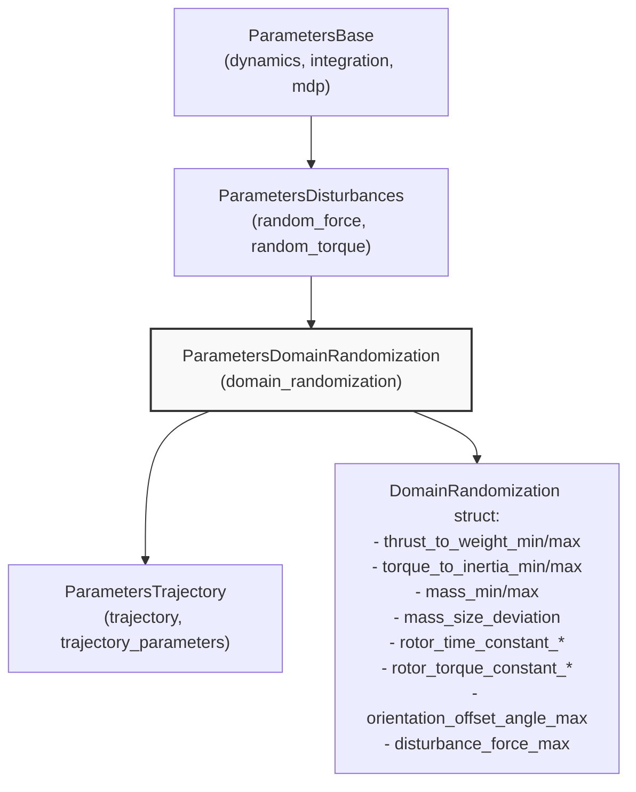
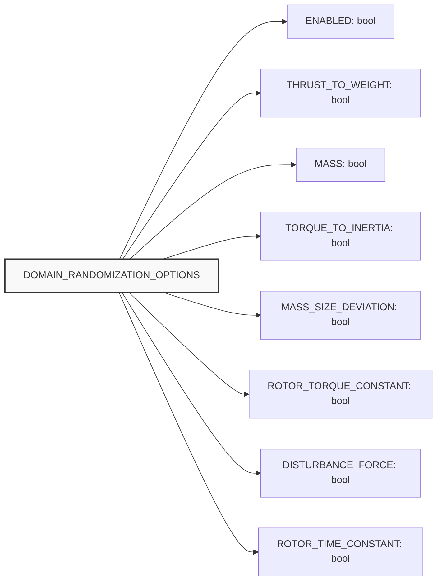
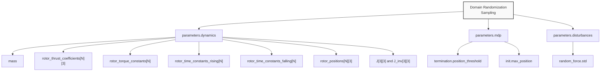

<!-- source: DeepWiki mcp.deepwiki.com · repo rl-tools/rl-tools · extra page Domain Randomization · fetched 2026-10-30 -->

# Domain Randomization

<details>
<summary>Relevant source files</summary>

The following files were used as context for generating this wiki page:

- [include/rl_tools/rl/environments/l2f/multirotor.h](include/rl_tools/rl/environments/l2f/multirotor.h)
- [include/rl_tools/rl/environments/l2f/operations_cpu.h](include/rl_tools/rl/environments/l2f/operations_cpu.h)
- [include/rl_tools/rl/environments/l2f/operations_generic.h](include/rl_tools/rl/environments/l2f/operations_generic.h)
- [include/rl_tools/rl/environments/l2f/operations_generic/10_sample_initial_parameters.h](include/rl_tools/rl/environments/l2f/operations_generic/10_sample_initial_parameters.h)
- [include/rl_tools/rl/environments/l2f/operations_generic/30_sample_initial_state.h](include/rl_tools/rl/environments/l2f/operations_generic/30_sample_initial_state.h)
- [include/rl_tools/rl/environments/l2f/operations_generic/70_post_integration.h](include/rl_tools/rl/environments/l2f/operations_generic/70_post_integration.h)
- [include/rl_tools/rl/environments/l2f/operations_multitask_generic.h](include/rl_tools/rl/environments/l2f/operations_multitask_generic.h)
- [include/rl_tools/rl/environments/l2f/operations_multitask_generic_forward.h](include/rl_tools/rl/environments/l2f/operations_multitask_generic_forward.h)
- [include/rl_tools/rl/environments/l2f/parameters/default.h](include/rl_tools/rl/environments/l2f/parameters/default.h)
- [include/rl_tools/rl/environments/l2f/parameters/dynamics/arpl.h](include/rl_tools/rl/environments/l2f/parameters/dynamics/arpl.h)
- [include/rl_tools/rl/environments/l2f/parameters/dynamics/soft.h](include/rl_tools/rl/environments/l2f/parameters/dynamics/soft.h)
- [include/rl_tools/rl/environments/l2f/parameters/dynamics/soft_rigid.h](include/rl_tools/rl/environments/l2f/parameters/dynamics/soft_rigid.h)
- [include/rl_tools/rl/environments/l2f/parameters/registry.h](include/rl_tools/rl/environments/l2f/parameters/registry.h)
- [include/rl_tools/rl/environments/l2f/parameters/trajectories/lissajous.h](include/rl_tools/rl/environments/l2f/parameters/trajectories/lissajous.h)
- [src/rl/zoo/l2f/environment.h](src/rl/zoo/l2f/environment.h)
- [src/rl/zoo/l2f/environment_big.h](src/rl/zoo/l2f/environment_big.h)
- [src/rl/zoo/l2f/ppo.h](src/rl/zoo/l2f/ppo.h)
- [src/rl/zoo/l2f/sac_big.h](src/rl/zoo/l2f/sac_big.h)

</details>


## Purpose and Scope

This document describes the domain randomization system in the L2F (Learn to Fly) multirotor environment. Domain randomization enables training policies that are robust to variations in physical parameters by sampling different dynamics models during training. This page covers the randomizable parameters, configuration options, and sampling strategies.

For information about the L2F environment architecture and features, see [Learn to Fly (L2F)](#4.2). For trajectory tracking functionality, see [Trajectory Tracking](#4.2.3). For observation composition, see [Observation and State Composition](#4.2.4).

## Overview

Domain randomization in L2F allows sampling variations in physical parameters at the beginning of each episode. The system randomizes dynamics parameters such as mass, inertia, thrust coefficients, and disturbance forces to expose the policy to a distribution of possible multirotor configurations. This improves sim-to-real transfer by training on a diverse set of dynamics models rather than a single nominal model.

The domain randomization system is implemented as a composable parameter component that wraps the base parameters using the linked-list pattern established throughout the L2F environment.

**Sources:** [include/rl_tools/rl/environments/l2f/multirotor.h:106-189](), [include/rl_tools/rl/environments/l2f/operations_generic/10_sample_initial_parameters.h:35-201]()

## Parameter Structure



**Diagram: Domain Randomization Parameter Hierarchy**

Domain randomization is implemented as `ParametersDomainRandomization<SPEC>` which inherits from the next component in the parameter chain and adds a `domain_randomization` field of type `parameters::DomainRandomization<T>`.

**Sources:** [include/rl_tools/rl/environments/l2f/multirotor.h:175-188](), [include/rl_tools/rl/environments/l2f/multirotor.h:106-127]()

## Randomizable Parameters

The following table describes all parameters that can be randomized:

| Parameter | Type | Description | Typical Range |
|-----------|------|-------------|---------------|
| `thrust_to_weight_min/max` | `T` | Ratio of maximum thrust to weight | [1.5, 5.0] |
| `torque_to_inertia_min/max` | `T` | Ratio of maximum torque to moment of inertia | [0.001, 0.100] |
| `mass_min/max` | `T` | Vehicle mass in kg | [0.02, 5.00] |
| `mass_size_deviation` | `T` | Percentage variation of size around nominal value derived from mass scale | 0.1 (10%) |
| `rotor_time_constant_rising_min/max` | `T` | Motor response time when increasing RPM in seconds | [0.0, 0.1] |
| `rotor_time_constant_falling_min/max` | `T` | Motor response time when decreasing RPM in seconds | [0.0, 0.3] |
| `rotor_torque_constant_min/max` | `T` | Torque generated per unit thrust | [0.005, 0.05] |
| `orientation_offset_angle_max` | `T` | Maximum angular offset for IMU mounting misalignment | radians |
| `disturbance_force_max` | `T` | Maximum disturbance force as multiple of surplus thrust | 0.1 (10%) |

**Sources:** [include/rl_tools/rl/environments/l2f/multirotor.h:106-127](), [include/rl_tools/rl/environments/l2f/parameters/default.h:91-123]()

## Configuration Options

Domain randomization is controlled by compile-time options that enable or disable specific randomization features. This allows fine-grained control over which parameters are randomized.



**Diagram: Domain Randomization Configuration Options**

### Default Configuration Templates

The codebase provides two default configuration templates:

1. **Disabled (default)**: `DefaultParametersDomainRandomizationOptions` with all options set to `false`
2. **Enabled**: `DEFAULT_DOMAIN_RANDOMIZATION_OPTIONS<true>` with all options enabled

**Example Configuration:**

```cpp
// Disabled domain randomization
struct DOMAIN_RANDOMIZATION_OPTIONS{
    static constexpr bool ENABLED = false;
    static constexpr bool THRUST_TO_WEIGHT = ENABLED;
    static constexpr bool MASS = ENABLED;
    // ... all other options inherit ENABLED
};
```

**Sources:** [include/rl_tools/rl/environments/l2f/multirotor.h:166-174](), [include/rl_tools/rl/environments/l2f/parameters/default.h:16-26](), [src/rl/zoo/l2f/environment_big.h:27-36]()

## Sampling Strategy

The domain randomization system follows a carefully designed sampling strategy to ensure physically consistent parameter combinations. The strategy is implemented in `_sample_initial_parameters` for `ParametersDomainRandomization`.

```mermaid
flowchart TD
    Start["sample_initial_parameters()"] --> Base["Call base parameters sampling"]
    Base --> T2W_Check{THRUST_TO_WEIGHT<br/>enabled?}
    
    T2W_Check -->|Yes| T2W_Sample["Sample thrust_to_weight<br/>uniform[min, max]<br/>Calculate factor_thrust_to_weight"]
    T2W_Check -->|No| Mass_Check
    T2W_Sample --> Mass_Check
    
    Mass_Check{MASS<br/>enabled?} -->|Yes| Mass_Sample["Sample size uniformly<br/>cube root space<br/>mass = size³<br/>Calculate scale_relative"]
    Mass_Check -->|No| Apply_Thrust
    Mass_Sample --> Apply_Thrust
    
    Apply_Thrust["Apply thrust coefficients:<br/>factor = factor_thrust_to_weight<br/>× factor_mass"] --> Torque_Check
    
    Torque_Check{TORQUE_TO_INERTIA<br/>enabled?} -->|Yes| Torque_Sample["Calculate max_torque<br/>from thrust_to_weight<br/>Sample torque_to_inertia<br/>uniform[min, max]"]
    Torque_Check -->|No| Size_Check
    Torque_Sample --> Size_Check
    
    Size_Check{MASS_SIZE_DEVIATION<br/>enabled?} -->|Yes| Size_Sample["Sample size_factor<br/>using reciprocal scale<br/>rotor_distance_factor =<br/>scale_relative × size_factor"]
    Size_Check -->|No| Inertia_Check
    Size_Sample --> Inertia_Check
    
    Inertia_Check{TORQUE_TO_INERTIA or<br/>MASS_SIZE_DEVIATION?} -->|Yes| Inertia_Update["Update inertia tensor:<br/>inertia_factor =<br/>torque_to_inertia_factor /<br/>rotor_distance_factor<br/>Scale rotor positions<br/>Update termination thresholds"]
    Inertia_Check -->|No| RotorTorque_Check
    Inertia_Update --> RotorTorque_Check
    
    RotorTorque_Check{ROTOR_TORQUE_CONSTANT<br/>enabled?} -->|Yes| RotorTorque_Sample["Sample torque_constant<br/>uniform[min, max]<br/>Apply to all rotors"]
    RotorTorque_Check -->|No| Disturbance_Check
    RotorTorque_Sample --> Disturbance_Check
    
    Disturbance_Check{DISTURBANCE_FORCE<br/>enabled?} -->|Yes| Disturbance_Sample["Calculate surplus_thrust<br/>= max(0, t2w - 1.0)<br/>Sample multiple [0, surplus × max]<br/>Set disturbance std"]
    Disturbance_Check -->|No| TimeConst_Check
    Disturbance_Sample --> TimeConst_Check
    
    TimeConst_Check{ROTOR_TIME_CONSTANT<br/>enabled?} -->|Yes| TimeConst_Sample["Sample rising time constant<br/>Sample falling time constant<br/>Apply to all rotors"]
    TimeConst_Check -->|No| End
    TimeConst_Sample --> End["Return parameters"]
```



**Diagram: Domain Randomization Sampling Workflow**

### Key Sampling Details

1. **Thrust to Weight Sampling**: Uniformly samples between `thrust_to_weight_min` and `thrust_to_weight_max`, then calculates a scaling factor relative to the nominal thrust-to-weight ratio [include/rl_tools/rl/environments/l2f/operations_generic/10_sample_initial_parameters.h:54-75]()

2. **Mass Sampling**: Samples uniformly in cube root space (size) rather than mass space to avoid bias toward larger quadrotors. The mass is then computed as `size³` [include/rl_tools/rl/environments/l2f/operations_generic/10_sample_initial_parameters.h:77-93]()

3. **Reciprocal Scaling**: For `mass_size_deviation`, the system uses reciprocal scaling where negative factors are converted to `1/(1-factor)` to maintain symmetry around the nominal value [include/rl_tools/rl/environments/l2f/operations_generic/10_sample_initial_parameters.h:29-34]()

4. **Physically Consistent Relationships**: The sampling strategy maintains physical consistency by:
   - Adjusting thrust coefficients based on both thrust-to-weight and mass changes
   - Calculating torque-to-inertia ratios based on actual rotor geometry
   - Scaling rotor positions and inertia tensors together
   - Computing disturbance forces relative to surplus thrust capacity

**Sources:** [include/rl_tools/rl/environments/l2f/operations_generic/10_sample_initial_parameters.h:35-201]()

## Implementation

### Core Functions

The domain randomization implementation consists of dispatch functions that handle different parameter types:

| Function | Signature | Purpose |
|----------|-----------|---------|
| `sample_initial_parameters` | `(DEVICE&, Multirotor<SPEC>&, PARAMETERS&, RNG&)` | Public interface, dispatches to specialized implementations |
| `_sample_initial_parameters` | `(DEVICE&, Multirotor<SPEC>&, ParametersDomainRandomization<SPEC>&, RNG&)` | Implements domain randomization sampling logic |
| `_sample_domain_randomization_factor` | `(DEVICE&, T range, RNG&)` | Samples reciprocal-scaled factors for size deviations |

**Sources:** [include/rl_tools/rl/environments/l2f/operations_generic.h:74-78](), [include/rl_tools/rl/environments/l2f/operations_generic/10_sample_initial_parameters.h:17-18]()

### Parameter Updates

After sampling, the following dynamics parameters are updated:



**Diagram: Parameters Modified by Domain Randomization**

**Sources:** [include/rl_tools/rl/environments/l2f/operations_generic/10_sample_initial_parameters.h:86-201]()

### Assertion-Based Validation

The implementation includes extensive assertions to validate configuration consistency. When a randomization option is enabled, the corresponding min/max parameters must be properly configured. When disabled, they must be set to zero. This prevents silent failures due to misconfiguration.

Example assertion pattern:
```cpp
if constexpr(OPTS::THRUST_TO_WEIGHT){
    rl_tools::utils::assert_exit(device, 
        parameters.domain_randomization.thrust_to_weight_min < 
        parameters.domain_randomization.thrust_to_weight_max, 
        "L2f: Domain randomization thrust_to_weight max should be larger than min...");
}
else{
    rl_tools::utils::assert_exit(device, 
        parameters.domain_randomization.thrust_to_weight_min == 0 && 
        parameters.domain_randomization.thrust_to_weight_max == 0, 
        "L2f: Domain randomization thrust_to_weight max/min should be 0 if THRUST_TO_WEIGHT is false...");
}
```

**Sources:** [include/rl_tools/rl/environments/l2f/operations_generic/10_sample_initial_parameters.h:67-200]()

## Integration with Training

Domain randomization is triggered at episode initialization when `SAMPLE_ENVIRONMENT_PARAMETERS` is enabled in the training loop configuration. For off-policy algorithms like SAC and TD3, this is controlled by the `LOOP_CORE_PARAMETERS::SAMPLE_ENVIRONMENT_PARAMETERS` flag.

**Example Configuration (SAC):**

```cpp
struct LOOP_CORE_PARAMETERS: rl::algorithms::sac::loop::core::DefaultParameters<...>{
    static constexpr bool SAMPLE_ENVIRONMENT_PARAMETERS = true;
    // ...
};
```

When enabled, the training loop calls `sample_initial_parameters` before each episode reset, ensuring the policy trains on diverse dynamics.

**Sources:** [src/rl/zoo/l2f/sac_big.h:64](), [include/rl_tools/rl/environments/l2f/operations_generic/10_sample_initial_parameters.h:35-201]()

## Configuration Examples

### Example 1: Disabled Domain Randomization

```cpp
struct DOMAIN_RANDOMIZATION_OPTIONS{
    static constexpr bool ENABLED = false;
    static constexpr bool THRUST_TO_WEIGHT = ENABLED;
    static constexpr bool MASS = ENABLED;
    static constexpr bool TORQUE_TO_INERTIA = ENABLED;
    static constexpr bool MASS_SIZE_DEVIATION = ENABLED;
    static constexpr bool ROTOR_TORQUE_CONSTANT = ENABLED;
    static constexpr bool DISTURBANCE_FORCE = ENABLED;
    static constexpr bool ROTOR_TIME_CONSTANT = ENABLED;
};

static constexpr typename PARAMETERS_TYPE::DomainRandomization domain_randomization = {
    0, // thrust_to_weight_min
    0, // thrust_to_weight_max
    0, // torque_to_inertia_min
    0, // torque_to_inertia_max
    0, // mass_min
    0, // mass_max
    0, // mass_size_deviation
    0, // rotor_time_constant_rising_min
    0, // rotor_time_constant_rising_max
    0, // rotor_time_constant_falling_min
    0, // rotor_time_constant_falling_max
    0, // rotor_torque_constant_min
    0, // rotor_torque_constant_max
    0, // orientation_offset_angle_max
    0  // disturbance_force_max
};
```

**Sources:** [src/rl/zoo/l2f/environment_big.h:27-95]()

### Example 2: Full Domain Randomization

```cpp
static constexpr typename PARAMETERS_TYPE::DomainRandomization domain_randomization = {
    1.5,  // thrust_to_weight_min
    5.0,  // thrust_to_weight_max
    0.001, // torque_to_inertia_min
    0.100, // torque_to_inertia_max
    0.02,  // mass_min
    5.00,  // mass_max
    0.1,   // mass_size_deviation (10%)
    0.0,   // rotor_time_constant_rising_min
    0.0,   // rotor_time_constant_rising_max
    0.0,   // rotor_time_constant_falling_min
    0.0,   // rotor_time_constant_falling_max
    0.005, // rotor_torque_constant_min
    0.05,  // rotor_torque_constant_max
    0.0,   // orientation_offset_angle_max
    0.1    // disturbance_force_max (10%)
};
```

**Sources:** [include/rl_tools/rl/environments/l2f/parameters/default.h:91-123]()

## Serialization and Inspection

Domain randomization parameters can be exported to JSON format for logging and analysis. The `json()` function for `ParametersDomainRandomization` serializes all randomization ranges:

```cpp
template <typename DEVICE, typename SPEC, typename PARAM_SPEC>
std::string json(DEVICE& device, 
                 const rl::environments::Multirotor<SPEC>& env, 
                 const rl::environments::l2f::parameters::DomainRandomization<PARAM_SPEC>& parameters)
```

This allows inspection of the sampled parameters during training and evaluation.

**Sources:** [include/rl_tools/rl/environments/l2f/operations_cpu.h:359-386]()

---

