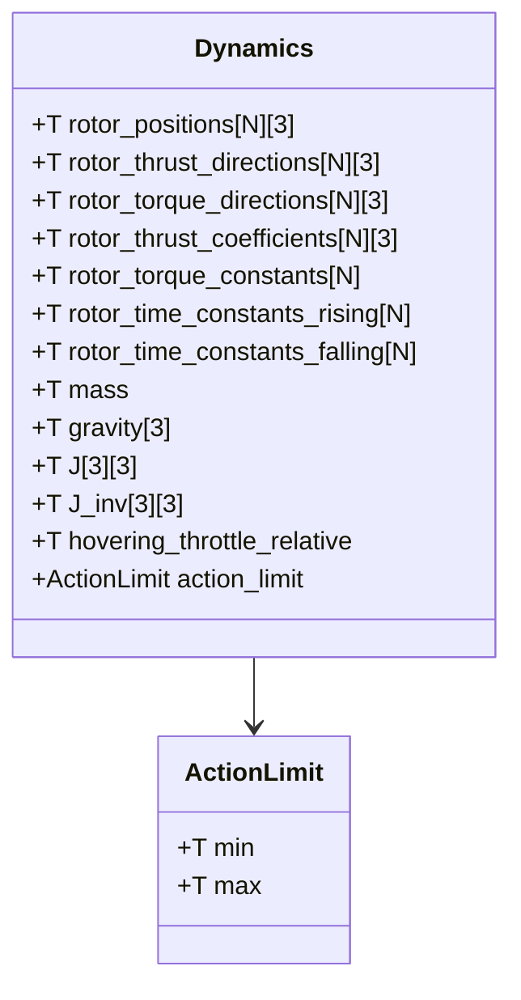
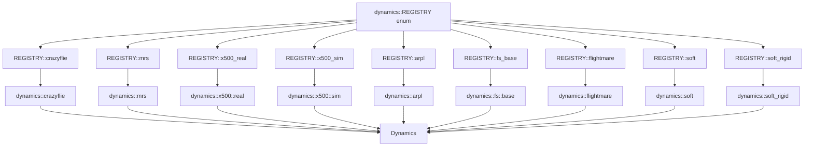
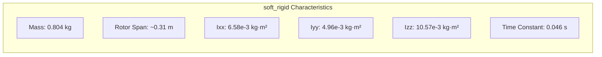
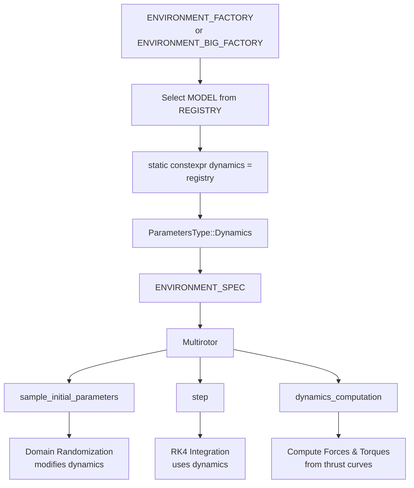
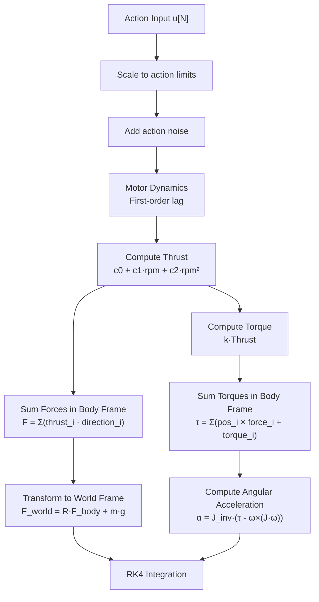

<!-- source: DeepWiki mcp.deepwiki.com · repo rl-tools/rl-tools · extra page Multirotor Dynamics and Model Registry · fetched 2026-10-30 -->

# Multirotor Dynamics and Model Registry

<details>
<summary>Relevant source files</summary>

The following files were used as context for generating this wiki page:

- [include/rl_tools/rl/environments/l2f/multirotor.h](include/rl_tools/rl/environments/l2f/multirotor.h)
- [include/rl_tools/rl/environments/l2f/operations_cpu.h](include/rl_tools/rl/environments/l2f/operations_cpu.h)
- [include/rl_tools/rl/environments/l2f/operations_generic.h](include/rl_tools/rl/environments/l2f/operations_generic.h)
- [include/rl_tools/rl/environments/l2f/operations_generic/10_sample_initial_parameters.h](include/rl_tools/rl/environments/l2f/operations_generic/10_sample_initial_parameters.h)
- [include/rl_tools/rl/environments/l2f/operations_generic/30_sample_initial_state.h](include/rl_tools/rl/environments/l2f/operations_generic/30_sample_initial_state.h)
- [include/rl_tools/rl/environments/l2f/operations_generic/70_post_integration.h](include/rl_tools/rl/environments/l2f/operations_generic/70_post_integration.h)
- [include/rl_tools/rl/environments/l2f/operations_multitask_generic.h](include/rl_tools/rl/environments/l2f/operations_multitask_generic.h)
- [include/rl_tools/rl/environments/l2f/operations_multitask_generic_forward.h](include/rl_tools/rl/environments/l2f/operations_multitask_generic_forward.h)
- [include/rl_tools/rl/environments/l2f/parameters/default.h](include/rl_tools/rl/environments/l2f/parameters/default.h)
- [include/rl_tools/rl/environments/l2f/parameters/dynamics/arpl.h](include/rl_tools/rl/environments/l2f/parameters/dynamics/arpl.h)
- [include/rl_tools/rl/environments/l2f/parameters/dynamics/soft.h](include/rl_tools/rl/environments/l2f/parameters/dynamics/soft.h)
- [include/rl_tools/rl/environments/l2f/parameters/dynamics/soft_rigid.h](include/rl_tools/rl/environments/l2f/parameters/dynamics/soft_rigid.h)
- [include/rl_tools/rl/environments/l2f/parameters/registry.h](include/rl_tools/rl/environments/l2f/parameters/registry.h)
- [include/rl_tools/rl/environments/l2f/parameters/trajectories/lissajous.h](include/rl_tools/rl/environments/l2f/parameters/trajectories/lissajous.h)
- [src/rl/zoo/l2f/environment.h](src/rl/zoo/l2f/environment.h)
- [src/rl/zoo/l2f/environment_big.h](src/rl/zoo/l2f/environment_big.h)
- [src/rl/zoo/l2f/ppo.h](src/rl/zoo/l2f/ppo.h)
- [src/rl/zoo/l2f/sac_big.h](src/rl/zoo/l2f/sac_big.h)

</details>


## Purpose and Scope

This page documents the multirotor physics model and dynamics registry system in the L2F (Learn to Fly) environment. It explains the `Dynamics` data structure that encapsulates rotor configurations, thrust/torque curves, inertia properties, and mass parameters. The registry provides 9+ pre-defined multirotor models ranging from micro-quadrotors (Crazyflie) to larger platforms (X500, ARPL). For information about domain randomization of these parameters, see [4.2.2](#4.2.2). For trajectory tracking features, see [4.2.3](#4.2.3).

**Sources:** [include/rl_tools/rl/environments/l2f/multirotor.h:14-44](), [include/rl_tools/rl/environments/l2f/parameters/registry.h:1-85]()

---

## Dynamics Data Structure

The core physics model is represented by the `Dynamics<T, TI, N>` structure, where `T` is the floating-point type, `TI` is the integer type, and `N` is the number of rotors (typically 4 for quadrotors).

### Structure Definition



**Dynamics Structure Components:**

| Field | Dimensions | Description |
|-------|-----------|-------------|
| `rotor_positions` | `[N][3]` | 3D position of each rotor in body frame (meters) |
| `rotor_thrust_directions` | `[N][3]` | Unit vector indicating thrust direction for each rotor |
| `rotor_torque_directions` | `[N][3]` | Unit vector indicating reactive torque direction |
| `rotor_thrust_coefficients` | `[N][3]` | Polynomial coefficients [c₀, c₁, c₂] for thrust curve |
| `rotor_torque_constants` | `[N]` | Torque-to-thrust ratio for each rotor |
| `rotor_time_constants_rising` | `[N]` | First-order lag when rotor spins up (seconds) |
| `rotor_time_constants_falling` | `[N]` | First-order lag when rotor spins down (seconds) |
| `mass` | scalar | Total vehicle mass (kg) |
| `gravity` | `[3]` | Gravity vector (typically [0, 0, -9.81]) |
| `J` | `[3][3]` | Inertia matrix (kg·m²) |
| `J_inv` | `[3][3]` | Inverse inertia matrix |
| `hovering_throttle_relative` | scalar | Relative throttle [0,1] needed to hover |
| `action_limit` | struct | Min/max bounds for rotor commands |

**Sources:** [include/rl_tools/rl/environments/l2f/multirotor.h:25-44]()

---

## Model Registry

The registry system provides a compile-time mechanism to select from pre-defined multirotor models using an enum-based dispatch.

### Registry Architecture



### Using the Registry

Models are selected using the `registry` template variable:

```cpp
// Example: Select Crazyflie model
static constexpr auto MODEL = parameters::dynamics::REGISTRY::crazyflie;
static constexpr auto dynamics = parameters::dynamics::registry<MODEL, SPEC>;

// Get model name as string
constexpr auto MODEL_NAME = parameters::dynamics::registry_name<MODEL>;
// Returns: "crazyflie"
```

**Sources:** [include/rl_tools/rl/environments/l2f/parameters/registry.h:18-84](), [src/rl/zoo/l2f/environment_big.h:23-24]()

---

## Physics Model Components

### Rotor Configuration

Each rotor is characterized by its spatial position and the directions in which it produces forces and torques:

- **Position**: 3D coordinates in the body frame define where thrust is applied
- **Thrust Direction**: Unit vector (typically [0, 0, 1] for upward thrust)
- **Torque Direction**: Reactive torque axis (alternates ±1 in z-direction for counter-rotating props)

**Example Configuration** (Crazyflie-style X-configuration):
```
Rotor layout:
    2 (+)     3 (+)
       \     /
         \ /
         / \
       /     \
    0 (-)     1 (-)
    
(+) = positive torque, (-) = negative torque
```

**Sources:** [include/rl_tools/rl/environments/l2f/parameters/dynamics/soft.h:11-47]()

### Thrust and Torque Models

#### Thrust Curve

Thrust is modeled as a polynomial function of the rotor command:

```
Thrust = c₀ + c₁·u + c₂·u²
```

where `u` is the normalized rotor command in `[action_limit.min, action_limit.max]`, and `[c₀, c₁, c₂]` are the `rotor_thrust_coefficients`.

#### Reactive Torque

Each rotor produces a reactive torque proportional to its thrust:

```
Torque = rotor_torque_constant · Thrust
```

The torque direction is given by `rotor_torque_directions[i]`, which alternates between rotors to enable yaw control.

#### Motor Dynamics

Rotor commands are filtered through first-order lag dynamics to simulate motor response:

```
τ = (u ≥ rpm) ? rotor_time_constants_rising : rotor_time_constants_falling
α = exp(-dt / τ)
rpm_next = α·rpm + (1-α)·u
```

This captures the asymmetric response of motors spinning up vs. down.

**Sources:** [include/rl_tools/rl/environments/l2f/operations_generic/70_post_integration.h:114-122](), [include/rl_tools/rl/environments/l2f/parameters/dynamics/soft.h:49-69]()

### Inertia Properties

The inertia matrix `J` and its inverse `J_inv` define rotational dynamics:

```
τ = J · α + ω × (J · ω)
α = J_inv · (τ - ω × (J · ω))
```

where:
- `τ` = applied torque vector
- `α` = angular acceleration
- `ω` = angular velocity
- `×` = cross product

Most models use diagonal inertia matrices assuming symmetry:

```
J = [ Ixx   0    0  ]
    [  0   Iyy   0  ]
    [  0    0   Izz ]
```

**Sources:** [include/rl_tools/rl/environments/l2f/multirotor.h:40-41]()

---

## Pre-defined Models

The registry includes diverse multirotor platforms with varying characteristics:

### Model Comparison Table

| Model | Mass (kg) | Rotor Distance (m) | Thrust-to-Weight | Motor Time Constant (s) | Description |
|-------|-----------|-------------------|------------------|------------------------|-------------|
| `crazyflie` | 0.027 | ~0.04 | ~2.1 | 0.02-0.05 | Bitcraze Crazyflie 2.X micro-quadrotor |
| `mrs` | 1.5 | ~0.25 | ~2.5 | 0.03-0.15 | MRS UAV System research platform |
| `x500_real` | 1.8-2.0 | ~0.25 | ~2.0 | 0.03-0.10 | Holybro X500 (real hardware) |
| `x500_sim` | Similar | Similar | Similar | Similar | X500 simulation model |
| `arpl` | 0.782 | ~0.10 | ~1.7 | 0.033 | ARPL lab platform |
| `fs_base` | Variable | Variable | Variable | Variable | FS baseline configuration |
| `flightmare` | Variable | Variable | Variable | Variable | Flightmare simulator model |
| `soft` | 0.970 | ~0.20 | ~1.7 | 0.040 | Soft-arm quadrotor |
| `soft_rigid` | 0.804 | ~0.20 | ~1.6 | 0.046 | Soft-rigid hybrid |

### Example: ARPL Model

```cpp
template<typename T, typename TI>
constexpr Dynamics<T, TI, 4> arpl = {
    // Rotor positions (X-configuration)
    {{0.0775, -0.0981, 0}, {-0.0775, 0.0981, 0},
     {0.0775, 0.0981, 0}, {-0.0775, -0.0981, 0}},
    
    // Thrust directions (all upward)
    {{0, 0, 1}, {0, 0, 1}, {0, 0, 1}, {0, 0, 1}},
    
    // Torque directions (alternating)
    {{0, 0, -1}, {0, 0, -1}, {0, 0, +1}, {0, 0, +1}},
    
    // Thrust coefficients (polynomial)
    {{-0.5300, 8.9714, -0.8911}, ...},
    
    // Torque constants
    {0.005965, 0.005965, 0.005965, 0.005965},
    
    // Time constants
    {0.033, 0.033, 0.033, 0.033},  // rising
    {0.033, 0.033, 0.033, 0.033},  // falling
    
    // Mass
    0.782,
    
    // Gravity
    {0, 0, -9.81},
    
    // Inertia and inverse
    {{1.7665e-3, 0, 0}, {0, 1.3766e-3, 0}, {0, 0, 2.95e-3}},
    {{566.14, 0, 0}, {0, 726.57, 0}, {0, 0, 338.98}},
    
    // Hovering throttle
    0.1310,
    
    // Action limits
    {0.0, 1.0}
};
```

**Sources:** [include/rl_tools/rl/environments/l2f/parameters/dynamics/arpl.h:9-108]()

### Example: Soft-Rigid Model

The `soft_rigid` model represents a quadrotor with soft arms and rigid body:



This model features:
- Non-quadratic thrust curve: `[-0.334, 6.091, 0.782]`
- Higher torque constant: `0.0176`
- Slower motor response: `0.046s` vs. Crazyflie's `0.02-0.05s`
- Asymmetric inertia reflecting arm flexibility

**Sources:** [include/rl_tools/rl/environments/l2f/parameters/dynamics/soft_rigid.h:9-114]()

---

## Integration with Environment

### Dynamics in Environment Configuration



### Usage in Training Configuration

The dynamics model is selected at compile-time in environment factory classes:

```cpp
template <typename DEVICE, typename TYPE_POLICY, typename TI, typename OPTIONS>
struct ENVIRONMENT_BIG_FACTORY {
    // Select model from registry
    static constexpr auto MODEL = parameters::dynamics::REGISTRY::soft_rigid;
    
    // Get model name for logging
    constexpr static auto MODEL_NAME = 
        rl_tools::rl::environments::l2f::parameters::dynamics::registry_name<MODEL>;
    
    // Instantiate dynamics
    static constexpr auto dynamics = 
        parameters::dynamics::registry<MODEL, PARAMETERS_SPEC>;
    
    // Include in nominal parameters
    static constexpr PARAMETERS_TYPE nominal_parameters = {
        {{{{dynamics, integration, mdp}, ...}, ...}, ...}, ...
    };
};
```

**Sources:** [src/rl/zoo/l2f/environment_big.h:23-48]()

### Runtime Dynamics Selection

For multitask learning, dynamics can be sampled from an array at episode initialization:

```cpp
struct ENVIRONMENT_STATIC_PARAMETERS {
    static constexpr TI N_DYNAMICS_VALUES = 1;
    static constexpr typename PARAMETERS_TYPE::Dynamics DYNAMICS_VALUES[N_DYNAMICS_VALUES] = {
        rl_tools::rl::environments::l2f::parameters::dynamics::registry<
            parameters::dynamics::REGISTRY::crazyflie, PARAMETERS_SPEC>
    };
};

// At episode reset:
TI index = random::uniform_int_distribution(device.random, (TI)0, 
    (TI)(N_DYNAMICS_VALUES - 1), rng);
parameters.dynamics = SPEC::STATIC_PARAMETERS::DYNAMICS_VALUES[index];
```

**Sources:** [src/rl/zoo/l2f/environment_big.h:136-139](), [include/rl_tools/rl/environments/l2f/operations_multitask_generic.h:29-31]()

---

## Dynamics Computation in Simulation

The dynamics parameters are used during each simulation step in the multirotor physics:

### Force and Torque Calculation Flow



The actual computation occurs in the dynamics function dispatched during integration:

```cpp
template<typename DEVICE, typename T, typename PARAMETERS, typename STATE>
static void multirotor_dynamics_dispatch(
    DEVICE& device, 
    const PARAMETERS& parameters, 
    const STATE& state, 
    const T action[4], 
    STATE& state_change
) {
    // Compute thrust from each rotor
    for (TI rotor_i = 0; rotor_i < 4; rotor_i++) {
        T rpm = state.rpm[rotor_i];
        T thrust = parameters.dynamics.rotor_thrust_coefficients[rotor_i][0] +
                    parameters.dynamics.rotor_thrust_coefficients[rotor_i][1] * rpm +
                    parameters.dynamics.rotor_thrust_coefficients[rotor_i][2] * rpm * rpm;
        
        // Apply thrust in body frame
        // Apply reactive torque
        // ...
    }
    
    // Transform forces to world frame and compute accelerations
    // state_change.linear_velocity = acceleration
    // state_change.angular_velocity = angular_acceleration
}
```

**Sources:** [include/rl_tools/rl/environments/l2f/operations_generic.h:95-129](), [include/rl_tools/rl/environments/l2f/operations_generic/60_dynamics.h]() (referenced but truncated in provided files)

---

## Summary

The multirotor dynamics and model registry system provides:

1. **Flexible Physics Modeling**: The `Dynamics<T, TI, N>` structure encapsulates all physical parameters needed for accurate quadrotor simulation
2. **Multiple Pre-defined Models**: 9+ models covering micro (Crazyflie) to research-scale (X500) platforms
3. **Compile-time Selection**: Registry enum enables efficient, type-safe model selection
4. **Realistic Motor Dynamics**: First-order lag with asymmetric rise/fall times
5. **Polynomial Thrust Curves**: Captures nonlinear actuator behavior
6. **Full 6-DOF Dynamics**: Position, orientation, linear and angular velocities with proper inertia modeling

The system is designed for both single-model training and multitask learning scenarios where agents must generalize across different platform dynamics.

**Sources:** [include/rl_tools/rl/environments/l2f/multirotor.h:1-90](), [include/rl_tools/rl/environments/l2f/parameters/registry.h:1-85](), [include/rl_tools/rl/environments/l2f/operations_generic.h:35-130]()

---

