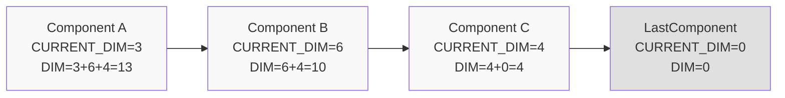
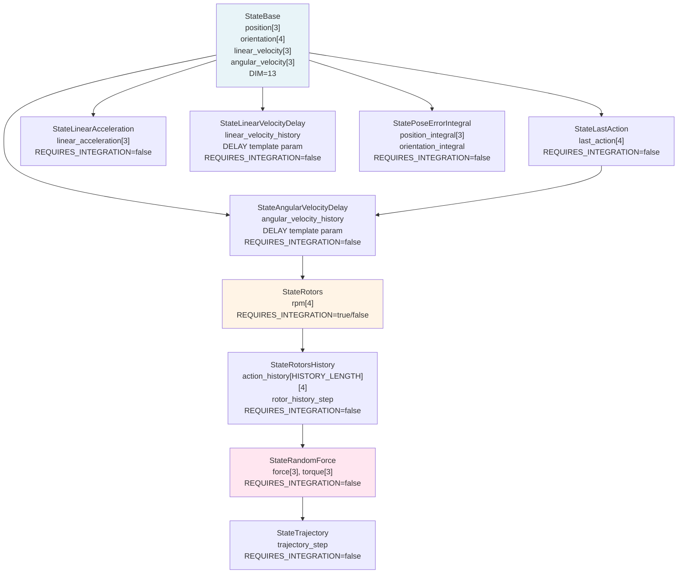
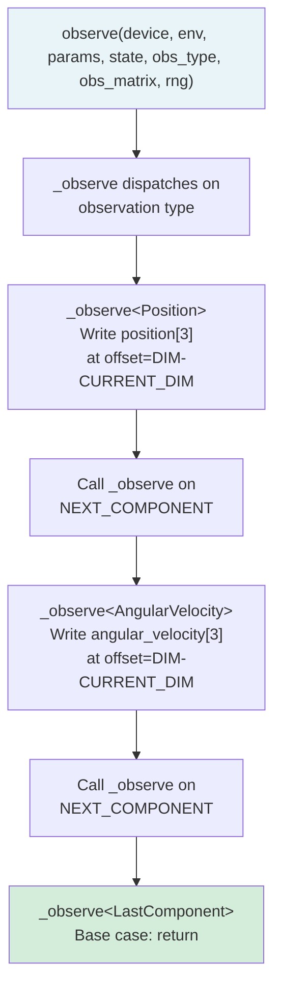

<!-- source: DeepWiki mcp.deepwiki.com · repo rl-tools/rl-tools · extra page Observation and State Composition · fetched 2026-10-30 -->

# Observation and State Composition

<details>
<summary>Relevant source files</summary>

The following files were used as context for generating this wiki page:

- [include/rl_tools/rl/environments/l2f/multirotor.h](include/rl_tools/rl/environments/l2f/multirotor.h)
- [include/rl_tools/rl/environments/l2f/operations_cpu.h](include/rl_tools/rl/environments/l2f/operations_cpu.h)
- [include/rl_tools/rl/environments/l2f/operations_generic.h](include/rl_tools/rl/environments/l2f/operations_generic.h)
- [include/rl_tools/rl/environments/l2f/operations_generic/10_sample_initial_parameters.h](include/rl_tools/rl/environments/l2f/operations_generic/10_sample_initial_parameters.h)
- [include/rl_tools/rl/environments/l2f/operations_generic/30_sample_initial_state.h](include/rl_tools/rl/environments/l2f/operations_generic/30_sample_initial_state.h)
- [include/rl_tools/rl/environments/l2f/operations_generic/70_post_integration.h](include/rl_tools/rl/environments/l2f/operations_generic/70_post_integration.h)
- [include/rl_tools/rl/environments/l2f/operations_multitask_generic.h](include/rl_tools/rl/environments/l2f/operations_multitask_generic.h)
- [include/rl_tools/rl/environments/l2f/operations_multitask_generic_forward.h](include/rl_tools/rl/environments/l2f/operations_multitask_generic_forward.h)
- [include/rl_tools/rl/environments/l2f/parameters/default.h](include/rl_tools/rl/environments/l2f/parameters/default.h)
- [include/rl_tools/rl/environments/l2f/parameters/trajectories/lissajous.h](include/rl_tools/rl/environments/l2f/parameters/trajectories/lissajous.h)
- [src/rl/zoo/l2f/environment.h](src/rl/zoo/l2f/environment.h)
- [src/rl/zoo/l2f/environment_big.h](src/rl/zoo/l2f/environment_big.h)
- [src/rl/zoo/l2f/ppo.h](src/rl/zoo/l2f/ppo.h)
- [src/rl/zoo/l2f/sac_big.h](src/rl/zoo/l2f/sac_big.h)

</details>


## Purpose and Scope

This page explains the composable observation and state system used in the L2F (Learn to Fly) multirotor environment. The system allows flexible construction of observation and state representations by chaining together modular components using a linked-list pattern. This design enables:

- Compile-time composition of observations with automatic dimension calculation
- Mix-and-match of state components to match different simulation requirements
- Separation between actor observations and privileged critic observations
- Zero runtime overhead through template-based composition

For information about the L2F environment itself, see [4.2](#4.2). For trajectory tracking features, see [4.2.3](#4.2.3). For domain randomization parameters, see [4.2.2](#4.2.2).

---

## Linked-List Composition Pattern

The observation and state systems use a compile-time linked-list pattern where each component:

1. Defines its own dimensionality (`CURRENT_DIM`)
2. References the next component in the chain (`NEXT_COMPONENT`)
3. Calculates total dimensionality recursively (`DIM = NEXT_COMPONENT::DIM + CURRENT_DIM`)
4. Terminates with `LastComponent` which has zero dimensions

### Composition Structure



**Diagram: Linked-list composition pattern with recursive dimension calculation**

Each component specification defines a `NEXT_COMPONENT` type parameter, creating a chain that terminates at `LastComponent<TI>`. Operations on composed types dispatch recursively through the chain.

**Sources:** [include/rl_tools/rl/environments/l2f/multirotor.h:237-261]()

---

## Observation Components

Observation components define what information is available to the policy or critic. Each component adds specific sensory or state information to the observation vector.

### Core Observation Types

| Component | Specification | Dimensions | Description |
|-----------|--------------|------------|-------------|
| `Position` | `PositionSpecification<T, TI, NEXT>` | 3 | World-frame position (x, y, z) |
| `OrientationQuaternion` | `OrientationQuaternionSpecification<T, TI, NEXT>` | 4 | Orientation as quaternion (w, x, y, z) |
| `OrientationRotationMatrix` | `OrientationRotationMatrixSpecification<T, TI, NEXT>` | 9 | Orientation as flattened 3×3 rotation matrix |
| `LinearVelocity` | `LinearVelocitySpecification<T, TI, NEXT>` | 3 | Body-frame linear velocity |
| `AngularVelocity` | `AngularVelocitySpecification<T, TI, NEXT>` | 3 | Body-frame angular velocity |
| `IMUAccelerometer` | `IMUAccelerometerSpecification<T, TI, NEXT>` | 3 | Simulated IMU acceleration measurement |
| `Magnetometer` | `MagnetometerSpecification<T, TI, NEXT>` | 2 | Simulated magnetometer (projected to 2D) |

**Sources:** [include/rl_tools/rl/environments/l2f/multirotor.h:264-404]()

### Delayed Observations

Delayed observations model sensor latency by providing historical values:

| Component | Specification | Dimensions | Description |
|-----------|--------------|------------|-------------|
| `AngularVelocityDelayed` | `AngularVelocityDelayedSpecification<T, TI, DELAY, NEXT>` | 3 | Angular velocity delayed by `DELAY` steps |
| `LinearVelocityDelayed` | `LinearVelocityDelayedSpecification<T, TI, DELAY, NEXT>` | 3 | Linear velocity delayed by `DELAY` steps |

These components access historical state maintained by corresponding state components (`StateAngularVelocityDelay`, `StateLinearVelocityDelay`).

**Sources:** [include/rl_tools/rl/environments/l2f/multirotor.h:405-446]()

### Action History Observations

```cpp
template <typename SPEC>
struct ActionHistory{
    static constexpr TI HISTORY_LENGTH = SPEC::HISTORY_LENGTH;
    static constexpr TI ACTION_DIM = 4;
    static constexpr TI CURRENT_DIM = ACTION_DIM * HISTORY_LENGTH;
    static constexpr TI DIM = NEXT_COMPONENT::DIM + CURRENT_DIM;
};
```

`ActionHistory` provides the last `HISTORY_LENGTH` actions taken, useful for making partially observable environments Markovian with respect to action-dependent dynamics (e.g., motor delays).

**Sources:** [include/rl_tools/rl/environments/l2f/multirotor.h:477-493]()

### Trajectory Tracking Observations

These components provide error signals relative to a desired trajectory:

| Component | Dimensions | Description |
|-----------|------------|-------------|
| `TrajectoryTrackingPosition` | 3 | Position error: desired - current |
| `TrajectoryTrackingLinearVelocity` | 3 | Velocity error: desired - current |
| `TrajectoryTrackingLookahead` | 6 × N_STEPS | Future trajectory waypoints |

**Sources:** [include/rl_tools/rl/environments/l2f/multirotor.h:566-614]()

### Domain Randomization Parameter Observations

For multitask learning, these components expose randomized dynamics parameters:

| Component | Dimensions | Description |
|-----------|------------|-------------|
| `ParametersMotorPosition` | N × 3 | Rotor position coordinates |
| `ParametersThrustCurves` | N × 3 | Thrust polynomial coefficients per rotor |
| `ParametersMass` | 1 | Total vehicle mass |
| `ParametersInertia` | 9 | Flattened inertia matrix |

**Sources:** [include/rl_tools/rl/environments/l2f/multirotor.h:508-565]()

---

## State Components

State components represent the full simulation state, including aspects not directly observable. States evolve through integration and discrete updates.

### State Component Hierarchy



**Diagram: State component inheritance and composition patterns**

**Sources:** [include/rl_tools/rl/environments/l2f/multirotor.h:624-783]()

### Core State: StateBase

`StateBase<SPEC>` provides the fundamental rigid-body state:

```cpp
template <typename T_SPEC>
struct StateBase{
    static constexpr bool REQUIRES_INTEGRATION = true;
    static constexpr TI DIM = 13;
    T position[3];        // World-frame position
    T orientation[4];     // Quaternion (w, x, y, z)
    T linear_velocity[3]; // Body-frame linear velocity
    T angular_velocity[3];// Body-frame angular velocity
};
```

This state evolves through numerical integration using RK4 integrator in the step function.

**Sources:** [include/rl_tools/rl/environments/l2f/multirotor.h:624-635]()

### Actuator State: StateRotors and StateRotorsHistory

`StateRotors<SPEC>` tracks rotor speeds (RPM) with optional first-order dynamics:

- When `CLOSED_FORM=true`: Rotor dynamics handled analytically in `post_integration`
- When `CLOSED_FORM=false`: Rotor derivatives computed, integrated numerically

`StateRotorsHistory<SPEC>` extends this by maintaining an action history ring buffer indexed by `rotor_history_step`.

**Sources:** [include/rl_tools/rl/environments/l2f/multirotor.h:684-733](), [include/rl_tools/rl/environments/l2f/operations_generic/70_post_integration.h:109-148]()

### Disturbance State: StateRandomForce

`StateRandomForce<SPEC>` adds persistent random forces and torques sampled at episode initialization:

```cpp
struct StateRandomForce: NEXT_COMPONENT{
    static constexpr bool REQUIRES_INTEGRATION = false;
    T force[3];   // Persistent force in world frame
    T torque[3];  // Persistent torque in body frame
};
```

These disturbances remain constant throughout an episode but vary across episodes when domain randomization is enabled.

**Sources:** [include/rl_tools/rl/environments/l2f/multirotor.h:743-760](), [include/rl_tools/rl/environments/l2f/operations_generic/30_sample_initial_state.h:135-163]()

### Trajectory State: StateTrajectory

`StateTrajectory<SPEC>` adds a step counter for trajectory tracking:

```cpp
struct StateTrajectory: NEXT_COMPONENT{
    static constexpr bool REQUIRES_INTEGRATION = false;
    TI trajectory_step;  // Increments each environment step
};
```

This counter indexes into the precomputed trajectory defined in parameters.

**Sources:** [include/rl_tools/rl/environments/l2f/multirotor.h:761-783]()

---

## Privileged Observations for Critics

Many observation components support privileged variants that expose information unavailable to the policy but useful for critic learning. This implements asymmetric actor-critic architectures.

### Privileged Component Variants

Each observation component has a corresponding privileged specification:

```cpp
// Non-privileged
template <typename T, typename TI, typename NEXT>
struct PositionSpecification{
    static constexpr bool PRIVILEGED = false;
};

// Privileged variant
template <typename T, typename TI, typename NEXT>
struct PositionSpecificationPrivileged: PositionSpecification<T, TI, NEXT>{
    static constexpr bool PRIVILEGED = true;
};
```

Privileged observations can include:
- True state values without observation noise (when `PRIVILEGED_OBSERVATION_NOISE = false`)
- Hidden state like `RandomForce` disturbances
- Ground-truth rotor speeds
- Full inertia and mass parameters

### Example: Asymmetric Actor-Critic Configuration

```cpp
// Actor observation (partial observability)
using OBSERVATION_TYPE = observation::Position<
    observation::OrientationRotationMatrix<
    observation::LinearVelocity<
    observation::AngularVelocity<
    observation::ActionHistory<...>>>>>;

// Critic observation (privileged)
using OBSERVATION_TYPE_PRIVILEGED = observation::Position<
    observation::OrientationRotationMatrix<
    observation::LinearVelocity<
    observation::AngularVelocity<
    observation::RandomForce<      // Privileged: true disturbances
    observation::RotorSpeeds<      // Privileged: true rotor speeds
    ...>>>>>>;
```

**Sources:** [src/rl/zoo/l2f/environment.h:141-151](), [include/rl_tools/rl/environments/l2f/multirotor.h:269-274]()

---

## Dimension Calculation and Type Metadata

The dimension of a composed observation/state is computed recursively at compile time:

```cpp
template <typename SPEC>
struct Position{
    using NEXT_COMPONENT = typename SPEC::NEXT_COMPONENT;
    static constexpr TI CURRENT_DIM = 3;
    static constexpr TI DIM = NEXT_COMPONENT::DIM + CURRENT_DIM;
};

template <typename TI>
struct LastComponent{
    static constexpr TI CURRENT_DIM = 0;
    static constexpr TI DIM = 0;
};
```

For a composition `Position<AngularVelocity<LastComponent>>`:
- `LastComponent::DIM = 0`
- `AngularVelocity::DIM = 3 + 0 = 3`
- `Position::DIM = 3 + 3 = 6`

This enables compile-time allocation of observation buffers with correct dimensions.

**Sources:** [include/rl_tools/rl/environments/l2f/multirotor.h:237-283]()

---

## Operations on Composed Types

Operations on composed observations and states use a dispatch pattern that recursively processes each component in the chain.

### Observation Dispatch Pattern



**Diagram: Recursive dispatch for observation composition**

Each component's `_observe` implementation:
1. Calls `_observe` on the next component (recursive case)
2. Writes its own data at the appropriate offset in the observation matrix
3. Base case: `_observe<LastComponent>` does nothing

**Sources:** [include/rl_tools/rl/environments/l2f/operations_generic.h:87-92]()

### State Initialization Dispatch

State initialization follows the same pattern:

```cpp
template<typename DEVICE, typename SPEC, typename PARAMETERS, typename STATE, typename RNG>
void _sample_initial_state(DEVICE& device, Multirotor<SPEC>& env, 
                           PARAMETERS& parameters, STATE& state, RNG& rng);
```

Each state component's implementation:
1. Calls `sample_initial_state` on `NEXT_COMPONENT` (via public dispatch function)
2. Initializes its own state fields

For example, `StateRotorsHistory` initializes the action history buffer and step counter after the base state is initialized.

**Sources:** [include/rl_tools/rl/environments/l2f/operations_generic/30_sample_initial_state.h:196-207]()

### Post-Integration Updates

After numerical integration, discrete state components are updated in `post_integration`:

```cpp
template<typename DEVICE, typename SPEC, typename PARAMETERS, 
         typename STATE_SPEC, typename ACTION_SPEC, typename RNG>
void post_integration(DEVICE& device, const Multirotor<SPEC>& env, 
                     PARAMETERS& parameters, const STATE& state, 
                     const Matrix<ACTION_SPEC>& action, 
                     STATE& next_state, RNG& rng);
```

This handles:
- Quaternion normalization (`StateBase`)
- Last action recording (`StateLastAction`)
- History buffer updates (`StateAngularVelocityDelay`, `StateRotorsHistory`)
- Rotor dynamics (if `CLOSED_FORM=true` in `StateRotors`)
- Trajectory step increment (`StateTrajectory`)

**Sources:** [include/rl_tools/rl/environments/l2f/operations_generic/70_post_integration.h:20-159]()

---

## Conditional Component Inclusion: Multiplex

The `Multiplex` component allows compile-time conditional inclusion of observation components:

```cpp
template <typename SPEC>
struct Multiplex{
    static constexpr bool ENABLE = SPEC::ENABLE;
    using CURRENT_COMPONENT = typename SPEC::CURRENT_COMPONENT;
    using NEXT_COMPONENT = typename SPEC::NEXT_COMPONENT;
    static constexpr TI CURRENT_DIM = ENABLE ? CURRENT_COMPONENT::CURRENT_DIM : 0;
    static constexpr TI DIM = NEXT_COMPONENT::DIM + CURRENT_DIM;
};
```

When `ENABLE=false`, the component contributes zero dimensions and is skipped during observation. This allows configuration-driven observation composition without runtime branching.

**Sources:** [include/rl_tools/rl/environments/l2f/multirotor.h:242-257]()

---

## Example Compositions

### Example 1: Basic Hovering Task

```cpp
using STATE_TYPE = StateBase<StateSpecification<T, TI>>;

using OBSERVATION_TYPE = observation::Position<
    observation::OrientationRotationMatrix<
    observation::LinearVelocity<
    observation::AngularVelocity<>>>>;
```

**Dimensions:** 3 + 9 + 3 + 3 = 18

This provides basic rigid-body state without actuator dynamics or history. Suitable for simple stabilization tasks.

**Sources:** [src/rl/zoo/l2f/environment.h:139-145]()

### Example 2: Trajectory Tracking with Action History

```cpp
using STATE_TYPE = StateTrajectory<StateSpecification<T, TI,
    StateRotorsHistory<StateRotorsHistorySpecification<T, TI, 
        ACTION_HISTORY_LENGTH, CLOSED_FORM,
    StateRandomForce<StateSpecification<T, TI, StateBase<...>>>>>>>;

using OBSERVATION_TYPE = observation::TrajectoryTrackingPosition<
    observation::OrientationRotationMatrix<
    observation::TrajectoryTrackingLinearVelocity<
    observation::AngularVelocityDelayed<
    observation::ActionHistory<...>>>>>;
```

This composition includes:
- State: Trajectory counter, rotor speeds with history, random disturbances, base state
- Observation: Trajectory errors, orientation, delayed angular velocity, action history

**Dimensions:** 3 + 9 + 3 + 3 + (4 × 8) = 50 (assuming 8-step action history)

Used in advanced trajectory tracking with domain randomization.

**Sources:** [src/rl/zoo/l2f/environment_big.h:123-131]()

### Example 3: Multitask Learning with Parameter Observations

```cpp
using OBSERVATION_TYPE_MARKOVIAN = DefaultActionHistoryObservation<
    observation::ParametersMotorPosition<
    observation::ParametersThrustCurves<
    observation::ParametersMass<
    observation::ParametersInertia<...>>>>>;
```

Exposes randomized dynamics parameters to enable multitask policy learning. The policy receives information about the current dynamics configuration, allowing it to adapt behavior across different vehicle morphologies.

**Dimensions:** Base observation + (4×3) + (4×3) + 1 + 9 = Base + 34

**Sources:** [include/rl_tools/rl/environments/l2f/parameters/default.h:168-174]()

---

## String Representations for Debugging

The system provides string serialization for composed observations, useful for logging and debugging:

```cpp
template <typename DEVICE, typename SPEC, typename OBS_SPEC>
std::string string(DEVICE& device, const Multirotor<SPEC>& env, 
                  const observation::Position<OBS_SPEC>& obs, bool first = true){
    using OBSERVATION = observation::Position<OBS_SPEC>;
    return std::string(first ? "" : ".") + "Position" + 
           dispatch(device, env, typename OBSERVATION::NEXT_COMPONENT{}, false);
}
```

For a composition `Position<OrientationRotationMatrix<AngularVelocity<>>>`, this generates:
```
"Position.OrientationRotationMatrix.AngularVelocity"
```

**Sources:** [include/rl_tools/rl/environments/l2f/operations_cpu.h:36-134]()

---

## Summary: Component Categories

| Category | Components | Use Case |
|----------|-----------|----------|
| **Base State** | Position, orientation, velocities | Core rigid-body dynamics |
| **Actuator Dynamics** | StateRotors, StateRotorsHistory | Motor lag modeling |
| **Observation Delay** | AngularVelocityDelayed, LinearVelocityDelayed | Sensor latency |
| **History** | StateLastAction, ActionHistory | Markovification of delays |
| **Trajectory** | StateTrajectory, TrajectoryTracking* | Reference tracking tasks |
| **Disturbances** | StateRandomForce, RandomForce | Robustness training |
| **Domain Randomization** | Parameters* | Multitask learning |
| **Privileged Info** | *Privileged variants | Asymmetric actor-critic |

The composition pattern provides maximum flexibility while maintaining zero runtime cost through compile-time specialization. Each configuration is a distinct type with computed dimensions, enabling type-safe buffer allocation and optimized dispatch.

---

