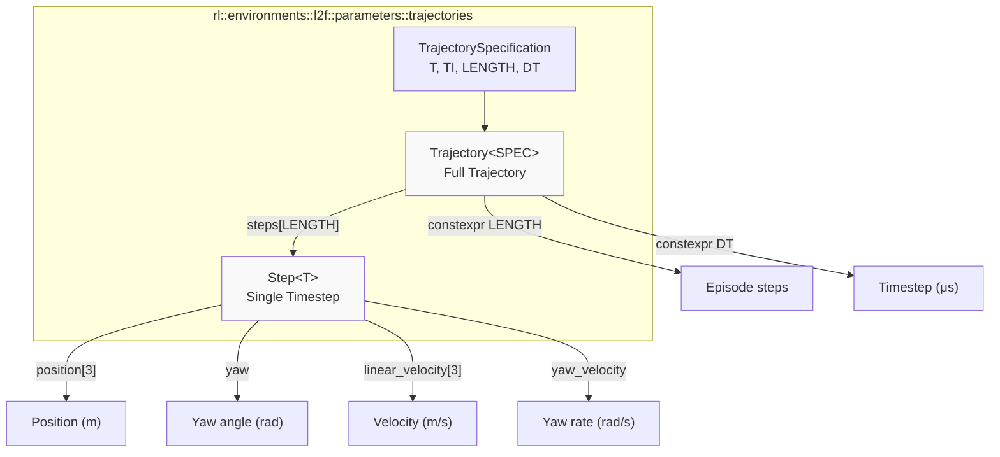
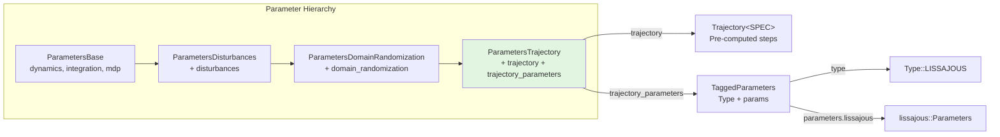
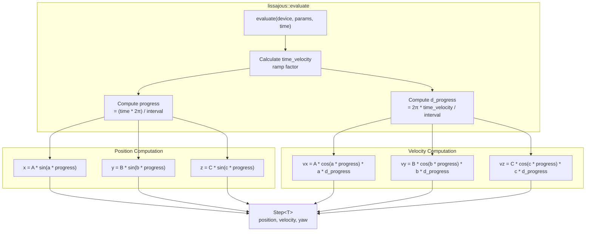
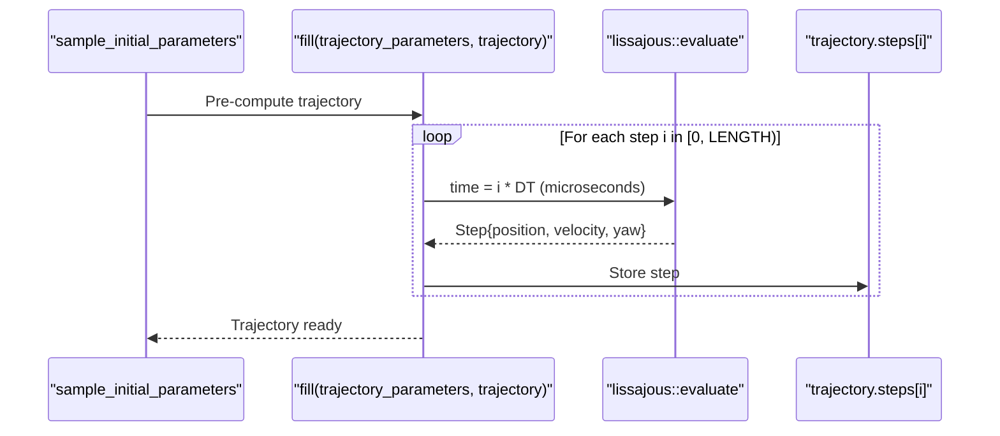
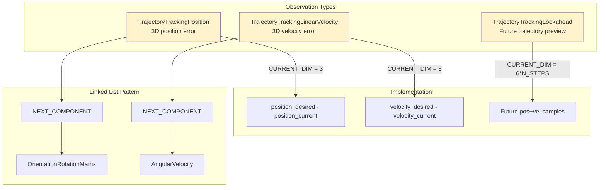
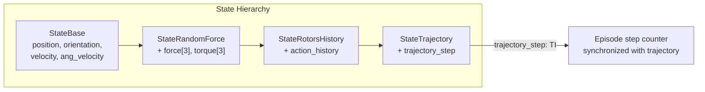
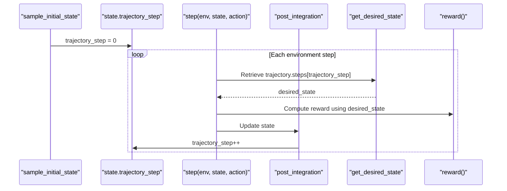
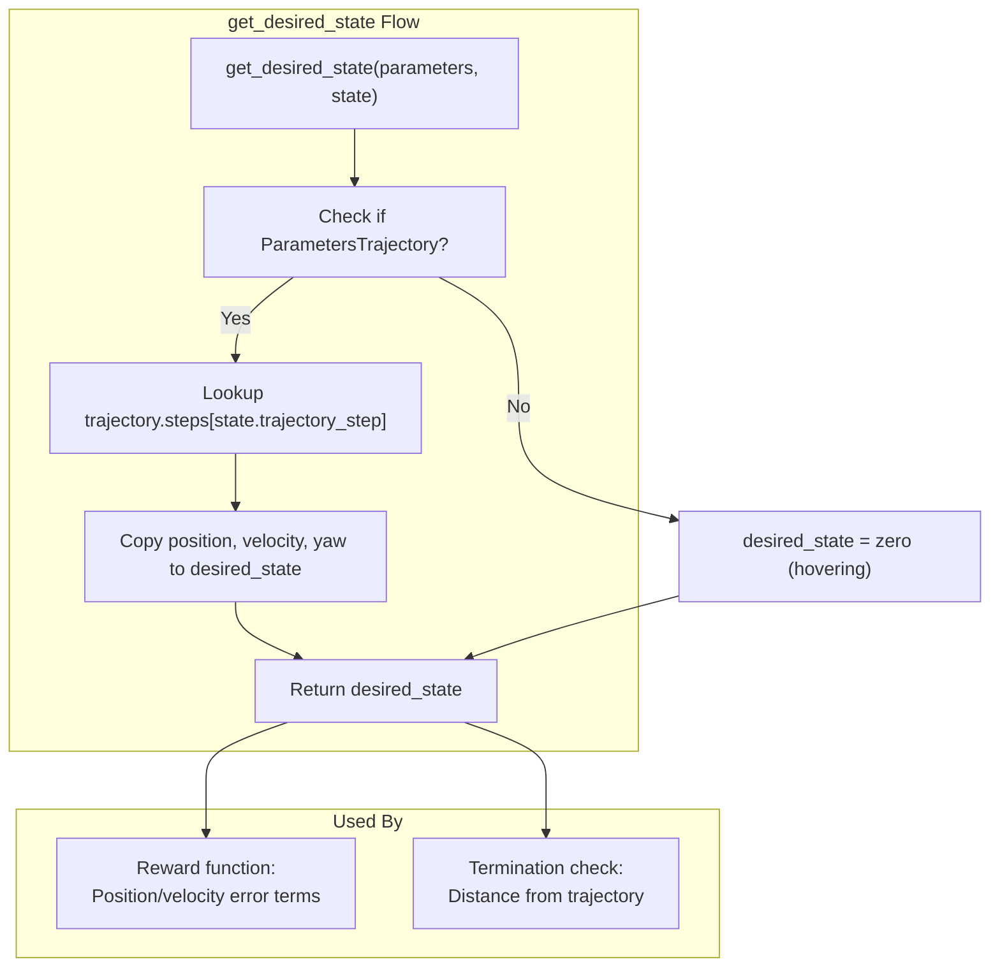

<!-- source: DeepWiki mcp.deepwiki.com · repo rl-tools/rl-tools · extra page Trajectory Tracking · fetched 2026-10-30 -->

# Trajectory Tracking

<details>
<summary>Relevant source files</summary>

The following files were used as context for generating this wiki page:

- [include/rl_tools/rl/environments/l2f/multirotor.h](include/rl_tools/rl/environments/l2f/multirotor.h)
- [include/rl_tools/rl/environments/l2f/operations_cpu.h](include/rl_tools/rl/environments/l2f/operations_cpu.h)
- [include/rl_tools/rl/environments/l2f/operations_generic.h](include/rl_tools/rl/environments/l2f/operations_generic.h)
- [include/rl_tools/rl/environments/l2f/operations_generic/10_sample_initial_parameters.h](include/rl_tools/rl/environments/l2f/operations_generic/10_sample_initial_parameters.h)
- [include/rl_tools/rl/environments/l2f/operations_generic/30_sample_initial_state.h](include/rl_tools/rl/environments/l2f/operations_generic/30_sample_initial_state.h)
- [include/rl_tools/rl/environments/l2f/operations_generic/70_post_integration.h](include/rl_tools/rl/environments/l2f/operations_generic/70_post_integration.h)
- [include/rl_tools/rl/environments/l2f/operations_multitask_generic.h](include/rl_tools/rl/environments/l2f/operations_multitask_generic.h)
- [include/rl_tools/rl/environments/l2f/operations_multitask_generic_forward.h](include/rl_tools/rl/environments/l2f/operations_multitask_generic_forward.h)
- [include/rl_tools/rl/environments/l2f/parameters/default.h](include/rl_tools/rl/environments/l2f/parameters/default.h)
- [include/rl_tools/rl/environments/l2f/parameters/trajectories/lissajous.h](include/rl_tools/rl/environments/l2f/parameters/trajectories/lissajous.h)
- [src/rl/zoo/l2f/environment.h](src/rl/zoo/l2f/environment.h)
- [src/rl/zoo/l2f/environment_big.h](src/rl/zoo/l2f/environment_big.h)
- [src/rl/zoo/l2f/ppo.h](src/rl/zoo/l2f/ppo.h)
- [src/rl/zoo/l2f/sac_big.h](src/rl/zoo/l2f/sac_big.h)

</details>


This document explains the trajectory tracking functionality in the Learn to Fly (L2F) multirotor environment, which enables agents to learn to follow time-varying reference trajectories. For general information about the L2F environment architecture, see [4.2](#4.2). For domain randomization features, see [4.2.2](#4.2.2).

**Sources:** [include/rl_tools/rl/environments/l2f/multirotor.h:189-206](), [include/rl_tools/rl/environments/l2f/parameters/trajectories/lissajous.h]()

---

## Overview

Trajectory tracking transforms the L2F environment from a stabilization task (hovering at the origin) into a dynamic reference tracking problem. The system pre-computes reference trajectories at initialization and provides tracking error observations to the policy. The agent learns to minimize position and velocity errors while following smooth, time-varying paths through 3D space.

The trajectory tracking system consists of:
- **Trajectory representation**: Discrete timesteps with position, velocity, yaw, and angular velocity
- **Lissajous curve generator**: Parametric trajectory type for smooth, periodic motion
- **Tracking observations**: Position and velocity error components in the observation space
- **State management**: Trajectory step counter synchronized with episode progress

**Sources:** [include/rl_tools/rl/environments/l2f/multirotor.h:189-221]()

---

## Trajectory Data Structure

### Trajectory Step Definition



**Trajectory Step Structure**

Each trajectory step represents the desired state at a specific time:

| Field | Type | Description |
|-------|------|-------------|
| `position[3]` | `T` | Desired 3D position in world frame |
| `yaw` | `T` | Desired yaw angle (heading) |
| `linear_velocity[3]` | `T` | Desired 3D velocity in world frame |
| `yaw_velocity` | `T` | Desired yaw rate |

**Sources:** [include/rl_tools/rl/environments/l2f/parameters/trajectories/trajectory.h]() (referenced in includes), [include/rl_tools/rl/environments/l2f/multirotor.h:189-206]()

### Trajectory Container

The `ParametersTrajectory` wrapper embeds trajectory data into the environment's parameter hierarchy:



**Sources:** [include/rl_tools/rl/environments/l2f/multirotor.h:189-206](), [src/rl/zoo/l2f/environment_big.h:41-43,77,97-100]()

---

## Lissajous Curve Trajectories

### Mathematical Definition

Lissajous curves are parametric curves defined by sinusoidal functions in each axis. They produce smooth, periodic motion ideal for training robust tracking controllers.

**Lissajous Parameters:**

| Parameter | Type | Description |
|-----------|------|-------------|
| `A`, `B`, `C` | `T` | Amplitude in x, y, z axes |
| `a`, `b`, `c` | `T` | Frequency ratios for each axis |
| `interval` | `T` | Period duration (seconds) |
| `ramp_duration` | `T` | Velocity ramp-up time (seconds) |

**Default Configuration:**
```cpp
A = 0.5, B = 1.0, C = 0.0  // xy-plane motion, no z variation
a = 2.0, b = 1.0, c = 1.0  // 2:1 frequency ratio (figure-8 pattern)
interval = 6.5             // 6.5 second period
ramp_duration = 0.0        // No velocity ramp
```

**Sources:** [include/rl_tools/rl/environments/l2f/parameters/trajectories/lissajous.h:13-36]()

### Trajectory Evaluation



**Velocity Ramping**: When `ramp_duration > 0`, the trajectory smoothly ramps from zero velocity to full speed over the specified duration, preventing abrupt starts.

**Sources:** [include/rl_tools/rl/environments/l2f/parameters/trajectories/lissajous.h:39-59]()

### Pre-computation Process

Trajectories are pre-computed at initialization for computational efficiency during training:



The `fill` function iterates over all episode steps and pre-computes the desired state:

```
for step_i in [0, TRAJECTORY_LENGTH):
    time = step_i * TRAJECTORY_DT  // in microseconds
    trajectory.steps[step_i] = lissajous::evaluate(params, time)
```

**Sources:** [include/rl_tools/rl/environments/l2f/parameters/trajectories/lissajous.h:61-68](), [include/rl_tools/rl/environments/l2f/operations_generic/10_sample_initial_parameters.h:203-207]()

---

## Trajectory Tracking Observations

### Observation Components

The environment provides specialized observation components for trajectory tracking:



**Observation Specification Table:**

| Component | Type | Dimensions | Description |
|-----------|------|------------|-------------|
| `TrajectoryTrackingPosition` | Error | 3 | Position error: `desired_pos - current_pos` |
| `TrajectoryTrackingLinearVelocity` | Error | 3 | Velocity error: `desired_vel - current_vel` |
| `TrajectoryTrackingLookahead` | Feedforward | `6 × N_STEPS` | Future positions and velocities sampled at intervals |

**Sources:** [include/rl_tools/rl/environments/l2f/multirotor.h:567-614](), [src/rl/zoo/l2f/environment_big.h:125-131]()

### Observation Composition Example

From the `ENVIRONMENT_BIG_FACTORY` configuration:

```cpp
using OBSERVATION_TYPE = 
    observation::TrajectoryTrackingPosition<observation::PositionSpecification<T, TI,
    observation::OrientationRotationMatrix<observation::OrientationRotationMatrixSpecification<T, TI,
    observation::TrajectoryTrackingLinearVelocity<observation::LinearVelocitySpecification<T, TI,
    observation::AngularVelocityDelayed<observation::AngularVelocityDelayedSpecification<T, TI, DELAY,
    observation::ActionHistory<observation::ActionHistorySpecification<T, TI, HISTORY_LENGTH
>>>>>>>>>;
```

This composition provides:
- 3D position tracking error
- 9D rotation matrix (orientation)
- 3D velocity tracking error  
- 3D angular velocity (with optional delay)
- 4 × HISTORY_LENGTH action history

**Sources:** [src/rl/zoo/l2f/environment_big.h:125-131]()

---

## State Management

### StateTrajectory Component

The `StateTrajectory` wrapper adds trajectory step tracking to the environment state:



**Sources:** [include/rl_tools/rl/environments/l2f/multirotor.h:742-751](), [src/rl/zoo/l2f/environment_big.h:124]()

### Trajectory Step Lifecycle



**Initialization:**
```cpp
state.trajectory_step = 0;
```

**Post-Integration Increment:**
```cpp
next_state.trajectory_step = state.trajectory_step + 1;
```

**Sources:** [include/rl_tools/rl/environments/l2f/operations_generic/30_sample_initial_state.h:209-216](), [include/rl_tools/rl/environments/l2f/operations_generic/70_post_integration.h:151-159]()

---

## Reward Shaping for Tracking

### Desired State Retrieval

The `get_desired_state` function extracts the reference state for the current timestep:



When `ParametersTrajectory` is present in the parameter hierarchy, the desired state is fetched from the pre-computed trajectory. Otherwise, the desired state defaults to hovering at the origin.

**Sources:** [include/rl_tools/rl/environments/l2f/operations_generic/35_get_desired_state.h]() (referenced), [include/rl_tools/rl/environments/l2f/operations_generic.h:147-148]()

### Reward Function Integration

The `Squared` reward function computes tracking error penalties:

```cpp
// Position error term
for (i in 0..2):
    position_error = state.position[i] - desired_state.position[i]
    reward -= parameters.reward.position * position_error^2

// Velocity error term  
for (i in 0..2):
    velocity_error = state.linear_velocity[i] - desired_state.linear_velocity[i]
    reward -= parameters.reward.linear_velocity * velocity_error^2
```

**Typical Reward Weights for Trajectory Tracking:**
- `position`: 1.0 to 10.0 (strong penalty for position deviation)
- `linear_velocity`: 0.0 to 0.1 (optional velocity matching)
- `orientation`: 0.1 to 2.5 (maintain stable attitude)

**Sources:** [include/rl_tools/rl/environments/l2f/parameters/reward_functions/squared/operations_generic.h]() (referenced), [src/rl/zoo/l2f/environment_big.h:58-74]()

---

## Configuration and Usage

### Trajectory Configuration Example

From `environment_big.h`, a typical trajectory tracking configuration:

```cpp
// Trajectory timing
static constexpr TI EPISODE_STEP_LIMIT = 500;
static constexpr TI SIMULATION_FREQUENCY = 100;  // Hz
static constexpr TI TRAJECTORY_LENGTH = EPISODE_STEP_LIMIT;
static constexpr TI TRAJECTORY_DT = 1000000/SIMULATION_FREQUENCY;  // 10000 μs = 0.01s

// Trajectory parameters
static constexpr auto trajectory_parameters = {
    Type::LISSAJOUS,
    {lissajous::default_parameters<T>}  // A=0.5, B=1.0, C=0.0, a=2, b=1, interval=6.5
};

// Pre-computed trajectory (filled at initialization)
static constexpr typename PARAMETERS_TYPE::Trajectory trajectory = {};
```

**Sources:** [src/rl/zoo/l2f/environment_big.h:38-43,77,97-100]()

### Observation Configuration

```cpp
using OBSERVATION_TYPE = 
    observation::TrajectoryTrackingPosition<observation::PositionSpecification<T, TI,
    observation::OrientationRotationMatrix<observation::OrientationRotationMatrixSpecification<T, TI,
    observation::TrajectoryTrackingLinearVelocity<observation::LinearVelocitySpecification<T, TI,
    observation::AngularVelocityDelayed<observation::AngularVelocityDelayedSpecification<T, TI, 0,
    observation::ActionHistory<observation::ActionHistorySpecification<T, TI, 8
>>>>>>>>>;
```

Observation dimensions:
- Trajectory position error: 3
- Rotation matrix: 9
- Trajectory velocity error: 3
- Angular velocity: 3
- Action history: 32 (8 steps × 4 actions)
- **Total: 50 dimensions**

**Sources:** [src/rl/zoo/l2f/environment_big.h:125-131]()

### State Configuration

```cpp
using STATE_TYPE = StateTrajectory<StateSpecification<T, TI,
    StateRotorsHistory<StateRotorsHistorySpecification<T, TI, 
        ACTION_HISTORY_LENGTH,  // 8
        CLOSED_FORM,            // false
        StateRandomForce<StateSpecification<T, TI, 
            StateBase<StateSpecification<T, TI>>
>>>>>>>;
```

**Sources:** [src/rl/zoo/l2f/environment_big.h:124]()

---

## JSON Export and Visualization

### Trajectory Export Format

The trajectory system provides JSON serialization for analysis and visualization:

```json
{
  "LENGTH": 500,
  "DT": 10000,
  "steps": [
    {
      "position": [0.0, 0.0, 0.0],
      "yaw": 0.0,
      "linear_velocity": [0.0, 0.0, 0.0],
      "yaw_velocity": 0.0
    },
    ...
  ]
}
```

**Lissajous Parameters Export:**
```json
{
  "type": "LISSAJOUS",
  "lissajous": {
    "A": 0.5,
    "B": 1.0,
    "C": 0.0,
    "a": 2.0,
    "b": 1.0,
    "c": 1.0,
    "interval": 6.5,
    "ramp_duration": 0.0
  }
}
```

**Sources:** [include/rl_tools/rl/environments/l2f/operations_cpu.h:388-433]()

---

## Integration with Training Loops

### SAC Training Configuration

From `sac_big.h`, trajectory tracking with SAC:

```cpp
struct SAC_PARAMETERS {
    static constexpr TI ACTOR_BATCH_SIZE = 512;
    static constexpr TI CRITIC_BATCH_SIZE = 512;
    static constexpr T GAMMA = 0.99;
    static constexpr T TARGET_ENTROPY = -2.0;  // For 4D action space
    static constexpr bool ENTROPY_BONUS_NEXT_STEP = false;
};

static constexpr TI EPISODE_STEP_LIMIT = 500;  // Matches trajectory length
```

**Sources:** [src/rl/zoo/l2f/sac_big.h:21-44]()

### PPO Training Configuration

From `ppo.h`, on-policy trajectory tracking:

```cpp
struct LOOP_CORE_PARAMETERS {
    static constexpr TI EPISODE_STEP_LIMIT = 500;
    static constexpr TI N_ENVIRONMENTS = 64;
    static constexpr TI BATCH_SIZE = 4096;
    static constexpr TI ON_POLICY_RUNNER_STEPS_PER_ENV = 128;
    static constexpr bool NORMALIZE_OBSERVATIONS = true;
    
    struct PPO_PARAMETERS {
        static constexpr T GAMMA = 0.99;
        static constexpr T INITIAL_ACTION_STD = 0.5;
    };
};
```

**Sources:** [src/rl/zoo/l2f/ppo.h:26-47]()

---

## Summary

The trajectory tracking system enables the L2F environment to train policies for dynamic reference following. Key features:

**Architecture:**
- Pre-computed trajectory storage for efficiency
- Lissajous parametric curves with configurable amplitudes and frequencies
- Observation components for position and velocity tracking errors
- State-based trajectory step counter for synchronization

**Implementation:**
- `ParametersTrajectory<SPEC>`: Parameter wrapper with trajectory data
- `lissajous::Parameters<T>`: Trajectory generation parameters
- `TrajectoryTrackingPosition`, `TrajectoryTrackingLinearVelocity`: Observation components
- `StateTrajectory<SPEC>`: State wrapper with trajectory step counter

**Usage:**
- Configure trajectory parameters at compile-time
- Pre-compute trajectory steps at initialization via `fill()`
- Retrieve desired state each step via `get_desired_state()`
- Compute tracking error rewards in reward function
- Export trajectories to JSON for visualization

**Sources:** [include/rl_tools/rl/environments/l2f/multirotor.h](), [include/rl_tools/rl/environments/l2f/parameters/trajectories/lissajous.h](), [src/rl/zoo/l2f/environment_big.h]()

---

