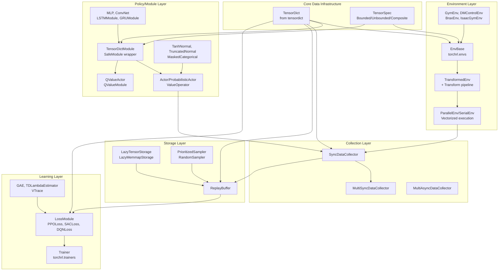

<!-- source: DeepWiki mcp.deepwiki.com · repo pytorch/rl · page 1 Overview · fetched 2026-10-21 -->

# Overview

Relevant source files

The following files were used as context for generating this wiki page:

- [.github/scripts/ci_timing_dashboard.html](.github/scripts/ci_timing_dashboard.html)
- [.github/scripts/track_ci_timing.py](.github/scripts/track_ci_timing.py)
- [.github/unittest/examples/scripts/run_all.sh](.github/unittest/examples/scripts/run_all.sh)
- [.github/unittest/examples/scripts/run_test.sh](.github/unittest/examples/scripts/run_test.sh)
- [.github/workflows/ci-timing-tracker.yml](.github/workflows/ci-timing-tracker.yml)
- [.github/workflows/docs.yml](.github/workflows/docs.yml)
- [.python-version](.python-version)
- [AGENTS.md](AGENTS.md)
- [CLAUDE.md](CLAUDE.md)
- [CONTRIBUTING.md](CONTRIBUTING.md)
- [README.md](README.md)
- [docs/requirements.txt](docs/requirements.txt)
- [docs/source/conf.py](docs/source/conf.py)
- [docs/source/index.rst](docs/source/index.rst)
- [docs/source/reference/objectives.rst](docs/source/reference/objectives.rst)
- [docs/source/reference/objectives_other.rst](docs/source/reference/objectives_other.rst)
- [examples/collectors/collector_device.py](examples/collectors/collector_device.py)
- [sota-check/run_rnd_mujoco.sh](sota-check/run_rnd_mujoco.sh)
- [sota-implementations/rnd/config_mujoco.yaml](sota-implementations/rnd/config_mujoco.yaml)
- [sota-implementations/rnd/utils_mujoco.py](sota-implementations/rnd/utils_mujoco.py)
- [torchrl/objectives/__init__.py](torchrl/objectives/__init__.py)

TorchRL is an open-source Reinforcement Learning (RL) library for PyTorch that provides a modular, efficient, and composable framework for RL research, decision-making, robotics, and simulation [README.md:23-26](), [docs/source/index.rst:6-12](). This page introduces TorchRL's architecture, design philosophy, core components, and provides a roadmap for navigating the documentation.

## What is TorchRL?

TorchRL solves the heterogeneity problem in RL codebases—where algorithms are difficult to reuse across different settings (online vs. offline, state-based vs. pixel-based, single-agent vs. multi-agent). TorchRL addresses this through:

- **`TensorDict`**: A universal, dictionary-like tensor container that standardizes data flow across all components [README.md:31-44]();
- **Modular components**: Independent building blocks (environments, policies, replay buffers, objectives, collectors) with consistent interfaces [README.md:31-37]();
- **PyTorch-native design**: Seamless integration with PyTorch primitives, `torch.compile`, and ecosystem tooling [README.md:23-26](), [docs/source/index.rst:21-29]().

Sources: [README.md:23-45](), [docs/source/index.rst:12-23]()

## Design Principles

TorchRL is built around three core design principles:

1. **Named, Structured, Batched Data**: Data should carry names, structures, batch dimensions, and device placements all the way through the training loop [README.md:33-34]().
2. **Modular Independence**: Environments, policies, replay buffers, objectives, and collectors are independent modules that can be swapped without rewriting the rest of the stack [README.md:35-37]().
3. **Seamless Scaling**: Research code scales from a local prototype to vectorized, multiprocess, distributed, compiled, recurrent, multi-agent, model-based, or offline workflows without changing the underlying data model [README.md:38-40]().

Sources: [README.md:31-41]()

## System Architecture

TorchRL's architecture connects all components through `TensorDict` as the universal data container.

### Core Architecture Diagram

Sources: [README.md:71-82](), [torchrl/objectives/__init__.py:61-121]()

## Core Components

- **TensorDict**: Central data container supporting batch operations (`stack`, `reshape`, indexing) and device transfers [README.md:41-44]().
- **Environment System**: Unified environment abstractions (`EnvBase`, `TransformedEnv`, `ParallelEnv`) supporting Gym/Gymnasium, DMControl, and custom backends [README.md:99-102]().
- **Module and Policy System**: Wraps PyTorch modules with explicit `in_keys` and `out_keys` via `TensorDictModule`, `Actor`, `ProbabilisticActor`, and `ValueOperator` [README.md:104-114]().
- **Data Collection**: Synchronous and asynchronous collectors (`SyncDataCollector`, `MultiSyncDataCollector`) that gather trajectories into `TensorDict` batches [README.md:76-79]().
- **Replay Buffers**: Composable storage backend architecture combining `Storage`, `Sampler`, and `Writer` components [README.md:78-79]().
- **Loss Modules**: Stateful PyTorch modules implementing RL objectives (e.g., `PPOLoss`, `SACLoss`, `DQNLoss`, `DDPGLoss`) using the TensorDict convention [torchrl/objectives/__init__.py:61-121](), [docs/source/reference/objectives.rst:8-18]().

Sources: [README.md:41-114](), [torchrl/objectives/__init__.py:61-121](), [docs/source/reference/objectives.rst:8-18]()

---

## Roadmap & Child Pages

### 1.1. Getting Started

For details on installation options (including PyPI, nightly builds, and editable installs with `uv` or `pip`), optional dependency groups, your first rollout code, and pointers to the getting-started tutorial series and knowledge base installation guides, see [Getting Started](#1.1).

Sources: [README.md:46-51](), [docs/source/index.rst:14-95](), [CONTRIBUTING.md:5-43]()

### 1.2. Repository Layout

For details on the structure and organization of the repository (`torchrl/` library packages, `test/`, `sota-implementations/`, `examples/`, `benchmarks/`, `sota-check/`, `docs/`, and `knowledge_base/`) and how they interrelate, see [Repository Layout](#1.2).

Sources: [README.md:46-51](), [docs/source/index.rst:86-158]()

---

