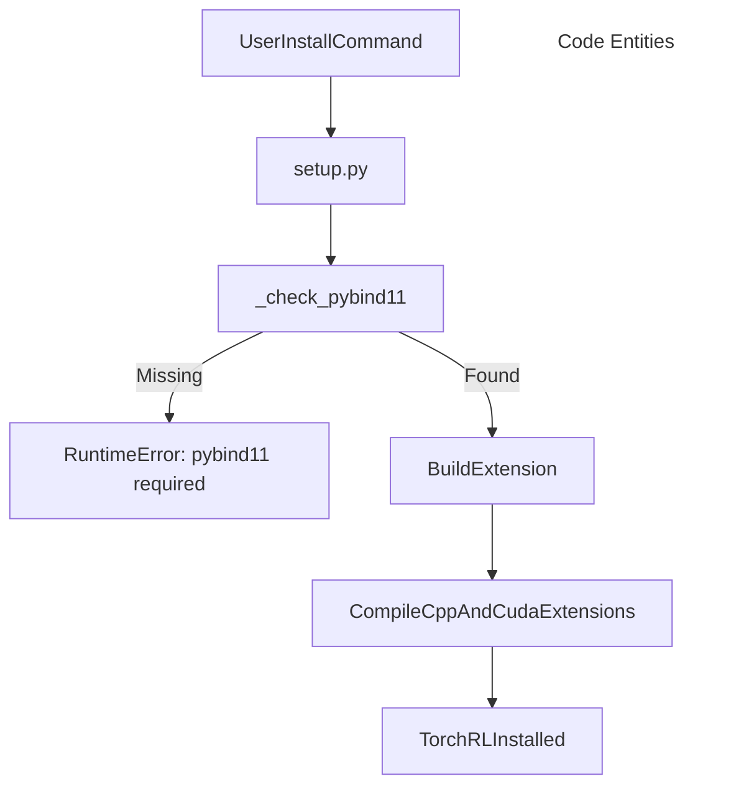
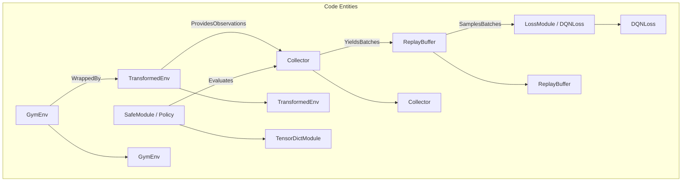

<!-- source: DeepWiki mcp.deepwiki.com · repo pytorch/rl · page 1.1 Getting Started · fetched 2026-10-21 -->

# Getting Started

<details>
<summary>Relevant source files</summary>

The following files were used as context for generating this wiki page:

- [.github/RELEASE_AGENT_PROMPT.md](.github/RELEASE_AGENT_PROMPT.md)
- [.github/scripts/pre-build-script-win.sh](.github/scripts/pre-build-script-win.sh)
- [.github/scripts/pre-build-script.sh](.github/scripts/pre-build-script.sh)
- [.github/scripts/td_script.sh](.github/scripts/td_script.sh)
- [.github/scripts/version_script.bat](.github/scripts/version_script.bat)
- [.github/unittest/linux_olddeps/scripts_gym_0_13/install.sh](.github/unittest/linux_olddeps/scripts_gym_0_13/install.sh)
- [.github/workflows/build-wheels-aarch64-linux.yml](.github/workflows/build-wheels-aarch64-linux.yml)
- [.github/workflows/build-wheels-linux.yml](.github/workflows/build-wheels-linux.yml)
- [.github/workflows/build-wheels-m1.yml](.github/workflows/build-wheels-m1.yml)
- [.github/workflows/build-wheels-windows.yml](.github/workflows/build-wheels-windows.yml)
- [.github/workflows/release.yml](.github/workflows/release.yml)
- [docs/source/reference/knowledge_base.rst](docs/source/reference/knowledge_base.rst)
- [knowledge_base/DM_CONTROL_INSTALLATION.md](knowledge_base/DM_CONTROL_INSTALLATION.md)
- [knowledge_base/GYM.md](knowledge_base/GYM.md)
- [knowledge_base/HABITAT.md](knowledge_base/HABITAT.md)
- [knowledge_base/MUJOCO_INSTALLATION.md](knowledge_base/MUJOCO_INSTALLATION.md)
- [knowledge_base/PRO-TIPS.md](knowledge_base/PRO-TIPS.md)
- [knowledge_base/README.md](knowledge_base/README.md)
- [knowledge_base/RESOURCES.md](knowledge_base/RESOURCES.md)
- [knowledge_base/VIDEO_CUSTOMISATION.md](knowledge_base/VIDEO_CUSTOMISATION.md)
- [pyproject.toml](pyproject.toml)
- [setup.py](setup.py)
- [tutorials/sphinx-tutorials/export.py](tutorials/sphinx-tutorials/export.py)
- [tutorials/sphinx-tutorials/getting-started-0.py](tutorials/sphinx-tutorials/getting-started-0.py)
- [tutorials/sphinx-tutorials/getting-started-1.py](tutorials/sphinx-tutorials/getting-started-1.py)
- [tutorials/sphinx-tutorials/getting-started-2.py](tutorials/sphinx-tutorials/getting-started-2.py)
- [tutorials/sphinx-tutorials/getting-started-4.py](tutorials/sphinx-tutorials/getting-started-4.py)
- [tutorials/sphinx-tutorials/getting-started-5.py](tutorials/sphinx-tutorials/getting-started-5.py)
- [tutorials/sphinx-tutorials/memory_efficient_rl.py](tutorials/sphinx-tutorials/memory_efficient_rl.py)
- [version.txt](version.txt)

</details>


## Purpose and Scope
This page covers the foundational setup for TorchRL, including core and optional dependency installation, build configurations for C++/CUDA extensions, a minimal first rollout and training loop pattern, and navigation pointers to the getting-started tutorial series and knowledge base installation guides.

Sources: [setup.py:1-49](), [pyproject.toml:1-48]()

---

## 1. Installation and Core Requirements

TorchRL is a modular, python-first PyTorch library for reinforcement learning. Its core dependencies are lightweight, centering around PyTorch and `tensordict`.

### Core Requirements
- `torch>=2.1.0` [pyproject.toml:41-41]()
- `tensordict>=0.14.2,<0.15.0` [pyproject.toml:47-47]()
- Supporting utilities: `numpy`, `packaging`, `cloudpickle`, `pyvers`, `hoptorch` [pyproject.toml:40-48]()

### Installing Core Packages
You can install TorchRL directly from PyPI or build it from source. Building from source invokes `setup.py`, which validates the presence of `pybind11` to compile high-performance C++ and CUDA extensions:

```bash
pip install torchrl
```

For editable installs from source:
```bash
git clone https://github.com/pytorch/rl.git
cd rl
pip install -e .
```


*Figure 1: TorchRL Build and Installation Dataflow.*

Sources: [setup.py:31-49](), [pyproject.toml:40-48]()

---

## 2. Optional Dependency Groups

TorchRL organizes optional backends, environments, and specialized workloads into explicit optional-dependency groups defined in `pyproject.toml`. You can install these groups using bracket notation (e.g., `pip install torchrl[atari,gym_continuous]`).

| Dependency Group | Key Packages Included | Target Workload / Domain |
| :--- | :--- | :--- |
| `atari` | `gymnasium[atari]` [pyproject.toml:93-93]() | Atari 2600 environments |
| `dm_control` | `dm_control` [pyproject.toml:94-94]() | DeepMind Control Suite |
| `gym_continuous` | `gymnasium<1.0`, `mujoco` [pyproject.toml:96-96]() | Continuous control benchmarks |
| `marl` | `vmas`, `pettingzoo`, `dm-meltingpot` [pyproject.toml:145-145]() | Multi-Agent RL |
| `llm` / `llm-vllm` / `grpo` | `transformers`, `vllm`, `ray`, `peft` [pyproject.toml:161-203]() | RLHF and LLM alignment (GRPO) |
| `vla` | `lerobot`, `torchvision` [pyproject.toml:101-101]() | Vision-Language-Action models |
| `checkpointing` | `torchsnapshot` [pyproject.toml:133-133]() | Distributed snapshotting |

Sources: [pyproject.toml:92-203]()

---

## 3. First Rollout and Training Loop

TorchRL decouples environment interaction from policy evaluation using the `TransformedEnv`, `Collector`, and `ReplayBuffer` abstractions. Below is a minimal code pattern demonstrating how environments and collectors are assembled.


*Figure 2: Component Interaction in TorchRL Training Loops.*

### Rollout Implementation Reference
The standard pattern for setting up an environment with transforms, a policy module, and a synchronous collector is illustrated in TorchRL's Sphinx tutorials:

1. **Environment Wrapping**: Wrap standard Gym environments with `TransformedEnv` and sequence observation preprocessing steps via `Compose` [tutorials/sphinx-tutorials/export.py:86-91]().
2. **Policy Construction**: Combine neural network modules (`ConvNet`) with operator wrappers (`QValueModule`) into a `TensorDictSequential` container [tutorials/sphinx-tutorials/export.py:94-96]().
3. **Data Collection**: Instantiate a `Collector` to coordinate environment steps and policy inference [tutorials/sphinx-tutorials/export.py:105-112]().

Sources: [tutorials/sphinx-tutorials/export.py:50-144]()

---

## 4. Documentation Series and Knowledge Base Guides

When encountering environment-specific installation challenges or aiming to deepen your understanding, consult the official learning resources:

- **Getting Started Tutorials**: Step-by-step guides covering basic Q-learning, PPO, and module export under `tutorials/sphinx-tutorials/` [tutorials/sphinx-tutorials/export.py:1-40]().
- **Knowledge Base Install Guides**: Detailed system dependency setups for complex simulators:
  - MuJoCo rendering and EGL backend configurations (`knowledge_base/MUJOCO_INSTALLATION.md`) [knowledge_base/MUJOCO_INSTALLATION.md:1-61]().
  - DMControl and Gym backend integrations (`knowledge_base/DM_CONTROL_INSTALLATION.md`, `knowledge_base/GYM.md`) [docs/source/reference/knowledge_base.rst]().
  - Troubleshooting tips and environment acceleration (`knowledge_base/PRO-TIPS.md`) [docs/source/reference/knowledge_base.rst]().

Sources: [docs/source/reference/knowledge_base.rst](), [knowledge_base/MUJOCO_INSTALLATION.md:1-61]()

---

