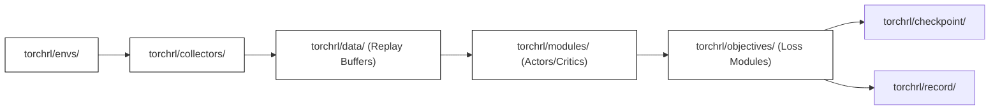
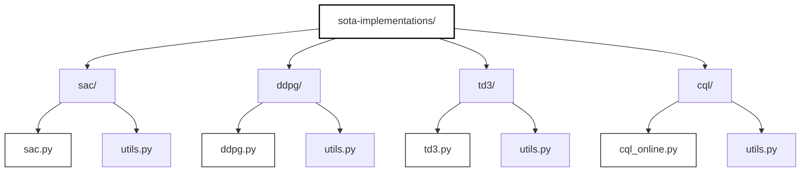
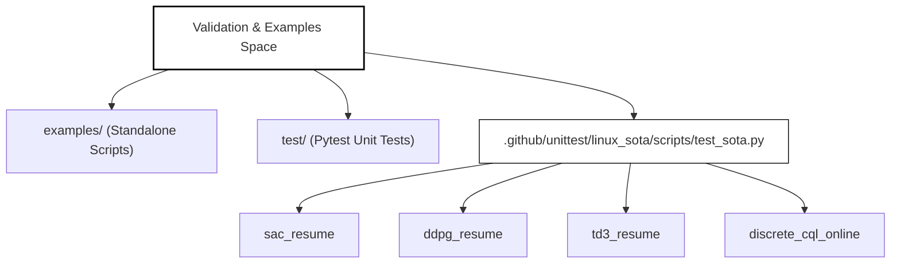

<!-- source: DeepWiki mcp.deepwiki.com · repo pytorch/rl · page 1.2 Repository Layout · fetched 2026-10-21 -->

# Repository Layout

Relevant source files

The following files were used as context for generating this wiki page:

- [.github/unittest/linux_sota/scripts/test_sota.py](.github/unittest/linux_sota/scripts/test_sota.py)
- [.github/workflows/docs.yml](.github/workflows/docs.yml)
- [README.md](README.md)
- [docs/requirements.txt](docs/requirements.txt)
- [docs/source/conf.py](docs/source/conf.py)
- [docs/source/index.rst](docs/source/index.rst)
- [docs/source/reference/objectives.rst](docs/source/reference/objectives.rst)
- [docs/source/reference/objectives_other.rst](docs/source/reference/objectives_other.rst)
- [examples/distributed/collectors/multi_nodes/delayed_dist.py](examples/distributed/collectors/multi_nodes/delayed_dist.py)
- [examples/distributed/collectors/multi_nodes/delayed_rpc.py](examples/distributed/collectors/multi_nodes/delayed_rpc.py)
- [examples/distributed/collectors/multi_nodes/generic.py](examples/distributed/collectors/multi_nodes/generic.py)
- [examples/distributed/collectors/multi_nodes/ray_train.py](examples/distributed/collectors/multi_nodes/ray_train.py)
- [examples/distributed/collectors/multi_nodes/rpc.py](examples/distributed/collectors/multi_nodes/rpc.py)
- [examples/distributed/collectors/multi_nodes/sync.py](examples/distributed/collectors/multi_nodes/sync.py)
- [examples/distributed/collectors/single_machine/generic.py](examples/distributed/collectors/single_machine/generic.py)
- [examples/distributed/collectors/single_machine/rpc.py](examples/distributed/collectors/single_machine/rpc.py)
- [examples/distributed/collectors/single_machine/sync.py](examples/distributed/collectors/single_machine/sync.py)
- [examples/distributed/replay_buffers/distributed_replay_buffer.py](examples/distributed/replay_buffers/distributed_replay_buffer.py)
- [sota-implementations/cql/cql_online.py](sota-implementations/cql/cql_online.py)
- [sota-implementations/cql/discrete_cql_online.py](sota-implementations/cql/discrete_cql_online.py)
- [sota-implementations/crossq/crossq.py](sota-implementations/crossq/crossq.py)
- [sota-implementations/ddpg/ddpg.py](sota-implementations/ddpg/ddpg.py)
- [sota-implementations/discrete_sac/discrete_sac.py](sota-implementations/discrete_sac/discrete_sac.py)
- [sota-implementations/iql/discrete_iql.py](sota-implementations/iql/discrete_iql.py)
- [sota-implementations/iql/iql_online.py](sota-implementations/iql/iql_online.py)
- [sota-implementations/sac/sac.py](sota-implementations/sac/sac.py)
- [sota-implementations/td3/td3.py](sota-implementations/td3/td3.py)
- [torchrl/collectors/distributed/utils.py](torchrl/collectors/distributed/utils.py)
- [torchrl/objectives/__init__.py](torchrl/objectives/__init__.py)

This page provides a comprehensive technical map of the `pytorch/rl` repository structure. It breaks down the internal library packages under `torchrl/`, reference implementations under `sota-implementations/`, standalone examples under `examples/`, validation suites under `sota-check/` and `test/`, performance benchmarks under `benchmarks/`, and documentation assets under `docs/` and `knowledge_base/`.

---

## 1. Top-Level Repository Architecture

The repository is organized around a modular PyTorch-native reinforcement learning paradigm. The core library lives inside the `torchrl/` directory, while surrounding directories provide documentation, verification scripts, SOTA reference algorithms, and tests.

```mermaid
graph TD
    Root["pytorch/rl Root"] --> TorchRL["torchrl/ (Core Library)"]
    Root --> SotaImp["sota-implementations/ (Reference Algorithms)"]
    Root --> Examples["examples/ (Standalone & Distributed Code)"]
    Root --> TestDir["test/ (Unit Test Suite)"]
    Root --> Benchmarks["benchmarks/ (Performance Suite)"]
    Root --> Docs["docs/ (Sphinx Documentation)"]
    Root --> KB["knowledge_base/ (Guides & Troubleshooting)"]

    TorchRL --> Envs["torchrl/envs/"]
    TorchRL --> Collectors["torchrl/collectors/"]
    TorchRL --> Data["torchrl/data/"]
    TorchRL --> Modules["torchrl/modules/"]
    TorchRL --> Objectives["torchrl/objectives/"]
    TorchRL --> Checkpoint["torchrl/checkpoint/"]

    SotaImp --> SAC["sac/sac.py"]
    SotaImp --> DDPG["sota-implementations/ddpg/ddpg.py"]
    SotaImp --> TD3["sota-implementations/td3/td3.py"]
    SotaImp --> CQL["sota-implementations/cql/cql_online.py"]

    style Root fill:none,stroke:#000,stroke-width:2px
    style TorchRL fill:none,stroke:#000,stroke-width:1px
    style SotaImp fill:none,stroke:#000,stroke-width:1px
```

*Sources: [README.md:1-142](), [docs/source/index.rst:1-164]()*

---

## 2. Core Library Layout (`torchrl/`)

The `torchrl/` package implements the foundational primitives for reinforcement learning, exposing modular APIs built around `TensorDict`.

### Library Submodules
- **`torchrl/envs/`**: Implements environment abstractions (`EnvBase`, `TransformedEnv`), environment wrappers for backends like Gym/Gymnasium, DMControl, Brax, VMAS, and vectorized execution via `ParallelEnv` and `SerialEnv`.
- **`torchrl/collectors/`**: Houses synchronous, asynchronous, and multi-worker rollout collectors (`BaseCollector`, `SyncCollector`, `MultiThreadCollector`) along with distributed weight synchronization schemes (`WeightSyncScheme`).
- **`torchrl/data/`**: Manages experience storage and dataset abstractions, including composable replay buffers (`ReplayBuffer`, storages, samplers, writers) and offline dataset pipelines (D4RL, Minari, Atari-DQN).
- **`torchrl/modules/`**: Contains neural network utilities, including `TensorDictModule`, `SafeModule`, actors, critics, exploration modules (`EGreedy`, `OrnsteinUhlenbeck`), and model-based RSSM/Dreamer components.
- **`torchrl/objectives/`**: Provides stateful, modular loss computation classes (`LossModule`, `ClipPPOLoss`, `SACLoss`, `DDPGLoss`, `DreamerV3Loss`) and advantage estimation methods (`ValueEstimators`, GAE).
- **`torchrl/checkpoint/`**: Implements unified run state checkpointing, resumption workflows, and manifest management via `Checkpoint` and `RunCheckpointer`.
- **`torchrl/record/`**: Handles metric logging (WandB, TensorBoard, CSV, MLflow) and video recording transforms (`VideoRecorder`).

*Sources: [README.md:1-142](), [torchrl/objectives/__init__.py:1-121]()*

---

## 3. Reference Implementations (`sota-implementations/`)

The `sota-implementations/` directory contains self-contained, production-grade training scripts for modern reinforcement learning algorithms. Each subdirectory typically includes a primary execution script (e.g., `sac.py`, `ddpg.py`, `cql_online.py`) and a `utils.py` file handling environment construction, agent creation, and logging setup.

### Key Algorithm Folders
- `sota-implementations/sac/`: Off-policy maximum entropy reinforcement learning via `sota-implementations/sac/sac.py`.
- `sota-implementations/ddpg/`: Deterministic policy gradients via `sota-implementations/ddpg/ddpg.py`.
- `sota-implementations/td3/`: Twin Delayed DDPG via `sota-implementations/td3/td3.py`.
- `sota-implementations/cql/`: Conservative Q-Learning via `sota-implementations/cql/cql_online.py`.
- `sota-implementations/ppo/`: On-policy clipped surrogate loss optimization (`ppo_mujoco.py`, `ppo_atari.py`).
- `sota-implementations/vla_grpo/`: Vision-Language-Action Group Relative Policy Optimization pipelines.

*Sources: [sota-implementations/sac/sac.py:1-204](), [sota-implementations/ddpg/ddpg.py:1-203](), [sota-implementations/td3/td3.py:1-206](), [sota-implementations/cql/cql_online.py:1-206]()*

---

## 4. Standalone Examples, Testing, and Verification

### Standalone Examples (`examples/`)
The `examples/` directory houses decoupled example scripts demonstrating advanced features such as distributed collectors, RPC-based multi-node execution, offline dataset ingestion, and custom environment menageries.

### Unit Tests and Verification (`test/` and `sota-check/`)
- **`test/`**: Comprehensive pytest unit test suite validating individual library modules (envs, collectors, data structures, losses, and modules).
- **SOTA Verification**: Automated integration testing of state-of-the-art scripts is coordinated via `.github/unittest/linux_sota/scripts/test_sota.py`, which executes short-horizon training sanity checks across algorithms like `dqn_trainer_resume`, `sac_resume`, `td3_resume`, `ddpg_resume`, and `vla_grpo`.

*Sources: [.github/unittest/linux_sota/scripts/test_sota.py:1-211]()*

---

## 5. Documentation and Knowledge Base (`docs/` and `knowledge_base/`)

### Documentation System (`docs/`)
- **`docs/source/conf.py`**: Configuration file for the Sphinx documentation builder, setting up extensions (`sphinx.ext.autodoc`, `myst_parser`, `sphinx_gallery`), intersphinx mappings, and release version sanitization [docs/source/conf.py:1-196]().
- **`docs/requirements.txt`**: Specifies external documentation dependencies, rendering tools, and integration packages [docs/requirements.txt:1-39]().
- **CI Documentation Workflow**: Defined in `.github/workflows/docs.yml`, handling Linux container provisioning, system library installations (GLFW, OpenGL, FFmpeg), environment setup, and Sphinx HTML generation [-.github/workflows/docs.yml:1-139]().

### Knowledge Base (`knowledge_base/`)
Contains troubleshooting guides, environment setup notes (MuJoCo, DMControl, Habitat), platform-specific build instructions, and developer best practices referenced in the main index [docs/source/index.rst:1-164]().

*Sources: [.github/workflows/docs.yml:1-139](), [docs/source/conf.py:1-196](), [docs/requirements.txt:1-39](), [docs/source/index.rst:1-164]()*

---

