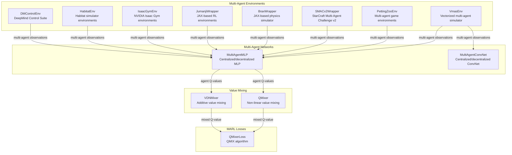
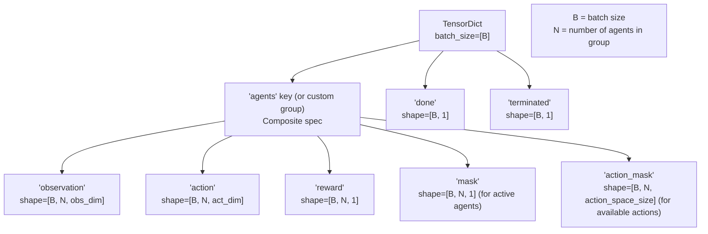
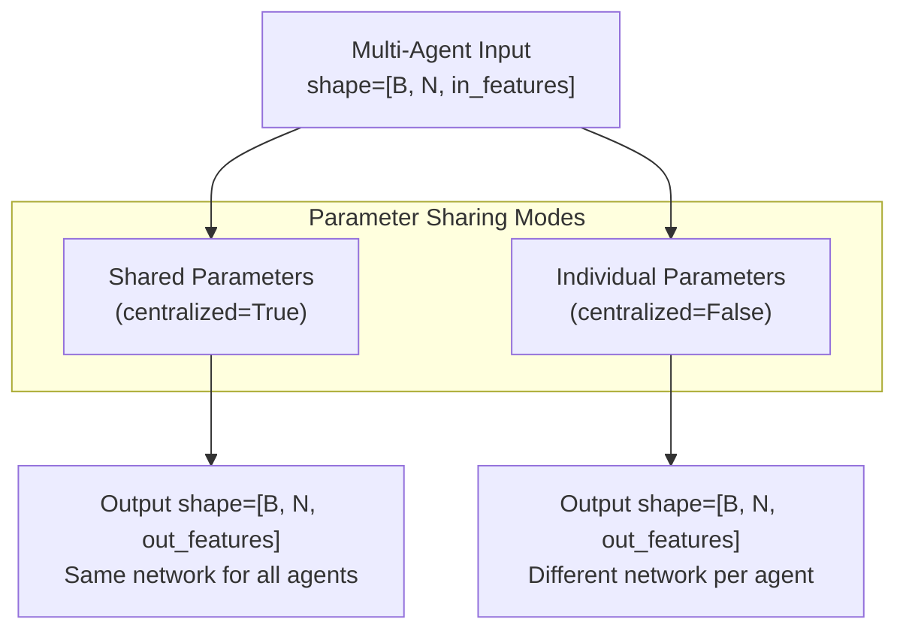
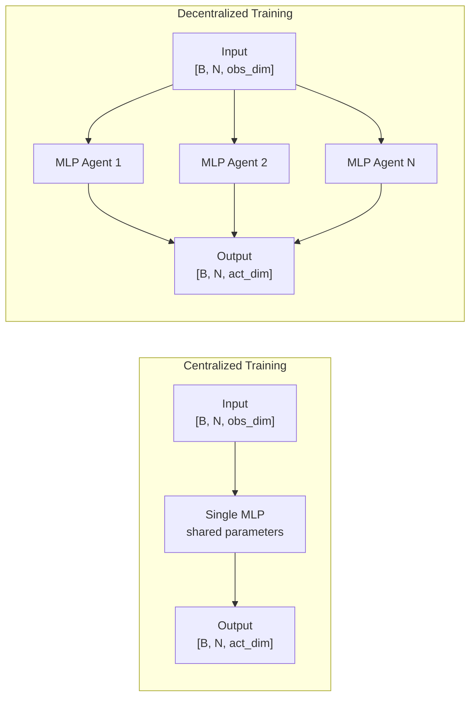
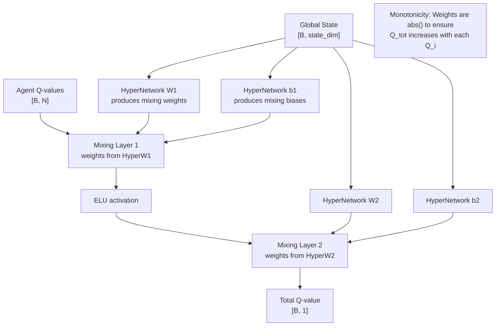
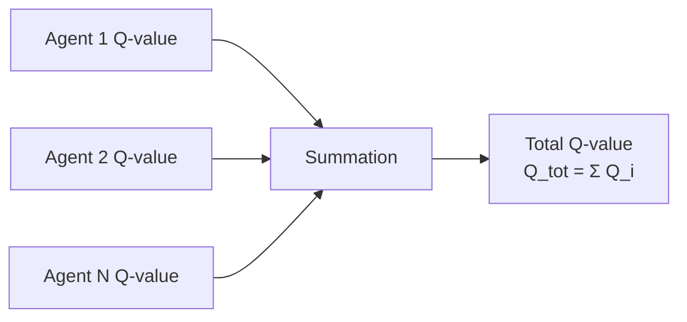
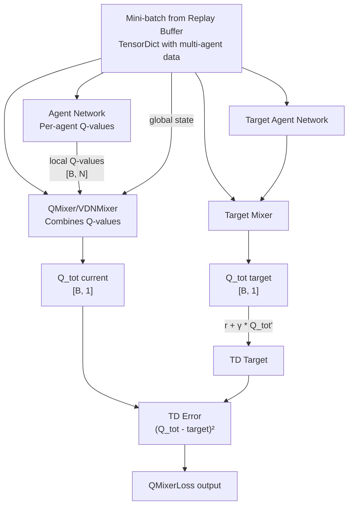
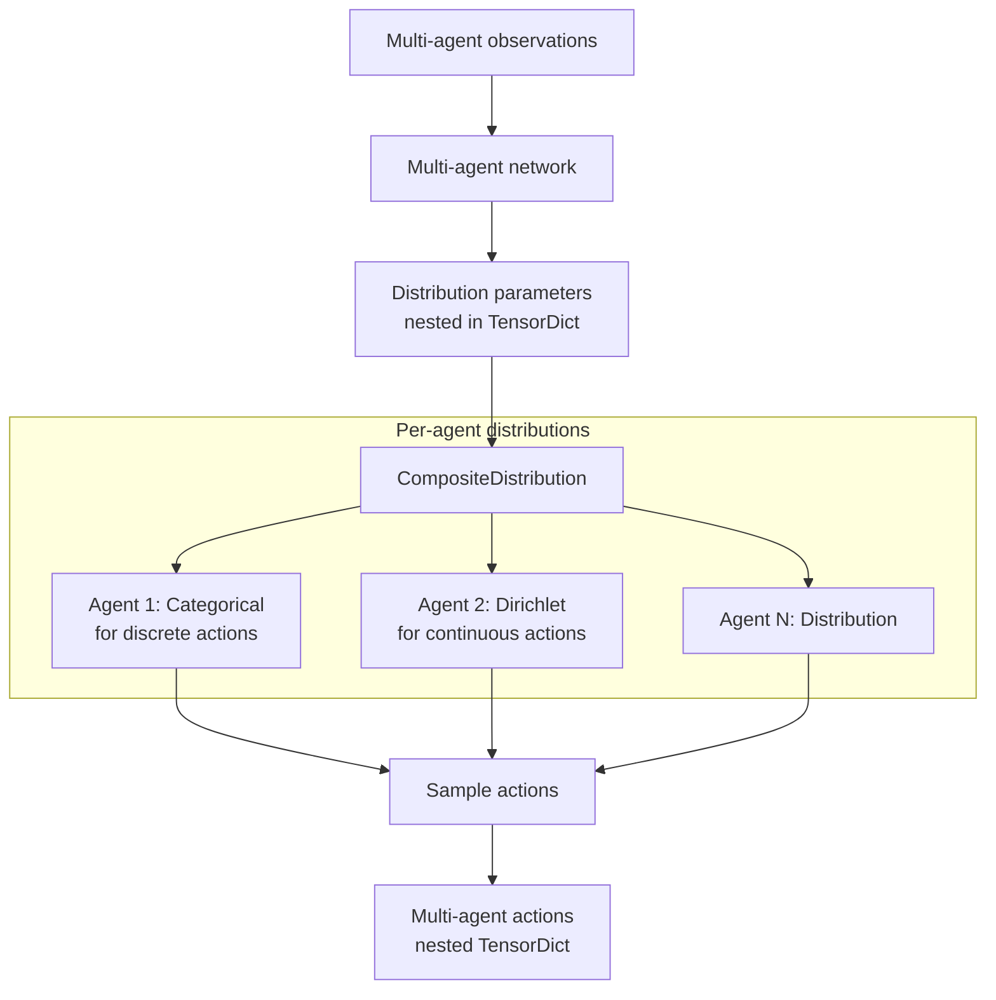

<!-- source: DeepWiki mcp.deepwiki.com · repo pytorch/rl · page 10 Multi-Agent Reinforcement Learning · fetched 2026-10-21 -->

# Multi-Agent Reinforcement Learning

<details>
<summary>Relevant source files</summary>

The following files were used as context for generating this wiki page:

- [.github/unittest/linux_libs/scripts_pettingzoo/environment.yml](.github/unittest/linux_libs/scripts_pettingzoo/environment.yml)
- [.github/unittest/linux_libs/scripts_pettingzoo/post_process.sh](.github/unittest/linux_libs/scripts_pettingzoo/post_process.sh)
- [.github/unittest/linux_libs/scripts_pettingzoo/run_test.sh](.github/unittest/linux_libs/scripts_pettingzoo/run_test.sh)
- [.github/unittest/linux_libs/scripts_pettingzoo/setup_env.sh](.github/unittest/linux_libs/scripts_pettingzoo/setup_env.sh)
- [docs/source/reference/objectives_value.rst](docs/source/reference/objectives_value.rst)
- [test/libs/test_multiagent.py](test/libs/test_multiagent.py)
- [test/objectives/test_dqn.py](test/objectives/test_dqn.py)
- [torchrl/envs/libs/brax.py](torchrl/envs/libs/brax.py)
- [torchrl/envs/libs/dm_control.py](torchrl/envs/libs/dm_control.py)
- [torchrl/envs/libs/envpool.py](torchrl/envs/libs/envpool.py)
- [torchrl/envs/libs/habitat.py](torchrl/envs/libs/habitat.py)
- [torchrl/envs/libs/isaacgym.py](torchrl/envs/libs/isaacgym.py)
- [torchrl/envs/libs/jax_utils.py](torchrl/envs/libs/jax_utils.py)
- [torchrl/envs/libs/jumanji.py](torchrl/envs/libs/jumanji.py)
- [torchrl/envs/libs/lbforaging.py](torchrl/envs/libs/lbforaging.py)
- [torchrl/envs/libs/openml.py](torchrl/envs/libs/openml.py)
- [torchrl/envs/libs/pettingzoo.py](torchrl/envs/libs/pettingzoo.py)
- [torchrl/envs/libs/smacv2.py](torchrl/envs/libs/smacv2.py)
- [torchrl/envs/libs/vmas.py](torchrl/envs/libs/vmas.py)
- [torchrl/objectives/multiagent/qmixer.py](torchrl/objectives/multiagent/qmixer.py)

</details>


## Purpose and Scope

This documentation covers multi-agent reinforcement learning (MARL) capabilities within TorchRL, including multi-agent environments, specialized network architectures, and MARL-specific loss modules. These components enable training multiple agents that interact in shared or competitive environments.

For single-agent RL algorithms, see Learning Algorithms (page 7). For general environment features, see Environments (page 3).

## Overview of MARL Components

TorchRL provides several components for multi-agent reinforcement learning:

1. **Multi-Agent Environments**: Integration with VMAS, PettingZoo, SMACv2, and other libraries.
2. **Multi-Agent Network Architectures**: Specialized networks for centralized/decentralized training.
3. **Value Mixing Networks**: QMixer and VDN for credit assignment.
4. **MARL Loss Modules**: QMixerLoss for training value decomposition networks.

**MARL System Architecture**



Sources: [torchrl/modules/models/multiagent.py:21-265](), [test/objectives/test_dqn.py:30-31](), [torchrl/objectives/multiagent/qmixer.py:34-35]()

## Multi-Agent Environments

TorchRL supports integration with multi-agent environment libraries through dedicated wrapper classes.

### Environment Structure

Multi-agent environments in TorchRL use nested TensorDict structures to organize observations, actions, and rewards for multiple agents. The `group_map` argument in environment wrappers allows flexible grouping of agents. By default, agents are grouped by name if they follow the `"<name>_<int>"` convention, otherwise they are all put in one group named `"agents"` [torchrl/envs/libs/vmas.py:139-143]().

**Multi-Agent TensorDict Structure**



Sources: [torchrl/envs/libs/vmas.py:139-143](), [torchrl/envs/libs/pettingzoo.py:98-111]()

The key convention is that agent-specific data is nested under an `"agents"` key (or a custom group key) in the TensorDict, with an additional dimension for the number of agents within that group. This allows the same data collection and training infrastructure to handle both single-agent and multi-agent scenarios.

### VMAS Integration

VMAS (Vectorized Multi-Agent Simulator) provides fast, vectorized multi-agent environments. The `VmasWrapper` integrates VMAS scenarios with TorchRL's environment interface [torchrl/envs/libs/vmas.py:111-113](). It supports vectorized simulations using PyTorch and allows specifying the number of vectorized environments (`num_envs`) [torchrl/envs/libs/vmas.py:122-125]().

Sources: [torchrl/envs/libs/vmas.py:111-113](), [torchrl/envs/libs/vmas.py:122-125]()

### PettingZoo Integration

PettingZoo is a library of multi-agent game environments. The `PettingZooWrapper` enables using PettingZoo environments within TorchRL [torchrl/envs/libs/pettingzoo.py:86-88](). It can wrap both `pettingzoo.AECEnv` and `pettingzoo.ParallelEnv` [torchrl/envs/libs/pettingzoo.py:90-91](). For `pettingzoo.ParallelEnv`, all agents step simultaneously. For `pettingzoo.AECEnv`, only one agent acts at each step, requiring `use_mask=True` [torchrl/envs/libs/pettingzoo.py:95-104](). The wrapper also handles action masks for unavailable actions [torchrl/envs/libs/pettingzoo.py:108-111]().

Sources: [torchrl/envs/libs/pettingzoo.py:86-88](), [torchrl/envs/libs/pettingzoo.py:90-91](), [torchrl/envs/libs/pettingzoo.py:95-104](), [torchrl/envs/libs/pettingzoo.py:108-111]()

### SMACv2 Integration

The `SMACv2Wrapper` integrates StarCraft Multi-Agent Challenge v2 environments. It provides access to both old SMAC maps and new procedural generation features [torchrl/envs/libs/smacv2.py:35-118]().

Sources: [torchrl/envs/libs/smacv2.py:29-30](), [torchrl/envs/libs/smacv2.py:35-118]()

### Brax Integration

The `BraxWrapper` integrates Google Brax environments, which offer a vectorized and differentiable simulation framework based on JAX [torchrl/envs/libs/brax.py:70-72](). It handles the conversion between JAX and PyTorch tensors [torchrl/envs/libs/brax.py:72-74](). Brax environments are designed for batched simulation, leveraging JAX's `vmap` for parallel execution [torchrl/envs/libs/brax.py:100-103]().

Sources: [torchrl/envs/libs/brax.py:69-70](), [torchrl/envs/libs/brax.py:70-72](), [torchrl/envs/libs/brax.py:72-74](), [torchrl/envs/libs/brax.py:100-103]()

### Jumanji Integration

The `JumanjiWrapper` integrates Jumanji environments, another JAX-based vectorized simulation framework [torchrl/envs/libs/jumanji.py:116-118](). Similar to Brax, it manages JAX-to-PyTorch conversion and supports building computational graphs over simulated trajectories [torchrl/envs/libs/jumanji.py:119-122](). Jumanji environments can be run with an arbitrary number of parallel instances by controlling the batch size of the input TensorDict [torchrl/envs/libs/jumanji.py:145-159]().

Sources: [torchrl/envs/libs/jumanji.py:116-118](), [torchrl/envs/libs/jumanji.py:119-122](), [torchrl/envs/libs/jumanji.py:145-159]()

### IsaacGym Integration

The `IsaacGymWrapper` provides an interface for IsaacGymEnvs environments [torchrl/envs/libs/isaacgym.py:22-23](). IsaacGym environments are designed for CUDA devices and are inherently batched [torchrl/envs/libs/isaacgym.py:34-36](). It's recommended to create one environment per process due to CUDA memory issues [torchrl/envs/libs/isaacgym.py:27-30](). The `IsaacGymEnv` class is a direct interface for creating these environments [torchrl/envs/libs/isaacgym.py:168-169]().

Sources: [torchrl/envs/libs/isaacgym.py:22-23](), [torchrl/envs/libs/isaacgym.py:27-30](), [torchrl/envs/libs/isaacgym.py:34-36](), [torchrl/envs/libs/isaacgym.py:168-169]()

### Habitat Integration

The `HabitatEnv` class provides a wrapper for Habitat environments, which are typically used for embodied AI research [torchrl/envs/libs/habitat.py:90-91](). It extends `GymEnv` and supports parallel execution across multiple GPUs by distributing environments to different devices [torchrl/envs/libs/habitat.py:53-85]().

Sources: [torchrl/envs/libs/habitat.py:90-91](), [torchrl/envs/libs/habitat.py:53-85]()

### DMControl Integration

The `DMControlWrapper` integrates DeepMind Control Suite environments [torchrl/envs/libs/dm_control.py:158-161](). It supports parallel execution through a metaclass `_DMControlMeta` that returns a `ParallelEnv` when `num_workers > 1` [torchrl/envs/libs/dm_control.py:128-139]().

Sources: [torchrl/envs/libs/dm_control.py:158-161](), [torchrl/envs/libs/dm_control.py:128-139]()

## Multi-Agent Network Architectures

TorchRL provides specialized network architectures for multi-agent reinforcement learning that support both centralized and decentralized training paradigms.

### MultiAgentNetBase

`MultiAgentNetBase` is the abstract base class for all multi-agent networks, providing the common interface and utilities.

**Multi-Agent Network Architecture**



Sources: [torchrl/modules/models/multiagent.py:21-122]()

Key parameters:
- `n_agents`: Number of agents in the environment
- `centralized`: If `True`, all agents share the same network parameters (parameter sharing)
- `share_params`: If `True`, agents share parameters; if `False`, each agent has its own parameters
- `agent_dim`: The dimension along which agents are stacked (typically `-2`)

### MultiAgentMLP

`MultiAgentMLP` extends `MLP` to handle multi-agent scenarios with configurable parameter sharing [torchrl/modules/models/multiagent.py:124-125]().

**MultiAgentMLP Architecture**



Sources: [torchrl/modules/models/multiagent.py:124-177]()

Usage example:
```python
# Centralized training (parameter sharing)
net = MultiAgentMLP(
    n_agents=4,
    centralized=True,
    share_params=True,
    in_features=10,
    out_features=5,
    num_cells=[64, 64],
    depth=2
)

# Decentralized training (separate parameters per agent)
net = MultiAgentMLP(
    n_agents=4,
    centralized=False,
    share_params=False,
    in_features=10,
    out_features=5,
    num_cells=[64, 64],
    depth=2
)
```

### MultiAgentConvNet

`MultiAgentConvNet` extends `ConvNet` to handle multi-agent scenarios with visual observations [torchrl/modules/models/multiagent.py:179-180]().

Sources: [torchrl/modules/models/multiagent.py:179-238]()

Key features:
- Supports both centralized and decentralized architectures
- Handles multi-agent visual observations
- Can share convolutional layers across agents
- Automatically flattens spatial dimensions for multi-agent batching

### QMixer

`QMixer` implements the QMIX mixing network that combines individual agent Q-values into a joint Q-value while maintaining the Individual-Global-Max (IGM) principle [torchrl/modules/models/multiagent.py:267-270]().

**QMixer Architecture**



Sources: [torchrl/modules/models/multiagent.py:267-393]()

Key features:
- Ensures monotonicity: increasing any agent's Q-value increases the total Q-value [torchrl/modules/models/multiagent.py:270-271]()
- Uses hypernetworks to generate mixing weights conditioned on global state [torchrl/modules/models/multiagent.py:272-273]()
- Enables centralized training with decentralized execution (CTDE)
- Maintains the IGM principle for credit assignment

Usage example:
```python
qmixer = QMixer(
    state_shape=(64,),      # Global state dimension
    mixing_embed_dim=32,    # Hypernetwork hidden size
    n_agents=4,             # Number of agents
)

# Mix agent Q-values
agent_qs = torch.randn(batch_size, n_agents)
state = torch.randn(batch_size, 64)
total_q = qmixer(agent_qs, state)  # shape: [batch_size, 1]
```

### VDNMixer

`VDNMixer` implements Value Decomposition Networks (VDN), a simpler alternative to QMixer that additively combines agent Q-values [torchrl/modules/models/multiagent.py:396-397]().

**VDN Architecture**



Sources: [torchrl/modules/models/multiagent.py:396-431]()

Key features:
- Simple additive value decomposition [torchrl/modules/models/multiagent.py:396-397]()
- Guarantees IGM principle
- No additional parameters (just summation)
- Faster and more stable than QMixer but less expressive

Usage example:
```python
vdn = VDNMixer()
agent_qs = torch.randn(batch_size, n_agents)
total_q = vdn(agent_qs)  # shape: [batch_size, 1]
```

## MARL Loss Modules

### QMixerLoss

`QMixerLoss` implements the QMIX algorithm, which trains a value decomposition network to perform credit assignment in cooperative multi-agent tasks [torchrl/objectives/multiagent/qmixer.py:34-36](). It expects agent-specific keys like `'local_value'`, `'action_value'`, and `'action'` to have an agent dimension [torchrl/objectives/multiagent/qmixer.py:39-41]().

**QMixer Training Flow**



Sources: [torchrl/objectives/multiagent/qmixer.py:34-36](), [torchrl/objectives/multiagent/qmixer.py:39-41]()

Key features:
- Implements QMIX algorithm for cooperative MARL [torchrl/objectives/multiagent/qmixer.py:34-36]()
- Supports both QMixer and VDNMixer networks [torchrl/objectives/multiagent/qmixer.py:47-48]()
- Handles multi-agent action spaces via nested TensorDict keys [torchrl/objectives/multiagent/qmixer.py:39-41]()
- Compatible with centralized training, decentralized execution (CTDE)
- Uses target networks for stable training [torchrl/objectives/multiagent/qmixer.py:55-57]()

The loss function computes the temporal difference error between the current total Q-value and the target:

```
L = (Q_tot(s, a) - (r + γ * max_a' Q_tot(s', a')))²
```

Where Q_tot is computed by the mixer network from individual agent Q-values.

Sources: [torchrl/objectives/multiagent/qmixer.py:34-36]()

## Composite Action Spaces for Multi-Agent

Multi-agent environments often require handling multiple actions simultaneously, potentially with different action types per agent. TorchRL uses `Composite` and `StackedComposite` specs to represent these complex action spaces [torchrl/data/tensor_specs.py:15-21]().

**Composite Distribution for MARL**



Sources: [torchrl/data/tensor_specs.py:15-21]()

Example from test code showing composite distributions for MARL:

```python
# From MARLEnv.make_composite_dist()
dist_cstr = functools.partial(
    CompositeDistribution,
    distribution_map={
        ("agents", "dirich"): lambda concentration: 
            torch.distributions.Independent(
                torch.distributions.Dirichlet(concentration), 1
            ),
        ("agents", "categ"): torch.distributions.Categorical,
    },
)
```

This shows how different action types can be specified for different agent action components using nested keys.

Sources: [torchrl/data/tensor_specs.py:15-21]()

## Complete MARL Training Example

Here's a complete example showing how to set up and train a multi-agent system using QMIX:

```python
from torchrl.envs import VmasEnv
from torchrl.modules import MultiAgentMLP, QMixer
from torchrl.objectives import QMixerLoss
from torchrl.data import ReplayBuffer, LazyTensorStorage
from torchrl.collectors import SyncDataCollector
import torch

# 1. Create multi-agent environment
env = VmasEnv(scenario="navigation", num_envs=32, n_agents=4)

# 2. Create agent network (decentralized execution)
agent_net = MultiAgentMLP(
    n_agents=4,
    centralized=False,  # Each agent has its own parameters
    share_params=True,   # But they share the same weights
    in_features=env.observation_spec["agents", "observation"].shape[-1],
    out_features=env.action_spec["agents", "action"].space.n,
    num_cells=[64, 64],
    depth=2
)

# 3. Create mixing network (centralized training)
mixer = QMixer(
    state_shape=env.observation_spec["state"].shape, # Corrected state_shape
    mixing_embed_dim=32,
    n_agents=4
)

# 4. Create loss module
loss_module = QMixerLoss(
    local_value_network=agent_net, # Renamed from agent_network
    mixer_network=mixer, # Renamed from mixer
    action_space="categorical",
    delay_value=True  # Use target networks
)

# 5. Create replay buffer and collector
replay_buffer = ReplayBuffer(
    storage=LazyTensorStorage(max_size=100000),
    batch_size=256
)

collector = SyncDataCollector(
    env,
    policy=agent_net,
    frames_per_batch=1000,
    total_frames=1000000
)

# 6. Training loop
optimizer = torch.optim.Adam(loss_module.parameters(), lr=3e-4)

for i, batch in enumerate(collector):
    replay_buffer.extend(batch)
    
    if len(replay_buffer) > 1000:
        # Sample and train
        for _ in range(10):
            sample = replay_buffer.sample()
            loss_dict = loss_module(sample)
            
            loss = loss_dict["loss"]
            optimizer.zero_grad()
            loss.backward()
            optimizer.step()
        
        # Update target networks
        if i % 100 == 0:
            loss_module.update_target_params()
```

This example demonstrates:
- Setting up a multi-agent environment (VMAS)
- Creating agent networks with parameter sharing
- Using a QMixer for value decomposition
- Training with experience replay
- Handling multi-agent data through the standard TorchRL pipeline

Sources: [torchrl/modules/models/multiagent.py:21-431](), [torchrl/objectives/multiagent/qmixer.py:34-36]()

## Summary of MARL Components

| Component | Purpose | Key Parameters | Use Case |
|-----------|---------|----------------|----------|
| `MultiAgentMLP` | MLP for multi-agent | `n_agents`, `centralized`, `share_params` | General multi-agent tasks |
| `MultiAgentConvNet` | ConvNet for multi-agent | `n_agents`, `centralized`, `share_params` | Visual multi-agent tasks |
| `QMixer` | Non-linear value mixing | `state_shape`, `mixing_embed_dim`, `n_agents` | QMIX algorithm (cooperative) |
| `VDNMixer` | Additive value mixing | None (just summation) | VDN algorithm (cooperative) |
| `QMixerLoss` | QMIX training loss | `local_value_network`, `mixer_network`, `delay_value` | Training QMIX/VDN agents |
| `VmasEnv` | Vectorized multi-agent | `scenario`, `num_envs`, `n_agents` | Fast multi-agent simulation |
| `PettingZooEnv` | Multi-agent games | `env_name`, `parallel` | Game-based MARL |
| `SMACv2Wrapper` | StarCraft Multi-Agent | `map_name`, `categorical_actions` | RTS-based MARL |
| `BraxWrapper` | JAX-based physics | `env`, `batch_size` | High-performance physics-based MARL |
| `JumanjiWrapper` | JAX-based RL | `env`, `batch_size` | Diverse JAX-based MARL tasks |
| `IsaacGymEnv` | NVIDIA Isaac Gym | `task`, `num_envs`, `device` | High-fidelity robotics simulation |
| `HabitatEnv` | Habitat simulator | `env_name`, `num_workers`, `device` | Embodied AI and navigation |
| `DMControlEnv` | DeepMind Control Suite | `env_name`, `task_name`, `num_workers` | Continuous control tasks |

### Centralized vs Decentralized Training

| Mode | Description | When to Use |
|------|-------------|-------------|
| Centralized (`centralized=True`) | All agents processed by single network | Homogeneous agents, parameter efficiency |
| Decentralized (`centralized=False, share_params=True`) | Separate network per agent, shared weights | Heterogeneous agents with similar structure |
| Fully Independent (`centralized=False, share_params=False`) | Separate network per agent, separate weights | Heterogeneous agents with different roles |

## Conclusion

TorchRL provides a comprehensive set of tools for multi-agent reinforcement learning, including integrations with popular multi-agent environment libraries, flexible network architectures for various parameter sharing schemes, and specialized loss modules for cooperative MARL algorithms like QMIX. These features enable researchers and practitioners to develop and evaluate MARL agents efficiently.

---

