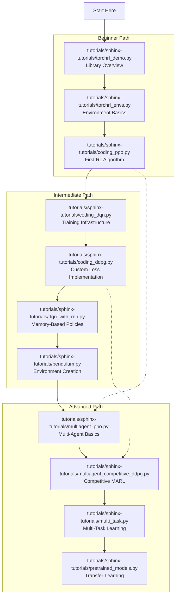

<!-- source: DeepWiki mcp.deepwiki.com · repo pytorch/rl · page 11 Examples and Tutorials · fetched 2026-10-21 -->

# Examples and Tutorials

Relevant source files

The following files were used as context for generating this wiki page:

- [tutorials/sphinx-tutorials/coding_ddpg.py](tutorials/sphinx-tutorials/coding_ddpg.py)
- [tutorials/sphinx-tutorials/coding_dqn.py](tutorials/sphinx-tutorials/coding_dqn.py)
- [tutorials/sphinx-tutorials/coding_ppo.py](tutorials/sphinx-tutorials/coding_ppo.py)
- [tutorials/sphinx-tutorials/dqn_with_rnn.py](tutorials/sphinx-tutorials/dqn_with_rnn.py)
- [tutorials/sphinx-tutorials/multi_task.py](tutorials/sphinx-tutorials/multi_task.py)
- [tutorials/sphinx-tutorials/multiagent_competitive_ddpg.py](tutorials/sphinx-tutorials/multiagent_competitive_ddpg.py)
- [tutorials/sphinx-tutorials/multiagent_ppo.py](tutorials/sphinx-tutorials/multiagent_ppo.py)
- [tutorials/sphinx-tutorials/pendulum.py](tutorials/sphinx-tutorials/pendulum.py)
- [tutorials/sphinx-tutorials/pretrained_models.py](tutorials/sphinx-tutorials/pretrained_models.py)
- [tutorials/sphinx-tutorials/torchrl_demo.py](tutorials/sphinx-tutorials/torchrl_demo.py)
- [tutorials/sphinx-tutorials/torchrl_envs.py](tutorials/sphinx-tutorials/torchrl_envs.py)

This page provides an overview of the learning resources available in the TorchRL repository, including tutorials, state-of-the-art (SOTA) implementations, and standalone examples. These resources are designed to help users understand TorchRL's API, implement various reinforcement learning algorithms, and explore advanced features.

The content is organized into three main categories:
- **Sphinx Tutorials**: Detailed, narrative-driven guides covering core RL algorithms, environment interaction, and advanced topics.
- **SOTA Implementations**: Scripts and configurations for reproducing cutting-edge RL algorithms.
- **Standalone Examples**: Focused code snippets demonstrating specific TorchRL functionalities.

For a high-level introduction to TorchRL's design philosophy and key features, refer to the [Overview](#1) page. To understand the repository's structure, see [Repository Layout](#1.2).

## Tutorial Architecture Overview

The following diagram illustrates how the various tutorial files map to core TorchRL components and learning objectives.

```mermaid
graph TD
    subgraph "Algorithm Tutorials"
        PPO["tutorials/sphinx-tutorials/coding_ppo.py<br/>Basic RL Training"]
        DQN["tutorials/sphinx-tutorials/coding_dqn.py<br/>DQN with Trainer"]
        DDPG["tutorials/sphinx-tutorials/coding_ddpg.py<br/>DDPG from Scratch"]
        RNN["tutorials/sphinx-tutorials/dqn_with_rnn.py<br/>Recurrent Policies"]
    end
    
    subgraph "Multi-Agent Tutorials"
        MAPPO["tutorials/sphinx-tutorials/multiagent_ppo.py<br/>MAPPO/IPPO"]
        MADDPG["tutorials/sphinx-tutorials/multiagent_competitive_ddpg.py<br/>MADDPG/IDDPG"]
    end
    
    subgraph "Environment Tutorials"
        ENVS["tutorials/sphinx-tutorials/torchrl_envs.py<br/>Environment Usage"]
        PENDULUM["tutorials/sphinx-tutorials/pendulum.py<br/>Custom Environment"]
        MULTITASK["tutorials/sphinx-tutorials/multi_task.py<br/>Multi-Task Policies"]
    end
    
    subgraph "Data and Infrastructure"
        PRETRAINED["tutorials/sphinx-tutorials/pretrained_models.py<br/>Pre-trained Models"]
        DEMO["tutorials/sphinx-tutorials/torchrl_demo.py<br/>Library Overview"]
    end
    
    subgraph "Core TorchRL Components"
        ENV_COMP["EnvBase<br/>GymEnv, VmasEnv"]
        MODULES["ProbabilisticActor<br/>QValueActor, MultiAgentMLP"]
        COLLECTORS["Collector"]
        LOSSES["ClipPPOLoss<br/>DDPGLoss, DQNLoss"]
        BUFFERS["ReplayBuffer"]
        TRAINERS["Trainer<br/>ReplayBufferTrainer"]
    end
    
    PPO --> ENV_COMP
    PPO --> MODULES
    PPO --> COLLECTORS
    PPO --> LOSSES
    
    DQN --> TRAINERS
    DQN --> BUFFERS
    DQN --> MODULES
    
    DDPG --> LOSSES
    DDPG --> COLLECTORS
    DDPG --> BUFFERS
    
    MAPPO --> MODULES
    MAPPO --> ENV_COMP
    MADDPG --> MODULES
    
    ENVS --> ENV_COMP
    PENDULUM --> ENV_COMP
    PRETRAINED --> BUFFERS
    PRETRAINED --> ENV_COMP
    PRETRAINED --> MODULES
    DEMO --> ENV_COMP
    DEMO --> MODULES
```

Sources: [tutorials/sphinx-tutorials/coding_ppo.py:1-50](), [tutorials/sphinx-tutorials/coding_dqn.py:1-50](), [tutorials/sphinx-tutorials/multiagent_ppo.py:1-50](), [tutorials/sphinx-tutorials/coding_ddpg.py:1-50](), [tutorials/sphinx-tutorials/dqn_with_rnn.py:1-50](), [tutorials/sphinx-tutorials/pendulum.py:1-50](), [tutorials/sphinx-tutorials/torchrl_envs.py:1-50](), [tutorials/sphinx-tutorials/multiagent_competitive_ddpg.py:1-50](), [tutorials/sphinx-tutorials/pretrained_models.py:1-50](), [tutorials/sphinx-tutorials/multi_task.py:1-50](), [tutorials/sphinx-tutorials/torchrl_demo.py:1-50]()

## Learning Progression Paths

This diagram illustrates recommended learning paths through the tutorials based on experience level and learning objectives:

Sources: [tutorials/sphinx-tutorials/torchrl_demo.py:1-50](), [tutorials/sphinx-tutorials/coding_ppo.py:1-50](), [tutorials/sphinx-tutorials/multiagent_ppo.py:1-50](), [tutorials/sphinx-tutorials/coding_dqn.py:1-50](), [tutorials/sphinx-tutorials/coding_ddpg.py:1-50](), [tutorials/sphinx-tutorials/dqn_with_rnn.py:1-50](), [tutorials/sphinx-tutorials/pendulum.py:1-50](), [tutorials/sphinx-tutorials/multiagent_competitive_ddpg.py:1-50](), [tutorials/sphinx-tutorials/multi_task.py:1-50](), [tutorials/sphinx-tutorials/pretrained_models.py:1-50]()

## Sphinx Tutorials

The `tutorials/sphinx-tutorials` directory contains detailed, narrative-driven tutorials that walk through various aspects of TorchRL. These tutorials are designed to be followed step-by-step and provide a deep understanding of the library's components and their interactions. For details, see [Sphinx Tutorials](#11.1).

### Basic Algorithm Tutorials

These tutorials introduce fundamental RL algorithms and their implementation in TorchRL.

#### PPO Tutorial (`coding_ppo.py`)

This tutorial demonstrates how to train a Proximal Policy Optimization (PPO) agent to solve the Inverted Pendulum task. It covers the creation of environments, data collection, policy and value network design, and the PPO loss module.
It highlights the use of `tensordict.TensorDict` as the universal data carrier.
Sources: [tutorials/sphinx-tutorials/coding_ppo.py:1-36]()

**Key Learnings:**
- Creating and transforming environments.
- Using `tensordict.TensorDict` for data exchange.
- Building training loops with TorchRL components: `torchrl.envs.EnvBase`, `torchrl.envs.transforms.Transform`, `torchrl.modules`, `torchrl.objectives.LossModule`, `torchrl.collectors.Collector`, and `torchrl.data.replay_buffers.ReplayBuffer`.
Sources: [tutorials/sphinx-tutorials/coding_ppo.py:19-35]()

#### DQN with Trainer (`coding_dqn.py`)

This tutorial illustrates how to use the generic `torchrl.trainers.Trainer` class to train a Deep Q-Network (DQN) algorithm for the CartPole task. It focuses on building a trainer with its essential components and adding hooks for logging and target network updates.
Sources: [tutorials/sphinx-tutorials/coding_dqn.py:1-27]()

**Key Learnings:**
- Building a `torchrl.trainers.Trainer` with a data collector, loss module, replay buffer, and optimizer.
- Adding hooks to the trainer for logging and target network updates.
- Building environments with transforms for pixel-based observations.
- Designing `torchrl.modules.QValueActor` objects.
- Efficient data collection and storage in a replay buffer.
Sources: [tutorials/sphinx-tutorials/coding_dqn.py:28-46]()

#### DDPG from Scratch (`coding_ddpg.py`)

This in-depth tutorial guides users through implementing the Deep Deterministic Policy Gradient (DDPG) algorithm by coding a custom loss module. It emphasizes TorchRL's modularity and extensibility, focusing on the `torchrl.objectives.LossModule` architecture.
Sources: [tutorials/sphinx-tutorials/coding_ddpg.py:1-29]()

**Key Learnings:**
- Writing a custom `torchrl.objectives.LossModule` and customizing its value estimator.
- Building environments with transforms and parallel execution.
- Designing policy and value networks.
- Collecting and storing trajectories in a replay buffer.
- Evaluating models.
Sources: [tutorials/sphinx-tutorials/coding_ddpg.py:30-41]()

### Multi-Agent Reinforcement Learning

These tutorials cover the implementation of multi-agent RL algorithms using TorchRL.

#### Multi-Agent PPO (`multiagent_ppo.py`)

This tutorial demonstrates how to solve a Multi-Agent Reinforcement Learning (MARL) problem using PPO. It uses the *Navigation* environment from VMAS, a multi-robot simulator, and covers creating multi-agent environments, network architectures, and the MAPPO/IPPO training loop.
Sources: [tutorials/sphinx-tutorials/multiagent_ppo.py:1-39]()

**Key Learnings:**
- Creating multi-agent environments and understanding their specs.
- Using GPU vectorized environments.
- Creating multi-agent network architectures (parameter sharing, centralized critic).
- Using `tensordict.TensorDict` for multi-agent data.
- Tying together collectors, modules, replay buffers, and losses in a multi-agent MAPPO/IPPO training loop.
Sources: [tutorials/sphinx-tutorials/multiagent_ppo.py:32-39]()

#### Competitive Multi-Agent DDPG (`multiagent_competitive_ddpg.py`)

This tutorial extends MARL concepts to competitive settings using DDPG. It uses the *simple_tag* environment from MultiAgentParticleEnvironments (MPE) and demonstrates training with both PettingZoo and VMAS backends.
Sources: [tutorials/sphinx-tutorials/multiagent_competitive_ddpg.py:1-39]()

**Key Learnings:**
- Using competitive multi-agent environments and their specs.
- Using `torchrl.envs.PettingZooEnv` and `torchrl.envs.VmasEnv` with multiple agent groups.
- Creating multi-agent network architectures (parameter sharing, centralized critic).
- Using `tensordict.TensorDict` for multi-agent multi-group data.
- Implementing an off-policy multi-agent MADDPG/IDDPG training loop.
Sources: [tutorials/sphinx-tutorials/multiagent_competitive_ddpg.py:32-39]()

### Environment and Data Tutorials

These tutorials focus on environment creation, interaction, and data handling within TorchRL.

#### Environment Usage (`torchrl_envs.py`)

This tutorial provides an overview of TorchRL's environment API, demonstrating how to interact with `GymEnv` and other frameworks. It covers environment specs, seeding, resetting, and stepping.
Sources: [tutorials/sphinx-tutorials/torchrl_envs.py:1-21]()

**Key Learnings:**
- Building `torchrl.envs.libs.gym.GymEnv` environments.
- Understanding environment specs (`observation_spec`, `action_spec`, `reward_spec`, `done_spec`).
- Using `env.set_seed()`, `env.reset()`, and `env.step()`.
- The role of `torchrl.envs.utils.step_mdp` in updating `TensorDict`s.
Sources: [tutorials/sphinx-tutorials/torchrl_envs.py:76-172]()

#### Custom Environment (`pendulum.py`)

This tutorial demonstrates how to design a custom stateless environment in TorchRL by coding a pendulum simulator from scratch. It covers defining environment specs, implementing `_reset` and `_step` methods, and using transforms.
Sources: [tutorials/sphinx-tutorials/pendulum.py:1-33]()

**Key Learnings:**
- Designing an environment in TorchRL: writing specs, implementing `_reset`, `_step`, and `_set_seed`.
- Transforming environment inputs and outputs, and writing custom transforms.
- Using `tensordict.TensorDict` to carry arbitrary data structures.
Sources: [tutorials/sphinx-tutorials/pendulum.py:25-33]()

### Advanced Topics

These tutorials delve into more specialized and advanced features of TorchRL.

#### Recurrent Policies (`dqn_with_rnn.py`)

This tutorial explains how to incorporate Recurrent Neural Networks (RNNs) into an actor in TorchRL for memory-based policies. It shows how `tensordict.TensorDict` is used to carry hidden states between steps and how to integrate this with replay buffers and loss modules.
Sources: [tutorials/sphinx-tutorials/dqn_with_rnn.py:1-40]()

**Key Learnings:**
- Incorporating an RNN in an actor in TorchRL.
- Using memory-based policies with a replay buffer and a loss module.
- Using `torchrl.envs.transforms.InitTracker` and `torchrl.envs.transforms.TensorDictPrimer` for recurrent state management.
Sources: [tutorials/sphinx-tutorials/dqn_with_rnn.py:41-43](), [tutorials/sphinx-tutorials/dqn_with_rnn.py:139-165]()

#### Pre-trained Models (`pretrained_models.py`)

This tutorial demonstrates how to use pre-trained models, such as R3M, for efficient image representation in TorchRL. It covers using them as transforms or as components of a policy, and how to fine-tune them.
Sources: [tutorials/sphinx-tutorials/pretrained_models.py:1-12]()

**Key Learnings:**
- Using `torchrl.envs.R3MTransform` for pre-trained feature extraction.
- Integrating transforms into the environment or directly into the policy.
- Fine-tuning pre-trained models.
- Processing offline datasets with pre-trained models.
Sources: [tutorials/sphinx-tutorials/pretrained_models.py:9-12]()

#### Multi-Task Policies (`multi_task.py`)

This tutorial details how to design multi-task policies and use batched environments to execute diverse tasks in parallel. It shows how to create policies with shared backbones and task-specific components.
Sources: [tutorials/sphinx-tutorials/multi_task.py:1-9]()

**Key Learnings:**
- Writing policies that can compute actions in diverse settings using distinct weights.
- Executing diverse environments in parallel using `torchrl.envs.ParallelEnv`.
- Using `tensordict.LazyStackedTensorDict` for multi-task data.
- Designing `tensordict.nn.TensorDictSequential` with `partial_tolerant=True` for task-specific sub-networks.
Sources: [tutorials/sphinx-tutorials/multi_task.py:7-9](), [tutorials/sphinx-tutorials/multi_task.py:75-78](), [tutorials/sphinx-tutorials/multi_task.py:110-112]()

## SOTA Implementations

The `sota-implementations/` directory contains scripts and configurations for reproducing state-of-the-art reinforcement learning algorithms. These implementations are designed for research and benchmarking purposes, often featuring advanced distributed training setups. For details, see [SOTA Implementations](#11.2).

## Standalone Examples

The `examples/` directory provides focused, standalone code examples that demonstrate specific TorchRL functionalities or integration patterns. These examples are typically more concise than the Sphinx tutorials and are often used for CI testing. For details, see [Standalone Examples](#11.3).

## Knowledge Base

The `knowledge_base/` directory contains installation and troubleshooting guides for various external dependencies and common issues encountered when using TorchRL. This includes setup instructions for environments like MuJoCo, DMControl, Habitat, Gym, and IsaacLab, along with general pro-tips. For details, see [Knowledge Base](#11.4).

---

