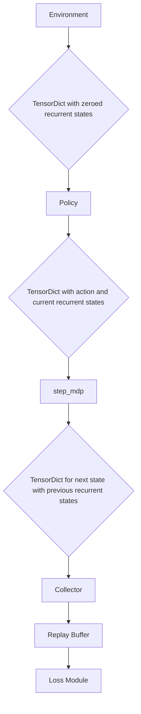
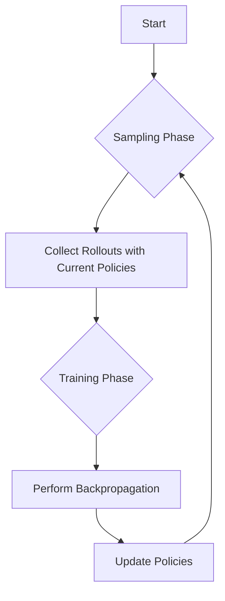
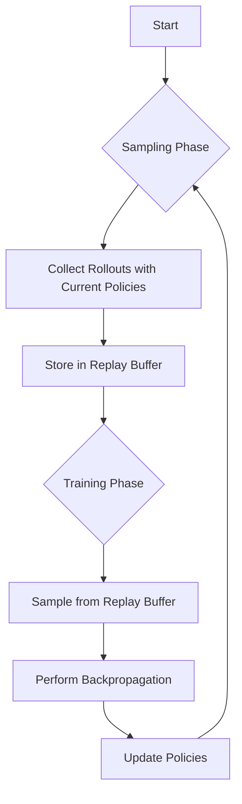

<!-- source: DeepWiki mcp.deepwiki.com · repo pytorch/rl · page 11.1 Sphinx Tutorials · fetched 2026-10-21 -->

# Sphinx Tutorials

<details>
<summary>Relevant source files</summary>

The following files were used as context for generating this wiki page:

- [docs/source/reference/knowledge_base.rst](docs/source/reference/knowledge_base.rst)
- [knowledge_base/VIDEO_CUSTOMISATION.md](knowledge_base/VIDEO_CUSTOMISATION.md)
- [tutorials/sphinx-tutorials/coding_ddpg.py](tutorials/sphinx-tutorials/coding_ddpg.py)
- [tutorials/sphinx-tutorials/coding_dqn.py](tutorials/sphinx-tutorials/coding_dqn.py)
- [tutorials/sphinx-tutorials/coding_ppo.py](tutorials/sphinx-tutorials/coding_ppo.py)
- [tutorials/sphinx-tutorials/dqn_with_rnn.py](tutorials/sphinx-tutorials/dqn_with_rnn.py)
- [tutorials/sphinx-tutorials/export.py](tutorials/sphinx-tutorials/export.py)
- [tutorials/sphinx-tutorials/getting-started-0.py](tutorials/sphinx-tutorials/getting-started-0.py)
- [tutorials/sphinx-tutorials/getting-started-1.py](tutorials/sphinx-tutorials/getting-started-1.py)
- [tutorials/sphinx-tutorials/getting-started-2.py](tutorials/sphinx-tutorials/getting-started-2.py)
- [tutorials/sphinx-tutorials/getting-started-4.py](tutorials/sphinx-tutorials/getting-started-4.py)
- [tutorials/sphinx-tutorials/getting-started-5.py](tutorials/sphinx-tutorials/getting-started-5.py)
- [tutorials/sphinx-tutorials/multi_task.py](tutorials/sphinx-tutorials/multi_task.py)
- [tutorials/sphinx-tutorials/multiagent_competitive_ddpg.py](tutorials/sphinx-tutorials/multiagent_competitive_ddpg.py)
- [tutorials/sphinx-tutorials/multiagent_ppo.py](tutorials/sphinx-tutorials/multiagent_ppo.py)
- [tutorials/sphinx-tutorials/pendulum.py](tutorials/sphinx-tutorials/pendulum.py)
- [tutorials/sphinx-tutorials/pretrained_models.py](tutorials/sphinx-tutorials/pretrained_models.py)
- [tutorials/sphinx-tutorials/torchrl_demo.py](tutorials/sphinx-tutorials/torchrl_demo.py)
- [tutorials/sphinx-tutorials/torchrl_envs.py](tutorials/sphinx-tutorials/torchrl_envs.py)

</details>


This page provides a guide to the tutorials located in the `tutorials/sphinx-tutorials` directory of the TorchRL codebase. These tutorials are designed to help users understand and implement various reinforcement learning concepts and algorithms using the TorchRL library. They cover a range of topics from basic setup and core components to advanced algorithms and multi-agent systems.

## Getting Started Series

The "Getting Started" series introduces fundamental TorchRL concepts and components, guiding users through the initial steps of building RL pipelines.

### Introduction to TorchRL

The `torchrl_demo.py` tutorial provides a hands-on introduction to TorchRL's main components. It highlights the library's PyTorch-native, modular, efficient, and comprehensive nature.
The tutorial begins with a quick example of creating an environment, building a policy, and collecting a trajectory.

```python
import torch
from torchrl.envs import GymEnv
from torchrl.modules import MLP, QValueActor

env = GymEnv("CartPole-v1")
actor = QValueActor(
    MLP(
        in_features=env.observation_spec["observation"].shape[-1],
        out_features=2,
        num_cells=[64, 64],
    ),
    in_keys=["observation"],
    spec=env.action_spec,
)
rollout = env.rollout(max_steps=200, policy=actor)
print(
    f"Collected {rollout.shape[0]} steps, total reward: {rollout['next', 'reward'].sum().item():.0f}"
)
```
[tutorials/sphinx-tutorials/torchrl_demo.py:47-65]()

This snippet demonstrates how to wrap a Gym environment, create a `QValueActor` with an `MLP` backbone, and use `EnvBase.rollout()` to collect a trajectory, resulting in a `TensorDict` containing interaction data.

Sources:
- [tutorials/sphinx-tutorials/torchrl_demo.py:1-190]()

### TensorDict: The Data Backbone

The `torchrl_demo.py` tutorial emphasizes `TensorDict` as the core data structure in TorchRL. It's a dictionary-like container for tensors that supports batched operations, crucial for organizing observations, actions, and rewards.

```python
from tensordict import TensorDict

# Create a TensorDict representing a batch of 4 transitions
batch_size = 4
data = TensorDict(
    obs=torch.randn(batch_size, 3),
    action=torch.randn(batch_size, 2),
    reward=torch.randn(batch_size, 1),
    batch_size=[batch_size],
)
print(data)
```
[tutorials/sphinx-tutorials/torchrl_demo.py:86-96]()

`TensorDict` supports indexing, slicing, device transfer, and stacking, maintaining its dictionary structure throughout. It also allows for nesting, useful for complex observations or separating current and next step data.

Sources:
- [tutorials/sphinx-tutorials/torchrl_demo.py:74-130]()

### Environments

The `torchrl_demo.py` and `torchrl_envs.py` tutorials explain TorchRL's unified environment interface, which works with various simulators like Gym and DMControl. Environments accept and return `TensorDict` objects.

**Creating Environments**
Environments are created using classes like `GymEnv` [tutorials/sphinx-tutorials/torchrl_demo.py:144-146](). Each environment has `specs` (e.g., `action_spec`, `observation_spec`) that define the shape and bounds of data, essential for network building and data validation [tutorials/sphinx-tutorials/torchrl_demo.py:147-148]().

```python
from torchrl.envs import GymEnv

env = GymEnv("Pendulum-v1")
print("Action spec:", env.action_spec)
print("Observation spec:", env.observation_spec)
```
[tutorials/sphinx-tutorials/torchrl_demo.py:144-148]()

Interaction involves `env.reset()` to initialize the environment and `env.step(td)` to advance it, where `td` is a `TensorDict` containing actions [tutorials/sphinx-tutorials/torchrl_demo.py:157-162](). The `step()` method returns the same `TensorDict` with `next` keys populated.

**Transforms**
Environment `Transforms` modify observations, actions, or rewards in a composable manner. Examples include `StepCounter` for tracking steps [tutorials/sphinx-tutorials/torchrl_demo.py:177-184]().

```python
from torchrl.envs import Compose, StepCounter, TransformedEnv

env = TransformedEnv(
    GymEnv("Pendulum-v1"),
    Compose(
        StepCounter(max_steps=200),  # Track steps and auto-terminate
    ),
)
print("Transformed env:", env)
```
[tutorials/sphinx-tutorials/torchrl_demo.py:177-184]()

**Batched Environments**
TorchRL supports batched execution of multiple environment instances, which is crucial for data-hungry RL algorithms.

Sources:
- [tutorials/sphinx-tutorials/torchrl_demo.py:133-190]()
- [tutorials/sphinx-tutorials/torchrl_envs.py:1-181]()

### First Training Loop

The `getting-started-5.py` tutorial demonstrates a basic training loop using DQN with a CartPole environment. It integrates concepts from previous tutorials, including environment setup, policy design, data collection, replay buffers, loss modules, and logging.

**Environment Setup**
A `GymEnv` is wrapped with a `StepCounter` transform [tutorials/sphinx-tutorials/getting-started-5.py:45-47]().

```python
from torchrl.envs import GymEnv, StepCounter, TransformedEnv

env = TransformedEnv(GymEnv("CartPole-v1"), StepCounter())
env.set_seed(0)
```
[tutorials/sphinx-tutorials/getting-started-5.py:45-47]()

**Policy Design**
A deterministic policy is built using `MLP` and `QValueModule`, then augmented with an `EGreedyModule` for exploration [tutorials/sphinx-tutorials/getting-started-5.py:66-72]().

```python
from torchrl.modules import EGreedyModule, MLP, QValueModule

value_mlp = MLP(out_features=env.action_spec.shape[-1], num_cells=[64, 64])
value_net = Mod(value_mlp, in_keys=["observation"], out_keys=["action_value"])
policy = Seq(value_net, QValueModule(spec=env.action_spec))
exploration_module = EGreedyModule(
    env.action_spec, annealing_num_steps=100_000, eps_init=0.5
)
policy_explore = Seq(policy, exploration_module)
```
[tutorials/sphinx-tutorials/getting-started-5.py:66-72]()

**Data Collector and Replay Buffer**
A `Collector` gathers data using the `policy_explore`, and a `ReplayBuffer` with `LazyTensorStorage` stores the collected experiences [tutorials/sphinx-tutorials/getting-started-5.py:93-101]().

```python
from torchrl.collectors import Collector
from torchrl.data import LazyTensorStorage, ReplayBuffer

init_rand_steps = 5000
frames_per_batch = 100
optim_steps = 10
collector = Collector(
    env,
    policy_explore,
    frames_per_batch=frames_per_batch,
    total_frames=-1,
    init_random_frames=init_rand_steps,
    auto_register_policy_transforms=True,
)
rb = ReplayBuffer(storage=LazyTensorStorage(100_000))
```
[tutorials/sphinx-tutorials/getting-started-5.py:93-101]()

**Loss Module and Optimizer**
A `DQNLoss` is initialized with the policy, along with an `Adam` optimizer and a `SoftUpdate` for target network updates [tutorials/sphinx-tutorials/getting-started-5.py:113-116]().

```python
from torchrl.objectives import DQNLoss, SoftUpdate

loss = DQNLoss(value_network=policy, action_space=env.action_spec, delay_value=True)
optim = Adam(loss.parameters(), lr=0.02)
updater = SoftUpdate(loss, eps=0.99)
```
[tutorials/sphinx-tutorials/getting-started-5.py:113-116]()

**Logger**
A `CSVLogger` and `VideoRecorder` are set up for logging training progress and saving rendered videos [tutorials/sphinx-tutorials/getting-started-5.py:128-133]().

```python
from torchrl._utils import logger as torchrl_logger
from torchrl.record import CSVLogger, VideoRecorder

path = "./training_loop"
logger = CSVLogger(exp_name="dqn", log_dir=path, video_format="mp4")
video_recorder = VideoRecorder(logger, tag="video")
record_env = TransformedEnv(
    GymEnv("CartPole-v1", from_pixels=True, pixels_only=False), video_recorder
)
```
[tutorials/sphinx-tutorials/getting-started-5.py:128-133]()

**Training Loop**
The training loop iteratively collects data, extends the replay buffer, updates the exploration factor, and performs optimization steps until a performance threshold is met [tutorials/sphinx-tutorials/getting-started-5.py:148-172]().

```python
total_count = 0
total_episodes = 0
t0 = time.time()
for i, data in enumerate(collector):
    # Write data in replay buffer
    rb.extend(data)
    num_frames = data.numel()
    total_count += num_frames
    total_episodes += data["next", "done"].sum().item()
    # Update the exploration factor once per collected frame
    exploration_module.step(num_frames)
    max_length = rb[:]["next", "step_count"].max()
    if len(rb) > init_rand_steps:
        # Optim loop (we do several optim steps
        # per batch collected for efficiency)
        for _ in range(optim_steps):
            sample = rb.sample(128)
            loss_vals = loss(sample)
            loss_vals["loss"].backward()
            optim.step()
            optim.zero_grad()
            # Update target params
            updater.step()
        if i % 10 == 0:
            torchrl_logger.info(f"Max num steps: {max_length}, rb length {len(rb)}")
    if max_length > 200:
        break
```
[tutorials/sphinx-tutorials/getting-started-5.py:148-172]()

Sources:
- [tutorials/sphinx-tutorials/getting-started-5.py:1-198]()

## Coding PPO, DQN, and DDPG

These tutorials provide in-depth guides to implementing popular reinforcement learning algorithms using TorchRL.

### Coding PPO

The `coding_ppo.py` tutorial demonstrates how to train a parametric policy network to solve the Inverted Pendulum task using Proximal Policy Optimization (PPO) with TorchRL. It covers creating environments, using `TensorDict` for data flow, and building a training loop with advantage computation, stochastic policies, and dynamic replay buffers.

The tutorial highlights six crucial TorchRL components: environments, transforms, models, loss modules, data collectors, and replay buffers [tutorials/sphinx-tutorials/coding_ppo.py:29-35]().

**PPO Algorithm Overview**
PPO is a policy-gradient algorithm where a batch of data is collected and used to train the policy to maximize expected return, subject to proximality constraints. The algorithm involves sampling data, performing optimization steps with random sub-samples using a clipped REINFORCE loss, which discourages significant policy shifts [tutorials/sphinx-tutorials/coding_ppo.py:46-85]().

**Training Loop Structure**
The tutorial outlines the steps for building the training loop:
1. Define hyperparameters [tutorials/sphinx-tutorials/coding_ppo.py:89-90]().
2. Create the environment using TorchRL's wrappers and transforms [tutorials/sphinx-tutorials/coding_ppo.py:92-93]().
3. Design the policy network and value model [tutorials/sphinx-tutorials/coding_ppo.py:94-96]().
4. Create the replay buffer and data loader [tutorials/sphinx-tutorials/coding_ppo.py:98-99]().
5. Run the training loop and analyze results [tutorials/sphinx-tutorials/coding_ppo.py:100-101]().

`TensorDict` is emphasized as the "lingua franca" of TorchRL, abstracting module inputs and outputs [tutorials/sphinx-tutorials/coding_ppo.py:102-105]().

Sources:
- [tutorials/sphinx-tutorials/coding_ppo.py:1-173]()

### Coding DQN

The `coding_dqn.py` tutorial focuses on using TorchRL's generic `Trainer` class to train a DQN algorithm for the CartPole task. It details building a trainer with essential components like data collector, loss module, replay buffer, and optimizer, and adding hooks for logging and target network updates.

**DQN Algorithm Overview**
DQN (Deep Q-Learning) extends Q-learning by using a neural network to estimate state-action values, allowing for continuous state spaces. The goal is to balance a pole on a cart by applying forces [tutorials/sphinx-tutorials/coding_dqn.py:54-78]().

**Trainer Components**
The tutorial covers the construction of various components:
- **Environment**: Building an environment with transforms for data normalization, frame concatenation, resizing, and grayscale conversion [tutorials/sphinx-tutorials/coding_dqn.py:174-180]().
- **Policy**: Designing a `QValueActor` to estimate action values [tutorials/sphinx-tutorials/coding_dqn.py:35-36]().
- **Data Collector**: Efficiently collecting data from the environment [tutorials/sphinx-tutorials/coding_dqn.py:37-38]().
- **Replay Buffer**: Storing training data, including multi-step transitions [tutorials/sphinx-tutorials/coding_dqn.py:38-39]().
- **Loss Module**: Computing the objective function to train the policy [tutorials/sphinx-tutorials/coding_dqn.py:40-41]().
- **Optimizer**: Performing parameter updates based on the loss [tutorials/sphinx-tutorials/coding_dqn.py:42-43]().

Additional modules include a logger, recorder, and target network updater, all orchestrated by the `Trainer` class [tutorials/sphinx-tutorials/coding_dqn.py:169-172]().

Sources:
- [tutorials/sphinx-tutorials/coding_dqn.py:1-180]()

### Coding DDPG

The `coding_ddpg.py` tutorial guides users through coding a Deep Deterministic Policy Gradient (DDPG) loss from scratch using TorchRL. It emphasizes TorchRL's modular approach, separating environment, data collection, model, and loss function.

**DDPG Algorithm Overview**
DDPG is a continuous control algorithm that learns a parametric value function for action-observation pairs and a policy that outputs actions maximizing this value function [tutorials/sphinx-tutorials/coding_ddpg.py:25-30]().

**Key Learnings**
The tutorial focuses on:
- Writing a loss module and customizing its value estimator [tutorials/sphinx-tutorials/coding_ddpg.py:33-34]().
- Building an environment with transforms and parallel execution [tutorials/sphinx-tutorials/coding_ddpg.py:35-36]().
- Designing policy and value networks [tutorials/sphinx-tutorials/coding_ddpg.py:37-38]().
- Efficiently collecting and storing trajectories in a replay buffer [tutorials/sphinx-tutorials/coding_ddpg.py:39-40]().
- Evaluating the model [tutorials/sphinx-tutorials/coding_ddpg.py:41]().

**TorchRL LossModule**
TorchRL's `LossModule` objects are stateful, containing trainable parameters. Their `forward` method expects a `TensorDict` as input and returns a `TensorDict` with loss values (e.g., `"loss_<smth>"`) [tutorials/sphinx-tutorials/coding_ddpg.py:106-123](). The `convert_to_functional` method is crucial for extracting parameters and converting modules to functional form, which is beneficial for RL algorithms that execute the same operations multiple times with different parameters [tutorials/sphinx-tutorials/coding_ddpg.py:162-169]().

Sources:
- [tutorials/sphinx-tutorials/coding_ddpg.py:1-169]()

## Pendulum: Writing Your Environment and Transforms

The `pendulum.py` tutorial demonstrates how to design a custom environment and transforms in TorchRL by coding a pendulum simulator from scratch. It covers writing specs, implementing environment behavior (`_reset`, `_step`, `_set_seed`), and transforming inputs/outputs.

**Stateless Environments**
The tutorial focuses on designing a *stateless* environment, where the current state is provided at each step. This offers full control over inputs and outputs, allowing for resetting experiments at any stage and modifying dynamics externally. Stateless environments also enable batched execution of transition simulations [tutorials/sphinx-tutorials/pendulum.py:43-60]().

**Environment Design Components**
When designing a new environment class, four key methods must be implemented:
- `EnvBase._reset()`: Resets the simulator to an initial state [tutorials/sphinx-tutorials/pendulum.py:122-123]().
- `EnvBase._step()`: Codes the state transition dynamic [tutorials/sphinx-tutorials/pendulum.py:124]().
- `EnvBase._set_seed()`: Implements the seeding mechanism [tutorials/sphinx-tutorials/pendulum.py:125]().
- Environment specs: Defines the input, observation, and reward specifications [tutorials/sphinx-tutorials/pendulum.py:126]().

**Pendulum Dynamics**
The tutorial models a simple pendulum where torque is applied to its fixed point. The goal is to position the pendulum upright (angular position at 0) and keep it still. This involves defining motion equations for angular velocity and position, and a reward equation that is maximized when the angle, angular velocity, and torque are all near zero [tutorials/sphinx-tutorials/pendulum.py:137-159]().

**Coding the `_step` Method**
The `_step` method is central to encoding the simulation. In TorchRL, `EnvBase.step()` receives a `TensorDict` as input [tutorials/sphinx-tutorials/pendulum.py:161-167]().

Sources:
- [tutorials/sphinx-tutorials/pendulum.py:1-167]()

## Recurrent DQN: Training Recurrent Policies

The `dqn_with_rnn.py` tutorial explains how to incorporate Recurrent Neural Networks (RNNs) into TorchRL policies for memory-based decision-making. It covers using RNNs within an actor, integrating them with replay buffers, and loss modules.

**Overview of Recurrent Policies**
Memory-based policies are crucial when observations are partially observable or when temporal dependencies are important. RNNs are a common tool for this, maintaining a recurrent state between steps that is fed into the policy along with the current observation [tutorials/sphinx-tutorials/dqn_with_rnn.py:29-37]().

**Data Flow with RNNs**
The core idea is to use `TensorDict` as a data carrier for hidden states. The policy reads the previous recurrent state from the current `TensorDict` and writes the current recurrent states into the `TensorDict` for the next state.


**Diagram: Data Flow with Recurrent Policies**

Sources:
- [tutorials/sphinx-tutorials/dqn_with_rnn.py:23-59]()

**Environment Setup for RNNs**
The tutorial uses a pixel-based CartPole environment with custom transforms: grayscale, resizing, reward scaling, and observation normalization [tutorials/sphinx-tutorials/dqn_with_rnn.py:167-177]().

```python
env = TransformedEnv(
    GymEnv("CartPole-v1", from_pixels=True, device=device),
    Compose(
        ToTensorImage(),
        GrayScale(),
        Resize(84, 84),
        StepCounter(),
        InitTracker(),
        RewardScaling(loc=0.0, scale=0.1),
        ObservationNorm(standard_normal=True, in_keys=["pixels"]),
    ),
)
```
[tutorials/sphinx-tutorials/dqn_with_rnn.py:167-177]()

Two important transforms for RNNs are:
- `InitTracker`: Stamps calls to `EnvBase.reset()` with an `"is_init"` boolean mask, indicating when RNN hidden states need to be reset [tutorials/sphinx-tutorials/dqn_with_rnn.py:140-145]().
- `TensorDictPrimer`: Instructs the environment and collector to expect extra keys for hidden states. This ensures that `env.reset()` populates these entries with zeroed tensors, which are then passed through the collector and stored in the replay buffer. This prevents the policy from silently losing recurrency by zeroing its hidden state at every step [tutorials/sphinx-tutorials/dqn_with_rnn.py:145-165](). The tutorial explicitly builds the primer using `LSTMModule.make_tensordict_primer()` after the LSTM is constructed.

Sources:
- [tutorials/sphinx-tutorials/dqn_with_rnn.py:1-185]()

## Multi-Agent Reinforcement Learning

These tutorials explore multi-agent RL problems, covering both cooperative and competitive scenarios with PPO and DDPG.

### Multi-Agent PPO

The `multiagent_ppo.py` tutorial demonstrates how to solve a Multi-Agent Reinforcement Learning (MARL) problem using PPO with TorchRL. It uses the *Navigation* environment from VMAS, a multi-robot simulator.

**Key Learnings**
The tutorial covers:
- Creating multi-agent environments in TorchRL and understanding their specs [tutorials/sphinx-tutorials/multiagent_ppo.py:34-35]().
- Using GPU vectorized environments [tutorials/sphinx-tutorials/multiagent_ppo.py:35-36]().
- Creating different multi-agent network architectures (e.g., parameter sharing, centralized critic) [tutorials/sphinx-tutorials/multiagent_ppo.py:37-38]().
- Using `TensorDict` for multi-agent data [tutorials/sphinx-tutorials/multiagent_ppo.py:38-39]().
- Integrating collectors, modules, replay buffers, and losses in a multi-agent MAPPO/IPPO training loop [tutorials/sphinx-tutorials/multiagent_ppo.py:39-40]().

**On-Policy Learning**
PPO is an on-policy algorithm, meaning it involves a **sampling** phase (collecting rollouts with current policies) and a **training** phase (using collected rollouts for backpropagation to update policies) [tutorials/sphinx-tutorials/multiagent_ppo.py:58-63]().


**Diagram: On-Policy Learning Loop**

**Critic Formulations in MARL**
- **MAPPO**: Uses a centralized critic that takes the global state as input (e.g., concatenated observations). This is suitable for centralized training [tutorials/sphinx-tutorials/multiagent_ppo.py:80-85]().
- **IPPO**: Uses a decentralized critic that takes only the respective agent's observation as input, enabling decentralized training [tutorials/sphinx-tutorials/multiagent_ppo.py:86-90]().

The tutorial also discusses the impact of parameter sharing on these formulations [tutorials/sphinx-tutorials/multiagent_ppo.py:91-93]().

Sources:
- [tutorials/sphinx-tutorials/multiagent_ppo.py:1-144]()

### Multi-Agent Competitive DDPG

The `multiagent_competitive_ddpg.py` tutorial extends multi-agent concepts to competitive scenarios using DDPG. It focuses on the *simple_tag* environment from the MultiAgentParticleEnvironments (MPE) and demonstrates training with both PettingZoo (CPU) and VMAS (GPU vectorized) environments.

**Key Learnings**
The tutorial covers:
- Using competitive multi-agent environments and their specs [tutorials/sphinx-tutorials/multiagent_competitive_ddpg.py:34-35]().
- Utilizing Parallel PettingZoo and VMAS environments with multiple agent groups [tutorials/sphinx-tutorials/multiagent_competitive_ddpg.py:36-37]().
- Creating different multi-agent network architectures (parameter sharing, centralized critic) [tutorials/sphinx-tutorials/multiagent_competitive_ddpg.py:38-39]().
- Using `TensorDict` for multi-agent multi-group data [tutorials/sphinx-tutorials/multiagent_competitive_ddpg.py:39-40]().
- Integrating components in an off-policy multi-agent MADDPG/IDDPG training loop [tutorials/sphinx-tutorials/multiagent_competitive_ddpg.py:40-41]().

**Off-Policy Learning**
DDPG is an off-policy algorithm, meaning that data collected from older policies can be reused for training.


**Diagram: Off-Policy Learning Loop**

Sources:
- [tutorials/sphinx-tutorials/multiagent_competitive_ddpg.py:1-153]()

## Exporting TorchRL Modules

The `export.py` tutorial explains how to export trained TorchRL modules for deployment on various hardware, including edge devices. It covers using different backends like ONNX or AOTInductor and testing exported models.

**Introduction to Exporting**
TorchRL's modularity and reliance on `TensorDict` allow for flexible policy building. However, deploying these policies on low-level hardware requires exporting them as standalone executables. PyTorch's ecosystem provides solutions for this, and TorchRL is fully compatible [tutorials/sphinx-tutorials/export.py:20-27]().

**Key Learnings**
The tutorial focuses on:
- Exporting any TorchRL module after training [tutorials/sphinx-tutorials/export.py:36]().
- Using various backends [tutorials/sphinx-tutorials/export.py:37]().
- Testing exported models [tutorials/sphinx-tutorials/export.py:38]().

**Exporting a `TensorDictModule`-based Policy**
The tutorial uses a DQN example with Atari games. The policy is built using `TensorDictModule` and `QValueModule`. A key aspect is handling environment transforms: while transforms are applied to the environment during training, for deployment, the model itself should handle preprocessing raw input data (e.g., images) [tutorials/sphinx-tutorials/export.py:149-158]().

This is achieved by prepending environment transforms to the policy using `TensorDictSequential` [tutorials/sphinx-tutorials/export.py:163-170]().

```python
policy_transform = TensorDictSequential(
    env.transform[
        :-1
    ],  # the last transform is a step counter which we don't need for preproc
    policy_explore.requires_grad_(
        False
    ),  # Using the explorative version of the policy for didactic purposes, see below.
)
```
[tutorials/sphinx-tutorials/export.py:163-170]()

The `torch.export.export()` function is then used with a fake `TensorDict` input to create a "raw" Python function that takes the input tensor and outputs an action, without dependencies on TorchRL or `TensorDict` modules [tutorials/sphinx-tutorials/export.py:179-182](). `TensorDictSequential.select_out_keys()` can be used to specify desired outputs [tutorials/sphinx-tutorials/export.py:175-177]().

Sources:
- [tutorials/sphinx-tutorials/export.py:1-182]()

## Memory-Efficient RL with Pretrained Models

The `pretrained_models.py` tutorial demonstrates how to use pretrained models in TorchRL for efficient image representation and fine-tuning. It uses R3M (Robotic Reinforcement Learning with Recurrent Memory) as an example.

**Overview**
Pretrained models can be used as transforms or as components of a policy. The tutorial shows how to use R3M to map observations to a vector representation, which can then be used by a policy.

**Using Pretrained Models as Transforms**
An `R3MTransform` is initialized and appended to a `TransformedEnv`. This transform processes collected data, mapping pixels to an `"r3m_vec"` entry in the output `TensorDict`. A simple `Actor` with an `MLP` then reads this vector to compute actions [tutorials/sphinx-tutorials/pretrained_models.py:63-74]().

```python
r3m = R3MTransform(
    "resnet50",
    in_keys=["pixels"],
    download=False,  # Turn to true for real-life testing
)
env_transformed = TransformedEnv(base_env, r3m)
net = nn.Sequential(
    nn.LazyLinear(128, device=device),
    nn.Tanh(),
    nn.Linear(128, base_env.action_spec.shape[-1], device=device),
)
policy = Actor(net, in_keys=["r3m_vec"])
```
[tutorials/sphinx-tutorials/pretrained_models.py:63-74]()

**Fine-tuning Pretrained Models**
For fine-tuning, the `R3MTransform` is integrated directly into the policy using `TensorDictSequential`, and its parameters are made trainable [tutorials/sphinx-tutorials/pretrained_models.py:91-94]().

```python
r3m.train()
policy = TensorDictSequential(r3m, policy)
```
[tutorials/sphinx-tutorials/pretrained_models.py:91-94]()

This allows the pretrained model's parameters to be updated during training. The flexibility of `TensorDictModule` allows easy swapping of transforms between the environment and the policy [tutorials/sphinx-tutorials/pretrained_models.py:104-108]().

**Using Pretrained Models with Replay Buffers**
Pretrained models can also be used to process data within a `ReplayBuffer`. An `R3MTransform` can be added to the replay buffer's `transform` chain. When data is sampled from the buffer, it passes through the R3M transform, providing processed data for offline RL [tutorials/sphinx-tutorials/pretrained_models.py:115-116]().

```python
from torchrl.data import LazyMemmapStorage, ReplayBuffer

buffer_scratch_dir = tempfile.TemporaryDirectory().name
storage = LazyMemmapStorage(1000, scratch_dir=buffer_scratch_dir)
rb = ReplayBuffer(storage=storage, transform=Compose(lambda td: td.to(device), r3m))
```
[tutorials/sphinx-tutorials/pretrained_models.py:115-116]()

Sources:
- [tutorials/sphinx-tutorials/pretrained_models.py:1-152]()

---

