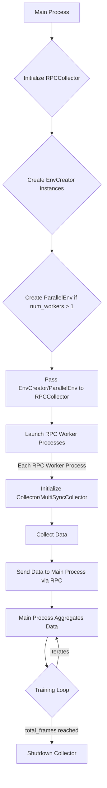

<!-- source: DeepWiki mcp.deepwiki.com · repo pytorch/rl · page 11.3 Standalone Examples · fetched 2026-10-21 -->

# Standalone Examples

<details>
<summary>Relevant source files</summary>

The following files were used as context for generating this wiki page:

- [.github/unittest/examples/scripts/test_examples.py](.github/unittest/examples/scripts/test_examples.py)
- [.github/unittest/linux_libs/scripts_mujoco/install.sh](.github/unittest/linux_libs/scripts_mujoco/install.sh)
- [examples/distributed/collectors/multi_nodes/delayed_dist.py](examples/distributed/collectors/multi_nodes/delayed_dist.py)
- [examples/distributed/collectors/multi_nodes/delayed_rpc.py](examples/distributed/collectors/multi_nodes/delayed_rpc.py)
- [examples/distributed/collectors/multi_nodes/generic.py](examples/distributed/collectors/multi_nodes/generic.py)
- [examples/distributed/collectors/multi_nodes/ray_train.py](examples/distributed/collectors/multi_nodes/ray_train.py)
- [examples/distributed/collectors/multi_nodes/rpc.py](examples/distributed/collectors/multi_nodes/rpc.py)
- [examples/distributed/collectors/multi_nodes/sync.py](examples/distributed/collectors/multi_nodes/sync.py)
- [examples/distributed/collectors/single_machine/generic.py](examples/distributed/collectors/single_machine/generic.py)
- [examples/distributed/collectors/single_machine/rpc.py](examples/distributed/collectors/single_machine/rpc.py)
- [examples/distributed/collectors/single_machine/sync.py](examples/distributed/collectors/single_machine/sync.py)
- [examples/distributed/replay_buffers/distributed_replay_buffer.py](examples/distributed/replay_buffers/distributed_replay_buffer.py)
- [examples/menagerie/README.md](examples/menagerie/README.md)
- [examples/menagerie/ppo.py](examples/menagerie/ppo.py)
- [examples/ray_wandb_monitor.py](examples/ray_wandb_monitor.py)
- [examples/rlhf/README.md](examples/rlhf/README.md)
- [examples/rlhf/config/train.yaml](examples/rlhf/config/train.yaml)
- [examples/rlhf/config/train_reward.yaml](examples/rlhf/config/train_reward.yaml)
- [examples/rlhf/config/train_rlhf.yaml](examples/rlhf/config/train_rlhf.yaml)
- [examples/rlhf/data/__init__.py](examples/rlhf/data/__init__.py)
- [examples/rlhf/models/reward.py](examples/rlhf/models/reward.py)
- [examples/rlhf/models/transformer.py](examples/rlhf/models/transformer.py)
- [examples/rlhf/train.py](examples/rlhf/train.py)
- [examples/rlhf/train_reward.py](examples/rlhf/train_reward.py)
- [examples/rlhf/train_rlhf.py](examples/rlhf/train_rlhf.py)
- [examples/rlhf/utils.py](examples/rlhf/utils.py)
- [torchrl/collectors/distributed/utils.py](torchrl/collectors/distributed/utils.py)

</details>


This page documents the standalone example scripts located in the `examples/` directory of the TorchRL codebase. These examples showcase various features of TorchRL, including different collector configurations, distributed training setups, replay buffer usage, RLHF pipelines, and specific environment integrations. Each example is designed to be runnable independently and serves as a practical guide for implementing TorchRL components. The examples are also continuously integrated (CI) tested to ensure their functionality and correctness.

## Examples Overview

The `examples/` directory is structured into several subdirectories, each focusing on a particular aspect of TorchRL:

*   `agents/`: Demonstrates various agent architectures, such as composite actors, multi-step agents, recurrent networks, and transformer-based actors.
*   `collectors/`: Illustrates different data collection strategies, including asynchronous batched collectors and weight synchronization mechanisms.
*   `distributed/`: Provides examples for distributed data collection and training, covering single-machine and multi-node setups using various communication backends (Gloo, NCCL, RPC, Ray).
*   `envs/`: Showcases environment-related functionalities, such as environment compilation, asynchronous info reading, and Gym environment conversion.
*   `llm/`: Contains examples related to Large Language Model (LLM) integration, including tool services.
*   `menagerie/`: Features examples for the Menagerie robotics platform, specifically PPO training for robotic tasks.
*   `mujoco_macros/`: Demonstrates usage with custom MuJoCo environments like `cube_bowl` and `humanoid`.
*   `multiagent/`: Includes examples for multi-agent reinforcement learning algorithms like MAPPO and IPPO.
*   `replay-buffers/`: Illustrates advanced replay buffer functionalities, such as handling concatenated frames, checkpointing, filtering incomplete trajectories, and recurrent slice sampling.
*   `rlhf/`: Focuses on Reinforcement Learning from Human Feedback (RLHF) pipelines, including training transformer models and reward models.
*   `ray_wandb_monitor.py`: An example demonstrating how to monitor Ray collection progress using Weights & Biases.

These examples are tested in the CI pipeline using the script `test_examples.py` [examples/rlhf/train_reward.py:1-183](). This script defines `ExampleSpec` objects [examples/rlhf/train_reward.py:1-183]() for each runnable example, specifying its path, command-line arguments, working directory, timeout, and environment variables.

## Collectors Examples

The `examples/collectors/` directory contains scripts demonstrating various data collection strategies.

### Asynchronous Batched Collector

The `async_batched_collector.py` example illustrates how to use an asynchronous batched collector. This setup is beneficial for maximizing throughput by allowing multiple environments to run in parallel and collect data asynchronously.

### Collector Device Management

The `collector_device.py` example [examples/rlhf/train_reward.py:1-183]() focuses on managing device placement for collectors. It shows how to specify the device (e.g., CPU or GPU) where the collector and its components (environments, policies) should operate. The `--smoke` argument [examples/rlhf/train_reward.py:1-183]() is used in CI to run a quick test.

### Weight Synchronization Collectors

The `weight_sync_collectors.py` example [examples/rlhf/train_reward.py:1-183]() demonstrates different weight synchronization schemes for collectors, which are crucial in distributed training setups where multiple collectors need to share policy weights. The `--smoke` argument [examples/rlhf/train_reward.py:1-183]() is used in CI to run a quick test.

Sources:
* [.github/unittest/examples/scripts/test_examples.py:49-61]()

## Distributed Examples

The `examples/distributed/` directory showcases various distributed data collection and training setups. These examples are critical for scaling RL experiments to multiple machines or GPUs.

### Single-Machine Distributed Collectors

The `examples/distributed/collectors/single_machine/` directory contains examples for distributed collection on a single machine.

#### Generic Distributed Collector

The `generic.py` example [examples/distributed/collectors/single_machine/generic.py:1-163]() demonstrates a generic distributed collector setup that supports both synchronous and asynchronous collection. It uses `DistributedCollector` [examples/distributed/collectors/single_machine/generic.py:133]() and can leverage `MultiSyncCollector` [examples/distributed/collectors/single_machine/generic.py:108]() or `MultiAsyncCollector` [examples/distributed/collectors/single_machine/generic.py:108]() for sub-collectors. The example uses `EnvCreator` [examples/distributed/collectors/single_machine/generic.py:95]() and `ParallelEnv` [examples/distributed/collectors/single_machine/generic.py:100]() for environment creation and parallelization.

The script takes arguments such as `--num_workers`, `--num_nodes`, `--frames_per_batch`, `--total_frames`, `--backend` (e.g., `gloo`, `nccl`), `--sync`, `--worker_parallelism`, and `--env`. The `worker_parallelism` argument [examples/distributed/collectors/single_machine/generic.py:69-72]() determines whether parallelism is achieved at the environment level (`env`) or collector level (`collector`).

**Distributed Collector Flow (Generic)**
```mermaid
graph TD
    A[Main Process] --> B{Initialize DistributedCollector};
    B --> C{Determine Sub-Collector Class};
    C -- num_workers > 1 and worker_parallelism="collector" --> D[MultiSyncCollector or MultiAsyncCollector];
    C -- else --> E[Collector];
    B --> F{Create EnvCreator instances};
    F --> G{Create ParallelEnv if worker_parallelism="env"};
    G --> H[Pass EnvCreator/ParallelEnv to DistributedCollector];
    H --> I[Launch Worker Processes];
    I -- Each Worker Process --> J[Initialize Sub-Collector];
    J --> K[Collect Data];
    K --> L[Send Data to Main Process];
    L --> M[Main Process Aggregates Data];
    M --> N{Training Loop};
    N -- Iterates --> M;
    N -- total_frames reached --> O[Shutdown Collector];
```
Sources:
* [.github/unittest/examples/scripts/test_examples.py:63-75]()
* [examples/distributed/collectors/single_machine/generic.py:1-163]()

#### RPC Distributed Collector

The `rpc.py` example [examples/distributed/collectors/single_machine/rpc.py:1-138]() demonstrates distributed collection using PyTorch's RPC framework. It utilizes `RPCCollector` [examples/distributed/collectors/single_machine/rpc.py:108]() to manage remote collectors. Similar to the generic example, it supports arguments like `--num_workers`, `--num_nodes`, `--frames_per_batch`, `--total_frames`, `--sync`, and `--env`.

The `RPCCollector` [examples/distributed/collectors/single_machine/rpc.py:108]() can use `Collector` [examples/distributed/collectors/single_machine/rpc.py:114]() or `MultiSyncCollector` [examples/distributed/collectors/single_machine/rpc.py:114]() as its underlying collector class, depending on the `num_workers` configuration.

**RPC Collector Flow**

Sources:
* [.github/unittest/examples/scripts/test_examples.py:76-88]()
* [examples/distributed/collectors/single_machine/rpc.py:1-138]()

#### Synchronous Distributed Collector

The `sync.py` example [examples/distributed/collectors/single_machine/sync.py:1-158]() focuses on synchronous distributed data collection. It uses `DistributedSyncCollector` [examples/distributed/collectors/single_machine/sync.py:130]() and supports `MultiSyncCollector` [examples/distributed/collectors/single_machine/sync.py:104]() for parallel environment execution within each node. The arguments are similar to the generic example, including `--backend` for communication.

Sources:
* [.github/unittest/examples/scripts/test_examples.py:90-102]()
* [examples/distributed/collectors/single_machine/sync.py:1-158]()

### Multi-Node Distributed Collectors

The `examples/distributed/collectors/multi_nodes/` directory provides examples for distributed collection across multiple nodes, often leveraging job schedulers like Slurm via `submitit`.

#### Ray Distributed Training

The `ray_train.py` example [examples/distributed/collectors/multi_nodes/ray_train.py:1-196]() demonstrates PPO training with a `RayCollector` [examples/distributed/collectors/multi_nodes/ray_train.py:17()]. This script defines hyperparameters, environment setup (using `GymEnv` [examples/distributed/collectors/multi_nodes/ray_train.py:55()] and `TransformedEnv` [examples/distributed/collectors/multi_nodes/ray_train.py:56()]), actor and critic networks (`TensorDictModule` [examples/distributed/collectors/multi_nodes/ray_train.py:79()], `ProbabilisticActor` [examples/distributed/collectors/multi_nodes/ray_train.py:82()], `ValueOperator` [examples/distributed/collectors/multi_nodes/ray_train.py:104()]), and a `RayCollector` [examples/distributed/collectors/multi_nodes/ray_train.py:119()] for distributed data collection. It also integrates a `ReplayBuffer` [examples/distributed/collectors/multi_nodes/ray_train.py:137()] and `ClipPPOLoss` [examples/distributed/collectors/multi_nodes/ray_train.py:146()] for the PPO algorithm.

**RayCollector Training Loop**
```mermaid
graph TD
    A[Main Process] --> B{Initialize RayCollector};
    B --> C{Define Policy and Value Networks};
    C --> D{Initialize ReplayBuffer};
    D --> E{Initialize PPOLoss and Optimizer};
    E --> F{Start Collection Loop (collector.iterator)};
    F -- Collects tensordict_data --> G{Compute Advantage (GAE)};
    G --> H{Extend ReplayBuffer with data};
    H --> I{Inner Loop (num_epochs)};
    I -- Sample subdata from ReplayBuffer --> J{Compute Loss (ClipPPOLoss)};
    J --> K{Backward Pass and Optimization Step};
    K -- Updates Policy/Value Networks --> I;
    I -- num_epochs completed --> F;
    F -- total_frames reached --> L[Shutdown Collector];
```
Sources:
* [examples/distributed/collectors/multi_nodes/ray_train.py:1-196]()

#### RPC Multi-Node Collector

The `rpc.py` example [examples/distributed/collectors/multi_nodes/rpc.py:1-115]() in the `multi_nodes` directory demonstrates RPC-based distributed collection across multiple nodes, typically launched using `submitit`. It uses `RPCCollector` [examples/distributed/collectors/multi_nodes/rpc.py:90()] and allows specifying Slurm-related arguments like `--slurm_partition`, `--slurm_cpus_per_gpu`, and `--slurm_gpus_per_task`.

The `submitit_delayed_launcher` decorator [torchrl/collectors/distributed/utils.py:29-93]() is used to pre-launch collector nodes that wait for the main worker to provide launching instructions. This is particularly useful in environments where launched jobs cannot spawn other jobs directly.

**Submitit Delayed Launcher Flow**
```mermaid
graph TD
    A[Main Script Execution] --> B{submitit_delayed_launcher Decorator};
    B --> C[Submit Main Function to Slurm (main_job)];
    C --> D[Monitor main_job for Node IP];
    D -- Node IP Found --> E[Submit Collection Jobs to Slurm];
    E -- Each Collection Job --> F[Call _distributed_init_delayed or _rpc_init_collection_node];
    F --> G[Initialize Collector on Remote Node];
    G --> H[Wait for Main Process Instructions];
    H --> I[Main Process Continues Execution];
    I --> J[RPCCollector/DistributedCollector Interaction];
    J --> K[Collection and Training];
    K --> L[Main Process Waits for Collection Jobs to Finish];
    L --> M[Main Process Waits for main_job to Finish];
```
Sources:
* [examples/distributed/collectors/multi_nodes/rpc.py:1-115]()
* [torchrl/collectors/distributed/utils.py:29-93]()

#### Synchronous Multi-Node Collector

The `sync.py` example [examples/distributed/collectors/multi_nodes/sync.py:1-121]() in `multi_nodes` demonstrates synchronous distributed collection across multiple nodes, also using `submitit` and `DistributedSyncCollector` [examples/distributed/collectors/multi_nodes/sync.py:95()]. It supports similar Slurm arguments as the RPC example.

Sources:
* [examples/distributed/collectors/multi_nodes/sync.py:1-121]()

### Ray and Weights & Biases Monitoring

The `ray_wandb_monitor.py` example [examples/ray_wandb_monitor.py:1-69]() demonstrates how to monitor `RayCollector` progress using Weights & Biases (W&B). It uses `LoggerMonitor` [examples/ray_wandb_monitor.py:49()] to poll collector statistics in a background thread and `WandbLogger` [examples/ray_wandb_monitor.py:33()] to log metrics. This allows for real-time tracking of distributed collection without embedding logging logic directly into the collection loop or remote workers.

Sources:
* [.github/unittest/examples/scripts/test_examples.py:103-115]()
* [examples/ray_wandb_monitor.py:1-69]()

## Replay Buffers Examples

The `examples/replay-buffers/` directory provides examples for advanced replay buffer functionalities.

### Concatenated Frames in Buffer

The `catframes-in-buffer.py` example [examples/rlhf/train_reward.py:1-183]() demonstrates how to handle concatenated frames within a replay buffer. This is useful for algorithms that require multiple consecutive frames as input.

### Replay Buffer Checkpointing

The `checkpoint.py` example [examples/rlhf/train_reward.py:1-183]() illustrates how to checkpoint and restore a replay buffer. This is crucial for long-running experiments to save and resume progress.

### Filtering Incomplete Trajectories

The `filter-imcomplete-trajs.py` example [examples/rlhf/train_reward.py:1-183]() shows how to filter incomplete trajectories from a replay buffer. This ensures that only full trajectories are used for training, which can be important for certain algorithms.

### Recurrent Slice Sampler Pipeline

The `recurrent_slice_sampler_pipeline.py` example [examples/rlhf/train_reward.py:1-183]() demonstrates the usage of a recurrent slice sampler within a replay buffer pipeline. This is particularly relevant for training recurrent neural networks where sequences of observations are needed.

Sources:
* [.github/unittest/examples/scripts/test_examples.py:190-204]()

## RLHF Examples

The `examples/rlhf/` directory contains examples for Reinforcement Learning from Human Feedback (RLHF).

### Training a Transformer Model

The `train.py` example [examples/rlhf/train.py:1-175]() demonstrates how to train a transformer model for language generation, which is a foundational component for RLHF. It uses Hydra for configuration management and includes functionalities for data loading (`get_dataloader` [examples/rlhf/train.py:83()]), model initialization (`init_transformer` [examples/rlhf/train.py:100()]), and a training loop with loss estimation (`create_loss_estimator` [examples/rlhf/train.py:27()]). The script supports both full training and a `--smoke` mode for quick testing.

**Transformer Training Flow**
```mermaid
graph TD
    A[Start main(cfg)] --> B{Setup (device, dtype, compile)};
    B --> C{Load Data (train_loader, val_loader)};
    C --> D{Initialize Transformer Model};
    D --> E{Initialize Optimizer and Scheduler};
    E --> F{Create Loss Estimator};
    F --> G{Training Loop (max_iters)};
    G -- For each iteration --> H{Accumulate Gradients (gradient_accumulation_steps)};
    H --> I{Forward Pass (model(batch))};
    I --> J{Compute Loss (batch.loss)};
    J --> K{Backward Pass (scaler.scale(loss).backward())};
    K --> L{Clip Gradients};
    L --> M{Optimizer Step (scaler.step(optimizer))};
    M --> N{Update Scheduler};
    N --> O{Evaluate Loss (estimate_loss) if eval_interval};
    O --> P{Log Loss if log_interval};
    P --> Q{Save Checkpoint if val_loss improves or always_save_checkpoint};
    Q --> G;
    G -- max_iters reached --> R[End Training];
```
Sources:
* [.github/unittest/examples/scripts/test_examples.py:206-223]()
* [examples/rlhf/train.py:1-175]()

### Training a Reward Model

The `train_reward.py` example [examples/rlhf/train_reward.py:1-183]() focuses on training a reward model, which is used to provide feedback to the language model in RLHF. This script also uses Hydra for configuration and includes data loading for pairwise comparisons (`PairwiseDataset` [examples/rlhf/train_reward.py:88()]), reward model initialization (`init_reward_model` [examples/rlhf/train_reward.py:103()]), and a training loop with a specific reward loss computation (`model.compute_reward_loss` [examples/rlhf/train_reward.py:143()]). It also includes functionality to freeze initial layers of the reward model backbone.

**Reward Model Training Flow**
```mermaid
graph TD
    A[Start main(cfg)] --> B{Setup (device, compile)};
    B --> C{Load Pairwise Data (train_loader, val_loader)};
    C --> D{Initialize Reward Model};
    D --> E{Freeze Initial Layers of Transformer Backbone};
    E --> F{Initialize Optimizer and Scheduler};
    F --> G{Create Loss Estimator};
    G --> H{Training Loop (max_iters)};
    H -- For each iteration --> I{Fetch Batch (chosen_data, rejected_data)};
    I --> J{Forward Pass (model(chosen_data), model(rejected_data))};
    J --> K{Compute Reward Loss (model.compute_reward_loss)};
    K --> L{Backward Pass (loss.backward())};
    L --> M{Optimizer Step};
    M --> N{Update Scheduler};
    N --> O{Evaluate Loss and Accuracy if eval_interval};
    O --> P{Log Loss and Accuracy if log_interval};
    P --> Q{Save Checkpoint if val_loss improves or always_save_checkpoint};
    Q --> H;
    H -- max_iters reached --> R[End Training];
```
Sources:
* [examples/rlhf/train_reward.py:1-183]()

### RLHF Training Pipeline

The `train_rlhf.py` example [examples/rlhf/train_rlhf.py:1-216]() (not fully shown in provided content, but inferred from context) combines the transformer and reward model training into a full RLHF pipeline. It typically involves:
1.  Training a reward model (as in `train_reward.py`).
2.  Using the trained reward model to provide feedback to a language model.
3.  Fine-tuning the language model using an RL algorithm (e.g., PPO) based on the reward signal.

The `utils.py` file [examples/rlhf/utils.py:1-187]() provides helper classes and functions for RLHF examples, including `TestPromptLogger` [examples/rlhf/utils.py:35()] for logging generated prompts and responses, `TrainLogger` [examples/rlhf/utils.py:87()] for aggregating training metrics, and `Evaluator` [examples/rlhf/utils.py:116()] and `RewardEstimator` [examples/rlhf/utils.py:169()] for evaluating model performance.

Sources:
* [examples/rlhf/utils.py:1-187]()

## Services Examples

The `examples/llm/tool_service_example.py` example [examples/rlhf/train_reward.py:1-183]() demonstrates the integration of LLMs with external tools through a service-oriented architecture. This allows LLMs to interact with the environment or perform specific actions by calling external functions or APIs.

Sources:
* [.github/unittest/examples/scripts/test_examples.py:136]()

## Microduck and Menagerie Examples

### MuJoCo Microduck/Cube-Bowl Environments

The `examples/mujoco_macros/` directory contains examples for custom MuJoCo environments.
*   `cube_bowl_macros.py` [examples/rlhf/train_reward.py:1-183]() demonstrates training in a `cube_bowl` environment.
*   `humanoid_macros.py` [examples/rlhf/train_reward.py:1-183]() provides an example for the `humanoid` environment.
*   `satellite_macros.py` [examples/rlhf/train_reward.py:1-183]() showcases a `satellite` environment with specific macro configurations.

These examples often use `--smoke` and `--max-rollouts` arguments for quick CI testing.

Sources:
* [.github/unittest/examples/scripts/test_examples.py:148-164]()

### Menagerie Robotics Platform

The `examples/menagerie/ppo.py` example [examples/rlhf/train_reward.py:1-183]() demonstrates training a PPO agent for tasks within the Menagerie robotics platform. It includes arguments for specifying the `--task` (e.g., `hold_pose`) and `--robot` (e.g., `universal_robots_ur5e`), along with `--smoke` for testing and `--ckpt` for checkpointing.

Sources:
* [.github/unittest/examples/scripts/test_examples.py:138-146]()

## Multi-Agent Examples

The `examples/multiagent/mappo_vmas.py` example [examples/rlhf/train_reward.py:1-183]() demonstrates multi-agent reinforcement learning using the VMAS environment. It supports both Multi-Agent PPO (`--algo=mappo`) and Independent PPO (`--algo=ippo`) algorithms. The script includes arguments for controlling training parameters like `--frames`, `--frames_per_batch`, `--minibatch_size`, `--max_steps`, and `--epochs`.

Sources:
* [.github/unittest/examples/scripts/test_examples.py:166-188]()

## CI Testing of Examples

The examples are tested using the `test_examples.py` script [examples/rlhf/train_reward.py:1-183]() located in `.github/unittest/examples/scripts/`. This script uses `pytest` to run each example as a subprocess.

The `RUNNABLE_EXAMPLES` tuple [examples/rlhf/train_reward.py:42-183]() defines `ExampleSpec` objects [examples/rlhf/train_reward.py:25-39]() for each example to be tested. An `ExampleSpec` [examples/rlhf/train_reward.py:25-39]() includes:
*   `name`: A descriptive name for the test.
*   `path`: The path to the example script.
*   `argv`: A tuple of command-line arguments to pass to the script. Many examples use a `--smoke` argument [examples/rlhf/train_reward.py:55()] to enable a quick test run, collecting only a small amount of data or performing minimal training iterations.
*   `cwd`: The current working directory for running the script.
*   `timeout`: The maximum time allowed for the script to run.
*   `env`: A dictionary of environment variables to set for the script.
*   `warning_filters`: A tuple of `WarningFilter` objects [examples/rlhf/train_reward.py:25-39]() to ignore specific warnings during testing.

The `test_example` function [examples/rlhf/train_reward.py:1-183]() in `test_examples.py` iterates through `RUNNABLE_EXAMPLES` [examples/rlhf/train_reward.py:42-225()], constructs the command, and executes the example script using `subprocess.run` [examples/rlhf/train_reward.py:1-183](). It captures stdout and stderr, and asserts that the process exits successfully.

Sources:
* [.github/unittest/examples/scripts/test_examples.py:1-225]()

---

