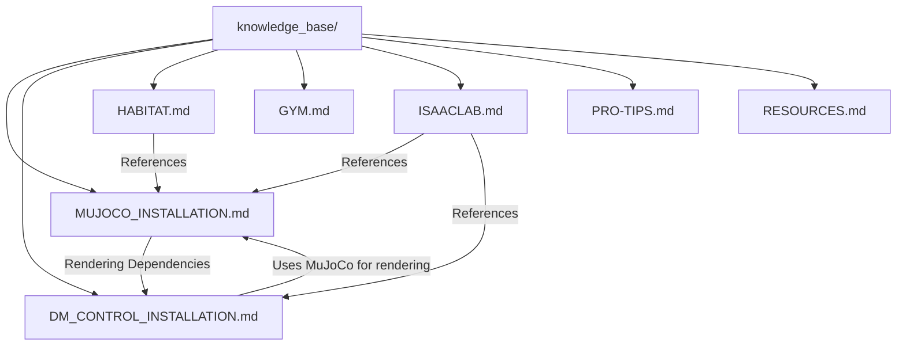

<!-- source: DeepWiki mcp.deepwiki.com · repo pytorch/rl · page 11.4 Knowledge Base · fetched 2026-10-21 -->

# Knowledge Base

<details>
<summary>Relevant source files</summary>

The following files were used as context for generating this wiki page:

- [docs/source/reference/isaaclab.rst](docs/source/reference/isaaclab.rst)
- [examples/collectors/isaaclab_rnn_ppo_memory.py](examples/collectors/isaaclab_rnn_ppo_memory.py)
- [examples/collectors/isaaclab_rnn_ppo_memory_utils.py](examples/collectors/isaaclab_rnn_ppo_memory_utils.py)
- [knowledge_base/DM_CONTROL_INSTALLATION.md](knowledge_base/DM_CONTROL_INSTALLATION.md)
- [knowledge_base/GYM.md](knowledge_base/GYM.md)
- [knowledge_base/HABITAT.md](knowledge_base/HABITAT.md)
- [knowledge_base/ISAACLAB.md](knowledge_base/ISAACLAB.md)
- [knowledge_base/MUJOCO_INSTALLATION.md](knowledge_base/MUJOCO_INSTALLATION.md)
- [knowledge_base/PRO-TIPS.md](knowledge_base/PRO-TIPS.md)
- [knowledge_base/README.md](knowledge_base/README.md)
- [knowledge_base/RESOURCES.md](knowledge_base/RESOURCES.md)

</details>


This page summarizes the installation and troubleshooting guides available in the `knowledge_base/` directory of the TorchRL repository. It aims to provide practical advice for setting up environments and resolving common issues encountered when working with various external libraries and during general PyTorch development.

## MuJoCo Installation and Troubleshooting

MuJoCo (Multi-Joint dynamics with Contact) is a physics engine widely used in robotics and reinforcement learning. DeepMind open-sourced MuJoCo, making it freely accessible. This section covers installation for both new (≥ 2.1.2) and old (≤ 2.1.1, `mujoco-py`) bindings, along with common rendering and import issues.

### Prerequisites for Rendering

MuJoCo supports `glfw`, `osmesa`, and `egl` backends for rendering. For headless environments and GPU acceleration, `egl` is recommended.

**Generic OpenGL/EGL Dependencies (with sudo access):**
```bash
$ sudo apt-get install libglfw3 libglew2.0 libglx-mesa0 libosmesa6 \
    libegl-dev libglvnd0 libglx0 libgles2
```
[knowledge_base/MUJOCO_INSTALLATION.md:29-31]()

**NVIDIA EGL Rendering:**
Verify NVIDIA graphics userspace libraries are visible and compatible.
```bash
$ ldconfig -p | grep -E 'libEGL_nvidia|libnvidia-eglcore|libGLX_nvidia'
$ ls /usr/share/glvnd/egl_vendor.d/10_nvidia.json
```
[knowledge_base/MUJOCO_INSTALLATION.md:37-38]()
If missing, install `libnvidia-gl-<driver-version>` or provide a matching NVIDIA userspace bundle and add its directory to `LD_LIBRARY_PATH`.

**Conda Installation (if no sudo access):**
```bash
$ conda activate mujoco_env
$ conda install -c conda-forge glew
$ conda install -c conda-forge mesalib
$ conda install -c anaconda mesa-libgl-cos6-x86_64
$ conda install -c menpo glfw3
```
[knowledge_base/MUJOCO_INSTALLATION.md:48-51]()

**Setting EGL Backend Environment Variables:**
These must be set *before* importing MuJoCo or `dm_control`.
```bash
$ conda env config vars set MUJOCO_GL=egl PYOPENGL_PLATFORM=egl
$ conda deactivate && conda activate mujoco_env
```
[knowledge_base/MUJOCO_INSTALLATION.md:59-60]()

### New Bindings (MuJoCo ≥ 2.1.2)

Install directly via pip:
```bash
$ conda create -n mujoco_env python=3.9
$ conda activate mujoco_env
$ pip install mujoco
```
[knowledge_base/MUJOCO_INSTALLATION.md:68-70]()

### Old Bindings (MuJoCo ≤ 2.1.1: `mujoco-py`)

This is for legacy code or specific cluster requirements.

1.  **Download MuJoCo binaries:**
    ```bash
    $ mkdir ~/.mujoco
    $ cd ~/.mujoco
    $ wget https://github.com/deepmind/mujoco/releases/download/2.1.0/mujoco210-linux-x86_64.tar.gz
    $ tar -xf mujoco210-linux-x86_64.tar.gz
    ```
    [knowledge_base/MUJOCO_INSTALLATION.md:83-86]()
    For versions < 2.1.0, a license file (`mjkey.txt`) is needed, which can be obtained from `roboti.us`.

2.  **Set environment variables for `mujoco-py`:**
    ```bash
    $ conda env config vars set MJLIB_PATH=/path/to/home/.mujoco/mujoco210/bin/libmujoco210.so \
    $ > LD_LIBRARY_PATH=$LD_LIBRARY_PATH:/path/to/home/.mujoco/mujoco210/bin \
    $ > MUJOCO_PY_MUJOCO_PATH=/path/to/home/.mujoco/mujoco210
    ```
    [knowledge_base/MUJOCO_INSTALLATION.md:92-94]()
    For versions < 2.1.0, also set `MUJOCO_PY_MJKEY_PATH`.

3.  **Install `mujoco-py`:**
    *   **Option 1 (Not Recommended):** `pip install mujoco-py` [knowledge_base/MUJOCO_INSTALLATION.md:107]()
    *   **Option 2 (Recommended for GPU rendering/hacks):** Clone the repo and install in develop mode.
        ```bash
        $ git clone https://github.com/openai/mujoco-py
        $ cd mujoco-py
        $ python setup.py develop
        $ conda env config vars set LD_LIBRARY_PATH=$LD_LIBRARY_PATH:/usr/lib/nvidia # Adapt path
        ```
        [knowledge_base/MUJOCO_INSTALLATION.md:119-123]()

4.  **Trigger build pipeline and sanity check:**
    ```python
    $ python
    >>> import mujoco_py # This triggers the build
    >>> print(mujoco_py.cymj) # Check for 'linuxgpuextensionbuilder' tag
    ```
    [knowledge_base/MUJOCO_INSTALLATION.md:133-144]()

### Common Issues

*   **`GL/glew.h not found`**: Install `libglew-dev` (Ubuntu) or `glew-devel` (CentOS).
    ```bash
    # Ubuntu
    sudo apt-get install libglew-dev libglew
    # CentOS
    sudo yum install glew glew-devel
    ```
    [knowledge_base/MUJOCO_INSTALLATION.md:160-162]()

Sources:
- [knowledge_base/MUJOCO_INSTALLATION.md:1-162]()

## DeepMind Control Suite (dm_control) Installation and Troubleshooting

`dm_control` is DeepMind's software stack for physics-based simulation and RL environments, built on MuJoCo.

### Basic Installation

```bash
pip install dm_control
```
[knowledge_base/DM_CONTROL_INSTALLATION.md:11-12]()

### Common Issues

1.  **`labmaze` build failure with Bazel 8 (Python 3.13+)**:
    *   **Cause**: `labmaze` (a `dm_control` dependency) lacks prebuilt wheels for Python 3.13+ and uses deprecated WORKSPACE files with Bazel 8.
    *   **Solutions**:
        *   **Option 1 (Recommended):** Use Python 3.12.
            ```bash
            python3.12 -m venv .venv
            source .venv/bin/activate
            pip install dm_control
            ```
            [knowledge_base/DM_CONTROL_INSTALLATION.md:37-40]()
        *   **Option 2:** Downgrade Bazel to 7.x.
            ```bash
            # Using Homebrew on macOS
            brew install bazel@7
            export PATH="/opt/homebrew/opt/bazel@7/bin:$PATH"
            # Or using bazelisk
            export USE_BAZEL_VERSION=7.4.1
            pip install dm_control
            ```
            [knowledge_base/DM_CONTROL_INSTALLATION.md:45-53]()
        *   **Option 3:** Install `dm_control` without `labmaze` if maze/locomotion environments are not needed.
            ```bash
            pip install dm_control --no-deps
            pip install dm-env dm-tree glfw lxml mujoco numpy pyopengl pyparsing scipy
            ```
            [knowledge_base/DM_CONTROL_INSTALLATION.md:58-60]()

2.  **EGL/rendering issues**: Refer to the [MuJoCo installation guide](#mujoco-installation-and-troubleshooting) for general rendering issues, as `dm_control` uses MuJoCo's rendering.

    *   **EGL multi-GPU device selection in containers**:
        *   **Problem**: All rendering might contend on a single GPU in Docker/SLURM containers, even with multiple GPUs available. This is often due to minimal CUDA images omitting NVIDIA graphics userspace libraries or the container runtime exposing only a subset of devices to EGL.
        *   **Workarounds**:
            1.  **Verify graphics userspace stack**: Install generic OpenGL/EGL/GLVND packages and verify NVIDIA libraries.
                ```bash
                sudo apt-get update
                sudo apt-get install -y libegl-dev libglvnd0 libglx0 libgles2
                nvidia-smi --query-gpu=driver_version,name --format=csv,noheader | head
                ldconfig -p | grep -E 'libEGL_nvidia|libnvidia-eglcore|libGLX_nvidia'
                ls /usr/share/glvnd/egl_vendor.d/10_nvidia.json
                ```
                [knowledge_base/DM_CONTROL_INSTALLATION.md:107-119]()
            2.  **Configure container for full GPU access**: Set `NVIDIA_VISIBLE_DEVICES=all` and include `graphics` in `NVIDIA_DRIVER_CAPABILITIES`. Assign `MUJOCO_EGL_DEVICE_ID=<worker_idx % num_gpus>` per worker *before* `dm_control` import.
            3.  **Run outside containers**: Bare metal setups usually expose all GPUs correctly.
            4.  **Reduce rendering overhead**: Lower resolution, render at lower frequency, or use state-only observations.

    *   **No batched rendering support in MuJoCo**: MuJoCo does not support batched GPU rendering; each environment renders independently.

3.  **macOS ARM64 (Apple Silicon) specific issues**: Ensure native ARM Python is used, not Rosetta.
    ```bash
    python -c "import platform; print(platform.machine())" # Should output: arm64
    ```
    [knowledge_base/DM_CONTROL_INSTALLATION.md:159-161]()
    If `x86_64` is output, install native ARM Python (e.g., via Homebrew or `pyenv`).

### Verifying Installation

```python
from dm_control import suite
print(suite.BENCHMARKING)
env = suite.load("cheetah", "run")
timestep = env.reset()
```
[knowledge_base/DM_CONTROL_INSTALLATION.md:177-184]()

Sources:
- [knowledge_base/DM_CONTROL_INSTALLATION.md:1-186]()

## Habitat Installation and Troubleshooting

This section guides you through setting up `habitat-lab` with TorchRL, including installation steps and common issues.

### Setting up your environment

1.  **Preparing conda env**:
    ```bash
    conda create -n habitat python=3.7 cmake=3.14.0
    conda activate habitat
    ```
    [knowledge_base/HABITAT.md:13-15]()

2.  **conda install habitat-sim**: For bullet physics and headless mode.
    ```bash
    conda install habitat-sim withbullet headless -c conda-forge -c aihabitat-nightly -y
    pip install git+https://github.com/facebookresearch/habitat-lab.git#subdirectory=habitat-lab

    # To reduce verbosity
    export MAGNUM_LOG=quiet && export HABITAT_SIM_LOG=quiet
    ```
    [knowledge_base/HABITAT.md:19-24]()
    Remove `headless` if not needed.

3.  **Installing TorchRL**: Follow the instructions in the main `README.md`.

### Using Habitat

To list available Habitat environments:
```python
from torchrl.envs.libs.habitat import HabitatEnv, _has_habitat
assert _has_habitat  # checks that habitat is installed
print([_env for _env in HabitatEnv.available_envs if _env.startswith("Habitat")])
```
[knowledge_base/HABITAT.md:37-41]()

### Common Issues

1.  **`OSError: Could not find/load shared object file: libllvmlite.so`**:
    *   **Solution**: Install `llvmlite` and set `LD_PRELOAD`.
        ```bash
        conda install -c conda-forge llvmlite
        conda env config vars set LD_PRELOAD=$LD_PRELOAD:/path/to/conda/envs/env_name/lib/python3.8/site-packages/llvmlite/binding/libllvmlite.so
        conda deactivate && conda activate env_name
        ```
        [knowledge_base/HABITAT.md:49-53]()

2.  **`ImportError: /usr/lib/x86_64-linux-gnu/libOpenGL.so.0: undefined symbol: _glapi_tls_Current`**:
    *   **Solution**: Link conda to the correct `libOpenGL.so` file.
        ```bash
        conda install -y -c conda-forge libglvnd-glx-cos7-x86_64 --force-reinstall
        conda install -y -c conda-forge xvfbwrapper --force-reinstall
        conda env config vars set LD_PRELOAD=$LD_PRELOAD:/path/to/conda/envs/env_name/x86_64-conda-linux-gnu/sysroot/usr/lib64/libGLdispatch.so.0
        conda deactivate && conda activate env_name
        ```
        [knowledge_base/HABITAT.md:58-61]()

Sources:
- [knowledge_base/HABITAT.md:1-61]()

## Gym/Gymnasium Integration

OpenAI Gym (now Gymnasium) provides a standard API for RL environments.

### Versioning

TorchRL is tested against Gym 0.13 and later. While it generally works with various versions, custom environment construction processes in libraries built around Gym might require manual wrapping using `torchrl.envs.libs.gym.GymWrapper`.

If you encounter issues, create the Gym environment first, then wrap it:
```python
import gymnasium as gym
from torchrl.envs.libs.gym import GymWrapper

# Create your custom or problematic gym env
gym_env = gym.make("MyCustomGymEnv")
# Wrap it with TorchRL's GymWrapper
torchrl_env = GymWrapper(gym_env)
```

Sources:
- [knowledge_base/GYM.md:1-30]()

## IsaacLab Integration and Troubleshooting

IsaacLab is NVIDIA's GPU-accelerated robotics simulation platform. This section covers its integration with TorchRL, focusing on headless GPU machines.

### Must-know rules

1.  **Launch Isaac before importing `torch`**: Initialize `AppLauncher` before `import torch` in any process that will own an Isaac simulation.
    ```python
    from isaaclab.app import AppLauncher
    import argparse

    parser = argparse.ArgumentParser()
    AppLauncher.add_app_launcher_args(parser)
    args_cli, _ = parser.parse_known_args(["--headless"])
    AppLauncher(args_cli)

    import torch # Import torch AFTER AppLauncher
    ```
    [knowledge_base/ISAACLAB.md:9-22]()

2.  **One simulation per process**: Avoid multiple IsaacLab simulations in the same process. Use separate processes for collectors, evaluators, or renderers.
    [knowledge_base/ISAACLAB.md:34-36]()

3.  **Environments are GPU-native and pre-vectorized**: IsaacLab environments are internally batched on the GPU. A single `gym.make(...)` can create thousands of sub-environments. `ParallelEnv` is usually unnecessary.
    [knowledge_base/ISAACLAB.md:38-42]()

4.  **Set non-interactive runtime variables**: For cluster/container jobs, set EULA/headless environment variables.
    ```bash
    export OMNI_KIT_ACCEPT_EULA=yes
    export ACCEPT_EULA=Y
    export PRIVACY_CONSENT=Y
    export OMNI_KIT_DISABLE_CUP=1
    export OMNI_KIT_ALLOW_ROOT=1
    export TERM="${TERM:-xterm}"
    ```
    [knowledge_base/ISAACLAB.md:50-56]()

### `IsaacLabWrapper`

Use `torchrl.envs.IsaacLabWrapper` to integrate IsaacLab environments with TorchRL.
```python
import gymnasium as gym
from torchrl.envs.libs.isaac_lab import IsaacLabWrapper

env = gym.make("Isaac-Ant-v0", cfg=env_cfg)
env = IsaacLabWrapper(env)
```
[docs/source/reference/isaaclab.rst:23-27]()

Key defaults: `device=cuda:0`, `allow_done_after_reset=True`, `convert_actions_to_numpy=False`.
The wrapper handles IsaacLab's in-place modifications of `terminated` and `truncated` tensors by cloning them.
IsaacLab environment specs include the batch dimension; use `*_spec_unbatched` for per-environment shapes.
Rewards are unsqueezed from `(num_envs,)` to `(num_envs, 1)` for TorchRL compatibility.

### Minimal state-based environment

```python
from isaaclab.app import AppLauncher
import argparse
import gymnasium as gym
import isaaclab_tasks  # noqa: F401
from isaaclab_tasks.manager_based.classic.ant.ant_env_cfg import AntEnvCfg
from torchrl.envs.libs.isaac_lab import IsaacLabWrapper

parser = argparse.ArgumentParser()
AppLauncher.add_app_launcher_args(parser)
args_cli, _ = parser.parse_known_args(["--headless"])
AppLauncher(args_cli)

cfg = AntEnvCfg()
cfg.scene.num_envs = 4096
cfg.sim.device = "cuda:0"
env = IsaacLabWrapper(gym.make("Isaac-Ant-v0", cfg=cfg), device="cuda:0")
td = env.reset()
print(td["policy"].shape)
```
[knowledge_base/ISAACLAB.md:64-84]()

### Tiled-camera rendering

For headless RGB capture, prefer IsaacLab tiled cameras. Add a `TiledCameraCfg` to the scene config and launch with `--enable_cameras`.
Use `IsaacLabWrapper.add_tiled_camera_config(...)` and `IsaacLabWrapper(..., from_tiled_camera=True)` to get pixels under `"pixels"` in the TensorDict.
```python
from torchrl.envs.libs.isaac_lab import IsaacLabWrapper

IsaacLabWrapper.add_tiled_camera_config(env_cfg, width=64, height=64)
env = IsaacLabWrapper(
    gym.make("Isaac-Ant-v0", cfg=env_cfg),
    device="cuda:0",
    from_tiled_camera=True,
)
```
[knowledge_base/ISAACLAB.md:97-104]()

**Cluster rendering dependencies**: Headless camera rendering requires a working NVIDIA graphics stack. Install `libegl-dev`, `libglvnd0`, `libglx0`, `libvulkan1`, `vulkan-tools`. Verify NVIDIA Vulkan ICD and GL/EGL userspace.
If `ERROR_INCOMPATIBLE_DRIVER` occurs, ensure NVIDIA userspace libraries match the host driver and set `LD_LIBRARY_PATH`, `VK_ICD_FILENAMES`, `__GLX_VENDOR_LIBRARY_NAME`, and `XDG_RUNTIME_DIR` accordingly.
For evaluator workers rendering on a dedicated GPU, expose only that GPU and use `cuda:0` inside the worker.
```bash
python examples/collectors/isaaclab_rnn_ppo_memory.py \
    --eval \
    --eval-cuda-visible-devices 2 \
    --eval-worker-device cuda:0 \
    --eval-nvidia-lib-dir /path/to/nvidia/lib \
    --eval-vulkan-icd /path/to/nvidia_icd.json \
    --eval-xdg-runtime-dir /tmp/xdg-runtime-eval
```
[docs/source/reference/isaaclab.rst:147-156]()

### Collector

Since IsaacLab environments are pre-vectorized, use a single `Collector` without `ParallelEnv` or a process-backed `Collector`.
```python
from torchrl.collectors import Collector

collector = Collector(
    create_env_fn=env,
    policy=policy,
    frames_per_batch=40960,   # 10 env steps * 4096 envs
    storing_device="cpu",
    no_cuda_sync=True,        # IMPORTANT for CUDA envs
)
```
[docs/source/reference/isaaclab.rst:168-175]()
*   `no_cuda_sync=True` is crucial for GPU-native environments to avoid hangs.
*   `storing_device="cpu"` moves collected data to CPU for the replay buffer.

### 2-GPU Async Pipeline

For maximum throughput, use two GPUs: one for simulation/collection (`sim_device`) and one for training (`train_device`).
```python
import copy, threading
from tensordict import TensorDict

# Deep copy policy to sim_device for collection
collector_policy = copy.deepcopy(policy).to(sim_device)
```
[docs/source/reference/isaaclab.rst:193-198]()

Sources:
- [knowledge_base/ISAACLAB.md:1-196]()
- [docs/source/reference/isaaclab.rst:1-198]()
- [examples/collectors/isaaclab_rnn_ppo_memory.py:1-42]()
- [examples/collectors/isaaclab_rnn_ppo_memory_utils.py:1-10]()

## Pro-Tips: Common PyTorch Errors and Solutions

This section addresses common PyTorch errors, especially those related to gradients and performance in RL.

### Gradient-related errors

Newcomers often face issues with `torch.no_grad()` and computational graphs. In RL, it's critical to distinguish between non-differentiable "data" (e.g., environment interactions, advantage computation) and differentiable "loss artifacts" (e.g., value error, log-probability).

**Typical RL Training Loop Sketch:**
```python
obs = env.reset()

for _ in range(n_training_steps):
    # STEP 1: data collection
    # Get a new datapoint "online"
    observations = []
    actions = []
    others = []
    for _ in range(n_data_per_training):
        with torch.no_grad(): # Policy inference is usually not part of the graph
            action = policy(obs)
        obs, *other = env.step(action)
        observations.append(obs)
        actions.append(action)
        others.append(other)
    replay_buffer.extend(observations, actions, others)

    # STEP 2: loss and optimization
    # => compute loss "offline"
    loss = loss_fn(replay_buffer.sample(batch_size))

    loss.backward()
    optim.step()
    optim.zero_grad()
```
[knowledge_base/PRO-TIPS.md:8-33]()

**Common Errors:**

1.  **`RuntimeError: Trying to backward through the graph a second time...`**: Occurs when a tensor that was part of a computational graph is used twice in the loss function. Avoid `retain_graph=True` unless absolutely necessary; instead, re-compute differentiable operations within `loss_fn`.
    [knowledge_base/PRO-TIPS.md:47-53]()

2.  **`RuntimeError: one of the variables needed for gradient computation has been modified by an inplace operation`**: Often follows attempts to fix the first error with `retain_graph=True`. Re-compute intermediate values for each loss separately, excluding unnecessary parameters from specific graphs.
    [knowledge_base/PRO-TIPS.md:55-66]()

3.  **Algorithm is not learning / `param.grad` is 0 or None**: Check the norm of parameter gradients. If zero, the gradient flow is broken.
    [knowledge_base/PRO-TIPS.md:68-71]()

### My Training is too slow

Training speed depends on several factors.

**Common Bottlenecks:**

*   **Data collection**: Simulator speed and data transformation. Speed up via vectorization (e.g., Brax, JAX-based simulators) or parallelization (e.g., Gym's "vectorized" envs). TorchRL transforms can often run on device.
    [knowledge_base/PRO-TIPS.md:78-84]()
*   **Replay buffer storage and sampling**: Heavy memory manipulation or indexing (e.g., prioritized replay) can be slow. TorchRL provides efficient contiguous storage and sampling.
    [knowledge_base/PRO-TIPS.md:85-90]()
*   **Advantage computation**: Often coded with for loops, which can be slow. Use TorchRL's vectorized solutions.
    [knowledge_base/PRO-TIPS.md:91-94]()
*   **Loss computation and optimization**: Use vectorized maps and `functorch` for speedups, especially with multiple target networks.
    [knowledge_base/PRO-TIPS.md:95-101]()

### Common bugs

*   **MuJoCo-related bugs**: Refer to the [MuJoCo installation guide](#mujoco-installation-and-troubleshooting).
    [knowledge_base/PRO-TIPS.md:104-105]()
*   **`ValueError: bad value(s) in fds_to_keep`**: Often caused by sending a tensor view (e.g., from `expand`, `permute`, `view`) across processes. The reference to the original content is lost. Use `.clone()` or `.contiguous()` after such operations.
    [knowledge_base/PRO-TIPS.md:106-111]()

Sources:
- [knowledge_base/PRO-TIPS.md:1-111]()

## Knowledge Base Overview

The `knowledge_base/` directory serves as a practical guide for common issues and pro-tips in the RL journey. It covers environment setup, installation of external libraries, and troubleshooting.

### Knowledge Base Structure


Title: "Knowledge Base File Dependencies"
Sources:
- [knowledge_base/README.md:1-8]()

### Contributing

The knowledge base is an evolving resource. Contributions are welcome for missing information or new troubleshooting experiences.
[knowledge_base/README.md:10-15]()

Sources:
- [knowledge_base/README.md:1-15]()

---

