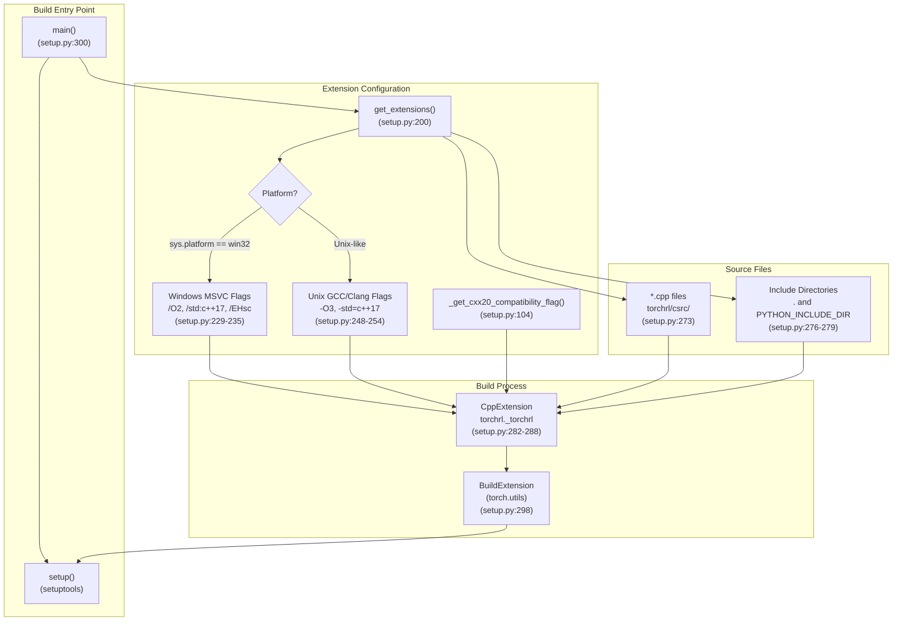
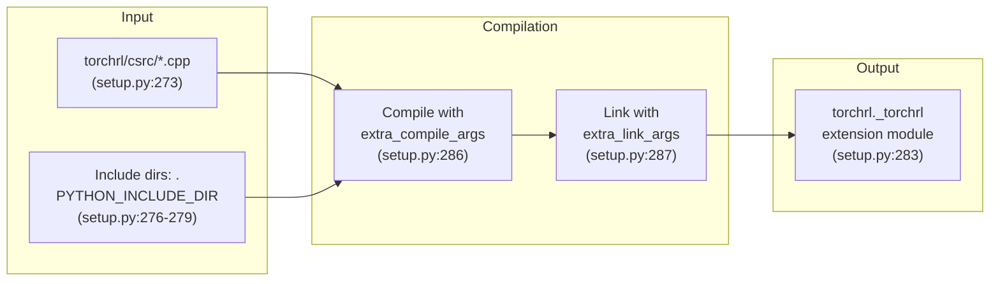
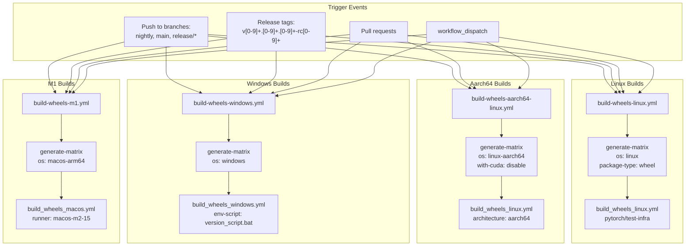
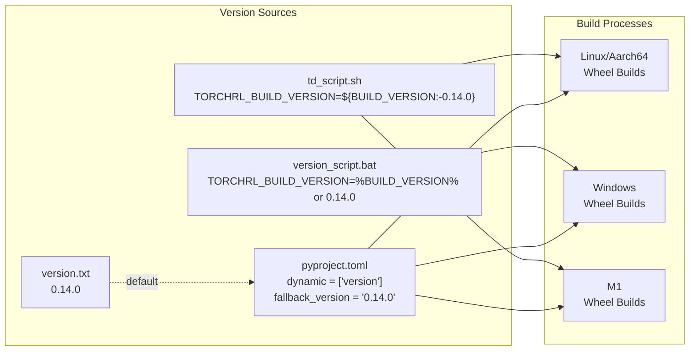
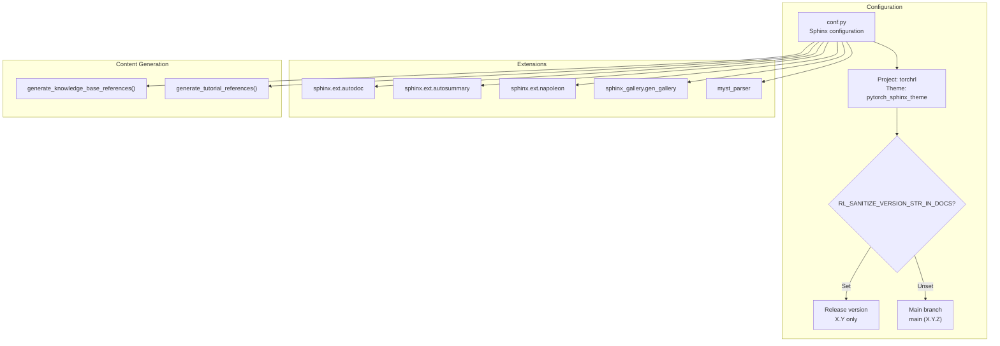
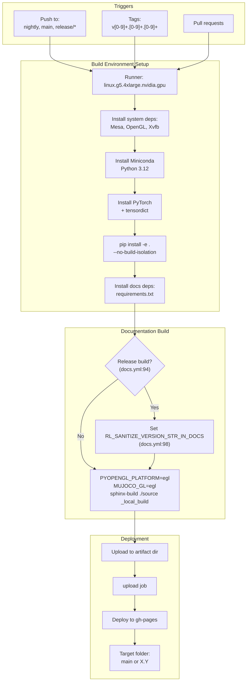
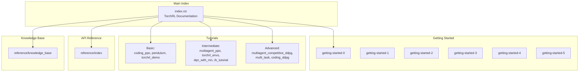
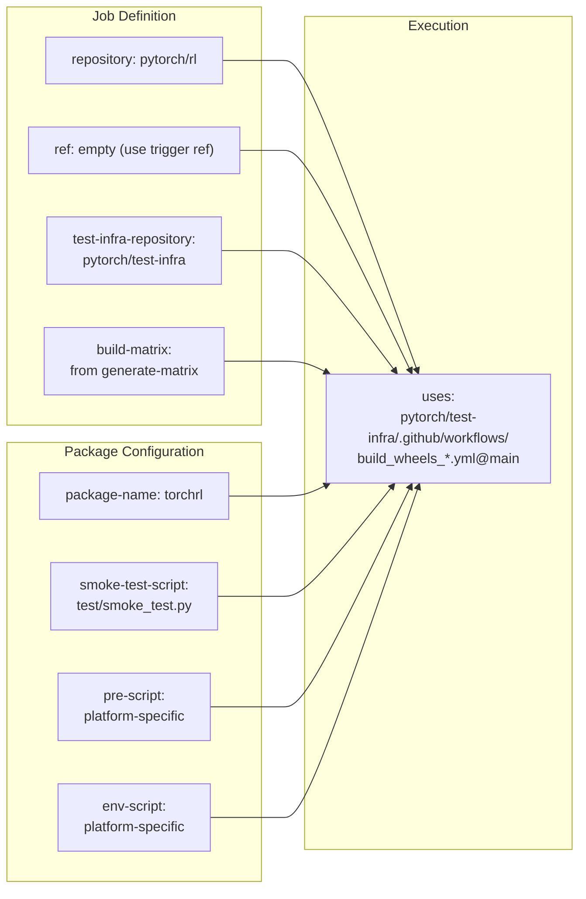
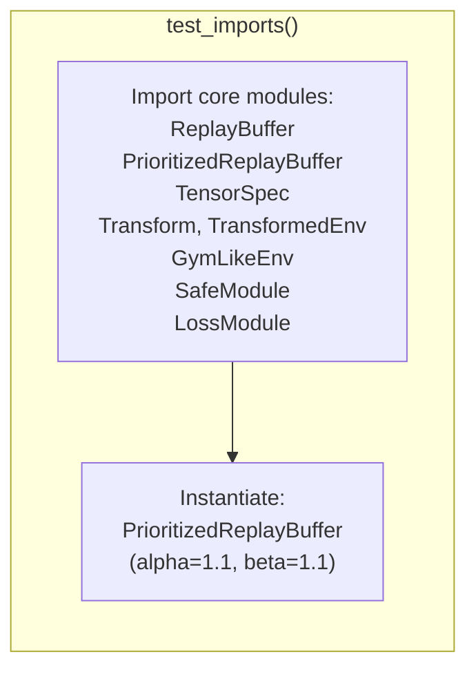

<!-- source: DeepWiki mcp.deepwiki.com · repo pytorch/rl · page 12 Development and Deployment · fetched 2026-10-21 -->

# Development and Deployment

<details>
<summary>Relevant source files</summary>

The following files were used as context for generating this wiki page:

- [.github/RELEASE_AGENT_PROMPT.md](.github/RELEASE_AGENT_PROMPT.md)
- [.github/scripts/ci_timing_dashboard.html](.github/scripts/ci_timing_dashboard.html)
- [.github/scripts/pre-build-script-win.sh](.github/scripts/pre-build-script-win.sh)
- [.github/scripts/pre-build-script.sh](.github/scripts/pre-build-script.sh)
- [.github/scripts/td_script.sh](.github/scripts/td_script.sh)
- [.github/scripts/track_ci_timing.py](.github/scripts/track_ci_timing.py)
- [.github/scripts/version_script.bat](.github/scripts/version_script.bat)
- [.github/unittest/examples/scripts/run_all.sh](.github/unittest/examples/scripts/run_all.sh)
- [.github/unittest/examples/scripts/run_test.sh](.github/unittest/examples/scripts/run_test.sh)
- [.github/unittest/linux_olddeps/scripts_gym_0_13/install.sh](.github/unittest/linux_olddeps/scripts_gym_0_13/install.sh)
- [.github/workflows/build-wheels-aarch64-linux.yml](.github/workflows/build-wheels-aarch64-linux.yml)
- [.github/workflows/build-wheels-linux.yml](.github/workflows/build-wheels-linux.yml)
- [.github/workflows/build-wheels-m1.yml](.github/workflows/build-wheels-m1.yml)
- [.github/workflows/build-wheels-windows.yml](.github/workflows/build-wheels-windows.yml)
- [.github/workflows/ci-timing-tracker.yml](.github/workflows/ci-timing-tracker.yml)
- [.github/workflows/release.yml](.github/workflows/release.yml)
- [.python-version](.python-version)
- [AGENTS.md](AGENTS.md)
- [CLAUDE.md](CLAUDE.md)
- [CONTRIBUTING.md](CONTRIBUTING.md)
- [examples/collectors/collector_device.py](examples/collectors/collector_device.py)
- [pyproject.toml](pyproject.toml)
- [setup.py](setup.py)
- [sota-check/run_rnd_mujoco.sh](sota-check/run_rnd_mujoco.sh)
- [sota-implementations/rnd/config_mujoco.yaml](sota-implementations/rnd/config_mujoco.yaml)
- [sota-implementations/rnd/utils_mujoco.py](sota-implementations/rnd/utils_mujoco.py)
- [tutorials/sphinx-tutorials/memory_efficient_rl.py](tutorials/sphinx-tutorials/memory_efficient_rl.py)
- [version.txt](version.txt)

</details>


This document describes the build system, continuous integration/deployment pipelines, and documentation infrastructure for TorchRL. It covers how the library is built from source, packaged into distributable wheels, and how documentation is generated and deployed.

For information about using the high-level Trainer system for RL experiments, see [Training Infrastructure](#8). For details on the core library architecture, see [Overview](#1).

---

## Overview

TorchRL's development infrastructure consists of four main components:

1.  **Build System**: Python package setup with C++ extension compilation
2.  **CI/CD Pipelines**: Automated wheel building for multiple platforms
3.  **Documentation System**: Sphinx-based documentation with automated deployment
4.  **Testing Infrastructure**: Smoke tests and validation scripts

The build system compiles C++ extensions using PyTorch's build utilities, while CI/CD workflows handle cross-platform distribution. Documentation is generated from docstrings and RST files, then deployed to GitHub Pages.

---

## Build System Architecture

### Setup Configuration

The build system is defined in [setup.py:1-434](), which uses PyTorch's `torch.utils.cpp_extension` module to compile C++ extensions with platform-specific compiler flags. The `pyproject.toml` file also defines build system requirements and project metadata [pyproject.toml:1-270]().



**Sources**: [setup.py:1-434](), [pyproject.toml:1-270]()

### Compiler Configuration

The build system adapts to different platforms with specific compiler flags. It also checks for `pybind11` installation [setup.py:31-49]() and handles stale builds due to PyTorch/Python version changes [setup.py:145-191]().

| Platform | Compiler | Optimization | C++ Standard | Special Flags |
|----------|----------|--------------|--------------|---------------|
| Windows | MSVC | `/O2` | `/std:c++17` | `/EHsc` (exception handling) |
| Unix-like | GCC/Clang | `-O3` | `-std=c++17` | `-fdiagnostics-color=always`, `-std=c++2a` (if C++20 not available) |

Debug mode can be enabled via the `DEBUG=1` environment variable, which switches optimization levels to `/Od` (Windows) or `-O0` (Unix) and adds debugging symbols [setup.py:236-268](). CUDA extensions are built conditionally based on `CUDA_HOME` and `FORCE_CUDA` environment variables, and CUDA version compatibility with PyTorch [setup.py:54-95]().

**Sources**: [setup.py:31-49](), [setup.py:54-95](), [setup.py:104-131](), [setup.py:145-191](), [setup.py:229-268]()

### C++ Extension Build Process



**Sources**: [setup.py:270-291]()

---

## Package Distribution

### Wheel Build Workflows

TorchRL maintains separate CI/CD workflows for building binary wheels across multiple platforms. These workflows are triggered by pushes to `nightly`, `main`, `release/*` branches, release candidate tags, pull requests, or manual `workflow_dispatch` events [build-wheels-linux.yml:3-14](), [build-wheels-aarch64-linux.yml:3-14](), [build-wheels-windows.yml:3-14](), [build-wheels-m1.yml:3-14]().



**Sources**: [.github/workflows/build-wheels-linux.yml:3-14](), [.github/workflows/build-wheels-aarch64-linux.yml:3-14](), [.github/workflows/build-wheels-windows.yml:3-14](), [.github/workflows/build-wheels-m1.yml:3-14]()

### Build Matrix Configuration

Each platform workflow generates a build matrix specifying Python versions, CUDA versions (where applicable), and platform-specific settings. These matrices are generated by `pytorch/test-infra/.github/workflows/generate_binary_build_matrix.yml` [build-wheels-linux.yml:76](), [build-wheels-aarch64-linux.yml:76](), [build-wheels-windows.yml:66](), [build-wheels-m1.yml:56]().

| Workflow | OS | Python Versions | CUDA | ROCm | CPU | Special Configuration |
|----------|----|-----------------|------|------|-----|----------------------|
| `build-wheels-linux.yml` | `linux` | `["3.10", "3.11", "3.12", "3.13", "3.14"]` | `enable` | `disable` | `enable` | `env-var-script: .github/scripts/td_script.sh` |
| `build-wheels-aarch64-linux.yml` | `linux-aarch64` | `["3.10", "3.11", "3.12", "3.13", "3.14"]` | `disable` | `disable` | `enable` | `env-var-script: .github/scripts/td_script.sh` |
| `build-wheels-windows.yml` | `windows` | `["3.10", "3.11", "3.12", "3.13", "3.14"]` | `disable` | N/A | `enable` | `env-script: .github/scripts/version_script.bat`, `post-script: "python packaging/wheel/relocate.py"` |
| `build-wheels-m1.yml` | `macos-arm64` | `["3.10", "3.11", "3.12", "3.13", "3.14"]` | N/A | N/A | `enable` | `env-var-script: .github/scripts/td_script.sh`, `setup-miniconda: true` |

**Sources**: [.github/workflows/build-wheels-linux.yml:76-91](), [.github/workflows/build-wheels-aarch64-linux.yml:76-91](), [.github/workflows/build-wheels-windows.yml:66-80](), [.github/workflows/build-wheels-m1.yml:56-67]()

### Version Management

Version information is centralized and managed through multiple files. The `pyproject.toml` uses `setuptools_scm` for dynamic versioning, with a fallback to `0.14.0` [pyproject.toml:223-229]().



**Sources**: [version.txt:1](), [.github/scripts/td_script.sh:3](), [.github/scripts/version_script.bat:2-6](), [pyproject.toml:223-229]()

### Pre-Build Dependencies

Each platform has specific pre-build scripts that install dependencies:

**Linux/macOS** ([.github/scripts/td_script.sh:1-51]()):
- Sets `TORCHRL_BUILD_VERSION` and strips `+cpu` suffix for PyPI compatibility.
- Upgrades `setuptools` and `packaging`.
- Installs `pybind11[global]`, `cloudpickle`, `importlib_metadata`, `numpy`, `orjson`, `pyvers`.
- Installs `tensordict` from PyPI (stable) for release branches/tags or from git (latest development) otherwise.
- Conditionally installs PyTorch if not already present or for smoke tests.

**Windows** ([.github/scripts/version_script.bat:1-79]()):
- Sets `TORCHRL_BUILD_VERSION` and strips `+cpu` suffix.
- Sets up MSVC environment using `vswhere.exe` to find `vcvarsall.bat`.
- Handles `VC_VERSION_LOWER`/`UPPER` based on `VC_YEAR`.
- Calls `vcvarsall.bat` for x64 architecture.
- Conditionally sets up Intel oneAPI for XPU builds.
- Sets `DISTUTILS_USE_SDK=1`.
- Upgrades `setuptools` to `72.1.0`.
- Workaround for free-threaded Python on Windows by copying `python3XXt.lib` to `python3XX.lib`.

**Sources**: [.github/scripts/td_script.sh:1-51](), [.github/scripts/version_script.bat:1-79](), [.github/scripts/pre-build-script.sh:1-8](), [.github/scripts/pre-build-script-win.sh:1-6]()

---

## Documentation System

### Sphinx Configuration

The documentation is built using Sphinx with the PyTorch theme. Configuration is centralized in `docs/source/conf.py`.



**Sources**: `docs/source/conf.py`

### Documentation Build Workflow

The documentation build process is orchestrated by `.github/workflows/docs.yml`:



**Sources**: `.github/workflows/docs.yml`

### Documentation Requirements

Documentation dependencies are specified in `docs/requirements.txt`:

| Category | Packages |
|----------|----------|
| Sphinx Core | `sphinx===5.0.0`, `sphinx-copybutton`, `sphinx-gallery`, `sphinx-autodoc-typehints` |
| Theme | `pytorch_sphinx_theme` (from GitHub) |
| Parsers | `myst-parser`, `docutils` |
| RL Environments | `dm_control`, `mujoco<3.3.6`, `gymnasium[classic_control,atari]`, `vmas` |
| Utilities | `matplotlib`, `numpy`, `tqdm`, `ipython`, `imageio[ffmpeg,pyav]` |
| Export | `onnxscript`, `onnxruntime`, `onnx` |
| Configuration | `hydra-core>=1.1`, `omegaconf` |

**Sources**: `docs/requirements.txt`

### Documentation Structure

The documentation entry point is `docs/source/index.rst`, which defines the structure.



**Sources**: `docs/source/index.rst`

### Sphinx Gallery Configuration

The gallery configuration in `docs/source/conf.py` controls tutorial generation:

-   `examples_dirs`: `reference/generated/tutorials/` (source)
-   `gallery_dirs`: `tutorials` (output)
-   `abort_on_example_error`: `True` (strict mode)
-   `plot_gallery`: `"False"` (no gallery plots)
-   `reset_modules`: Custom `kill_procs` function + matplotlib/seaborn

The `kill_procs` function (`docs/source/conf.py`) terminates child processes after each gallery example to prevent resource leaks.

**Sources**: `docs/source/conf.py`

---

## Continuous Integration Details

### Build Job Configuration

All wheel build workflows follow a common pattern using PyTorch's test infrastructure. They call shared workflows like `pytorch/test-infra/.github/workflows/build_wheels_macos.yml` [build-wheels-m1.yml:78](), `build_wheels_windows.yml` [build-wheels-windows.yml:93](), and `build_wheels_linux.yml` [build-wheels-linux.yml:102](), [build-wheels-aarch64-linux.yml:102]().



**Sources**: [.github/workflows/build-wheels-linux.yml:92-112](), [.github/workflows/build-wheels-aarch64-linux.yml:91](), [.github/workflows/build-wheels-windows.yml:81-105](), [.github/workflows/build-wheels-m1.yml:68-95]()

### Smoke Test

The smoke test validates basic imports and functionality [test/smoke_test.py:1-20](). It ensures that core TorchRL modules can be imported and a `PrioritizedReplayBuffer` can be instantiated.



**Sources**: [test/smoke_test.py:8-20]()

### Documentation Deployment Strategy

Documentation is deployed to different folders based on the trigger. The `release.yml` workflow also updates `gh-pages` docs by creating a stable symlink [release.yml:5]().

| Trigger Type | Ref Name | Target Folder | Example |
|--------------|----------|---------------|---------|
| Push to main | `main` | `main` | `/main/` |
| Release tag | `v0.15.2` | `0.15` (major.minor) | `/0.15/` |
| RC tag | `v0.15.2-rc1` | Skipped (no upload) | N/A |

The upload job (`.github/workflows/docs.yml`) uses git operations to commit and push to the `gh-pages` branch:

1.  Downloads artifact from build job
2.  Determines target folder from ref type/name
3.  Clears existing folder content
4.  Copies new documentation via `rsync`
5.  Updates `_static` folder if building for main branch
6.  Commits with pytorchbot credentials
7.  Pushes to gh-pages

**Sources**: `.github/workflows/docs.yml`, [release.yml:5]()

---

## Environment Variables

Key environment variables used across the build system:

| Variable | Purpose | Set In | Values |
|----------|---------|--------|--------|
| `TORCHRL_BUILD_VERSION` | Package version for wheel builds | Version scripts | `0.14.0` |
| `DEBUG` | Enable debug mode compilation | User/CI | `0` or `1` |
| `PYTHON_INCLUDE_DIR` | Additional Python headers | User/CI | Path to Python includes |
| `RL_SANITIZE_VERSION_STR_IN_DOCS` | Sanitize version in docs | docs.yml | `1` (if set) |
| `TORCHRL_CONSOLE_STREAM` | Console output stream | conf.py, docs.yml | `stdout` |
| `PYOPENGL_PLATFORM` | OpenGL platform for rendering | docs.yml | `egl` |
| `MUJOCO_GL` | MuJoCo graphics backend | docs.yml | `egl` |
| `MAX_IDLE_COUNT` | Collector timeout (docs build) | docs.yml | `180` |
| `BATCHED_PIPE_TIMEOUT` | Pipe timeout (docs build) | docs.yml | `180` |
| `TENSORDICT_SOURCE` | Source for TensorDict installation | build-wheels-*.yml | `auto`, `stable`, `git` |
| `RELEASE_TAG` | Release tag for `release.yml` | release.yml | e.g., `v0.11.0` |
| `TEST_INFRA_REF` | PyTorch test-infra ref | release.yml | `main` or `release/X.Y` |
| `DRY_RUN` | Dry run mode for `release.yml` | release.yml | `true` or `false` |

**Sources**: [setup.py:236,256](), [.github/scripts/td_script.sh:3](), [.github/scripts/version_script.bat:2](), `docs/source/conf.py`, `.github/workflows/docs.yml`, [.github/workflows/build-wheels-linux.yml:69](), [.github/workflows/build-wheels-aarch64-linux.yml:69](), [.github/workflows/build-wheels-windows.yml:59](), [.github/workflows/build-wheels-m1.yml:49](), [.github/workflows/release.yml:87-96]()

---

## Contributing Workflow

This section provides a high-level overview of contributing to TorchRL. For detailed guidelines, see [Contributing and Repo Automation](#12.5).

### Development Installation

For local development, it is recommended to install TorchRL and TensorDict in editable mode. The `CONTRIBUTING.md` provides instructions for `pip install` and `uv run` [CONTRIBUTING.md:5-54]().

```bash
# Using pip
git clone https://github.com/pytorch/tensordict
git clone https://github.com/pytorch/rl
cd tensordict
python setup.py develop
cd ../rl
python setup.py develop

# Using uv (recommended for local development)
# From the root of the cloned TorchRL repository
uv run pytest test/test_tensordictmodules.py
# For CUDA 13.0 nightly wheels on Linux
uv run --index pytorch-nightly=https://download.pytorch.org/whl/nightly/cu130 pytest test/test_tensordictmodules.py
```

**Sources**: [CONTRIBUTING.md:5-54]()

### Build from Source

Standard installation builds C++ extensions automatically:

```bash
pip install -e . --no-build-isolation
```

The `--no-build-isolation` flag is used in CI (`.github/workflows/docs.yml`) to reuse the environment's build dependencies.

**Sources**: [CONTRIBUTING.md:23-25](), `.github/workflows/docs.yml`

### Code Formatting and Linting

TorchRL uses `pre-commit` hooks for linting and formatting. Contributors are encouraged to install and run `pre-commit` locally [CONTRIBUTING.md:69-79](). The `CLAUDE.md` file provides specific guidelines for AI agent contributions, including rules for imports, cross-version compatibility, logging, TensorDict usage, type hints, `torch.compile` friendliness, and testing [CLAUDE.md:1-281]().

**Sources**: [CONTRIBUTING.md:69-79](), [CLAUDE.md:1-281]()

### Pull Requests and Issues

The project actively welcomes pull requests. Contributors are asked to fork the repository, create a branch, add tests for new code, update documentation for API changes, ensure tests and documentation pass, and make sure code lints. A Contributor License Agreement (CLA) is required. Issues are tracked on GitHub, and contributors can assign themselves to issues [CONTRIBUTING.md:84-116]().

**Sources**: [CONTRIBUTING.md:84-116]()

---

## Platform-Specific Details

### Windows Build Configuration

Windows builds require special handling ([.github/scripts/version_script.bat:1-79]()):

1.  **Visual Studio Detection**: Uses `vswhere.exe` to locate MSVC installation.
2.  **Version Support**: Supports VS 2017 (v15), 2019 (v16), 2022 (v17).
3.  **Environment Setup**: Calls `vcvarsall.bat` with x64 architecture.
4.  **Intel XPU Support**: Conditional oneAPI setup for XPU builds.
5.  **Setuptools**: Pins to version `72.1.0` for compatibility.
6.  **Python Library Workaround**: Copies `python3XXt.lib` to `python3XX.lib` for free-threaded Python.

**Sources**: [.github/scripts/version_script.bat:1-79]()

### Aarch64 Build Configuration

Aarch64 builds have specific requirements:

-   **CUDA**: Disabled (`with-cuda: disable`) due to limited aarch64 CUDA support [build-wheels-aarch64-linux.yml:88]().
-   **Miniconda**: Disabled (`setup-miniconda: false`) in favor of system Python [build-wheels-aarch64-linux.yml:110]().
-   **Dependencies**: Uses `td_script.sh` for TensorDict and other dependencies [build-wheels-aarch64-linux.yml:112]().

**Sources**: [.github/workflows/build-wheels-aarch64-linux.yml:88](), [.github/workflows/build-wheels-aarch64-linux.yml:91](), [.github/workflows/build-wheels-aarch64-linux.yml:91]()

---

## Summary

The TorchRL development infrastructure provides:

1.  **Cross-platform builds** via `setup.py` with PyTorch's C++ extension utilities.
2.  **Automated wheel distribution** for Linux, Windows, macOS (x86\_64/ARM), and aarch64.
3.  **Sphinx-based documentation** with automated deployment to GitHub Pages.
4.  **Smoke tests** validating core functionality across platforms.

All workflows leverage PyTorch's shared test infrastructure (`pytorch/test-infra`) for consistency with the broader PyTorch ecosystem. Version management is centralized through `version.txt` and `pyproject.toml`, and platform-specific scripts handle environment configuration.

For details on specific aspects of the development process, refer to the child pages:
-   [Build System](#12.1)
-   [Documentation System](#12.2)
-   [Testing and CI](#12.3)
-   [Benchmarking](#12.4)
-   [Contributing and Repo Automation](#12.5)

---

