<!-- source: DeepWiki mcp.deepwiki.com · repo pytorch/rl · page 12.1 Build System · fetched 2026-10-21 -->

# Build System

<details>
<summary>Relevant source files</summary>

The following files were used as context for generating this wiki page:

- [.clang-format](.clang-format)
- [.github/RELEASE_AGENT_PROMPT.md](.github/RELEASE_AGENT_PROMPT.md)
- [.github/scripts/pre-build-script-win.sh](.github/scripts/pre-build-script-win.sh)
- [.github/scripts/pre-build-script.sh](.github/scripts/pre-build-script.sh)
- [.github/scripts/td_script.sh](.github/scripts/td_script.sh)
- [.github/scripts/version_script.bat](.github/scripts/version_script.bat)
- [.github/unittest/linux_olddeps/scripts_gym_0_13/install.sh](.github/unittest/linux_olddeps/scripts_gym_0_13/install.sh)
- [.github/workflows/build-wheels-aarch64-linux.yml](.github/workflows/build-wheels-aarch64-linux.yml)
- [.github/workflows/build-wheels-linux.yml](.github/workflows/build-wheels-linux.yml)
- [.github/workflows/build-wheels-m1.yml](.github/workflows/build-wheels-m1.yml)
- [.github/workflows/build-wheels-windows.yml](.github/workflows/build-wheels-windows.yml)
- [.github/workflows/lint.yml](.github/workflows/lint.yml)
- [.github/workflows/nightly_build.yml](.github/workflows/nightly_build.yml)
- [.github/workflows/release.yml](.github/workflows/release.yml)
- [build_nightly.sh](build_nightly.sh)
- [packaging/build_wheels.sh](packaging/build_wheels.sh)
- [packaging/prepare_nightly_build.py](packaging/prepare_nightly_build.py)
- [packaging/verify_nightly_version.py](packaging/verify_nightly_version.py)
- [pyproject.toml](pyproject.toml)
- [setup.py](setup.py)
- [test/compile/test_compile_objectives.py](test/compile/test_compile_objectives.py)
- [test/compile/test_compile_utils.py](test/compile/test_compile_utils.py)
- [test/compile/test_compile_value.py](test/compile/test_compile_value.py)
- [test/smoke_test.py](test/smoke_test.py)
- [torchrl/_extension.py](torchrl/_extension.py)
- [torchrl/csrc/numpy_utils.h](torchrl/csrc/numpy_utils.h)
- [torchrl/csrc/pybind.cpp](torchrl/csrc/pybind.cpp)
- [torchrl/csrc/segment_tree.h](torchrl/csrc/segment_tree.h)
- [torchrl/csrc/torch_utils.h](torchrl/csrc/torch_utils.h)
- [torchrl/csrc/utils.cpp](torchrl/csrc/utils.cpp)
- [torchrl/csrc/utils.h](torchrl/csrc/utils.h)
- [tutorials/sphinx-tutorials/memory_efficient_rl.py](tutorials/sphinx-tutorials/memory_efficient_rl.py)
- [version.txt](version.txt)

</details>


This document describes TorchRL's build system, which handles compilation of C++ extensions, wheel generation for multiple platforms, and version management. The build system is centered around `setup.py` for local development and GitHub Actions workflows for CI/CD wheel building across Linux, Windows, macOS M1, and aarch64 architectures.

For information about the documentation build system, see [Documentation System](#12.2).

## Overview

TorchRL's build system consists of three main components:

1.  **Local Build Configuration**: `setup.py` with platform-specific C++ extension compilation
2.  **CI/CD Workflows**: GitHub Actions workflows for automated wheel building
3.  **Build Scripts**: Shell and batch scripts for environment setup and dependency installation

The build system compiles a single C++ extension module (`torchrl._torchrl`) from sources in `torchrl/csrc/` and packages it with the Python code into distributable wheels for PyPI.

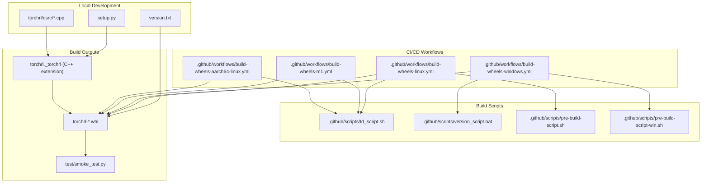

**Sources**: [setup.py:1-191](), [version.txt:1-1](), [.github/workflows/build-wheels-linux.yml:1-63](), [.github/workflows/build-wheels-windows.yml:1-63](), [.github/workflows/build-wheels-m1.yml:1-65](), [.github/workflows/build-wheels-aarch64-linux.yml:1-66]()

## setup.py Architecture

The `setup.py` file uses PyTorch's `torch.utils.cpp_extension` infrastructure to build C++ extensions with platform-specific compiler flags. It also includes logic for checking `pybind11` installation, detecting CUDA availability, and cleaning stale builds.

### Main Functions

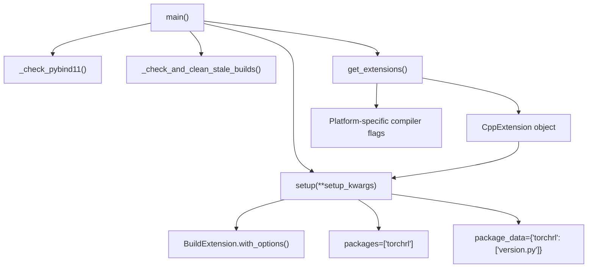

**Sources**: [setup.py:18-24](), [setup.py:31-49](), [setup.py:145-191]()

### _check_pybind11() Function

The `_check_pybind11()` function ensures that `pybind11` is installed before attempting to build C++ extensions. It skips this check for non-build commands like `clean` or `sdist` [setup.py:31-49]().

### _check_and_clean_stale_builds() Function

This function prevents ABI incompatibility issues by checking if the current PyTorch/Python/CUDA environment differs from the one used for a previous build. If a mismatch is detected, it warns the user and attempts to clean stale build artifacts [setup.py:145-191](). This check compares:
*   PyTorch version (`torch.__version__`)
*   Python version (`sys.version_info`)
*   CUDA version (`torch.version.cuda`)
*   CUDA version used for building (`_get_build_cuda_version()`)
*   `FORCE_CUDA` environment variable
*   Whether CUDA extensions were built (`_should_build_cuda()`)

The build information is stored in `build/.torchrl_build_info.json` [setup.py:51]().

### _should_build_cuda() Function

This helper function determines whether CUDA extensions should be built. It considers the `FORCE_CUDA` environment variable, the presence of `CUDA_HOME`, and compatibility between the `nvcc` CUDA version and the PyTorch CUDA version [setup.py:77-95]().

### _get_cxx20_compatibility_flag() Function

This function attempts to find a C++20 compatibility flag (`-std=c++20` or `-std=c++2a`) for older Unix compilers, ensuring that the C++ extensions can be built with modern C++ features if `BuildExtension` requires C++20 [setup.py:104-132]().

### get_extensions() Function

The `get_extensions()` function is responsible for configuring C++ extension builds with appropriate compiler flags for each platform:

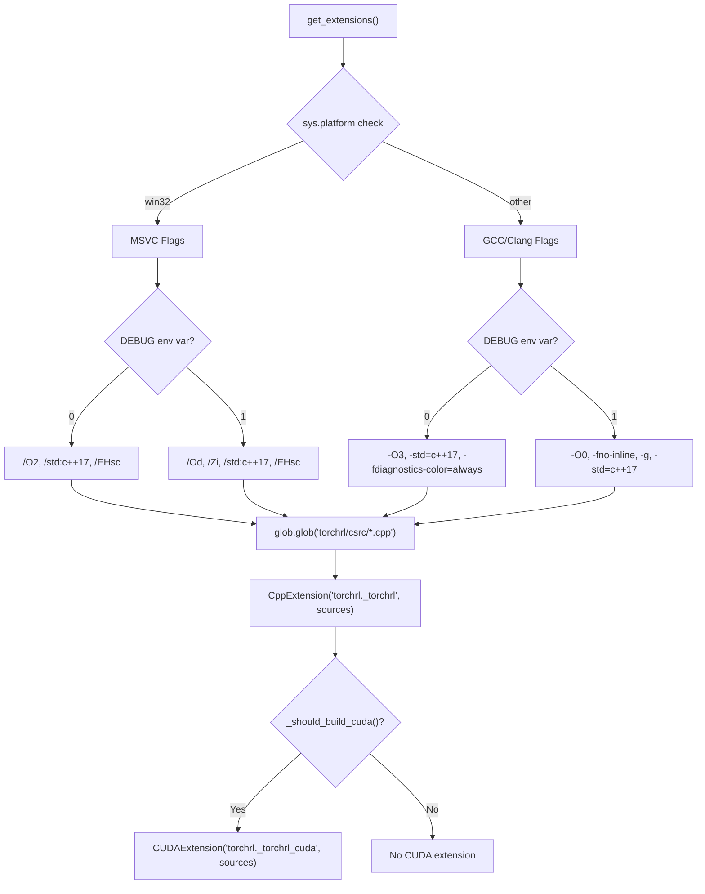

**Compiler Flags by Platform**:

| Platform | Optimization | Standard | Additional Flags |
|----------|-------------|----------|------------------|
| Windows (Release) | `/O2` | `/std:c++17` | `/EHsc` (exception handling) |
| Windows (Debug) | `/Od` | `/std:c++17` | `/Zi` (debug info), `/DEBUG` (link) |
| Unix (Release) | `-O3` | `-std=c++17` | `-fdiagnostics-color=always` |
| Unix (Debug) | `-O0` | `-std=c++17` | `-g`, `-fno-inline` |

**Sources**: [setup.py:53-143]()

### C++ Extension Configuration

The extension is configured with the following parameters:

-   **Name**: `torchrl._torchrl` (for CPU) and `torchrl._torchrl_cuda` (for CUDA) - the compiled extensions are imported as `from torchrl import _torchrl` or `from torchrl import _torchrl_cuda`.
-   **Sources**: All `.cpp` files in `torchrl/csrc/` directory [setup.py:200](). CUDA extensions also include `.cu` files.
-   **Include Directories**: Current directory (`.`) plus optional `PYTHON_INCLUDE_DIR` from environment.
-   **Build Command Class**: `BuildExtension.with_options()` from `torch.utils.cpp_extension`.

The extension sources are discovered dynamically using `glob.glob(os.path.join("torchrl/csrc", "*.cpp"))` [setup.py:200]() and `glob.glob(os.path.join("torchrl/csrc", "*.cu"))` [setup.py:206]().

**Sources**: [setup.py:193-210]()

## pyproject.toml

The `pyproject.toml` file defines the build system requirements, project metadata, dependencies, and optional dependency groups. It specifies `setuptools` as the build backend.

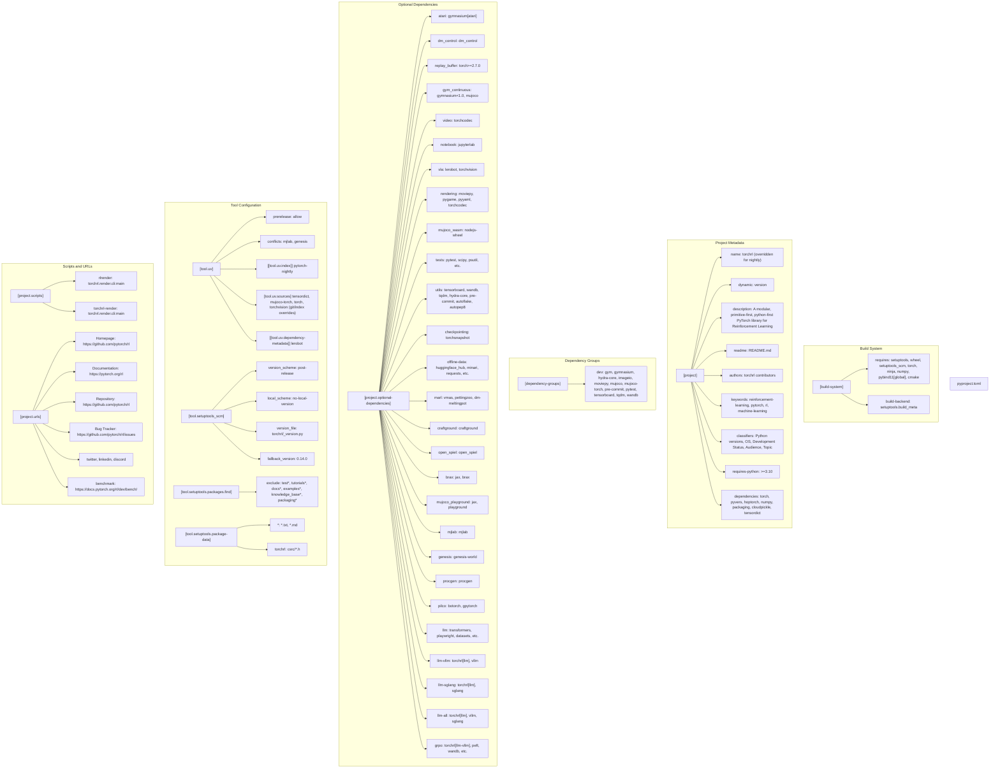

**Sources**: [pyproject.toml:1-244]()

## Platform-Specific Wheel Building

TorchRL uses GitHub Actions workflows that invoke PyTorch's centralized `test-infra` workflows for building wheels across multiple platforms. Each platform has a dedicated workflow file.

### Workflow Trigger Configuration

All wheel building workflows share the same trigger pattern:

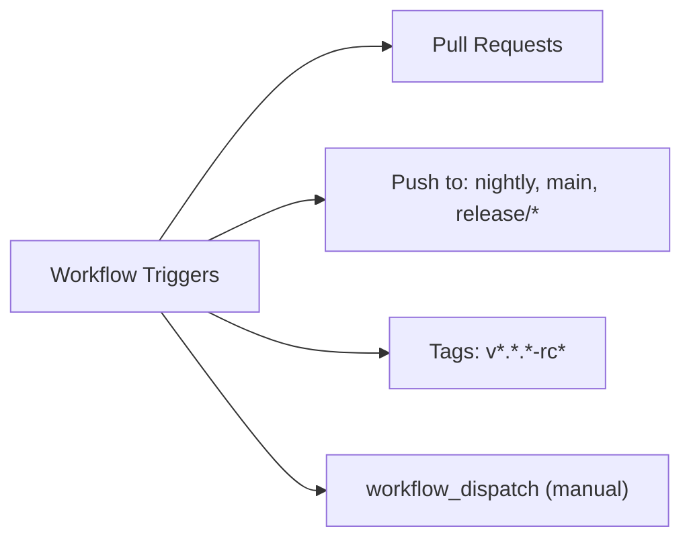

**Sources**: [.github/workflows/build-wheels-linux.yml:3-14](), [.github/workflows/build-wheels-windows.yml:3-14](), [.github/workflows/build-wheels-m1.yml:3-14]()

### Workflow Architecture

Each platform workflow follows a two-job pattern:

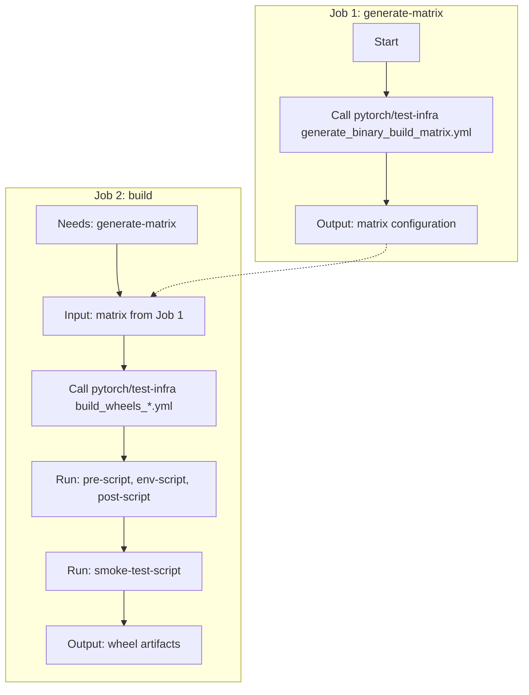

**Sources**: [.github/workflows/build-wheels-linux.yml:75-91]()

### Platform-Specific Configurations

| Platform | Workflow File | OS Matrix | Pre-Script | Env-Script | Post-Script |
|----------|--------------|-----------|------------|------------|-------------|
| Linux x86_64 | `build-wheels-linux.yml` | `os: linux` | `pre-build-script.sh` | `td_script.sh` | None |
| Linux aarch64 | `build-wheels-aarch64-linux.yml` | `os: linux-aarch64` | `pre-build-script.sh` | `td_script.sh` | None |
| Windows | `build-wheels-windows.yml` | `os: windows` | `pre-build-script-win.sh` | `version_script.bat` | `packaging/wheel/relocate.py` |
| macOS M1/M2 | `build-wheels-m1.yml` | `os: macos-arm64` | `pre-build-script.sh` | `td_script.sh` | None |

**Key Configuration Parameters**:

-   **repository**: `pytorch/rl`
-   **package-name**: `torchrl`
-   **smoke-test-script**: `test/smoke_test.py`
-   **runner-type** (M1 only): `macos-m2-15`

**Sources**: [.github/workflows/build-wheels-linux.yml:92-112](), [.github/workflows/build-wheels-windows.yml:81-105](), [.github/workflows/build-wheels-m1.yml:68-95](), [.github/workflows/build-wheels-aarch64-linux.yml:70-91]()

## Nightly Builds

Nightly builds are handled by the `.github/workflows/nightly_build.yml` workflow. This workflow builds and tests CPU wheels for Linux and macOS across various Python versions.

```mermaid
graph TD
    nightly_workflow[".github/workflows/nightly_build.yml"]
    
    nightly_workflow --> trigger_schedule[Cron Schedule: '15 15 * * *']
    nightly_workflow --> trigger_push[Push to: "nightly" branch]
    nightly_workflow --> trigger_manual[workflow_dispatch]
    
    nightly_workflow --> build_job[build-wheel-unix]
    build_job --> test_job[test-wheel-unix]
    test_job --> upload_job[upload-wheel-unix]
    
    build_job -- "Matrix: OS (Linux/macOS), Python (3.10-3.14), CUDA (cpu)" --> install_torch_nightly[Install PyTorch nightly]
    install_torch_nightly --> build_torchrl_nightly[Build TorchRL Nightly (TORCHRL_NIGHTLY=1)]
    build_torchrl_nightly --> fix_manylinux[Rename linux to manylinux1]
    fix_manylinux --> upload_artifact[Upload wheel artifact]
    
    test_job -- "Matrix: OS (Linux/macOS), Python (3.10-3.14), CUDA (cpu)" --> download_artifact[Download wheel artifact]
    download_artifact --> install_tensordict_nightly[Install tensordict-nightly]
    install_tensordict_nightly --> install_torchrl_wheel[Install built TorchRL wheel]
    install_torchrl_wheel --> verify_version[Verify nightly version format]
    verify_version --> run_tests[Run smoke_test.py]
    
    upload_job --> publish_pypi[Publish to PyPI]
```

**Key aspects of nightly builds**:
*   **Triggers**: Daily schedule, pushes to the `nightly` branch, or manual dispatch [nightly_build.yml:16-22]().
*   **PyTorch Nightly**: Installs PyTorch nightly builds from `https://download.pytorch.org/whl/nightly/${{ matrix.cuda_support[1] }}` [nightly_build.yml:59-62]().
*   **TorchRL Nightly**: Sets `TORCHRL_NIGHTLY=1` environment variable during build [nightly_build.yml:65-66]().
*   **Wheel Naming**: Renames `linux` platform tag to `manylinux1` for PyPI compatibility [nightly_build.yml:71]().
*   **Testing**: Downloads the built wheel, installs `tensordict-nightly`, and runs `test/smoke_test.py` [nightly_build.yml:123-156]().
*   **Version Verification**: Includes a step to verify the nightly version format using `packaging/verify_nightly_version.py` [nightly_build.yml:139-143]().
*   **Upload**: Uploads wheels to PyPI if triggered by schedule or manual dispatch [nightly_build.yml:158-170]().

**Sources**: [.github/workflows/nightly_build.yml:1-170](), [packaging/verify_nightly_version.py]()

## Build Scripts

Build scripts handle environment setup, dependency installation, and version configuration.

### td_script.sh (Linux/macOS)

This script sets up the environment for Unix-based builds:

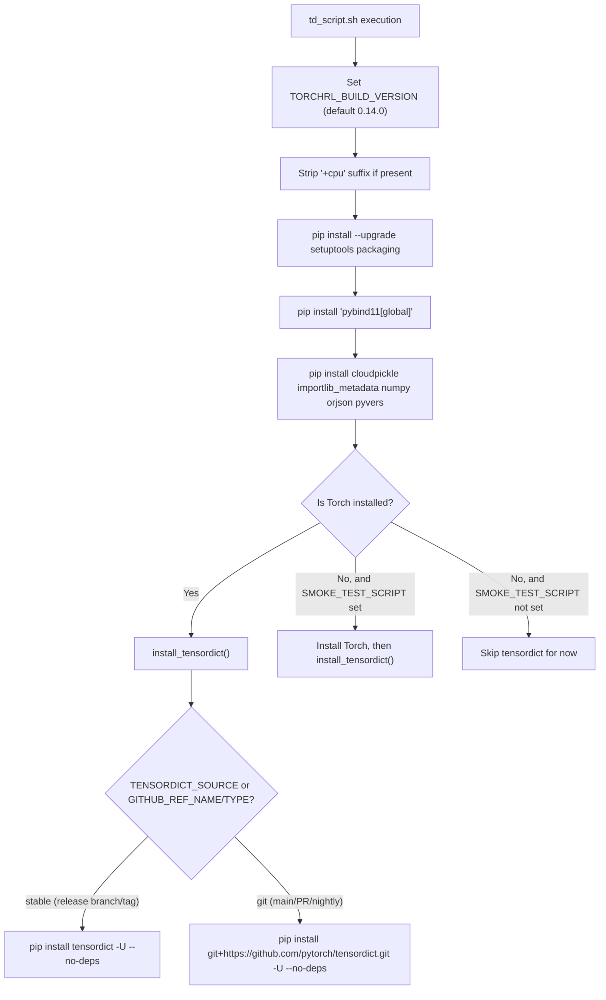

**Key Environment Variables**:
-   `TORCHRL_BUILD_VERSION`: Defaults to `0.14.0` [td_script.sh:3]().
-   `SMOKE_TEST_SCRIPT`: If set, triggers torch installation [td_script.sh:46]().
-   `CONDA_RUN`: Prefix for conda environment execution.
-   `PIP_INSTALL_TORCH`: Command to install PyTorch.
-   `ARCH`: Architecture detection (e.g., `aarch64`).
-   `TENSORDICT_SOURCE`: Controls how TensorDict is installed (stable, git, or auto-detected) [td_script.sh:23]().

**Dependencies Installed**:
1.  `setuptools`, `packaging` (upgraded) [td_script.sh:10]().
2.  `pybind11[global]` [td_script.sh:13]().
3.  `cloudpickle`, `importlib_metadata`, `numpy`, `orjson`, `pyvers` [td_script.sh:14]().
4.  `tensordict`: Installed from PyPI (stable) for release branches/tags or from git (latest development version) for others, or explicitly overridden by `TENSORDICT_SOURCE` [td_script.sh:22-40]().

**Sources**: [.github/scripts/td_script.sh:1-51]()

### version_script.bat (Windows)

This batch script configures the Windows build environment:

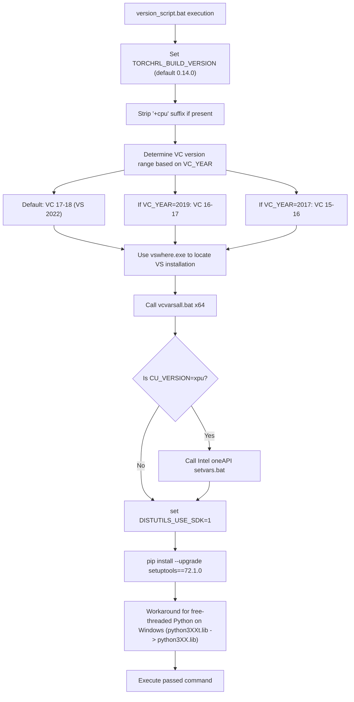

**Environment Configuration**:
-   `TORCHRL_BUILD_VERSION`: Defaults to `0.14.0` [version_script.bat:3]().
-   Visual Studio detection using `vswhere.exe` [version_script.bat:28-33]().
-   Automatic detection of VS 2017, 2019, or 2022 [version_script.bat:17-26]().
-   Intel oneAPI setup for XPU builds [version_script.bat:45]().
-   Fixed setuptools version: `72.1.0` [version_script.bat:51]().
-   Workaround for free-threaded Python on Windows to handle `python3XXt.lib` vs `python3XX.lib` [version_script.bat:54-63]().

**Sources**: [.github/scripts/version_script.bat:1-79]()

### Pre-Build Scripts

Two pre-build scripts prepare the environment before compilation:

**pre-build-script.sh (Linux/macOS)**:
```bash
pip install --upgrade setuptools
pip install "pybind11[global]"
conda install anaconda::cmake -y
pip install git+https://github.com/pytorch/tensordict.git -U
```

**pre-build-script-win.sh (Windows)**:
```bash
pip install --upgrade setuptools
export TORCHRL_BUILD_VERSION=0.14.0
```

**Sources**: [.github/scripts/pre-build-script.sh:1-8](), [.github/scripts/pre-build-script-win.sh:1-6]()

## Version Management

TorchRL's version is managed through multiple files and `setuptools_scm`.

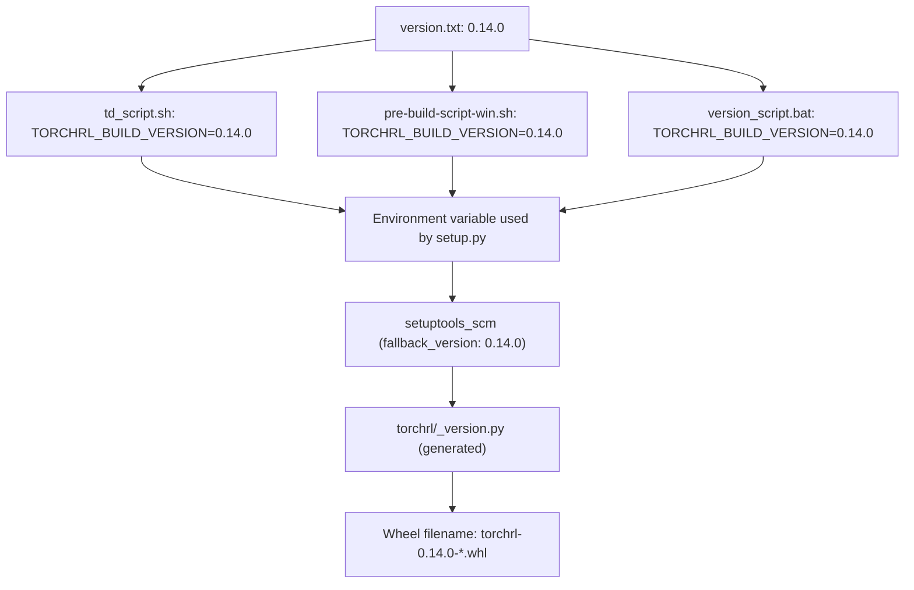

The version string `0.14.0` is duplicated across:
-   [version.txt:1]()
-   [.github/scripts/td_script.sh:3]()
-   [.github/scripts/version_script.bat:3]()
-   [.github/scripts/pre-build-script-win.sh:5]()

The `TORCHRL_BUILD_VERSION` environment variable is read by the build system to determine the wheel version. `setuptools_scm` is used to dynamically determine the version from git tags, with `0.14.0` as a `fallback_version` [pyproject.toml:229](). The determined version is written to `torchrl/_version.py` [pyproject.toml:228]().

**Sources**: [version.txt:1-1](), [.github/scripts/td_script.sh:3](), [.github/scripts/version_script.bat:3](), [.github/scripts/pre-build-script-win.sh:5](), [pyproject.toml:223-230]()

## Smoke Testing

After wheel building, a smoke test verifies basic functionality:

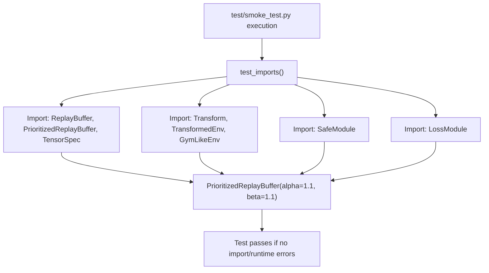

The smoke test validates:
1.  Core data structures (replay buffers, specs)
2.  Environment system (transforms, gym-like)
3.  Module system (SafeModule)
4.  Training objectives (LossModule)
5.  Basic instantiation of a prioritized replay buffer

**Sources**: [test/smoke_test.py:1-20]()

## Build Process Flow

The complete build process from source to distributable wheel:

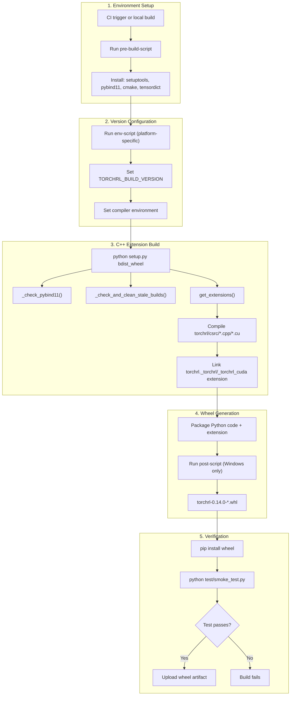

**Sources**: [setup.py:1-191](), [.github/workflows/build-wheels-linux.yml:1-63](), [test/smoke_test.py:1-20]()

## Local Development Build

For local development, build TorchRL using:

```bash
# Install build dependencies
pip install --upgrade setuptools pybind11

# Build in development mode (editable install)
pip install -e .

# Or build a wheel
python setup.py bdist_wheel
```

**Debug Build**: Set `DEBUG=1` environment variable to compile with debug symbols and no optimization:

```bash
# Unix
DEBUG=1 pip install -e .

# Windows
set DEBUG=1
pip install -e .
```

Debug builds use `-O0 -g` (Unix) or `/Od /Zi` (Windows) compiler flags instead of optimization flags [setup.py:12-91]().

**Sources**: [setup.py:12-91]()

---

